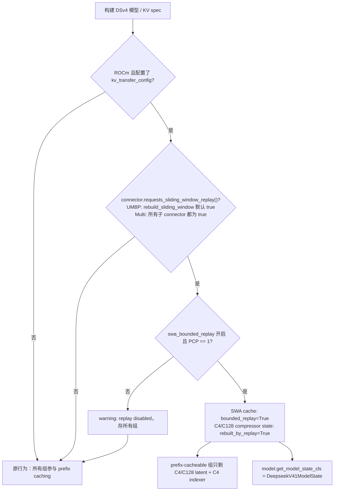
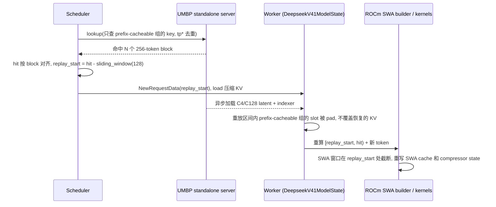

# PR #63002: [ROCm][UMBP] Support DeepSeek-V4-Pro with UMBP standalone mode (compressed KV + SWA replay)

> **Author**: @shen-shanshan | **State**: OPEN | **Date**: 2026-10-22
> **Branch**: `shen-shanshan:rocm-dsv4-umbp` → `main` | **Labels**: documentation, rocm, ci/build, deepseek, kv-connector, DSv4
> **Changes**: +276 -12 lines across 12 files | **ROCm 相关性**: 完全相关
> **Review 对象**: 本地分支 `rocm-dsv4-umbp` @ `65b9de446a`（base main `499a3d1e1e`，提交 `3859ed9e24` + `65b9de446a`）。它还没有 push，GitHub 上的 PR head 仍是旧的 `0cbd55ffb4`。PR 描述以 `vllm-dev-skills/docs/mori/pr-umbp-dsv4-standalone.md` 为准。§9 的行号都是按本地分支算的。
> 本报告分两部分：§1–6 为 PR 详细总结，§7–8 为 ROCm review 意见。

---

## 1. 总结 (Summary)

这个 PR 让 MI355X 上的 DeepSeek-V4-Pro 能用 MORI-UMBP standalone 模式，把 prefix KV 卸载到节点本地的 `umbp_standalone_server`，之后再恢复回来。

核心做法是把 DeepSeek-V4.1 已有的 **SWA bounded replay** 机制接到 DSv4 的 ROCm 路径上：
- UMBP 只存 C4/C128 latent 和 C4 indexer，每个对象 256 token。
- sliding-window cache 和 compressor state 不再参与 prefix caching。命中之后由 scheduler 重算最后一个窗口，把它们重建出来。

另外两点：
- aiter sparse MLA 和 NaN-free 快路径的开关，改成复用 #64715 合入的 `kv_connector_may_load_foreign_kv()`。这样接 UMBP 时快路径不会被关掉。
- 在 rebase 到当前 main 之后，PR 只剩模型侧和 replay hook 的增量。

## 2. 背景与动机 (Background & Motivation)

- **相关 RFC**：#57187（UMBP connector）。通用 connector 已经以 `[UMBP][1/10]`–`[8/10]` 的形式合入 main。DeepSeek-V4.1-Flash 的同类 PR #64715 也已合入，带来了 TP 去重和 canonical-KV 判断。
- **DSv4 不能直接套用通用 connector**：
  1. **小对象太多。** SWA 组和 compressor state 组的 block 只有 4/8 token。128K 的 prompt 在每个 rank 上会碎成几万个小对象。SGLang 的 DSv4 UMBP 实现也是只存压缩池，然后重算最后一个窗口。
  2. **快路径被关掉。** 只要配了任何 connector，ROCm DSv4 就会关掉 aiter sparse MLA 和 `extra_cache_nan_free` 快路径。UMBP 只恢复同一 cache layout 自己写出的整块数据，不会带进 NaN 之类的外来字节。
- **收益（PR 描述）**：
  - GSM8K 精度没有变化：DP8 + DSpark，pass 2 有 72.6% 的 prompt token 来自 UMBP 恢复。
  - AgentX 输出吞吐 +14.4%，TTFT p90 −31.7%。
  - 这些数字的来源有问题，见 §7 的 F3。

## 3. 代码修改分析 (Code Change Analysis)

### 3.1 修改的模块

| 模块 | 改动 |
|------|------|
| `kv_connector/v1/base.py` (+12) | 新增 classmethod `requests_sliding_window_replay(kv_transfer_config)`，默认返回 `False` |
| `kv_connector/v1/multi_connector.py` (+13) | 覆写这个 hook：所有子 connector 都返回 True 时才返回 True |
| `kv_connector/v1/umbp/connector.py` (+25/-2) | UMBP 覆写 hook，返回 `rebuild_sliding_window`，默认 True。EAGLE 草稿组被拒绝时，报错里给出 `rebuild_sliding_window: false` 的提示 |
| `v1/kv_cache_interface.py` (+10/-2) | `SlidingWindowMLASpec.rebuilt_by_replay`：设为 True 时该组不参与 prefix caching，也不声明自己的 replay 窗口。`merge`、`is_uniform_with_collection` 同步处理这个字段 |
| `models/deepseek_v4/compressor.py` (+48) | 新增 `dsv4_swa_replay_enabled()`，作为总开关。compressor state spec 设置 `rebuilt_by_replay` |
| `models/deepseek_v4/attention.py` (+6/-1) | SWA cache 设置 `bounded_replay` |
| `models/deepseek_v4/amd/model.py` (+15) | replay 开启时安装 `DeepseekV41ModelState`，并加上 `token_lookback_depth = 0` |
| `models/deepseek_v4/amd/rocm.py` (+16/-6) | 4 处开关改用 `kv_connector_may_load_foreign_kv()`，同时更新 warning 文案 |
| `docs/features/umbp_store_connector_usage.md` (+20) | 新增 `rebuild_sliding_window` 选项，以及 "DeepSeek-V4 on ROCm" 小节 |
| tests (+123) | 新增 4 个测试：prefix replay、开关逻辑、DSpark 被接受、EAGLE 被拒绝 |

### 3.2 架构 / 流程图

开关的决策流程：



一次 UMBP 命中的处理过程：



### 3.3 关键实现细节

- **`rebuilt_by_replay` 和 `bounded_replay` 的区别**：
  - scheduler 只允许存在一个 replay 窗口，见 `prefix_replay_tokens` 取 max 的逻辑。
  - compressor state 的窗口是 8（C4）和 128（C128），如果也声明 `bounded_replay` 就会冲突。
  - 所以新增了"不参与缓存，但不声明窗口"这种状态。`prefix_replay_tokens` 仍然是 `sliding_window if bounded_replay else 0`。
- **model state 复用**：`DeepseekV41ModelState` 通过 `spec.prefix_cacheable` 找出要 pad 的组。compressor state 现在不是 prefix-cacheable，所以 replay 时会被正常重写。`decoder_replay_layers` 是用 `getattr` 取的，DSv4 上为 None，不受影响。
- **快路径**：`kv_connector_may_load_foreign_kv()` 只在 connector 的 `only_restores_canonical_kv()` 返回 True 时才放行快路径。UMBP 用派生 namespace 时返回 True；显式指定 `key_namespace` 时返回 False。
- **DSpark**：草稿层只有 SWA，它的窗口 KV 来自 target 的 hidden states，所以同一次 replay 会一起重建。EAGLE 风格的草稿组仍然在启动时被拒绝。

## 4. 涉及的技术原理 (Technical Principles)

- **DSv4 的混合 KV cache**：
  - 每层有三类状态：C4/C128 压缩后的 MLA latent（sparse top-k 注意力读这里）、128-token 的滑动窗口 KV，以及 compressor 的累积状态。前两类保存逐 token 或逐组的 KV，第三类保存还没凑满一个压缩组的残余 token。
  - 混合 KV cache manager 把每类状态各放一个组，block size 也不同。
- **SWA bounded replay**：
  - 命中之后不恢复窗口 KV，而是把命中位置前 `sliding_window` 个 token 重新跑一遍 prefill，重建 SWA cache。
  - 被重放的 token 只能看到 `replay_start` 之后的窗口，所以重建出来的窗口 KV 是近似值。压缩上下文和 sparse top-k 上下文是精确的。
  - 这个取舍 DSv4.1 已经在用。
- **compressor state 为什么能靠 replay 重建**：
  - C128 的残余组起点是 `floor(hit/128)*128`，一定不早于 `hit-127`。C4 的 overlap 窗口是 8。
  - 所以只要重放区间不少于 128 token，就能覆盖所有需要的残余 token。
  - 这个前提是 F2 讨论的内容。
- **canonical KV 与快路径**：aiter sparse MLA kernel 和 `extra_cache_nan_free` 都不会清洗 NaN。只有确认 cache 里的数据全部由 vLLM 自己的写入路径写出时，才能用这些快路径。

## 5. 评论区讨论亮点 (Discussion Highlights)

- GitHub 上还没有实质性的 review 讨论，只有 mergify 发的冲突提醒和文档预览链接。
- 有关联的讨论在 #64715（v4.1 版本）。reviewer 当时指出，`only_restores_canonical_kv` 在 MultiConnector 里组合使用时，可能让外来 KV 进入同一个 namespace。#64715 通过把这类引擎的 namespace 分开解决了这个问题。本 PR 直接复用这个结论，所以不会再引入同样的问题。

## 6. 风险与潜在问题 (Risk Analysis)

| 风险 | 严重程度 | 说明 |
|------|---------|------|
| 正确性：replay 窗口和 compressor state 窗口之间的隐含约束 | Medium | 见 F2 |
| 兼容性：replay 没有 CDNA 门控，和 v4.1 不一致 | Medium | 见 F1 |
| 正确性：重建出的窗口 KV 是近似值，也会作用到 GPU prefix 命中 | Medium | 只要配置了 connector，所有命中都要重放。长上下文精度没有验证，见 F3 |
| 测试覆盖：E2E 数据来源 | Medium | 见 F3 |
| 设计：新增公共 connector API | Low | 见 F4 |
| 性能：每次命中多算 128 token | Low | 相比存几万个小对象，这个代价可以接受。AgentX 结果是正收益 |
| 可维护性：参数名和 docstring 过期 | Low | 见 F5 |
| 兼容性：CUDA 和其他 connector | Low | 开关以 `is_rocm()` 和 hook 默认 False 为前提，已核实不受影响 |

---

## 7. Review 意见 (Findings)

| 意见类型 | 🔴 | ⚠️ | 📝 |
|---|---|---|---|
| 兼容性 | 0 | 1 | 0 |
| 正确性 | 0 | 1 | 0 |
| 测试 | 0 | 1 | 1 |
| 设计 | 0 | 0 | 1 |
| 可维护性 | 0 | 0 | 1 |

**⚠️【兼容性】F1：DSv4 的 replay 开关没有 CDNA 版本门控，v4.1 有** `[已验证]`
- **问题**：
  - `deepseek_v41/attention.py:602-614` 的注释写明：replay 依赖 AITER sparse-MLA 和 Triton gather 路径在 `replay_start` 处截断，而这只在兼容的 CDNA 版本上验证过。所以 v4.1 在 `get_cdna_version() not in (3, 4)` 时会关掉 replay（#65249）。
  - DSv4 的 `dsv4_swa_replay_enabled()`（`compressor.py:42-81`）只检查 `is_rocm()`、connector hook、`swa_bounded_replay` 和 PCP，没有检查 CDNA 版本。
  - DSv4 的 AMD 路径明确支持 gfx1250（`amd/model.py:159`、`amd/rocm.py:1098`、`:1501`，`get_cdna_version()` 对它返回 5）和 RDNA（`not on_rdna()`）。
- **影响**：
  - 触发条件：gfx1250 或 RDNA 上的 DSv4 配置 UMBP。这时 replay 会打开，而 SWA/compressor state 也不再参与 prefix caching。
  - 如果这些架构上的 kernel 没有按 `replay_start` 截断，重放 token 就会读到没有重建的窗口槽位，导致精度悄悄下降。
  - 这两套开关逻辑本该一致，现在出现了分歧。
- **行动**：建议作者把 v4.1 的 `get_cdna_version() in (3, 4)` 条件放进 `blockers`，比如写成 `"unvalidated ROCm arch"`，让两个模型的门控保持一致。

**⚠️【正确性】F2：`rebuilt_by_replay` 依赖"重放窗口 ≥ C128 state 窗口"，但代码里没有任何检查** `[已验证]`
- **问题**：
  - compressor state 被标成 `rebuilt_by_replay` 后，正确性完全依赖一个前提：SWA 的重放长度（`prefix_replay_tokens = config.sliding_window`）不小于 compressor state 的窗口（C128 的 `sliding_window = 128`，C4 的是 8，见 `compressor.py:203-205`）。
  - 这个前提只写在 `compressor.py:237-238` 的注释里。`dsv4_swa_replay_enabled()` 和 scheduler 都没有校验它。`rebuilt_by_replay` 组的 `prefix_replay_tokens` 是 0，所以 scheduler 的单窗口检查也不会覆盖到它。
- **影响**：
  - 触发条件：某个 DSv4 变体的 `config.sliding_window < 128`，同时配置了 UMBP。
  - 这时 C128 的残余组有一部分不会被重写，compressor 会读到 block 里残留的旧数据（来自别的请求，或者从未初始化），而且没有任何报错。
  - 目前 DSv4-Pro 的 `sliding_window` 是 128，所以现在不会触发。
- **行动**：
  - 建议作者在 `dsv4_swa_replay_enabled()` 里检查 `hf_config.sliding_window >= 128`（也就是最大的 compressor state 窗口），不满足时把它加进 `blockers`。
  - 或者在构建 spec 时加 assert，把这个隐含前提变成显式的。

**⚠️【测试】F3：E2E 数据的来源和覆盖范围需要在描述中说明** `[已验证]`
- **问题**：
  - PR 描述里的 GSM8K 和 AgentX 数据是 rebase 之前测的。当时的代码里，TP 去重和快路径开关都是本 PR 自己实现的，之后替换成了 #64715 的实现。rebase 之后没有重跑。
  - AgentX 只跑了一次，`DURATION=600`，低于 matrix 要求的 900 s 下限，用 `--unsafe-override` 才跑起来。
  - 精度只测了 GSM8K，都是短 prompt。replay 的近似对长上下文影响多大，没有验证。
- **影响**：reviewer 看到的数字和当前代码对不上。长 prefix 场景下 SWA 近似的精度风险也没有被测到。
- **行动**：
  - 建议作者在当前代码上至少重跑一次 GSM8K pass 1/pass 2，并在描述中写明测试时的 commit。
  - 补一次长上下文的恢复精度测试，比如 32K/128K prefix 下的 needle 或 LongBench 子集。
  - 用 `DURATION=3600` 重跑 agentic 测试。

**📝【设计】F4：`requests_sliding_window_replay` 作为公共 connector API，副作用要写清楚** `[已验证]`
- **问题**：
  - 这个 hook 不只决定 connector 存哪些组。只要它返回 True，DSv4 的 **GPU prefix cache** 行为也会改变：SWA 组不再参与 prefix caching，每次命中都要重放。
  - 但 `base.py:232-241` 的 docstring 只说了 connector 侧的影响。
  - 新增 base-class API 也很可能被 KV connector 的 maintainer 追问，例如为什么不在 UMBP 的 extra config 里由模型自己读。
- **影响**：其他 connector 的作者照这个 docstring 实现 hook 时，不知道会改变核心 prefix caching 的语义。
- **行动**：建议作者在 docstring 里补一句："returning True also takes the model's sliding-window groups out of GPU prefix caching"。PR 描述里也最好主动解释一下，为什么选 hook 而不是模型直接读 UMBP 配置。

**📝【可维护性】F5：参数名和 docstring 过期** `[已验证]`
- **问题**：
  - `amd/rocm.py` 中 `_trust_dsv4_extra_cache_nan_free`（:125）、`_aiter_sparse_mla_enabled`（:136）、`_aiter_sparse_mla_prefill_enabled`（:158）的参数还叫 `has_kv_transfer`，实际传入的已经是 `kv_connector_may_load_foreign_kv()` 的结果。v4.1 的同名函数已经改成了 `has_foreign_kv_writer`。
  - `KVCacheSpec.prefix_replay_tokens` 的 docstring（`kv_cache_interface.py:236`）还写着 "DeepSeek-V4.1 only"。
- **影响**：读代码的人会误以为"只要有 connector 就关闭快路径"；两个模型的代码也越来越不一致。
- **行动**：建议作者把参数统一改名为 `has_foreign_kv_writer`，并更新 docstring。

**📝【测试】F6：开关测试没有覆盖 MultiConnector 组合，也没有覆盖 `swa_bounded_replay=False`** `[已验证]`
- **问题**：`test_dsv4_swa_replay_only_with_a_connector_that_asks` 覆盖了没有 connector、ExampleConnector、`rebuild_sliding_window: false` 和 PCP 这几种情况。但没有测 `Multi[UMBP]`（应为 True）、`Multi[UMBP, Example]`（应为 False），以及 `swa_bounded_replay=False`。
- **影响**：`MultiConnector.requests_sliding_window_replay` 新加的代码路径没有测试。
- **行动**：建议作者在这个测试里补上这 3 个断言，改动很小。

## 8. 结论 (Verdict)

⚠️ **NEEDS WORK**

设计是对的。它复用了 v4.1 已经验证过的 replay 机制，以及 #64715 的 TP 去重和 canonical-KV 判断。改动只作用在 ROCm 加 UMBP 的场景，CUDA 和其他 connector 不受影响。`rebuilt_by_replay` 和 model state 的配合也核对过了。

合入前建议完成三件事：
1. 补上和 v4.1 一致的 CDNA 门控（F1）。
2. 把"重放窗口 ≥ 128"这个隐含前提变成显式检查（F2）。
3. 在当前代码上重跑 E2E，并标明测试时的 commit（F3）。

## 9. 英文 Review 评论 (Copy-Paste English Comments)

**C1** `vllm/models/deepseek_v4/compressor.py:61-65` — ⚠️ comment

```text
DeepSeek-V4.1 only enables SWA bounded replay on ROCm for CDNA 3/4 (`get_cdna_version() in (3, 4)`, #65249), because the replay_start clamping in the AITER sparse-MLA and Triton gather paths has only been validated there. This gate has no such check, while the DSv4 AMD path also runs on gfx1250 and RDNA. With UMBP configured on those archs, the SWA and compressor-state groups would leave prefix caching and rely on an unvalidated clamp. Could you add the same CDNA condition to `blockers` (e.g. "unvalidated ROCm arch") so both models stay consistent?
```

**C2** `vllm/models/deepseek_v4/compressor.py:237-239` — ⚠️ comment

```text
Marking the compressor states `rebuilt_by_replay` is only correct while the SWA replay length (`config.sliding_window`) is at least the largest compressor-state window (128 for C128), so that the partial C128 group is rewritten before it is read. Today that holds for DeepSeek-V4-Pro, but nothing enforces it: the scheduler never sees this group's window, since its `prefix_replay_tokens` is 0. A variant with a smaller sliding window would silently read stale state. Could you check `sliding_window >= 128` in `dsv4_swa_replay_enabled()` and disable replay (or assert) otherwise?
```

**C3** `vllm/distributed/kv_transfer/kv_connector/v1/base.py:232-241` — ⚠️ comment

```text
Returning True here changes more than what the connector stores: the model takes its sliding-window groups out of GPU prefix caching too, so every GPU prefix hit also replays the last window. Could the docstring say so explicitly? Connector authors implementing this hook should know it changes core prefix-caching behavior, not just the offload set.
```

**C4** `vllm/models/deepseek_v4/amd/rocm.py:777` — ⚠️ comment (the stale parameter names are on unchanged lines 125/136/158, so this is anchored on the nearest changed line)

```text
The helpers fed by this call (`_trust_dsv4_extra_cache_nan_free`, `_aiter_sparse_mla_enabled`, `_aiter_sparse_mla_prefill_enabled`) still name their argument `has_kv_transfer`, but it now means "a connector may load non-canonical KV". DeepSeek-V4.1 already renamed it to `has_foreign_kv_writer`. Could you rename it here too, so the two backends read the same?
```

## 10. 英文总结评论 (Overall Review Summary)

```text
This cleanly reuses DeepSeek-V4.1's SWA bounded replay and #64715's TP dedup and canonical-KV gate, so UMBP stores only DeepSeek-V4's compressed KV, and the change stays on ROCm with UMBP. Before merging, I'd like three things: the same CDNA 3/4 gate V4.1 uses for replay, an explicit check that the replay window covers the 128-token compressor state, and E2E numbers re-run on the current code with the tested commit noted. Changes needed before merge; otherwise the design looks good.
```
