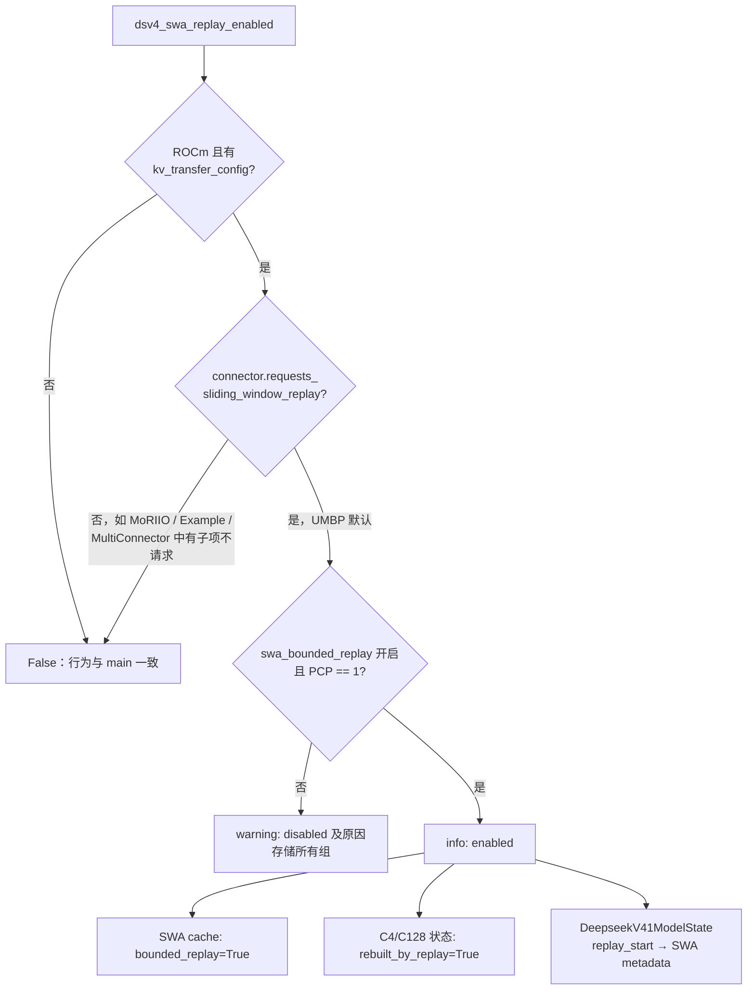
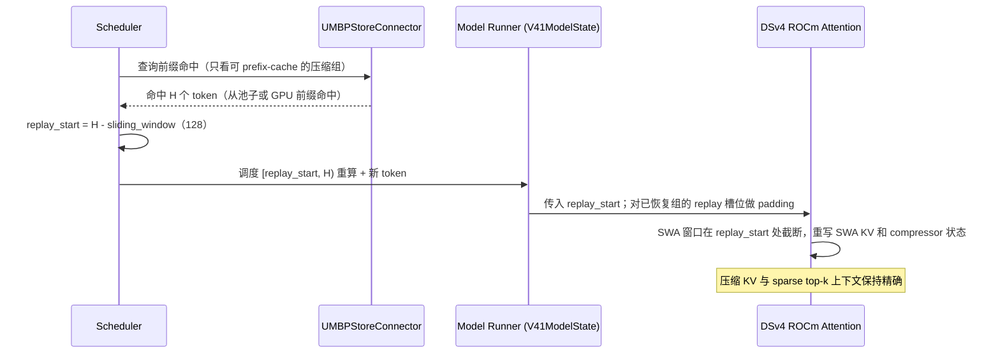

# PR #63002: [ROCm][UMBP] Support UMBP standalone mode for DeepSeek-V4-Pro

> **Author**: @shen-shanshan | **State**: OPEN | **Date**: 2026-10-22
> **Branch**: `shen-shanshan:rocm-dsv4-umbp` → `main` | **Labels**: ci/build, deepseek, documentation, DSv4, kv-cache-manager, kv-connector, needs-rebase, rocm
> **Changes**: +277 -14 lines across 12 files | **ROCm 相关性**: 部分相关（启用条件限定在 ROCm 上，但改动了共享的 KV connector 基类、`MultiConnector`、`SlidingWindowManager` 和 `deepseek_v4/attention.py`、`compressor.py`）
> 本报告分两部分：§1–6 为 PR 详细总结，§7–8 为 ROCm review 意见。
>
> 说明：
> - 代码来自本地 ref `pr/63002`（head `6b10bdef88`，即本地分支 `rocm-dsv4-umbp`）。merge-base 是 `1895228ed8`（2026-11-18），比当前 main（`5e0855d305`）只落后 5 个 commit。`git merge-tree` 显示与当前 main 没有文本冲突，所以 `needs-rebase` label 应该已经过期。
> - GitHub API 本次被限流，PR 描述和评论通过网页获取。CI：checks 页面上 DCO、pre-commit 等仍为 pending（PR 2026-11-18 刚转为 ready for review），Buildkite 结果未确认。
> - 本次为静态 review，没有运行 PR 代码。

---

## 1. 总结 (Summary)

本 PR 让 MI355X 上的 DeepSeek-V4-Pro 可以通过 `UMBPStoreConnector`（standalone 模式）把前缀 KV 卸载到节点本地的 MORI-UMBP `umbp_standalone_server`，之后再恢复使用。

核心做法与 DeepSeek-V4.1（#64715）一致：只把压缩后的 KV（C4/C128 latent、C4 indexer K）放进池子。SWA cache 和 compressor 状态不进入 prefix caching，命中后由调度器重算命中前最后一个窗口（SWA bounded replay）来重建。

为此，PR 新增了一个由 connector 声明的开关 `requests_sliding_window_replay()`，把 compressor 状态标记为 `rebuilt_by_replay`，并让 DSv4 AMD 模型使用支持 replay 的 `DeepseekV41ModelState`。

## 2. 背景与动机 (Background & Motivation)

- 参考 RFC #57187，复用已经合入的 UMBP connector 组件，以及 #64715（DSv4.1-Flash）引入的 TP 去重和 `kv_connector_may_load_foreign_kv()`。
- 痛点：DSv4 每个请求除了压缩 KV，还有 SWA cache 和 C4/C128 compressor 状态。如果把它们都按 block 存进池子，一个长请求会产生数万个很小的对象。只存 256-token 粒度的压缩 KV，就能把对象数量和带宽降下来。
- PR 描述中的验证：
  - 单测：UMBP 343 passed，prefix replay 16 passed，sparse MLA 18 passed（MI355X）。
  - GSM8K（DSv4-Pro-0813，8×MI355X，DP8 + DSpark）：无 connector 时 0.9515；UMBP 第二轮有 72.6% 的 prompt token 从池子恢复，结果为 0.9522，接受长度 4.48 → 4.50。
  - AgentX（128 sessions，**600 s** 测量窗口，单次运行）：输出吞吐 +14.4%，TTFT mean / p90 分别 −18.9% / −31.7%，TPOT −10.9%。
- PR 在 Limitations 中自己写明：只覆盖单节点 standalone；每个配置只跑了一次；完整时长（`DURATION=3600`）的 agentic 运行和 TP8 恢复检查还没做。

## 3. 代码修改分析 (Code Change Analysis)

### 3.1 修改的模块

| 文件 | 改动 |
|------|------|
| `kv_connector/v1/base.py` | 新增 classmethod `requests_sliding_window_replay()`，默认返回 False |
| `kv_connector/v1/multi_connector.py` | 只有当所有子 connector 都请求 replay 时才返回 True |
| `kv_connector/v1/umbp/connector.py` | 返回 `rebuild_sliding_window`（默认 True）；EAGLE 草稿组被拒绝时，报错信息里附上关闭 replay 的提示 |
| `v1/core/single_type_kv_cache_manager.py` | `SlidingWindowManager.Params` 新增 `rebuilt_by_replay`：该组不参与 prefix caching，也不额外声明 replay 窗口 |
| `models/deepseek_v4/compressor.py` | 新增 `dsv4_swa_replay_enabled()`（ROCm + connector 请求 + `swa_bounded_replay` + 无 PCP），启动时打日志说明是否启用及原因；`CompressorStateCache` 据此设置 `rebuilt_by_replay` |
| `models/deepseek_v4/attention.py` | SWA cache 层设置 `bounded_replay=dsv4_swa_replay_enabled(...)` |
| `models/deepseek_v4/amd/model.py` | 启用 replay 时，把 `get_model_state_cls` 换成 `DeepseekV41ModelState`；新增 `token_lookback_depth = 0` |
| `models/deepseek_v4/amd/rocm.py` | aiter sparse MLA（decode / prefill）和 `extra_cache_nan_free` 的 gate，从 `kv_transfer_config is not None` 改为 `kv_connector_may_load_foreign_kv()` |
| `docs/features/umbp_store_connector_usage.md` | 新增 `rebuild_sliding_window` 选项和 "DeepSeek-V4 on ROCm" 小节 |
| tests（3 个文件） | gate 函数、`rebuilt_by_replay` 调度行为、DSpark 接受 / EAGLE 拒绝 |

### 3.2 架构 / 流程图





### 3.3 关键实现细节

- **只用一个 replay 窗口**：调度器只允许一个 replay 窗口，所以 compressor 状态不另声明窗口（`prefix_replay_tokens` 返回 0），只用 `rebuilt_by_replay` 让它不参与 prefix caching。SWA 组的 replay 长度是 128（DSv4 的 `sliding_window`）。C128 不完整组的起点 ≥ H−127，C4 的 overlap 是 8 个 token，两者都落在 replay 区间内。
- **fast path**：UMBP 在派生 namespace 下只恢复同一布局写出的整 block，`only_restores_canonical_kv` 为 True，所以 aiter sparse MLA 和 `extra_cache_nan_free` 保持开启。其他 connector（如 MoRIIO）仍然回退。
- **投机解码**：DSpark 草稿层只有 SWA，窗口 KV 由 target hidden states 推导，所以同一次 replay 能一起重建。EAGLE 式 `mtp` 草稿组不能被重建，启动时报错，并提示设置 `rebuild_sliding_window: false`。
- **代价**：connector 开启后，GPU 本地的前缀命中也要 replay，而 replay 段的窗口 KV 是近似的。
- **CUDA 不受影响**：`dsv4_swa_replay_enabled` 在非 ROCm 上直接返回 False；DSv4.1 有自己的 attention 和 compressor（`deepseek_v41/`），也不受影响。

## 4. 涉及的技术原理 (Technical Principles)

- **DeepSeek-V4 混合 KV**：每层有 SWA（窗口 128）、C4 压缩 KV（4:1，含 indexer K）和 C128 压缩 KV（128:1），另外还有 compressor 的滑动状态（C4 窗口 8，C128 窗口 128），它们通过 hybrid allocator 按不同 group 管理。压缩 KV 可以按前缀精确复用；SWA 和 compressor 状态只和最近的 token 有关。
- **SWA bounded replay**：命中 H 个 token 后，不恢复 SWA，而是从 `H − window` 开始重算。重算段内的 token 只看到从 replay_start 起的窗口，所以重建出的窗口 KV 是近似的；压缩 KV 和 sparse top-k 选出的上下文是从缓存读的，保持精确。
- **UMBP standalone**：MORI-UMBP 的节点本地 DRAM/SSD 池，通过 gRPC unix socket 访问，按 256-token 对象存取。namespace 由模型、KV 布局、cache group、并行拓扑派生，从而保证只恢复"同一布局"写出的字节，这是 fast path 可以保持开启的前提。
- **Model runner state**：`DeepseekV41ModelState` 是 MRV2 的模型专属状态，负责把每个请求的 `replay_start` 上传到 GPU 并注入 attention metadata，同时把已恢复组的 replay 槽位做 padding，避免它们被近似值覆盖。

## 5. 评论区讨论亮点 (Discussion Highlights)

- **AndreasKaratzas**：提到相关的 #64656（Mamba2 hybrid 的 UMBP 支持）。作者提到相关 issue #52911 和 #64715。两者都是交叉引用，没有设计争议。
- PR 前后被 mergify 标了 6 次 `needs-rebase`，作者多次 force-push。2026-11-18 补了 2 个 commit 并转为 ready for review。claude bot 对 fork PR 不做自动 review。
- 目前没有实质性的 reviewer 意见。

## 6. 风险与潜在问题 (Risk Analysis)

| 风险 | 严重程度 | 说明 |
|------|---------|------|
| 性能结论的证据不足 | 中 | 只有单次运行、600 s 窗口的 +14.4%，3600 s 运行和 TP8 检查还没做（见 §7 第二条） |
| replay 近似 | 低 | 开启 connector 后，GPU 前缀命中也走 replay，同一 prompt 冷启动和热启动的输出可能不同。这是已披露的取舍，GSM8K 无回退 |
| 共享接口扩展 | 低 | `requests_sliding_window_replay` 默认 False，`rebuilt_by_replay` 默认 False，CUDA 和其他 connector 不受影响 |
| fast path 判断 | 低 | 依赖 `only_restores_canonical_kv` 的语义，与 V4.1 完全相同；自定义 `key_namespace` 时会正确回退 |
| 非 CDNA3/4 架构 | 中 | gfx1250 / RDNA 上的 DSv4 配置 UMBP 会打开未经验证的 replay（见 §7 第一条） |
| 不变量只写在注释里 | 低 | replay 长度能否覆盖 compressor 窗口只写在注释中（见 §7 第五条） |
| V1 runner | 低 | `get_model_state_cls` 只在 MRV2 生效；ROCm 默认用 V2，V1 不在考虑范围内 |

---

## 7. Review 意见 (Findings)

| 意见类型 | 数量 |
|---------|------|
| ⚠️【兼容性】 | 1 |
| ⚠️【测试】 | 1 |
| 📝【可维护性】 | 1 |
| 📝【测试】 | 1 |
| 📝【正确性】 | 1 |

**⚠️【兼容性】DSv4 的 replay 开关没有 CDNA 版本门控，V4.1 有** `[已验证]`
- **问题**：
  - V4.1 在 `deepseek_v41/attention.py:635-648` 写明：replay 依赖 AITER sparse-MLA 和 Triton gather 路径在 `replay_start` 处截断，而这只在兼容的 CDNA 版本上验证过。所以 `get_cdna_version() not in (3, 4)` 时，V4.1 会关闭 replay，SWA 改为参与 prefix caching。
  - DSv4 的 `dsv4_swa_replay_enabled()`（`compressor.py:42-81`）只检查 `is_rocm()`、connector、`swa_bounded_replay` 和 PCP，没有 CDNA 检查。
  - DSv4 的 AMD 路径明确有 gfx1250 和 RDNA 分支（`amd/model.py:159`、`amd/rocm.py:1181`、`:1587`）。
  - 这一条在上一版 review（head `65b9de4`）就提过，当前 head 仍未处理。
- **影响**：
  - 触发条件：在 gfx1250 或 RDNA 上运行 DSv4 并配置 UMBP。
  - 这时 replay 会打开，SWA 和 compressor 状态不再参与 prefix caching；但这些架构上 SWA 在 `replay_start` 处的截断没有验证过。
  - 如果截断不生效，replay 段的 token 会读到 replay_start 之前没写过的 SWA 槽位，导致输出静默出错。
- **行动**：作者应当在 `dsv4_swa_replay_enabled()` 中加上与 V4.1 相同的 `get_cdna_version() in (3, 4)` 检查，并把原因写进 blockers，让启动日志说明为什么被关闭；同时在 gate 测试中补一个不兼容架构的用例。

**⚠️【测试】端到端性能结论只有单次 600 s 运行，PR 自己列为待做的 3600 s 和 TP8 验证还没完成** `[已验证]`
- **问题**：
  - 标题级的 AgentX 结论（+14.4% 吞吐、TTFT p90 −31.7%）来自一次 600 s 测量窗口的运行，PR 的 Limitations 也写明"run-to-run variance unmeasured"。
  - agentic trace 的会话长、KV 复用随时间累积，600 s 窗口大概率还没到稳态：池子命中率、驱逐和 SSD 回落都还没充分出现。
  - TP8（`dep8` 之外的拓扑）的恢复检查也还没做。
- **影响**：合入后 +14.4% 会被当作 UMBP 在 DSv4 上的参考数字。如果稳态下收益明显缩小，或者 TP8 恢复有问题，会误导使用者。
- **行动**：作者应当在合入前补上 `DURATION=3600` 的 AgentX A/B（最好每组至少两次）和 TP8 恢复检查，并用这些结果更新 PR 描述的表格。

**📝【可维护性】gate 的语义变了，但参数名还叫 `has_kv_transfer`；`MultiConnector` 的子配置构造已经重复了 5 次** `[已验证]`
- **问题**：
  - `deepseek_v4/amd/rocm.py` 中 `_trust_dsv4_extra_cache_nan_free`、`_aiter_sparse_mla_enabled`、`_aiter_sparse_mla_prefill_enabled` 的参数仍叫 `has_kv_transfer`，但现在传入的是 `kv_connector_may_load_foreign_kv()`。成员变量已经改名为 `_has_foreign_kv_writer`，参数却没改。
  - `multi_connector.py` 第 166/230/244/256/267/280 行都在写 `KVTransferConfig(**{"engine_id": ..., **c})`，新加的 `requests_sliding_window_replay` 又复制了一遍 `only_restores_canonical_kv` 的写法。
- **影响**：读代码的人会以为"只要配了 connector 就关 fast path"，与实际行为不符；重复的子配置构造今后容易出现分叉。
- **行动**：建议作者：
  - 把这三个函数的参数统一改名为 `may_load_foreign_kv`；
  - 在 `MultiConnector` 中抽出一个 `_child_transfer_configs(kv_transfer_config)` classmethod，供两个 classmethod 共用。

**📝【测试】gate 测试放在 sparse MLA 测试文件里，且没有覆盖 `MultiConnector`** `[已验证]`
- **问题**：
  - `test_dsv4_swa_replay_only_with_a_connector_that_asks` 测的是 `deepseek_v4/compressor.py` 的 gate，却放在 `tests/v1/attention/test_rocm_aiter_triton_sparse_mla.py` 中。
  - 它覆盖了 UMBP、无 connector、Example、opt-out 和 PCP 五种情况，但没有覆盖 `MultiConnector`（全部子项请求 / 部分子项请求）。
- **影响**：`MultiConnector` 的"全部子项都请求才返回 True"规则如果被改坏（例如把 `all` 写成 `any`），UMBP + MoRIIO 组合会错误地开启 replay，现有测试发现不了。
- **行动**：建议作者把该测试挪到 DSv4 或 KV connector 相关的测试文件，并增加 `MultiConnector([UMBP, UMBP])` 返回 True、`MultiConnector([UMBP, MoRIIO])` 返回 False 两个用例。顺带补上 `swa_bounded_replay=False` 这个 blocker 的用例（目前 `cache_config` 固定为 True）。

**📝【正确性】"replay 能覆盖 compressor 状态"只靠注释保证，建议改成断言** `[已验证]`
- **问题**：
  - `compressor.py:239-241` 的注释写的是"replay of ≥128 tokens from a 256-aligned hit"。实际需要的不变量是：SWA 的 replay 长度（`sliding_window`）≥ 各 compressor 状态的窗口（C4 = 8，C128 = 128）。只要满足这一点，不需要 256 对齐，不完整的 C128 组也会落在 replay 区间内。
  - 两者分别来自模型配置和硬编码常量，代码中没有任何检查。
- **影响**：如果今后的变体缩小 SWA 窗口，或者增大压缩比，compressor 状态就会被读到没重建过的值，而且是静默的数值错误。
- **行动**：建议作者在 `CompressorStateCache.get_kv_cache_config`（或 `dsv4_swa_replay_enabled` 启用时）断言 `self.sliding_window <= attention 的 sliding_window`，并把注释改成准确的不变量。

## 8. 结论 (Verdict)

⚠️ **NEEDS WORK**。设计与 V4.1 的 replay 方案一致：只有 connector 显式请求时才在 ROCm 上启用，CUDA 和其他 connector 零影响，GSM8K 在 72.6% 恢复率下没有精度回退。合入前需要两件事：
- 补上和 V4.1 一样的 CDNA 版本门控（上一版 review 提过，仍未处理）；
- 补齐 PR 自己列为待做的 3600 s AgentX 和 TP8 恢复验证。

其余三条是可选的改进。

## 9. 英文 Review 评论 (Copy-Paste English Comments)

**C1** `vllm/models/deepseek_v4/compressor.py:54-62` — ⚠️ comment

```text
DeepSeek-V4.1 turns replay off unless get_cdna_version() is 3 or 4, because the replay_start clamp in the AITER sparse-MLA and Triton gather paths has only been validated there. This gate has no such check, while the DSv4 AMD path does have gfx1250 and RDNA branches. On those architectures a UMBP config would take the SWA cache and compressor states out of prefix caching and depend on an unvalidated clamp. Could you add the same CDNA check here as a blocker, so the startup log explains why replay is off, and add a test case for it?
```

**C2** `vllm/models/deepseek_v4/amd/rocm.py:146-148` — 📝 comment

```text
The gate now receives kv_connector_may_load_foreign_kv(), but the parameters of _trust_dsv4_extra_cache_nan_free, _aiter_sparse_mla_enabled and _aiter_sparse_mla_prefill_enabled are still named has_kv_transfer. A reader would conclude that any connector disables the fast paths, which is no longer true for UMBP. Could you rename them to may_load_foreign_kv to match the _has_foreign_kv_writer attribute?
```

**C3** `vllm/models/deepseek_v4/compressor.py:239-241` — 📝 comment

```text
The invariant that actually matters here is that the SWA replay length covers every compressor-state window: C4 keeps 8 tokens and C128 keeps 128. 256-alignment is not needed, because a partial C128 group always starts at or after H - 127. Both values come from different places, the model config and the constants above, and nothing ties them together. Consider asserting self.sliding_window <= the attention sliding window when rebuilt_by_replay is set, so a future variant with a smaller window fails at startup instead of reading stale compressor state.
```

**C4** `tests/v1/attention/test_rocm_aiter_triton_sparse_mla.py:864-885` — 📝 comment

```text
This tests the compressor gate rather than sparse MLA, so it may be easier to find next to the DSv4 or connector tests. It also does not cover MultiConnector. Could you add a case where every child is UMBP (expect True) and one where UMBP is combined with a connector that does not ask (expect False), so that the all-children rule is pinned down?
```

## 10. 英文总结评论 (Overall Review Summary)

```text
The design mirrors the DeepSeek-V4.1 replay. It turns on only when the connector asks for it, on ROCm, and leaves CUDA and other connectors untouched. GSM8K holds with 72.6% of prompt tokens restored from the pool. Before merge, please add the CDNA 3/4 gate that V4.1 already has, since the replay_start clamp is unvalidated on gfx1250 and RDNA. Please also finish the pending validation: a full-length (3600 s) AgentX A/B to back the +14.4% claim, and the TP8 restore check. The other inline notes are optional. Approve once both are in.
```
