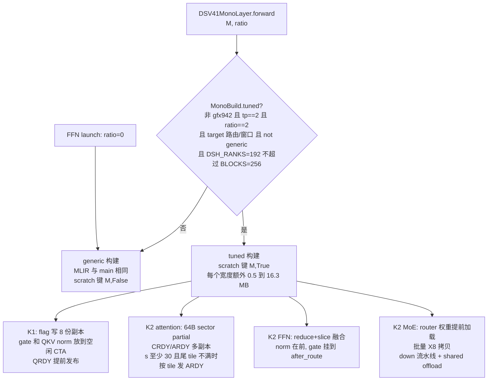
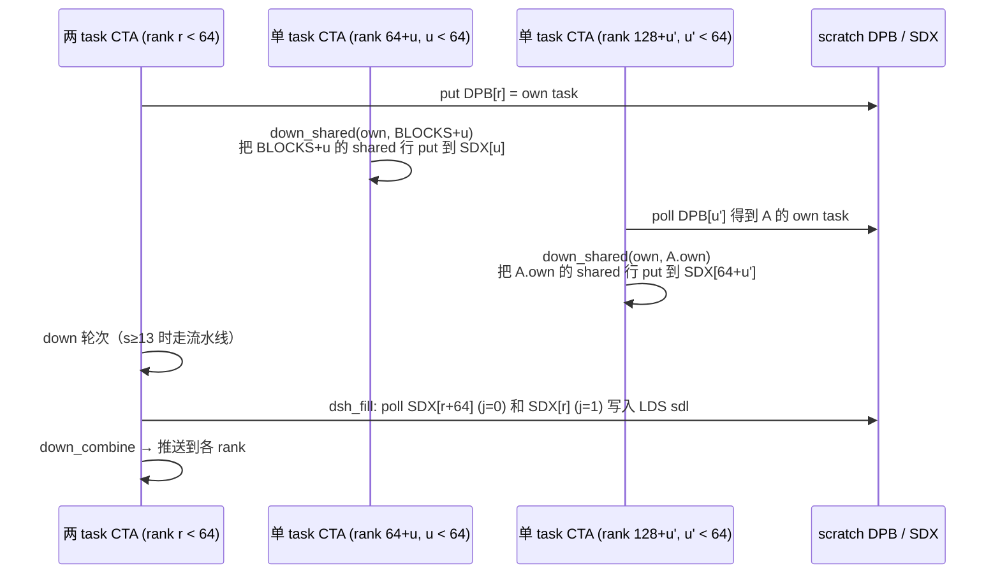

# PR #63027: [ROCm][Perf][DSv4.1] Mono: tuned K1/K2 for the TP2 compress-ratio-2 layers on MI355X

> **Author**: @chao-xu-spec | **State**: OPEN | **Date**: 2026-10-22（2026-11-02 rebase 到 main `410ab341a8`）
> **Branch**: `chao-xu-spec:dsv41-mono-r2-tuned` → `main` | **Labels**: rocm, deepseek, DSv4.1
> **Changes**: +1219 -203 lines across 12 files | **ROCm 相关性**: 完全相关（只在 gfx950 上生效的 DeepSeek-V4.1 mono decode kernel，FlyDSL 编写）
> 本报告分两部分：§1–6 为 PR 详细总结，§7–8 为 ROCm review 意见。
> 代码核对基于 PR head `bbae878ed8`。PR 的 merge-base 是 `410ab341a8`，已包含 #63892（`cc69774820`）。从这个 base 到当前 main `ffdf26702a`，`deepseek_v41/amd/mono/` 和 numerics 测试都没有改动，所以现在和 main 没有文本冲突。

---

## 1. 总结 (Summary)

本 PR 只优化一类层：DeepSeek-V4.1-Flash 的 mono decode 中，**gfx950 + TP2 + compress ratio 2** 的 target 层。优化对象是 K1（attention 前半 + FFN seam）和 K2（attention 后半 + FFN seam + MoE + 推送）两个 kernel。新增静态构建属性 `MonoBuild.tuned` 来选择新路径，其余构建（ratio 0/1、TP4/TP8、DSpark draft、gfx942、FFN launch）作者称编译出的 MLIR 与 main 逐字节相同。tuned 路径分三组：(1) 被轮询的 ready flag 复制 8 份并各占一条 cache line，MoE 下标运算改用无符号移位/掩码，独立的 load 提前到 wait 之前发出；(2) down 阶段中，处理两个 task 的 CTA 把多轮计算通过 LDS 做成流水线，它们的 shared-expert down 行交给后面到达的单 task CTA 计算，结果经 SDX 交回；(3) 缩短 FFN seam → norm → router 的依赖链，attention partial 按整 64 B sector 写出，`wo_a` 的 ready flag 改为按 token tile 发布。作者称输出与 main 逐位一致，ratio-2 层 K1+K2 快 8.6–18.1%，E2E TPOT p50 降 3.3–3.7%（这些数字无法溯源，见 §7）。

## 2. 背景与动机 (Background & Motivation)

- mono（`--monokernel`）是 DSv4.1 在 MI355X 上做低并发 decode 的专用路径：每层 decode 拆成 K1/K2 两个持久化 FlyDSL 大 kernel，grid 等于 CU 数（`BLOCKS = 256`）。CTA 之间通过 scratch 中带 tag 的 mailbox 同步，TP 间的归约通过 IPC peer buffer 在 kernel 内完成。
- 在 TP2 + MTP 的 agentic 场景里，ratio-2 层是 decode 的热点。作者给出三类瓶颈：256 个 CTA 同时自旋轮询同一 flag 行而被串行化；polls 和 load 之间存在串行往返；two-task down CTA（320 个 down task 分给 256 个 CTA，前 64 个到达的 CTA 各做 2 个）是关键路径。
- 作者说明了与其他 PR 的关系：#61482 会把这些 kernel 移到 `vllm/models/common/amd/mono/`；本 PR 已 rebase 到包含 #63576（K2 combine 先等 `krdy` 再读 `klen`）和 #63689（MXFP8 零值/次正规组的 scale code）的 main，tuned 路径复用了 `stage_combine` 与 `vllm_mx_code`。2026-11-02 再次 rebase 到 `410ab341a8`，这个 base 包含 #63892。
- okorzh-amd 在 10-30 列出的关联 PR：#63892/#64153/#63486 只有文本冲突（layer.py 和测试文件，后合入的一方 rebase）；#63341 是潜在冲突（BLOCKS 按 arch 选择，而 shared-row offload 依赖 BLOCKS 足够大）。

## 3. 代码修改分析 (Code Change Analysis)

### 3.1 修改的模块

| 文件 | 改动 |
|------|------|
| `mono/layer.py`（173 行改动） | `MonoBuild.generic` 字段和 `tuned` 属性（门控条件：非 gfx942、tp==2、ratio==2、target 路由、`DSH_RANKS <= BLOCKS`）；`tuned` 传进 Front/Back/MoE 的 build key 和 `scratch_layout`；K1 的 gate 移到没有 wqkv 任务的 CTA；`publish_x8` 写 8 份 flag 副本；`store_normed(wide=True)` 改为一次 16 B store；`run_ffn` 的 tuned 分支采用 reduce+slice 融合 → norm → gate 的顺序，gate 通过 `after_route` 挂到 route CTA 上 |
| `mono/runner.py` (+38) | `generic` 构造参数；scratch 缓存键改为 `(tokens, tuned)`；新增 `tuned(tokens, ratio)`；`forward` 按 tuned 选择 scratch |
| `mono/stages/moe.py`（621 行改动） | `udiv/umod` 无符号下标运算；router 权重和 route bias 在等 x 之前就发出；`load_x8_rows_all`（批量 X8 拷贝）；`down_rounds_pipe`/`down_round_pipe`/`down_slot`/`rows_to_lds`（down 流水线）；`dsh_offload`/`dsh_fill`（shared 行 offload，新增 scratch 区 `sdx`/`dpb`）；`down_sums`（承接 #63892 的晚加载 peer 基址）；`stage_lds` 的 tuned 布局（`dmid`/`dmids`、`pipe_picks`） |
| `mono/stages/seam.py` (+202) | `stage_reduce_slice`/`reduce_slice_quad`/`slice_rest`/`slice_mix_all`（reduce 与 slice 融合，所有 token tile 的 mix 一次完成）；`stage_norm` 的 tuned 分支（权重提前加载、一次批量 poll）、`tail_barrier` |
| `mono/attention/front.py` (+120) | tuned 时 `publish` 写 COPIES 份；`stage_qkv` 改为 16 B 的成对 poll，QRDY 提前到 kv record 之前发布；QKV norm 移到没有 wqkv 任务的 CTA；X8 等待读本 CTA 对应的副本；`settle` 参数（`s_waitcnt vmcnt(0)`） |
| `mono/attention/back.py` (+102) | `stage_split` 按整 64 B sector 写 partial（`lane_gather`）；CRDY/ARDY 改为多副本；s≥30 且最后一个 tile 不满时，`wo_a` 按 tile 发布 ARDY |
| `mono/attention/plan.py` (+50) | `COPIES=8`、`QRDY_STRIDE=64`、`ARDY_MIN_S=30`、`flag_stride/flag_copy/on_copy/ardy_tiles`；`front_scratch/back_scratch` 增加 tuned 布局 |
| `mono/common/mx.py` (+51) | `udiv/umod`；`oob/oob_rsrc`（`OOB_RECORDS=0x60000000`，`OOB_DWORD=0x1C000000`：对不活跃的 slot 发出越界 load，不产生内存流量）；`scale_index` 支持无符号运算 |
| `mono/stages/gemv.py` (+7)、`moe_shape.py` (+7) | `ld_vec`；`MoeBuild.tuned`/`RouteShape.tuned` |
| `mono/README.md` (+5) | 说明 tuned/generic 构建 |
| `tests/models/test_dsv41_mono_numerics.py` (+46) | 新建一个 `generic=True` 的 runner 作为逐位参考；ratio-2 用例增加 12 和 36 行；每个 runner 运行前恢复 SWA cache，并逐字节比较 K1 写入的 SWA record |

### 3.2 架构 / 流程图

tuned 门控与各构建的路径选择：



shared-expert down 的 offload（tuned，按 down 阶段的到达序号 rank 分工，extra = 320 − 256 = 64）：



### 3.3 关键实现细节

- **门控与缓存键**：`generic` 是 dataclass 字段，`key_tuple` 会把它带进 JIT 缓存键；`tuned` 是由字段和常量推出的属性。tuned 与 generic 构建的 kernel symbol 名相同（`dsv41_mono_k1_s.._tp2_r2...`）。只有测试会同时加载这两种构建；生产环境没有 `generic=True`。
- **scratch**：`runner._scratch` 的键从 `tokens` 改为 `(tokens, tuned)`。我在本地按 PR 的 `scratch_bytes` 算过（纯 Python，不跑 GPU）：TP2 下 generic 布局与 main 完全一致（48 个宽度合计 432.2 MB）；tuned 布局在 s=1 时为 0.51 MB，s=48 时为 16.3 MB，48 个宽度合计 451.9 MB。实际增量取决于用到哪些宽度。
- **X8 批量拷贝**：tuned 且 `live` 是 Python int（单 token tile）时，`load_x8_rows` 在 poll 和 barrier 之后直接调用 `load_x8_rows_all` 并 return，不进入 #63892 引入的 `x8all` 分支（`moe.py:1148-1153`）。
- **down 流水线**：只在 `rs.picks > 72`（s ≥ 13）且 CTA 有 2 个 task 时使用。每轮做法：先发出下一轮的 w2 权重和 ug flag 的首次 load，再用 `raw_ptr_buffer_load_lds` 把本轮各 slot 的 MID/MIDS 行直接拷进 LDS（`fits = r1 - r0 <= pipe_picks`）；放不下时 `down_slot` 每次从全局 MID 读 3 个 K step（`DOWN_REG_CHUNK`）。按 PR 的 `stage_lds` 计算，`pipe_picks` 在 s=13/18/24/36/48 时分别为 49/59/54/46/38。不活跃的 slot 用 `oob_rsrc` + `OOB_DWORD` 发出越界 load，返回 0 且没有内存流量。
- **与 #63892 的 `push_bases` 接口**：PR 把 `c = dict(c, peer_addr=c["push_bases"]()...)` 从 `stage_down` 末尾移到新的 `down_sums`（`moe.py:1738`）。流水线路径和原来的轮次循环都会调用 `down_sums`，所以 TP4 的晚加载基址行为不变。tuned 只在 TP2 生效，而 `push_bases` 只在 TP4 设置（`layer.py:701`），两者在运行时不会同时打开。
- **flag 副本**：XRDY/QRDY/CRDY/ARDY 的写方由 `tid < COPIES` 的线程各写一份，读方读 `bid % 8` 号副本。副本 0 的下标与原下标相同，所以没改成读副本的读方（如 x8_given 分支）也仍然正确。`publish_x8` 的步长 `flag_stride(2*S)` 和 front xq 的步长 `flag_stride(xq_units)` 相等（`xq_units = WQKV_KPARTS * s = 2s`）。
- **gate 挂到 route 之后**：s>16 时 `router_groups[0] = 2`，gate 在 route CTA 上执行于 `stage_route` 之后。`stage_gate` 只写 seam 的 `red[0:500)`，它在 K2Lds union 中与 MoeLds.red（4096 words）重叠；此时该区域不是 live 数据，并且不碰 `tab`。

## 4. 涉及的技术原理 (Technical Principles)

- **持久化 megakernel + tagged mailbox**：grid = CU 数，所有 CTA 必须同时驻留。stage 之间不靠 kernel 边界同步，而是 producer 写 (value, tag) 对、consumer 轮询 tag 等于本 step 的 epoch。因此任何 CTA 之间的等待链都要证明没有环（本 PR 的 DPB/SDX 交接满足这一点：两 task CTA 先发布 DPB，后等待 SDX）。
- **轮询热点与 cache line 副本**：256 个 CTA 用 system/device scope 的 load 自旋读同一条 128 B 行时，L2 上对同一行的请求会被串行化。把 flag 复制 8 份、分布在不同行上，可以把竞争分散开。
- **gfx950 的 vmcnt 按发出顺序完成**：`s_waitcnt vmcnt(N)` 只能等待"最老的若干个"load 完成，所以晚发出的 load 会被早发出的 load 挡住。PR 多处调整发出顺序（权重先于 poll，或晚于关键 load），`settle` 则先排空下一 tile 的 load，避免 LDS store 被它挡住。
- **buffer load 越界返回 0**：AMD 的 buffer resource 带 `num_records` 上界，越界 load 返回 0，并且不访问内存。PR 把 `num_records` 设为 1.5 GB，并给不活跃的 lane 一个 1.75 GB 的偏移，相当于"不需要 exec mask 的谓词 load"。这个做法要求合法偏移始终小于 1.5 GB。
- **MXFP4 × MXFP8 的 down GEMV**：w2 是 FP4（aiter `shuffle_scale` 布局的 e8m0 scale），MID 是 MXFP8。逐位一致的要求是 MFMA 的顺序和累加链（`DOWN_CHAINS=2`）都不变，PR 的 `down_slot` 注释也是这么声明的。

## 5. 评论区讨论亮点 (Discussion Highlights)

- **okorzh-amd（10-30）**：① 与 #63816（gfx942 路由的 NaN guard）有冲突，要求保留两边的修复；作者已处理，tuned 的 `stage_route` 保留了 `isnan` 的 select。② 指出旧测试在 K1 跳过 SWA insert 时也能通过，作者随后加入 `swa_pre/swa_ref` 的逐字节比较（已落实，见测试 +46）。③ 列出关联 PR 的冲突（见 §2）。
- **Frida Andersson**（日期不详，网页上看不到作者回复，线程未 resolve）：① 要求给出三个 commit 各自的收益，因为流水线让 `moe.py` 多了约 400 行；② 问是否有用例走 `fits` 为 false 的路径，建议用 `e_score_correction_bias` 制造集中路由；③ `QRDY_STRIDE=64` 只在 `MAX_TOKENS <= 64` 时成立，建议改用 `flag_stride(s)`；④ `forward` 每次都构造一个 `MonoBuild`，建议和 `kernels()` 一起查一次并缓存；⑤ TP4/TP8 没有 tuned 构建，测试里的 generic runner 只应在 TP2 创建。我核对了当前 head：③④⑤ 对应的代码都没有改。
- **作者 11-02**：rebase 到 `410ab341a8`（包含 #63892）后，在 4×MI355X 上重跑：TP4 85 passed/5 skipped，TP2 83 passed/7 skipped，与 main 计数相同；TP2 115/115 个用例与 main 逐位一致，TP4 16/16 一致；non-tuned MLIR 一致（gfx950 384/384，gfx942 76/76）。TP8 和 gfx942 没有在硬件上跑。
- 网页上没有看到 `/amd-ci run`，也没有 AMD CI 的结果。

## 6. 风险与潜在问题 (Risk Analysis)

| 风险 | 严重程度 | 说明 |
|------|---------|------|
| 集中路由时走 `fits` 为 false 的 down 路径，没有逐位一致性测试 | Medium | 见 §7 ⚠️【测试】 |
| 两份功能相同的批量 X8 拷贝（#63892 的 `x8all` 与本 PR 的 `load_x8_rows_all`），#64153 还会再加 TP8 的门控 | Medium | 见 §7 ⚠️【可维护性】 |
| 性能数字无法溯源，且没有按 commit 拆分 | Medium | 见 §7 ⚠️【性能】 |
| AMD 可选 CI 未触发；index source 的 tuned 构建只有容差级别的 e2e 覆盖 | Medium | 见 §7 ⚠️【测试】 |
| 魔法常量没有断言保护（`QRDY_STRIDE`、`OOB_RECORDS`） | Low | 见 §7 📝 |
| tuned scratch 让用到的每个宽度的显存多一份，且在 KV profiling 之后才懒分配 | Low | 见 §7 📝 |
| 正确性：flag 副本、DPB/SDX 交接、LDS 别名 | Low | 已逐项核对，没有发现缺陷；作者有逐位一致的硬件证据 |
| 兼容性：gfx942/TP4/TP8/draft 不受影响 | Low | 门控是静态的；FFN launch 的 ratio=0，不会被 tuned |

---

## 7. Review 意见 (Findings)

| 类型 | 🔴 | ⚠️ | 📝 |
|------|----|----|----|
| 测试 | — | 2 | — |
| 可维护性 | — | 1 | 2 |
| 性能 | — | 1 | — |
| 资源 | — | — | 1 |
| 设计/协调 | — | — | 1 |

---

**⚠️【测试】down 流水线中 `fits` 为 false 的分支（集中路由）没有被逐位一致性测试覆盖** `[已验证]`

- **问题**: `down_round_pipe` 在 `fits = r1 - r0 <= cap`（`moe.py:1818`）为 false 时，会改走 `down_slot(..., r0=None)`：每次从全局 MID 读 `DOWN_REG_CHUNK = 3` 个 K step 的操作数（`moe.py:1870` 起）。这条路径的代码与流水线主路径不同，也不同于 generic 的 `mid_operands`。按 PR 的 `stage_lds` 计算，s=36/48 时 `cap` 为 46/38 个 pick。两 task CTA 的一轮有 8 个 slot（`per_round = WAVES * 1`）。numerics 测试用的是随机 gate 权重，48 行共 288 个 pick 分散在约 270 个专家上，每个 slot 平均约 1 个 pick，所以 8 个 slot 远到不了 38。也就是说，测试只走了 `fits` 为 true 的分支。
- **影响**: 生产中可能出现集中路由，例如 8 个相同的请求、或 benchmark 用的重复 prompt：同一位置的 token 选同一组专家，单个专家可以有几十个 pick，这时就会进入 `fits` 为 false 的分支。如果这条路径在 MFMA 顺序、`past` 掩码或 `cbase` 上有偏差，会造成静默的数值错误，而 PR 的"逐位一致"证据覆盖不到它。Frida 已经提过同样的问题，网页上看不到作者回复。
- **行动**: 建议作者在 `_check_layers` 中加一个用 `e_score_correction_bias` 把路由集中到少数专家的 ratio-2 用例（36 或 48 行），并断言 tuned 与 generic 逐位一致。也可以在测试里断言该用例确实触发了 `r1 - r0 > pipe_picks`。

**⚠️【可维护性】rebase 到 #63892 之后，`load_x8_rows` 里有两份功能相同的批量 X8 拷贝** `[已验证]`

- **问题**: main 上的 #63892 已经在 `load_x8_rows` 中内联了批量路径：由 `x8all = c["push_bases"] and not GFX942 and isinstance(live, int)` 门控，先发出全部 load，再按掩码 store（`moe.py:1153-1160`）。本 PR 又新增了 `load_x8_rows_all`（`moe.py:1185-1200`），并在 tuned 时提前 return（`moe.py:1148-1152`）。两者的发出顺序、clamp 和 store 掩码一致，只是写法不同：前者用 `fx.Uint32`，并依赖 `buffer_load` 默认的 `vec_width`；后者用 `udiv/umod` 和带显式宽度的 `ld_vec`。#64153（TP8）还会在同一个函数上再加一个门控。
- **影响**: 同一个优化有三处门控、两份实现，今后修 bug 或调整时很容易只改一份。#63892 的 review 里已经指出过 `vec_width` 默认值的隐患，这里正好是一份显式、一份隐式。
- **行动**: 建议作者把两者合成一个 helper，例如保留 `load_x8_rows_all`，把门控写成 `batch = (tuned or push_bases) and not GFX942 and isinstance(live, int)`，并用作者现有的 MLIR diff 工具确认 TP4 构建的 MLIR 不变。同时在 #64153 中引用这个统一后的接口。

**⚠️【性能】性能数字无法溯源，也没有按 commit 拆分** `[已验证]`

- **问题**: PR 描述里的 microbench 表（K1+K2 每层 µs，M=1..48，冷 L2）和 E2E 表（TPOT p50 −3.31%/−3.74%）都没有给出命令或脚本。仓库中没有对应的 harness（注释提到的 `harness/down_probe.py` 不在树里），E2E 还是"rebase 之前"测的。三个 commit 一共 +1219 行，Frida 要求的逐 commit 收益没有回复。另外，E2E 的 output tok/s/GPU 在 c4 下是 −0.66%，与 TPOT 的改善方向不一致，PR 没有解释。
- **影响**: reviewer 无法判断哪部分复杂度是值得的：流水线 + offload 大约 400 行，收益是多少？在当前描述下，这些数字只能当作 [unverified]。
- **行动**: 建议作者补充三个 commit 各自的 microbench 增量，以及复现所用的命令或脚本（可以放在 PR 评论里）。也请解释 c4 吞吐下降、TPOT 却改善的原因，例如是否是 MTP 接受率或 batch 组成不同。

**⚠️【测试】AMD 硬件 CI 没有运行；index-source 的 tuned 构建没有逐位一致的参考** `[已验证]`

- **问题**: ① 唯一覆盖这些 kernel 的 CI 是 `.buildkite/test-amd.yaml:4658` 的 ":amd: (MI355) DeepSeek-V4.1 Mono Decode Numerics"，它是 `optional: true`，需要有人评论 `/amd-ci run` 才会跑；PR 页面上看不到触发记录或结果。② 新增的逐位比较只覆盖非 index 的 K1/K2（测试没有传 `select`）。index source 专有的 tuned 路径没有被这个比较覆盖，包括 K1 的 `store_normed(..., wide=True)`（`layer.py` 的 `store()`，只在 `key.index` 时执行）和 K2 中 #63576 的 `krdy` 等待与 tuned 布局的组合。这些路径只有 `test_dsv41_mono_layers.py` 的 TP2 rows=8 e2e 用例，按容差比较。
- **影响**: 合入前没有 AMD 硬件 CI 信号，只能依赖作者的本地结果。index source 层的 normed 行如果写错，会影响 vLLM indexer 的 top-k，而容差测试不一定能发现。
- **行动**: 建议 reviewer 在合入前评论 `/amd-ci run` 并确认 MI355 Mono Numerics 通过（该 job 是 4 GPU，会跑 tp=2）。建议作者在 `_check_layers` 中给一个 ratio-2 用例加上 index 变体，与 generic 构建逐位比较。

**📝【可维护性】`QRDY_STRIDE = 64` 和 `OOB_RECORDS = 0x60000000` 没有断言约束** `[已验证]`

- **问题**: ① `attention/plan.py:49` 的 `QRDY_STRIDE = 64` 只有在 `MAX_TOKENS（48）<= 64` 时，各 QRDY 副本才不会重叠（Frida 提过同样的问题）。② `common/mx.py:80-81` 的 `OOB_RECORDS` 把 w2/w2_s 的 buffer 上界设为 1.5 GB。我按 TP2 估算了 w2 每个 rank 的大小：384 × 5120 × 576 B ≈ 1.13 GB，目前有余量。但如果以后放宽 tuned 门控（例如 TP1，或专家/中间维度更大的模型），合法 load 会超出 `num_records`，静默读到 0。
- **行动**: 建议作者加上 `assert MAX_TOKENS <= QRDY_STRIDE`（或者按 Frida 的建议用 `flag_stride`），并在 `MonoBuild.tuned` 或 `down_weight_loads` 附近断言 w2 每个 rank 的字节数小于 `OOB_RECORDS`，同时注释写明 `OOB_DWORD * 4 > OOB_RECORDS` 这个关系。

**📝【资源】tuned scratch 让用到的每个宽度的显存多一份，且分配发生在 KV profiling 之后** `[已验证]`

- **问题**: 按 PR 的 `scratch_bytes` 计算，tuned 布局在 s=1/12/24/48 时为 0.51/5.98/11.95/16.33 MB，所有宽度合计 451.9 MB/rank。这些显存与 generic scratch 同时存在：同一宽度下，ratio 0/1 层和 FFN launch 仍然使用 generic scratch。分配是在某个宽度第一次 eager 运行时懒执行的（cudagraph 捕获前的 warmup），不在 KV cache profiling 的统计里。
- **行动**: PR 描述写了"up to ~20 MB per tuned width"，这一点很好。建议作者补充 TP2 + MTP 实际用到的宽度集合下的总增量，或者在 runner 初始化时为 cudagraph 会用到的宽度预分配，让显存进入 profiling 统计。`forward` 每次构造 `MonoBuild`、测试在 TP4/8 也创建 generic runner 这两点（Frida 的 nit），也可以一起处理。

**📝【设计/协调】与 #63892、#63341、#64153 的接口关系** `[已验证]`

- **问题**: ① #63892 已经合入，本 PR 把它的晚加载 peer 基址 rebind 原样搬进 `down_sums`（`moe.py:1738`），流水线路径和原来的轮次路径都会调用它。TP4 行为不变，TP2 tuned 不受 `push_bases` 影响。这部分迁移是正确的，没有冲突。② tuned 门控要求 `moe.DSH_RANKS（3 × (320 − BLOCKS)）<= BLOCKS`。如果 #63341 把 BLOCKS 改成按 arch 选择，并且值小于 240，tuned 会静默退回 generic，没有任何日志。③ `after_route` 依赖一个隐式的 LDS 别名不变式：`seam.red` 的前 500 words 落在 MoeLds.red 内、不碰 `tab`，并且在 route 之后不是 live 数据。代码里没有注释或断言说明这一点。
- **行动**: 建议作者在 `MonoBuild.tuned` 门控处注明它与 #63341 的关系；在 `run_ffn` 的 `after_route` 处补一句 LDS 别名说明，或断言 `GATE 用到的 red words <= MoeLds.red`。

## 8. 结论 (Verdict)

**⚠️ NEEDS WORK**

这个 PR 的工程质量很高：门控是静态的，non-tuned 构建的 MLIR 与 main 一致，测试改为与 generic 构建逐位比较，并加了 SWA 逐字节检查。我逐项核对了 flag 副本的读写下标、DPB/SDX 交接的无环性、LDS union 的别名，以及与 #63892 `push_bases` 的迁移，都没有发现正确性缺陷，也没有能给出具体触发输入的阻塞问题。合入前建议完成：补上集中路由（`fits` 为 false）和 index source 的逐位一致用例；合并两份批量 X8 拷贝；给出逐 commit 的收益和可复现的命令；回复 Frida 的五条评论；由 reviewer 评论 `/amd-ci run`，确认 MI355 Mono Numerics 通过。

## 9. 英文 Review 评论 (Copy-Paste English Comments)

**C1** `vllm/models/deepseek_v41/amd/mono/stages/moe.py:1818-1819` — ⚠️ comment

```text
As far as I can tell, nothing in the numerics test takes the `fits` false branch here. With the test's random gate, 48 rows spread 288 picks over roughly 270 experts, so a two-task round (8 slots) carries about 8 picks, while `pipe_picks` is 38 at 48 rows and 46 at 36. The fallback `down_slot(..., r0=None)` path, which loads MID in chunks of `DOWN_REG_CHUNK`, is different code from both the LDS path and the generic `mid_operands`. It is reachable in serving when routing concentrates, e.g. a batch of identical requests. Could you add a ratio-2 case at 36 or 48 rows with `e_score_correction_bias` skewed toward a few experts, assert that it is bit-identical to the `generic=True` runner, and ideally also check that it actually trips `r1 - r0 > pipe_picks`?
```

**C2** `vllm/models/deepseek_v41/amd/mono/stages/moe.py:1148-1152` — ⚠️ comment

```text
Since #63892 landed, `load_x8_rows` has two batched X8 copies that do the same thing: the inline `x8all` path, gated on `push_bases` for TP4, and `load_x8_rows_all`, gated on `tuned` for TP2. They use the same issue order, clamp and store mask, written slightly differently (`fx.Uint32` with the default `vec_width`, vs `udiv`/`umod` with an explicit `ld_vec(..., 4)`). #64153 is about to add a TP8 gate to the same function. Could you keep a single helper, e.g. `load_x8_rows_all` behind `(tuned or push_bases) and not GFX942 and isinstance(live, int)`, and confirm with your MLIR diff that the TP4 builds are unchanged?
```

**C3** `vllm/models/deepseek_v41/amd/mono/stages/moe.py:153-162` — ⚠️ comment

```text
The down-stage pipeline and the shared-row offload are most of the added code (roughly 400 lines in moe.py). The PR description gives one aggregate number for all three commits, and I couldn't find the microbench harness in the tree. Could you post the per-commit K1+K2 deltas (as Frida asked) and the command or script behind the microbench and E2E tables? The E2E was also measured before the rebase. One more thing worth explaining: output tok/s/GPU drops by 0.66% at c4 while TPOT p50 improves by 3.7%.
```

**C4** `vllm/models/deepseek_v41/amd/mono/attention/plan.py:49` — ⚠️ comment

```text
Nit, following up on Frida's comment: `QRDY_STRIDE = 64` only keeps the QRDY copies disjoint while `MAX_TOKENS <= 64`, and nothing enforces that. In the same spirit, `OOB_RECORDS = 0x60000000` in common/mx.py silently caps every live w2/w2_s load at 1.5 GB. That is fine at TP2 (w2 is about 1.13 GB per rank), but a later widening of the `tuned` gate would read zeros without any error. Could you add `assert MAX_TOKENS <= QRDY_STRIDE` (or derive the stride from `flag_stride`), plus an assert near the tuned gate that the per-rank w2 bytes stay below `OOB_RECORDS`?
```
