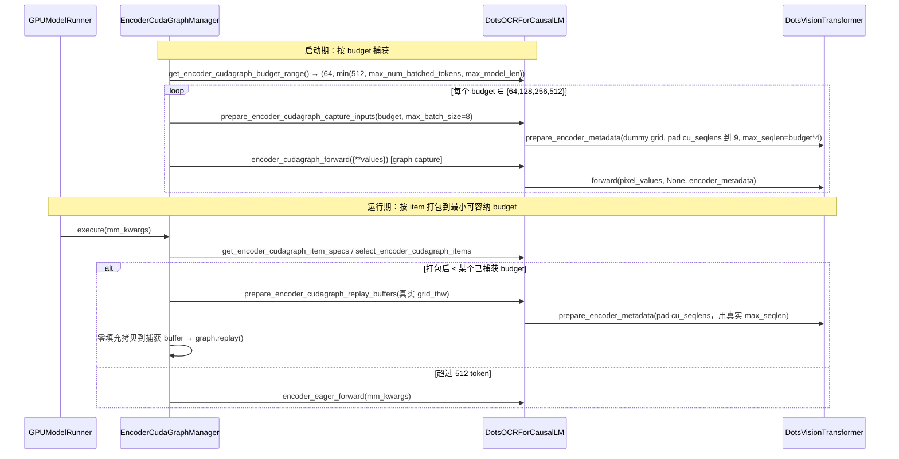
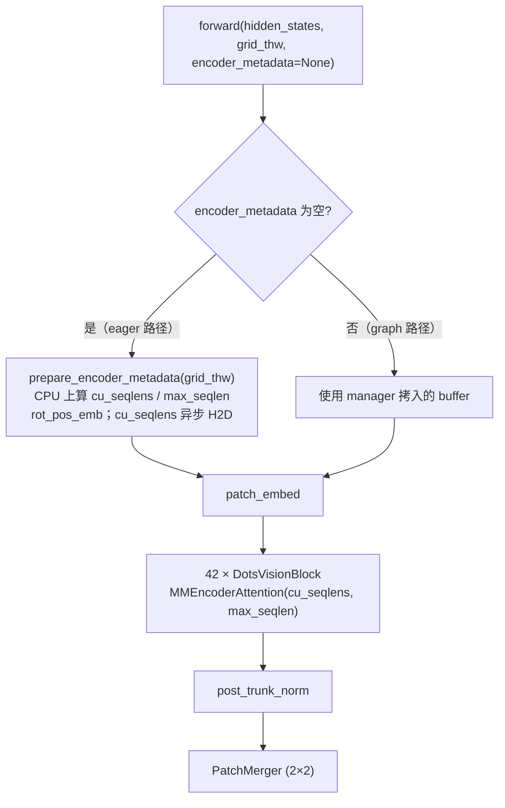

# PR #63074: [Model] dots.ocr: support encoder CUDA graph

> **Author**: @LLBeYourself | **State**: OPEN | **Date**: 2026-10-22
> **Branch**: `feat/dots-ocr-encoder-cudagraph` → `main` | **Labels**: documentation, multi-modality, nvidia, verified
> **Changes**: +277 -15 lines across 3 files | **ROCm 相关性**: 部分相关（模型代码为 CUDA/ROCm 共享路径；dots.ocr ViT 在 ROCm 上默认走 `ROCM_AITER_FA` / CK `FLASH_ATTN`；新增的 `core_model` 用例会进入 AMD MI355 的 `test_vit_cudagraph.py -m core_model` CI 步骤）
> 本报告分两部分：§1–6 为 PR 详细总结，§7–8 为 ROCm review 意见。

---

## 1. 总结 (Summary)

本 PR 让 dots.ocr（`DotsOCRForCausalLM`）实现 `SupportsEncoderCudaGraph` 协议，使其 1.2B 视觉编码器（ViT）可以被现有的 `EncoderCudaGraphManager` 按 token budget 捕获并重放 CUDA/HIP graph。核心做法与 Qwen2-VL 一致：把 `DotsVisionTransformer.forward` 中依赖 `grid_thw` 的元数据（rotary 位置编码、`cu_seqlens`、`max_seqlen`）拆到图外的 `prepare_encoder_metadata()`，图内只剩纯计算；同时把默认 budget 上限压到 512 token，大图回退 eager。作者在 RTX 3090/4090、A100 上报告小图单请求 encoder 延迟最高 3–6× 加速，大图不退化。

## 2. 背景与动机 (Background & Motivation)

- 属于 tracking issue #38175（多模态 encoder CUDA graph 推广）的一部分。vLLM 已为 Qwen2/2.5/3-VL、GLM-4V、DeepSeek-OCR 等提供 encoder graph；dots.ocr 是常用的文档 OCR 模型，其 ViT 层数多（42 层）、小图时 kernel launch 开销占主导，因此适合 graph 化。
- 作者实测发现：若使用 manager 默认 budget 范围（直到 `max_num_batched_tokens`），一张 1000×800 文档页（1044 token）会被 pad 到 2048 budget，速度仅为 eager 的 0.56–0.61×；所以把 `max_budget` 封顶为 512，大图回退 eager，同时 graph 显存从 1.43 GiB 降到 0.23 GiB、启动捕获时间少 12–19 s。
- 描述较完整地解释了机制（launch-bound vs GPU-bound、2× budget 阶梯带来的 padding 代价），并主动列出局限（CPU/GPU 速度比、批量吞吐中性、未测在线并发和 H100）。PR 声明使用了 AI 辅助（Claude 写 benchmark 脚本并参与描述撰写）。

## 3. 代码修改分析 (Code Change Analysis)

### 3.1 修改的模块

| 模块 | 改动 |
|------|------|
| `vllm/model_executor/models/dots_ocr.py` (+261 −15) | ① `DotsVisionTransformer.forward` 拆分为 `prepare_encoder_metadata()`（图外）+ 图内计算；② `DotsOCRForCausalLM` 继承 `SupportsEncoderCudaGraph` 并实现 8 个协议方法（config / budget range / item specs / select items / capture inputs / replay buffers / graph forward / eager forward） |
| `tests/models/multimodal/generation/test_vit_cudagraph.py` (+15) | 新增 `dots_ocr` 配置（image-only、`[4096]` 单 budget、`core_model` 标记、`trust_remote_code`） |
| `docs/design/cuda_graphs_multimodal.md` (+1) | 支持矩阵新增 `DotsOCRForCausalLM` 行（image ✅ / video ❌ / 其他 ❌） |

### 3.2 架构 / 流程图

encoder graph 的捕获与重放流程（dots.ocr 侧职责标注）：



`DotsVisionTransformer.forward` 拆分前后：



### 3.3 关键实现细节

- **`prepare_encoder_metadata()`**：`cu_seqlens` 改在 CPU 上计算（int32），这样 `max_seqlen` 也是 CPU 标量，attention wrapper 里的 `.item()` 不再触发 D2H 同步；返回前用 `async_tensor_h2d` 拷到设备。eager 路径因此也顺带省掉一次 GPU→CPU 同步。
- **`cu_seqlens` 定长 padding**：传入 `max_batch_size` 时，用最后一个 offset 把 `cu_seqlens` 补到 `max_batch_size + 1`，补出的是长度为 0 的空序列，保持捕获与重放的 shape 一致。由于 dots.ocr 只有图片、每张图就是一个 attention 序列，不需要 Qwen 的 frames 轴。
- **`max_seqlen` 捕获值**：`max_seqlen_override = token_budget * spatial_merge_size**2`（budget 内最多的 patch 数），因为 FA wrapper 会在捕获时 `.item()` 把它固化为 kernel launch 参数。
- **budget 范围**：`min_budget = 64`（与 Qwen2-VL/Qwen3-VL 一致；更小会让 `max_batch_size = min(max//min, min)` 缩到 4），`max_budget = min(512, max_num_batched_tokens, max_model_len)`。默认 budgets 64/128/256/512，`max_batch_size = 8`。
- **capture 输入**：每个 item 的 dummy grid 为 `[1, 2, ceil(budget/8)*2]`，`pixel_values` 全零，shape 为 `(total_patches, C*T*P*P)`；`patch_embed` 不再接收 `grid_thw`（原本就未使用）。
- **`_get_image_grid_thw()`**：兼容 `image_grid_thw` 为 tensor（原始 mm_kwargs）或 list（`select_encoder_cudagraph_items` 之后）。
- 协议方法整体与 `qwen2_vl.py` 的实现结构一致（`encoder_cudagraph_forward` 中 `values.pop("pixel_values")` 安全，因为 manager 传入的是 `{**values}` 浅拷贝）。

## 4. 涉及的技术原理 (Technical Principles)

- **CUDA/HIP Graph 与 encoder graph manager**：graph 捕获一次 kernel 序列后重放，消除 CPU 端逐个 launch 的开销。代价是输入必须写进捕获时的固定地址 buffer、shape 固定，且图内不能有 host 同步（`.item()`、`.tolist()`）或依赖数据的 Python 分支。`EncoderCudaGraphManager` 按 token budget（2× 阶梯）各捕获一张图，运行时把若干图片打包进最小可容纳的 budget，不足部分零填充。ROCm 上同一套 `torch.cuda.graph` API 映射到 hipGraph。
- **varlen attention 与 `cu_seqlens` / `max_seqlen`**：ViT 把多张图拼成一个长序列，用累积长度 `cu_seqlens` 区分 attention 边界；`flash_attn_varlen_func`（CUDA FA / ROCm CK FA / aiter FA）用 `max_seqlen` 决定 grid 大小。捕获时取 budget 上界，重放时较短序列只是多出空 block，数值不变。超出 `cu_seqlens[-1]` 的 padding token 不属于任何序列，其输出是未定义值，但后续 RMSNorm/MLP/2×2 merger 都是逐 token（或 4-token 组内）运算，padding 行不会污染有效行，最终被 manager 截掉。
- **2D RoPE 预计算**：dots.ocr ViT 用按 (h, w) 位置的 rotary embedding，`rot_pos_emb(grid_thw)` 依赖输入分辨率，所以必须放在图外、作为 buffer 输入。
- **launch-bound vs GPU-bound**：小图（≤512 token）时 42 层 ViT 每层十几个小 kernel，CPU 发射速度决定延迟，graph 收益大；大图时 GPU 计算主导，graph 收益趋零，而 2× budget 阶梯的 padding 反而变成纯开销——这就是 512 封顶的依据。该平衡点与 CPU/GPU 速度比强相关，不同硬件（包括 MI300/MI355 + EPYC）可能不同。

## 5. 评论区讨论亮点 (Discussion Highlights)

目前没有实质性人工 review：只有 github-actions 欢迎语、readthedocs 预览链接，以及 claude[bot] 的"fork PR 自动 review 被禁用"提示。PR 尚未获得 `ready` 标签，upstream CI 与 AMD CI（`/amd-ci run`）都未被触发；fetch 到的 `checks` 数据也没有有效的 check run。

## 6. 风险与潜在问题 (Risk Analysis)

| 风险 | 严重程度 | 说明 |
|------|---------|------|
| 正确性：ROCm 上 graph 路径未验证 | 中 | 全部正确性验证在 NVIDIA 上完成；ROCm aiter/CK FA 对空 padding 序列的处理与 hipGraph 捕获未经实测，见 §7「未在 ROCm 上验证」 |
| 测试覆盖：CI 用例未覆盖默认配置 | 中 | 测试固定 `[4096]` budget + 每批 1 张图，默认 64–512 budget 和多图打包路径不进 CI，见 §7 |
| 性能：512 封顶仅基于 NVIDIA 数据 | 低 | AMD 平台的 launch 开销和 CPU/GPU 速度比不同，最优上限可能不同，见 §7 |
| 兼容性：eager 路径行为改变 | 低 | `cu_seqlens` 改为 CPU 计算后 H2D；数值等价，并去掉了一次 D2H 同步，属于正向改动 |
| 可维护性：`compute_attn_mask_seqlen` 与共享 helper 重复 | 低 | 本地实现缺 `FLASHINFER` 分支；后端支持集合与 `MMEncoderAttention.compute_max_seqlen` 已分叉 |
| 兼容性：`TORCH_SDPA` ViT 后端无法捕获 | 低 | SDPA wrapper 内部 `cu_seqlens.tolist()`，是 encoder graph 的共享限制，不由本 PR 引入 |

---

## 7. Review 意见 (Findings)

| 意见类型 | 🔴 | ⚠️ | 📝 |
|---|---|---|---|
| 【测试】 | 0 | 2 | 0 |
| 【性能】 | 0 | 1 | 0 |
| 【可维护性】 | 0 | 0 | 1 |
| 【兼容性】 | 0 | 0 | 1 |
| **合计** | 0 | 3 | 2 |

**⚠️【测试】新 `core_model` 用例会进入 AMD MI355 CI，但 graph 路径未在 ROCm 上验证** `[已验证]`（ROCm 上是否失败 `[推测]`）

- **问题**: `tests/models/multimodal/generation/test_vit_cudagraph.py:363-377` 给 `dots_ocr` 加了 `pytest.mark.core_model`；`.buildkite/test-amd.yaml` 中 `:amd: (MI355 DPX) Multimodal Models (Standard) 4` 步骤会执行 `pytest models/multimodal/generation/test_vit_cudagraph.py -m core_model`，所以这个用例会在 MI355 上跑。而 PR 的正确性和性能验证只覆盖 RTX 3090/4090 与 A100。在 ROCm 上，dots.ocr ViT 默认走 `ROCM_AITER_FA`（`VLLM_ROCM_USE_AITER=1`）或 CK `FLASH_ATTN`，两者都会在 hipGraph 里固化 `max_seqlen = budget*4`；而且 ROCm wrapper 不传 `out=`（`supports_out = not is_rocm()`），padding 行的输出 buffer 不会被清零。
- **影响**: 如果 aiter/CK varlen kernel 处理长度为 0 的 padding 序列、或 `total_tokens > cu_seqlens[-1]` 时的行为与 CUDA FA 不同，问题只会在 AMD CI（或合入后的 AMD 用户）上暴露。目前 AMD 侧没有任何信号。
- **行动**: 建议作者（或有权限的 reviewer）在合入前评论 `/amd-ci run`，并至少在一台 MI300/MI355 上分别用 aiter FA 和 CK FA 跑一遍 `pytest ... -k "dots_ocr and image"`；如果 ROCm 有问题，作者应当在测试配置里按 `current_platform.is_rocm()` 显式处理，而不是让 MI355 CI 变红。

**⚠️【测试】CI 用例没有覆盖默认 budget 配置和多图打包（空 `cu_seqlens` padding）路径** `[已验证]`

- **问题**: 测试 harness 固定 `encoder_cudagraph_max_vision_items_per_batch = 1`，这个用例又覆盖成 `encoder_cudagraph_token_budgets: [4096]`，因此 `max_batch_size = 1`、`pad_to = 1`。`prepare_encoder_metadata` 里用最后一个 offset 补空序列的分支（`dots_ocr.py:577-591`），以及 PR 新引入的默认 512 封顶 / 64–512 budget 阶梯，在 CI 中都不会执行。另外断言只检查"有非空输出"，没有和 eager 输出对比（这是 harness 的既有风格）。
- **影响**: PR 中最独特的逻辑（空序列 padding、默认 budget 范围、`max_batch_size = 8` 的打包）完全依赖作者的本地脚本；以后 manager 或 attention wrapper 的改动如果破坏这些路径，CI 无法发现。
- **行动**: 建议作者补一个轻量用例：用默认 budget（或 `[64, 512]`）+ `max_vision_items_per_batch > 1` + 小尺寸图片（≤512 token），并对比 graph 与 eager 的 greedy 输出（作者说已有 bit-identical 的本地验收脚本，可以改写进 `tests/v1/cudagraph/` 或本文件）。

**⚠️【性能】默认 `max_budget = 512` 的封顶只基于 NVIDIA 测量** `[已验证]`（数字 `[unverified]`）

- **问题**: `dots_ocr.py:838-843` 把 `max_budget` 硬编码为 512，注释写明依据是 "Measured on RTX 3090/4090 and A100"。PR 里的全部加速比（64 token 时 6.22×、224×224 时 92 → 21 ms 等）来自作者未公开的本地脚本，属于 `[unverified]`；也没有 ROCm 数据。作者自己也指出最优点由 CPU/GPU 速度比决定，在 RTX 3090 + 快 CPU 上 384 token 已经退化到 0.71×。
- **影响**: MI300X/MI355X 的 HIP launch 开销、hipGraph 重放成本以及主机 CPU 都不同，512 对 AMD 来说可能过保守（错失收益）或过激进（257–511 token 区间退化）。这个常量会作为默认值在所有平台生效。
- **行动**: 建议作者公开 benchmark 脚本（PR 中已表示愿意分享），便于 AMD 侧复测；建议 review 时追问能否提供 MI300/MI355 上的 encoder-only 数据，或在注释中注明该上限仅按 NVIDIA 调优，并提示可用 `encoder_cudagraph_token_budgets` 覆盖。

**📝【可维护性】`compute_attn_mask_seqlen` 与共享的 `MMEncoderAttention.compute_max_seqlen` 已分叉** `[已验证]`

- **问题**: `dots_ocr.py:538-546` 的本地实现只对 `{FLASH_ATTN, ROCM_AITER_FA, TRITON_ATTN}` 返回 `max_seqlen`；共享 helper `MMEncoderAttention.compute_max_seqlen` 还覆盖 `FLASHINFER`（含 bucket）。本 PR 让 eager 路径与 graph 路径（`max_seqlen_override` 无论什么后端都会生成 tensor，`dots_ocr.py:596-599`）共用这套元数据，两条路径对 `max_seqlen` 是否为 `None` 的语义出现了不对称。
- **行动**: 建议作者把 `prepare_encoder_metadata` 改为复用 `MMEncoderAttention.compute_max_seqlen`，或至少只在 FA 类后端才生成 `max_seqlen_override`，与 eager 语义对齐（可作为后续 cleanup）。

**📝【兼容性】`TORCH_SDPA` ViT 后端下开启 encoder graph 会在捕获时失败（共享限制）** `[已验证]`

- **问题**: 在 ROCm 上，如果既没有启用 aiter MHA，也没有安装 `flash_attn`（例如部分 gfx1x 环境或自定义构建），`get_vit_attn_backend` 会回退到 `TORCH_SDPA`。`torch_sdpa_wrapper` 内部有 `cu_seqlens.tolist()`，这在 stream capture 期间不允许执行。这个问题对 Qwen2-VL 等已支持的模型同样存在，不是本 PR 引入的。
- **行动**: 不阻塞本 PR；建议 review 时追问 manager 是否应在 SDPA 后端下直接拒绝或降级 `cudagraph_mm_encoder`，并给出清晰报错（可另开 issue）。

> AI 代码诊断：描述解释了机制并给出带单位的数据，协议实现与 `qwen2_vl.py` 结构一致；新增符号（`async_tensor_h2d`、`EncoderCudaGraphReplayBuffers`、`EncoderItemSpec`、`EncoderCudaGraphCaptureInputs`）均已核实存在于 PR head。没有发现幻觉符号或安全戏法。主要风险集中在"只在 NVIDIA 上验证"和"CI 用例覆盖的路径比 PR 真正引入的逻辑窄"。

## 8. 结论 (Verdict)

**⚠️ NEEDS WORK**

改动设计合理，紧跟 Qwen2-VL 的成熟模式，eager 路径还顺带去掉了一次 D2H 同步；没有发现阻塞级缺陷。但新加的 `core_model` 用例会直接进入 AMD MI355 CI，而 graph 路径从未在 ROCm 上跑过，CI 用例也没有覆盖 PR 真正新增的默认 budget 与多图 padding 逻辑。建议先跑 `/amd-ci run`，并补一个默认配置 + graph-vs-eager 对比用例后再合入。

## 9. 英文 Review 评论 (Copy-Paste English Comments)

**C1** `tests/models/multimodal/generation/test_vit_cudagraph.py:363-377` — ⚠️ comment

```text
This config is marked `core_model`, so it will also run in the AMD MI355 "Multimodal Models (Standard) 4" step (`test_vit_cudagraph.py -m core_model`), but the validation in the description only covers RTX 3090/4090 and A100. On ROCm the dots.ocr ViT goes through ROCM_AITER_FA or CK flash-attn, which bake `max_seqlen = budget * 4` into the hipGraph and do not zero the output buffer for padded rows (`supports_out` is False on ROCm). Could we get a `/amd-ci run` on this PR (or a local MI300/MI355 run of `-k "dots_ocr and image"`) before merging, so a ROCm-specific failure doesn't turn the AMD CI red after merge?
```

**C2** `vllm/model_executor/models/dots_ocr.py:577-591` — ⚠️ comment

```text
The test config pins `encoder_cudagraph_token_budgets: [4096]` and the harness uses `max_vision_items_per_batch=1`, so `max_batch_size` is 1 and this empty-sequence `cu_seqlens` padding branch, the default 64-512 budget range, and multi-image packing are never exercised in CI. The test also only checks for non-empty output. Since you already have a bit-identical graph-vs-eager acceptance script, could you add a lightweight case with the default budgets (or [64, 512]), more than one image per batch, and a graph-vs-eager comparison of the greedy output?
```

**C3** `vllm/model_executor/models/dots_ocr.py:838-843` — ⚠️ comment

```text
The 512-token cap becomes the default on every platform, but it was tuned only on RTX 3090/4090 and A100, and as you note the break-even point depends on the CPU/GPU speed ratio (384 tokens is already 0.71x on the 3090 box). HIP launch overhead and host CPUs on MI300X/MI355X differ, so the best cap there may be different. Could you share the benchmark scripts so it can be re-measured on AMD, and mention in the comment that the cap is NVIDIA-tuned and can be overridden via `encoder_cudagraph_token_budgets`?
```

**C4** `vllm/model_executor/models/dots_ocr.py:545-546` — 📝 nit (anchored on the closest diff context line of `compute_attn_mask_seqlen`)

```text
Nit / follow-up: now that eager and graph share `prepare_encoder_metadata`, consider reusing `MMEncoderAttention.compute_max_seqlen` instead of the local `compute_attn_mask_seqlen`. The local version omits FLASHINFER (and its seqlen bucketing). Also, `max_seqlen_override` produces a tensor regardless of backend while the eager path returns None for non-FA backends. Aligning the two would keep dots.ocr in sync with the shared helper.
```
