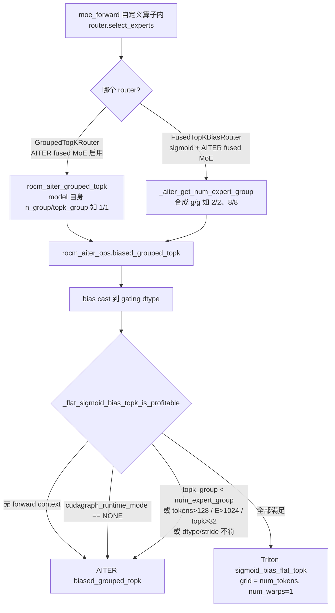

# PR #63076: [ROCm][Perf] Triton sigmoid+bias top-k when MoE grouping eliminates nothing

> **Author**: @chennyiiis | **State**: OPEN | **Date**: 2026-10-22
> **Branch**: `rocm-sigmoid-bias-topk` → `main` | **Labels**: rocm, verified
> **Changes**: +475 -0 lines across 3 files | **ROCm 相关性**: 完全相关（AITER MoE 路由 dispatch + 新 Triton kernel，仅 ROCm 路径）
> 本报告分两部分：§1–6 为 PR 详细总结，§7–8 为 ROCm review 意见。

---

## 1. 总结 (Summary)

当 MoE 路由的分组阶段“什么都不淘汰”（`topk_group >= num_expert_group`，即所有 group 都被选中）时，grouped top-k 退化为“sigmoid(logits)+bias → 全局 top-k → 取 pre-bias sigmoid 作为权重（可选 renorm，乘 `routed_scaling_factor`）”。本 PR 新增一个寄存器驻留（register-resident）的 Triton kernel `sigmoid_bias_flat_topk`，并在 `rocm_aiter_ops.biased_grouped_topk` 这一 ROCm 两个 router 共同到达的封装点上，在“形状满足 + 当前 step 处于 CUDA graph 模式”时替换 AITER 的 `biased_grouped_topk`。作者声称该路由算子在 gfx942 graph replay 下快 1.67×–2.15×，但明确**不声称端到端收益**（e2e +0.4%–0.8%，在噪声范围内）。

## 2. 背景与动机 (Background & Motivation)

- Moonlight-16B-A3B、Kimi-VL-A3B、Kimi-Linear、Kimi-K2、Kimi-K3 等 DeepSeek-V3 架构 checkpoint 声明 `use_grouped_topk=True` 但 `n_group=1, topk_group=1`，分组阶段是恒等变换；ROCm 上它们仍走 AITER `biased_grouped_topk_hip`。作者（借助 Hyperloom 工具发现）认为 AITER 在这种退化形状下仍做 LDS group scan，浪费 decode 延迟（docstring 称约 11 µs/MoE 层）。
- 另一条路径：`FusedTopKBiasRouter` 在 AITER fused MoE 启用时会用 `_aiter_get_num_expert_group` 合成一个 AITER 有实例化的分组数（例如 64 专家 → 2/2），`topk_group == num_expert_group`，同样是“不淘汰任何 group”。
- 迭代历史：初版只特化 `rocm_aiter_grouped_topk`，并带一个 env var；reviewer @simondanielsson 要求不加开关、自动只在有收益时启用，并质疑是否应改 router factory 让此类模型不走 GroupedTopKRouter。作者论证了 factory 改动会改变 `routing_method_type`（DeepSeekV3 → MiniMax2）并影响 AITER mxfp4 experts，且 FusedTopKBiasRouter 仍会调到 grouped kernel，于是把特化下沉到 `rocm_aiter_ops.biased_grouped_topk` 封装点。
- eager 模式下实测 −1.8%~−3.5% 的 e2e 回退（Triton Python launch 开销 vs 单次 C++ dispatch），因此加了 `cudagraph_runtime_mode != NONE` 的门控。
- 与 #49870 的关系：#49870 处理的是 AITER fused MoE **未**启用时的同一退化形状。

## 3. 代码修改分析 (Code Change Analysis)

### 3.1 修改的模块

| 文件 | 改动 |
|------|------|
| `vllm/model_executor/layers/fused_moe/router/rocm_sigmoid_bias_flat_topk.py`（新增 203 行） | Triton kernel `_sigmoid_bias_flat_topk_kernel`（fast path + exact-tie 慢路径）、形状门控 `can_use_sigmoid_bias_flat_topk`、launcher `sigmoid_bias_flat_topk` |
| `vllm/_aiter_ops.py`（+60） | 新增模块级 `_flat_sigmoid_bias_topk_is_profitable()`（forward context 的 graph 模式检查 + 形状门控）；在 `rocm_aiter_ops.biased_grouped_topk` 中 bias cast 之后插入替换分支 |
| `tests/kernels/moe/test_rocm_aiter_topk.py`（+212） | 以 AITER 封装为参考的正确性测试（10 种形状 × dtype × renorm）、分组退化 1/2/4/8、bias dtype cast、`routed_scaling_factor`、以及 wrapper 替换条件测试 |

### 3.2 架构 / 流程图

调用路径与新的 dispatch 决策：



Kernel 内部（每 token 一个 wave）：

```mermaid
flowchart TD
    K0[load logits 行 + bias, BLOCK_E=next_pow2 E] --> K1[s = 1/(1+exp2(-x·log2e)); NaN→0; sc = s + b]
    K1 --> K2[TOPK 轮 tl.max + 等值失效<br/>记录每个专家被选中的轮次 rnd]
    K2 --> K3{n_picked == TOPK?}
    K3 -->|是：无精确平局| K4[按 rnd 作为输出槽位写 s·scale 与 id]
    K3 -->|否：存在精确平局| K5[打包 int64 key = 保序 score<<32 | BLOCK_E-1-idx<br/>TOPK 轮 max，平局取低 id]
    K5 --> K6[重新从 logits 计算 pre-bias sigmoid → renorm/scale → 写出]
```

### 3.3 关键实现细节

- **Fast path**：每轮 `m = max(v)`、`hit = v == m`、记录 `rnd[hit] = k`。若最终恰好选出 `TOPK` 个专家，说明每轮只命中一个（无精确平局），轮次 k 直接是输出槽位（降序），权重直接来自寄存器中的 `s`。
- **慢路径（精确平局）**：`okey = bits ^ ((bits >> 31) & 0x7FFFFFFF)` 把 fp32 映射为保序 int32；低 32 位放 `BLOCK_E-1-idx`，使 key 唯一且平局偏向低 expert id；sentinel 为 `INT64_MIN` 量级。
- **门控** `can_use_sigmoid_bias_flat_topk`：bias 非 None、`topk_group >= num_expert_group`、2D 且最后一维连续、`num_tokens <= 128`、`num_experts <= 1024`、`topk <= min(32, E)`、bias numel == E 且连续、gating ∈ {fp32, bf16, fp16}、ids int32 / weights fp32 且最后一维连续。**无 arch 门控**。
- **graph 模式门控**：`get_forward_context().cudagraph_runtime_mode == NONE` → AITER；无 forward context（`AssertionError`）→ AITER。
- 行 stride 显式传入（`stride_wm/stride_im`），因此 AITER fused shared experts 时 `topk_weights` 是 `[T, topk+n_shared]` 缓冲的列切片也能正确写入；行偏移用 `pid.to(tl.int64)`，无 int32 溢出。
- 不新增 env var，不改 router 选择与 `routing_method_type`。

## 4. 涉及的技术原理 (Technical Principles)

- **DeepSeek-V3 式 noaux_tc 路由**：`score = sigmoid(logit)`，选择用 `score + e_score_correction_bias`（负载均衡偏置），但输出权重用 pre-bias 的 `score`；可选 renorm 后乘 `routed_scaling_factor`。分组版先按组内 top-2 之和选 `topk_group` 个组，再在被选组内做 top-k；当 `topk_group >= num_expert_group` 时分组阶段为恒等，等价于全局 top-k。
- **AITER `biased_grouped_topk`**：Python 入口按条件分派到 FlyDSL herd（opt-in，`AITER_FLYDSL_USE_HERD=1`，gfx950/gfx1250）、gfx1250 精确 sigmoid 路径、`biased_grouped_topk_hip`（HIP，内含 LDS 版与 v0.1.26 新增的寄存器版 `topk_reg_kernel`）或 `moe_fused_gate`。
- **CUDA/HIP graph 与 launch 开销**：graph replay 时 Python 不再执行，kernel 的优势只剩 device time；eager 下 Triton 的 Python launcher 开销（数 µs）大于单个 C++ dispatch，因此本 PR 只在 graph 模式启用。vLLM 的 `moe_forward` 是自定义算子，对 Dynamo 不透明，router 的 Python 分支在 capture 时执行一次，其决定被“烤”进图里。
- **wave64 单 wave reduction**：`num_warps=1` 在 AMD 上即一个 64-lane wavefront，`tl.max` 是纯 wave 内 DPP/permute 归约，无 LDS barrier；BLOCK_E=1024 时每 lane 持有 16 个元素。

## 5. 评论区讨论亮点 (Discussion Highlights)

- **@simondanielsson**（多轮 review）：① 能否改 router factory 让“无分组”模型根本不走 grouped op，或者把 fallback 做进 AITER？② 不要新 env var，自动只在有收益时启用；③ 要求 e2e 1k/1k、8k/1k、64k/1k 多并发数据以及 GPQA/NIAH；④ 最新一轮：**“如果没有性能收益，是否还值得加？”**，并 @tjtanaa / @shen-shanshan 征求意见——目前悬而未决。
- **@chennyiiis**：论证 factory 改动会把 `routing_method_type` 从 DeepSeekV3 变为 MiniMax2，影响 AITER mxfp4 experts 的 `_supports_routing_method` 与 `renormalize`；FusedTopKBiasRouter 仍会以合成的 2/2 调到 grouped kernel，因此把特化移到 wrapper。发现 eager 回退后加了 graph 模式门控。查明 8k/64k 崩溃源于 `vllm bench serve` random 数据集按 `tokenizer.vocab_size`(163842) 采样、超出 embedding 行数(163840)，与本 PR 无关。
- **@Fangzhou-Ai**：问 `_MAX_*` 常量是否只从 Kimi-K3 推出——作者在注释中解释为“形状上界而非模型上界”，但实测仅覆盖 256/384 专家（见 §7）。
- 测试精简：按 reviewer 要求删掉了门控表测试、改用 `set_random_seed`；作者称精简后的套件“正在 gfx942 上重跑”，尚未在评论中确认结果。

## 6. 风险与潜在问题 (Risk Analysis)

| 风险 | 严重程度 | 说明 |
|------|---------|------|
| 性能基线与 main pin 的 AITER 不一致 | High | 见 §7 ⚠️【性能】AITER v0.1.26 已有寄存器版路径 |
| 启用范围宽于验证（gfx950、E=896、Kimi-K2/K3） | Medium | 见 §7 ⚠️【兼容性】 |
| 与 AITER 非逐位等价（sigmoid 精度、平局规则） | Medium | 见 §7 ⚠️【正确性】；实测 5/3328 次路由 id 不同 |
| 测试覆盖：精确平局慢路径无定向测试、无 AMD CI 结果 | Medium | 见 §7 ⚠️【测试】 |
| 净收益存疑 / 维护成本 | Medium | e2e 无收益，maintainer 已质疑价值 |
| graph capture 期间首次 Triton JIT | Low | 见 §7 📝 |
| 注释/文档与实现漂移 | Low | 见 §7 📝 |

---

## 7. Review 意见 (Findings)

| 类型 | 🔴 | ⚠️ | 📝 |
|------|----|----|----|
| 性能 | — | 1 | — |
| 兼容性 | — | 1 | — |
| 正确性 | — | 1 | 1 |
| 测试 | — | 1 | — |
| 设计 | — | — | 1 |
| 注释/文档 | — | — | 1 |

---

**⚠️【性能】PR 的对比基线是旧版 AITER；main pin 的 AITER v0.1.26 已为同一退化形状提供寄存器驻留 kernel** `[已验证]`

- **问题**: 新文件 docstring（`rocm_sigmoid_bias_flat_topk.py:9-13`）与 `_aiter_ops.py:2119-2122` 的 1.67×–2.15× 依据是“AITER 把 biased score 放在 LDS 里做 16 轮串行 scan”。但 vLLM main 的 `docker/Dockerfile.rocm_base` pin `AITER_BRANCH="v0.1.26"`，该版本 `aiter_meta/csrc/kernels/topk_softmax_kernels_group.cu` 的 `LAUNCHER_TOPK_REG()` 在 `topk_grp == num_expert_group`、wave64、`num_experts % 64 == 0`、experts-per-lane ∈ {2,3,4,6,8,14}（即 E ∈ {128,192,256,384,512,896}）、`4 <= topk <= 32` 时**先**派发到寄存器版 `topk_reg_kernel`，正是 PR 微基准的 256/384 专家形状，也覆盖 Kimi-Linear(256/8)、Kimi-K2(384/8)、Kimi-K3(896/16)。作者在 Limitations 中承认 e2e/精度对比用的是容器自带的旧 vLLM + 旧 AITER（“today's main cannot start against this image's AITER”）。
- **影响**: 在 main 实际使用的 AITER 上，被替换的很可能已不是 LDS kernel，PR 声称的 device-time 收益没有被测量过，可能大幅缩小甚至为负；而 e2e 本来就在噪声内。合入后可能是“零收益 + 额外 200 行 kernel + 数值行为变化”。只有 E=64（Moonlight/Kimi-VL，EPL=1 不在寄存器版列表）仍落在 LDS 路径。
- **行动**: 作者应当在 AITER v0.1.26（main 的 pin）上重测微基准，至少覆盖 E=64/256/384/896 × tokens 1/8/32/128，与 `biased_grouped_topk_hip` 的寄存器版直接对比；若仅 E=64 仍有收益，建议把门控收窄到 AITER 寄存器版不覆盖的形状，或把该优化提交到 AITER 侧（reviewer 已提出此选项）。

**⚠️【兼容性】启用范围宽于验证范围：无 arch 门控，gfx950 与 E>384 均未测** `[已验证]`（影响 `[推测]`）

- **问题**: `can_use_sigmoid_bias_flat_topk`（`rocm_sigmoid_bias_flat_topk.py:131-163`）只检查形状/dtype，`_MAX_EXPERTS=1024`、`_MAX_TOPK=32`、`_MAX_TOKENS=128`（`:36-41`）。PR 所有数据均来自单张 MI300X (gfx942)，微基准仅 256/384 专家，e2e 仅 64/256 专家模型。代码注释点名的 Kimi-K2 (384/top-8) 与 Kimi-K3 (896/top-16，`vllm/models/kimi_k3/amd/linear.py` 通过 `use_grouped_topk/num_expert_group/topk_group` 进入 FusedMoE）主要部署在 MI355X (gfx950)，均会在 graph 模式下静默切到新 kernel。另外 FusedTopKBiasRouter 的合成分组（如 256 专家 → 8/8）也会命中，涉及 sigmoid+bias 且无分组的模型（例如 MiniMax-M2 一类，`[推测]`）。
- **影响**: gfx950 上 AITER 有 gfx950 专属路径（FlyDSL herd 等），Triton 单 wave + BLOCK_E=1024（每 lane 16 个 fp32 + 慢路径 16 个 int64 key）在 gfx950 上的寄存器占用与延迟均未测量，可能比 AITER 慢；`_MAX_TOKENS=128` 是 token 数上界而非相位判断，短 prefill/混合批在 PIECEWISE graph 下同样命中，其收益也未测。
- **行动**: 建议作者要么补充 gfx950 + E=896/top-16 + E=384/top-8 的微基准（graph replay）与一次 Kimi-K2 路由一致性比对，要么在门控中加入已验证的 arch / 专家数范围，把未验证组合留给 AITER。

**⚠️【正确性】与 AITER 并非逐位等价：sigmoid 计算方式与精确平局规则都不同，注释却声称 “Same formula” / “bit-exact” / “In-place equivalent”** `[已验证]`（与 5/3328 不一致的因果关系 `[推测]`）

- **问题**: ① `rocm_sigmoid_bias_flat_topk.py:67-68` 注释称“Same formula as the AITER kernel”，但 AITER v0.1.26 用 `__builtin_amdgcn_rcpf(1.0f + exp2f(-C_LOG2E * x))`（近似倒数 `v_rcp_f32`），而 Triton 的 `1.0 / (...)` 在 fp32 下是 IEEE 正确舍入除法——两者可差 1 ulp，PR 自己测到 4.77e-07 的权重差即此量级。② `:100-101` 的平局规则“取低 expert id”，而 AITER 寄存器版用 `legacy_topk_tie_rank()`（按 lane 置换的遗留顺序），并不等于低 id 优先。③ `:174-175` docstring 称 “In-place equivalent of aiter.biased_grouped_topk”。
- **影响**: 在 biased score 近似平局时（1 ulp 内），两条路径会选不同专家——PR 的 live 比对中 Moonlight 有 5/3328 次调用 id 不一致，与此吻合。单次影响小，但这意味着 graph 模式与 eager 模式（仍走 AITER）对同一输入可能路由到不同专家，跨模式的确定性/可复现性（例如 debug 时 `--enforce-eager` 复现线上问题）被破坏。
- **行动**: 作者应当修正注释与 docstring，明确“与 AITER 选择集合在非近似平局时一致，近似平局和精确平局时可能不同”；若希望真正对齐，建议在 Triton 中改用近似倒数（如 `tl.math.fast_dividef` 或 rcp 内建）并实现与 AITER 一致的平局次序，再用 live 比对确认 3328/3328。

**⚠️【测试】精确平局慢路径实际上没有被测试覆盖；修剪后的测试结果与 AMD CI 结果均缺失** `[已验证]`

- **问题**: 所有正确性测试用 `torch.randn` 生成 fp32 → bf16/fp32 的 logits 和 bias（`test_rocm_aiter_topk.py:405-417`），在 E≤1021 下几乎不可能出现 `sc` 的精确相等，因此 `n_picked != TOPK` 的慢路径（`rocm_sigmoid_bias_flat_topk.py:99-128`，包括 int64 保序 key、sentinel、重新计算 sigmoid）基本不会执行。而慢路径恰恰在 CUDA graph 的 padding 行（logits 全 0 → 所有 s=0.5、sc 只差 bf16 bias，bias 值重复概率很高）上真实触发。另外 PR 描述称精简后的套件“正在重跑”，checks 中没有任何 CI 运行记录（vLLM 默认不触发 CI，需要 `/amd-ci run`）。
- **影响**: 慢路径中的位运算/选择/写回若有错误（例如负分数的 key 映射、`-0.0` 与 `+0.0` 的排序），只会在 padding 行或真实平局时出现，现有测试捕获不到；未经 AMD CI 的 Triton kernel 有静默数值错误合入 main 的风险。
- **行动**: 建议作者补一个定向测试：构造包含精确平局的输入（如全零 logits + 含重复值的 bias、以及 top-k 边界上两个专家同分），断言选中的 id 集合与 Python 参考（按 score 降序、平局取低 id）一致，权重与 AITER 在 tol 内一致；并请 maintainer 触发 `/amd-ci run`，在 PR 中贴出修剪后套件的通过结果。

**📝【正确性】Triton kernel 的首次 JIT 编译发生在 CUDA graph capture 内部** `[已验证]`（影响 `[推测]`）

- **问题**: `gpu_model_runner._warmup_and_capture` 的 warmup 用 `cudagraph_runtime_mode=CUDAGraphMode.NONE` 跑 `_dummy_run`，而新门控在 NONE 时返回 False，所以 warmup 永远走 AITER；Triton kernel 第一次被 launch（触发 JIT 编译与 `hipModuleLoad`）是在第一次 capture 中。
- **影响**: 冷 Triton cache 时会把编译时间计入 capture；若 ROCm/Triton 某版本在 capture 中加载模块受限，会表现为 capture 失败。作者 e2e 跑通说明当前环境可用，但这一依赖值得显式确认。
- **行动**: 建议 review 时追问作者是否在冷 Triton cache 下验证过 graph capture；可考虑在模块首次使用时（或 `process_weights_after_loading` 阶段）用 dummy 输入预热一次 kernel。

**📝【设计】在 e2e 无收益的前提下，新增一条 Triton 路由分支的维护成本值得讨论** `[已验证]`

- **问题**: PR 自述“No end-to-end speedup is claimed”，maintainer @simondanielsson 已提出“没有性能收益是否还要加”；加上第一条 finding（main 的 AITER 已有寄存器版），收益可能进一步缩小。新增内容包括 200 行 Triton kernel、`_aiter_ops.py` 中第三种路由分派、数值行为与 eager 路径分叉。
- **行动**: 建议作者在 v0.1.26 上重测后给出明确结论；若收益仅限 E=64 小模型，建议优先在 AITER 侧补齐（让 `LAUNCHER_TOPK_REG` 覆盖 EPL=1），而非在 vLLM 中维护平行实现。

**📝【注释/文档】若干注释与当前实现不一致** `[已验证]`

- **问题**: ① `rocm_sigmoid_bias_flat_topk.py:77` 写“16 rounds of fp32 max”，实际是 `TOPK` 轮；② 模块 docstring `:17-21` 描述“每轮一次 int64 key 的 tl.max”，这已是平局时的 fallback 而非主路径；③ `:10-13` 对 AITER 的描述（LDS、16 轮、~11 µs）对应旧版 AITER，与 v0.1.26 不符；④ `_aiter_ops.py:2119-2122` 把未在 main AITER 上复测的 1.67×–2.15× 写进 docstring。
- **行动**: 建议作者同步修正这些注释，避免把会过时的性能数字写入代码 docstring（放在 PR 描述即可）。

## 8. 结论 (Verdict)

⚠️ **NEEDS WORK** — 实现本身的边界处理（stride、int64 偏移、NaN、bias cast、graph 门控位置）基本扎实，未发现可具体触发的数值错误；但核心性能依据是对旧版 AITER 测的，而 main pin 的 AITER v0.1.26 已为 256/384/896 专家提供寄存器版 kernel，加上 gfx950/大专家数未验证、与 AITER 的非等价性被注释掩盖、平局慢路径无测试，在合入前应先在 main 的 AITER 上重新证明收益并收窄或补充验证范围。

## 9. 英文 Review 评论 (Copy-Paste English Comments)

**C1** `vllm/_aiter_ops.py:2116-2123` — ⚠️ comment

```text
The 1.67x-2.15x figure here was measured against the AITER in your container, but main pins AITER v0.1.26 (docker/Dockerfile.rocm_base), and that version already dispatches this exact shape to a register-resident kernel: LAUNCHER_TOPK_REG() in topk_softmax_kernels_group.cu fires when topk_grp == num_expert_group, num_experts % 64 == 0, experts-per-lane in {2,3,4,6,8,14} (E = 128/192/256/384/512/896) and 4 <= topk <= 32. That covers the 256/384 micro-benchmark shapes as well as Kimi-Linear, Kimi-K2 and Kimi-K3, so the LDS-scan kernel described in the new module docstring is likely no longer what gets replaced. Could you re-run the graph-replay micro-benchmark against v0.1.26 for E = 64/256/384/896? If only E=64 (EPL=1, outside AITER's register path) still benefits, I think the gate should be narrowed to that, or the fix should go into AITER instead.
```

**C2** `vllm/model_executor/layers/fused_moe/router/rocm_sigmoid_bias_flat_topk.py:67-68` — ⚠️ comment

```text
This is not quite the same formula as AITER: AITER v0.1.26 computes __builtin_amdgcn_rcpf(1.0f + exp2f(-C_LOG2E * x)), i.e. an approximate v_rcp_f32, while `1.0 / (...)` here is an IEEE-rounded fp32 division, so the two can differ by 1 ulp. That matches the 4.77e-07 weight deltas and plausibly explains the 5/3328 Moonlight calls whose selected ids differed. Tie-breaking also differs: the slow path picks the lower expert id (L100-101), whereas AITER's register path orders ties with legacy_topk_tie_rank(). Since eager steps still use AITER, the same input can now route differently in graph vs eager mode. Could you either align the numerics/tie order, or update this comment and the "In-place equivalent" docstring (L174-175) to state the near-tie divergence explicitly?
```

**C3** `vllm/model_executor/layers/fused_moe/router/rocm_sigmoid_bias_flat_topk.py:36-41` — ⚠️ comment

```text
The gate accepts up to 1024 experts / top-32 / 128 tokens on any ROCm arch, but all measurements are on a single MI300X (gfx942) with 256/384 experts. Kimi-K2 (384/top-8) and Kimi-K3 (896/top-16), both named in the comments above, are mostly deployed on MI355X (gfx950), where AITER has its own gfx950-specific paths and where BLOCK_E=1024 with num_warps=1 (16 fp32 values plus 16 int64 keys per lane in the tie path) has not been profiled. Could you either add gfx950 graph-replay numbers for E=384/top-8 and E=896/top-16, or restrict the gate to the arch/expert range you have actually validated so the rest keeps AITER?
```

**C4** `tests/kernels/moe/test_rocm_aiter_topk.py:465-493` — ⚠️ comment

```text
With randn logits and biases, exact ties in the biased score are essentially impossible at these sizes, so the n_picked != TOPK branch of the kernel (the int64 order-preserving key, the sentinel and the sigmoid recomputation) is effectively never executed by this suite. That branch does run in production, e.g. on CUDA-graph padding rows where all logits are equal and the bf16-cast bias has duplicate values. Could you add a targeted case with constructed ties (all-zero logits plus a bias with repeated values, and a tie straddling the top-k boundary) and check the ids against a simple Python reference with lower-id tie-breaking? It would also help to post the result of the trimmed suite and an `/amd-ci run` before merge.
```
