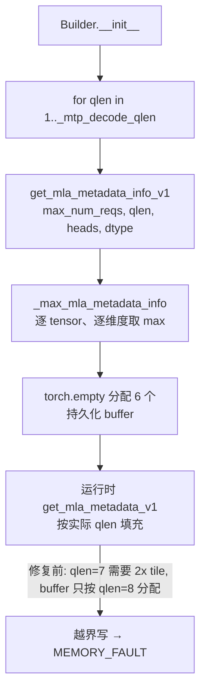

# PR #63116: [Bugfix][ROCm] Size AITER MLA persistent metadata for every decode query length

> **Author**: @BaoYunkai | **State**: OPEN | **Date**: 2026-10-22
> **Branch**: `BaoYunkai:bugfix/yunkai/aiter-mla-metadata-qlen-sizing` → `vllm-project:main` | **Labels**: bug, rocm
> **Changes**: 2 files（`rocm_aiter_mla.py` 新增 helper 并改写一次调用；测试文件新增 1 个用例、改 1 处断言）| **ROCm 相关性**: 完全相关
> 本报告分两部分：§1–6 为 PR 详细总结，§7–8 为 ROCm review 意见。
>
> **数据来源说明**: GitHub API 匿名限流（403，约 25 分钟后恢复），未能拉取完整 JSON。本报告基于 `github.com/.../pull/63116.diff` 的完整 diff 与 PR 页面摘要（描述、评论概要）。未获取 CI check 详情和 inline review comments；未在本地检出源码做跨文件验证（`_mtp_decode_qlen` 与 `reorder_batch_threshold` 的关系仅由测试断言推断）。

---

## 1. 总结 (Summary)

`AiterMLAMetadataBuilder` 原先只用一次 `get_mla_metadata_info_v1(max_num_reqs, _mtp_decode_qlen, ...)` 来决定持久化 MLA decode metadata buffer 的大小，隐含假设 buffer 需求随 qlen 单调增长。该假设在 gfx950 上不成立，导致小 qlen 时 buffer 不够，warmup 阶段 `HSA_STATUS_ERROR_MEMORY_FAULT`。PR 对 qlen = 1..threshold 各调用一次，并对每个维度取最大值来分配 buffer。

## 2. 背景与动机 (Background & Motivation)

- 触发场景（PR 描述）：Kimi-K3 + DSpark draft，TP4，7 个 speculative token，bf16 KV cache，16 heads/rank。draft 以 k-token block 运行，threshold 为 k+1=8，builder 需服务 1..8 的所有 qlen。
- 根因（PR 描述 + 测试 docstring）：gfx950 上 aiter 对 bf16、packed rows（qlen×heads）< 128 的 block 以 64 分块，否则以 128 分块。16 heads × 7 tokens = 112 行，按 64 分块得 2 个 tile；16 × 8 = 128 行，按 128 分块得 1 个 tile。所以 qlen=7 需要的 work buffer 是 qlen=8 的两倍。原代码只按最大 qlen（8）定尺寸，qlen=7 的 metadata 写越界。
- 范围声明：不影响无 speculative decoding 的配置，也不影响 16-head fp8 KV cache（到 threshold 8）。

## 3. 代码修改分析 (Code Change Analysis)

### 3.1 修改的模块

| 文件 | 改动 |
|------|------|
| `vllm/v1/attention/backends/mla/rocm_aiter_mla.py` | 新增 `_max_mla_metadata_info()`（逐维度取最大）；`AiterMLAMetadataBuilder.__init__` 中循环 qlen=1..`_mtp_decode_qlen` 调 `get_mla_metadata_info_v1` 并合并；补充注释 |
| `tests/v1/attention/test_rocm_aiter_mla_mtp_split.py` | 已有断言由单次调用改为 qlen=1..threshold 的调用列表；新增 `test_builder_sizes_metadata_for_every_decode_qlen`，用 mock 复现 gfx950 分块规则 |

### 3.2 架构 / 流程图



### 3.3 关键实现细节

- `_max_mla_metadata_info`：`zip(*infos)` 把 6 个 tensor 的 (shape, dtype) 按位置对齐；int shape 归一化为 1 元 tuple，再 `zip(*shapes)` 逐维取 max；dtype 取第一项。
- 返回值 shape 现在永远是 tuple（例如 `(257,)`），原先可能是 int；`torch.empty` 两者都接受。
- `max_split_per_batch`（`_asm_dcp_verify` 时传入，避免 reduce scratch 按容量估算成约 9 GiB）在每次调用中保持。
- 初始化多调用 threshold 次（≤8 次）的纯 Python 查询，开销可忽略。

## 4. 涉及的技术原理 (Technical Principles)

- **aiter persistent MLA metadata**：`get_mla_metadata_info_v1` 返回 work_meta_data / work_indptr / work_info_set / reduce_indptr / reduce_final_map / reduce_partial_map 六个 buffer 的尺寸；`get_mla_metadata_v1` 在运行时按 batch 的实际 qlen 填充。尺寸由 info 函数预估，若预估偏小，kernel 写越界，表现为 GPU memory fault 而非 Python 异常。
- **非单调性**：split-KV 调度把 `qlen × heads` 切成 tile，tile 大小取决于 arch、dtype 和 packed rows，所以 tile 数对 qlen 并非单调。按单点（最大 qlen）定尺寸只在单调时才安全。
- **MTP/DSpark 的 qlen 集合**：speculative decode 的 verify 以及被 reorder 到 decode 区的请求，qlen 可取 1..threshold 内任意值，builder 必须覆盖整个区间。

## 5. 评论区讨论亮点 (Discussion Highlights)

- @frida-andersson 要求给出完整 serve 命令，并收窄 fp8 的说法。
- 作者补充了命令，并把 fp8 的声明限定为"16-head fp8 到 qlen 8"，同时说明 32-head fp8 在 gfx950 上行为不同（见 §7 F2）。
- claude[bot] 有评论但 fork 上 review 被禁用，内容未能获取。code owners（@AndreasKaratzas, @tjtanaa）已被请求 review，暂无 approval。

## 6. 风险与潜在问题 (Risk Analysis)

| 风险 | 严重程度 | 说明 |
|------|---------|------|
| 正确性：32-head fp8 等其他 arch/dtype/heads 组合 | Medium | 作者自述行为不同；取 max 的方式对任何单个 qlen 的需求都成立，但需求超出 info 函数自身预估的情形无法靠此修复（F2） |
| 测试覆盖 | Medium | 新测试用 mock 复刻 aiter 的分块规则，没有真实 aiter/GPU 回归（F1） |
| 性能/显存 | Low | 每维取 max 后 buffer 只会变大，对 TP4/16 heads 场景增量约为 work buffer 翻倍；reduce scratch 在非 dcp 路径仍按 aiter 估算，需确认无异常增长（F3） |
| 兼容性 | Low | 仅依赖 `get_mla_metadata_info_v1` 现有签名；aiter 版本 v0.1.26 已验证 |
| 可维护性 | Low | 注释解释了非单调性的原因，helper 职责单一 |

---

## 7. Review 意见 (Findings)

| 意见类型 | 数量 |
|------|------|
| 🔴 必须修复 | 0 |
| ⚠️ 建议修复 | 2 |
| 📝 建议/备注 | 2 |

**⚠️【测试】新增单测复刻了被测对象的假设，不能防止真实 aiter 回归** `[已验证]`
- **问题**: `test_builder_sizes_metadata_for_every_decode_qlen`（测试文件约 1026–1036 行）自己实现了 `get_mla_metadata_info_v1`，其中 `64 if 64 <= packed < 128 else 128` 就是 PR 对 aiter 行为的假设。然后断言 builder 的 buffer ≥ 各 qlen 的需求；由于 builder 本身就是对这些 mock 返回值取 max，断言几乎必然成立。
- **影响**: 如果 aiter 的真实分块规则改变（或假设本来就不准确），测试仍然通过；真实 bug（memory fault）只能在 MI355X 上复现，CI 中不会再被捕获。该测试只验证了 `_max_mla_metadata_info` 的合并逻辑。
- **行动**: 建议作者补一个在 gfx950 上、使用真实 aiter 的测试（`skipif` 非 gfx950 / 无 aiter），对 qlen=1..8 调 `get_mla_metadata_info_v1`，断言 builder buffer ≥ 需求；或至少把 mock 测试改名为只测合并逻辑，并在 docstring 注明规则来自 aiter 某版本。

**⚠️【正确性】32-head fp8（及其他未覆盖组合）是否仍有同类越界** `[推测]`
- **问题**: 作者在评论中承认 32-head fp8 在 gfx950 上"行为不同"。PR 的修复前提是"info 函数对每个 qlen 给出的尺寸本身是对的"；描述中没有说明 32-head fp8 的不同是否属于 info 函数低估。
- **影响**: 若是低估，则该配置在任何 qlen 仍会 fault，此 PR 不能解决，但标题和描述暗示的是通用修复。
- **行动**: 建议 review 时追问：32-head fp8 的差异是什么，是否有 issue 追踪；并把"已验证组合"（bf16 16 heads TP4 qlen 1–8；fp8 16 heads 到 8）写进 PR 描述或代码注释。

**📝【性能】buffer 增大的量级与 reduce scratch** `[推测]`
- **问题**: 每维取 max 会放大所有 6 个 buffer。代码注释指出，不传 `max_split_per_batch` 时 aiter 会按容量估算约 9 GiB 的 reduce scratch。
- **影响**: 在非 `_asm_dcp_verify` 路径，如果某个 qlen 的估算对应更大 scratch，显存峰值会上升。
- **行动**: 建议作者贴出修复前后 buffer 总字节数（TP4、max_num_seqs 实际值）。

**📝【可维护性】依赖 `_mtp_decode_qlen == reorder_batch_threshold`** `[推测]`
- **问题**: 实现循环到 `_mtp_decode_qlen`，测试则循环到 `reorder_batch_threshold`；两者在 diff 中没有显式关联（已有断言由单次调用改为列表，隐含二者相等）。
- **影响**: 若日后二者分叉，builder 可能覆盖不全或测试给出假阳性。
- **行动**: 建议作者加一个 assert 或在注释中说明二者的关系。

非 ROCm 项（HK）：无需新增 env var / 依赖 / CI 改动。PR 描述中的数字（max abs error 0.004、MI355X 上 qlen 4–8 通过）为作者自述，未能追溯到脚本输出，标记为 `[unverified]`。

## 8. 结论 (Verdict)

⚠️ NEEDS WORK：修复思路合理，逐 qlen 取 max 是对非单调需求的正确处理，改动小、风险低，没有可构造出触发输入的阻塞性问题。建议补充真实 aiter 的回归测试，并澄清 32-head fp8 的剩余风险后合入。

## 9. 英文 Review 评论 (Copy-Paste English Comments)

**C1** `tests/v1/attention/test_rocm_aiter_mla_mtp_split.py:1035-1036` — ⚠️ comment

```text
I think this test mostly checks the merge logic rather than the bug itself. The mocked get_mla_metadata_info_v1 encodes the same "64 when 64 <= packed < 128, else 128" tiling assumption the fix is based on, and the builder then takes a max over those same mocked values, so the assertion will hold even if the real aiter tiling differs. Could you add a gfx950-only test (skipped without aiter) that calls the real get_mla_metadata_info_v1 for qlen 1..8 and checks the builder's buffers cover every result? If that isn't feasible in CI, please at least note in the docstring which aiter version the tiling rule comes from.
```

**C2** `vllm/v1/attention/backends/mla/rocm_aiter_mla.py:1009-1011` — ⚠️ comment

```text
The comment and PR description explain the bf16 16-head case well. In the discussion you mention that 32-head fp8 on gfx950 behaves differently. Could you clarify whether that is also an under-sized buffer from get_mla_metadata_info_v1 (which taking a max over qlen would not fix), or a separate issue? If it is separate, please link the tracking issue here, and list the combinations you validated (dtype, heads, TP, qlen range) so readers know the scope of this fix.
```
