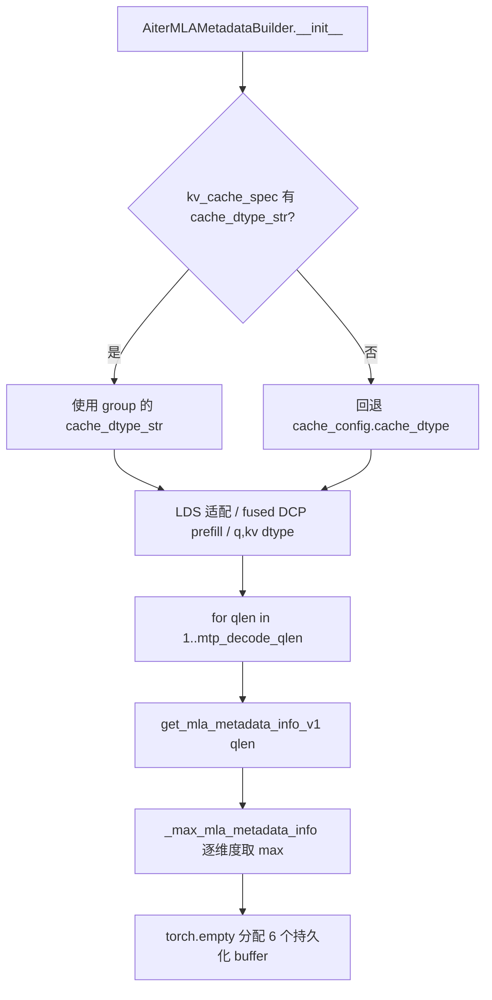

# PR #63117: [Bugfix][ROCm] Take the AITER MLA KV cache dtype from the group's spec

> **Author**: @BaoYunkai | **State**: OPEN | **Date**: 2026-10-22
> **Branch**: 未获取（GitHub API 限流）→ `main` | **Labels**: 未获取
> **Changes**: 约 +250 -20 行，3 个文件（1 个源码 + 2 个测试）| **ROCm 相关性**: 完全相关
> 本报告分两部分：§1–6 为 PR 详细总结，§7–8 为 ROCm review 意见。
>
> ⚠️ **数据来源说明**：`gh` 未安装，REST API 被限流且无 token，因此本次仅通过 `github.com/.../pull/63117.diff|.patch` 获取了 diff 与 commit 信息。**PR 描述、评论区、review、CI 状态均未获取**；§5 为空，§7 中不含 CI 相关判断。`head_sha` 取自 `.patch` 中最后一个 commit（2/2）。

---

## 1. 总结 (Summary)

PR 包含两个 commit，均修改 `AiterMLAMetadataBuilder`（`vllm/v1/attention/backends/mla/rocm_aiter_mla.py`）：
1. **KV cache dtype 来源**：builder 不再使用全局 `cache_config.cache_dtype`，而是使用该 KV cache group 的 `kv_cache_spec.cache_dtype_str`（speculative draft 自带 `kv_cache_dtype`、`kv_cache_dtype_skip_layers` 等场景下与 target 不同）。
2. **持久化 metadata 缓冲区尺寸**：对 `qlen = 1.._mtp_decode_qlen` 逐个调用 `get_mla_metadata_info_v1`，按维度取最大值来分配 buffer，因为在 gfx950 上 aiter 的 buffer 需求对 qlen 非单调。

## 2. 背景与动机 (Background & Motivation)

- 问题 1：builder 以 target 的 `VllmConfig` 构造，draft 模型若 `kv_cache_dtype` 不同，会错误继承 target 的 dtype，导致 `q_dtype/kv_dtype`、LDS 适配判断（segmented DCP verify）、fused DCP prefill 判断全部基于错误 dtype。
- 问题 2：原实现只按 `qlen = _mtp_decode_qlen` 调用一次 `get_mla_metadata_info_v1`，但运行时会服务所有 `qlen ≤ reorder_batch_threshold`。PR 的测试注释称：gfx950 上 bf16 且 packed rows（qlen×heads）< 128 时 aiter 以 64 切 tile，因此 16 heads × 7 tokens 比 16 heads × 8 tokens 需要**两倍**的 buffer（DSpark draft 以 k-token block 运行，threshold 为 k+1）。→ 可能的越界写 / metadata 溢出。（该机制来自 PR 测试注释，**[未验证]**，见 §7。）

## 3. 代码修改分析 (Code Change Analysis)

### 3.1 修改的模块

| 文件 | 说明 |
|------|------|
| `vllm/v1/attention/backends/mla/rocm_aiter_mla.py` | 新增 `_max_mla_metadata_info`；`__init__` 中 dtype 来源改为 group spec；metadata buffer 按所有 qlen 取最大 |
| `tests/v1/attention/test_rocm_aiter_mla_group_kv_cache_dtype.py`（新） | CPU 上用桩运行真实 `__init__`，验证 fp8 group / bf16 target 及反向组合的 dtype |
| `tests/v1/attention/test_rocm_aiter_mla_mtp_split.py` | 更新既有断言为逐 qlen 调用；新增 `test_builder_sizes_metadata_for_every_decode_qlen` |

### 3.2 架构 / 流程图



### 3.3 关键实现细节

- `_max_mla_metadata_info`：对每个 buffer 把标量尺寸规整为 1-tuple，按维度取 max，dtype 取第一个 qlen 的结果。
- `kv_cache_dtype` 的解析从 `_supports_fused_dcp_prefill` 之前上移到 `_supports_segmented_dcp_verify` 之前，供三处复用；原先的 `kv_cache_dtype_str = cache_config.cache_dtype` 改为复用该变量。
- `max_split_per_batch` 在 DCP verify 路径下继续传入每次调用。

## 4. 涉及的技术原理 (Technical Principles)

- **AITER MLA persistent metadata**：`get_mla_metadata_v1` 生成 work/reduce 调度表（work_indptr、work_info_set、reduce_*_map），buffer 预分配以兼容 CUDA/HIP graph；大小由 `get_mla_metadata_info_v1(max_batch, max_qo_len, heads, q_dtype, kv_dtype, ...)` 给出，取决于 packed rows = qlen×heads 与 tile 大小。
- **MTP / speculative decode**：decode 以多 token（qlen>1）运行，同一 builder 服务 1..threshold 的所有 qlen，因此 buffer 必须覆盖所有 qlen 的最坏情况。
- **KV cache group**：hybrid / speculative 场景下不同 layer 可有不同 KV 格式，应以 spec 为准而非全局配置。

## 5. 评论区讨论亮点 (Discussion Highlights)

未获取（API 限流）。commit 信息显示 `Generated-by: Hyperloom` 与 `Co-authored-by: Claude`，属 AI 辅助生成。

## 6. 风险与潜在问题 (Risk Analysis)

| 风险 | 严重程度 | 说明 |
|------|---------|------|
| 正确性：builder 与 impl/forward 的 dtype 不一致 | Medium | 见「Builder 与 impl 的 dtype 来源是否一致」 |
| 测试覆盖：无真实 aiter / GPU 验证 | Medium | 见「测试以桩模拟被测行为」 |
| 性能/显存：buffer 取 max 增大 | Low | 仅 init 时多 N 次调用；显存增量未给出数据 |
| 可维护性：merge 助手静默截断 | Low | 见「_max_mla_metadata_info 静默假设」 |

---

## 7. Review 意见 (Findings)

| 意见类型 | 数量 |
|---|---|
| 【测试】 | 1 |
| 【正确性】 | 1 |
| 【可维护性】 | 1 |
| 【注释/文档】 | 1 |

**⚠️【测试】测试以桩模拟被测行为，未验证 gfx950 真实 aiter 行为** `[已验证]`
- **问题**: `test_builder_sizes_metadata_for_every_decode_qlen` 中的 `get_mla_metadata_info_v1` 是测试内自写桩，把“64 <= packed < 128 时 tile=64”写死在桩里，再断言 buffer ≥ 桩的结果。该断言由修复本身保证，不依赖真实 aiter，因此无法证明 gfx950 上非单调属于事实，也无法在 aiter 行为变化时报警。
- **影响**: 根因（非单调、16 heads×7 vs ×8 需两倍 buffer）仅是 PR 的断言，**[未验证]**；若该行为不存在，则修复无害但无必要；若存在其他 tile 规则，桩无法发现。
- **行动**: 建议作者补充：在 gfx950 上用真实 aiter 对 qlen=1..8 打印 `get_mla_metadata_info_v1` 各尺寸的输出作为 PR 证据，并加一个 `@pytest.mark` 的 ROCm 真机测试（或跳过时说明）。

**⚠️【正确性】Builder 与 impl 的 dtype 来源是否一致** `[推测]`
- **问题**: builder 现在以 group spec 决定 `_mla_q_dtype/_mla_kv_dtype`（`rocm_aiter_mla.py` 约 983–1010 行），但 impl/forward 内 q 量化、`kv_cache_dtype` 仍可能取自 layer 或全局配置。diff 未显示这些路径。
- **影响**: 若 draft layer 为 bf16 而 target 为 fp8（或相反），builder 预设的 q/kv dtype 与 forward 实际调用不一致，metadata 与 kernel 变体不匹配 → 静默数值错误。
- **行动**: 建议 review 时追问作者：impl 侧（`AiterMLAImpl`、`kv_cache_dtype` 的使用点）是否已按 layer 的 `kv_cache_dtype` 工作？并说明是否在 draft 与 target 不同 dtype 的端到端场景（如 DeepSeek MTP + `--kv-cache-dtype fp8` + draft bf16）上做过验证。

**📝【可维护性】`_max_mla_metadata_info` 静默假设** `[已验证]`
- **问题**: 使用 `zip(*shapes)` 在各 qlen 返回的 rank 不一致时会静默截断；dtype 只取第一个 qlen 的结果，不检查一致性。
- **影响**: aiter 将来若让某个 buffer 的 rank/dtype 随 qlen 变化，会得到错误尺寸而非报错。
- **行动**: 建议作者加入 rank/dtype 一致性的 `assert`。

**📝【注释/文档】PR 描述与端到端验证缺失** `[推测]`
- **问题**: 本次未能获取 PR 描述；commit 信息仅有 AI 署名，没有 Test Plan / 结果。
- **行动**: 建议作者在描述中补充复现条件（硬件 gfx942/gfx950、模型、`num_speculative_tokens`）以及修复前后的现象（越界/错误输出）。

## 8. 结论 (Verdict)

⚠️ NEEDS WORK — 方向合理（以 group spec 取 dtype、按所有 qlen 取 max 分配 buffer 都是安全方向的修复，且改动局限在 Tier-1 文件的 init 阶段），但根因缺乏真机证据、测试为自洽桩，且 builder/impl dtype 一致性待确认。未发现带具体触发输入的阻塞项。

## 9. 英文 Review 评论 (Copy-Paste English Comments)

**C1** `tests/v1/attention/test_rocm_aiter_mla_mtp_split.py:1021-1050` — ⚠️ comment

```text
This test stubs get_mla_metadata_info_v1 with a function that already encodes the "tile by 64 when 64 <= packed < 128" rule, and then asserts the buffers cover the stub's output. It passes by construction, so it can't tell us whether real aiter on gfx950 actually has this non-monotonic behavior. Could you attach output from the real aiter (qlen 1..8, 16 heads, bf16) showing the per-buffer sizes, and ideally add a ROCm-only test that calls the real function? That would also catch future aiter tiling changes.
```

**C2** `vllm/v1/attention/backends/mla/rocm_aiter_mla.py:850-855` — ⚠️ comment

```text
The builder now takes the KV cache dtype from the group's spec, which makes sense for draft/skip-layer groups. Could you confirm the impl/forward side (q quantization and the kv_cache_dtype used when launching the kernels) also follows the layer's dtype rather than cache_config.cache_dtype? Otherwise the metadata is sized for one dtype and the kernel runs with another. Have you validated a case where the draft and target dtypes differ end to end (e.g. fp8 target with bf16 draft)?
```
