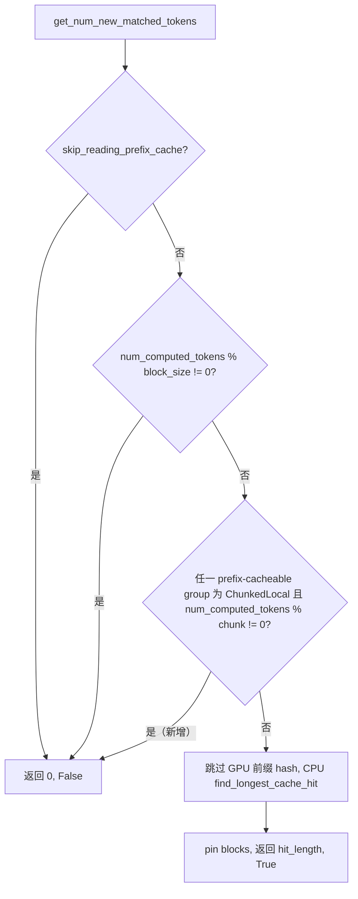

# PR #63266: [Bugfix][KV Offload] Reject misaligned chunked-local CPU suffix hits

> **Author**: @charxwu | **State**: OPEN | **Date**: 2026-10-23
> **Branch**: `charxwu:codex/fix-simple-cpu-chunk-position` → `main` | **Labels**: bug, documentation, verified
> **Changes**: +140 -1 lines across 4 files | **ROCm 相关性**: 不相关（调度层通用 bugfix，仅在 MI350X 上做了验证）
> 本报告分两部分：§1–6 为 PR 详细总结，§7–8 为 review 意见。非 ROCm 相关，已跳过 ROCm 专项规则（A/B/C/D/E/F/G/P）。

---

## 1. 总结 (Summary)

`SimpleCPUOffloadConnector` 在 GPU 前缀结束于 attention chunk 中间时，会接着从 CPU 加载后缀，导致 chunked-local 层的 chunk 边界错位（相对后缀起点 vs. 绝对 token 位置），输出错误。本 PR 在 `get_num_new_matched_tokens` 中增加检查：只要任一参与前缀缓存的 chunked-local group 满足 `num_computed_tokens % attention_chunk_size != 0`，就放弃 CPU 命中，保留 GPU 前缀并重算后缀。

## 2. 背景与动机 (Background & Motivation)

- CPU 侧 `find_longest_cache_hit` 接收的是 `remaining_hashes`（已跳过 GPU 前缀），其 chunked-local 查找把后缀起点当作 chunk 起点，当 GPU 前缀长度不是 chunk 的整数倍时，命中的 block 与绝对位置不对齐。
- 作者在 main（`284c0317c4`）复现：16 token GPU 前缀 + 64 token CPU 命中，冷启动 token 487 vs 混合命中 token 48，logprob 最大误差 4.78。
- 取舍：不去修 CPU 侧查找，而是在入口处保守拒绝（性能换正确性）。

## 3. 代码修改分析 (Code Change Analysis)

### 3.1 修改的模块

| 文件 | 说明 |
|---|---|
| `vllm/v1/simple_kv_offload/manager.py` (+10) | 新增 chunked-local 对齐检查并提前返回 `(0, False)` |
| `tests/v1/simple_kv_offload/test_scheduler.py` (+35) | 6 个参数化单测（local 前缀 0/16/64 × CPU 尾部 block 有/无） |
| `tests/v1/simple_kv_offload/test_integration.py` (+88/-1) | 真实 `LLM` + 微型 Llama4（1 层 chunked-local + 1 层 full attention）回归 |
| `docs/features/kv_offloading_usage.md` (+7) | 记录重算 fallback 行为 |

### 3.2 架构 / 流程图



### 3.3 关键实现细节

- 检查位置在 block 对齐检查之后、`remaining_hashes` 计算之前，只遍历 `prefix_cacheable_group_ids`，读取 `cpu_kv_cache_config` 中的 spec。
- `num_computed_tokens == 0` 时取模为 0，纯 CPU 命中不受影响；chunk 对齐的 GPU 前缀同样保留 CPU 复用。
- 提前返回发生在 pin 之前，不会泄漏 CPU block 引用（单测断言 free block 数恢复）。

## 4. 涉及的技术原理 (Technical Principles)

- **Chunked-local attention（Llama4）**：token 只能看到同一 chunk（如 64 token）内的前文，chunk 边界由绝对位置决定。
- **KV offload 后缀加载**：GPU 前缀之后的部分从 CPU 拷回，查找以后缀为起点；若后缀起点不在 chunk 边界，CPU 侧按"后缀相对位置"划分 chunk，与实际绝对位置不一致，导致被复用的 KV 属于错误的可见窗口。
- **Hybrid KV cache manager**：多个 group（full + chunked-local）共享块表，需所有 group 同时满足条件。

## 5. 评论区讨论亮点 (Discussion Highlights)

- 作者 @charxwu 请求 @shen-shanshan review，并说明在 MI350X 上真实 LLM 回归修复前失败、修复后通过，112 个 scheduler/events 测试全过。
- claude[bot] 因 fork PR 未自动 review；mergify 仅文档预览。暂无实质性设计争论。

## 6. 风险与潜在问题 (Risk Analysis)

| 风险 | 严重程度 | 说明 |
|---|---|---|
| 正确性 | Low | 保守拒绝，仅减少复用，不引入新的错误路径 |
| 性能 | Low–Medium | 非 chunk 对齐的 GPU 前缀 + chunked-local 模型会完全放弃 CPU 命中（见 §7 日志建议） |
| 兼容性 | Low | 仅影响含 `ChunkedLocalAttentionSpec` 的模型（Llama4 等） |
| 测试覆盖 | Low | 单测 + 端到端覆盖较好；未覆盖 `hash_block_size != block_size` 组合 |
| 可维护性 | Low | 集成测试较重，依赖 transformers Llama4 与 `envs.disable_envs_cache()` |

---

## 7. Review 意见 (Findings)

| 意见类型 | 数量 |
|---|---|
| 🔴 | 0 |
| ⚠️ | 0 |
| 📝 | 2 |

**📝【可维护性】新增的 fallback 无日志** `[已验证]`
- **问题**: `manager.py` 新增分支静默返回 `(0, False)`，而相邻的块对齐分支用 `logger.warning_once` 提示原因。
- **影响**: 用户在 chunked-local 模型上发现 CPU 命中率为 0 时难以定位原因。
- **行动**: 建议作者加一条 `logger.debug_once`/`warning_once`，说明是 chunk 对齐导致的重算。

**📝【测试】集成测试对全局 env 缓存的处理** `[已验证]`
- **问题**: `test_integration.py` 中调用 `envs.disable_envs_cache()` 后未恢复，`monkeypatch` 退出时 env 值恢复但缓存开关不会。
- **影响**: 同进程后续测试可能读到不同的 env 缓存行为（是否实际触发取决于测试顺序，未验证）。
- **行动**: 建议作者对照同目录其他测试的做法，用 fixture 恢复或确认无影响。

另：PR 中 MI350X 的数字均可追溯到 PR 描述中的命令；"fresh native build 未声明"已被作者如实说明。CI 状态未能获取（checks 数据格式异常），未做判断。

## 8. 结论 (Verdict)

✅ LGTM。改动小且保守，根因分析与测试（含修复前失败证据）充分；仅有两条非阻塞建议。

## 9. 英文 Review 评论 (Copy-Paste English Comments)

**C1** `vllm/v1/simple_kv_offload/manager.py:389-396` — ⚠️ comment

```text
The fix looks right to me: bailing out before pinning CPU blocks avoids leaking references, and the unit test checks the free-block count. One small ask: the neighbouring block-alignment branch logs a warning_once explaining why the external lookup is skipped, but this new branch returns silently. Could you add a similar (debug/warning once) log saying the CPU hit is skipped because the local prefix is not chunk-aligned? Otherwise a 0% CPU hit rate on Llama4-style models is hard to diagnose.
```

**C2** `tests/v1/simple_kv_offload/test_integration.py:34` — ⚠️ comment

```text
The test calls envs.disable_envs_cache() after setting the env var via monkeypatch, but nothing re-enables the cache afterwards, so monkeypatch teardown restores the env value but not the cache state. Could you check how other tests in this directory handle this and restore it (e.g. via a fixture) so later tests in the same process are not affected?
```
