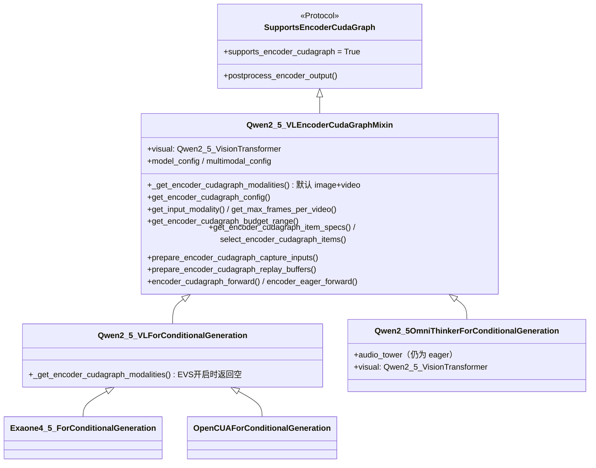
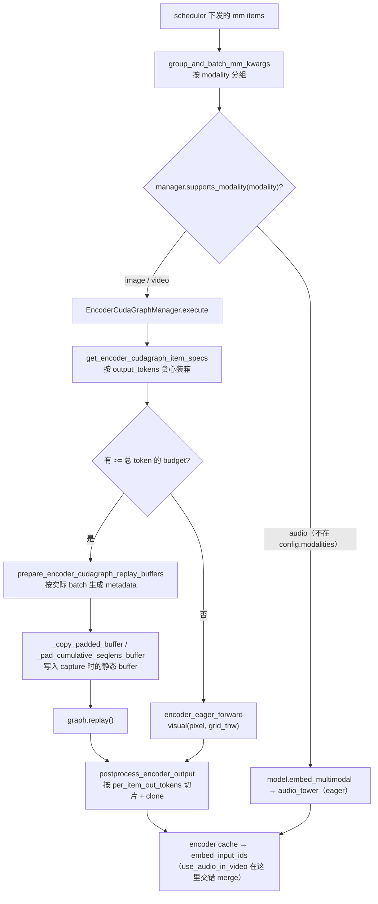

# PR #63374: [MM][CG] Support ViT full CUDA graph for Qwen2.5-Omni

> **Author**: @nlpkiddo-2001 | **State**: OPEN | **Date**: 2026-10-23
> **Branch**: `qwen2_5_omni_vit_cudagraph` → `main` | **Labels**: documentation, multi-modality, qwen, nvidia
> **Changes**: +599 -571 lines across 4 files | **ROCm 相关性**: 部分相关（`qwen2_5_vl.py` 是 CUDA/ROCm 共用的模型文件；encoder CUDA graph 在 ROCm 上可用，AMD MI355 CI 会跑 `test_vit_cudagraph.py`，所以新增的 Omni 用例也会在 ROCm 上运行。PR 本身没有 ROCm 专属代码）
> 本报告分两部分：§1–6 为 PR 详细总结，§7–8 为 ROCm review 意见。

---

## 1. 总结 (Summary)

这个 PR 让 Qwen2.5-Omni 的 thinker（`Qwen2_5OmniThinkerForConditionalGeneration`）在图像和视频输入上支持 ViT 的 encoder CUDA graph（`cudagraph_mm_encoder`），音频编码器仍然走 eager。Omni 与 Qwen2.5-VL 用的是同一个 `Qwen2_5_VisionTransformer`，因此作者把 Qwen2.5-VL 已有的 12 个 encoder CUDA graph 协议方法提取成共享的 `Qwen2_5_VLEncoderCudaGraphMixin`，两个模型都继承它。唯一的模型差异是 EVS：Qwen2.5-VL 在开启 EVS 剪枝时关闭 encoder graph，这一点改成由 `_get_encoder_cudagraph_modalities()` 覆写实现。

## 2. 背景与动机 (Background & Motivation)

- 属于 #38175（各 VLM 支持 encoder CUDA graph 的追踪 issue）的一部分。Qwen2.5-VL 在 #40830 中已经支持，作者在 #38175 中认领了 Qwen2.5-Omni，目前没有其他 PR 在做。
- Encoder CUDA graph 的收益来自去掉 ViT 的 kernel launch 开销。作者在 H200 上测到 eager encoder 约有 23 ms 的固定开销，小图片 encoder 延迟最多快 5.5x；但输入会被 pad 到下一档 token budget，默认 2 的幂档位下，大图反而比 eager 慢（0.61x~0.66x）。
- 选择 mixin 而不是复制：12 个方法中有 11 个对 Omni 原样可用，复制会多出约 300 行重复代码。
- PR 说明中写明使用了 AI 辅助（勾选了 `/pr-checklist` 与 AI assistance）。作者说明未测试的范围有：FA2、Blackwell、**ROCm**、Omni-7B，以及 `use_audio_in_video=True` 的视频。

## 3. 代码修改分析 (Code Change Analysis)

### 3.1 修改的模块

| 文件 | 改动 |
|------|------|
| `vllm/model_executor/models/qwen2_5_vl.py` (+582 -570，按 patience 算法约 +324 -312) | 新增 `Qwen2_5_VLEncoderCudaGraphMixin(SupportsEncoderCudaGraph)`，放在 `Qwen2_5_VLForConditionalGeneration` 之前；原类里 12 个协议方法移入 mixin；原类改为继承 mixin，并覆写 `_get_encoder_cudagraph_modalities()`（EVS 开启时返回 `[]`）；import 增加 `ModelConfig, MultiModalConfig` |
| `vllm/model_executor/models/qwen2_5_omni_thinker.py` (+4 -1) | 继承 `Qwen2_5_VLEncoderCudaGraphMixin`；`multimodal_config` 改为 `get_multimodal_config()`（非 Optional）；新增 `self.model_config`（mixin 的 `get_max_frames_per_video` / `get_encoder_cudagraph_budget_range` 需要） |
| `tests/models/multimodal/generation/test_vit_cudagraph.py` (+11) | 新增 `qwen2_5_omni` 配置（`Qwen/Qwen2.5-Omni-3B`，图像+视频，`core_model`） |
| `docs/design/cuda_graphs_multimodal.md` (+2) | 支持表格新增 Omni 一行；note 中说明 Omni 只在 Hopper 上测了 FA3 与 FlashInfer |

### 3.2 架构 / 流程图

类结构（重构前后）：



运行期 Omni 多模态输入的分发（`gpu_model_runner._execute_mm_encoder`）：



### 3.3 关键实现细节

- **纯移动，已用 AST 核对**：对 `upstream/main` 与 `pr/63374` 的 `qwen2_5_vl.py` 逐方法比较 `ast.dump`，结果是 11 个协议方法与原实现**完全一致**；`get_encoder_cudagraph_config` 唯一的改动是 `modalities` 改为调用 `_get_encoder_cudagraph_modalities()`；`Qwen2_5_VLForConditionalGeneration` 的其他方法、`Qwen2_5_VisionTransformer`、attention/block 等类**没有任何改动**。因此 Qwen2.5-VL 的非 graph 路径（包括 ROCm 分支）行为不变。
- **ROCm 相关分支全部保留**：`compute_attn_mask_seqlen` 中的 `ROCM_AITER_FA`、`compile_native=not current_platform.is_rocm()`、`prepare_encoder_metadata` 里 `MMEncoderAttention.compute_max_seqlen/maybe_compute_seq_lens/maybe_recompute_cu_seqlens` 的后端分派都在未修改的代码里，不受影响。
- **Omni 的输入差异都能被 mixin 处理**：
  - Omni 的 `visual` 构造时没传 `input_norm`，因此是 `IdentityInputNorm`（`input_dtype=None`）。capture 时的 dummy buffer dtype 落到模型 dtype；replay 时 `_copy_padded_buffer` 把 fp32 的 `pixel_values` 隐式转成 bf16，与 eager 路径的 `.type(self.visual.dtype)` 等价。
  - 视频 batch 里额外的 `second_per_grid_ts`、`use_audio_in_video` 两个 key 被 `select_encoder_cudagraph_items` 丢弃，不影响 encoder；音频与视频的交错 merge 发生在 `embed_input_ids`，在 encoder 之后。
  - Omni 没有设置 `supports_encoder_tp_data`。`ModelConfig` 会把 `--mm-encoder-tp-mode data` 回退为 `weights`，因此 manager 的 DP 分片分支不会被触发。
  - `get_max_frames_per_video` 里的 `assert isinstance(info, Qwen2VLProcessingInfo)` 对 Omni 成立（`Qwen2_5OmniThinkerProcessingInfo` 继承 `Qwen2_5_VLProcessingInfo`）。
- **合并状态**：merge-base（10-23）之后，`qwen2_5_vl.py` 与 `qwen2_5_omni_thinker.py` 在 main 上没有变化。docs 与测试文件在 main 上被 #56277（Mistral/Pixtral encoder CG）改过，但 `git merge-tree` 显示可以自动合并，没有冲突。

## 4. 涉及的技术原理 (Technical Principles)

- **Encoder CUDA graph（budget 制）**：`EncoderCudaGraphManager` 按若干 token budget 预先 capture ViT 前向；运行时把一批图像/视频按输出 token 数贪心装进最小的够用的 budget，把输入、`cu_seqlens`、rope cos/sin、window index 等拷进 capture 时的静态 buffer 后 replay，再按每个 item 的实际 token 数切片。超过最大 budget 的批次回退到 `encoder_eager_forward`。
- **padding 与 `cu_seqlens`**：replay 的 metadata 按实际 batch 计算，`cu_seqlens`/`cu_window_seqlens` 的剩余位置用最后一个累计偏移填充，表示空序列；`window_index`/`reverse_indices` 等用 0 填充。`max_seqlen` 在 capture 时取上界（`token_budget * merge^2`，窗口为固定几何上界），因为 FA wrapper 的 `.item()` 值会被烤进 graph。
- **Qwen2.5 ViT 的窗口注意力**：32 个 block 中只有 `fullatt_block_indexes` 做全局注意力，其余按 112px 窗口做局部注意力，需要 `window_index` 重排和 `reverse_indices` 还原。这也是 Qwen2.5 系列 metadata 比 Qwen3-VL 多出 `cu_window_seqlens`/`max_seqlen_window` 的原因。
- **ROCm 上的 ViT 注意力后端**：`RocmPlatform.get_vit_attn_backend` 在 aiter MHA 开启时选 `ROCM_AITER_FA`，否则在 CDNA 上有 `flash_attn` 时选 `FLASH_ATTN`，再否则回退 `TORCH_SDPA`。`flash_attn_maxseqlen_wrapper` 在 ROCm 上不传 `out=`（`supports_out = not is_rocm()`），而 CUDA 上 capture 时会用零初始化的 `out`，规避 #57136 中 padding NaN 的问题。

## 5. 评论区讨论亮点 (Discussion Highlights)

- 目前没有实质性的人工 review。评论只有 mergify 的文档预览链接、github-actions 的欢迎语，以及 `claude[bot]`「来自 fork，自动 review 已禁用」的说明。
- 作者在描述里主动解释了没有加入 `test_eonly_vit_cudagraph_outputs` 的原因：Qwen2.5-VL/Omni 在纯 eager 下，单图与多图同批的输出就有约 4%~8% 的相对差异（BF16 舍入在 32 个 block 中放大），达不到该测试 0.016 的容差。Qwen2.5-VL 本身也不在这个测试里。作者另外在 encoder-only 模式下手动对比了「同一个 padded buffer 上 graph 与 eager 的输出」，`max abs diff = 0`，但这一验证没有写进测试。

## 6. 风险与潜在问题 (Risk Analysis)

| 风险 | 严重程度 | 说明 |
|------|---------|------|
| Qwen2.5-VL 回归 | Low | AST 核对确认是纯移动，非 graph 路径与 ROCm 分支都没有改动 |
| 新用例只做冒烟检查 | Medium | 见 §7 ⚠️【测试】：只断言输出非空，不能发现静默回退 eager 或数值偏差 |
| ROCm 上未验证 | Medium | 见 §7 ⚠️【兼容性】：AMD MI355 CI 会跑这个用例，但作者没有在 ROCm 上测，CUDA 专属的 padding NaN 规避在 ROCm 上不生效 |
| 预计算 embedding 输入 + encoder graph | Low | 见 §7 📝【正确性】：现有问题，现在 Omni 也受影响 |
| 默认 budget 下大图变慢 | Low | 见 §7 📝【性能】：功能默认关闭，作者已说明 |
| diff 可读性 / blame | Low | 见 §7 📝【可维护性】 |

---

## 7. Review 意见 (Findings)

| 类型 | 🔴 | ⚠️ | 📝 |
|------|----|----|----|
| 测试 | — | 1 | — |
| 兼容性 | — | 1 | — |
| 正确性 | — | — | 1 |
| 注释/文档 | — | — | 1 |
| 性能 | — | — | 1 |
| 可维护性 | — | — | 1 |

---

**⚠️【测试】新增的 Omni 用例只检查「有非空输出」，不能证明 graph 被命中，也不能发现数值偏差** `[已验证]`

- **问题**: `tests/models/multimodal/generation/test_vit_cudagraph.py:154-164` 新增的 `qwen2_5_omni` 配置复用了 `test_vit_cudagraph_image/video`。这两个测试只断言 `len(outputs) == N`、`len(output_ids) > 0`、`output_text` 是字符串，没有检查 `graph_hits > 0`，也没有与 eager 输出对比。PR 中最有力的正确性证据（同一 padded buffer 上 graph 与 eager `max abs diff = 0`，以及 full budget 下与普通 eager 完全一致）是手动跑的，没有进入 CI。Omni 也没有加入 `test_eonly_vit_cudagraph_outputs`（理由见 §5，可以接受）。
- **影响**: 以后如果 Omni 的 `supports_encoder_cudagraph` 识别失效（例如 MRO 或 `model_config` 属性被改动），或者 graph 输出出现偏差，这两个测试照样会通过。在 ROCm 上更是如此，见下一条。
- **行动**: 建议作者补一个确定性的 graph-vs-eager 检查，绕开 batch 不变性问题。例如单张图、`encoder_cudagraph_max_vision_items_per_batch=1`，`encoder_cudagraph_token_budgets` 取该图的精确 token 数（不发生 padding），用 `manager.execute` 与 `embed_multimodal` 做 `assert_close`，并断言 `get_cumulative_stats()["graph_hits"] > 0`。可以参照 `_check_eonly_encoder_outputs` 的写法。

**⚠️【兼容性】Omni encoder graph 会在 AMD CI 上运行，但没有在 ROCm 上验证；CUDA 专属的 padding NaN 规避在 ROCm 上不生效** `[已验证]`（ROCm 上是否真会出现 NaN `[推测]`）

- **问题**:
  - `.buildkite/test-amd.yaml` 的 `:amd: (MI355 DPX) Multimodal Models (Standard) 4` 任务会执行 `pytest models/multimodal/generation/test_vit_cudagraph.py -m core_model`（optional 任务），新用例带 `core_model` 标记，测试本身用 `is_cuda_alike()` 守卫，所以会在 MI355 上跑。作者明确写了 ROCm 未测试。
  - `vllm/v1/attention/ops/vit_attn_wrappers.py` 的 `flash_attn_maxseqlen_wrapper` 只在 `current_platform.is_cuda()` 且正在 capture 时，传入零初始化的 `out`，用来规避 #57136（Qwen2.5-VL-3B 在多个 budget graph 共享 pool 时，FA 的 padding 输出未初始化，NaN 污染了有效 token）。ROCm 上 `supports_out = False`，`FLASH_ATTN`/`ROCM_AITER_FA` 都走不到这个规避逻辑。
  - `docs/design/cuda_graphs_multimodal.md:39-40` 新增的 Omni 说明紧挨着「也在 AMD MI350X 上用 FLASH_ATTN 测试过」那一行，读者容易误以为 Omni 也在 ROCm 上验证过。
- **影响**: 如果 ROCm 的 CK/aiter varlen FA 也会把 padding 区域的 NaN 带进有效输出（未验证），那么 Omni（以及 Qwen2.5-VL）在 ROCm 上开启 `cudagraph_mm_encoder` 后会产生 NaN embedding。现有测试只检查输出非空，无法发现这种问题。
- **行动**: 建议作者或 reviewer 在 PR 上用 `/amd-ci run` 跑一次 MI355 的多模态任务；建议 review 时追问 ROCm 维护者：ROCm 上的 FA/aiter varlen 是否需要类似的零初始化输出规避。文档建议把 Omni 那一行改成明确的「Not yet validated on ROCm」，或者调整顺序，避免与 MI350X 那一行产生歧义。

**📝【正确性】预计算 embedding（`image_embeds`/`video_embeds`）输入在 encoder graph 路径会因 `KeyError` 失败（现有问题，现在也覆盖到 Omni）** `[已验证]`（静态追踪，未实际运行）

- **问题**: `qwen2_5_vl.py:1370-1378` 的 `_get_pixel_values_by_modality` 无条件读取 `mm_kwargs["pixel_values"]`/`["pixel_values_videos"]`。`gpu_model_runner._execute_mm_encoder` 只过滤 `prompt_embeds`，`image_embeds` 这类 item 的 modality 仍是 `"image"`，会进入 `encoder_cudagraph_manager.execute` → `select_encoder_cudagraph_items` → `KeyError`。Omni 的 `_parse_and_validate_image_input/_video_input` 支持 `*_embeds` 输入。这段代码与 main 上的 Qwen2.5-VL（以及 Qwen3-VL 的同名方法）完全相同，不是本 PR 引入的。
- **影响**: 触发条件是 `--enable-mm-embeds` + `cudagraph_mm_encoder=True` + 带 `image_embeds` 的请求，结果是 encoder 步骤抛异常。该组合较少见，且两个功能都需要显式开启。
- **行动**: 建议作者在 PR 描述里说明这个限制，或者顺手在 mixin 的 `get_input_modality`/`select_encoder_cudagraph_items` 中，对不含 pixel key 的 batch 让 manager 回退到 `embed_multimodal`（也可以单独提一个 follow-up）。

**📝【注释/文档】`get_multimodal_config()` / `self.model_config` 的改动是 mixin 正确运行的前提，但缺少说明** `[已验证]`

- **问题**: `qwen2_5_omni_thinker.py:1152-1154` 新增 `self.model_config` 并改用 `get_multimodal_config()`。mixin 通过类级注解 `model_config: ModelConfig` / `multimodal_config: MultiModalConfig` 声明依赖，但没有文档说明「使用这个 mixin 的模型必须设置 `visual`、`model_config`、`multimodal_config` 三个属性」。目前 Exaone4.5、OpenCUA 通过继承 Qwen2.5-VL 自然满足这个要求。
- **行动**: 建议作者在 mixin 的 docstring 中写明这三个属性的约定，方便后续模型（例如其他复用 `Qwen2_5_VisionTransformer` 的模型）接入。

**📝【性能】默认 budget 下大图 encoder 变慢，端到端 TTFT 在高负载下变差；数字为单次运行** `[已验证]`（数字本身 `[unverified]`）

- **问题**: PR 自己的数据显示，默认 budget 下 8×672² 为 0.61x，1280×720 为 0.66x；30 req/s 端到端 Mean TTFT 从 14012.6 升到 17826.6 ms（小图）、从 1718.7 升到 2594.1 ms（大图）。表格注明「one run each」，硬件只有 H200。
- **影响**: 功能默认关闭，作者也在描述中说明了取舍，不影响默认用户。但按文档开启的用户，在大图或高负载场景下可能拿到负收益。
- **行动**: 建议作者在 `cuda_graphs_multimodal.md` 中给出 Qwen2.5 系列推荐的细粒度 `encoder_cudagraph_token_budgets`（就是 PR 里的 tuned 列表），并说明大图、高负载场景下的取舍。

**📝【可维护性】类移动导致 diff 显示为 +582/-570，影响 review 与 blame** `[已验证]`

- **问题**: mixin 插在 `Qwen2_5_VLForConditionalGeneration` 之前，默认 myers diff 把整个类显示为删除后重新添加（+582 -570）；用 `--diff-algorithm=patience` 后只有 +324 -312，实际变化就是 12 个方法的移动。本次 review 用 AST 逐方法比较，确认除 `get_encoder_cudagraph_config` 的一行外完全一致。
- **行动**: 建议作者在 PR 描述里提示 reviewer 用 `git diff --diff-algorithm=patience` 或 `--color-moved` 查看，或者附上「方法逐一未改动」的核对方法，降低 maintainer 的 review 成本。

> 共享路径核对：`qwen2_5_vl.py` 中所有 ROCm 相关分支（`ROCM_AITER_FA` 的 max_seqlen 计算、`compile_native=not is_rocm()`、metadata 后端分派）都在未改动的代码里；Exaone4.5 / OpenCUA 两个子类通过 MRO 拿到与之前完全相同的方法。合并检查：与当前 main 自动合并，无冲突。
>
> AI 代码诊断：描述对机制（WHY）解释充分，给出了带单位的延迟/TTFT 数字和命令，也说明了未测试范围。主要信号是测试只做冒烟检查，最关键的数值验证是手动完成的。幻觉符号扫描：`Qwen2_5_VLEncoderCudaGraphMixin`、`get_multimodal_config`、`ModelConfig`/`MultiModalConfig` import、`IdentityInputNorm.input_dtype`、`Qwen2VLProcessingInfo.get_num_frames_with_most_features` 都确认存在。

## 8. 结论 (Verdict)

**⚠️ NEEDS WORK**

重构本身干净：AST 核对确认 Qwen2.5-VL 的行为与 ROCm 分支没有变化，Omni 的输入差异（dtype、额外的视频 key、音频 eager、DP 回退）也都能被 mixin 正确处理。没有找到能给出具体触发输入、且由本 PR 引入的阻塞性问题。但新用例只做冒烟检查，最关键的 graph-vs-eager 一致性没有进入 CI；Omni 在 ROCm 上会被 AMD CI 执行却从未验证过，CUDA 专属的 padding NaN 规避在 ROCm 上也不生效。建议补一个确定性的数值测试，并跑一次 AMD CI 后再合入。

## 9. 英文 Review 评论 (Copy-Paste English Comments)

**C1** `tests/models/multimodal/generation/test_vit_cudagraph.py:154-164` — ⚠️ comment

```text
The new qwen2_5_omni entry only goes through test_vit_cudagraph_image/video, which assert that the output is non-empty. They would still pass if the model silently fell back to eager (e.g. supports_encoder_cudagraph stops matching) or if the graph output drifted. The strongest evidence in the description (graph vs eager max abs diff = 0 on the same padded buffers, and exact match with full budgets) was a manual run. Could you turn that into a deterministic check that avoids the batch-invariance issue you mentioned, e.g. a single image with max_vision_items_per_batch=1 and a token budget equal to that image's exact token count, comparing manager.execute against embed_multimodal and asserting graph_hits > 0 (similar to _check_eonly_encoder_outputs)?
```

**C2** `docs/design/cuda_graphs_multimodal.md:39` — ⚠️ comment

```text
This line sits right above "Encoder CUDA Graph has also been tested with AMD MI350X ...", so readers may assume Qwen2.5-Omni was validated on ROCm, while the PR description says ROCm was not tested. Could you state that explicitly (e.g. "not yet validated on ROCm")? Note that the AMD MI355 "Multimodal Models (Standard) 4" job runs test_vit_cudagraph.py -m core_model, so this new core_model entry will execute on ROCm. Also, the zero-initialized `out` workaround for the padding NaN issue (#57136, which was reported on Qwen2.5-VL) in flash_attn_maxseqlen_wrapper is CUDA-only, because ROCm FA does not take `out`. Could someone trigger `/amd-ci run` so we at least get one ROCm signal before merging?
```

**C3** `vllm/model_executor/models/qwen2_5_vl.py:1370-1378` — 📝 comment

```text
Not introduced by this PR, but it now also applies to Qwen2.5-Omni: _get_pixel_values_by_modality always reads mm_kwargs["pixel_values"] / ["pixel_values_videos"]. _execute_mm_encoder only filters out prompt_embeds, so an image_embeds / video_embeds item (with --enable-mm-embeds) still has modality "image"/"video", reaches encoder_cudagraph_manager.execute, and fails with a KeyError in select_encoder_cudagraph_items. Could you either note this limitation in the description or make the encoder graph path fall back to embed_multimodal when the batch carries embeddings instead of pixels (a follow-up PR is fine)?
```

**C4** `vllm/model_executor/models/qwen2_5_vl.py:1289-1294` — 📝 comment

```text
I verified with an AST comparison that, apart from get_encoder_cudagraph_config calling _get_encoder_cudagraph_modalities(), the 11 methods moved into the mixin are identical to main, and nothing else in Qwen2_5_VLForConditionalGeneration or the vision tower changed. The default diff shows +582/-570 because the class moved; `git diff --diff-algorithm=patience` shrinks it to about +324/-312. Mentioning this in the description would save maintainers time. Could you also add a short note to the mixin docstring that users must provide `visual`, `model_config` and `multimodal_config`? Omni needed exactly those two __init__ changes.
```
