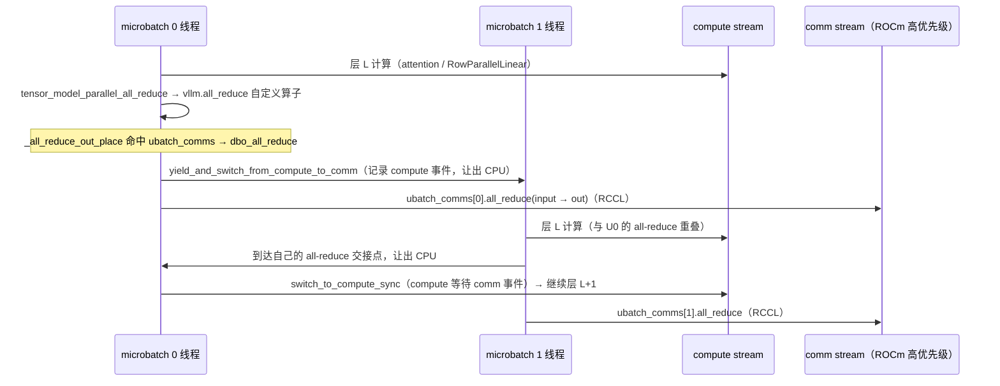
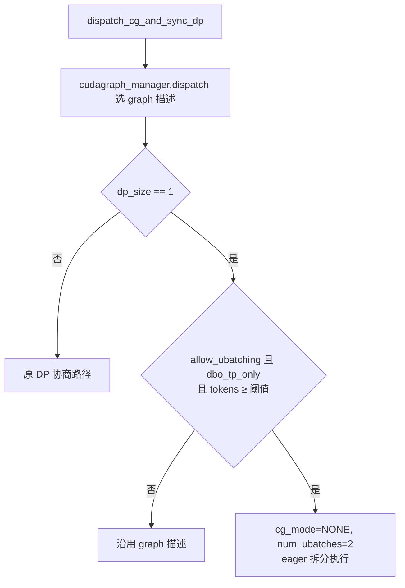

# PR #63483: [Core][DBO] Dual batch overlap under pure tensor parallelism (split PR of M3.1)

> **Author**: @benenzhu | **State**: OPEN | **Date**: 2026-10-24
> **Branch**: `benenzhu:zty/dbo-pure-tp` → `main` | **Labels**: documentation, mrv2
> **Changes**: +347 -11 lines across 11 files | **ROCm 相关性**: 部分相关（主体是跨平台的 MRV2 DBO 引擎改动；包含 ROCm 专属的 comm stream 优先级、hipBLASLt 句柄预热、aiter fused AR+RMSNorm 绕过，验证全部在 MI355X 上完成）
> 本报告分两部分：§1–6 为 PR 详细总结，§7–8 为 ROCm review 意见。

---

## 1. 总结 (Summary)

本 PR 把 Dual Batch Overlap（DBO）扩展到"纯 TP"部署（DP=1、无 EP、TP>1），仅支持 Model Runner V2。超过 `--dbo-prefill-token-threshold` 的步被拆成两个 microbatch，每次 TP all-reduce 成为 microbatch 交接点：当前 microbatch 让出 CPU、在 comm stream 上用自己专属的 `PyNcclCommunicator` 做 all-reduce，另一个 microbatch 同时在 compute stream 上计算。ROCm 侧额外把 comm stream 设为高优先级，并通过预热 hipBLASLt 句柄池修复 DBO 步的 GPU hang（`hipblasLtCreate` 的 null-stream memset 与 Stream-K GEMM 竞争）。

## 2. 背景与动机 (Background & Motivation)

- 这是 M3.1（#63232，模型本身已以 #64111 合入）中 ROCm 工作的引擎部分拆分。MiniMax-M3/M3.1 在 MI355X 上以 TP4 部署，长 prefill 步中 TP all-reduce 占比高，DBO 可用通信掩盖计算。
- 现有 DBO 只在 DP>1（EP all2all 作为交接点）下可用；#44677 在 MRV1 上做过同样目标，但 MRV1 将被 #63373 移除。本 PR 面向 MRV2 的 `UBatchRunner`，在 `vllm.all_reduce` 自定义算子内部挂 hook，使 compiled graph 也能走到交接逻辑。
- 作者报告 MI355X、TP4、M3（MXFP4 experts）agentic 3600 s：c64 interactivity P90 +31%、吞吐 +10%，c32 基本持平略降；M3.1-Flash 单请求 16K/32K prompt TTFT −35%/−39%。

## 3. 代码修改分析 (Code Change Analysis)

### 3.1 修改的模块

| 模块 | 改动 |
|------|------|
| `vllm/config/parallel.py` (+10) | 新增 `dbo_tp_only` 属性：ubatching 且 DP=1、无 EP、TP>1 |
| `vllm/config/vllm.py` (+11 -4) | TP-only 时跳过 all2all backend 断言；MRV1 下把该模式列为不支持；TP-only 允许多模态模型 |
| `vllm/distributed/parallel_state.py` (+10) | `GroupCoordinator.ubatch_comms`；`_all_reduce_out_place` 在 microbatch 线程内转交 `dbo_all_reduce` |
| `vllm/v1/worker/ubatching.py` (+57) | `init_dbo_tp_comms`（每个 microbatch 一个 PyNccl/RCCL communicator）、`dbo_comm_stream_priority`（ROCm 为 -1）、`dbo_all_reduce`（yield→comm stream all-reduce→切回 compute） |
| `vllm/v1/worker/gpu/ubatch_utils.py` (+57 -4) | comm stream 优先级；构造时初始化 TP communicators；ROCm 上 `_warm_blas_lt_handles`；DP=1 时 `dp_metadata=None`；forward context 传入 `ubatch_slices`；`merge_ubatch_outputs` 透传 None；DP=1 也构建 runner |
| `vllm/v1/worker/gpu/dp_utils.py` (+16) | DP=1 时本地决定是否拆分，拆分步强制 `CUDAGraphMode.NONE` |
| `vllm/v1/worker/workspace.py` (+5 -2) / `gpu_worker.py` (+4) | TP-only + V2 时 workspace manager 只保留一套（`num_ubatches=1`） |
| `fused_allreduce_gemma_rms_norm.py` (+4 -2) | DBO 中跳过 aiter fused AR+RMSNorm |
| `fused_moe/prepare_finalize/no_dp_ep.py` (+4) | `supports_dbo()` 返回 True |
| `tests/v1/worker/test_dbo_pure_tp.py`（新增 180 行） | 配置、阈值、workspace id、hook 回退等单测 |

### 3.2 架构 / 流程图

TP all-reduce 交接时序（两个 microbatch 线程，同一 TP rank 内）：



拆分决策（DP=1）：



### 3.3 关键实现细节

- **hook 位置**：`GroupCoordinator._all_reduce_out_place` 是 `vllm.all_reduce` 自定义算子的实现体，运行时（非 tracing）执行，因此 piecewise 编译图中的 all-reduce 也会进入 hook；hook 仅在 `ubatch_comms` 非空（只有 TP group 会被设置）且当前线程属于某个 microbatch 时生效，否则回到原 device communicator（custom AR / quick AR / RCCL）。
- **每 microbatch 一个 communicator**：避免两个 microbatch 的集合通信排在同一个 NCCL/RCCL 队列上；`out` 用 `torch.empty_like` 在 compute stream 上分配、comm stream 写入，依赖事件等待保证顺序，刻意不用 `record_stream`（作者称会导致 32K 步 OOM）。
- **拆分步 eager**：DP=1 时 `dispatch_cg_and_sync_dp` 本地决定，拆分步强制 `CUDAGraphMode.NONE`；作者建议把 decode 阈值设得高于 decode batch，以保留 decode 的 graph。
- **hipBLASLt 预热（ROCm）**：每个 microbatch 线程在 compute / capture / comm 三个 stream 上各跑一次 64×64 bf16 GEMM，使 torch 的 Lt 句柄池在启动时就填满，后续每步新建的 microbatch 线程直接复用，不再触发 `hipblasLtCreate`。
- **workspace**：TP-only 时 workspace manager 只保留一套（所有 microbatch 共享 slot 0），依据是"两个 microbatch 都在同一个 compute stream 上计算"。

## 4. 涉及的技术原理 (Technical Principles)

- **DBO（Dual Batch Overlap）**：把一个 batch 拆成两个 microbatch，在 CPU 侧用两个线程 + barrier 实现协作式交替，GPU 侧一个 compute stream、一个 comm stream；microbatch A 的通信与 microbatch B 的计算重叠，交接点是集合通信。
- **TP 下的通信模式**：纯 TP 时每层通常有 2 次 all-reduce（attention o_proj 与 MLP/MoE down_proj 之后），prefill 大 token 数时 all-reduce 时间与 GEMM 同量级，是 DBO 可隐藏的主要开销；MoE 在无 EP 时 `MoEPrepareAndFinalizeNoDPEP` 没有 all2all，交接点仍是 TP all-reduce。
- **HIP stream 优先级与硬件队列**：ROCm 上不同 stream 会映射到有限数量的硬件队列（HQD），默认优先级的 stream 可能被映射到同一个队列而串行；把 comm stream 提高到 -1（ROCm 的最高优先级，`priority_range()==(0,-1)`）可以让通信 kernel 获得独立队列/抢占机会。
- **hipBLASLt Stream-K 与句柄初始化**：Stream-K GEMM 用全局 flag buffer 做 workgroup 之间的 fixup 同步；`hipblasLtCreate` 在 null stream 上异步清零该 buffer，如果另一条 stream 上的 Stream-K GEMM 已经开始，清零会抹掉 partner workgroup 已置位的 flag，owner 永远自旋（作者用 rocgdb 定位到 `label_SK_Fixup`）。torch 的 Lt 句柄按线程从池中取，线程退出时归还。
- **torch.compile 与通信融合**：vLLM 的 `fuse_allreduce_rms` pass 会在编译图中把 `vllm.all_reduce + rms_norm` 替换为 FlashInfer（CUDA）或 aiter（ROCm）的融合算子；被替换后 `vllm.all_reduce` 不再出现在图里，任何挂在它上面的运行时 hook 都不会被调用。

## 5. 评论区讨论亮点 (Discussion Highlights)

- **@njhill**（inline，`vllm/v1/worker/gpu/ubatch_utils.py`）：建议把 `_warm_blas_lt_handles()` 移到 ROCm 专属的 platform 文件中，而不是放在通用 `UBatchRunner` 里（作者尚未回应；本报告 §7 也有相关备注）。
- claude[bot] 自动 review 留有评论，conversation 页面未完整显示，内容未知。
- 作者多次 `/ci run`（Buildkite #99103、#99113（已取消）、#99220 对应当前 head `2a04ace072`）；结果在页面上不可见，CI 状态未知。
- 其余 issue comments 只有 mergify 冲突提醒与 CI 触发记录，无实质设计讨论。

## 6. 风险与潜在问题 (Risk Analysis)

| 风险 | 严重程度 | 说明 |
|------|---------|------|
| 共享单套 workspace 时跨交接点存活的资源被另一 microbatch 覆盖 | High | 见 §7【正确性】workspace 共享 |
| 编译期 AR+RMSNorm 融合 / FlashInfer 路径绕过 hook | Medium | 见 §7【性能】hook 被绕过；ROCm + AITER 默认开启该融合 |
| 默认阈值下 decode 步全部变 eager，并多捕获永不使用的图 | Medium | 见 §7【性能】默认阈值 |
| 额外 RCCL communicator 在 KV 显存分配后才创建 | Medium | 见 §7【资源】 |
| 无 DBO 开/关数值一致性测试；E2E 有空内容响应 | Medium | 见 §7【测试】 |
| ROCm comm stream 优先级与 hipBLASLt 预热同时作用于已有的 DP/EP DBO 路径 | Low | 见 §7 📝 |
| 非 DBO 路径的热路径开销 | Low | `_all_reduce_out_place` 只多一次属性判空，可忽略 |

---

## 7. Review 意见 (Findings)

| 类型 | 🔴 | ⚠️ | 📝 |
|------|----|----|----|
| 正确性 | — | 1 | — |
| 性能 | — | 2 | — |
| 资源 | — | 1 | — |
| 测试 | — | 1 | — |
| 可维护性 / 兼容性 | — | — | 2 |

---

**⚠️【正确性】TP-only 模式让两个 microbatch 共享一套 workspace，但"同一 compute stream"并不足以保证安全** `[已验证]`（触发条件 `[推测]`）

- **问题**: `gpu_worker.py:606-609` 在 V2 + `dbo_tp_only` 时把 `num_ubatches` 设为 1，`workspace.py:139-142` 让所有 microbatch 共用 slot 0（含 scratch、`get_persistent` 资源和 `get_retained` 的保留区间）。注释给出的依据是"两个 microbatch 在同一个 stream 上计算"——但 DP/EP 下的 DBO 同样是两个 microbatch 共用一个 compute stream，却保留两套，正是因为 workspace 内容可能跨越 yield 存活。`WorkspaceManager.get_persistent_resource` 的 docstring 也明确要求"Uses of the same resource must not overlap"。仓库中已存在跨层（即跨 TP all-reduce 交接点）保留 workspace 内容的用法：`vllm/models/deepseek_v41/nvidia/flash_mla_mega_attn.py` 中 `get_retained((compressed_cache_prefix, chunk), ...)` 依赖"后续 consumer 层复用 source 层留下的列"。
- **影响**: 在纯 TP DBO 下，microbatch 0 的 source 层写入保留区，交接给 microbatch 1；若 microbatch 1 以相同 key（相同 chunk 元组）写入了自己的数据，microbatch 0 的后续 consumer 层会拿到 `intact=True` 并直接复用 microbatch 1 的 KV 列 → 静默的 attention 结果错误。key 不同时会退化为重新 gather（安全但多做功）。是否会碰撞取决于两个 microbatch 的 chunk 划分，未实测。
- **行动**: 建议作者说明为何 TP-only 可以共享（是显存原因还是 DSpark graph 保留 workspace 视图的问题），并至少二选一：保留每 microbatch 一套 workspace；或在共享模式下禁止 `get_retained` / 跨层 persistent 资源（例如对这类调用断言 `not dbo_enabled()`），并补一个 split vs unsplit 的数值一致性测试。

**⚠️【性能】编译期 AR+RMSNorm 融合与 FlashInfer 融合路径会绕过交接 hook，PR 描述与代码不一致** `[已验证]`（影响 `[推测]`）

- **问题**: ① PR 描述称 `fused_allreduce_gemma_rms_norm` "skips its FlashInfer / AITER fused kernels inside a microbatch"，但 `fused_allreduce_gemma_rms_norm.py:178-179` 只给 aiter 分支加了 `not dbo_enabled()`，前面的 FlashInfer 分支（以及 `vllm/models/common/ops/fused_allreduce_rms_norm.py`）未加判断。② 更普遍的情况：ROCm 上只要 AITER 开启且 TP>1，`enable_allreduce_rms_fusion` 默认为真，`pass_manager.py` 会加入 `RocmAiterAllReduceFusionPass`，在编译图中把 `vllm.all_reduce + rms_norm` 替换成 aiter 融合算子，编译 range 的分界是 `AiterCustomAllreduce.effective_max_size()`（64 MiB）/ (hidden×2)；hidden=6144、bf16 时约 5461 token。拆分后每个 microbatch 只有阈值的一半（例如 8192 阈值对应约 4096 token），正好落在融合图的 range 内。
- **影响**: 这些 all-reduce 在 compute stream 上用 aiter custom AR 执行，不会让出 CPU，也不走 comm stream——overlap 静默消失；同一层内有的 all-reduce 走 hook（RCCL / comm stream）、有的走融合 AR（compute stream），两类集合通信并发执行，这一场景没有被测试过。作者验证用的 MiniMax-M3 AMD 模型走 eager 辅助函数，不经过这个编译 pass，因此测不出来。
- **行动**: 建议作者在 `dbo_tp_only` 时关闭 `fuse_allreduce_rms`（或让融合 range 的上界不覆盖 microbatch 大小），并给 FlashInfer 分支同样加上 `dbo_enabled()` 判断，使代码与 PR 描述一致；同时在任意一个走 VLLM_COMPILE 的模型（如 Qwen3-MoE/Llama，TP4，AITER on）上确认日志中出现 comm-stream all-reduce。

**⚠️【性能】默认阈值下纯 TP 的 decode 步会被拆分成 eager，并且会额外捕获永不 replay 的 microbatch 图** `[已验证]`

- **问题**: `dp_utils.py:317-333` 在 DP=1 时只要 `check_ubatch_thresholds` 为真，就把 batch 描述改为 `CUDAGraphMode.NONE` 拆分执行。默认 `dbo_decode_token_threshold=32`、`dbo_prefill_token_threshold=512`，因此 `--enable-dbo --tensor-parallel-size 4` 下任意 ≥32 token 的 decode 步都会以 eager 方式拆分执行。另外，`cudagraph_utils.py::_maybe_ubatch_twin` 只要 `ubatch_runner` 存在就会生成 microbatch 版 FULL graph 候选并捕获；但同样满足阈值的步在 DP=1 路径上总会被改写为 NONE，这些图永远不会被 replay，却会在捕获期间通过 hook 在 microbatch 线程里录制 RCCL all-reduce。
- **影响**: 用户只加 `--enable-dbo` 时 decode 失去 CUDA/HIP graph，ITL 大幅回退；启动时额外的图捕获浪费时间与显存。PR 中的 E2E 都显式设置了 `--dbo-decode-token-threshold 32768`，掩盖了这个问题。
- **行动**: 建议作者在 `dbo_tp_only` 下不拆分 uniform decode（或为该模式设置更合理的默认阈值并给出 warning），并让 `_maybe_ubatch_twin` 在 `dbo_tp_only` 时直接返回 None。

**⚠️【资源】每个 microbatch 新建的 RCCL communicator 在 KV cache 显存确定之后才创建** `[推测]`

- **问题**: `init_dbo_tp_comms` 由 `UBatchRunner.__init__` 调用（`ubatch_utils.py:361`），而 `maybe_build_ubatch_runner` 在 `model_runner.py` 初始化 block tables 之后（即 KV cache 配置已确定之后）才执行；每个 `PyNcclCommunicator` 会 `ncclCommInitRank` 并做 warm-up all-reduce，RCCL 会按 channel × peer 分配设备侧缓冲。ROCm 上还会再跑预热 GEMM 并分配 Lt workspace。
- **影响**: 这两份额外的 RCCL 显存没有计入 memory profiling，在 `gpu_memory_utilization` 0.9–0.95 的常见配置下可能在启动或首个拆分步时 OOM，且随 TP 大小和 `NCCL_BUFFSIZE`/channel 数增长。
- **行动**: 建议作者测量两个额外 communicator 在 MI355X TP4/TP8 下的显存占用，并把它们的创建移到 memory profiling 之前（例如在 worker 初始化分布式环境时创建），或在 KV 预算中预留。

**⚠️【测试】没有 DBO 开/关的数值一致性验证，E2E 中出现空内容响应** `[已验证]`

- **问题**: `test_dbo_pure_tp.py` 只覆盖配置、阈值、workspace id 和 hook 回退（mock），没有 split 与 unsplit 的输出比较；PR 的 E2E 描述写道 "1-2 per point came back without content"，没有说明 DBO 关闭时是否同样出现。M3 表格来自"our M3 serving branch"而非本分支，单次运行；c32 下 DBO 吞吐与 interactivity 略降。
- **影响**: DBO 改变了 all-reduce 的执行流与 communicator，且 workspace 改为共享，任何静默数值错误只会表现为质量下降或空输出；这些数字 `[unverified]`。
- **行动**: 建议作者补一个 GPU 测试：TP2 下同一 prompt 分别以 DBO 开/关做 greedy 生成，比较 token 完全一致（或 logprob 在容差内）；并说明空内容响应在 DBO 关闭时是否也存在、是什么原因。

**📝【可维护性】hipBLASLt 预热放在通用 `UBatchRunner` 中，缺少上游 issue 链接，且是否覆盖模型实际使用的 BLAS 路径未说明** `[推测]`

- **问题**: `ubatch_utils.py:364-389` 在通用 runner 中做 ROCm 专属 workaround（@njhill 已建议迁到 ROCm platform 文件）；TODO 没有链接 hipBLASLt/ROCm 的 issue，也没有写受影响的 ROCm 版本。预热使用 `torch.mm(a, a, out_dtype=torch.float32)`，是否与模型 GEMM 走同一个 torch Lt 句柄池取决于 `preferred_blas_library` 和 out_dtype 的分派路径；而 vLLM ROCm 的 bf16 linear 很多走 aiter/hipb_mm 自己的句柄。
- **行动**: 建议作者按 @njhill 的意见把预热移到 `vllm/platforms/rocm.py`（例如 platform hook），在 TODO 中链接 hipBLASLt 的 issue 与 ROCm 版本，并改用与模型 bf16 GEMM 相同的调用（如 `F.linear` bf16→bf16）做预热，或说明为什么 `out_dtype=fp32` 能覆盖到同一个句柄池。

**📝【兼容性】ROCm comm stream 高优先级与 BLAS 预热也作用于已有的 DP/EP DBO** `[已验证]`

- **问题**: `dbo_comm_stream_priority()` 和 `_warm_blas_lt_handles()` 不区分 `dbo_tp_only`，所有 ROCm DBO 模式（DeepEP / nixl_ep / allgather_reducescatter + DP）都会生效；PR 验证只覆盖纯 TP。
- **行动**: 建议作者在 PR 描述中说明这是有意的全局变更，并补一组 DP/EP DBO 在 MI355X 上的回归数据（或至少一次冒烟测试）。另外 PR 描述中残留 HTML 片段（`<li>`、`</ul>`），建议整理。

## 8. 结论 (Verdict)

**⚠️ NEEDS WORK**

对 MI355X 上 TP 部署的 M3 系列模型，纯 TP DBO 方向合理，hook 选在自定义算子内部、每个 microbatch 一个 communicator 的设计也清晰，hipBLASLt hang 的根因分析很扎实。但 workspace 共享的安全性论证不充分（仓库里已有跨层保留 workspace 的用法），编译期 AR+RMSNorm 融合和 FlashInfer 路径会让 hook 静默失效，默认阈值会让 decode 失去 graph，额外 RCCL communicator 的显存也没有计入预算，且缺少 DBO 开/关数值一致性测试。建议处理这几点后再合入。

## 9. 英文 Review 评论 (Copy-Paste English Comments)

**C1** `vllm/v1/worker/workspace.py:139-142` — ⚠️ comment

```text
Sharing one workspace set across microbatches in TP-only mode relies on "both microbatches compute on one stream", but that is also true for DP/EP DBO, which keeps one set per microbatch because workspace contents can live across a yield. Retained spans do exist across layers today: `flash_mla_mega_attn.py` uses `get_retained((compressed_cache_prefix, chunk), ...)` and lets later consumer layers reuse the source layer's columns. With a shared slot, microbatch 1 can overwrite that span between microbatch 0's source and consumer layers, and if the key matches, microbatch 0 sees `intact=True` and reads the other microbatch's KV. Could you explain why sharing is needed (memory, or the DSpark retained-view issue), and either keep per-microbatch sets or forbid retained/persistent resources under TP-only DBO?
```

**C2** `vllm/model_executor/layers/fused_allreduce_gemma_rms_norm.py:178-179` — ⚠️ comment

```text
The PR description says FlashInfer and AITER fused kernels are skipped inside a microbatch, but only the AITER branch is gated; the FlashInfer branch above (and `models/common/ops/fused_allreduce_rms_norm.py`) still bypasses the hand-off. More broadly, on ROCm with AITER and TP > 1, `fuse_allreduce_rms` is on by default and `RocmAiterAllReduceFusionPass` replaces `vllm.all_reduce + rms_norm` in compiled graphs for compile ranges up to 64 MiB / (hidden * 2) tokens, which covers a typical microbatch (e.g. ~4K tokens at hidden 6144). Those all-reduces never reach the hook, so overlap silently disappears for compiled models. Could you gate the FlashInfer branch as well and disable or cap the all-reduce fusion when `dbo_tp_only` is set?
```

**C3** `vllm/v1/worker/gpu/dp_utils.py:317-333` — ⚠️ comment

```text
With the default thresholds (`dbo_decode_token_threshold=32`, `dbo_prefill_token_threshold=512`), this forces every decode step with >= 32 tokens into an eager split under pure TP, so `--enable-dbo` alone loses CUDA graphs for decode. Separately, `_maybe_ubatch_twin` still adds microbatched FULL-graph candidates whenever a ubatch runner exists, and those graphs are captured (with RCCL all-reduces recorded from the microbatch threads) but can never be replayed, because this branch always rewrites them to NONE. Could you skip splitting uniform decodes in TP-only mode (or use mode-specific defaults with a warning) and return None from `_maybe_ubatch_twin` when `dbo_tp_only` is set?
```

**C4** `vllm/v1/worker/gpu/ubatch_utils.py:361` — ⚠️ comment

```text
`init_dbo_tp_comms` creates two extra PyNccl/RCCL communicators from `UBatchRunner.__init__`, which runs after the KV cache config has been decided, so their device buffers (and the ROCm BLAS warm-up workspaces) are not covered by memory profiling. At gpu_memory_utilization 0.9-0.95 this may OOM at startup or on the first split step, and the cost grows with TP size and RCCL channel count. Could you measure their footprint on MI355X TP4/TP8 and create them before memory profiling (or reserve for them)? A greedy DBO on/off output-equality test at TP2 would also help, given the empty responses mentioned in the E2E section.
```
