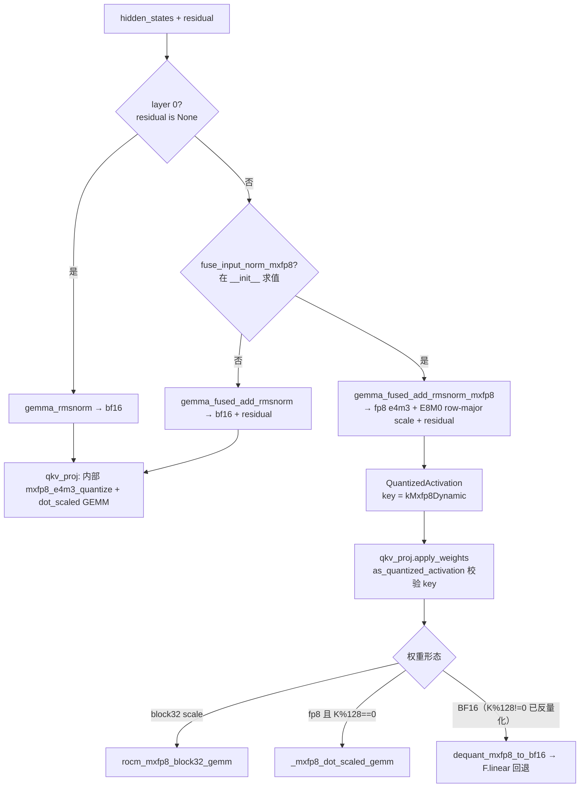
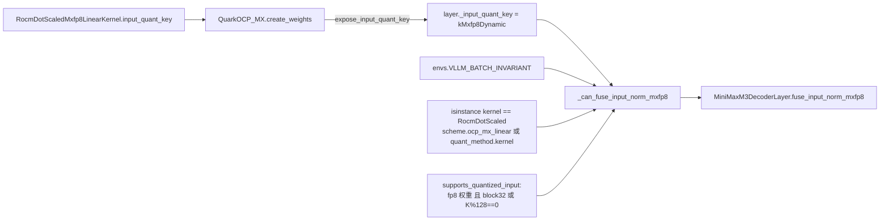

# PR #63637: [ROCm][MiniMax-M3] Fuse MXFP8 activation quant into the Gemma input_layernorm for qkv_proj

> **Author**: @RuibinCheung | **State**: OPEN | **Date**: 2026-10-26
> **Branch**: `RuibinCheung:cursor/minimax-m3-rocm-gemma-norm-mxfp8-quant-edd1` → `main` | **Labels**: rocm, quantization, minimax
> **Changes**: +366 -28 lines across 6 files | **ROCm 相关性**: 完全相关（MiniMax-M3 AMD 模型目录 + Tier-1 `mxfp8/rocm_native.py`，仅 gfx950 生效）
> 本报告分两部分：§1–6 为 PR 详细总结，§7–8 为 ROCm review 意见。

---

## 1. 总结 (Summary)

在 ROCm（gfx950）上，MiniMax-M3 decoder 层的 `qkv_proj` 若由 `RocmDotScaledMxfp8LinearKernel` 承载（如 MiniMax-M3.1-Flash-Quark-MXFP4 中 1x32 MXFP8 的 attention 投影），原流程是 fused add + Gemma RMSNorm 写出 bf16，再由 GEMM 内部单独 launch 一次 `mxfp8_e4m3_quantize`。本 PR 把逐 32 元素块的 MXFP8 量化作为 epilogue 融进 norm kernel（`gemma_fused_add_rmsnorm_mxfp8`），以 `QuantizedActivation` 直接交给 `qkv_proj`，每层省一次 launch 和一次 bf16 读写往返；输出与原路径 bit-exact。

## 2. 背景与动机 (Background & Motivation)

- vLLM 已有 `QuantizedActivation` 契约（`vllm/model_executor/layers/fusion/quant_activation.py`）：linear kernel 通过 `input_quant_key()` 声明可消费的预量化输入，layer 通过 `expose_input_quant_key` 暴露能力，生产者用 `get_input_quant_key` 查询。DeepSeek V4.1（CUDA/FlashInfer）、`maybe_fused_act_quant` 已在使用。
- 但 ROCm 原生 MXFP8 GEMM（`RocmDotScaledMxfp8LinearKernel`）此前未声明 input key，Quark OCP_MX 也不暴露，所以 ROCm 上无法做 producer 侧量化融合。
- MiniMax-M3 AMD 路径在 decode 下 kernel launch 密集，作者从 trace 量化：被移除的独立 quant launch 约占 decode GPU kernel 时间 1.9%（60 层中 59 层生效）。
- E2E 验证基于尚未合入的 #63232（[New Model] Support Minimax-M3.1-Flash，OPEN）之上。

## 3. 代码修改分析 (Code Change Analysis)

### 3.1 修改的模块

| 模块 | 改动 |
|------|------|
| `vllm/models/minimax_m3/amd/ops/gemma_rmsnorm.py` (+94 -8) | `_gemma_fused_add_rmsnorm_kernel` 新增 `QUANT_MXFP8`/`FP8_MAX`/`TINY` constexpr 与 `scale_ptr`；新公开函数 `gemma_fused_add_rmsnorm_mxfp8` 返回 `(x_q, x_scale, residual_out)`；原 `gemma_fused_add_rmsnorm` 改为调用共享的 `_gemma_fused_add_rmsnorm(..., False)` |
| `vllm/model_executor/kernels/linear/mxfp8/rocm_native.py` (+64 -14, **Tier-1**) | `input_quant_key()` 返回 `kMxfp8Dynamic`；新增 `supports_quantized_input(layer)`；拆出 `_mxfp8_dot_scaled_gemm`（接受已量化输入）；`apply_weights` 接受 `QuantizedActivation`，BF16 权重时反量化回退 |
| `vllm/model_executor/layers/quantization/quark/schemes/quark_ocp_mx.py` (+4) | MXFP8 分支调用 `expose_input_quant_key(layer, self.ocp_mx_linear)`（**对所有平台的 MXFP8 kernel 生效**） |
| `vllm/models/minimax_m3/amd/model.py` (+46 -5) | 新增 `_can_fuse_input_norm_mxfp8` 生产者门控；`MiniMaxM3DecoderLayer.__init__` 计算 `fuse_input_norm_mxfp8`；`forward` 在 residual 非空且门控为真时调用融合 norm 并构造 `QuantizedActivation`；两类 attention 的 `forward` 类型注解放宽 |
| `vllm/models/minimax_m3/amd/ops/__init__.py` (+2) | 导出新函数 |
| `tests/kernels/test_minimax_m3_amd_ops.py` (+156 -1) | bit-exact 对比测试（含边界块）、Quark MXFP8 layer 端到端 GEMM 对比（3 种权重形态）、batch-invariant 关闭测试 |

### 3.2 架构 / 流程图

改动前后单层数据流：



生产者门控与消费者能力的关系：



### 3.3 关键实现细节

- **norm epilogue 量化**：先 `out.to(x dtype).to(fp32)` 再量化，保证与"写出 bf16 → 再量化"bit-exact；`amax = max(|y|, TINY)`，`sb = clamp(ceil(log2(amax/448)) + 127, 0, 254)`，用 `y * exp2(127 - sb)` 代替除法以避开 CDNA 上 2^-127 subnormal flush-to-zero —— 与 `mxfp8_utils._mxfp8_quant_triton_kernel` 逐行一致。
- **每行一个 program**，`BLOCK_N = next_pow2(n)`（6144 → 8192），reshape 成 `(BLOCK_N/32, 32)` 求块 amax；padding 块 amax=TINY、scale 写入被 mask 掉。
- **scale 布局**：row-major `[M, K/32]`，与 FlashInfer 消费的 swizzled 布局不同但共用 `kMxfp8Dynamic`，因此生产者额外检查 kernel 类型（与 DSv4.1 `can_fuse_query_quant` 同样的做法）。
- **消费者回退**：`QuantizedActivation` 遇到 BF16 权重（K%128!=0，load 时已反量化）时先 `dequant_mxfp8_to_bf16` 再 linear，而不是报错。
- **关闭条件**：`VLLM_BATCH_INVARIANT`、LoRA（`requires_unquantized_input`）、第 0 层（无 residual）、mono decode 执行器（直接调 `input_layernorm`/`self_attn`）。不新增 env var。

## 4. 涉及的技术原理 (Technical Principles)

- **MXFP8（OCP Microscaling）**：每 32 个元素共享一个 E8M0（纯 2 的幂，uint8 偏置 127）scale，元素为 fp8 e4m3fn（max 448）。scale 取 `ceil(log2(amax/448))` 使块内最大值落在 e4m3 顶部，避免小元素掉入 subnormal。gfx950（CDNA4）有原生 microscaling MFMA，Triton 通过 `tl.dot_scaled` 使用。
- **Producer-side quant fusion**：把下游 GEMM 的激活量化挪到上游 elementwise/归约 kernel 的 epilogue，省掉一次 HBM 写读（bf16 `[M, H]`）和一次 launch。在 decode 小 M 下 launch 开销占比高，收益主要来自 launch 数；大 M 下来自带宽。
- **QuantizedActivation 契约**：`QuantKey` 只描述 dtype / scale 粒度 / 对称性，不描述 scale 布局与 padding（源码 TODO(mgoin) 已承认），因此生产者必须同时匹配具体消费者 kernel。
- **Gemma RMSNorm**：`y = x * rstd * (1 + w)`，fused-add 版本同时输出 `x + residual` 作为新 residual。
- **CUDA/HIP graph 兼容**：融合路径只在 forward 中按 Python 常量（`__init__` 时算好的 bool）分支，并在图内 `torch.empty` 分配，graph 捕获安全。

## 5. 评论区讨论亮点 (Discussion Highlights)

- 截至 review 时无人工 reviewer 评论；Claude bot 因 fork PR 未执行自动 review；github-actions 提示需要 `/amd-ci run` 才会触发 AMD CI。
- PR 描述自述使用 AI 辅助（`/pr-checklist` skill，checklist 全勾选），且 Details 部分对 scale 布局、batch invariance、LoRA、mono decode 的考量写得较完整——说明作者理解了契约的主要坑点，但其中 LoRA 一条与实现机制不符（见 §7）。

## 6. 风险与潜在问题 (Risk Analysis)

| 风险 | 严重程度 | 说明 |
|------|---------|------|
| 数值正确性 | Low | 量化公式与现有 Triton quant 逐行一致，bit-exact 测试覆盖全零块 / 极小块 / scale>1 块、bf16+fp16、3 种 hidden；已核对 |
| 生产者门控在构造期求值 | Medium | 见 §7 ⚠️【设计】：LoRA 声明不成立，当前因模型不支持 LoRA 而无害 |
| 性能证据 | Medium | 见 §7 ⚠️【测试】：E2E 数据噪声远大于理论收益，且描述与表格不一致 |
| 跨后端暴露 | Low | Quark MXFP8 在 CUDA 上也开始暴露 key；已核对现有生产者不会匹配，见 §7 📝【兼容性】 |
| 可维护性 | Low | MXFP8 块量化公式第三次复制，见 §7 📝 |
| CI / 合入顺序 | Low | AMD CI 未触发；E2E 依赖未合入的 #63232 |

---

## 7. Review 意见 (Findings)

| 类型 | 🔴 | ⚠️ | 📝 |
|------|----|----|----|
| 测试 | — | 1 | 1 |
| 设计 | — | 1 | — |
| 兼容性 | — | — | 1 |
| 可维护性 | — | — | 1 |

已核对且**未发现问题**的点（供 reviewer 参考）：量化公式与 `_mxfp8_quant_triton_kernel` 一致（含 subnormal 规避，`sb=254` 实际不可达）；`FP8_MAX` 取自 `finfo(float8_e4m3fn)`=448（OCP，非 fnuz）；`MiniMAXGemmaRMSNorm.forward` 本就直接调 `gemma_fused_add_rmsnorm`，绕过 module 不丢逻辑；两个 attention forward 中 `hidden_states` 只被 `qkv_proj` 消费；`ColumnParallelLinear.forward` → `QuarkOCP_MX.apply_weights` → kernel 透传 `QuantizedActivation`；构造期门控为 True 的情形在 load 后必然仍为 True（不会落入反量化慢路径）；Eagle3 aux hidden state 取自 layer 输入，不受影响。

---

**⚠️【测试】E2E 性能数据噪声远大于理论收益，描述与表格互相矛盾** `[已验证]`

- **问题**: PR 描述 Claims 写 "c16 为 1.017x–1.045x（两次运行）"、"c4/c8/c32 在噪声内"，但 Validation 表格中 c16 只有 1.017x，c8 为 **1.106x**、c32 为 1.064x、c4 为 0.990x。被移除的 launch 仅占 decode kernel 时间 1.9%，即 E2E 理论上限约 1.02x；c8 的 10.6% 被定性为"噪声"，等于承认 run-to-run 噪声 ≥ ±10%，那么 c1 的 1.018x 同样无法与噪声区分。c16 第二次运行的 1.045x 在表中无出处 `[unverified]`。
- **影响**: 不影响正确性；但 E2E 表格无法支撑任何 E2E 加速结论，reviewer 可能误把 1.106x 当成本 PR 收益引用。
- **行动**: 建议作者以 kernel 级 microbenchmark（已给出方法学与完整 M 扫描，可信度高）作为主要证据，E2E 部分给出每个并发点每次运行的原始值与方差，或改述为"E2E 无回退、收益在噪声内"，并删除/补齐 1.045x 的出处。

**⚠️【设计】生产者门控在 `DecoderLayer.__init__` 一次性求值，PR 描述中的 LoRA 安全声明与实现机制不符** `[已验证]`（LoRA 下的崩溃表现 `[推测]`）

- **问题**: `vllm/models/minimax_m3/amd/model.py:1386` 在构造期调用 `_can_fuse_input_norm_mxfp8(self.self_attn.qkv_proj)` 并把结果存成 bool。LoRA 的 `BaseLinearLayerWithLoRA.requires_unquantized_input = True` 只有在 `LoRAModelManager._create_lora_modules` 于**模型构造之后** `replace_submodule` 时才出现，此时门控早已算完。所以 PR 描述 "With LoRA on qkv_proj, get_input_quant_key returns None and nothing changes" 对本生产者并不成立。对比：`maybe_fused_act_quant`、Kimi K3 AMD（`linear.py` 中 `self.self_attn.get_input_quant_key()`）都在 forward 期查询，天然感知 LoRA 包装。
- **影响**: 当前 `MiniMaxM3SparseForCausalLM` 未实现 `SupportsLoRA`，因此今天不可触发。一旦后续为该模型开启 LoRA，`qkv_proj` 会收到 `QuantizedActivation`，LoRA adapter 分支对其做矩阵乘会直接报错（或 base 层用量化输入、adapter 层拿不到原始激活）。这是给未来埋的坑，而且 PR 描述会让人以为已经处理过。
- **行动**: 建议作者把门控改为 forward 期查询（例如缓存 kernel 类型/权重形态检查，仅在 forward 中再判 `get_input_quant_key(self.self_attn.qkv_proj)`，开销是一次 getattr），或至少修正 PR 描述并在 `_can_fuse_input_norm_mxfp8` 注释中写明"构造期求值，不感知 LoRA 包装；模型目前不支持 LoRA"。

**📝【兼容性】Quark OCP_MX 现在对所有平台的 MXFP8 kernel 暴露 `kMxfp8Dynamic`** `[已验证]`

- **问题**: `quark_ocp_mx.py:252` 的 `expose_input_quant_key` 不是 ROCm 专属：CUDA 上 Quark MXFP8 层若选中 FlashInfer Cutedsl/Cutlass kernel（消费 swizzled scale），`get_input_quant_key` 也会返回 `kMxfp8Dynamic`。已核对现有生产者：`can_fuse_query_quant` 查 `quant_method.kernel`、`_can_fuse_wo_a` 查 `scheme.kernel`，Quark 的 kernel 挂在 `scheme.ocp_mx_linear`，两者都匹配不上；`maybe_fused_act_quant` 无 MXFP8 条目；DSv4.1 ROCm 的 `_alloc_attn_out` 不经 linear。因此当前无行为变化。
- **影响**: 今后任何只按 `kMxfp8Dynamic` 判断（不查 kernel 类型）的通用生产者，会把 row-major scale 喂给 Quark+FlashInfer 层 → 静默错结果。风险源于契约本身（布局不在 key 里），本 PR 扩大了暴露面。
- **行动**: 建议作者在 PR 描述中注明此跨后端效果已核对；可选地在 `kMxfp8Dynamic` 生产者处统一要求 kernel 类型检查（或推动 TODO(mgoin) 把 scale 布局纳入契约）。

**📝【可维护性】MXFP8 块量化公式出现第三份拷贝** `[已验证]`

- **问题**: `amax/TINY → ceil(log2(amax/FP8_MAX))+127 → clamp(0,254) → x*exp2(127-sb)` 现在分别存在于 `mxfp8_utils._mxfp8_quant_triton_kernel`、`minimax_m3/amd/ops/swiglu_oai.py` 和本 PR 的 `gemma_rmsnorm.py:103-125`，包括同一个 subnormal 规避技巧。
- **影响**: 若将来修改舍入策略或 scale 规则，需要三处同步。本 PR 的 bit-exact 测试以 `mxfp8_e4m3_quantize` 为参照，能抓住 norm 版的偏离，这一点做得好；但 swiglu 版是否有同等保护需另查。
- **行动**: 建议作者（可作为 follow-up）抽出一个共享的 `@triton.jit` 块量化 helper（输入 `[nb, 32]` fp32，返回 `(q, sb)`），三处 kernel 共用。

**📝【测试】AMD CI 未触发，E2E 基于未合入的 #63232** `[已验证]`

- **问题**: `checks` 中无可用的 CI 结果（fork PR，需要 maintainer `/amd-ci run`）；单测结果来自作者本地 MI355X。E2E 与 GSM8K 在 #63232（MiniMax-M3.1-Flash 支持，仍 OPEN）之上测得，main 上的 `minimax_m3` 目录尚无 M3.1 相关代码。
- **影响**: 改动触及 Tier-1 `rocm_native.py`，其他消费者（`test_rocm_mxfp8_linear.py`、`test_mx_linear_batch_invariant.py`，作者称 97 passed）在 AMD CI 上未复现；合入顺序若是本 PR 先于 #63232，main 上真正触发该融合的 checkpoint 需要说明。
- **行动**: 建议 review 时请 maintainer 执行 `/amd-ci run`（至少 AMD kernels 步骤），并请作者说明在 main（无 #63232）上哪些 checkpoint 会走到融合路径，或标注依赖顺序。

## 8. 结论 (Verdict)

**⚠️ NEEDS WORK**（轻度）

核心改动正确且设计克制：量化数学与现有 kernel 逐行对齐并有 bit-exact 测试，生产者门控同时检查 key、kernel 类型和权重形态，消费者对 BF16 权重有回退，batch-invariant 也处理了。没有发现可构造出触发输入的正确性问题。需要改的是：把 E2E 性能证据的表述改到与数据一致；修正（或从机制上落实）LoRA 安全声明；再跑一次 AMD CI。

## 9. 英文 Review 评论 (Copy-Paste English Comments)

**C1** `vllm/models/minimax_m3/amd/model.py:1386-1388` — ⚠️ comment

```text
The producer gate is evaluated once in `__init__`, but LoRA wrapping (`LoRAModelManager._create_lora_modules` -> `replace_submodule`) happens after the model is constructed, so `requires_unquantized_input` on the LoRA wrapper is never seen here. That means the description's claim "with LoRA on qkv_proj, get_input_quant_key returns None and nothing changes" doesn't hold for this producer. It's harmless today only because `MiniMaxM3SparseForCausalLM` doesn't implement `SupportsLoRA`; if LoRA is enabled later, `qkv_proj` would receive a `QuantizedActivation` that the adapter branch can't consume. Could you either re-check `get_input_quant_key(self.self_attn.qkv_proj)` at forward time (as `maybe_fused_act_quant` and the Kimi K3 AMD layers do), keeping the kernel-type/weight checks cached, or update the description and add a comment noting the gate is construction-time only?
```

**C2** PR conversation (no line anchor; refers to the Claims / end-to-end table) — ⚠️ comment

```text
The end-to-end numbers don't seem able to support a speedup claim: the removed launches are ~1.9% of decode kernel time, so the ceiling is ~1.02x, yet c8 shows 1.106x and c32 1.064x and both are described as run-to-run noise. If noise is >=10%, the 1.018x at c1 is also within noise. The Claims also mention 1.017x-1.045x at c16 over two runs, but the table only shows 1.017x. Could you either report the per-run values (and spread) for each concurrency, or reword the end-to-end part as "no regression, gains within noise" and rely on the microbenchmark, which is well specified and convincing on its own?
```

**C3** `vllm/model_executor/layers/quantization/quark/schemes/quark_ocp_mx.py:252` — ⚠️ comment

```text
Note that this exposes `kMxfp8Dynamic` for Quark MXFP8 layers on every platform, including CUDA where the selected kernel may be FlashInfer (swizzled scales). I checked the current producers (`can_fuse_query_quant`, `_can_fuse_wo_a`, `maybe_fused_act_quant`), and none of them match Quark layers, because Quark keeps its kernel on `scheme.ocp_mx_linear`, so there's no behavior change today. Still, any future producer that keys only on `kMxfp8Dynamic` would silently feed row-major scales into a swizzled-scale consumer. Could you mention this in the description, or consider only exposing the key when the kernel's scale layout is known to producers?
```

**C4** `vllm/models/minimax_m3/amd/ops/gemma_rmsnorm.py:103-114` — ⚠️ comment

```text
This block-quant epilogue is now the third copy of the same MXFP8 math (also in `mxfp8_utils._mxfp8_quant_triton_kernel` and `swiglu_oai.py`), including the exp2(127 - sb) subnormal workaround. The bitwise test against `mxfp8_e4m3_quantize` guards this copy nicely, so this is not blocking. As a follow-up, could the three kernels share a small `@triton.jit` helper that takes a `[nb, 32]` fp32 tile and returns `(q, sb)`, so a future change to the scale rule only needs to be made once?
```
