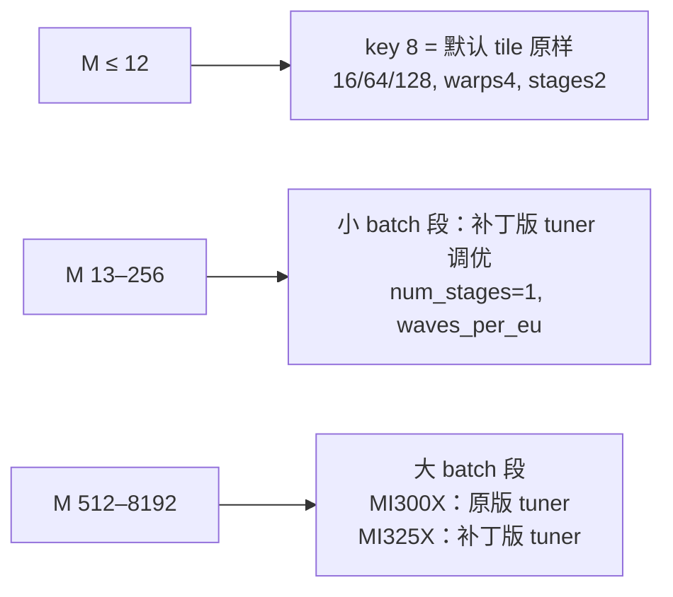

# PR #63727: [ROCm][Perf][Muse Spark] Add gfx942 FP8 W8A8 fused-MoE configs for E=32,N=4096

> **Author**: @mjkvaak-amd | **State**: OPEN | **Date**: 2026-10-26
> **Branch**: `rocm/fused-moe-mi300x-e32-n4096-fp8` → `main` | **Labels**: rocm, ready
> **Changes**: +292 -0 lines across 2 files | **ROCm 相关性**: 完全相关
> 本报告分两部分：§1–6 为 PR 详细总结，§7–8 为 ROCm review 意见。

---

## 1. 总结 (Summary)

PR 为 Muse Spark（`amd/Muse-Spark-Open-816B-A42B-Quark-PTPC-FP8`）在 gfx942 上 TP8 + EP 部署时每个 rank 的 MoE 形状（`E=32, N=4096, fp8_w8a8`，per-token FP8 激活）新增两份 Triton fused-MoE 调优配置：MI300X 和 MI325X 各一份。main 上该形状没有配置，会回退到 `get_default_config`。纯 JSON 改动，不改任何代码。作者报告 c64 下 MI300X 服务吞吐提升 12–25%，MI325X 提升约 20–21%，GSM8K 不变。

## 2. 背景与动机 (Background & Motivation)

- Muse Spark 有 256 个路由专家，top-8，`moe_intermediate_size = 4096`，`moe_hidden_size = 4096`（即 MoE 的输入 K）。TP8 + EP 时每个 rank 持有 32 个专家，专家内部不做 TP 切分，所以 `w2` 形状是 `(32, 4096, 4096)`，对应的配置文件名是 `E=32,N=4096`。
- 在 ROCm 上，Muse Spark 的 FP8 路径强制使用 Triton MoE 后端：`validate_fp8_deployment` 要求 `moe_backend == "triton"`，否则直接报错。因此这份 JSON 对**所有** gfx942 上的 Muse Spark FP8 部署都会生效，不存在"只在 opt-in 时才用到"的问题。
- main 上没有这个形状的配置，`get_moe_configs` 会打印 "Using default MoE config. Performance might be sub-optimal!"，然后走启发式默认 tile。
- 作者说明调优时发现 `benchmarks/kernels/benchmark_moe.py` 有两个问题：
  - EP 模式下，它把全部 token 路由到本地 32 个专家，每个专家看到的行数是真实服务时的 8 倍。
  - 在 gfx942 上，FP8 的 quant dtype 写死为 `float8_e4m3fn`，导致没有计时到真正的 W8A8 kernel。
  作者用一个本地补丁（在 PR 描述中给出了 diff，未包含在本 PR 里）重新调优了小 batch 段。

## 3. 代码修改分析 (Code Change Analysis)

### 3.1 修改的模块

| 文件 | 改动 |
|------|------|
| `fused_moe/configs/E=32,N=4096,device_name=AMD_Instinct_MI300X,dtype=fp8_w8a8.json` | 新增，16 个 batch key（8–8192） |
| `fused_moe/configs/E=32,N=4096,device_name=AMD_Instinct_MI325X,dtype=fp8_w8a8.json` | 新增，16 个 batch key（8–8192），各项独立调优 |

### 3.2 架构 / 流程图

```mermaid
flowchart TD
    A[Muse Spark FP8 MoE 前向<br/>moe_backend=triton 强制] --> B[try_get_optimal_moe_config<br/>w2_shape=(32,4096,4096), dtype=fp8_w8a8]
    B --> C[get_config_file_name]
    C --> D{get_device_name<br/>_ROCM_DEVICE_ID_NAME_MAP}
    D -->|0x74a1 / 0x74b5| E1[AMD_Instinct_MI300X]
    D -->|0x74a5 / 0x74b9| E2[AMD_Instinct_MI325X]
    D -->|0x74a9 / 0x74bd| E3[AMD_Instinct_MI300X_HF<br/>无对应文件 → 默认 tile]
    E1 --> F[E=32,N=4096,device_name=...,dtype=fp8_w8a8.json<br/>per-token 量化 → 无 block_shape 后缀]
    E2 --> F
    F --> G[pop triton_version<br/>按 key 与 M 的距离取最近邻 tile]
    G --> H[invoke_fused_moe_triton_kernel<br/>**config → BLOCK_*/num_warps/num_stages/waves_per_eu]
```



### 3.3 关键实现细节

- **文件名匹配**：`get_config_file_name` 生成 `E={E},N={N},device_name={get_device_name_as_file_name()},dtype=fp8_w8a8.json`。PTPC per-token 量化时 `block_shape=None`，没有 `block_shape` 后缀。ROCm 的 `get_device_name` 通过 `_ROCM_DEVICE_ID_NAME_MAP` 把 `0x74a1/0x74b5` 映射为 `AMD_Instinct_MI300X`，把 `0x74a5/0x74b9` 映射为 `AMD_Instinct_MI325X`，与两个文件名完全一致。
- **N 的含义**：N 取自 `w2_shape[2]`，即每个 rank 的 intermediate size。EP 时不做切分，所以 N = 4096。`benchmark_moe.py` 在 `--enable-expert-parallel` 时也用 `shard_intermediate_size = 2 * intermediate_size`，命名一致。
- **key 集合**：`BLOCK_SIZE_M/N/K`、`GROUP_SIZE_M`、`num_warps`、`num_stages`、`waves_per_eu`。没有 `matrix_instr_nonkdim` 和 `kpack`，会走 Triton 默认值（16 和 1），这与 main 上已有的 gfx942 文件同类。`triton_version` 会在 `get_moe_configs` 中被 pop 掉。
- **整除性**：
  - w1 的 N 是 2×4096 = 8192，w2 的 N 是 4096。
  - 两个 GEMM 的 K 都是 4096。
  - 文件中出现的 `BLOCK_SIZE_N` ∈ {32, 64, 128, 256} 和 `BLOCK_SIZE_K` ∈ {128, 256} 都能整除这些维度。
- **小 batch 段**：
  - `"8"` 这一项与 `get_default_config` 在 M ≤ 8 时的输出完全一致：fp8 per-tensor/per-token 分支下为 BM16/BN64/BK128、GROUP 1、warps 4、ROCm 上 stages 2。
  - 按最近邻规则，M = 1–12 都会命中 key 8，所以 c1–c8 的 decode 与 main 行为相同。这与作者给出的 "c1–c8 flat by design" 一致。
- **num_stages=1**：小到中 batch 段大量使用 `num_stages: 1`。这是 HIP 后端合法的流水深度，并且比默认的 2 更不容易触发 `OutOfResources`。

## 4. 涉及的技术原理 (Technical Principles)

- **Triton fused-MoE 调优表**：vLLM 的 `fused_moe_kernel` 用 `(E, N, device, dtype[, block_shape])` 定位 JSON 文件，文件内以 "token 数 M" 为 key。运行时取 |key − M| 最小的那一项，所以 key 的分布决定了每个 M 区间落到哪个 tile。没有文件时使用 `get_default_config` 的启发式。
- **gfx942 的 FP8**：MI300X/MI325X 原生支持的是 `float8_e4m3fnuz`，即 `current_platform.fp8_dtype()`。`FusedMoEQuantConfig.use_fp8_w8a8` 判断的是 `quant_dtype == current_platform.fp8_dtype()`，所以只要传入 `e4m3fn`，W8A8 路径就会被判为不启用。这也是作者给 tuner 打补丁的原因之一。
- **AMD 专属 launch 参数**：
  - `waves_per_eu` 是 Triton AMD 后端的占用率提示：0 表示不限制，n 表示目标为每个 EU 上 n 个 wave。它会影响寄存器分配。
  - `matrix_instr_nonkdim` 和 `kpack` 控制 MFMA 指令形状和 K 方向打包。未指定时取默认值。
- **EP 路由分布**：TP8 + EP 时，每个 token 的 top-8 专家分布在 256 个专家上，平均只有 1/8 落在本 rank。tuner 如果把全部 token 都路由到 32 个本地专家，每个专家的行数会被放大约 8 倍，小 batch 下选出的 tile 会偏大。作者用 `expert_map` 补丁还原了真实服务时的分布。

## 5. 评论区讨论亮点 (Discussion Highlights)

- @jhartika-amd 询问 `benchmark_moe.py` 被改了什么。作者随后在 PR 描述的 Details 部分补充了说明，并贴出了完整的 tuner 补丁 diff（该补丁不在本 PR 中）。
- @AndreasKaratzas 提醒作者 CI 的使用规范：失败后应使用 `/ci retry` 只重跑失败的组，不要反复 `/ci run` 触发全量构建；重跑前先确认对应的测试组在 main 上是绿的。作者多次触发 CI，其中 #101472 在 CI setup 阶段就失败了。最新一次是 Buildkite #101894，对应当前 head `1909818024`。
- @fxmarty-amd 已 APPROVE。
- 本次没有拿到 check-runs 的明细（GitHub API 限流）。只知道 `mergeable_state=clean`，#101894 的结果需要在 PR 页面确认。

## 6. 风险与潜在问题 (Risk Analysis)

| 风险 | 严重程度 | 说明 |
|------|---------|------|
| 数值正确性 | Low | 只换 tile，kernel 不变；不同 `BLOCK_SIZE_K` 只改变 fp32 累加顺序。GSM8K 在两种硬件上都持平 |
| MI300X 大 batch 段的调优质量 | Low–Medium | 见 §7「MI300X 512–8192 段的调优来源与服务时分布不一致」 |
| 设备覆盖 | Low | `AMD_Instinct_MI300X_HF`（0x74a9/0x74bd）不会命中这两个文件，仍走默认 tile，属于预期内的范围 |
| 形状共享 | Low | 其他模型只要每个 rank 的形状同为 E=32、N=4096、FP8 W8A8，也会读到这份文件；K 不同时可能不是最优，但 kernel 对 K/N 有 mask，不影响正确性 |
| 可复现性 | Low | tuner 补丁没有上游化，见 §7 |
| CI | Unknown | check 明细未获取 |

---

## 7. Review 意见 (Findings)

| 意见类型 | 🔴 | ⚠️ | 📝 |
|---------|----|----|----|
| 性能 | 0 | 0 | 1 |
| 可维护性 | 0 | 0 | 1 |
| 测试 / 数据来源 | 0 | 0 | 1 |

**📝【性能】MI300X 512–8192 段的调优来源与服务时分布不一致** `[已验证]`
- **问题**：MI300X 文件中 key 512–8192（第 83–145 行）的 tile，按 PR 描述来自未打补丁的 `benchmark_moe.py --tune`。这个版本有两个已在 main 上确认的问题：
  - EP 模式下，它把全部 token 路由到本地 32 个专家，每个专家的行数被放大约 8 倍。
  - 在 gfx942 上，它把 quant dtype 写死为 `float8_e4m3fn`（`benchmark_moe.py` 第 261 行）。由于 `use_fp8_w8a8` 判断的是 `quant_dtype == current_platform.fp8_dtype()`，而 gfx942 上该值为 `e4m3fnuz`，这里会被判为不启用，计时的并不是服务时实际运行的 W8A8 kernel。

  只有 16–256 段用补丁版重新调优过。作者自己的 MI325X kernel 表也显示，同一批 MI300X tile 在 MI325X 上于 batch 512/2048/3072 落后于默认 tile。MI300X 本机目前只给出了 batch 16–128 的 kernel 对比。
- **影响**：不影响正确性。MI300X 上的 prefill 大 chunk 可能没有拿到最优 tile，甚至在个别 batch 上比默认 tile 慢。不过服务表中 TTFT 都有小幅改善，目前没有看到回退的证据。
- **行动**：建议作者补一组 MI300X 在 batch 512–8192 下的 kernel 计时，使用服务路由、对比默认 tile。如果有点位落后，就像 MI325X 那样用补丁版 tuner 重调这一段；也可以在描述中注明这些 key 是用哪个版本的 tuner 得到的。

**📝【可维护性】tuner 修复没有上游化，gfx942 FP8 调优难以复现** `[已验证]`
- **问题**：作者的补丁修了 `benchmarks/kernels/benchmark_moe.py` 的两个问题：
  1. gfx942 上 FP8 quant dtype 写死为 `e4m3fn`，导致 W8A8 kernel 没有被计时。
  2. EP 模式没有 `expert_map`，路由分布与服务时不一致。

  main 上这两处仍未修复（第 261 行和第 322–324 行）。补丁只以 diff 形式附在 PR 描述里，并引入了两个临时的环境变量 `MOE_TUNE_GLOBAL_E` 和 `MOE_TUNE_NUM_STAGES`。
- **影响**：其他人用 main 上的 tuner 在 gfx942 上调 FP8 MoE 配置时，会继续得到计时路径错误的结果，也无法复现本 PR 的配置。
- **行动**：建议作者另开一个 PR 上游化第 1 点（改用 `current_platform.fp8_dtype()`，这是明确的 bug fix）。第 2 点建议做成正式的 CLI 参数（例如 `--global-num-experts`），而不是环境变量。本 PR 本身不需要修改。

**📝【测试】性能数据为单次测量，"逐 bit 一致"的说法无法静态验证** `[已验证]`
- **问题**：
  - 服务表中每个点只跑了一次，原始日志没有附上。数据可以对上描述中给出的命令和镜像（`nightly-83c078d955`、`nightly-rocm72-3966924d`），但标准差未知，c16–c32 那些 +2%–5% 的提升处在噪声范围附近。
  - 描述称"MI325X 每一项与默认 tile 输出逐 bit 一致（FP8 乘积在 fp32 中精确累加）"。这只在乘积的动态范围小于 24 bit 尾数时成立。e4m3fnuz 乘积的指数跨度可以超过这个范围，所以这是对实测结果的经验总结，不是普遍保证。
- **影响**：不影响合入判断。c64/c128 的 +12%–25% 远超噪声，GSM8K 持平。
- **行动**：建议作者在描述中把"逐 bit 一致"改为"在测试输入上逐 bit 一致"，并在描述里附上 c64 点的原始 `vllm bench serve` 输出，以便追溯。

## 8. 结论 (Verdict)

✅ **LGTM**：两份文件的命名与 ROCm 设备名映射、PTPC 的 dtype 后缀和 EP 下的 N 完全匹配。key 集合对 HIP 后端合法，tile 能整除 8192 和 4096。M ≤ 12 时保持默认 tile 不变，高并发下的收益和精度数据也比较完整。三条备注都不阻塞合入；合入前请确认 Buildkite #101894 的结果。

## 9. 英文 Review 评论 (Copy-Paste English Comments)

**C1** `vllm/model_executor/layers/fused_moe/configs/E=32,N=4096,device_name=AMD_Instinct_MI300X,dtype=fp8_w8a8.json:83-145` — ⚠️ comment

```text
Per the description, the MI300X entries for batch 512-8192 come from the unpatched benchmark_moe.py. On main that script routes every token to the 32 local experts (about 8x the per-expert rows seen in serving) and, on gfx942, uses float8_e4m3fn as the quant dtype, so use_fp8_w8a8 is false and the W8A8 kernel is not the one being timed. Your MI325X table also shows these MI300X tiles losing to the default at batch 512, 2048 and 3072 there. Could you add MI300X kernel timings for 512-8192 with serving routing against the default tile, and re-tune any point that loses, as you did for MI325X? Not blocking, since TTFT improved in the serving runs.
```

**C2** `vllm/model_executor/layers/fused_moe/configs/E=32,N=4096,device_name=AMD_Instinct_MI300X,dtype=fp8_w8a8.json:2` — ⚠️ comment

```text
The tuner fixes in the description are worth upstreaming in a separate PR, especially using current_platform.fp8_dtype() instead of a hard-coded float8_e4m3fn in benchmark_moe.py. As it stands, anyone tuning FP8 MoE on gfx942 with main's script times a non-W8A8 path and cannot reproduce these files. The global-experts/expert_map routing would fit better as a CLI flag than as the MOE_TUNE_* environment variables. No change needed in this PR.
```

**C3** `vllm/model_executor/layers/fused_moe/configs/E=32,N=4096,device_name=AMD_Instinct_MI325X,dtype=fp8_w8a8.json:2` — ⚠️ comment

```text
Small wording nit on the description: "bit-identical outputs because FP8 products accumulate exactly in fp32" holds for the inputs you tested, but it is not guaranteed in general. The exponent span of e4m3fnuz products can exceed fp32's 24-bit mantissa, so a different BLOCK_SIZE_K can change the rounding. Could you phrase it as "bit-identical on the tested inputs"? Attaching the raw bench output for the c64 points would also make the single-run numbers easier to audit.
```

## 10. 英文总结评论 (Overall Review Summary)

```text
Config-only change that looks correct. The file names match the ROCm device-name mapping, the per-token FP8 dtype suffix and the EP-unsharded N=4096. All keys are valid for the HIP Triton backend, the tiles divide 8192 and 4096, and batches up to 12 keep the default tile. Two optional follow-ups. First, the MI300X 512-8192 entries came from the unpatched tuner, so a kernel comparison against the default would help. Second, the benchmark_moe.py FP8 dtype fix for gfx942 is worth upstreaming separately. Approve once CI is green.
```
