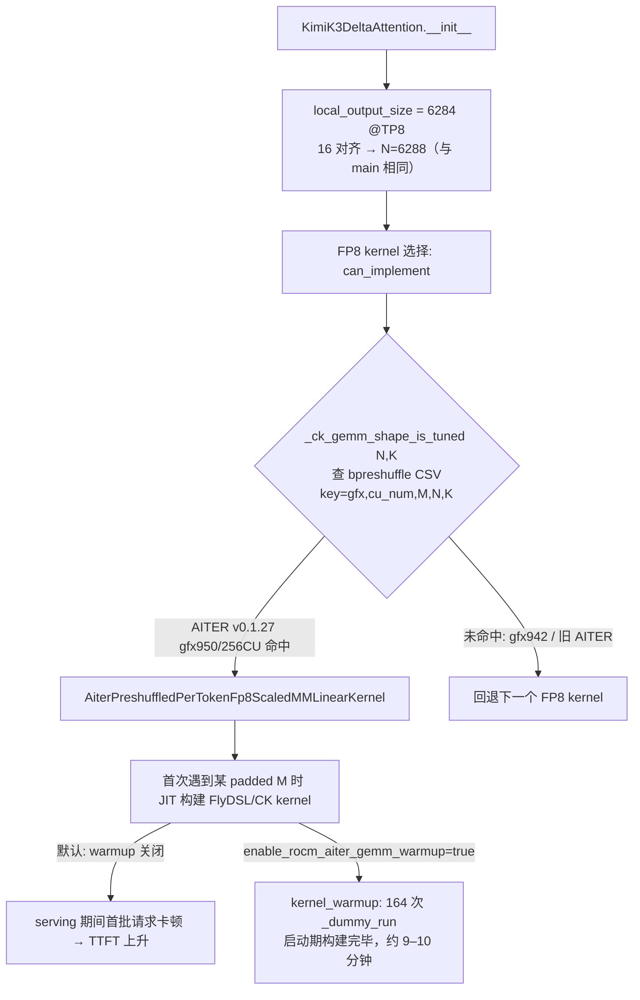
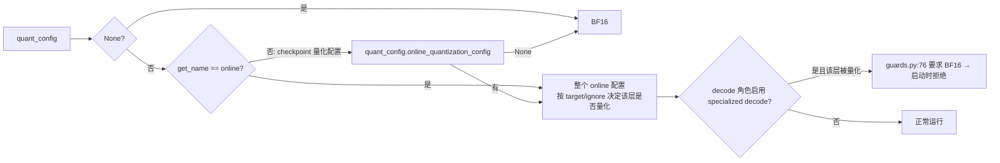

# PR #63730: [ROCm][Perf] Kimi-K3 prefill GEMMs on AITER tuned kernels

> **Author**: @whx-sjtu | **State**: OPEN | **Date**: 2026-10-26（最近更新 2026-11-04）
> **Branch**: `whx-sjtu:whx/k3-p-gemm-shapes` → `main`（base `5689c2790c`，落后当前 main 302 个 commit，与 main `4ab4404e24` 文本合并无冲突）| **Labels**: rocm, ready, kimi, k3
> **Changes**: +176 -1 lines across 5 files | **ROCm 相关性**: 完全相关（Kimi-K3 AMD 模型目录 + ROCm 专属 warmup；注意 `amd/linear.py` 在 XPU 上也会被加载）
> 本报告分两部分：§1–6 为 PR 详细总结，§7–8 为 ROCm review 意见。本次为对 head `20af1935f0` 的复审（上次 review 针对 `dfbba0b123`），变化见 §7 开头。

---

## 1. 总结 (Summary)

本 PR 针对 MI355X 上 Kimi-K3 PD 分离中 prefill 实例开启 online FP8 后反而比 BF16 慢的问题，现在只做两件事：(1) 让 latent MoE 的 `routed_expert_down_proj` 跟随 online quantization 配置（原先硬编码 `quant_config=None`）；(2) 新增 opt-in 的 `kernel_config.enable_rocm_aiter_gemm_warmup`，在 kernel warmup 阶段按 AITER 的 M 分桶跑一次 dummy forward，把 FlyDSL/CK 调优 GEMM 的首次 JIT 构建挪到启动期。上一版中“KDA in_proj 128 行对齐”与配套的 specialized decode guard 修改已在新 commit `20af193` 中撤回，in_proj 恢复 main 的 16 行对齐。

## 2. 背景与动机 (Background & Motivation)

- Kimi-K3 在 ROCm 上采用 PD 分离（1P1D、TP8+DCP8、MoRIIO），prefill 实例用 `--quantization-config` 做 online FP8 per-channel 量化。作者实测 online FP8 prefill 的吞吐与 TTFT 反而不如 BF16（10626 vs 10775 tok/s/GPU，TTFT 5.35 s vs 4.50 s）。
- 作者归因：AITER 调优 kernel 首次以某 padded M 调用时才 JIT 构建，serving 期间每个新 M 桶都会卡住首批请求；另外 `routed_expert_down_proj` 原先无法被 online 配置量化。
- 上一版还把 KDA in_proj 的 TP8 本地形状从 6288 pad 到 6400，理由是“6288 不在 AITER 调优表中”。该前提只对作者基准使用的 nightly `81198e97`（pin `AITER_BRANCH="v0.1.24.post1"`）成立；当前 main pin `v0.1.27`（#63774），其 Kimi-K3 表已同时调优 6288×7168 和 6400×7168。作者在复审后接受了这一点并撤回 padding。
- 注意：PR 描述中的全部端到端数据仍是在 AITER v0.1.24.post1、in_proj pad 到 128 的配置下测得的，作者明确写了“Not re-run end to end on v0.1.27”。

## 3. 代码修改分析 (Code Change Analysis)

### 3.1 修改的模块

| 模块 | 改动 |
|------|------|
| `vllm/models/kimi_k3/amd/linear.py` (+6/-1) | `routed_expert_down_proj` 的 `quant_config`：online 配置直接透传；非 online 配置取 `quant_config.online_quantization_config`（无则 None → BF16） |
| `vllm/model_executor/warmup/kernel_warmup.py` (+44) | 新增 `_aiter_gemm_m_buckets()` 与 `_rocm_aiter_gemm_warmup()`，在 `is_rocm()` 分支内、`rocm_segmented_attn_autotune_warmup` 之后调用 |
| `vllm/config/kernel.py` (+7) | 新增 `enable_rocm_aiter_gemm_warmup: bool = False`，并加入 `compute_hash` 忽略列表 |
| `tests/model_executor/test_rocm_aiter_gemm_warmup.py`（新增 55 行） | 分桶覆盖性（对照 AITER `getPaddedM`）与开关 opt-in |
| `tests/model_executor/model_loader/test_reload.py` (+64) | KDA online loading：6 个 shard 加载后完成处理、源张量被释放、padding 行保持为 0（覆盖 main 已有的 16 行对齐 padding；新 commit 删除了 `% 128` 断言） |
| ~~`vllm/models/kimi_k3/amd/kda.py`~~、~~`.../specialized_decode/runtime/guards.py`~~、~~`tests/.../test_runtime.py`~~ | 已在 `20af193` 中完全撤回，与 base 无差异 |

### 3.2 架构 / 流程图

prefill GEMM dispatch 与 warmup 的关系（当前 head）：



`routed_expert_down_proj` 量化配置的选择：



### 3.3 关键实现细节

- `routed_expert_down_proj`：`quant_config.get_name() == "online"`（`online/base.py:214`）时直接用整个 online 配置；否则取基类属性 `online_quantization_config`（`base_config.py:135` 默认 `None`，不会 AttributeError）。效果是 checkpoint 量化配置被绕过（该层 checkpoint 为 BF16），只有 online 配置可作用于该层。
- warmup 尺寸 = AITER M 分桶（1/2/4/8；≤256 步长 16；≤1024 步长 32；≤4096 步长 64；之后步长 128）∪ 8 的倍数到 512 ∪ `max_m - 1`；`max_num_batched_tokens=8192` 时 164 次 forward，作者实测 541–585 s（无 online 量化时 104 s）。调用 `_dummy_run(num_tokens, skip_eplb=True)`，与已有 compile warmup 的调用方式一致。
- 边界：`max_m` 很小时（如 3）分桶为 `[1, 2, 3]`；`max_m - 1 = 0` 会被 `if m > 0` 过滤。已人工走查。
- `enable_rocm_aiter_gemm_warmup` 不影响计算图，正确地加入 `compute_hash` 的忽略集合；通过 `--kernel-config` JSON 打开，与 `enable_rocm_segmented_attn_autotune` 同一模式。
- `kda.py` 现与 base 完全一致：`in_proj_padding = -local_output_size % 16`，TP8 下 pad 4 行到 6288；specialized decode guard 仍要求 in_proj 精确为 `(NPROJ=6288, H)`。

## 4. 涉及的技术原理 (Technical Principles)

- **AITER 调优表 dispatch**：vLLM 的 `_ck_gemm_shape_is_tuned(N, K)` 用一组代表性 M 查询 AITER CSV，命中即选择 AITER preshuffled per-token FP8 GEMM。AITER 的配置 key 含 `(gfx, cu_num, padded_M, N, K, q_dtype_w)`，因此调优条目按架构与 CU 数隔离；gfx942（304 CU）或分区后的 MI355X 不会命中 Kimi-K3 表，自动回退。
- **AITER v0.1.27 的 Kimi-K3 表**：本地安装的 amd-aiter 0.1.27 中 `a8w8_bpreshuffle_tuned_gemm_kimik3.csv`（gfx950/256 CU）在 M=256…8192 的 52 个点上，6288/6400 的调优耗时比中位数 1.00、范围 0.92–1.09，与作者在 PR 中的新说法一致。这是撤回 padding 的依据。
- **FlyDSL/CK kernel 的 JIT 构建**：AITER 的调优 kernel 第一次以某 padded M 调用时编译/加载，耗时可达秒级；PD 场景下 prefill 实例的首批长 prompt 分布在多个 M 桶，构建成本直接计入 TTFT。warmup 在 CUDA graph 捕获前遍历所有桶，把成本转移到启动期。
- **online quantization**：`--quantization-config` 在 BF16（或已量化）checkpoint 加载后按 target/regex 在线量化 Linear 层（`fp8_per_channel`、`mxfp4` 等）；`ignore` 列表可排除层。
- **Kimi-K3 specialized decode**：MI355X 上的 FlyDSL 单内核 decode，直接按指针读取 BF16 权重，对权重形状/dtype/contiguity 有严格 guard，不满足则启动失败。

## 5. 评论区讨论亮点 (Discussion Highlights)

- @shen-shanshan 在 `kda.py` 上指出 128 padding 的前提只在 AITER v0.1.24.post1 下成立，建议在 v0.1.27 上重测并在无差异时撤回。作者在 `20af193` 中撤回 padding 与 guard 修改，并回复：v0.1.27 表中 6288/6400 耗时比中位数 1.00；**未重测端到端**，理由是“共享的 MI355X 上重复运行差异可达 2 倍”。
- @ChuanLi1101 认可当时的 padding 方案与 warmup 默认关闭，并要求说明单次运行的方差。作者在 Validation 中补充：以 BF16 有无 warmup 两行（0.4% 吞吐、0.01 s 平均 TTFT）作为方差参照。注意这两行是不同配置，不是同一配置的重复测量；与作者自己说的“重复差异可达 2 倍”也不一致（见 §7 ⚠️【测试】）。ChuanLi1101 认可的 padding 现已撤回。
- 仍无 approval；Claude bot 因 fork PR 未自动 review。唯一一次 `/ci run`（Buildkite #97872）针对旧 commit `2ff4ed42b198`；当前 head 无 CI / AMD CI 记录。
- mergify 在 11-02 提示的冲突：当前 head 的 base 仍是 `5689c2790c`，但 `git merge-tree` 显示与最新 main 文本合并无冲突（kda/guards 改动撤回后冲突面消失）。

## 6. 风险与潜在问题 (Risk Analysis)

| 风险 | 严重程度 | 说明 |
|------|---------|------|
| `routed_expert_down_proj` 默认被 online 配置量化，行为变化且无精度评测 | Medium | 见 §7 ⚠️【兼容性】 |
| 性能数据来自未合入的配置（pad 128 + AITER v0.1.24.post1），且单次运行 | Medium | 见 §7 ⚠️【测试】 |
| PR 标题 / Claims 仍描述已撤回的 kernel 选择改动 | Low | 见 §7 📝【注释/文档】 |
| warmup 启动时间 +9–10 分钟 | Low | opt-in，已在 docstring 写明 |
| XPU 也加载 `amd/linear.py` | Low | down_proj 量化行为变化同样作用于 XPU，未验证 |
| 当前 head 无 CI 记录 | Low | 需要 `/ci run` 或 `/amd-ci run` |

---

## 7. Review 意见 (Findings)

### 相对上次 review 的变化（`dfbba0b123` → `20af1935f0`）

新 commit `20af193`（“keep KDA in_proj at 16-row alignment”）撤回了 `kda.py` 的 128 对齐、`guards.py` 的 padding 适配、`test_runtime.py` 中对应测试，以及 `test_reload.py` 中的 `% 128` 断言。其余文件与上一版相同。

| 上次意见 | 状态 | 说明 |
|---------|------|------|
| ⚠️【性能】“6288 未调优”前提在 AITER v0.1.27 下不成立 | ✅ 已解决 | padding 与 guard 修改已撤回；作者给出的 v0.1.27 耗时比（中位数 1.00，0.92–1.09）已本地复核 |
| ⚠️【设计】默认配置（padding 开、warmup 关）是最慢的一档 | ✅ 已解决 | 退化行来自 128 padding；撤回后默认配置对应作者表中“+ down_proj MXFP4”一行（10663 / 5.14 s），不差于 PR 前 |
| ⚠️【兼容性】`routed_expert_down_proj` 跟随 online 配置：行为变化、无精度评测、可能导致 specialized decode 启动失败 | ❌ 仍未解决 | 代码未改，PR 仍写 “No accuracy evaluation” |
| ⚠️【测试】性能数据单次运行、基于旧 nightly overlay | ❌ 仍未解决（证据更弱） | 现在的数据测的是一个本 PR 不再提交的配置；作者称重复运行差异可达 2 倍 |
| 📝【设计】warmup 未按 AITER 是否启用限定 | ❌ 仍未解决 | 代码未改 |
| 📝【兼容性】padding 与 down_proj 改动作用于 gfx942 与 XPU | 🟡 部分解决 | padding 部分随撤回消失；down_proj 对 XPU 的影响并入下方 ⚠️【兼容性】 |
| 📝【可维护性】分桶公式复制了 AITER `getPaddedM` | ❌ 仍未解决 | 代码未改 |
| 新增 | 📝【注释/文档】 | PR 标题与 Claims 仍描述已撤回的 kernel 选择改动和对应收益 |

| 类型 | 🔴 | ⚠️ | 📝 |
|------|----|----|----|
| 兼容性 | — | 1 | — |
| 测试 | — | 1 | — |
| 设计 | — | — | 1 |
| 可维护性 | — | — | 1 |
| 注释/文档 | — | — | 1 |

---

**⚠️【兼容性】`routed_expert_down_proj` 默认开始跟随 online 配置量化：行为变化且未做精度评测，并可能使 specialized decode 启动失败** `[已验证]`（启动失败场景 `[推测]`）

- **问题**: `vllm/models/kimi_k3/amd/linear.py:278-287` 把原来的 `quant_config=None` 改为 online 配置。PR Details 说明“linear 默认 target 未 ignore 此层的 online 配置现在会量化它”。同时 specialized decode 的 `guards.py:76`（当前 main 为 `:77`）仍要求 `routed_expert_down_proj.weight` 为 BF16 `(LAT, H)`。`vllm/models/kimi_k3/__init__.py` 在 XPU 上也加载 `amd/linear.py`，因此该变化也作用于 XPU。
- **影响**: ① 现有使用“linear 默认 fp8”这类宽泛 online 配置的部署，升级后该层被静默量化，数值发生变化，而 PR 写明“No accuracy evaluation”。② decode 角色若使用同样宽泛的 online 配置并设置 `decode_backend=latency_specialized`，升级后会在 guard 处启动报错（显式报错，不会静默出错），需要用户自行把该层加入 `ignore`。③ XPU 上的同类配置行为同样改变，未验证。
- **行动**: 建议作者至少补一次 GSM8K（或同类）精度对比，覆盖 down_proj 为 FP8 / MXFP4 两种情况；并在 specialized decode README 或 guard 报错信息里提示“online 配置需 ignore `routed_expert_down_proj`”。

**⚠️【测试】性能数据测的是本 PR 不再提交的配置，且为单次运行；当前 head 无 CI** `[已验证]`

- **问题**: PR Claims 第三条与基准表都基于 nightly `81198e97`（AITER v0.1.24.post1）+ in_proj pad 128 的文件 overlay。撤回 padding 后，作者写明“Not re-run end to end on v0.1.27”。方差方面，作者以 BF16 有无 warmup 两行的差异（0.4%）作为参照，但那是两个不同配置的单次运行，不是重复测量；作者在 review 回复中又说该共享 MI355X 上“repeats differed by up to 2x”。`test_reload.py` 的 GPU reload 测试未运行；当前 head 无 CI 记录（唯一一次 `/ci run` 针对旧 commit `2ff4ed42b198`）。
- **影响**: 吞吐提升（+2.1%、+0.7%）与噪声无法区分。TTFT 改善（5.35 s → 4.05 s）主要来自 warmup，方向上可信，但对“16 对齐 + v0.1.27 + warmup”这个实际合入的配置没有任何端到端数据。如果重复运行差异真可达 2 倍，单次 1.3 s 的 TTFT 下降也不能作为结论。
- **行动**: 建议作者在 AITER v0.1.27 的 main 上，至少测“online FP8 + down_proj，warmup 关 / 开”两种配置各 2–3 次（可在非共享机器上，或报告重复间的 min/max）；并在当前 head 上触发 `/ci run` 与 `/amd-ci run`。

**📝【设计】warmup 未按 AITER 是否启用 / 模型类型限定** `[已验证]`

- **问题**: `vllm/model_executor/warmup/kernel_warmup.py:241-265` 只检查开关，未检查 `rocm_aiter_ops.is_linear_fp8_enabled()` 等条件；开关打开时在任意 ROCm 模型上都会执行约 164 次 dummy forward。作者自己的数据也显示“Warmup without online quantization gives no gain”。
- **行动**: 建议作者在 AITER linear 未启用时跳过并打印一条日志，避免用户误开后白白付出启动时间；并在 Kimi-K3 ROCm recipe 中注明 online FP8 prefill 应同时开启该开关。

**📝【可维护性】warmup 分桶公式复制了 AITER 内部的 `getPaddedM` 规则** `[已验证]`

- **问题**: `kernel_warmup.py:225-238` 的 `_aiter_gemm_m_buckets` 与测试中的 `_aiter_padded_m` 都硬编码了 AITER 当前的 padding 阶梯（16/32/64/128 与 256/1024/4096 阈值）；AITER 若调整该规则，warmup 会悄悄漏桶，测试也会因为对照的是同一份复制而继续通过。
- **行动**: 建议作者在可行时直接引用 AITER 的 `get_padded_m`，或在注释中标注对应的 AITER 版本 / 源码位置。

**📝【注释/文档】PR 标题与 Claims 仍描述已撤回的 kernel 选择改动** `[已验证]`

- **问题**: 标题 “Kimi-K3 prefill GEMMs on AITER tuned kernels” 原本指 in_proj 改到调优形状；现在 PR 不再改变任何 kernel 选择（6288 在 v0.1.27 上本来就命中调优表，这是 AITER 升级带来的，不是本 PR）。Claims 第三条的 +2.1% / TTFT 4.05 s 也来自带 128 padding 的配置。
- **行动**: 建议作者把标题改为反映实际内容（例如 “AITER GEMM warmup and online-quantized routed_expert_down_proj”），并把性能 Claim 标注为“measured with the earlier padded variant on v0.1.24.post1”或替换为新数据。

## 8. 结论 (Verdict)

**⚠️ NEEDS WORK**

上次最主要的问题（无条件 128 padding 的前提在 AITER v0.1.27 下不成立）已被作者撤回，默认配置的退化也随之消失，PR 现在只剩一个默认关闭的 warmup 开关和 down_proj 的量化行为变化，并能与当前 main 无冲突合并。仍需处理：`routed_expert_down_proj` 量化行为变化缺少精度验证；实际合入的配置没有端到端性能数据；当前 head 未跑过 CI。

## 9. 英文 Review 评论 (Copy-Paste English Comments)

**C1** `vllm/models/kimi_k3/amd/linear.py:278-287` — ⚠️ comment

```text
Thanks for dropping the padding. This hunk is still open from the last round: it changes the default numerics of routed_expert_down_proj for any online config whose linear default does not ignore it, and the PR still says there was no accuracy evaluation. It can also make a decode role fail at startup, since the specialized decode guard (guards.py:76) still requires this weight to be BF16, so latency_specialized plus a broad online FP8 config would now be refused. The same change also applies on XPU, which loads amd/linear.py. Could you add a GSM8K comparison for down_proj in FP8/MXFP4, and mention the required ignore entry in the specialized decode README or the guard message?
```

**C2** `vllm/config/kernel.py:293-297` — ⚠️ comment

```text
All the end-to-end numbers in the PR were taken with in_proj padded to 128 on AITER v0.1.24.post1, which this PR no longer ships, and the description says the current configuration was not re-run on v0.1.27. The variance note compares two different configurations (BF16 with and without warmup) rather than repeats of one, and your reply mentions repeats on the shared MI355X differing by up to 2x. Could you measure online FP8 + down_proj with this flag off and on, 2-3 runs each, on main with AITER v0.1.27 (or report min/max across repeats)? Please also trigger /ci run and /amd-ci run on the current head; the only CI build so far was for 2ff4ed42b198.
```

**C3** `vllm/model_executor/warmup/kernel_warmup.py:241-265` — 📝 nit

```text
The warmup runs ~164 dummy forwards whenever the flag is set, regardless of whether AITER linear kernels are enabled or the model uses them; your own data says warmup without online quantization gives no gain. Could you skip it (with a log line) when rocm_aiter_ops.is_linear_fp8_enabled() is false? Also, _aiter_gemm_m_buckets re-implements AITER's getPaddedM ladder, and the test mirrors the same copy; consider importing AITER's helper or noting the AITER version this mirrors so the buckets do not silently drift.
```
