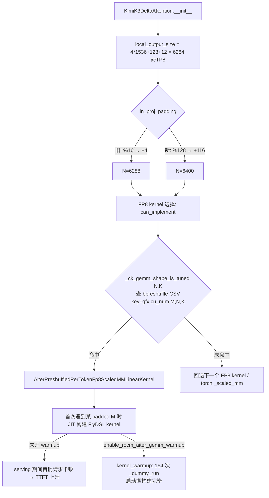

# PR #63730: [ROCm][Perf] Kimi-K3 prefill GEMMs on AITER tuned kernels

> **Author**: @whx-sjtu | **State**: OPEN | **Date**: 2026-10-26
> **Branch**: `whx-sjtu:whx/k3-p-gemm-shapes` → `main`（base `5689c2790c`）| **Labels**: rocm, ready, kimi, k3
> **Changes**: +245 -4 lines across 8 files | **ROCm 相关性**: 完全相关（Kimi-K3 AMD 模型目录 + ROCm 专属 warmup；注意 `amd/linear.py` / `amd/kda.py` 在 XPU 上也会被加载）
> 本报告分两部分：§1–6 为 PR 详细总结，§7–8 为 ROCm review 意见。

---

## 1. 总结 (Summary)

本 PR 针对 MI355X 上 Kimi-K3 PD 分离中 prefill 实例开启 online FP8 后反而比 BF16 慢的问题，做了三件事：(1) 把 KDA `in_proj_qkvgfab` 每个 TP rank 的输出行数从 16 对齐改为 128 对齐（TP8 下 6288 → 6400），使其命中 AITER 的 Kimi-K3 bpreshuffle FP8 调优表；(2) 让 latent MoE 的 `routed_expert_down_proj` 跟随 online quantization 配置（原先硬编码 `quant_config=None`）；(3) 新增 opt-in 的 `kernel_config.enable_rocm_aiter_gemm_warmup`，在 kernel warmup 阶段按 AITER 的 M 分桶跑一次 dummy forward，把 FlyDSL/CK GEMM 的首次 JIT 构建挪到启动期。配套修改 specialized decode 的权重 guard，使其接受 in_proj 尾部的对齐 padding。

## 2. 背景与动机 (Background & Motivation)

- Kimi-K3 在 ROCm 上采用 PD 分离（1P1D、TP8+DCP8、MoRIIO），prefill 实例用 `--quantization-config` 做 online FP8 per-channel 量化。作者实测 online FP8 prefill 的吞吐与 TTFT 反而不如 BF16（10626 vs 10775 tok/s/GPU，TTFT 5.35 s vs 4.50 s）。
- 作者归因：(a) KDA in_proj 的 TP8 本地形状 6288×7168 不在 AITER 调优表中，`AiterPreshuffledPerTokenFp8ScaledMMLinearKernel.can_implement` 拒绝后回退到 `torch._scaled_mm`；(b) AITER 调优 kernel 首次使用时才 JIT 构建，serving 期间每个新 M 桶都会卡住首批请求。
- 本 PR 依赖已合入的 #61950（PR 描述称已 rebase）。它也是 #64958（Mooncake + specialized decode）基准配置的前置。
- 注意：作者的全部端到端数据基于 vLLM ROCm nightly `81198e97`（2026-10-08），该版本 `docker/Dockerfile.rocm_base` pin 的是 `AITER_BRANCH="v0.1.24.post1"`；当前 main（以及本 PR base）已 pin `v0.1.27`（#63774，2026-10-30）。

## 3. 代码修改分析 (Code Change Analysis)

### 3.1 修改的模块

| 模块 | 改动 |
|------|------|
| `vllm/models/kimi_k3/amd/kda.py` (+4/-2) | `in_proj_padding = -local_output_size % 128`（原 `% 16`），注释说明 6400×7168 命中 AITER 表 |
| `vllm/models/kimi_k3/amd/linear.py` (+6/-1) | `routed_expert_down_proj` 的 `quant_config`：online 配置直接透传；非 online 配置取 `quant_config.online_quantization_config`（无则 None → BF16） |
| `vllm/model_executor/warmup/kernel_warmup.py` (+44) | 新增 `_aiter_gemm_m_buckets()` 与 `_rocm_aiter_gemm_warmup()`，在 `is_rocm()` 分支内、`rocm_segmented_attn_autotune_warmup` 之后调用 |
| `vllm/config/kernel.py` (+7) | 新增 `enable_rocm_aiter_gemm_warmup: bool = False`，并加入 `compute_hash` 忽略列表 |
| `vllm/models/kimi_k3/amd/specialized_decode/runtime/guards.py` (+7/-1) | in_proj 检查改为：`rows = weight.size(0) - in_proj_padding`，`rows > NPROJ` 则拒绝，否则只检查前 `NPROJ=6288` 行 |
| `tests/model_executor/test_rocm_aiter_gemm_warmup.py`（新增 55 行） | 分桶覆盖性（对照 AITER `getPaddedM`）与开关 opt-in |
| `tests/model_executor/model_loader/test_reload.py` (+65) | KDA online loading：6 个 shard 加载后完成处理、源张量被释放、padding 行保持为 0 |
| `tests/models/kimi_k3/amd_specialized_decode/test_runtime.py` (+57) | guard 接受 6288/4、6400/116，拒绝 6416/4、6284/0 |

### 3.2 架构 / 流程图

prefill GEMM dispatch 与 warmup 的关系：



specialized decode 侧 guard 的判定：

```mermaid
flowchart LR
    W[in_proj weight 行数 R] --> R1[rows = R - in_proj_padding]
    R1 --> Q{rows > NPROJ=6288?}
    Q -->|是| X[拒绝: 真实行越过 kernel 读取范围]
    Q -->|否| Y[need w_in[:6288] 形状/dtype/contiguous]
    Y -->|R=6400,pad=116 → 6284| OK[接受: kernel 只读前 6288 行]
    Y -->|R=6284,pad=0 → 切片只有 6284 行| X2[拒绝: 形状不符]
```

### 3.3 关键实现细节

- TP8 下 KDA 本地输出 = `4 × 1536 + 128 (f_a) + 12 (beta heads) = 6284`；旧逻辑 pad 4 行到 6288，新逻辑 pad 116 行到 6400。padding 无条件生效（不分 arch、不分 BF16/FP8、不分 TP）。forward 中 `split_sizes.append(self.in_proj_padding)` 后丢弃 padding 列，逻辑通用。
- specialized decode kernel（`mono/attention/kda.py`）通过 `w_in.data_ptr()` 构造 buffer resource，按 `row * HIDDEN` 寻址且 `row < GEMV_TASKS*ROWS = NPROJ`，因此尾部多出的 padding 行不会被读取；guard 只检查 `w_in[:NPROJ]`（对 dim0 切片仍 contiguous）。已对照源码确认。
- `routed_expert_down_proj`：`quant_config.get_name() == "online"` 时直接用整个 online 配置；否则取基类属性 `online_quantization_config`（`QuantizationConfig` 上默认 `None`，不会 AttributeError）。效果是 checkpoint 量化配置被绕过，只有 online 配置可作用于该层。
- warmup 尺寸 = AITER M 分桶（1/2/4/8；≤256 步长 16；≤1024 步长 32；≤4096 步长 64；之后步长 128）∪ 8 的倍数到 512 ∪ `max_m - 1`；`max_num_batched_tokens=8192` 时 164 次 forward，作者实测 541–585 s。调用 `_dummy_run(num_tokens, skip_eplb=True)`，V1 / V2 runner 都接受 `skip_eplb`；与已有的 compile warmup 调用方式一致（未传 `is_profile`）。
- `enable_rocm_aiter_gemm_warmup` 不影响计算图，正确地加入 `compute_hash` 的忽略集合；通过 `--kernel-config` JSON 打开，与 `enable_rocm_segmented_attn_autotune` 同一模式。

## 4. 涉及的技术原理 (Technical Principles)

- **AITER 调优表 dispatch**：vLLM 的 `_ck_gemm_shape_is_tuned(N, K)` 用一组代表性 M 查询 AITER CSV，只要任一 M 命中就认为 (N, K) “已调优”，进而选择 AITER preshuffled per-token FP8 GEMM。AITER 0.1.27 的 `get_GEMM_config_with_quant_type` 以 `(gfx, cu_num, padded_M, N, K, q_dtype_w)` 为 key，因此调优条目天然按架构（gfx950）与 CU 数（256 = MI355X 全卡）隔离；gfx942（304 CU）或分区后的 MI355X 不会命中 Kimi-K3 表，自动回退。
- **`model_configs/` 合并**：AITER 在未设置 `AITER_CONFIG_GEMM_A8W8_BPRESHUFFLE` 环境变量时，会把 `configs/model_configs/*a8w8_bpreshuffle_tuned_gemm*.csv`（含 `_kimik3.csv`）与主表合并，所以 Kimi-K3 专用表默认生效。
- **FlyDSL/CK kernel 的 JIT 构建**：AITER 的调优 kernel 在第一次以某 padded M 调用时编译/加载，耗时可达秒级；PD 场景下 prefill 实例的首批长 prompt 恰好分布在多个 M 桶，构建成本直接计入 TTFT。warmup 在 CUDA graph 捕获前遍历所有桶，把成本转移到启动期。
- **online quantization**：`--quantization-config` 在 BF16（或已量化）checkpoint 加载后按 target/regex 在线量化 Linear 层（`fp8_per_channel`、`mxfp4` 等）；`ignore` 列表可排除层。
- **Kimi-K3 specialized decode**：MI355X 上的 FlyDSL 单内核 decode，直接按指针读取 BF16 权重，对权重形状/dtype/contiguity 有严格 guard，不满足则启动失败。

## 5. 评论区讨论亮点 (Discussion Highlights)

- 截至抓取时无实质性人工 review 评论，也无 approval；13 位 code owner 待 review。Claude bot 因 fork PR 未自动 review。
- 作者曾 `/ci run` 触发 Buildkite #97872，但对应的是旧 commit `2ff4ed42b198`，非当前 head；mergify 曾提示冲突（PR 描述称已 rebase）。当前 head 的 CI 与 AMD CI 状态未知。
- 当前 main 在本 PR base 之后合入了 #61435（specialized decode 加入 MLA M1a/M1b）与 #57678，触及 `guards.py` 与 `test_runtime.py`，合入前大概率需要再 rebase。

## 6. 风险与潜在问题 (Risk Analysis)

| 风险 | 严重程度 | 说明 |
|------|---------|------|
| padding 的前提在当前 pin 的 AITER 版本下不成立 | High | 见 §7 ⚠️【性能】AITER v0.1.27 已调优 6288×7168 |
| 默认配置（padding 开、warmup 关）按作者自己的数据是最慢的一行 | Medium | 见 §7 ⚠️【设计】 |
| `routed_expert_down_proj` 默认被 online 配置量化，行为变化且无精度评测 | Medium | 见 §7 ⚠️【兼容性】 |
| 性能数据单次运行、基于旧 nightly 的 overlay | Medium | 见 §7 ⚠️【测试】 |
| warmup 启动时间 +9–10 分钟 | Low | opt-in，已在 docstring 写明 |
| XPU 也加载 `amd/linear.py` / `amd/kda.py` | Low | padding 与 down_proj 量化变化同样作用于 XPU，未验证 |
| 需要 rebase 到包含 #61435 的 main | Low | guards/test_runtime 有并发修改 |

---

## 7. Review 意见 (Findings)

| 类型 | 🔴 | ⚠️ | 📝 |
|------|----|----|----|
| 性能 | — | 1 | — |
| 设计 | — | 1 | 1 |
| 兼容性 | — | 1 | 1 |
| 测试 | — | 1 | — |
| 可维护性 | — | — | 1 |

---

**⚠️【性能】核心前提“6288 不在 AITER 调优表中”在当前 pin 的 AITER v0.1.27 下不成立** `[已验证]`

- **问题**: `vllm/models/kimi_k3/amd/kda.py:189-197` 的注释与 PR Claims 写“6288 has no entry and falls back to torch._scaled_mm”。但 main 与本 PR base 的 `docker/Dockerfile.rocm_base` 都 pin `AITER_BRANCH="v0.1.27"`（#63774），本容器安装的 amd-aiter 0.1.27 中 `aiter/configs/model_configs/a8w8_bpreshuffle_tuned_gemm_kimik3.csv` 对 `gfx950 / cu_num=256` 同时含 `N=6288,K=7168` 与 `N=6400,K=7168` 各 62 个 M 条目（M=1…32768），且两者调优耗时基本相同（如 M=8192：299.7 µs vs 294.7 µs；M=32768：1026.9 µs vs 1050.6 µs；M=256：25.5 µs vs 26.8 µs）。作者的基准使用的 nightly `81198e97` pin 的是 `v0.1.24.post1`，结论来自旧表。
- **影响**: 在当前 main 上，6288 已经会走 `AiterPreshuffledPerTokenFp8ScaledMMLinearKernel`，128 对齐不再带来 kernel 选择上的收益，却无条件给每个 rank 增加 112 行（+1.8% FLOPs/权重），并对所有 arch、BF16 路径、非 TP8 配置生效；连带的 specialized decode guard 修改也只是为了容纳这次 padding。
- **行动**: 作者应当在 AITER v0.1.27 上重新测量“16 对齐 + warmup”与“128 对齐 + warmup”两种配置；若无差异，建议撤回 `kda.py` 的 padding 改动（及 `guards.py` 适配），只保留 warmup 与 down_proj 量化；若仍有收益，请更新注释与 PR 描述中的原因，并说明数据对应的 AITER 版本。

**⚠️【设计】默认配置下（padding 开、warmup 关）按作者自己的数据是最慢的一档** `[已验证]`

- **问题**: padding 无条件生效，而 warmup 默认关闭（`vllm/config/kernel.py:293`）。PR 描述表格中“+ in_proj pad 128”（即不开 warmup 的状态）为 10552 tok/s/GPU、TTFT 5.78 s / 14.18 s，比 PR 前（online FP8 + down_proj MXFP4：10663、5.14 s）更差；只有手动打开 warmup 才得到 10851 / 4.05 s。
- **影响**: 没有阅读 PR 的 Kimi-K3 ROCm online FP8 用户升级后会得到更差的 TTFT（新调优的 6400 kernel 在 serving 期首用时 JIT 构建）；标题“prefill GEMMs on AITER tuned kernels”的收益完全依赖一个默认关闭、启动成本约 9–10 分钟的开关。
- **行动**: 建议作者二选一：让 padding 与 warmup 绑定（例如仅在 warmup 开启或检测到 online FP8 + gfx950 时 pad 到 128），或在 PR 描述 / Kimi-K3 ROCm recipe 文档中明确“online FP8 prefill 必须同时开启 `enable_rocm_aiter_gemm_warmup`”。

**⚠️【兼容性】`routed_expert_down_proj` 默认开始跟随 online 配置量化：行为变化且未做精度评测，并可能使 specialized decode 启动失败** `[已验证]`（启动失败场景 `[推测]`）

- **问题**: `vllm/models/kimi_k3/amd/linear.py:278-287` 把原来的 `quant_config=None` 改为 online 配置。PR Details 已说明“linear 默认 target 未 ignore 此层的 online 配置现在会量化它”。同时 specialized decode 的 `guards.py:76` 仍要求 `routed_expert_down_proj.weight` 为 BF16 `(LAT, H)`。
- **影响**: ① 现有使用“linear 默认 fp8”这类宽泛 online 配置的部署，升级后该层被静默量化，数值发生变化；PR 明确“No accuracy evaluation”。② decode 角色若使用同样的宽泛 online 配置并设置 `decode_backend=latency_specialized`，升级后会在 guard 处启动报错（会显式报错，不会静默出错），需要用户自行把该层加入 `ignore`。
- **行动**: 建议作者至少补一次 GSM8K（或同类）精度对比，覆盖 down_proj 为 FP8 / MXFP4 两种情况；并在 specialized decode README 或 guard 的报错信息里提示“online 配置需 ignore `routed_expert_down_proj`”。

**⚠️【测试】性能数据为单次运行、基于旧 nightly overlay，GPU reload 测试未运行** `[已验证]`

- **问题**: 6 个配置各跑 1 次（ROCm/ATOM Actions 链接可追溯，但无方差）；吞吐差异（+2.1%、+0.7%）与 BF16 自身两次的差距（10775 vs 10729，约 0.4%）同一量级。环境是 nightly `81198e97` + 文件 overlay（AITER v0.1.24.post1），与当前 main 不一致。`test_reload.py` 中 GPU reload 测试未运行；当前 head 的 CI 状态未知（唯一一次 `/ci run` 针对旧 commit）。
- **影响**: 吞吐提升的结论无法与噪声区分；TTFT 改善（5.35 s → 4.05 s）较显著，但应主要归功于 warmup，而非 padding。
- **行动**: 建议作者在 AITER v0.1.27 的 main 上每个配置至少重复 2–3 次，并在当前 head 上触发 `/amd-ci run`，同时说明 reload GPU 测试覆盖情况。

**📝【设计】warmup 未按 AITER 是否启用 / 模型类型限定** `[已验证]`

- **问题**: `kernel_warmup.py:241-266` 只检查开关，未检查 `rocm_aiter_ops.is_linear_fp8_enabled()` 等条件；开关打开时在任意 ROCm 模型上都会执行约 164 次 dummy forward。
- **行动**: 建议作者在 AITER linear 未启用时跳过并打印一条日志，避免用户误开后白白付出启动时间。

**📝【兼容性】padding 与 down_proj 改动同样作用于 gfx942 与 XPU** `[已验证]`

- **问题**: Kimi-K3 表只含 `gfx950/256` 条目，gfx942（304 CU）上 6288 和 6400 都不命中，会回退到其他 kernel，128 对齐只增加计算量；`vllm/models/kimi_k3/__init__.py` 在 XPU 上同样加载 `amd/linear.py`（进而加载 `KimiK3DeltaAttention`）。
- **行动**: 建议作者在注释中注明 padding 只对 gfx950 全卡有意义，或按 arch 门控；并确认 XPU 路径不受影响。

**📝【可维护性】warmup 分桶公式复制了 AITER 内部的 `getPaddedM` 规则** `[已验证]`

- **问题**: `_aiter_gemm_m_buckets` 与测试中的 `_aiter_padded_m` 都硬编码了 AITER 当前的 padding 阶梯（16/32/64/128 与 256/1024/4096 阈值）；AITER 若调整该规则，warmup 会悄悄漏桶。
- **行动**: 建议作者在可行时直接引用 AITER 的 `get_padded_m`，或在注释中标注对应的 AITER 版本 / 源码位置。

## 8. 结论 (Verdict)

**⚠️ NEEDS WORK**

warmup 机制本身设计合理、默认关闭、测试到位，是 TTFT 改善的主要来源。但 PR 的核心论据“6288 未调优”只在旧 AITER（v0.1.24.post1）下成立；当前 pin 的 v0.1.27 已调优 6288×7168 且耗时与 6400 相当。无条件的 128 padding 及其连带的 guard 修改需要在 v0.1.27 上重新论证。默认配置在作者自己的数据中是退化的，`routed_expert_down_proj` 量化行为变化也缺少精度验证。

## 9. 英文 Review 评论 (Copy-Paste English Comments)

**C1** `vllm/models/kimi_k3/amd/kda.py:189-197` — ⚠️ comment

```text
The premise here ("6288 has no entry and falls back to torch._scaled_mm") seems to hold only for the AITER version used in the benchmark nightly (81198e97 pins v0.1.24.post1). main now pins AITER v0.1.27 (#63774), and its model_configs/a8w8_bpreshuffle_tuned_gemm_kimik3.csv has gfx950/256-CU entries for both N=6288,K=7168 and N=6400,K=7168 (62 M values each), with near-identical tuned latencies (e.g. M=8192: 299.7 us vs 294.7 us). On current main, 6288 should already dispatch to AiterPreshuffledPerTokenFp8ScaledMMLinearKernel, so the unconditional 128 padding would only add ~1.8% rows on every arch/dtype. Could you re-measure 16-alignment vs 128-alignment (both with warmup) on v0.1.27, and drop the padding + guard change if there is no difference?
```

**C2** `vllm/config/kernel.py:293-297` — ⚠️ comment

```text
By your own table, the default configuration after this PR (128 padding on, warmup off) is the slowest row: 10552 tok/s/GPU and 5.78 s mean TTFT, versus 10663 / 5.14 s before the PR. The gain only appears with enable_rocm_aiter_gemm_warmup, which is off by default and costs ~9-10 minutes of startup. Consider tying the padding to the warmup (or to online FP8 on gfx950), or at least documenting in the Kimi-K3 ROCm recipe that online FP8 prefill must enable this flag.
```

**C3** `vllm/models/kimi_k3/amd/linear.py:278-287` — ⚠️ comment

```text
This changes the default numerics of routed_expert_down_proj for any online config whose linear default does not ignore it, and the PR notes there was no accuracy evaluation. It can also make a decode role fail at startup: the specialized decode guard (guards.py:76) still requires this weight to be BF16, so latency_specialized combined with a broad online FP8 config would now be refused. Could you add a GSM8K comparison for down_proj in FP8/MXFP4, and mention the required ignore entry in the specialized decode README or guard message?
```

**C4** `vllm/model_executor/warmup/kernel_warmup.py:241-266` — 📝 nit

```text
The warmup runs ~164 dummy forwards whenever the flag is set, regardless of whether AITER linear kernels are actually enabled or the model uses them. Could you skip it (with a log line) when rocm_aiter_ops.is_linear_fp8_enabled() is false? Also, _aiter_gemm_m_buckets re-implements AITER's getPaddedM ladder; consider importing AITER's helper or noting the AITER version this mirrors so the buckets do not silently drift.
```
