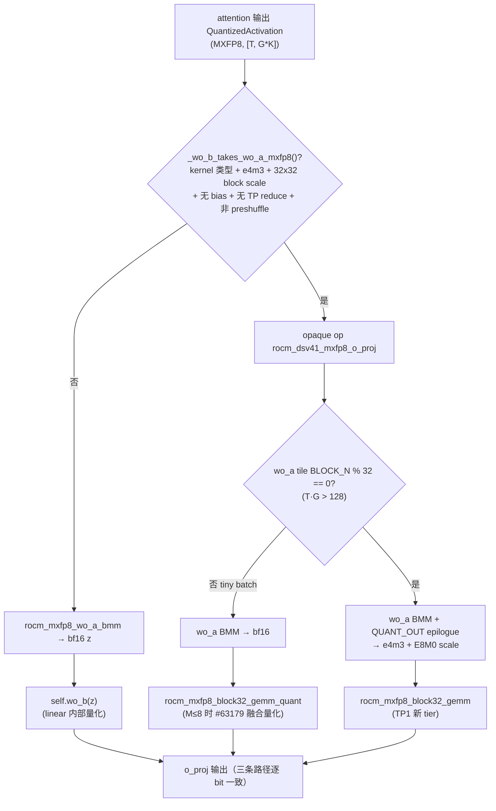
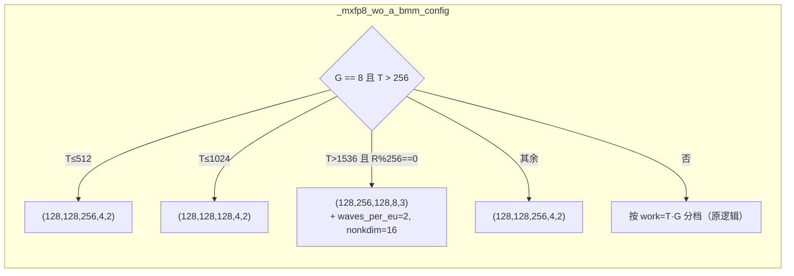

# PR #63821: [ROCm][Perf][DSv4.1] TP1 MXFP8 GEMM tiles and a pre-quantized wo_b input for DEP8 on MI355X

> **Author**: @maslan-coop26 | **State**: OPEN | **Date**: 2026-10-26
> **Branch**: `rocm-dsv41-tp1-oproj-gemms` → `main` | **Labels**: rocm, ready, needs-rebase, ci/build, deepseek, quantization, DSv4.1
> **Changes**: +560 -43 lines across 6 files | **ROCm 相关性**: 完全相关（gfx950 MXFP8 block32 GEMM 调优表 + DSv4.1 AMD o_proj 路径）
> **CI**: GitHub Actions 8 项（6 success、2 skipped）；Buildkite #98898 全部 190 个 job 通过（作者 11-05 评论，对应 10-31 的 head `3d2b5cd8`，早于 11-06 的 DSpark `main_proj` 提交）；已获 @Fangzhou-Ai approve
> 本报告分两部分：§1–6 为 PR 详细总结，§7–8 为 ROCm review 意见。

---

## 1. 总结 (Summary)

DeepSeek-V4.1-Flash 在 TP1（DP8 attention + EP8 MoRI）部署下，`wo_b`、`wq_b`、shared expert `gate_up` / `down` 和 DSpark `main_proj` 这几个 MXFP8 block32 GEMM 没有调优表，在 M > 256 时会退回 128×128×128 的默认 tile，导致 288 token 时比 256 token 慢一倍。本 PR 做了三件事：

1. 给这五个形状加 TP1 调优表。
2. 给 `wo_a` BMM 加 8-group 专用 tier。
3. 让 `wo_a` BMM 在 epilogue 里直接输出 MXFP8 量化结果交给 `wo_b`，省掉一次独立的量化 launch 和一次 bf16 往返。

输出与 main 逐 bit 相同，每层延迟最多降低到 1/2.2。端到端（agentic，256 并发）median TPOT 从 7.34–7.39 ms 降到 7.11–7.14 ms。

## 2. 背景与动机 (Background & Motivation)

- `rocm_block32_gemm._TUNED` 只有 TP2/TP4 的表。TP1 下 `(5120, 8192)` 这类形状走 `_default_config`，M > 256 时切换到 128×128×128 tile，例如 `wo_b` 从 256 token 的 36.0 µs 跳到 288 token 的 72.8 µs。DP8 c256 每个 rank 的 decode 规模（224–512 token）正好落在这个跳变区。
- 相关 PR：
  - #62533（已关闭）：覆盖了其中三个形状。
  - #63179（已合并）：block32 GEMM 在 M ≤ 8 时把激活量化融合进 packed kernel。
  - #64459（open）：调同样四个 TP1 形状到 M = 512。作者的对比表显示 #64459 在 1–32 token 更快，本 PR 在 640+ token 更快；双方约定"后合入的一方按 M 范围合并 tier"。
- 迭代过程：okorzh-amd 先后指出 epilogue 量化测试覆盖不足、CI mirror 没跑这些测试、gate 只按 dtype/shape 判断、端到端吞吐只有单次运行，以及合入 #63179 后 M ≤ 8 会多一次 launch。作者在 621c4e5 / 98c7dcb 中全部处理了。

## 3. 代码修改分析 (Code Change Analysis)

### 3.1 修改的模块

| 文件 | 改动 |
|------|------|
| `vllm/model_executor/kernels/linear/mxfp8/rocm_block32_gemm.py` | `_TUNED` 新增 5 个 key：`(4608,5120)` gate_up TP1、`(5120,2304)` down TP1、`(5120,8192)` wo_b TP1、`(5120,15360)` DSpark main_proj、`(32768,1280)` wq_b TP1（:553-736）。M ≤ 32 沿用 `_default_config` 的 packed tile |
| `vllm/v1/attention/ops/rocm_aiter_mla_sparse.py` | `_mxfp8_wo_a_bmm_kernel` 增加 `QUANT_OUT` epilogue（:2023-2037）；`_mxfp8_wo_a_bmm_config` 增加 G=8 且 T>256 的 tier，并返回编译器 hint（:2045-2088）；新增 opaque op `rocm_dsv41_mxfp8_wo_a_bmm_mxfp8` 和 `rocm_dsv41_mxfp8_o_proj`（:2194-2343） |
| `vllm/models/deepseek_v41/amd/rocm.py` | `_o_proj` 在 `_wo_b_takes_wo_a_mxfp8()` 为真时走 `rocm_mxfp8_o_proj`（:930-939）；新增 gate 方法（:962-993） |
| `tests/kernels/attention/test_rocm_triton_attn_dsv4.py` | wo_a BMM 增加 G=8 / o_lora_rank=256 的 case；新增 epilogue 逐 bit 对比测试（9 种 fused tile）、o_proj op 与 wo_b linear 的逐 bit 对比、gate 判定测试（8 个 case） |
| `tests/kernels/quantization/test_rocm_mxfp8_linear.py` | block32 参考测试增加 4 个 TP1 形状和 DSpark 形状，token 扫描加 96/300/2100 |
| `.buildkite/test_areas/kernels.yaml` | ":amd: (MI355 DPX) MLA Kernels" mirror 增加 `-k "wo_a_bmm or wo_b_takes_wo_a_mxfp8_gate"` |

### 3.2 架构 / 流程图





### 3.3 关键实现细节

- **epilogue 量化**（:2023-2037）：把 fp32 累加结果先转 bf16 再转回 fp32，reshape 为 `(BLOCK_M, BLOCK_N/32, 32)`，然后：
  - `amax = max(|x|, fp32 tiny)`；
  - `bits = clamp(ceil(log2(amax/448)) + 127, 0, 254)`；
  - 用 `x * exp2(127 - bits)` 缩放后转成 e4m3。

  这和 `_mxfp8_e4m3_quantize_triton`（`mxfp8_utils.py:116-176`）逐行一致：同样的 tiny clamp、同样用倒数缩放（避免 sb=0 时除以次正规数在 CDNA 上 flush 成 NaN）。我已核对。
- **为什么逐 bit 一致**：main 上 `wo_b` 的 `RocmDotScaledMxfp8LinearKernel.apply_weights`（`rocm_native.py:524-541`）在 block32 scale 且输入为 bf16 时调用 `rocm_mxfp8_block32_gemm_quant`。M > 8 时它就是 `mxfp8_e4m3_quantize(x)` + 同一 `_config` 的 `_launch`。PR 的 hand-off 路径只在 T·G > 128 时启用（此时 T ≥ 17 > 8），等价于用 epilogue 替代那次独立量化，GEMM config 不变。
- **小 batch 保持 #63179 的融合**：T·G ≤ 128 时，wo_a tile 的 BLOCK_N=16，无法按 32 列量化，op 内部改走 `rocm_mxfp8_block32_gemm_quant`，与 `wo_b` linear 在 main 上的行为一样。这个分支放在 opaque op 里，避免 torch.compile 把 token 数固化。
- **gate**（:962-993）：检查 `type(kernel) is RocmDotScaledMxfp8LinearKernel`（排除子类和其他会重排权重的 kernel，参照 `can_fuse_query_quant`），以及 e4m3 权重、uint8 2D scale、`ws.shape[0] != w.shape[0]`（block scale，排除 `VLLM_BATCH_INVARIANT` 的逐行 scale）、无 bias、`not reduce_results or tp_size == 1`、`_wo_b_scale is None`（排除 bpreshuffle FP8 wo_b）。
- **编译器 hint**：`_launch_mxfp8_wo_a_bmm` 把 `waves_per_eu`、`matrix_instr_nonkdim` 作为 Triton launch kwargs 传入（AMD Triton 支持）；256 宽 tile 只在 `o_lora_rank % 256 == 0` 时使用。
- **调优表**：每个新 key 在 M ≤ 8 / ≤ 32 时的 tier 与 `_default_config` 完全相同（`_packed(8,16,256,2,2,3,16,0)` 和 `_packed(32,32,256,1,2,3,16,0)`），所以 M ≤ 8 时 #63179 的 `cfg.packed` 条件依然满足。

## 4. 涉及的技术原理 (Technical Principles)

- **MXFP8 block32 GEMM**：DSv4.1 的 MXFP8 线性层权重带 32×32 block E8M0 scale，激活按每 32 列一个 E8M0 scale 量化，gfx950 上用 Triton `tl.dot_scaled` 原生计算。激活量化通常是 GEMM 前的一次独立 launch，再加一次 bf16 读写。
- **Epilogue 融合**：生产者 GEMM（这里是 `wo_a` BMM）在写回之前已经把完整的输出 tile 放在寄存器里，只要 tile 宽度是 32 的倍数，就能在原地算出 per-32 scale 并直接写 e4m3。消费者（`wo_b`）就不用再读 bf16、再量化，省掉一次 launch 和一次 HBM 往返。
- **按 M 分档的调优表**：Triton GEMM 的最优 tile 随 M 变化。vLLM 在 HIP graph 下按 capture size 预先选好 config。`_TUNED` 以 `(N, K)` 为 key，每个 tier 覆盖到 `max_m`，最后一档覆盖更大的 M。
- **DP attention（TP1）**：DEP8 部署中 attention 每个 rank 是 TP1，`n_local_groups = 8`，o_proj 的 GEMM 形状比 TP2/TP4 大得多，需要单独调优。
- **Opaque custom op 与 torch.compile**：分支依赖运行时 token 数时必须放进 `direct_register_custom_op` 注册的 op 内部，否则 Dynamo 会按 trace 时的值固化分支。

## 5. 评论区讨论亮点 (Discussion Highlights)

- **@okorzh-amd（第一轮）**：
  - 原测试只覆盖 9 个 fused tile 中的 3 个，block32 扫描只覆盖 39 个新 tier 中的 12 个，并给出具体的补充行。
  - CI mirror 只跑了这个文件中的一个测试。
  - gate 只按 dtype/shape 重新推导 dispatch，草稿 #60169 的 in-place shuffle 会让 permuted 权重静默通过，建议仿照 `can_fuse_query_quant` 检查 kernel 类型。
  - 端到端 tok/s 只有单次运行，建议以 TPOT 为主。
  - 作者全部采纳（621c4e5）。
- **@okorzh-amd（第二轮，最关键的一条）**：#63179 合入后，`wo_b` linear 在 M ≤ 8 会融合量化；而当时的 hand-off 在 M ≤ 8 走"bf16 BMM + 独立量化 + 非融合 GEMM"，比 main 多一次 launch，并且波及 TP2/TP4/TP8 mono `ffn_only` 层。作者在 98c7dcb 把 `wo_b` GEMM 移进 opaque op，tiny batch 改走 `rocm_mxfp8_block32_gemm_quant`，并补了 T·G = 128 两侧的测试。
- **与 #62533 / #64459 的重复 key**：两个 PR 都往 `_TUNED` 加同样的 key，后合入者会出现重复字典 key（ruff F601 会让 pre-commit 失败，运行时后出现的字面量静默覆盖）。双方约定后合入者按 M 范围合并 tier。

## 6. 风险与潜在问题 (Risk Analysis)

| 风险 | 严重程度 | 说明 |
|------|---------|------|
| 正确性：hand-off 输出不一致 | 低 | 公式与参考量化逐行一致；9 种 fused tile 都有逐 bit 测试；gate 有 8 个 case 测试 |
| 兼容性：hand-off 实际也在 TP>1 生效 | 低 | 见 §7 "hand-off 路径在 TP2/4/8 也会生效"；输出逐 bit 一致，只是性能未测 |
| 可维护性：与 #64459 的 key 冲突 | 中 | 见 §7 "与 #64459 的 tier 合并" |
| 性能：端到端证据单薄 | 低 | 本 PR 端到端只跑了 1–2 次，镜像是 mlperf nightly 而不是 main；TPOT 两次都优于基线三次 |
| 测试覆盖：DSpark `main_proj` tier 未经 Buildkite | 低 | 11-06 的提交晚于 Buildkite #98898；作者本地 108 passed |
| 合并：needs-rebase | 低 | 与 main 三方合并只有 `kernels.yaml` 相邻行一处冲突（main 新增 `test_kimi_mxfp4_indexer.py`），属于机械冲突 |

---

## 7. Review 意见 (Findings)

| 意见类型 | 数量 |
|---------|------|
| 🔴 必须修复 | 0 |
| ⚠️ 建议修复 | 0 |
| 📝 建议/备注 | 4 |

**📝【兼容性】hand-off 路径在 TP2/4/8 也会生效，描述只写了 TP1** `[已验证]`
- **问题**：gate 的条件是 `not reduce_results or tp_size == 1`（`rocm.py:988-991`）。`vllm/models/deepseek_v41/amd/model.py:233-234`（sequence parallel）和 `:304-307`（mono decode `ffn_only` 层）都会在 TP > 1 时把 `self.attn.wo_b.reduce_results` 设为 False。所以在 TP2/TP4/TP8 的 SP 或 monokernel 部署里，`o_proj` 也会走 `rocm_dsv41_mxfp8_o_proj`。触发条件是 T·G > 128：TP2（G=4）时 T > 32，TP4（G=2）时 T > 64，TP8（G=1）时 T > 128。
- **影响**：输出逐 bit 一致（不需要 reduce 时，linear 本身也只是 block32 GEMM），没有正确性风险。但描述的 Scope 写的是"TP2/TP4 tables unchanged"和"isn't used … with a row-parallel reduce at TP > 1"，没有提到这两种 reduce 被外移的部署；这些部署中 G=2/4 的 wo_a tile 是按 bf16 输出调的，加了量化 epilogue 后的性能没有测过。
- **行动**：建议作者在描述的 Scope 里补一句 SP / mono `ffn_only` 也会走 hand-off，最好附一组 TP4 mono 的 o_proj 微基准对比。

**📝【可维护性】与 #64459 的 tier 合并需要在合入时落实** `[已验证]`
- **问题**：`rocm_block32_gemm.py:553/624/660/722` 新增的四个 TP1 key 与 #64459 完全相同。两个 PR 的修改位置不同，git 不会报冲突，后合入的一方会产生重复字典 key。
- **影响**：ruff F601 让 pre-commit 失败（容易发现）。但如果有人用 `# noqa` 绕过，运行时后出现的字面量会静默覆盖前一个，丢掉另一方 PR 的小 M（#64459）或大 M（本 PR）收益。
- **行动**：建议 review 时追问由谁负责合并，并要求合并后的表在 block32 参考测试里覆盖每个 tier 的边界。

**📝【测试】端到端数据的来源与本 PR 的 diff 不完全对应** `[已验证]`
- **问题**：端到端运行使用 `rocm/mlperf-inference:vllm-openai-rocm-nightly-rocm100-3f1bcfd8`，"with this PR's change applied to the image's copy of `deepseek_v41/amd/rocm.py`"，但 hand-off 还依赖 `rocm_aiter_mla_sparse.py` 和 `rocm_block32_gemm.py` 的改动；本 PR 只有 1 次有效运行（另一次因 host 磁盘接近写满被剔除，16,711 tok/s，低于全部三次基线）。
- **影响**：TPOT 结论（两次 7.11/7.14 vs 三次 7.34–7.39）相对可信；tok/s 和 tok/s per user 只有一个样本。
- **行动**：建议作者在描述中说明镜像里同步替换了哪些文件，tok/s 结论保持"单次运行"的标注（已标注）。

**📝【测试】DSpark `main_proj` tier 的边界覆盖** `[已验证]`
- **问题**：`(5120, 15360)` 的 tier 边界是 8/32/56/126/133/168/224/8192（按每请求 7 行设计），block32 参考测试的 token 扫描（1, 7, 32, 33, 96, 192, 300, 1024, 2100）没有命中 133 和 168 这两档；这个提交（82daaacb，11-06）也晚于 Buildkite #98898。
- **影响**：未覆盖的 tile 是 `_tiled(64,64,256,…)` 和 `_tiled(64,64,512,…)`，与其他已测形状使用的 tile 相同，风险低。
- **行动**：建议在扫描里加一个 130 或 140 左右的 token 数，并在 rebase 后重新跑一次 `/ci run`。

## 8. 结论 (Verdict)

✅ **LGTM**：hand-off 与参考量化逐 bit 一致（公式已核对，测试覆盖全部 fused tile），gate 以 kernel 类型为准，tiny batch 保留 #63179 的融合；前两轮 review 的意见都已处理。剩下的是描述补充（TP>1 生效范围）、与 #64459 的 tier 合并，以及 rebase 后重跑 CI。

## 9. 英文 Review 评论 (Copy-Paste English Comments)

**C1** `vllm/models/deepseek_v41/amd/rocm.py:962-993` — 📝 comment

```text
Small scope note: this gate also holds at TP > 1 whenever wo_b's reduce is moved out. amd/model.py sets `self.attn.wo_b.reduce_results = False` under sequence parallel (L233-234) and for mono decode ffn_only layers (L304-307), so TP2/TP4/TP8 SP or monokernel deployments now take rocm_dsv41_mxfp8_o_proj whenever T*G > 128 (T > 32 at TP2, T > 64 at TP4, T > 128 at TP8). The output stays bit-identical there, so this is not a correctness concern, but the Scope section says the hand-off isn't used at TP > 1, and the G = 2/4 wo_a tiles were tuned for a bf16 epilogue. Could you mention this in the description, and ideally add one o_proj micro-benchmark at TP4 mono?
```

**C2** `vllm/model_executor/kernels/linear/mxfp8/rocm_block32_gemm.py:553-566` — 📝 comment

```text
Just to track the agreement with #64459: both PRs add (4608, 5120), (5120, 2304), (5120, 8192) and (32768, 1280) at different positions in _TUNED, so git won't flag it and the second one to land will carry duplicate dict keys (ruff F601; at runtime the later literal silently wins). Since the two tables win in different M ranges, please make sure whoever lands second merges the tiers by M range, and extend the block32 reference sweep so every merged tier boundary is hit. It would also be good to add a token count around 130-170 for the DSpark main_proj tiers (133 and 168 are not reached by the current sweep), and to re-run CI after the rebase since the main_proj commit landed after Buildkite #98898.
```

## 10. 英文总结评论 (Overall Review Summary)

```text
Nice work: the QUANT_OUT epilogue is bit-identical to the existing MXFP8 quantizer, tiny batches keep the fused path from #63179, and the earlier review points are all addressed. A few non-blocking notes: the hand-off also activates at TP > 1 under sequence parallel or mono ffn_only layers, which the description should mention; whichever of this PR and #64459 lands second must merge the overlapping _TUNED tiers by M range; and please re-run CI after the rebase, since the DSpark main_proj commit came after the last Buildkite run. LGTM.
```
