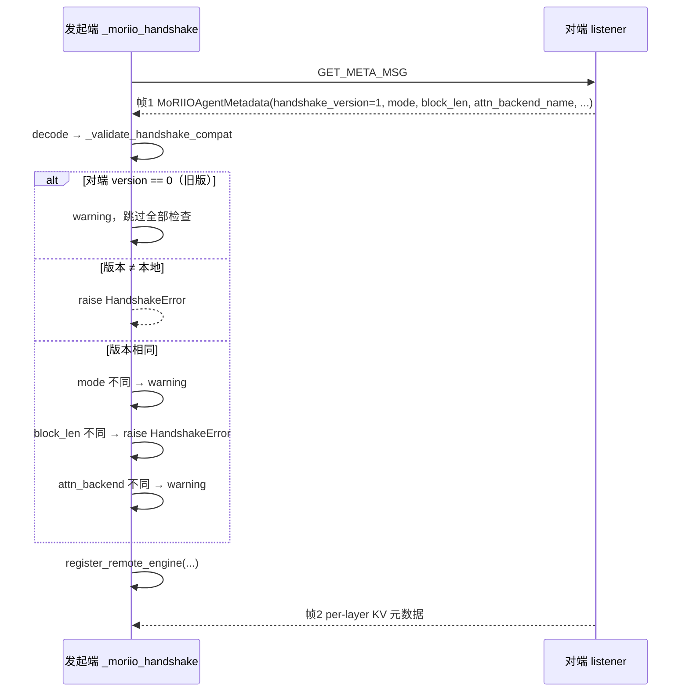

# PR #63854: feat(moriio): add version/mode compatibility check to connector handshake (Gap 12)

> **Author**: @kudomcho | **State**: OPEN | **Date**: 2026-10-26
> **Branch**: `feat/moriio-gap12-handshake-compat-v2` → `main` | **Labels**: kv-connector, needs-rebase
> **Changes**: +230 -0 lines across 3 files | **ROCm 相关性**: 完全相关（MoRIIO KV connector，仅 ROCm/mori 可用）
> 本报告分两部分：§1–6 为 PR 详细总结，§7–8 为 ROCm review 意见。

---

## 1. 总结 (Summary)

MoRIIO 的 P/D 两端在握手时交换 `MoRIIOAgentMetadata`，但 main 不检查两端的协议版本和运行模式是否兼容，配置不一致的问题要到传输时才暴露，甚至完全不暴露。本 PR 做了三件事：

- 新增 `MORIIO_HANDSHAKE_VERSION = 1`，并给元数据加上 `handshake_version`（默认 0）和 `mode` 两个字段，listener 发送时显式填入。
- 发起端在 `_moriio_handshake` 中解码元数据后调用 `MoRIIOConnectorWorker._validate_handshake_compat`。版本为 0 的对端视为旧版，打 warning 后跳过检查；版本不同时抛 `HandshakeError`；`block_len` 不同时抛 `HandshakeError`；mode 或 attention backend 不同时只打 warning。
- 新增测试文件 `test_moriio_handshake_compat.py`，覆盖字段默认值、msgspec 往返、旧版对端解码，以及 `_validate_handshake_compat` 的各条分支。不过下文会说明，后一组测试绑定到了不存在的方法上。

## 2. 背景与动机 (Background & Motivation)

- 本 PR 是 ROCm/mori#759 中 MoRIIO 可靠性 "Gap" 列表的第 12 项，与 #63856（Gap 3）和 #63855（Gap 6）同属一个系列，最初与 #63856 合在已关闭的 #63845 里。
- 目标是滚动升级时让新旧 vLLM 实例互相识别：旧版对端放行但打 warning；协议版本明确不同的对端尽早拒绝，避免握手成功后才在 RDMA 偏移或通知协议上出现隐蔽错误。
- 第一版代码里 `handshake_version` 的默认值等于当前版本，在 `omit_defaults=True` 下这个字段永远不会出现在线上。reviewer @okorzh-amd 实测指出了这个问题，当前 head 已把默认值改为 0，发送端显式赋值。

## 3. 代码修改分析 (Code Change Analysis)

### 3.1 修改的模块

| 文件 | 改动 |
|------|------|
| `vllm/distributed/kv_transfer/kv_connector/v1/moriio/moriio_common.py` (+11) | 新增模块级常量 `MORIIO_HANDSHAKE_VERSION = 1`；`MoRIIOAgentMetadata` 增加 `handshake_version: int = 0` 和 `mode: str = ""` |
| `vllm/distributed/kv_transfer/kv_connector/v1/moriio/moriio_connector.py` (+52) | import 常量；`_moriio_handshake` 在第一帧解码后、`register_remote_engine` 之前调用 `_validate_handshake_compat`；新增 `MoRIIOConnectorWorker._validate_handshake_compat`；listener 元数据构造时填入 `handshake_version=MORIIO_HANDSHAKE_VERSION, mode=self.mode.value` |
| `tests/v1/kv_connector/unit/test_moriio_handshake_compat.py` (+167, 新文件) | `TestMoRIIOAgentMetadataCompat`（8 个用例，只依赖 msgspec）；`TestValidateHandshakeCompat`（6 个用例，用 MagicMock 绑定 `MoRIIOConnector._validate_handshake_compat`） |

### 3.2 架构 / 流程图



`HandshakeError` 抛出后的去向（由调用方决定，本 PR 未改动）：

```mermaid
flowchart TD
    E[_validate_handshake_compat 抛 HandshakeError] --> R{调用路径}
    R -- "READ: _eager_handshake_all_dp_ranks" --> V["记 all_ok=False → TP 投票<br/>→ raise HandshakeError（main: decode EngineCore 退出；<br/>#65690 后：只让该 engine 的请求失败）"]
    R -- "WRITE/lazy: _background_moriio_handshake" --> B["done_callback 记 exception<br/>request_ready 仍置位 write_ready_flags"]
    B --> C["下一次 save_kv_layer：<br/>handshake_ready 为假 → 再发起一轮握手"]
    C --> E
```



### 3.3 关键实现细节

- `MoRIIOAgentMetadata` 是 `msgspec.Struct(omit_defaults=True, dict=True)`，没有设置 `forbid_unknown_fields`。旧版本端解码新消息时会忽略未知字段；新版本端解码旧消息时，缺失字段会取默认值，即 `handshake_version=0`、`mode=""`。默认值改成 0 后，wire 兼容性是正确的。
- 校验只在发起端执行：READ 模式下是 decode，WRITE 模式下是 prefill。listener 端不做校验。
- `getattr(remote, "handshake_version", 0)` / `getattr(remote, "mode", "")` 是防御性写法。由于这两个字段已在 Struct 中声明，`getattr` 的默认值永远用不到。
- `block_len` 比较的是标量：`self.block_len` 在多种 block_len 并存时取各层最大值（`moriio_connector.py:2872`）。

## 4. 涉及的技术原理 (Technical Principles)

- **msgspec 的 `omit_defaults`**：编码时省略等于默认值的字段，以缩小消息体积。版本字段的默认值必须是"未设置"的哨兵值（这里是 0），否则当前版本永远不会出现在线上，接收端会用自己的默认值填充，旧版对端也会被误判为同版本。这正是第一版的 bug。
- **滚动升级中的协议版本**：常见做法是"最低兼容版本"或"版本区间"，而不是严格相等。严格相等意味着常量每次升级时，新旧实例之间都会被拒绝；当前实现只对 v0（旧版）宽容，v1 与 v2 之间无法共存。
- **MoRIIO 握手失败的传播**：READ 模式下 eager 握手失败会经 TP 投票导致整步失败（#65690 之前会让 decode engine 退出）；WRITE 模式下后台握手失败只记日志，下一次 `save_kv_layer` 会重新发起。对于永久性的不兼容，这意味着会反复握手。
- **P/D 异构配置**：MoRIIO 已经在传输时逐层检查 `_check_peer_block_size`（每块 token 数）和 `_block_copy_matches_peer`（两端 head/token 排布，注释明确说 "Prefill and decode can order heads and tokens differently (different attention backends)"）。也就是说，P/D 两端使用不同 attention backend 是受支持的场景。

## 5. 评论区讨论亮点 (Discussion Highlights)

- **@okorzh-amd（omit_defaults bug）**：用 msgspec 实测发现，`handshake_version` 默认值等于当前版本时线上没有这个字段，旧版对端会被解码为 1，将来 v1 与 v2 会互相解码成自己的版本。作者把默认值改为 0，并在发送端显式赋值，**已修复**（我核对了代码与测试 `test_omit_defaults_keeps_nonzero_version_on_wire`）。
- **@okorzh-amd（测试是否在 CI 中运行）**：作者回复该文件在 `tests/v1/kv_connector/unit/` 下，会被 CI 收集。**部分成立**：专门的 `:amd: (MI355 DPX) MoRIIO Connector Unit Tests` step 只跑 `v1/kv_connector/unit/moriio`，新文件不在这个目录。见 §7。
- **@okorzh-amd（`_validate_handshake_compat` 无测试）**：作者称已添加 `TestValidateHandshakeCompat` 覆盖全部分支。**但这组测试绑定的是 `MoRIIOConnector._validate_handshake_compat`，该方法实际定义在 `MoRIIOConnectorWorker` 上，见 §7 🔴。**
- **@okorzh-amd（与 #64693 冲突）**：已 rebase 并保留 `layer_base_addr_index`。
- **作者 11-18 的汇总回复**称 "version mismatch downgraded to warning per @TianDi101's suggestion"。抓取到的页面里看不到 @TianDi101 的评论（可能被折叠），而 head 代码仍然对版本不匹配抛 `HandshakeError`，测试也断言会抛异常。

## 6. 风险与潜在问题 (Risk Analysis)

| 风险 | 严重程度 | 说明 |
|------|---------|------|
| 测试：新测试必然失败 | 高 | 见 §7 🔴 |
| 设计：版本策略与作者表述矛盾，且无前向兼容 | 中 | 见 §7 |
| 正确性：永久不兼容被当作瞬时失败处理 | 中 | READ 导致 decode 退出，WRITE 每层重复握手，见 §7 |
| 兼容性：`block_len` 硬拒、backend warning 可能误伤 | 低（推测） | 与已有的逐层检查重叠，见 §7 📝 |
| 兼容性：与 #63856 文本冲突 | 中 | 同在 `_moriio_handshake`，merge-tree 已验证 |
| HK：DCO 未签、CI 未运行、测试目录 | 中 | 见 §7 |

---

## 7. Review 意见 (Findings)

| 类型 | 🔴 | ⚠️ | 📝 |
|------|----|----|----|
| 测试 | 1 | 1 | — |
| 设计 | — | 2 | — |
| 兼容性 | — | — | 2 |
| 注释/文档 | — | — | 1 |

整体看：线上兼容性的核心（默认值 0 + 发送端显式赋值 + msgspec 忽略未知字段）是正确的，旧版对端能被识别为 v0。但声称覆盖校验逻辑的测试组必然失败；"版本不匹配降级为 warning"的说法与代码不一致；永久性不兼容沿用了为瞬时失败设计的处理路径。

---

**🔴【测试】`TestValidateHandshakeCompat` 绑定了不存在的 `MoRIIOConnector._validate_handshake_compat`，6 个用例全部失败** `[已验证]`

- **问题**: `test_moriio_handshake_compat.py:109` 中的 `MoRIIOConnector._validate_handshake_compat.__get__(conn)` 会访问 `MoRIIOConnector` 类上的这个属性。但在 head 的 `moriio_connector.py` 里，`_validate_handshake_compat` 只定义在 `MoRIIOConnectorWorker` 中（第 2419 行，`class MoRIIOConnectorWorker` 起始于第 1840 行）；`MoRIIOConnector`（第 282 行）既没有这个方法，也没有 `__getattr__` 转发。
- **影响**: 具体触发：`pytest tests/v1/kv_connector/unit/test_moriio_handshake_compat.py::TestValidateHandshakeCompat`。每个用例在 `_make_connector_stub` 里都会抛 `AttributeError: type object 'MoRIIOConnector' has no attribute '_validate_handshake_compat'`，6 个用例全部失败。结果是 kv_connector 单测 shard 一旦运行就会变红，而作者回复 reviewer 时声称已覆盖的全部校验分支实际上一条都没有被测到。由于 CI 未运行，这个问题至今没有暴露。
- **行动**: 作者应当改为绑定 `MoRIIOConnectorWorker._validate_handshake_compat`（并同步修改类 docstring "Tests for MoRIIOConnector._validate_handshake_compat"），在本地实际跑通这个文件后附上输出。

**⚠️【设计】版本不匹配的处理与作者表述相反，严格相等也不支持 v1↔v2 滚动升级** `[已验证]`

- **问题**: 作者 11-18 的汇总说 "version mismatch downgraded to warning per @TianDi101's suggestion"，但 head 的 `moriio_connector.py:2434-2438` 在 `remote_version != MORIIO_HANDSHAKE_VERSION` 时仍然 `raise HandshakeError`，测试 `test_version_mismatch_raises` 也断言会抛异常。另外，策略只对 v0 宽容、对任何其他不等版本都拒绝。等常量升到 2 时，v1 与 v2 实例无法共存，"支持滚动升级"只对第一次升级成立。
- **影响**: reviewer 无法判断哪个是预期行为。如果预期是 warning，那么当前代码会在 READ 模式下让 decode engine 退出（见下一条）；如果预期是拒绝，作者的回复会误导后续 reviewer。
- **行动**: 作者应当明确选择一种行为，并让代码、测试、描述三者一致。如果需要滚动升级，建议改成"最低兼容版本"语义（例如 `MORIIO_MIN_COMPAT_HANDSHAKE_VERSION`，在 `remote_version < MIN` 或 `MIN_remote > local` 时才拒绝），并在常量旁写明什么样的改动需要升版本。

**⚠️【设计】永久性不兼容走的是为瞬时失败设计的路径：READ 下 decode 退出，WRITE 下每次调用都重新握手** `[已验证]`

- **问题**: `_validate_handshake_compat` 在 `_moriio_handshake` 内抛 `HandshakeError`。READ 模式下，`_eager_handshake_all_dp_ranks` 捕获后设 `all_ok=False`，TP 投票后再统一 `raise HandshakeError`，从 `start_load_kv` 抛出，main 上会让 decode EngineCore 退出（#65690 合入后改为只让该 engine 的请求失败，并按引用次数退避）。WRITE 模式下，`_background_moriio_handshake` 的 done_callback 只记 exception；`request_ready` 回调不检查失败，仍会置位 `write_ready_flags`。之后 `save_kv_layer` 中 `handshake_ready` 依旧为假，守卫 `remote_engine_id not in self._remote_agents` 用的是 bare 键，恒为真，所以每一层、每一次调用都会对这个不兼容对端再发起一整轮握手，每轮都失败并记 exception。
- **影响**: 具体触发：一个 `block_len` 与本地不同的 decode 实例（例如两端 `--block-size` 不同）通过 proxy 接入。在 WRITE 模式下，prefill 会对它无限次重复握手，刷屏的 exception 日志会占满单线程握手执行器，其他 decode engine 的首次握手被排在后面。在 READ 模式下，`--block-size` 配错的那个 prefill 一旦被引用，decode 整体退出。错误本身是正确的，但影响范围远大于"拒绝这个对端"。
- **行动**: 建议作者为不兼容单独定义一个异常（例如 `HandshakeIncompatibleError(HandshakeError)`），并把被拒绝的 engine 记入 `_rejected_engines`，让后续请求直接失败、不再握手；也可以把校验移到更早、只执行一次的位置（例如 proxy 注册阶段）。同时请在描述里写明 READ 模式下与 #65690 的关系。

**⚠️【测试】新测试文件不在 MoRIIO 专用 CI step 的目录下；CI 未运行；DCO 未签** `[已验证]`

- **问题**: ①新文件位于 `tests/v1/kv_connector/unit/test_moriio_handshake_compat.py`，而 `.buildkite/test-amd.yaml` 和 `test_areas/misc.yaml` 中的 "MoRIIO Connector Unit Tests" step 只运行 `pytest v1/kv_connector/unit/moriio`，其 `source_file_dependencies` 也只列了 `tests/v1/kv_connector/unit/moriio/`。所以新文件只会被通用 kv_connector unit 分片收集，修改 MoRIIO 代码时触发的专用 step 不会运行它。②CI 未运行（无 `ready` label，pre-run-check 失败，pre-commit 与 Buildkite 均被跳过）。③DCO 显示 "requires action"：唯一的 commit `1f8d2a4` 没有 `Signed-off-by`。④`needs-rebase` label 仍在，但本地对 `upstream/main`（92b9817e02）做 merge-tree 没有冲突，label 可能已过时。另外 `_make_connector_stub(self, mode="write", block_len=128,\n backend_name=...)` 的换行风格不符合 ruff format，pre-commit 运行后会被改写。
- **影响**: 上一条 🔴 在专用 step 里本来能第一时间暴露。没有 DCO sign-off 的 PR 不能合入。
- **行动**: 作者应当给 commit 补 sign-off（`git commit --amend -s`）；建议把测试文件移到 `tests/v1/kv_connector/unit/moriio/`，运行 pre-commit，并请 maintainer 加 `ready` label 或触发 `/amd-ci run`。

**📝【兼容性】`block_len` 硬拒与已有的逐层检查重叠，标量比较可能比逐层逻辑更严格** `[推测]`

- **问题**: `moriio_connector.py:2451` 比较的是标量 `block_len`，多种 block_len 并存时取各层最大值。MoRIIO 已经在传输时逐层做 `_check_peer_block_size`（每块 token 数）和基于 `kv_head_layouts` 的 head 切片，用于异构 TP 和异构 backend。我核对后发现，目前支持的异构 TP 组合（KV head 复制，`min(tp) >= total_kv_heads`）每个 rank 都持有 1 个 head，block_len 相同，暂时找不到会被误伤的受支持配置，所以标为推测。
- **影响**: 如果将来逐层 head 切片能支持 block_len 不同的组合（例如非复制 head 的异构 TP），这个标量硬拒会成为新的阻碍，而且报错信息不会说明是哪一层。
- **行动**: 建议作者说明 `block_len` 硬拒覆盖了哪些逐层检查没有覆盖的失败；如果没有，可以降为 warning，或者改为逐层比较并在报错中给出层名。

**📝【兼容性】attention backend 不同只是受支持的配置，warning 会在正常部署中出现** `[已验证]`

- **问题**: `moriio_connector.py:2457` 在 `attn_backend_name` 不同时打 warning。但 `_block_copy_matches_peer` 的注释明确说 "Prefill and decode can order heads and tokens differently (different attention backends)"，并且有对应的切片路径。mode 不同的 warning 文案写的是 "both sides of a transfer must use the same mode"，却只打 warning 而不拒绝。
- **影响**: P/D 使用不同 backend 的合法部署会在每次握手时打 warning，干扰排障；而真正"必须一致"的 mode 却只打 warning、不拦截。
- **行动**: 建议作者把 backend 不同降为 debug/info，或者仅在 `_block_copy_matches_peer` 也无法处理时才 warning；mode 不同要么按文案所说直接拒绝，要么修改文案。

**📝【注释/文档】冗余的 `getattr` 防御** `[已验证]`

- **问题**: `handshake_version` 和 `mode` 已经是 Struct 字段，msgspec 解码缺失字段时会填默认值，所以 `getattr(remote, "handshake_version", 0)` / `getattr(remote, "mode", "")` 的默认值永远用不到。
- **行动**: 建议作者直接访问属性，避免读者误以为这两个字段可能不存在。

## 8. 结论 (Verdict)

**🔴 BLOCK**

线上兼容性的核心设计（哨兵默认值 0 + 显式赋值）是正确的，reviewer 指出的 `omit_defaults` 问题也已修复。但新加的 `TestValidateHandshakeCompat` 绑定了 `MoRIIOConnector` 上不存在的方法，只要运行 `pytest tests/v1/kv_connector/unit/test_moriio_handshake_compat.py` 就会有 6 个用例 AttributeError，作者声称已覆盖的校验逻辑实际没有任何测试。此外，版本不匹配的行为与作者表述相反，不兼容对端会在 WRITE 模式下被无限重复握手、在 READ 模式下导致 decode 退出，commit 还缺 DCO sign-off。修好测试、统一版本策略并处理不兼容的传播后再审。

## 9. 英文 Review 评论 (Copy-Paste English Comments)

**C1** `tests/v1/kv_connector/unit/test_moriio_handshake_compat.py:104-110` — 🔴 blocking

```text
This binds `MoRIIOConnector._validate_handshake_compat`, but the method is defined on `MoRIIOConnectorWorker` and `MoRIIOConnector` has neither the method nor a `__getattr__` fallback. Every test in `TestValidateHandshakeCompat` therefore fails in `_make_connector_stub` with AttributeError, so none of the compat branches are actually covered. CI never ran on this PR, which is why it hasn't shown up. Could you bind `MoRIIOConnectorWorker._validate_handshake_compat` instead, fix the class docstring, and paste a local pytest run of this file?
```

**C2** `vllm/distributed/kv_transfer/kv_connector/v1/moriio/moriio_connector.py:2434-2438` — ⚠️ comment

```text
Your latest summary says the version mismatch was downgraded to a warning, but this still raises HandshakeError and `test_version_mismatch_raises` asserts that it does. Separately, strict equality only tolerates v0: once the constant becomes 2, v1 and v2 engines reject each other, so rolling upgrades only work for the first bump. Could you pick one behaviour, make the code, tests and description agree, and consider a minimum-compatible-version check instead of equality?
```

**C3** `vllm/distributed/kv_transfer/kv_connector/v1/moriio/moriio_connector.py:2373` — ⚠️ comment

```text
An incompatible peer is a permanent condition, but this raises the same HandshakeError used for transient failures. In READ mode the eager vote turns it into a raise from start_load_kv, which stops decode's EngineCore (until #65690). In WRITE mode the failure is only logged and `request_ready` still sets `write_ready_flags`, so save_kv_layer starts a new handshake round for this peer on every layer call. Could you raise a dedicated incompatibility error and remember rejected engines so later requests fail fast without re-handshaking?
```

**C4** `tests/v1/kv_connector/unit/test_moriio_handshake_compat.py:1-3` — ⚠️ comment

```text
The ":amd: (MI355 DPX) MoRIIO Connector Unit Tests" step only runs `pytest v1/kv_connector/unit/moriio` and only triggers on `tests/v1/kv_connector/unit/moriio/`, so this file at the unit/ root is not run when MoRIIO code changes. Could you move it into `tests/v1/kv_connector/unit/moriio/`? Also, DCO is failing because commit 1f8d2a4 has no Signed-off-by line, and pre-commit hasn't run yet (the stub signature is not ruff-formatted).
```

## 10. 英文总结评论 (Overall Review Summary)

```text
The wire design is right: a sentinel default of 0, set explicitly by the sender, so old peers decode as legacy, and the omit_defaults issue is fixed. Blocking for now: TestValidateHandshakeCompat binds MoRIIOConnector._validate_handshake_compat, which does not exist (the method is on MoRIIOConnectorWorker), so all six compat tests fail and none of the checks are covered. Please also make the version-mismatch behaviour match your summary, stop re-handshaking rejected peers in WRITE mode, move the test under unit/moriio, and add the DCO sign-off. Changes needed before merge.
```
