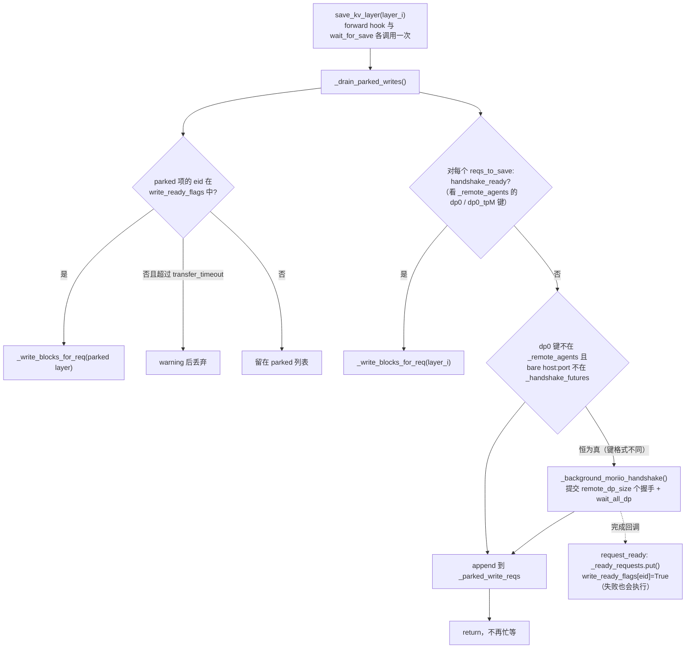
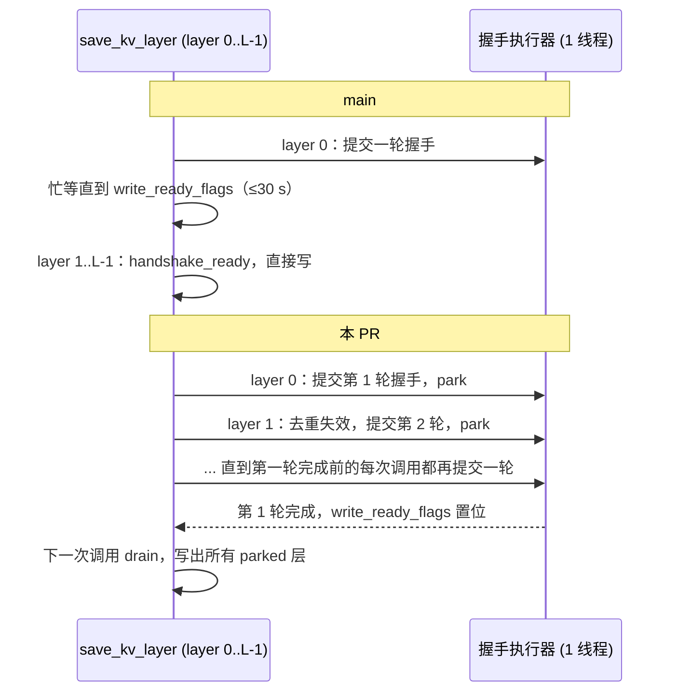

# PR #63855: feat(moriio): park requests instead of busy-waiting on handshakes (Gap 6)

> **Author**: @kudomcho | **State**: OPEN | **Date**: 2026-10-26
> **Branch**: `feat/moriio-gap6-park-requests` → `main` | **Labels**: kv-connector, needs-rebase
> **Changes**: +54 -93 lines across 2 files | **ROCm 相关性**: 完全相关（MoRIIO KV connector，仅 ROCm/mori 可用）
> 本报告分两部分：§1–6 为 PR 详细总结，§7–8 为 ROCm review 意见。

---

## 1. 总结 (Summary)

在 main 上，MoRIIO WRITE 模式的 producer（prefill）遇到首次接触、握手尚未完成的 decode engine 时，`save_kv_layer` 会以 `sleep(0.001)` 忙等，直到 `write_ready_flags` 置位或 `transfer_timeout`（默认 30 s）到期，整个 batch 的这一层都被阻塞。本 PR 改为 "park-and-return"：握手未就绪的请求按 (req, meta, layer, kv_layer, 入队时间) 放进 `_parked_write_reqs`，函数立即返回；每次进入 `save_kv_layer` 时先由 `_drain_parked_writes` 检查，`write_ready_flags` 已置位的请求就写，超过 `transfer_timeout` 的就丢弃并打 warning。READ 侧删除了 `start_load_kv` 中已无法到达的 lazy 握手回退和忙等循环。

## 2. 背景与动机 (Background & Motivation)

- 本 PR 是 ROCm/mori#759 中 MoRIIO 可靠性 "Gap" 列表的第 6 项，与 #63856（Gap 3，握手 recv 超时）、#63854（Gap 12，版本校验）同属一个系列。
- main 上 WRITE busy-wait 的问题：`save_kv_layer` 每层调用两次（forward hook 一次，`wait_for_save` 循环一次）。握手未完成时每次调用都可能忙等最多 `transfer_timeout`，一个慢或死的 decode 对端就能拖住整个 prefill batch。
- 第一版 PR 也给 READ 加了 parking。reviewer 指出 READ 路径上 `_eager_handshake_all_dp_ranks` 要么抛异常、要么把 engine 加进 `_eager_handshaked_engines`，parking 分支永远不会执行，作者随后删掉了 READ parking，只保留对死代码的清理。
- 与 #63879（draft，@MohitAMD）功能重叠：后者同样改写 WRITE 首次接触逻辑，只对仍在握手的 engine 阻塞以保证从 layer 0 开始写，并对进行中的握手去重。本 PR 在 docstring 里留了 TODO 说明需要与之调和。

## 3. 代码修改分析 (Code Change Analysis)

### 3.1 修改的模块

| 文件 | 改动 |
|------|------|
| `vllm/distributed/kv_transfer/kv_connector/v1/moriio/moriio_connector.py` (+53 -93) | 新增 `_parked_write_reqs` 与 `_drain_parked_writes()`；`save_kv_layer` 入口先 drain，握手未就绪时 park 并 `continue`，删除尾部忙等循环；握手触发条件改为 `dp0_remote_engine_id not in _remote_agents and remote_engine_id not in _handshake_futures`；`start_load_kv` 删除 lazy 握手回退与忙等循环；删除两段解释既有不变式的注释 |
| `tests/v1/kv_connector/unit/moriio/test_moriio_write_done_routing.py` (+1) | `_fanout_save_worker` 测试 helper 补 `worker._parked_write_reqs = []`（避免已有 fanout 测试 AttributeError） |

### 3.2 架构 / 流程图

WRITE producer 的 `save_kv_layer`（本 PR 之后）：



与 main 的时序对比：



### 3.3 关键实现细节

- parked 项存的是请求自己的 `layer_name`/`kv_layer`，drain 时按原层写，修复了第一版"drain 用当前层写队首请求"的问题。
- 同一层会被 park 两次（forward hook 和 `wait_for_save` 各一次）。由于 `MoRIIOWriter.schedule_write` 按 `(transfer_id, layer_name)` 去重（`moriio_engine.py` 中的 `_scheduled_layers`），重复项不会造成重复写入。
- drain 的就绪条件只看 `write_ready_flags[eid]`，而直接写路径看的是 `_remote_agents` 里的 dp0 / dp0_tpM 会话键。两套条件不一致，见 §7。
- `_ready_requests` 在本 PR 后只有 `put`（`request_ready` 回调），没有任何 `get`。
- 删除的注释包括："Another producer rank writes everything this one holds..." 和 "A failed target handshake must be retried, so check every target session rather than write_ready_flags, which is set either way"。后一条恰好说明了 drain 条件为何不能只看 `write_ready_flags`。

## 4. 涉及的技术原理 (Technical Principles)

- **MoRIIO WRITE（push）模式**：prefill 在每层 attention forward 后通过 `save_kv_layer` 把该层 KV 用 RDMA 写到 decode 预分配的 block。`wait_for_save` 在 forward 结束后再按层补调一次，然后调用 `seal_pending_transfers`，把每个 transfer 已排队的写次数固定为 `writes_expected`。写线程完成 `writes_expected` 次写入后才向 decode 发 `write_done`。
- **首次接触握手**：producer 首次写某个 decode engine 前，要对它的每个 DP rank 握手（交换 mori `EngineDesc` 与 per-layer 元数据），成功后在 `_remote_agents` 中记录 `{engine}_dp{N}`（fanout 时是 `{engine}_dp{N}_tp{M}`）。握手在单线程执行器上后台运行，`_handshake_futures` 也按这些带后缀的键索引。
- **请求只在最后一个 prefill step 出现在 `reqs_to_save` 中**：如果握手跨过了这个 step，后续 step 必须仍能把它写完，所以 parking 依赖 engine 继续 step。`has_pending_push_work()` 会让 engine 在有 deferred send 时继续空转，空 step 走 `no_forward` → `post_forward` → `wait_for_save` → `save_kv_layer`，drain 仍会执行。
- **READ 模式 eager 握手**：decode 在 forward 前同步握手所有引用到的 prefill engine，然后做 TP 投票，失败就抛异常。因此 `start_load_kv` 里的 lazy 回退在 main 上已是死代码。

## 5. 评论区讨论亮点 (Discussion Highlights)

- **@okorzh-amd（与 #63879 重叠）**：#63879 改写同一段代码，"只对仍在握手的 engine 阻塞，保证从 layer 0 开始写，并跳过进行中的握手"；它还不再把 WRITE producer 的条目放进 `_ready_requests`，两者都合入的话第一版 drain 永不触发，所有 parked 写会在 `transfer_timeout` 时被丢弃。请求合并为一个 PR。作者只加了一条 TODO。
- **@okorzh-amd（parked 请求只写一层）**：第一版 drain 用当前层写队首请求，加上 `seal_pending_transfers` 会固定 `writes_expected`，导致 `write_done` 在其他层未写时发出。作者改为使用 parked 项自身的 layer/kv，这一点已修复。
- **@okorzh-amd（测试 helper）**：`_fanout_save_worker` 用 `__new__` 构造，缺少 `_parked_write_reqs`，3 个 fanout 测试会 AttributeError。作者已补上。
- **@okorzh-amd（重复握手）**：每次 `save_kv_layer` 都会为仍在握手的 engine 再开一轮，因为守卫查的是 bare `host:port`，而 `_remote_agents`/`_handshake_futures` 的键带 `_dpN` 后缀。作者回复"已改为检查 dp0 键并跳过 `_handshake_futures` 中进行中的轮次"。**经核对，后半个检查仍用 bare 键查 `_handshake_futures`，去重依然无效（见 §7）。**
- **@okorzh-amd（READ parking 不可达）**：作者已删除 READ parking。
- **@okorzh-amd（相关 PR 汇总）**：#63879 是替代方案且有冲突；#65690、#65923 在 `start_load_kv` 有文本冲突；#63856 是依赖（死对端场景需要握手超时）。
- 作者称 "19/19 unit tests pass"，无日志或命令可溯源，记为 `[unverified]`。

## 6. 风险与潜在问题 (Risk Analysis)

| 风险 | 严重程度 | 说明 |
|------|---------|------|
| 正确性：握手去重无效 | 中 | 见 §7「in-flight 去重仍查不到」 |
| 正确性：drain 条件与直接写路径不一致 | 中 | 见 §7 |
| 正确性：seal 与 drain 的竞态 | 中（推测） | 可能导致 `write_done` 早发、decode 读到不完整 KV，见 §7 |
| 设计：与 #63879 / #65690 冲突 | 中 | 同一代码块的两种方案；与 #65690 有 2 处文本冲突（merge-tree 验证） |
| 测试覆盖 | 中 | park / drain / 超时丢弃都没有单测 |
| 资源：`_ready_requests` 只进不出 | 低 | 每轮握手放一项，永不消费 |
| 提交规范：DCO | 低 | 修复 commit `7cb622a` 缺 Signed-off-by |

---

## 7. Review 意见 (Findings)

| 类型 | 🔴 | ⚠️ | 📝 |
|------|----|----|----|
| 正确性 | — | 3 | 1 |
| 设计 | — | 1 | — |
| 测试 | — | 1 | — |
| 可维护性 | — | 1 | 1 |

整体看：去掉 WRITE 每层最长 30 s 的忙等是有价值的；READ 侧删除的确实是死代码（我核对了 `_eager_handshake_all_dp_ranks` 要么抛异常、要么登记 engine）。parked 项按自身 layer 回放，配合 `schedule_write` 按层去重，重复 park 不会导致重复写。但作者声称已修复的握手去重实际仍无效，drain 的就绪判断比直接写路径弱，与 #63879 的方案之争也还没有收敛。

---

**⚠️【正确性】in-flight 去重仍查不到：`_handshake_futures` 的键带 `_dpN` 后缀，守卫用的是 bare `host:port`** `[已验证]`

- **问题**: `moriio_connector.py:3285-3289` 的守卫是 `dp0_remote_engine_id not in self._remote_agents and remote_engine_id not in futures`，其中 `remote_engine_id` 是 bare `host:port`。但 `_background_moriio_handshake` 写入的是 `self._handshake_futures[target_engine_id]`（`moriio_connector.py:2502`），`target_engine_id` 是 `{engine}_dp{N}` 或 `{engine}_dp{N}_tp{M}`。所以第二个条件恒为真，`_background_moriio_handshake` 内部的 `self._handshake_futures.get(remote_engine_id)`（2433）同样查不到。在 main 上这个缺陷被忙等掩盖：第一层调用会阻塞到握手完成，之后各层看到的都是 ready。本 PR 去掉忙等后，第一轮握手完成前的每一次 `save_kv_layer` 调用都会再提交一整轮。
- **影响**: 具体触发：WRITE 模式（默认），prefill 首次向一个 DP=d 的 decode engine 写，模型有 L 个 attention 层。在第一轮握手完成前，每层两次调用各提交 d 个握手加 1 个 `wait_all_dp`，最多约 2L×(d+1) 个任务，全部排在单线程执行器上。每轮都会重复 `register_remote_engine`、覆盖 `layer_name_to_remote_kv_cache_metadata`，还会把其他 decode engine 的首次握手排到后面。叠加 #63856 且对端已死时，每个握手要 61 s，积压可达 2L×d×61 s（L=61、d=8 时约 16 小时）。另外每轮的 `request_ready` 都会往 `_ready_requests` 放一项，本 PR 后没有任何代码消费这个队列，会无界增长。
- **行动**: 作者应当按 #63879 的思路增加一个按 bare engine id 索引的 in-flight 集合（例如 `_write_handshake_in_flight: set[EngineId]`，提交时加入，`wait_all_dp` 完成时移除），或者检查 `get_engine_name_with_dp(remote_engine_id, 0)` / fanout 的 `_dp0_tp{M}` 是否在 `_handshake_futures` 中；同时停止向 `_ready_requests` 写入或删除这个队列，并补一个"L 层调用只提交一轮握手"的单测。

**⚠️【正确性】drain 只看 `write_ready_flags`，而该标志在握手失败时也会被置位** `[已验证]`

- **问题**: `_drain_parked_writes`（`moriio_connector.py:3224`）在 `eid in self.write_ready_flags` 时就写 parked 请求。`request_ready` 回调挂在 `wait_all_dp` future 上，不检查异常，无论握手成功与否都会置 `write_ready_flags[eid]=True`。直接写路径用的是 `handshake_ready`，即 `_remote_agents` 里的 dp0 / 每个 `_dp0_tp{M}` 会话都存在。本 PR 还删掉了明确说明这一点的注释（"A failed target handshake must be retried, so check every target session rather than write_ready_flags, which is set either way"）。
- **影响**: 具体触发：fanout（prefill TP < decode TP，`write_targets` > 1）时，一个 target 握手失败，或者对端握手直接失败。parked 请求会被交给写线程，写线程在 `layer_name_to_remote_kv_cache_metadata[...]` 处找不到会话，该请求失败，而不是像直接写路径那样"下次调用重试握手"（已有测试 `test_fanout_write_retries_handshake_after_one_target_failed` 保护的正是直接写路径的这个语义）。main 上的忙等也基于这个标志，所以这不是全新的缺陷，但 parking 把它变成了所有首次接触请求的必经路径。
- **行动**: 作者应当让 drain 复用与直接写路径相同的 `handshake_ready` 判断（可以抽成一个 helper，对 parked 项的 meta 重算 `write_targets`）；握手未就绪且 future 已失败时，重新触发握手或明确让该请求失败。同时恢复被删除的那段注释。

**⚠️【正确性】`seal_pending_transfers` 可能在部分层 drain 之前就固定了 `writes_expected`** `[推测]`

- **问题**: `wait_for_save` 逐层调用 `save_kv_layer`，最后调用 `seal_pending_transfers`，把每个 transfer 已排队的写次数固定为 `writes_expected`。`_remote_agents[eid]` 在握手 future 的 done callback 里写入，而 `write_ready_flags` 要等到之后执行器跑完 `wait_all_dp` 才置位。如果这两个时间点之间正好跨过本 step 的最后几次 `save_kv_layer`：后面的层因为 `handshake_ready` 已成立被直接写，前面 park 的层因为 `write_ready_flags` 还没置位留在列表里。seal 只会统计已直接写的层，parked 层在下一个 step 才排队。
- **影响**: `writes_expected` 偏小，写线程会在 parked 层写完之前就向 decode 发 `write_done`，decode 可能读到未写完的 KV，结果是静默错误输出。窗口很窄，而且上一条的重复握手会让执行器更忙；我没有构造出确定的复现。
- **行动**: 建议作者让 drain 与直接写路径使用同一个就绪判断（上一条），这样每次调用开头的 drain 能在直接写之前清空 parked 项，竞态窗口随之消失；另外建议补一个单测：握手在 step 中途完成时，断言 seal 后的 `writes_expected` 等于该请求的总层数。

**⚠️【设计】与 #63879 的方案之争未收敛；与 #65690 有文本冲突；描述过时** `[已验证]`

- **问题**: ①`_drain_parked_writes` 的 docstring 里放了 `# TODO: reconcile with #63879's layer-0-only-blocking approach.`，而 reviewer 要求的是合并成一个 PR。两种方案对首次接触的语义不同（本 PR 不阻塞、写序不保证从 layer 0 开始；#63879 只对握手中的 engine 阻塞）。②用 `git merge-tree` 在本地验证，本 PR 与 #65690 在 `start_load_kv` 有 2 处冲突：#65690 需要 `failed_engines = self._eager_handshake_all_dp_ranks(...)` 的返回值，并且要保留 release-only 请求的分支和 lazy 回退。③PR 描述仍写着 `_parked_read_reqs` 和 "start_load_kv ... park"，但 READ parking 已删除。④`needs-rebase` label 仍在，不过本地对 `upstream/main`（92b9817e02）做 merge-tree 没有冲突，label 可能已过时。
- **影响**: 如果两个方案都合入，会出现 reviewer 描述的情况：drain 永不触发，parked 写全部超时丢弃。描述过时会误导 reviewer 去关注 READ 侧。
- **行动**: 建议作者与 @MohitAMD 商定只保留一种方案（例如以 #63879 的 in-flight 集合 + 只对握手中的 engine 处理为基础，再看 parking 是否还有增量价值）；更新描述，明确只改 WRITE；与 #65690 约定合入顺序。

**⚠️【测试】park / drain / 超时丢弃没有任何单测；CI 未运行；DCO 未通过** `[已验证]`

- **问题**: 测试改动只有 helper 里的一行 `worker._parked_write_reqs = []`。parking、drain 后按原层写、`transfer_timeout` 丢弃、去重这些新行为都没有测试。作者称 "19/19 unit tests pass"，但没有给出命令或日志，`[unverified]`。CI 未运行（无 `ready` label，pre-run-check 失败，pre-commit 与 Buildkite 均被跳过）。DCO 显示 "requires action"：修复 commit `7cb622a`（"fix: address reviewer feedback on park-requests PR"）没有 `Signed-off-by`。
- **影响**: 上面三条正确性问题都是简单单测就能发现的，CI 和 AMD MoRIIO 单测 step 也没有在这个 head 上跑过。
- **行动**: 作者应当给 `7cb622a` 补 sign-off（`git commit --amend -s` 或 rebase `--signoff`）；建议在 `tests/v1/kv_connector/unit/moriio/` 下补以下测试：握手未就绪时 park 不写、标志置位后下一次调用按原层写、超时后丢弃、多层多次调用只提交一轮握手、fanout 一个 target 失败时 parked 请求不被写出。最后请 maintainer 触发 `/amd-ci run`。

**⚠️【可维护性】删除了说明既有不变式的注释** `[已验证]`

- **问题**: reviewer 要求删的是本 PR 新加的长 AI 注释，但 diff 同时删掉了 main 上原有的两段注释：`if not write_targets:` 前的 "Another producer rank writes everything this one holds: no session is needed, and waiting for a handshake that never starts would stall this rank, and its TP peers, every layer."，以及 `handshake_ready` 前的 "A failed target handshake must be retried, so check every target session rather than write_ready_flags, which is set either way."，还有 "Initiate handshake with remote engine to exchange metadata."。
- **影响**: 第二段注释正好说明了为什么不能只看 `write_ready_flags`。删除后，drain 引入的正是这个问题（见上文），后续维护者也失去了这条线索。
- **行动**: 建议作者恢复这两段原有注释，只删本 PR 自己新增的冗长注释。

**📝【正确性】超时丢弃只打 warning，不通知 decode，也不释放资源** `[已验证]`

- **问题**: `_drain_parked_writes` 在 parked 时间超过 `transfer_timeout` 后，只记 warning 就把该项从列表移除，不标记 transfer 失败，不通知 decode，也不释放 producer block。由于每层分别 park，同一请求的不同层可能在不同调用中超时。如果 `write_ready_flags` 恰好在其间置位，就会出现部分层被丢弃、部分层被写出的情况。
- **影响**: decode 侧只能等自己的超时（参见 #58962 的 WRITE consumer 超时），producer block 只能等 scheduler 的 deferred-send 截止时间释放。这与 main 忙等超时后的行为大致相同，不是新回归，但"部分层写出"是 parking 特有的。
- **行动**: 建议作者在超时时按请求（而不是按层）整体丢弃，并走已有的失败通知路径（例如 `_mark_request_done` / write_failed），或者至少在描述里说明这个行为。

**📝【可维护性】TODO 放在 docstring 里** `[已验证]`

- **问题**: `moriio_connector.py:3215` 的 `# TODO: ...` 写在三引号 docstring 内部，会成为 docstring 文本，而不是代码注释，grep TODO 的工具和 IDE 也不会识别。
- **行动**: 建议作者把它移到 docstring 外作为普通注释；更好的做法是在合并前就解决与 #63879 的调和，而不是留 TODO。

## 8. 结论 (Verdict)

**⚠️ NEEDS WORK**

去掉 WRITE 首次接触的逐层忙等是有价值的，READ 侧清理的也确实是死代码。但 reviewer 指出的重复握手问题，作者回复已修，实际仍未修复（`_handshake_futures` 用 bare 键查询）。drain 的就绪判断比直接写路径弱，存在 seal 竞态风险，新行为没有测试，与 #63879 的方案之争也未收敛，修复 commit 还缺 DCO sign-off。建议修好去重和就绪判断、补测试并与 #63879 合并方案后再审。

## 9. 英文 Review 评论 (Copy-Paste English Comments)

**C1** `vllm/distributed/kv_transfer/kv_connector/v1/moriio/moriio_connector.py:3285-3289` — ⚠️ comment

```text
The in-flight check still never matches. `_background_moriio_handshake` stores futures under `target_engine_id` (`{engine}_dp{N}` or `{engine}_dp{N}_tp{M}`), but `remote_engine_id` here is the bare `host:port`, so `remote_engine_id not in futures` is always true. On main the busy-wait hid this; without it, every save_kv_layer call (two per layer per step) before the first round finishes submits another full round of remote_dp_size handshakes on the single-worker executor, and each round also pushes an entry into `_ready_requests`, which nothing reads anymore. Could you track in-flight rounds by bare engine id (as #63879 does with `_write_handshake_in_flight`), drop the `_ready_requests` put, and add a test that L layer calls submit only one round?
```

**C2** `vllm/distributed/kv_transfer/kv_connector/v1/moriio/moriio_connector.py:3224` — ⚠️ comment

```text
The drain writes a parked request as soon as `write_ready_flags[eid]` is set, but `request_ready` sets that flag even when the handshake failed, which is why the direct path checks the `_remote_agents` sessions instead (the comment explaining this was removed in this PR). With fanout and one failed target, a parked request is handed to the writer without a session instead of retrying the handshake. The two predicates also flip at different times, so `seal_pending_transfers` can run after some layers were written directly while earlier parked layers are still waiting, which would undercount `writes_expected`. Could the drain reuse the same `handshake_ready` check as the direct path, and could you restore the removed comment?
```

**C3** `vllm/distributed/kv_transfer/kv_connector/v1/moriio/moriio_connector.py:3212-3216` — ⚠️ comment

```text
The TODO here (which sits inside the docstring) leaves the overlap with #63879 open, and if both land the drain never fires, as noted earlier in this thread. The description also still mentions `_parked_read_reqs` and READ parking, which were removed. In addition, this branch conflicts with #65690 in start_load_kv: #65690 needs the failed-engine set returned by `_eager_handshake_all_dp_ranks` and keeps the release-only branch. Could you agree with @MohitAMD on a single approach for WRITE first contact, update the description to say only WRITE changes, and coordinate the merge order with #65690?
```

**C4** `tests/v1/kv_connector/unit/moriio/test_moriio_write_done_routing.py:483` — ⚠️ comment

```text
The only test change is this helper fix, so parking, replaying the parked layer, dropping at transfer_timeout and deduplicating handshakes are all untested. The fix-up commit 7cb622a also has no Signed-off-by, which is why DCO is failing. Could you sign off that commit and add tests under tests/v1/kv_connector/unit/moriio/ for: a not-ready handshake parks without writing; the next call after the session exists writes the parked layer; timeout drops; one handshake round for many layer calls; and a fanout target failure not writing the parked request?
```

## 10. 英文总结评论 (Overall Review Summary)

```text
Removing the per-layer busy-wait on WRITE first contact is worthwhile, and the READ-side removal is correct because the eager handshake makes that fallback unreachable. Before merge: the in-flight dedup still compares the bare host:port against `_handshake_futures`, whose keys carry a `_dpN` suffix, so every call re-submits a handshake round; the drain gates on `write_ready_flags`, which is set even on failure, instead of the session check the direct path uses; the new behaviour has no tests; and commit 7cb622a needs a DCO sign-off. Please also converge with #63879. Changes needed before merge.
```
