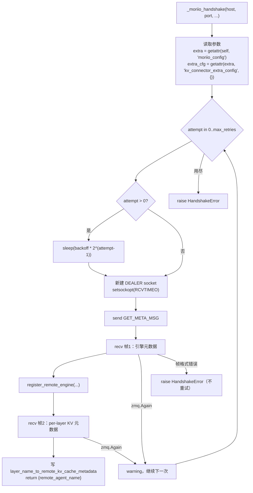
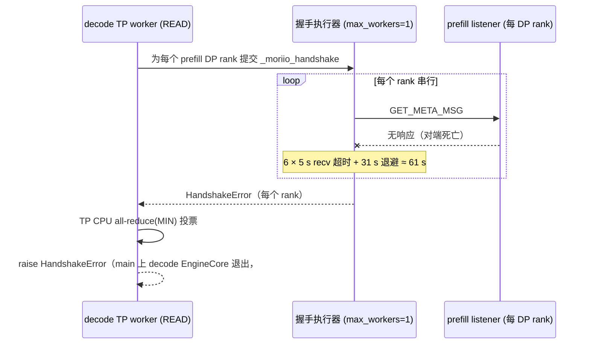

# PR #63856: feat(moriio): add handshake receive timeout with retry and backoff (Gap 3)

> **Author**: @kudomcho | **State**: OPEN | **Date**: 2026-10-26
> **Branch**: `feat/moriio-gap3-handshake-timeout` → `main` | **Labels**: kv-connector
> **Changes**: +107 -51 lines across 2 files | **ROCm 相关性**: 完全相关（MoRIIO KV connector，仅 ROCm/mori 可用）
> 本报告分两部分：§1–6 为 PR 详细总结，§7–8 为 ROCm review 意见。

---

## 1. 总结 (Summary)

MoRIIO 的握手发起端 `_moriio_handshake` 在 main 上用 ZMQ DEALER socket 发 `GET_META_MSG` 后直接 `recv_multipart()`，没有任何超时。对端死掉或不可达时，握手线程会永远阻塞。本 PR 给 DEALER socket 设置 `zmq.RCVTIMEO`（默认 5 s）。超时（`zmq.Again`）后按指数退避（1/2/4/8/16 s）重做整个握手，最多重试 5 次；全部失败后抛 `HandshakeError`。三个参数写成 `MoRIIOConstants` 常量，代码里也尝试从 `kv_connector_extra_config` 读取覆盖值。不过下文会说明，这条覆盖路径实际是死代码。

## 2. 背景与动机 (Background & Motivation)

- 本 PR 是 ROCm/mori#759 中 MoRIIO 可靠性 "Gap" 列表的第 3 项。同作者还拆出了 #63855（Gap 6，用 park 取代 busy-wait）和 #63854（Gap 12，握手版本/模式校验）；三者原本同属已关闭的 #63845。
- main 上的握手卡死后果严重。READ 模式下，decode 在 `start_load_kv` 里通过 `_eager_handshake_all_dp_ranks` 同步握手所有 prefill DP rank，然后进入 TP CPU all-reduce 投票。只要有一个 rank 卡在 `recv()`，其他 TP worker 就会一直等在 all-reduce 上，decode engine 整体挂死。WRITE 模式下握手在后台执行器（`max_workers=1`）里跑，卡死的握手会堵住这个 worker 之后的所有握手。
- 作者的思路是：有界的超时加有限次重试，把"永远挂起"变成"最多约 61 s 后明确失败"。

## 3. 代码修改分析 (Code Change Analysis)

### 3.1 修改的模块

| 文件 | 改动 |
|------|------|
| `vllm/distributed/kv_transfer/kv_connector/v1/moriio/moriio_common.py` (+8) | `MoRIIOConstants` 新增 `HANDSHAKE_RECV_TIMEOUT_MS=5000`、`HANDSHAKE_MAX_RETRIES=5`、`HANDSHAKE_BACKOFF_BASE=1.0`，注释写明最坏耗时 61 s，并声称可通过 `kv_connector_extra_config` 覆盖 |
| `vllm/distributed/kv_transfer/kv_connector/v1/moriio/moriio_connector.py` (+99 -51) | `_moriio_handshake`：读取三个参数后进入 `for attempt in range(max_retries + 1)` 循环。每次新建 DEALER socket 并设置 `RCVTIMEO`，原有的握手体整体缩进一层放进 `try`；`except zmq.Again` 记 warning 后继续下一次；循环结束后抛 `HandshakeError` |

### 3.2 架构 / 流程图



调用方视角下，失败最终落到哪里：



### 3.3 关键实现细节

- 每次重试都新建一个 `zmq_ctx`，退出时 `ctx.destroy(linger=0)`。旧 socket 上迟到的回复会被丢弃，不会串到下一次尝试。
- 只有 `zmq.Again` 会触发重试。帧格式错误、msgspec 解码失败和 mori 注册异常都直接抛出，不重试。这与 #63854 的版本不匹配 `HandshakeError` 能正确配合（不会重试一个永久不兼容的对端）。
- 根据 review 意见，`SNDTIMEO` 已被删除（DEALER 发送是异步的，这个超时不会触发）。但 PR 描述和 commit message 里仍写着 "Set zmq.RCVTIMEO/zmq.SNDTIMEO"。
- 参数读取用的是 `getattr(self, "moriio_config", None)` → `getattr(extra, "kv_connector_extra_config", {})`。`MoRIIOConfig` 是 `@dataclass(slots=True)`，没有这个字段，所以 `extra_cfg` 恒为 `{}`。详见 §7。
- 握手体只是缩进了一层，没有改变语义，原有的 `local_kv_cache_metadata` / `remote_kv_cache_metadata` 清理逻辑仍在循环内。

## 4. 涉及的技术原理 (Technical Principles)

- **ZMQ DEALER/ROUTER 与超时**：ZMQ 的 TCP 连接是异步建立的，连接一个不存在的端点不会报错，`send` 也不会失败。只有 `recv` 会表现为永远等不到数据。所以 `RCVTIMEO` 是检测死对端的唯一手段，`SNDTIMEO` 对 DEALER 无意义。超时后 `recv` 抛 `zmq.Again`。
- **MoRIIO 握手协议**：发起端发 `GET_META_MSG`，listener（ROUTER）回两帧：①msgspec 编码的 `MoRIIOAgentMetadata`（含 mori `EngineDesc`），②msgpack 编码的 per-layer KV 元数据。发起端在第一帧后调用 `register_remote_engine` 注册对端 mori engine，在第二帧后写入 `layer_name_to_remote_kv_cache_metadata`。
- **READ 模式的 eager 握手与 TP 投票**：decode 的每个 TP worker 在 forward 之前握手所有 prefill DP rank，然后做一次 CPU all-reduce(MIN)，确保所有 worker 对成功/失败的判断一致，避免有的 worker 进入 forward 集合通信而其他 worker 还在握手，导致 NCCL hang。握手失败时 main 会在投票后抛 `HandshakeError`，导致 decode engine 退出；#65690 把它改成只让该 prefill engine 的请求失败。
- **单线程握手执行器**：`_handshake_initiation_executor` 的 `max_workers=1`（MoRIIO 不保证线程安全），所有握手串行执行，单次握手的最坏耗时会线性叠加到同批所有握手上。

## 5. 评论区讨论亮点 (Discussion Highlights)

- **@okorzh-amd（超时估算）**：询问 5 s 的依据。作者回复已补注释：最坏 6×5 s + (1+2+4+8+16) s = 61 s/engine。
- **@okorzh-amd（最坏耗时与 decode 退出）**：死对端每次握手要 61 s；执行器单线程，READ eager 握手会在 TP 投票前逐个拨号该 engine 的所有 rank，DP8 prefill 会让 decode step 卡住约 8 分钟，随后 `HandshakeError` 让 decode EngineCore 退出（直到 #65690 合入）。他提到 NIXL 单次 5 s 超时即放弃（`nixl/base_worker.py:1161`），并提出三个要求：一个 rank 重试用尽后停止拨号同 engine 的其他 rank；三个常量可通过 `kv_connector_extra_config` 覆盖；在描述里写明 decode 退出的后果。作者回复"已让三个常量可覆盖"，early-exit "will look into"。**经核对，覆盖并未生效（见 §7），early-exit 未实现，描述也没有补充。**
- **@okorzh-amd（测试）**：没有测试覆盖重试循环。作者回复下个迭代补，当前 head 仍没有测试。
- **@okorzh-amd（格式）**：ruff format 0.14.0 会改写函数内 5 处，作者回复已运行 ruff format。pre-commit 未跑，无法确认。
- **@okorzh-amd（SNDTIMEO）**：指出 SNDTIMEO 不会触发，作者已删除。
- **@okorzh-amd（相关 PR 汇总）**：#65690 是依赖（把 READ eager 投票的 `HandshakeError` 变成按请求失败）；#63854 是同函数的伙伴 PR；#62832、#62396 同样修改 `_moriio_handshake`，与本 PR 的整体重缩进冲突。

## 6. 风险与潜在问题 (Risk Analysis)

| 风险 | 严重程度 | 说明 |
|------|---------|------|
| 正确性：覆盖参数是死代码 | 中 | 见 §7「`kv_connector_extra_config` 覆盖从未生效」 |
| 可用性：死对端导致长时间卡顿 | 中 | READ eager 路径每个 rank 串行 61 s，DP8 约 8 分钟后 decode 退出（#65690 之前），见 §7 |
| 测试覆盖 | 中 | 重试/退避/用尽三条分支都没有单测 |
| 兼容性：与同函数的其他 PR 冲突 | 中 | 与 #63854 在 `_moriio_handshake` 中有文本冲突（已用 merge-tree 验证）；#62832/#62396 冲突由 reviewer 指出，未核实 |
| 失败后的下游行为 | 低 | 握手现在会"失败"而非"挂起"，失败路径（后台 `request_ready` 回调无条件置位 ready 标志）以前几乎走不到，见 §7 📝 |
| 可维护性：描述过时 | 低 | 描述和 commit message 仍写 SNDTIMEO、"listener 无需修改" |

---

## 7. Review 意见 (Findings)

| 类型 | 🔴 | ⚠️ | 📝 |
|------|----|----|----|
| 正确性 | — | 1 | 2 |
| 设计 | — | 1 | — |
| 测试 | — | 1 | — |
| 注释/文档 | — | 1 | — |
| 兼容性 | — | — | 1 |

整体看：用 `RCVTIMEO` + 重试解决 `recv()` 永久阻塞的方向是对的，对 main 是明确改进（从"永远挂起"变成"有界失败"）。每次重试新建 context 并 `linger=0`，避免了迟到回复串到下一次尝试；只对 `zmq.Again` 重试，也不会去重试永久性错误。问题集中在：reviewer 要求的可调参数实际没有接上；最坏耗时的放大问题仍未处理；缺测试；描述过时。

---

**⚠️【正确性】`kv_connector_extra_config` 覆盖从未生效：`MoRIIOConfig` 没有这个属性** `[已验证]`

- **问题**: `moriio_connector.py:2356-2357` 用 `extra = getattr(self, "moriio_config", None)` 和 `extra_cfg = getattr(extra, "kv_connector_extra_config", {})` 取配置。`self.moriio_config` 是 `MoRIIOConfig.from_vllm_config(...)` 的返回值，`MoRIIOConfig`（`moriio_common.py:326`）是 `@dataclass(slots=True)`，字段只有端口、rank、`transfer_timeout`/`defer_timeout`/`recv_abort_timeout`、`backend` 等，没有 `kv_connector_extra_config`。所以 `getattr` 总是返回默认值 `{}`，`handshake_recv_timeout_ms` / `handshake_max_retries` / `handshake_backoff_base` 三个 key 无论怎么设都会被忽略。`moriio_common.py:497-498` 的注释（"Overridable via kv_connector_extra_config"）和作者在 review 里的回复都与代码不符。
- **影响**: 具体触发：`--kv-transfer-config '{"kv_connector":"MoRIIOConnector", ..., "kv_connector_extra_config": {"handshake_max_retries": 0, "handshake_recv_timeout_ms": 2000}}'`，运行时仍是 5 次重试、5 s 超时、最坏 61 s/rank。这正是 reviewer 为缓解 DP8 约 8 分钟卡顿而要求的调节手段，用户以为调小了，实际没变，也没有任何报错。
- **行动**: 作者应当仿照 `transfer_timeout`/`defer_timeout` 的做法，把三个参数加进 `MoRIIOConfig`，在 `from_vllm_config` 里从 `extra_config` 读取，并用 `_positive_finite_timeout` 类的校验拒绝负数/NaN（`max_retries` 允许 0）；`_moriio_handshake` 直接读 `self.moriio_config.<field>`，同时补一个"覆盖值生效"的单测。

**⚠️【设计】死对端的最坏耗时被单线程执行器按 rank 串行放大，early-exit 仍未实现** `[已验证]`

- **问题**: 握手执行器 `max_workers=1`（`moriio_connector.py:2078`）。READ 模式下 `_eager_handshake_all_dp_ranks` 为同一 prefill engine 的每个 DP rank（flexible mirror 下是每个 (dp, tp)）各提交一次 `_moriio_handshake`，然后对每个 future 调 `.result()`，并在 TP all-reduce 投票之前全部等完。每次握手最坏耗时 61 s，所以 DP8 prefill 首次接触且不可达时，decode 的 `start_load_kv` 要阻塞约 8×61 s ≈ 8 分钟，这期间该 decode engine 上所有请求都在等。投票失败后 main 会抛 `HandshakeError`，decode EngineCore 退出（#65690 之前）。reviewer 要求"一个 rank 用尽重试后不再拨号同 engine 的其他 rank"，作者回复 "will look into"，当前 head 没有实现。
- **影响**: 本 PR 把"永久挂起"换成了"分钟级卡顿 + engine 退出"，确实是改进，但 PR 描述把它表述成"no longer blocks forever"，没有提到 decode 退出这一后果。在 WRITE 模式下，同一个执行器还会把其他 decode engine 的握手排在死对端的 61 s × rank 数之后。
- **行动**: 建议作者：①同一 remote engine 内首个 rank 重试用尽后，让其余 rank 快速失败（例如在 eager 循环里检测到第一个 `HandshakeError` 后取消/跳过剩余 future，或对同一 host:port 记录"已判死"的截止时间）；②在描述中写明与 #65690 的依赖关系，以及合入前后 decode 的行为差异；③考虑默认值是否该向 NIXL 的单次 5 s 靠拢（例如默认重试 1–2 次）。

**⚠️【测试】重试循环没有任何测试** `[已验证]`

- **问题**: PR 只改了 `moriio_common.py` 和 `moriio_connector.py`，没有新增或修改测试。`except zmq.Again` 分支、退避序列、用尽后的 `HandshakeError` 以及"格式错误不重试"都没有覆盖。PR 描述的 test plan 只写了"现有 test_moriio_connector.py 仍通过"和两条手工观察项，没有附任何日志。作者在 review 中承诺补测试，但 head 上没有。
- **影响**: 上一条的"覆盖不生效"正是一个最简单的单测就能发现的 bug。以后再改这个函数（#63854、#62832、#62396 都会动它）时，重试语义很容易被悄悄破坏。
- **行动**: 建议作者在 `tests/v1/kv_connector/unit/moriio/` 下补单测：起一个不回复的 ROUTER（或 mock `zmq_ctx`），断言 `max_retries+1` 次尝试后抛 `HandshakeError`、`time.sleep` 的调用序列等于退避序列（mock 掉 sleep），并覆盖"第一次超时、第二次成功"和"帧格式错误时不重试"两种情况，以及 extra config 覆盖。

**⚠️【注释/文档】PR 描述、commit message 与代码不一致；CI 未运行** `[已验证]`

- **问题**: ①描述和 commit `54adfd3` 都写着 "Set zmq.RCVTIMEO/zmq.SNDTIMEO"，代码已删掉 SNDTIMEO。②描述称 "Listener side is already idempotent — no changes needed"，但 main 的 `_moriio_handshake_listener` 收到非预期消息时会 `raise HandshakeError`，listener 线程随之退出，之后该 rank 的所有握手都只能等到超时。这个问题由 #64756 修复，属于本 PR 的前置/伙伴问题。③CI 未运行：无 `ready` label，pre-run-check 失败，pre-commit 与 Buildkite 均被跳过。ruff format 问题作者称已修复，但无法从 CI 确认。
- **影响**: 读描述的 reviewer 会误以为 listener 侧没有问题。listener 死掉时，本 PR 的效果是"每个握手 61 s 后失败"，而不是"重试即可恢复"。
- **行动**: 建议作者更新描述：删除 SNDTIMEO；注明 listener 健壮性依赖 #64756、按请求失败依赖 #65690；把最坏耗时和 decode 退出后果写进描述。另请 maintainer 加 `ready` label 或触发 `/amd-ci run`，确认 pre-commit 和 `:amd: (MI355 DPX) MoRIIO Connector Unit Tests` 通过。

**📝【正确性】握手现在会"失败"，后台路径的 `request_ready` 回调却无条件置位 ready 标志** `[已验证]`

- **问题**: `_background_moriio_handshake` 把 `request_ready` 挂在 `wait_all_dp` future 的 `add_done_callback` 上。这个回调不检查 `_f.exception()`，即使握手失败也会 `_ready_requests.put(entry)`，并把 `load_ready_flag` / `write_ready_flags[remote_engine_id]` 置为 True。这是 main 上已有的行为，但在 main 上死对端只会挂起，几乎走不到这里；本 PR 让失败在 61 s 后真正发生，这条路径从此可达。
- **影响**: WRITE 模式下，`save_kv_layer` 的 busy-wait 看到 `write_ready_flags` 后会对 `_ready_requests` 的队首请求调用 `_write_blocks_for_req`。该 engine 没有 session，写线程查 `layer_name_to_remote_kv_cache_metadata` 时会失败，具体落点 `[推测]` 是写线程记 exception 后结束该请求。这个行为不是本 PR 引入的，但本 PR 是第一次让它在死对端场景下大概率发生。
- **行动**: 建议作者在 `request_ready` 中检查 `_f.exception()`，失败时不要置位 ready 标志（或改为放入失败队列）；这一点也可以和 #63855 / #65690 协调后统一处理。

**📝【正确性】第二帧超时后重试会对同一对端再次 `register_remote_engine`（重复注册）** `[已验证]`

- **问题**: 在 `try` 块内，收到第一帧后立即执行 `self.moriio_wrapper.register_remote_engine(metadata.agent_metadata)`（`moriio_connector.py:2405`），随后才 `recv` 第二帧（per-layer KV 元数据）。如果第二帧触发 `zmq.Again`，`except` 会进入下一次尝试，整个握手体重新执行，同一个对端 `EngineDesc` 会被注册第二次（最多 `max_retries+1` 次）。另外，第一次尝试已经把 `remote_engine_ip` 写入 wrapper，并清空了 `local/remote_kv_cache_metadata`，但 `layer_name_to_remote_kv_cache_metadata` / `remote_moriio_metadata` 还没写，所以失败的那次尝试会留下"已注册但无 layer 元数据"的半完成状态。如果最终所有尝试都失败，这个对端会一直保持已注册状态。
- **影响**: 我核对了本地 mori 源码（`~/vllm/mori` @ `09aa23b`）：`IOEngine::RegisterRemoteEngine` 依次调用各 backend；RDMA（`ControlPlaneServer`）、XGMI、Fabric 都是 `engines[desc.key] = desc` 的按 key 覆盖，OFI 是重新 seed 地址，随后统一 `InvalidateRouteCache()`。所以在这个 mori 版本下重复注册是幂等的，不会泄漏或报错，风险低。不过这依赖 mori 的实现细节，vLLM pin 的 mori 版本是否同样如此我没有逐一核对。最终失败后残留的注册没有对应的 `deregister_remote_engine`，属于小的状态泄漏。
- **行动**: 建议作者把 `register_remote_engine` 移到两帧都成功收到之后、`return` 之前再调用（这样重试与失败都不会留下半完成状态），或者在 `except zmq.Again` 分支里对已注册的 desc 调用 `deregister_remote_engine`。

**📝【兼容性】与同批 MoRIIO PR 的冲突与依赖** `[已验证]`

- **问题**: 用 `git merge-tree` 在本地验证：本 PR 与 #63854 在 `_moriio_handshake` 有 1 处文本冲突（#63854 在第一帧解码后插入 `_validate_handshake_compat`，本 PR 把整段缩进进了 `try`）；与 #63855、#64756、#65690 都可以干净合并。语义上：#64756（listener 收到坏消息不再退出）是本 PR 重试能真正生效的前提；#65690 把本 PR 最终抛出的 `HandshakeError` 转成按请求失败，并加了"按引用次数退避"，两者叠加后每个失败 engine 每轮仍要花 61 s × rank 数；#63855 移除 WRITE busy-wait 后，本 PR 的失败会在执行器上排队累积（见 #63855 报告中的重复握手问题）。
- **行动**: 建议作者与 #63854 协调合入顺序（后合入者在 `try` 块内保留 `_validate_handshake_compat` 调用）；也建议 maintainer 按 #64756 → #63856 → #65690 的顺序评估。

## 8. 结论 (Verdict)

**⚠️ NEEDS WORK**

给握手 `recv` 加上限是正确且必要的改进，实现本身（每次新建 context、只重试 `zmq.Again`）也没有问题。但作者回复里声称已实现的 `kv_connector_extra_config` 覆盖实际不生效，reviewer 要求的 early-exit 也没有做，DP8 场景下死对端仍会让 decode 卡住约 8 分钟后退出。重试循环没有测试，描述也已过时。建议修好参数接线并补测试、更新描述后再合。

## 9. 英文 Review 评论 (Copy-Paste English Comments)

**C1** `vllm/distributed/kv_transfer/kv_connector/v1/moriio/moriio_connector.py:2356-2357` — ⚠️ comment

```text
These overrides never take effect. `self.moriio_config` is a `MoRIIOConfig`, which is a `@dataclass(slots=True)` with no `kv_connector_extra_config` field, so `getattr(extra, "kv_connector_extra_config", {})` always returns `{}` and the three `handshake_*` keys are silently ignored. For example, setting `handshake_max_retries: 0` still gives 6 attempts and up to 61 s per rank. Could you add the three knobs to `MoRIIOConfig` and parse them in `from_vllm_config` the same way `transfer_timeout` and `defer_timeout` are parsed (with the positive/finite validation), read them from `self.moriio_config` here, and add a unit test for the override?
```

**C2** `vllm/distributed/kv_transfer/kv_connector/v1/moriio/moriio_connector.py:2375` — ⚠️ comment

```text
With the single-worker handshake executor, this loop's worst case (61 s) adds up across ranks: the READ eager handshake joins every prefill DP rank (or every (dp, tp) rank on the flexible mirror) before the TP vote, so a dead DP8 prefill stalls the decode step for about 8 minutes, and then the vote raises HandshakeError, which stops decode's EngineCore until #65690 lands. Could you make the remaining ranks of the same remote engine fail fast once one rank has used up its retries, and document the decode-exit outcome and the #65690 dependency in the description?
```

**C3** `vllm/distributed/kv_transfer/kv_connector/v1/moriio/moriio_connector.py:2448-2462` — ⚠️ comment

```text
No test exercises the timeout path: the `zmq.Again` retry, the backoff sequence, the final HandshakeError, and the "malformed frame is not retried" case are all uncovered, and a minimal test would have caught the dead override above. Could you add a unit test under tests/v1/kv_connector/unit/moriio/ that dials a ROUTER that never replies (or mocks `zmq_ctx`), patches `time.sleep`, and asserts the attempt count, the sleep sequence and the raised error, plus a case where the first attempt times out and the second succeeds?
```

**C4** `vllm/distributed/kv_transfer/kv_connector/v1/moriio/moriio_common.py:495-501` — ⚠️ comment

```text
The comment here, the PR description and the commit message are out of date. They say the values are overridable through kv_connector_extra_config (not true yet, see the other comment) and that SNDTIMEO is set (it was removed). The description also says the listener side needs no changes, but on main the listener raises and exits on an unexpected message, so every later handshake to that rank only times out; that is fixed separately by #64756. Could you update the comment and description accordingly?
```

## 10. 英文总结评论 (Overall Review Summary)

```text
Bounding the handshake recv with RCVTIMEO is the right fix for the infinite hang, and the retry loop itself is sound: a fresh context per attempt and retries only on zmq.Again. Before merge: the kv_connector_extra_config overrides are dead code because MoRIIOConfig has no such attribute; the worst case still serializes to about 8 minutes for a dead DP8 prefill before decode exits, so please fail fast across ranks of the same engine; and please add a test for the retry path and refresh the description (SNDTIMEO, the #64756 and #65690 dependencies). Changes needed before merge.
```
