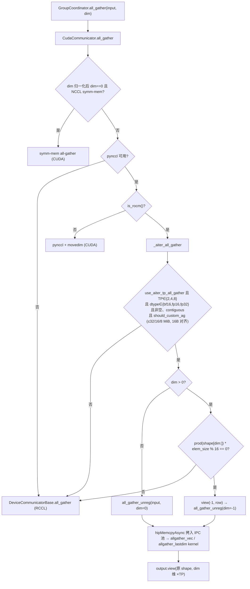
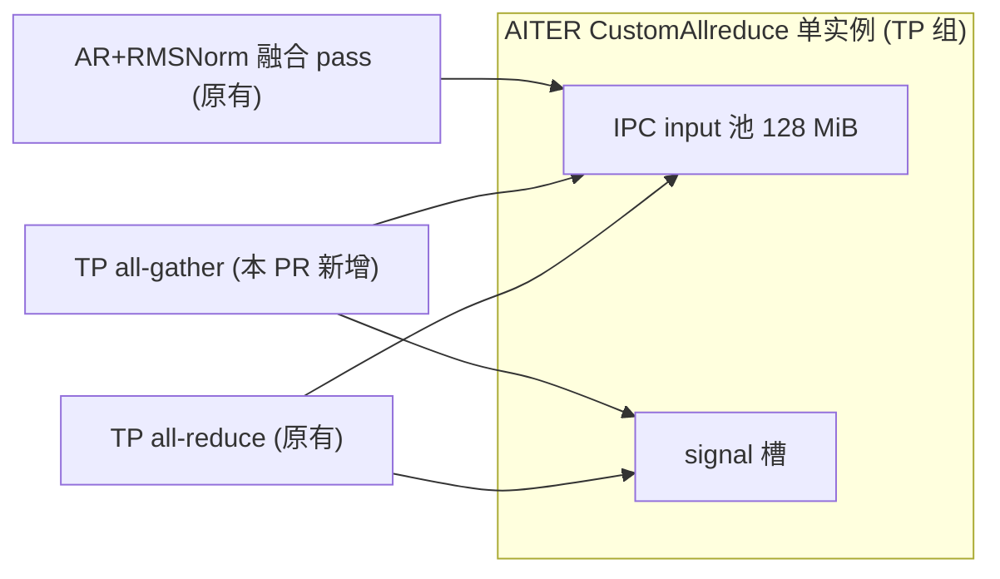

# PR #63890: [ROCm][Perf] Use AITER's all-gather for small TP all-gathers

> **Author**: @okorzh-amd | **State**: OPEN | **Date**: 2026-10-27
> **Branch**: `okorzh/rocm-aiter-small-tp-all-gather` → `main` | **Labels**: rocm, nvidia
> **Changes**: +142 -1 lines across 4 files | **ROCm 相关性**: 完全相关（ROCm TP 通信路径，AITER custom all-reduce 实例复用）
> 本报告分两部分：§1–6 为 PR 详细总结，§7–8 为 ROCm review 意见。

---

## 1. 总结 (Summary)

本 PR 让 gfx942 / gfx950 上的 **TP 组 all-gather** 在 TP 组已经启用 AITER custom all-reduce 的前提下，改走 AITER 的 IPC all-gather（`all_gather_unreg`，copy-in 路径），替代此前的 RCCL `all_gather_into_tensor` + `movedim`。准入条件只看 arch / TP size（2/4/8）/ dtype（bf16/fp16/fp32）/ 非空 / contiguous / AITER 的 `should_custom_ag` 容量上限（128 MiB 池 / (2×TP) = 32/16/8 MiB 每 rank）。`dim > 0` 的 gather 被改写为 2-D view `(-1, prod(shape[dim:]))` 上的 last-dim gather，省掉 RCCL 路径的 `movedim` 拷贝。核心价值是 DeepSeek-V4.1-Flash 低并发 decode 中 logits / Engram gather 的延迟（PR 报告 TP4 c1-c4 decode step 快 1.2-1.9%）。

## 2. 背景与动机 (Background & Motivation)

- #48446 把 ROCm TP all-gather 留在 RCCL（pynccl + `movedim` 路径更慢），#48247 仅为 **DP 组** 启用了 AITER all-gather/reduce-scatter。
- 延迟敏感的 decode gather（`LogitsProcessor` 的 logits gather、DeepSeek-V4.1 Engram 的 rows / `wkv` gather）每次都要付 RCCL launch + `movedim` 的代价；各模型已经开始自己写 AITER gather helper（#57832、#63263、#63322、#60606）。
- 本 PR 选择在 communicator 层统一处理 TP gather，而不是继续在模型里堆 helper。
- 迭代过程：最初带 2 MiB cap（CUDA custom all-gather 的默认值）且不限 arch；reviewer @frida-andersson 质疑 cap 来源与 dim-0 / gfx942 / gfx1250 未验证；作者做了两轮 AITER vs RCCL sweep 后去掉 cap，先 gate 到 gfx950，随后 reviewer 在 MI325X 上验证后扩到 `get_cdna_version() in (3, 4)`（当前 head 8ca2504b97）。

## 3. 代码修改分析 (Code Change Analysis)

### 3.1 修改的模块

| 模块 | 改动 |
|------|------|
| `vllm/distributed/device_communicators/cuda_communicator.py` (+35) | `__init__` 新增 `use_aiter_tp_all_gather`（TP 组 + AITER AR 开启 + CDNA3/4）；`all_gather` 的 ROCm 分支先尝试新的 `_aiter_all_gather`，返回 `None` 时回落 RCCL |
| `vllm/distributed/device_communicators/aiter_custom_all_reduce.py` (+3) | wrapper 透传 AITER 的 `all_gather_unreg` |
| `tests/distributed/test_comm_ops.py` (+44) | CPU mock 测试：dim 0 / 中间 dim / last dim 走 AITER 且 shape 正确；TP6、24 字节行、空 tensor、超限尺寸回落 RCCL |
| `tests/distributed/test_rocm_aiter_custom_ar.py` (+60) | 2-GPU 测试：bf16 `(3,4,64)` 在 dim 0/1/2 上 eager + graph replay 与 `dist.all_gather` 逐位相等，并用 spy 断言 AITER 实际被调用的 dim 序列 |

### 3.2 架构 / 流程图





### 3.3 关键实现细节

- **门控一次计算**：`use_aiter_tp_all_gather = use_aiter_allreduce and get_cdna_version() in (3, 4)`，只在 `unique_name` 前缀为 `tp` 的组上成立；`VLLM_BATCH_INVARIANT=1`、`--disable-custom-all-reduce`、`VLLM_ROCM_USE_AITER_CUSTOM_AR=0` 都会通过 `use_aiter_allreduce=False` 关掉它。
- **每次调用的门控**只依赖 shape/dtype/contiguity/arch，所有 rank 决策一致（不会出现部分 rank 走 AITER、部分走 RCCL 的死锁）。
- **始终 copy-in**（`all_gather_unreg`），包括 graph capture 期间：避免 AITER registered 路径在不可 IPC 导出的输入（expandable segments 下分配的 `staged_rows`）上直接抛错；代价是每个 captured gather 多一个 D2D memcpy 节点（作者测得 c1 约 25 µs/step）。
- **任意 dim**：`dim > 0` 时用 2-D view 的 last-dim gather（AITER `allgather_lastdim` 要求每行为 16 字节 pack 的整数倍，PR 显式检查）；`dim == 0` 直接首维 gather。
- **TP size 白名单 (2, 4, 8)** 是承重条件：AITER `dispatchAllGather` 对其他 world size 只 `printf("allgather world_size error")` 而不 launch，`should_custom_ag` 本身不拒绝 TP6（见 §7）。
- AITER 0.1.27 的 `all_gather_unreg` 每次 `torch.empty` 新输出，不与池别名，graph 内多次 gather 的输出互不覆盖。

## 4. 涉及的技术原理 (Technical Principles)

- **IPC custom all-gather**：每个 rank 把输入拷进事先 IPC 注册、跨 rank 可见的池（copy-in），kernel 内 `start_sync` 后每个 rank 直接从所有 peer 的池中读取并写本地输出，`end_sync` 保证所有 peer 读完再返回。对小消息它比 RCCL 少了 proxy / 协议开销，延迟更低；对大消息带宽优势会收窄。
- **last-dim gather 与 movedim**：RCCL `all_gather_into_tensor` 只能沿首维拼接，`dim != 0` 需要 `reshape + movedim + contiguous` 额外一次全量拷贝；AITER 的 `allgather_lastdim` 在 kernel 内按 `(ngpus*y + rank)*row + x` 交错写，天然得到 last-dim 拼接结果。中间 dim 可以把 `shape[dim:]` 压成一行，转化为 last-dim gather，数学上逐位等价。
- **CUDA/HIP graph capture 与 copy-in**：capture 期间 `hipMemcpyAsync` 成为 graph 的 memcpy 节点，池地址在 init 时已注册，无需在 `capture()` 结束时额外注册 graph buffer；registered 路径则直接绑定输入地址，省一次拷贝但要求输入可 IPC 导出。
- **共享 AITER 实例**：TP 的 all-reduce、AR+RMSNorm 融合和本 PR 的 all-gather 共用同一个 `CustomAllreduce`（同一 IPC 池与 signal 槽），因此同一时刻只能有一个 collective 在飞（同 stream 串行时成立）。

## 5. 评论区讨论亮点 (Discussion Highlights)

- **@frida-andersson**（`cuda_communicator.py`）：2 MiB cap 是 CUDA 的默认值、未在 AITER kernel 上测过，要求用 AITER vs RCCL sweep 定 cap → 作者跑了两轮 sweep（TP2/4/8，768 点/轮）后**移除 cap**，只保留 `should_custom_ag` 的容量上限。
- **@frida-andersson**（`aiter_custom_all_reduce.py`）：dim 0 在 DeepSeek-V4.1 上没有调用点、未测量，要求对比 RCCL 或暂留 RCCL → 作者给出 sweep 数据（graph replay 中位数 1.18/1.41/1.43x）后保留 dim 0 走 AITER。
- **@frida-andersson**：gfx942 / gfx1250 在 AITER 开启时都会走新路径，要求验证或 gate 掉 → 作者先 gate 到 gfx950；reviewer 随后在 MI325X（TP4 c1，两次非交换 pass，ITL p50 -140 / -50 µs）验证，作者扩到 `in (3, 4)`，gfx1250 仍在 RCCL。
- **@frida-andersson**：询问 `revcomm` / `mut_reg` 两个 scratch 镜像的用途 → 作者澄清：`revcomm` 证明新 GPU 测试在 main 的 communicator 上会失败；`mut_reg` 测 copy-in 代价（~25 µs/step @c1）并证明 registered 路径在 expandable segments 下会抛 "cannot be IPC-exported"。
- 作者主动在描述中声明的限制：`AITER_CUSTOM_AR_MAX_SIZE=0` 不会关闭这条路径；AITER all-gather 与 all-reduce 共享池和 signal 槽，跨 stream 并发的 TP collective 会竞争（main 目前没有这样的调用方）。
- CI 状态：未抓取，视为未知；PR 描述称 "(MI300|MI355) Distributed Features" 这两个 optional step 尚待解锁。

## 6. 风险与潜在问题 (Risk Analysis)

| 风险 | 严重程度 | 说明 |
|------|---------|------|
| 默认路径对所有 TP 模型生效，但端到端只测了 DeepSeek-V4.1-Flash | Medium | 见 §7 ⚠️【兼容性】生效范围宽于验证范围且无单独回退开关 |
| gfx942 与非 bf16 / TP>2 的 GPU 覆盖薄 | Medium | 见 §7 ⚠️【测试】 |
| 跨 stream 并发 TP collective 与 AITER 共享 signal | Low | 见 §7 📝【并发】；当前无调用方 |
| dim-0 gather 由一次 RCCL kernel 变为 copy + kernel | Low | 见 §7 📝【性能】；sweep 中 run1 在 ≤128 KiB graph 点出现过 loss |
| 数值正确性 | Low | 纯字节搬运；PR 报告 eager + graph replay 下与 RCCL 逐位相等；本次 review 核对 AITER kernel 索引公式与 view 变换一致 |
| 可维护性：ROCm 分支注释已过时、魔法 (2,4,8) | Low | 见 §7 📝【可维护性】 |

---

## 7. Review 意见 (Findings)

| 类型 | 🔴 | ⚠️ | 📝 |
|------|----|----|----|
| 兼容性 | — | 1 | — |
| 测试 | — | 1 | — |
| 性能 | — | — | 2 |
| 并发 | — | — | 1 |
| 可维护性 | — | — | 1 |

---

**⚠️【兼容性】生效范围宽于端到端验证范围，且没有只关 gather 的回退开关** `[已验证]`

- **问题**: `cuda_communicator.py:84-88` 让 gfx942/gfx950 上**所有** TP all-gather（只要 ≤ 32/16/8 MiB、bf16/fp16/fp32、contiguous）都默认改走 AITER，包括 sequence-parallel / `sp_all_gather` 的 dim-0 hidden-state gather、prefill 中尺寸在上限以内的 gather、多模态 ViT 编码器里的 TP gather（qwen2_vl / intern_vit 等）。端到端只测了 DeepSeek-V4.1-Flash（MI355X TP4/TP8，MI325X 仅 TP4 c1 两次非交换 pass）；MI300X、Llama / DeepSeek-R1 / SP 模型均未测。关闭它的唯一途径是 `VLLM_ROCM_USE_AITER_CUSTOM_AR=0` 或 `--disable-custom-all-reduce`，二者会连同 AITER all-reduce 一起关掉；AITER 自己的 `AITER_CUSTOM_AR_MAX_SIZE=0` 也不影响 `should_custom_ag`（PR 描述已承认）。
- **影响**: 若某个未测模型/拓扑上 AITER gather 出现回归（性能或挂起），用户只能以牺牲 AITER all-reduce 的代价规避，排障时也无法单独 A/B gather。
- **行动**: 建议作者要么把默认生效范围限制在已测量的场景（例如保留对 dim-0 / SP gather 的 RCCL 路径，直到有 SP 模型的端到端数据），要么在 PR 描述中明确列出受影响调用方，并在 `_log_all_reduce_backend_selection` 旁加一条 `info_once` 日志说明 "TP all-gather: AITER"，方便用户确认与排障；是否需要临时的 gather-only 开关建议 review 时与 maintainer 确认。

**⚠️【测试】GPU 测试只覆盖 TP2 + bf16 + 单一小 shape，且只在 optional CI step 中运行** `[已验证]`

- **问题**: `tests/distributed/test_rocm_aiter_custom_ar.py:180-181` 只用 `(3, 4, 64)` bf16 在 TP2 上跑 dim 0/1/2；fp16/fp32、TP4/TP8（`allgather_lastdim<T,4/8>` 模板实例）、接近 `should_custom_ag` 上限的尺寸、多维 dim-0 输入都没有进 CI 测试（作者的 79-case 矩阵和 sweep 是 scratch 脚本，不在 PR 中）。CPU 测试 `test_comm_ops.py:585` 直接把 `use_aiter_tp_all_gather = True` 写死在 mock 上，arch 门控本身没有被任何测试覆盖（作者也承认 gate 放宽到 gfx1250 时测试仍会通过）。该 GPU 测试所在的 "(MI300|MI355) Distributed Features" step 是 `optional: true`，PR 描述称尚待解锁；gfx942 上从未跑过该测试。
- **影响**: 这是 ROCm 专属默认路径，CUDA CI 全绿不能说明任何问题；TP4/8 或 fp32 的 kernel 实例若有问题（例如 pack 宽度、索引溢出），只能在用户侧暴露。
- **行动**: 建议作者把 GPU 测试参数化到 `{bf16, fp32}` × 一个上限附近的尺寸，并在 4-GPU agent 上加 TP4 用例；合并前请 maintainer 触发 `/amd-ci run`，确保 MI300（gfx942）与 MI355 的 Distributed Features step 实际跑过且通过。

**📝【性能】dim-0 gather 由单个 RCCL kernel 变为 copy-in + AITER kernel，端到端无调用点数据** `[已验证]`

- **问题**: PR 自己的 sweep 显示 run1 在 5 个 ≤128 KiB 的 graph-replay dim-0 点上输给 RCCL，run2 全部胜出；DeepSeek-V4.1 decode 没有 dim-0 gather，所以 dim-0 只有隔离 microbenchmark 数据。SP 模型的 prefill dim-0 gather（如 TP4 下 256×5120 bf16 = 2.6 MB）现在会进入 AITER。
- **行动**: 建议作者补一组带 sequence parallel 的模型端到端数据（或至少 TP8 dim-0 graph replay 的多轮 sweep 均值），以确认 dim-0 在真实 serving 中不倒退。

**📝【性能】性能数字依赖未入库的 scratch 镜像与脚本，c16/c32 结论作者自认不成立** `[已验证]`

- **问题**: 描述中的 decode step 收益（TP4 c1-c4 -1.2~-1.9%、TP8 -0.8~-1.2%）来自 `pr`/`r1` 镜像与未提交的 `bench_ag.py`；当前 head 的 TP4 c2/c4、TP8 未重跑；c16/c32 作者明确标注 "not established"。gfx942 只有 reviewer 的两次非交换 c1 pass。
- **行动**: 这些数字在本报告中视为 `[unverified]`；建议 review 时只把 TP4 c1（多轮交换、方差小）当作已确立的收益，其余作为参考。

**📝【并发】AITER all-gather 与 all-reduce 共享 IPC 池与 signal 槽，跨 stream 的 TP collective 会从"安全的 RCCL"变成竞争** `[推测]`

- **问题**: 此前 TP all-gather 走 RCCL，与 AITER all-reduce 在不同 stream 上并发是安全的；本 PR 后二者共享同一 `CustomAllreduce` 的池与 signal。本次 review 检查了 DeepSeek-V4.1 AMD 模型的 aux stream（`maybe_execute_in_parallel` 在 ROCm 上顺序执行）、Engram prefetch stream（只做 lookup，不做 TP gather）与 DBO（两个 ubatch 共享 compute stream），未发现当前的并发调用方。
- **行动**: 建议作者在 `_aiter_all_gather` 处加一行注释，说明"TP gather 必须与 TP all-reduce 在同一 stream 上串行发出"这一不变式，防止后续多 stream 优化（例如 #63483 的 draft TP DBO）在 gather 上踩坑。

**📝【可维护性】ROCm 分支的旧注释已不准确；(2, 4, 8) 白名单是承重条件但没有说明** `[已验证]`

- **问题**: `cuda_communicator.py:503-507` 的注释仍写着 "keep ROCm on the base-class collective"，而下一行已经先尝试 AITER。`world_size not in (2, 4, 8)`（第 533 行）不只是"未测量"，而是**必需**：AITER `dispatchAllGather` 在其他 world size 下只 `printf("allgather world_size error")` 而不 launch kernel，输出是未初始化的 `torch.empty`，而 AITER 的 `should_custom_ag` 并不拒绝 TP6。
- **行动**: 建议作者更新该注释，并在 TP-size 检查旁注明 "AITER all-gather launches nothing for other world sizes; should_custom_ag does not reject them"；也可以向 AITER 上游提 issue，让 `should_custom_ag` 自己拒绝不支持的 world size。

## 8. 结论 (Verdict)

**⚠️ NEEDS WORK**

实现本身干净，逐位正确性论证扎实：rank 间决策一致、dim 变换与 AITER kernel 索引公式吻合、copy-in 路径在 capture 下安全、TP6 有显式拦截。未发现必须修复的问题。主要缺口在生效范围与验证范围不匹配：默认对 gfx942/950 上所有 TP gather 生效，却没有单独的回退开关；GPU 测试只覆盖 TP2/bf16，且只在 optional 的 AMD CI step 中运行。建议补齐 TP4 + fp32 测试，并确认 AMD CI 实际跑过、加上 backend 日志，之后即可合入。

## 9. 英文 Review 评论 (Copy-Paste English Comments)

**C1** `vllm/distributed/device_communicators/cuda_communicator.py:84-88` — ⚠️ comment

```text
This turns AITER all-gather on by default for every TP all-gather on gfx942/gfx950 under the size cap, including sequence-parallel dim-0 hidden-state gathers, prefill gathers and ViT encoder gathers, but end-to-end data exists only for DeepSeek-V4.1-Flash. Today the only way to opt out is VLLM_ROCM_USE_AITER_CUSTOM_AR=0 / --disable-custom-all-reduce, which also drops AITER all-reduce, and AITER_CUSTOM_AR_MAX_SIZE=0 does not affect should_custom_ag. Could you at least log the selected TP all-gather backend once (next to _log_all_reduce_backend_selection) so users can tell which path is active? It would also help to either list the affected call sites in the description or keep dim-0/SP gathers on RCCL until there is an SP model measurement.
```

**C2** `tests/distributed/test_rocm_aiter_custom_ar.py:180-181` — ⚠️ comment

```text
The GPU test only exercises TP2 with a single bf16 (3, 4, 64) tensor, so the allgather_lastdim<T, 4/8> instantiations, fp32/fp16 and sizes near the should_custom_ag limit are only covered by the scratch matrix outside the PR. The CPU test also sets use_aiter_tp_all_gather directly, so the arch gate is not covered by any test. Could you parametrize this over {bf16, fp32} plus one near-limit size, and add a TP4 case on a 4-GPU agent? Since the Distributed Features steps are optional, please also make sure /amd-ci actually runs them on both MI300 (gfx942) and MI355 before merge.
```

**C3** `vllm/distributed/device_communicators/cuda_communicator.py:507-509` — 📝 nit（注释在第 503-507 行，均为未改动行；锚定在 hunk 内的第 507-509 行）

```text
Nit: the comment just above still says ROCm stays on the base-class collective, which is no longer accurate now that AITER is tried first. Related: the `self.world_size not in (2, 4, 8)` check in _aiter_all_gather is load-bearing rather than "unmeasured". AITER's dispatchAllGather only printf's "allgather world_size error" and launches nothing for other sizes, while should_custom_ag does not reject TP6, so the output would be an uninitialized torch.empty. Could you update the comment and note that invariant next to the TP-size check?
```
