# PR #63891: [ROCm][Perf][DSv4.1] Run DSpark's fused Markov sampling on gfx950 with --monokernel

> **Author**: @okorzh-amd | **State**: OPEN | **Date**: 2026-10-27
> **Branch**: `okorzh/dsv41-fused-markov-gfx950` → `main` | **Labels**: rocm, ci/build, deepseek, dflash, DSv4.1
> **Changes**: +92 -28 lines across 5 files | **ROCm 相关性**: 完全相关（DeepSeek-V4.1 AMD DSpark 草稿采样，gfx942/gfx950）
> 本报告分两部分：§1–6 为 PR 详细总结，§7–8 为 ROCm review 意见。

---

## 1. 总结 (Summary)

#60731 为 gfx942 引入了 `fused_markov`：把 DSpark 草稿的 Markov 顺序采样（每个草稿步约 9 个 kernel）融合成每步一次 Triton launch + 最后一次小 launch。它被 `ops.enabled()`（仅 gfx942）门控，因此 gfx950 一直跑 vLLM 的循环（k=6 时每 decode step 约 51 个 kernel）。本 PR 把门控换成新的 `ops.monokernel_cdna3_or_4()`（`--monokernel` + ROCm + CDNA3/4），让 gfx950 也走融合路径，但在 gfx950 上把行数上限设为 `MAX_ROWS_GFX950 = 5`（≥6 行时 vLLM 循环更快）。同时把 #63885 的 `swa_decode_meta_enabled()` 合并为同一个函数。

## 2. 背景与动机 (Background & Motivation)

- `fused_markov` 是纯 Triton，复用 vLLM 自己的 `gumbel_noised_argmax` / `spec_step_seed`，没有 gfx942 专属代码；只因为当初是 gfx942 移植而被 `enabled()` 门控。
- 作者给出的收益（MI355X，DeepSeek-V4.1-Flash `--monokernel`，DSpark k=6，synthetic AL 3.87，32k/1k）：TP4 c1 -2.36%、c2 -2.10%、c4 -0.98%、c8 ±0（8 行回到循环）、TP2 c1 -2.27%；每 step GPU kernel 数 365→321，`_markov_*` 7 个/step。4 轮 ABBA、GPU 两半互换，数据表完整，但来自作者本地运行、无可追溯日志 → `[unverified]`，机制（减少 ~44 个小 kernel launch）与数字量级吻合。
- `MAX_ROWS_GFX950 = 5` 的依据：microbench 显示融合路径每多一行约 +54 us；vLLM 循环的 Markov GEMV 在 `rocm_unquantized_gemm` 中只在 `0 < n <= 5` 走 wvSplitK，6 行起走通用 GEMM，循环反而更便宜。

## 3. 代码修改分析 (Code Change Analysis)

### 3.1 修改的模块

| 文件 | 改动 |
|------|------|
| `vllm/models/deepseek_v41/amd/ops/__init__.py` | `swa_decode_meta_enabled()` 重命名为 `monokernel_cdna3_or_4()`（逻辑不变：`_monokernel and is_rocm and get_cdna_version() in (3, 4)`），`record_monokernel` 清它的 cache；docstring 更新 |
| `vllm/models/deepseek_v41/amd/ops/fused_markov.py` | 门控 `enabled()` → `monokernel_cdna3_or_4()`；新增 `MAX_ROWS_GFX950 = 5`，`_why_not` 按 `get_cdna_version() == 4` 选择上限 |
| `vllm/models/deepseek_v41/amd/ops/swa_decode_meta.py` | 改用 `monokernel_cdna3_or_4()`（纯重命名） |
| `tests/models/test_dsv41_mono_decode.py` | `test_dspark_draft_model_samples_with_fused_markov` 改为驱动真实门控 + stub kernel：gfx950/5 行→融合，gfx950/6 行→循环，gfx942/8 行→融合，无 `--monokernel`→循环；断言 launch 次数与 `num_warps` |
| `tests/kernels/models/amd/test_dsv41_gfx942_fused_markov.py` | `_set_gate` 额外清 `monokernel_cdna3_or_4` 的 cache |

### 3.2 架构 / 流程图

```mermaid
flowchart TD
    A[DSparkSpeculator._sample_sequential&#40;num_reqs&#41;] --> B[model.sample_sequential<br/>dspark.py]
    B --> C[fused_markov.sample_sequential]
    C --> D{monokernel_cdna3_or_4&#40;&#41;?<br/>--monokernel 且 CDNA3/4}
    D -- 否 --> L[返回 False → vLLM 循环<br/>~9 kernel × k 步]
    D -- 是 --> E{_why_not}
    E -->|greedy / watermark / d2t /<br/>confidence head / AE| L
    E --> F{num_reqs ≤ max_rows?<br/>gfx950: 5，gfx942: 8}
    F -- 否 --> L
    F -- 是 --> G{bf16 / 连续 / 未量化 Markov head?}
    G -- 否 --> L
    G -- 是 --> H[k 次 _markov_step_kernel<br/>+ 1 次 _markov_last_kernel]
    H --> I[写 draft_logits 缓存 + draft_tokens<br/>返回 True]
```



### 3.3 关键实现细节

- gfx942 行为不变：`get_cdna_version()` 依次判断 gfx90a→2、gfx942→3、gfx950→4，所以在 gfx942 上 `monokernel_cdna3_or_4()` ⇔ `enabled()`，上限仍为 `MAX_ROWS = 8` `[已验证]`。gfx90a / gfx1250 / 非 ROCm 均不启用。
- `NUM_WARPS = 4` 在 main 上已经是 4，本 PR 未改 kernel 本身。
- `_scratch` 缓冲按 `MAX_ROWS` 分配，gfx950 上限更小，不会越界。
- FULL graph 下决策按 padding 后的 batch 大小在捕获时做出；padding 后行数 ≥ 实际行数，所以捕获为融合路径的图回放时实际行数也 ≤ 5。
- DSpark AMD 草稿模型有 `sample_sequential` 属性，`supports_batch_sharded_draft_logits()` 返回 False，因此 draft logits cache 是 replicated（按 req_state_idx 寻址），与 kernel 中 `cache_ptr + req * stride0` 一致 `[已验证]`。这在 main 上对 gfx950 已经成立（即便 gfx950 之前从不走融合路径），本 PR 未改变。

## 4. 涉及的技术原理 (Technical Principles)

- **DSpark + Markov head**：DSpark 草稿模型并行出 k 个位置的 base logits，再按顺序对每个位置加一个由上一草稿 token 决定的低秩 Markov bias（`markov_w1` 嵌入 × `markov_w2`，129280×256 bf16 ≈ 66 MB），然后 Gumbel 采样。顺序依赖使得 k 步无法并行，vLLM 循环每步要 embedding、GEMV、add、Gumbel（kernel + argmax + gather）、copy 共约 9 个 kernel。
- **融合方式**：每步一次 launch，按 vocab 分 BLOCK=256 的程序块，每块算自己的 bias、加 base、写 cache、做块内 Gumbel-max；下一步开头由各程序自己对上一轮的块最大值做 argmax 得到上一个 token。噪声只依赖 seed、步号、位置、token id，且两边都取并列最大中的第一个，因此结果与块大小无关。
- **数值与无损性**：bias 的 256 项求和顺序与 vLLM GEMV 不同，最后一个 bf16 bit 可能不同，从而改变草稿 token；但概率式拒绝采样以草稿实际使用的 logits（写入 cache 的那份）计算接受率，只要 "采样的 token 来自缓存的那份 logits"，目标分布就不变——kernel 测试精确检查了这一点。
- **gfx950 cutoff**：融合路径每行成本线性增长（ROWS 在 kernel 中 `tl.static_range` 展开，每行再读一遍 `markov_w2`，依赖 cache 命中），而 vLLM 循环在 6 行起由 wvSplitK 换到通用 GEMM 后几乎不随行数增长，所以存在交叉点。

## 5. 评论区讨论亮点 (Discussion Highlights)

- **@frida-andersson**：(1) 指出验证是在 `4e80ef8`（删除 `NUM_WARPS_GFX950`、加 5 行上限之前）做的，要求在新 head 上重跑——作者在 c128b8ba44 上完整重跑并更新了所有表格；(2) 建议把 `swa_decode_meta_enabled()` 与 `fused_markov_enabled()` 两个包装合并为一个 `monokernel_cdna3_or_4()`——已采纳（即当前 head 9751254a4e 的唯一代码变化）；(3) 询问 `MAX_ROWS_GFX950` 的来源——作者给出 microbench 及 wvSplitK `0 < n <= 5` 的解释。
- mergify 曾报冲突，已 rebase；当前 head 对 `upstream/main` 无冲突（5 个文件在 merge-base 之后 main 上无改动）。
- 与 #63181（另一种 Markov 融合，2 launch/步）、#63486 / #61311（移动测试文件、改名 `_monokernel`→`_specialized_decode`）存在后续合并顺序上的交互，作者已在描述中说明。
- Code owner review 仍待定；CI 状态未知。

## 6. 风险与潜在问题 (Risk Analysis)

| 风险 | 严重程度 | 说明 |
|------|---------|------|
| gfx950 上 3–5 行、k=6 的融合 kernel 没有逐 token 数值对比 | Medium | 见 §7 ⚠️【测试】 |
| 无 CI 在 gfx950 上跑融合 launch | Medium | kernel 测试只在 MI300 gfx942 job；作者手动在 gfx950 跑过 6 passed |
| `MAX_ROWS_GFX950` 与另一个文件里的 wvSplitK 阈值耦合 | Low | 见 §7 📝 |
| `dspark.py` docstring 仍写 "gfx942" | Low | 见 §7 📝 |
| 草稿 token 可能因 1 bf16 ULP 变化 | Low | 不影响目标分布；GSM8K/AL 无变化 |
| 与 #61311 等改名 PR 的合并顺序 | Low | 文本冲突，作者已说明跟随 |

---

## 7. Review 意见 (Findings)

| 类型 | 🔴 | ⚠️ | 📝 |
|------|----|----|----|
| 测试 | — | 1 | — |
| 注释/文档 | — | — | 1 |
| 可维护性 | — | — | 1 |

**⚠️【测试】融合 kernel 的数值对比只覆盖 1–2 行、5 个草稿步，而 gfx950 生产路径是 1–5 行、6 步** `[已验证]`

- **问题**: `tests/kernels/models/amd/test_dsv41_gfx942_fused_markov.py` 中 `N_SPEC, MAX_REQS = 5, 4`，`test_fused_markov_matches_vllm_loop` 只参数化 `num_reqs ∈ {1, 2}`。`_markov_step_kernel` 的 `ROWS` 与 `STEP` 都是 `tl.constexpr`，行循环用 `tl.static_range(ROWS)` 展开——ROWS=3/4/5 与 STEP=5（第 6 步）是不同的编译产物，从未与 vLLM 循环逐 token 比较过。本 PR 让 gfx950 实际跑的正是 ROWS 1–5、k=6（作者在 Limitations 中也承认 "3–5 行只通过 GSM8K 和 AL 比较"）。新的 gate 测试用 stub kernel，不验证数值。
- **影响**: 若某个 ROWS/STEP 组合在 gfx950 上有编译或寄存器分配问题导致采样错位（例如写错 `draft_tokens` 列、或 cache 写入与采样 token 不一致），拒绝采样仍会保证输出正确，但接受率会悄悄下降；GSM8K/AL 的平均值对这类偏差不敏感，且没有 CI 在 gfx950 上运行该测试。
- **行动**: 建议作者把 kernel 测试参数化扩到 `num_reqs ∈ {1, 2, 5}`（gfx942 再加 8，`MAX_REQS` 相应调大），`N_SPEC` 改为 6 与 DSv4.1 生产配置一致；成本只是几次额外 launch。同时建议 AMD 侧在 MI355 kernels job 中加入该测试，或至少在描述中记录手动 gfx950 运行的命令与结果。

**📝【注释/文档】`dspark.py` 的 `sample_sequential` docstring 仍写 "With --monokernel on gfx942"** `[已验证]`

- **问题**: `vllm/models/deepseek_v41/amd/dspark.py:397-398` 未随本 PR 更新，与 `fused_markov.py` / `ops/__init__.py` 的新说明不一致。
- **行动**: 建议作者同步改为 "on gfx942 and gfx950 (`ops.monokernel_cdna3_or_4()`)"，或干脆指向 `fused_markov.py` 的模块 docstring。

**📝【可维护性】`MAX_ROWS_GFX950 = 5` 隐式依赖 `rocm_unquantized_gemm` 的 wvSplitK 阈值** `[已验证]`

- **问题**: 上限的理由是 `vllm/model_executor/layers/utils.py` 中 `use_wvsplitk` 的 `0 < n <= 5` 条件（还受 `lmhead_skinny_guard_permits` / `VLLM_SKINNY_GEMM_MAX_WEIGHT_BYTES` 影响；`markov_w2` 66 MB 低于默认 256 MiB 上限）。常量注释提到了原因，但没有指向具体位置，也没有测试把两者绑定。
- **影响**: 如果将来 wvSplitK 阈值或 skinny guard 调整，gfx950 的交叉点会移动，该常量会悄悄变成次优（只影响性能，不影响正确性）。
- **行动**: 建议作者在常量注释中写明 "see `use_wvsplitk` in `rocm_unquantized_gemm` (model_executor/layers/utils.py)"，方便后续调优时一并更新。

## 8. 结论 (Verdict)

**⚠️ NEEDS WORK**（小改动即可）

门控替换正确：gfx942 上 `monokernel_cdna3_or_4()` 与 `enabled()` 等价、行为不变；gfx950 启用后只在 ≤5 行时取融合路径，FULL graph 下按 padding 后的尺寸决策且安全；draft logits cache 寻址与 replicated cache 一致。性能数据设计规范（ABBA、换 GPU 半区、多轮），但为作者本地结果。唯一需要补的是：融合 kernel 在 gfx950 实际使用的 3–5 行、6 步组合上没有逐 token 数值对比，扩展现有 kernel 测试参数即可解决。

## 9. 英文 Review 评论 (Copy-Paste English Comments)

**C1** `vllm/models/deepseek_v41/amd/ops/fused_markov.py:53-54` — ⚠️ comment

```text
With this change gfx950 runs `_markov_step_kernel` at ROWS 1-5 and STEP 0-5 (k=6), but `test_dsv41_gfx942_fused_markov.py` only compares against vLLM's loop at `num_reqs in {1, 2}` and `N_SPEC = 5`. Since ROWS and STEP are constexpr and the row loop is `static_range`-unrolled, ROWS=3..5 and STEP=5 are separate compiled variants that have never been checked token-by-token; GSM8K/AL would hide a subtle mismatch because rejection sampling keeps outputs correct and only acceptance drops. Could you extend that test to `num_reqs in {1, 2, 5}` (plus 8 on gfx942, bumping MAX_REQS) and N_SPEC=6 to match DSv4.1? Anchoring here because the test's parametrize line is outside the diff.
```

**C2** `vllm/models/deepseek_v41/amd/ops/fused_markov.py:28-30` — 📝 comment

```text
Nit: `DSparkDeepseekV4ForCausalLM.sample_sequential` in `vllm/models/deepseek_v41/amd/dspark.py` still says "With --monokernel on gfx942 each Markov step is one launch". Could you update it to mention gfx950 / `ops.monokernel_cdna3_or_4()` so the docstrings agree? (Anchored here since dspark.py is not in the diff.)
```

**C3** `vllm/models/deepseek_v41/amd/ops/fused_markov.py:222-226` — 📝 comment

```text
The 5-row cap is tied to `use_wvsplitk`'s `0 < n <= 5` condition (and the skinny-GEMM weight guard) in `rocm_unquantized_gemm`, model_executor/layers/utils.py. Consider naming that location in the `MAX_ROWS_GFX950` comment so whoever retunes the wvSplitK threshold knows this crossover moves with it.
```
