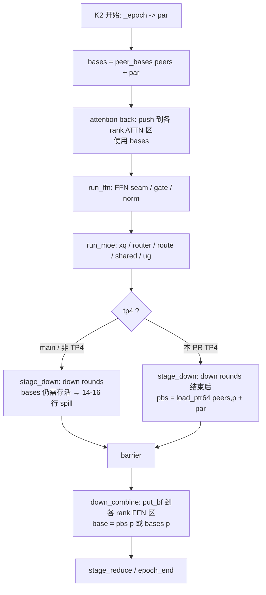
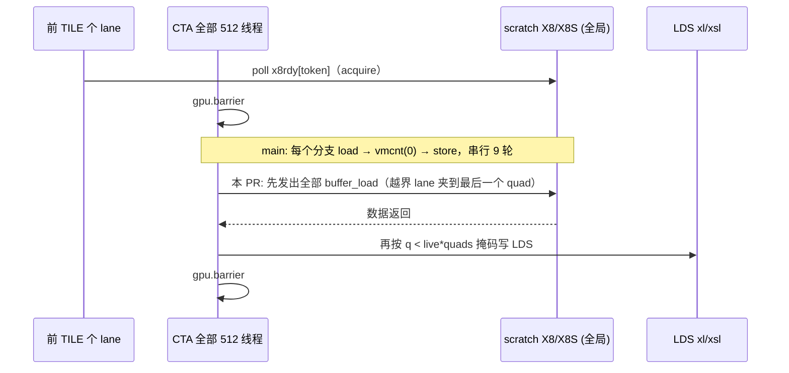

# PR #63892: [ROCm][Perf][DSv4.1] Mono: batch TP4 K2's X8 copies, load its push's peer bases late

> **Author**: @okorzh-amd | **State**: OPEN | **Date**: 2026-10-27
> **Branch**: `okorzh/dsv41-mono-tp4-k2-x8-peer-bases` → `main` | **Labels**: rocm, deepseek, DSv4.1
> **Changes**: +122 -10 lines across 3 files | **ROCm 相关性**: 完全相关（gfx950 专属的 DeepSeek-V4.1 mono decode kernel，FlyDSL 编写）
> 本报告分两部分：§1–6 为 PR 详细总结，§7–8 为 ROCm review 意见。
> Review 基于 vLLM main `335dd77b09`（2026-10-30）的周边代码；PR base 为 `ed1a7307`，本次涉及的 hunk 上下文与本地 main 一致。

---

## 1. 总结 (Summary)

本 PR 针对 DeepSeek-V4.1 mono decode 的第二个 kernel（K2，attention 后半 + FFN seam + MoE + MoE all-reduce 推送），在 **TP4 + gfx950（MI355X）** 下做两处降低寄存器压力的改动：(1) 单 token tile（≤16 行）时把 MXFP8 X8 行拷贝从“每个分支 load→wait→LDS store 串行”改为“所有 load 先发出，再统一 store”（新 `load_x8_rows_all`）；(2) MoE 推送用的 4 个 peer buffer 基址不再从 kernel 开头一直持有到推送，而是在 `stage_down` 的 barrier 前重新从 `peers` 表加载。作者称改动按构造 bit-exact，在 14–16 行消除 VGPR spill/scratch，c2 step time -3.9%（叠加镜像、单次运行）。门控为编译期常量 `tp == 4 and not GFX942`，TP2、所有 K1、FFN launch、gfx942 的二进制与 main 相同。

## 2. 背景与动机 (Background & Motivation)

- mono（`--monokernel`）是 DSv4.1 在 MI355X 上低并发 decode 的专用路径：一层 decode 拆为 K1/K2 两个 FlyDSL 大 kernel，TP 间的 all-reduce 通过 IPC 映射的对称 peer buffer 在 kernel 内直接推送（system-scope 存储 + tagged mailbox）。
- #60397 引入了 `peer_bases`：kernel 开头一次性加载全部 rank 的 peer 基址（注释：“a put's address must not wait on a load of its own”）。在 TP4 K2 中这些基址需从 attention 推送一直存活到 MoE 的 down 推送，跨越整段 MoE，在 14–16 行时 VGPR 达 255–256 并 spill 到 scratch。
- 作者的根因分析：gfx950 上 spill reload 之后的 `s_waitcnt vmcnt(0)` 同时会等待之前的 system-scope store，于是每个 peer 的推送都要等前一个推送完成，推送被串行化；X8 拷贝每个分支各自 `vmcnt(0)`，形成 23–25 条串行拷贝链。
- 低并发（c1/c2，DSpark k=6 → 7/14 行）正是 mono 服务的场景，因此 14–16 行的 spill 直接落在 c2 的关键路径上。
- 关联：#63027（draft，TP2 专属，含同名 `load_x8_rows_all`）、#63486（移动测试文件）、#61934（已关闭，“No e2e gain observed”，提升 K2 seam load）。

## 3. 代码修改分析 (Code Change Analysis)

### 3.1 修改的模块

| 文件 | 改动 |
|------|------|
| `vllm/models/deepseek_v41/amd/mono/layer.py` (+37 -5) | `run_ffn` 新增 `peer_load` / `x8_all` 两个编译期参数并写入 MoE context；`build_mono_k2` 中按 `tp == 4 and not GFX942` 打开，`peer_load = lambda p: load_ptr64(peers, p) + par` |
| `vllm/models/deepseek_v41/amd/mono/stages/moe.py` (+44 -4) | `load_x8_rows` 在 `x8_all` 且 `live` 为 Python int 时转入新 `load_x8_rows_all`；`stage_down` 在 barrier 前调用 `peer_load` 得到 `pbs`；`down_combine` 新增 `pbs=None` 参数并优先使用 |
| `tests/models/test_dsv41_mono_numerics.py` (+41 -1) | 数值对比新增 `(ratio=2, R=2, T=7)` 即 14 行用例；新增仅编译的 ISA 测试 `test_mono_decode_k2_tp4_no_scratch[14|16]`（断言反汇编中无 `scratch_`） |

### 3.2 架构 / 流程图

K2 中 peer 基址的生命周期（main vs 本 PR，TP4/gfx950）：



X8 行拷贝（单 token tile，`live` 为 Python int）：



### 3.3 关键实现细节

- **门控**：`tp4 = tp == 4 and not GFX942`（`layer.py:884`），纯 Python bool，构建时常量；`GFX942` 来自 `common/arch.py` 的模块级 `target_arch()`。FFN launch（`layer.py` 第二个 `run_ffn` 调用点）不传参数，保持 main 行为。
- **`peer_load`**：`load_ptr64(peers, p) + par`，与 kernel 开头 `bases[p] = load_ptr64(peers, p) + par` 计算同一值；`peers` 指向 `PeerBuffer.addresses`（`common/peer_memory.py`），在 runner 初始化时一次性创建、之后只读，因此晚加载不会读到不同值。
- **`pbs` 放置位置**：`stage_down` 的 round 循环之后、`gpu.barrier()` 之前，对 `d.tp` 个 rank 发出加载，`down_combine` 推送时使用；gfx942 在 `stage_down` 开头已转去 `stage_down_942`，不会走到新代码。
- **`load_x8_rows_all`**：循环次数从 `ceil(TILE*quads/THREADS)` 变为 `ceil(live*quads/THREADS)`；每个 lane 的 `q` 夹到 `live*quads-1`（保证 `token_of(row)` 在 `[0, live)` 内），store 用未夹的 `q < live*quads` 掩码。对被 store 的 lane，夹与不夹的 `q` 相同，故 LDS 中的行列位置、数值与 main 完全一致。
- **触发点**：`run_moe` 中 `load_x8_rows(..., lambda j: j, s)` 两处（shared 单 tile、ug 单 tile），`live = s` 为 int；多 tile 的 `n` 与 `gather_x8r` 的 `fx.min(count, TILE)` 为 traced 值，仍走旧路径。
- **测试**：ISA 测试走 `COMPILE_ONLY=1` + `flyc.compile`，通过 FlyDSL 私有属性 `k2._last_compiled[1]._ir_text` 取 IR，再用 MiniMax-M3 的 `code_object` 解出 ELF，`llvm-objdump` 反汇编。

## 4. 涉及的技术原理 (Technical Principles)

- **VGPR 压力与 spill**：gfx950 每个 wave 最多 512 个 VGPR，但在 512 线程/CTA 的 occupancy 下 mono 编译目标约 256。超过后编译器把值 spill 到 scratch（`scratch_store/scratch_load`），reload 是一次 VMEM 访问，需要 `s_waitcnt vmcnt`。
- **vmcnt 是按序计数**：gfx9 系列（含 gfx950）VMEM load 与 store 共用 `vmcnt`，`s_waitcnt vmcnt(0)` 会等待之前发出的全部 VMEM 操作，包括 system-scope（`sc0 sc1`）的远端 store。推送之间插入 reload 等待，实际上把 4 个 peer 推送串行化了。这是作者给出的性能机制，与硬件语义一致。
- **内存级并行（MLP）**：把多个独立的 16B `buffer_load` 先全部发出、只等一次，延迟从 N 次往返变为约一次，代价是 load 结果同时占用寄存器（9 个 vec4 ≈ 36 VGPR）。
- **IPC 对称 peer memory**：每个 rank 一块 uncached buffer，通过 IPC handle 互相映射；`peers` 表（int64/rank）在设备内存中，kernel 读表得到远端基址，再用 tagged mailbox（数据+tag 同一 64 位存储）做跨 GPU 交接。`par` 选择 epoch 奇偶两半之一，避免相邻 launch 覆盖未读数据。
- **CUDA/HIP graph**：mono kernel 在 graph 中按固定参数重放。本 PR 只改变 kernel 内指令序列，不改变 host 端参数、分配或 launch 数，`peers` 表指针与内容在重放间保持不变，因此不引入新的捕获约束。

## 5. 评论区讨论亮点 (Discussion Highlights)

- 目前无人工 review。唯一的 review 来自 `claude[bot]`：因 PR 来自 fork，自动 review 被禁用，需要 maintainer 评论 `@claude review` 触发。
- 无 issue 评论与 inline 评论。PR 描述本身很完整：给出了根因、门控理由、编译级证据表、与 #63027/#63486 的合并顺序方案，并主动列出未完成项（GPU hash、4x MI355X pytest、main 上的 ABBA、GSM8K）。

## 6. 风险与潜在问题 (Risk Analysis)

| 风险 | 严重程度 | 说明 |
|------|---------|------|
| 正确性：bit-exact 只有代码层推理，GPU 验证仍在待办 | Medium | 见 §7 ⚠️【测试】GPU 验证未完成 |
| 性能：收益数字来自叠加镜像的单次运行，c1 在噪声内 | Medium | 见 §7 ⚠️【性能】数字溯源 |
| 性能：门控覆盖全部宽度，c1（7 行）的 SGPR lane spill 增加 | Medium | 见 §7 ⚠️【性能】门控宽度 |
| 同步/顺序：晚加载 peer 基址 | Low | `peers` 表只读、值相同，无新的跨 CTA/跨 GPU 顺序依赖（已核对） |
| CUDA/HIP graph 捕获 | Low | 仅编译期分支，无 host 侧改动 |
| 兼容性：TP2 / gfx942 / FFN launch | Low | 编译期门控排除，作者称 51 个配置哈希一致 |
| 可维护性：与 #63027 的重复 helper、DSv4 孪生代码未同步 | Low | 见 §7 📝 |

---

## 7. Review 意见 (Findings)

| 类型 | 🔴 | ⚠️ | 📝 |
|------|----|----|----|
| 测试 | — | 1 | 1 |
| 性能 | — | 2 | — |
| 可维护性 | — | — | 2 |

> 已核对且**未发现问题**的部分（不单列 finding）：
> - `load_x8_rows_all` 的索引覆盖与 main 等价：被 store 的 lane 夹前夹后 `q` 相同，越界 lane 的 load 被夹到 `live*quads-1`，`token_of(row)` 在 `[0, live)` 内，无越界读；store 掩码正确。
> - X8 的就绪等待（前 TILE 个 lane poll `x8rdy` → barrier）在新路径中保持在全部 load 之前，acquire 顺序不变。
> - `peer_load` 读的 `peers` 表是 `PeerBuffer.addresses`，初始化后只读，与 kernel 开头加载的值相同；`par` 是 kernel 开头算出的同一 SSA 值，因此晚加载不存在 epoch 半区错位或读到旧值的风险。
> - `moe_context` 只由 `run_ffn` 构造，两个调用点都会设置 `cb["x8_all"]`，不会出现 trace 期 KeyError；FFN launch 与 gfx942 不进入新代码。
> - graph 重放：无新增 host 侧分配、`.item()` 或 launch 参数变化。

---

**⚠️【测试】bit-exact 只靠构造论证，GPU 侧验证（哈希、4x MI355X pytest、graph 重放压力）全部待完成** `[已验证]`

- **问题**: PR 描述的 Validation 中，`pytest tests/models/test_dsv41_mono_{numerics,layers,decode}.py`（含新增 14 行用例和 300 次 graph 重放压力）以及 TP4 下 1–48 行、各 ratio、index source、draft 的逐 rank K1/K2 输出哈希对比，均为未勾选。已完成的只有仅编译的 ISA 测试（在 stack 镜像中直接调用测试函数，未经 pytest）和 CPU 测试。
- **影响**: 我逐行核对后认为两处改动在语义上与 main 等价，但 FlyDSL AST 改写对新 `if q < live * quads`（traced 条件位于 `range_constexpr` 展开内）、夹值的无符号除法以及 `pbs` 跨 barrier 存活的 lowering，只有在 GPU 上跑才能确认。mono kernel 的出错方式是静默数值偏差或跨 GPU 推送 hang，CUDA CI 完全覆盖不到。
- **行动**: 作者应当在合入前补齐 4x MI355X 上的三组 pytest 与 TP4 哈希对比（至少 7/14/16 行 × ratio 0/1/2 × target/draft），并把结果贴进 PR 描述。

**⚠️【性能】性能数字来自叠加镜像的单次、未交换运行，无法追溯到 main** `[已验证]`（数字本身 `[unverified]`）

- **问题**: 表中 c1 -59 us / c2 -256 us 来自“nightly 83c078d955 + #63182、#63027、#63367、#63181、#63355，外加本改动的 A/B 开关等价实现”的镜像，每组只跑一次，且 baseline 是“更早一轮”的同半区运行。作者自己给出 A/A 噪声 0.7%（c1），未打补丁的运行漂移 5.225–5.284 ms（c1，即约 1.1%）、6.412–6.517 ms（c2，约 1.6%）。c1 的 -1.1% 落在漂移范围内；对“最快未打补丁运行”的 c2 差值为 -151 us（-2.4%）。PR 中没有附原始 bench 输出或日志。
- **影响**: 唯一明确超出噪声的是 c2，而且依据是一次运行。关联的 #61934 曾因“No e2e gain observed”被关闭，说明这一类寄存器压力改动的 e2e 收益并不稳定。
- **行动**: 作者应当在 main（单独应用本 PR）上做 PR 描述中已承诺的 c1/c2 ABBA（每组 ≥3 次，交替顺序），附 `vllm bench serve` 的原始输出；在此之前，建议 review 时把 -3.9% 视为未验证。

**⚠️【性能】门控覆盖 TP4 的所有宽度，但 spill 只发生在 14–16 行；c1（7 行）的 SGPR lane spill 反而增加** `[已验证]`（性能影响 `[推测]`）

- **问题**: `tp4 = tp == 4 and not GFX942`（`layer.py:884`）对 1–48 行一律打开 `peer_load` 和 `x8_all`。作者在 Tradeoffs 中写明：7 行（即 c1 宽度）时 `v_writelane` 从 103 增至 174，其中 32 条在循环内（main 为 0）。原因是新的 `pbs`（4 个 i64 → 8 个 SGPR）和闭包捕获的 `par` 需要在 SGPR 中跨 barrier 和 down_combine 循环存活。1–13 行在 main 上本来并不 spill。
- **影响**: 循环内的 writelane/readlane 是每次迭代都要付的成本；在 c1 上，X8 批量化带来的收益可能被它部分抵消。实测 c1 -1.1% 落在漂移内，无法排除 c1 持平或略有回退。
- **行动**: 建议作者在 main 的 ABBA 中单独报告 c1；若 c1 无收益，考虑把 `peer_load` 限定到 `key.tokens >= 14`（spill 实际发生的宽度），X8 批量化保持对全部单 tile 宽度打开，并在注释中说明两者门控不同的原因。

**📝【测试】新 ISA 测试只守护 peer 基址一半，且依赖 FlyDSL 私有属性和另一模型的 helper** `[已验证]`

- **问题**: `test_mono_decode_k2_tp4_no_scratch`（`tests/models/test_dsv41_mono_numerics.py:799-831`）只断言 `"scratch_" not in isa`，X8 批量化（串行拷贝链 23–25 → 3–4）没有回归守护；`k2._last_compiled[1]._ir_text` 与 `k2.func` 是 FlyDSL 0.4.0 `JitFunction` 的私有字段（`flydsl/compiler/jit_function.py:1256,1717`）；`code_object` 从 `vllm.models.minimax_m3...residency` 跨模型导入；`skipif(not _on_cdna4())` 要求真实 gfx950 设备，而测试本身只编译，CI 上只能在 MI355 队列运行。
- **行动**: 建议作者 (a) 补一条对 `s_waitcnt vmcnt(0)` 或 X8 load 数量的断言，以覆盖 X8 一半；(b) 把 `code_object` 和 FlyDSL 私有访问收敛到共享的测试 helper（M3 的 `test_ops.py` 里已有 `_disassemble`），以便 FlyDSL 升级时只需改一处。

**📝【可维护性】peer 基址公式出现两份，`x8_all` 成为 MoE context 的必需键，与 #63027 的同名 helper 冲突** `[已验证]`

- **问题**: ① `layer.py:895` 的 `load_ptr64(peers, p) + par` 重复了 `layer.py` 中 `bases = [b + par for b in peer_bases(peers, tp)]` 的公式，以后若基址计算改变（如 `par` 语义），晚加载路径会悄悄不同步。② `load_x8_rows` 无条件读取 `c["x8_all"]`，而 `moe_context` 没有给默认值，今后任何新的 `moe_context` 调用方漏设都会在 trace 期 KeyError。③ #63027 有自己的 `load_x8_rows_all`；`common/ops.py` 中也已有 `batched_rounds`（同样是“先发 load、夹到最后一个元素、再掩码 use”的模式）。④ DSv4 的孪生实现 `vllm/models/deepseek_v4/amd/mono/layer.py:698` 同样在 kernel 开头持有 `peer_bases`，作者也说明 DSv4-Pro 的 mono 拷贝（#61482）尚未检查。
- **行动**: 建议作者把“rank p 在 epoch 半区 par 下的基址”提成一个 helper，两处共用；在 `moe_context` 中给 `"x8_all": False` 默认值；与 #63027 协商只保留一个 `load_x8_rows_all`（PR 描述已有计划），并在 PR 中注明 DSv4 孪生实现是否需要同样的改动。

## 8. 结论 (Verdict)

**⚠️ NEEDS WORK**

代码改动小、门控严格（构建期常量，TP2/gfx942/FFN launch 不受影响），我核对了索引覆盖、X8 就绪等待顺序、`peers` 表只读性以及 graph 重放交互，没有发现正确性或同步问题，也没有足以 BLOCK 的具体触发输入。但作者自己列出的 GPU 验证（bit-exact 哈希、4x MI355X pytest、graph 重放压力）尚未完成，性能收益只有叠加镜像上的单次运行，c1 可能被新增的 SGPR lane spill 抵消。建议补齐 GPU 验证和 main 上的 ABBA 后再合入。CI 状态未知：抓取的 `checks` 数据为空（只有字段名），PR 未带 `ready` 标签，AMD CI 很可能尚未运行。

## 9. 英文 Review 评论 (Copy-Paste English Comments)

**C1** `tests/models/test_dsv41_mono_numerics.py:407` — ⚠️ comment

```text
I walked through both changes and they look value-equivalent to main: the clamped loads stay in [0, live), the store mask matches the old guard, and `peers` is the read-only `PeerBuffer.addresses` table, so the late reload returns the same base. Still, the only executed evidence so far is the compile-only ISA test run outside pytest. The GPU items in the checklist (numerics/layers/decode on 4x MI355X including this new 14-row case and the 300-replay graph stress, plus per-rank K1/K2 hashes at TP4) are what would catch a FlyDSL lowering problem in the new traced `if` or in `pbs` living across the barrier. Could you run those and paste the results before this is marked ready?
```

**C2** `vllm/models/deepseek_v41/amd/mono/layer.py:881-884` — ⚠️ comment

```text
The gate turns on both `peer_load` and `x8_all` for every TP4 width, but the spill this targets only happens at 14-16 rows. Per your own tradeoff note, at 7 rows (the c1 width) `v_writelane` goes 103 -> 174 with 32 inside loops (main has 0), and the measured c1 delta (-1.1%) is within the 5.225-5.284 ms drift you report. Could you report c1 separately in the ABBA on main? If c1 shows no gain, consider gating `peer_load` on `key.tokens >= 14` while keeping the X8 batching for all single-tile widths, and add a comment explaining why the two gates differ.
```

**C3** `vllm/models/deepseek_v41/amd/mono/layer.py:895` — ⚠️ comment

```text
The step-time numbers come from a stack image with five other PRs. Each arm ran once, the arms were not swapped, and the baseline is from an earlier round, so I can only treat the -256 us (c2) as unverified for now. Since #61934 was closed for showing no e2e gain, could you attach the raw `vllm bench serve` output from the ABBA on main with this PR alone (at least 3 alternating runs per arm)? Separately, this lambda duplicates the `bases` formula from the kernel prologue (`load_ptr64(peers, p) + par`). A small shared helper would keep the late path from silently diverging if the base computation ever changes.
```

**C4** `vllm/models/deepseek_v41/amd/mono/stages/moe.py:1068` — ⚠️ comment

```text
`c["x8_all"]` is now a required key of the MoE context, but `moe_context()` does not set a default, so any future caller that builds a context without going through `run_ffn` will fail at trace time with a KeyError. Consider adding `"x8_all": False` to `moe_context()` (next to `x_cm` / `x_ready`). Also, `common/ops.py` already has `batched_rounds` with the same clamp-load-then-masked-use pattern, and #63027 adds its own `load_x8_rows_all`. It would be good to settle on one helper before both land.
```
