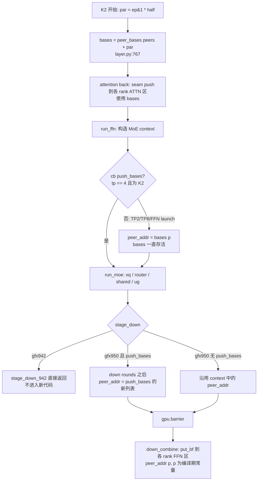
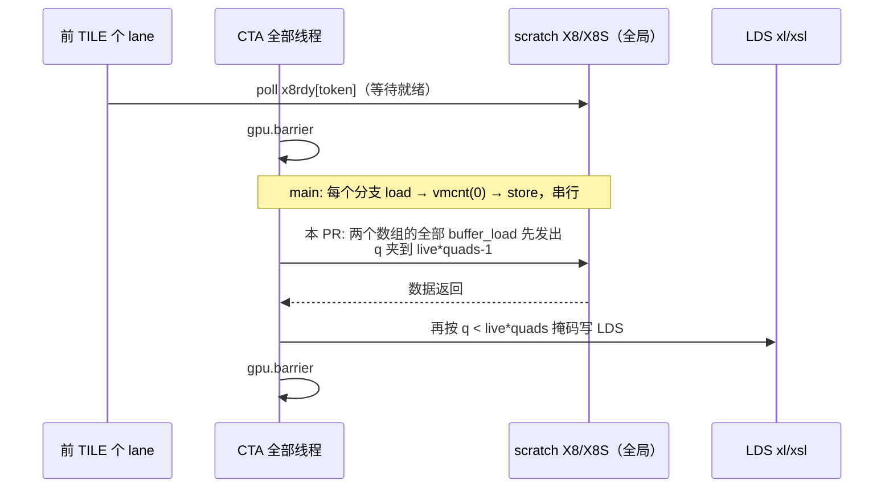

# PR #63892: [ROCm][Perf][DSv4.1] Mono: batch TP4 K2's X8 copies, load its push's peer bases late

> **Author**: @okorzh-amd | **State**: OPEN | **Date**: 2026-10-27（最后更新 2026-11-01）
> **Branch**: fork → `main` | **Labels**: rocm, ready, deepseek, DSv4.1
> **Changes**: +36 -1 lines across 3 files | **ROCm 相关性**: 完全相关（gfx950 专属的 DeepSeek-V4.1 mono decode kernel，FlyDSL 编写）
> 本报告分两部分：§1–6 为 PR 详细总结，§7–8 为 ROCm review 意见。
> 这是对新 head `38b9675d` 的重新 review（上一轮 review 的 head 为 `92852abd`，+122/-10）。PR base `3a90cc6fd0` 已在 upstream main 中，且 base 与当前 main `e8ec12c5ed`（2026-11-02）之间 `deepseek_v41/amd/mono` 与该测试文件均无改动；代码核对基于 base 版本文件。

---

## 1. 总结 (Summary)

本 PR 针对 DeepSeek-V4.1 mono decode 的第二个 kernel（K2：attention 后半 + FFN seam + MoE + MoE all-reduce 推送），在 **TP4 + gfx950（MI355X）** 下做两处降低寄存器压力的改动，target 与 DSpark draft 的 K2 都生效：(1) 单 token tile（≤16 行）时，X8（MXFP8）行拷贝从"每个分支 load → `vmcnt(0)` → LDS store 串行"改为"先发出全部 load，再统一掩码 store"；(2) MoE 推送用的 4 个 peer buffer 基址不再从 kernel 开头一直持有到推送，而是在 `stage_down` 的 barrier 前重新从 `peers` 表加载。两处都由一个 MoE context 键 `push_bases` 门控，只在 TP4 K2 中设置。作者给出了 bit-exact（257 个配置、1028/1028 个 (config, rank) 哈希一致）、4 轮 ABBA（c1 -0.9%、c2 -3.5%、c4 -0.8%）和 GSM8K/AL 结果。

## 2. 背景与动机 (Background & Motivation)

- mono（`--monokernel`）是 DSv4.1 在 MI355X 上低并发 decode 的专用路径：每层 decode 拆为 K1/K2 两个 FlyDSL 大 kernel，TP 间 all-reduce 通过 IPC 映射的对称 peer buffer 在 kernel 内直接推送（system-scope store + tagged mailbox）。
- #60397 引入了 `peer_bases`（`common/ops.py:283`）：kernel 开头一次性加载全部 rank 的 peer 基址。TP4 K2 中这些基址从 attention 推送一直存活到 MoE down 推送，跨越整段 MoE；在 14–16 行（index source 时 13 行）VGPR 达 255–256 并 spill 到 scratch。
- 作者给出的根因：在 gfx950 上，spill reload 之后的 `s_waitcnt vmcnt(0)` 也会等待之前的 system-scope store，于是每个 peer 的推送都要等前一个推送完成；X8 拷贝每个分支各自等 `vmcnt(0)`，形成 23–25 条串行拷贝链。
- 低并发（c1/c2，DSpark k=6 → 7/14 行）是 mono 服务的场景，14 行的 spill 正好落在 c2 的关键路径上。
- 本轮变化：作者按 reviewer（frida-andersson、okorzh-amd 转述、shen-shanshan）的要求 rebase 到 main `e5196e2959`，把 PR 从 +122/-10 缩到 +36/-1（去掉独立的 `load_x8_rows_all`、`peer_load`/`x8_all` 两个参数，合并为单一 `push_bases`），并补齐 GPU 验证。
- 关联：#63027（TP2 tuned K1/K2，含同类批量拷贝 `load_x8_rows_all`）、#64153（TP8 同样两处改动，draft，叠在本 PR 旧 head 上需 rebase）、#63486（移动测试文件）、#61934（已关闭，"No e2e gain observed"）。

## 3. 代码修改分析 (Code Change Analysis)

### 3.1 修改的模块

| 文件 | 改动 |
|------|------|
| `vllm/models/deepseek_v41/amd/mono/layer.py` (+2) | `run_ffn` 中 `cb["push_bases"] = a.get("push_bases") if tp == 4 else None`（634）；`build_mono_k2` 给 `run_ffn` 的参数字典加 `push_bases=lambda: [b + par for b in peer_bases(peers, tp)]`（863） |
| `vllm/models/deepseek_v41/amd/mono/stages/moe.py` (+14 -1) | `load_x8_rows` 新增批量路径（1072–1080、1095–1097），旧路径在批量开启时循环 0 次；`stage_down` 在 barrier 前把 `peer_addr` 重绑为晚加载的基址（1624）；`moe_context` 给 `push_bases` 默认 `None`（2030–2031） |
| `tests/models/test_dsv41_mono_numerics.py` (+20) | 新增仅编译的 ISA 测试 `test_mono_decode_k2_tp4_no_scratch`（576–590）：TP4 K2、14 行，断言反汇编中无 `scratch_` |

### 3.2 架构 / 流程图

K2 中 peer 基址的生命周期（main vs 本 PR，TP4/gfx950）：



X8 行拷贝（单 token tile，`live` 为 Python int）：



### 3.3 关键实现细节

- **门控**：`push_bases` 只由 `build_mono_k2` 传入（`layer.py:863`），`run_ffn` 只在 `tp == 4` 时放进 context（634）。FFN launch（`build_mono_ffn` 的 `run_ffn` 调用）不传该键，`a.get` 返回 `None`。TP2/TP8/K1 二进制不变（作者称 236 个配置哈希一致）。
- **批量 X8 路径的开启条件**：`c["push_bases"] and not GFX942 and isinstance(live, int)`（1072）。`live` 为 int 只出现在单 tile 分支（`run_moe` 中 `const_expr(not multi)` 下的 `s`，以及 ug 单 tile 循环里的 `s`）；`multi = len(token_tiles(s)) > 1`，`token_tiles` 每段 `min(TILE, s - t0)`，所以此时 `s ≤ TILE`。多 tile 的 `n = fx.min(...)` 与 `gather_x8r` 的 `fx.min(count, TILE)` 是 traced 值，仍走旧路径。
- **批量路径的索引**：循环次数 `ceil(live*quads/THREADS)`；`q` 夹到 `live*quads-1`，所以 `row < live`，load 不越界；store 用未夹的 `tid + THREADS*i < live*quads` 掩码。对实际 store 的 lane，夹前夹后的 `q` 相同，写入 LDS 的位置与 main 的 `(q < TILE*quads) & (row < live)` 完全一致（`row < live` ⟺ `q < live*quads`）。
- **新 load 的向量宽度**：新路径的 `bo.buffer_load(r, off, dtype=T.i32, cache_modifier=CM_DEV)` 没写 `vec_width`，依赖 aiter `buffer_ops.buffer_load` 的默认 `vec_width=4`（本容器 amd-aiter 0.1.27 中核对）；旧路径显式写了 `vec_width=4`。
- **晚加载的基址**：`push_bases()` 计算 `[b + par for b in peer_bases(peers, tp)]`，与 kernel 开头 `bases`（`layer.py:767`）是同一公式、同一 `peers` 表、同一 `par`；`stage_down` 用 `dict(c, peer_addr=...__getitem__)` 只在本函数内重绑，`down_combine` 里 `p` 来自 `range_constexpr(d.tp)`，`list.__getitem__` 可用。
- **测试**：ISA 测试 `COMPILE_ONLY=1` + `flyc.compile`，通过 FlyDSL 私有属性 `k2._last_compiled[1]._ir_text` 取 IR，用 MiniMax-M3 的 `code_object` 解出 ELF，再用 PATH 上的 `llvm-objdump` 反汇编。

## 4. 涉及的技术原理 (Technical Principles)

- **VGPR 压力与 spill**：mono kernel 以每 CTA 多线程的 occupancy 编译，VGPR 预算约 256。超出后编译器把值 spill 到 scratch，reload 是一次 VMEM 访问，需要 `s_waitcnt vmcnt`。把一个长生命周期的值（这里是 4 个 64 位基址）改成"用前再加载"，是用一次额外的全局 load 换取跨大段代码的寄存器占用。
- **vmcnt 按序计数**：gfx9 系列（含 gfx950）VMEM load 与 store 共用 `vmcnt`，`s_waitcnt vmcnt(0)` 会等待之前发出的全部 VMEM 操作，包括 system-scope 的远端 store。在相邻两次 peer 推送之间插入 reload 等待，相当于把 4 个推送串行化。这是作者给出的性能机制，与硬件语义一致。
- **内存级并行**：把多个独立的 16B `buffer_load` 先全部发出、只等一次，延迟从 N 次往返变为约一次，代价是 load 结果同时占用寄存器。这也是作者报告 7 行时 `v_writelane` 增加（103 → 174）的原因之一。
- **IPC 对称 peer memory**：每个 rank 一块 uncached buffer，通过 IPC handle 互相映射；`peers` 表（每 rank 一个 i64）在设备内存中，初始化后只读。`par` 选择 epoch 奇偶两半之一，避免相邻 launch 覆盖尚未读取的数据。
- **HIP graph**：mono kernel 在 graph 中以固定参数重放。本 PR 只改变 kernel 内的指令序列，不改 host 端参数、分配或 launch 数，不引入新的捕获约束；作者的 suite 包含 300 次 graph 重放。

## 5. 评论区讨论亮点 (Discussion Highlights)

上一轮（head `92852abd`）的 review 意见及本轮处理情况：

| 上轮意见 | 提出者 | 本轮状态 |
|---|---|---|
| GPU 验证（4x MI355X suite、TP4 逐 rank 哈希）未完成 | frida-andersson | **已解决**：suite 通过；257 个配置 × 3 次 × 4 rank，1028/1028 对哈希与 main 一致；一行变异体（最后一行最后一个 quad 填错）能被 6 行用例和哈希检查抓到 |
| 性能数字来自叠加 5 个 PR 的镜像、单次运行 | frida-andersson | **已解决**：在 main 上做 4 轮 ABBA（GPU 半区交换），c1/c2 每个 PR server 都快于每个 main server；附复现命令 |
| `x8_all` 是必需键、`moe_context` 无默认值 | shen-shanshan | **已解决**：合并为 `push_bases`，`moe_context` 默认 `None`（2031） |
| 门控覆盖所有宽度，建议把晚加载限定到 ≥14 行 | shen-shanshan | **作者用数据反驳，理由成立**：c1 实测 -51 us；c4（28 行，只有晚加载生效）也 -67 us；晚加载把 MoE 推送中两次 peer store 之间的 10–14 条 `v_readlane` 去掉（27 → 13 条指令）；而且只做批量拷贝的 13 行 index source 比 main 更差（4 个 VGPR spill），所以两半必须一起开 |

- 作者主动说明了局限：没有 pytest 在 9–16 行运行 K2（被精简掉了，靠哈希检查覆盖）；ISA 测试只守护晚加载这一半；DSv4-Pro 的孪生实现（#61482）未修改也未检查；c4 的收益未做 profile。
- `shen-shanshan` 在 11-01 评论 `/ci run`，触发 Buildkite #98976（commit `38b9675d`）；结果在抓取数据中不可见。线程中没有 `/amd-ci run`。
- `claude[bot]`：PR 来自 fork，自动 review 被禁用。

## 6. 风险与潜在问题 (Risk Analysis)

| 风险 | 严重程度 | 说明 |
|------|---------|------|
| 正确性：两处改动的数值等价性 | Low | 代码核对等价（见 §7 开头），作者 GPU 哈希 1028/1028 一致 |
| 测试：当前 head 未跑 AMD CI | Medium | 见 §7 ⚠️【测试】 |
| 测试：ISA 测试在无 `llvm-objdump` 时静默跳过 | Low | 见 §7 📝【测试】 |
| 性能：7 行时 SGPR lane spill 增加 | Low | 作者已量化且 c1 ABBA 仍为正收益 |
| 同步/顺序：晚加载 peer 基址 | Low | `peers` 只读、值相同；load 在 barrier 前发出，推送前已落地 |
| HIP graph 捕获 | Low | 无 host 侧改动 |
| 兼容性：TP2 / TP8 / gfx942 / FFN launch | Low | 门控排除，作者称二进制一致 |
| 可维护性：与 #63027、#64153、DSv4-Pro 孪生代码的协调 | Low | 见 §7 📝【可维护性】 |

---

## 7. Review 意见 (Findings)

| 类型 | 🔴 | ⚠️ | 📝 |
|------|----|----|----|
| 测试 | — | 1 | 2 |
| 可维护性 | — | — | 2 |

> 已核对且**未发现问题**的部分（不单列 finding）：
> - 批量 X8 路径与 main 等价：单 tile 时 `live ≤ TILE`（由 `token_tiles` 保证）；load 的 `q` 夹到 `live*quads-1`，不越界；store 掩码 `q < live*quads` 与 main 的 `(q < TILE*quads) & (row < live)` 等价；X8 的就绪 poll 和 barrier 仍在全部 load 之前。
> - 晚加载的 `peer_addr` 与 main 的 `lambda p: bases[p]`（`moe.py:2009`）取值相同：同一 `peer_bases(peers, tp)`、同一 `par`；`p` 是编译期常量，`list.__getitem__` 可用；gfx942 在 `stage_down` 开头已转去 `stage_down_942`。
> - 重绑的 `c` 只在 `stage_down` 内生效，不影响 seam push 或其他阶段。
> - FFN launch 和 K1 拿不到 `push_bases`；`moe_context` 有默认值，不会出现 trace 期 KeyError。
> - HIP graph 重放：无新增 host 侧分配、`.item()` 或 launch 参数变化。

---

**⚠️【测试】当前 head 还没有跑 AMD CI；能覆盖本改动的 MI355 mono 数值 job 是可选的，需要 `/amd-ci run`** `[已验证]`

- **问题**: `.buildkite/test-amd.yaml` 中 ":amd: (MI355) DeepSeek-V4.1 Mono Decode Numerics"（`mi355_4`，`optional: true`）是唯一会运行 `tests/models/test_dsv41_mono_numerics.py`（含新增 ISA 测试和 `test_mono_decode_layer_matches_vllm[4]`）的 job。线程中只有 `/ci run`（Buildkite #98976，结果未知），没有 `/amd-ci run`。作者的 GPU 验证用的是"nightly 镜像 + 覆盖 mono 路径文件"的镜像，PR 部分是 `0a44cb7166`，不是当前 head `38b9675d`（作者称 head 只多了 `moe_context` 的默认值，并在 10 个配置上比对过编译产物逐字节一致）。
- **影响**: 上游 CUDA CI 不会运行任何 mono kernel；在 AMD CI 跑过当前 head 之前，没有任何 CI 记录证明这个 head 在干净的 ROCm 镜像上能编译、能通过数值测试。
- **行动**: 建议作者或 reviewer 在当前 head 上评论 `/amd-ci run`，确认 MI355 mono numerics job 通过且新 ISA 测试是 PASSED 而非 SKIPPED，再合入。

**📝【测试】新 ISA 测试只守护晚加载这一半，依赖 FlyDSL 私有属性和另一模型的 helper，且没有 `llvm-objdump` 时静默跳过** `[已验证]`（CI 镜像中是否有 `llvm-objdump` `[推测]`）

- **问题**: `test_mono_decode_k2_tp4_no_scratch`（`tests/models/test_dsv41_mono_numerics.py:576-590`）只断言无 `scratch_`；作者在描述中承认，单独回退批量拷贝（250 VGPR、无 spill）时它不会失败。它读取 FlyDSL 0.4.0 的私有字段 `k2._last_compiled[1]._ir_text`，并从 `vllm.models.minimax_m3...residency` 跨模型导入 `code_object`。`skipif(not shutil.which("llvm-objdump"))`：在本地 nightly 容器里，`llvm-objdump` 位于 `.../_rocm_sdk_devel/lib/llvm/bin/`（不在 `/opt/rocm/llvm/bin`），它在 PATH 上取决于镜像的构造方式。
- **影响**: 如果 CI 镜像里 PATH 上没有 `llvm-objdump`，测试会被标为 SKIPPED，job 依然是绿的，回归守护形同虚设；FlyDSL 升级改了私有字段名时也会以 AttributeError 失败而非给出有意义的信息。
- **行动**: 建议作者确认 AMD CI 日志中该测试是 PASSED；可考虑在 CI 环境（`CI` 环境变量存在）下把缺少 `llvm-objdump` 变成失败而不是跳过，或回退查找 ROCm 的 llvm 目录；FlyDSL 私有访问与 M3 的 `code_object` 可以收敛到一个共享测试 helper。

**📝【测试】没有任何 pytest 在 9–16 行运行 TP4 K2；14 行的数值用例在精简中被删掉** `[已验证]`

- **问题**: 上一个 head 曾在数值测试中加入 14 行（ratio=2, R=2, T=7）用例，本 head 删除了它。现有 `test_mono_decode_layer_matches_vllm` 只覆盖 6 行和 48 行；作者说明 9–16 行由仓库外的哈希测试和 c2 的 e2e 运行覆盖。
- **影响**: 14–16 行正是本 PR 改变最大的宽度（spill 消失、批量拷贝、晚加载同时生效）。仓库内的回归测试只能抓到 6 行上的批量拷贝错误（作者的变异体实验证实了这一点），抓不到只在 14–16 行出现的问题（比如未来某次改动让这些宽度重新 spill 后与晚加载交互出错）。
- **行动**: 建议作者考虑把 14 行的数值用例加回来（作者精简的理由是测试时间），或在 PR 描述中说明为什么 6 行用例足以代表 14 行。

**📝【可维护性】一个 `push_bases` 键同时开启两项不相关的优化；新 load 隐式依赖 `vec_width` 默认值** `[已验证]`

- **问题**: ① `load_x8_rows` 用 `c["push_bases"]` 判断是否批量拷贝（`moe.py:1072`），虽然 `moe_context` 的注释写明"also batches the X8 copies"，但从名字看不出它控制 X8 路径；作者的理由（13 行时单开批量拷贝会更差）说明两者有耦合，但这一点只在 PR 评论里，没有写进代码。② 新路径的 `bo.buffer_load(...)`（`moe.py:1079`）省略了 `vec_width=4`，依赖 aiter 的默认值 4；同一函数中旧路径显式写了 `vec_width=4`。
- **影响**: 今后有人想单独关掉其中一项（例如 TP8 的 #64153 或 TP2 的 #63027 合并时），很容易只改一半；如果 aiter 改了 `buffer_load` 的默认宽度，新路径会静默地只拷贝 4 字节而不是 16 字节。
- **行动**: 建议作者在 1072 行附近补一句注释，说明为什么批量拷贝也由 `push_bases` 门控（13 行 index source 的数据）；新 load 显式写上 `vec_width=4`，与旧路径一致。

**📝【可维护性】与 #63027、#64153 及 DSv4-Pro 孪生实现的协调** `[已验证]`

- **问题**: #63027（TP2）在 tuned 构建里有自己的批量拷贝 `load_x8_rows_all`，并把 `stage_down` 的 barrier 移进新的 `down_sums`；#64153（TP8）叠在本 PR 旧 head `92852abd` 上，需要 rebase 到新接口；DSv4-Pro 的 `deepseek_v4/amd/mono` 有自己的 `load_x8_rows` 和 `peer_bases`，本 PR 未改也未检查。
- **影响**: 后合入的一方若没有把基址重绑放到 `down_sums` 的 barrier 之前，晚加载的 load 可能无法在推送前落地，收益消失或产生新的等待；两个孪生实现会越走越远。
- **行动**: 作者在描述中已写明合并顺序方案；建议 review 时追问 DSv4-Pro 孪生实现是否需要同样的改动，并在 #63027/#64153 中引用本 PR 的最终接口。

## 8. 结论 (Verdict)

**⚠️ NEEDS WORK**

和上一轮相比，PR 精简到 +36/-1，并解决了上一轮全部四条意见：GPU suite、逐 rank 哈希（1028/1028 一致）、main 上的 4 轮 ABBA、`moe_context` 默认值，以及对门控宽度的有数据支撑的回应。我逐行核对了批量拷贝的索引与掩码、晚加载基址的取值、门控范围和 graph 交互，没有发现正确性或同步问题。剩下的唯一 ⚠️ 是当前 head 还没跑 AMD CI（可选的 MI355 mono numerics job 需要 `/amd-ci run`），该 job 绿且新 ISA 测试为 PASSED 后，我认为可以合入；其余为 📝 建议。CI 状态：抓取的 `checks` 数据为空（只有字段名）；上游 Buildkite #98976 已触发但结果未知，AMD CI 未见触发。

## 9. 英文 Review 评论 (Copy-Paste English Comments)

**C1** `tests/models/test_dsv41_mono_numerics.py:576-590` — ⚠️ comment

```text
Thanks for the rebase and the thorough validation; the per-rank hashes and the ABBA on main address everything from the last round. One gap left: the only CI job that runs this file is the optional ":amd: (MI355) DeepSeek-V4.1 Mono Decode Numerics" job, and I only see `/ci run` in the thread, which doesn't launch any mono kernel. Your GPU runs also used an overlay image with 0a44cb7166 rather than this head. Could you trigger `/amd-ci run` on 38b9675d and confirm that this test shows PASSED rather than SKIPPED? It skips when `llvm-objdump` is not on PATH; in the nightly image I checked, it lives under `_rocm_sdk_devel/lib/llvm/bin`, so a silent skip is possible depending on how the CI image sets PATH.
```

**C2** `vllm/models/deepseek_v41/amd/mono/stages/moe.py:1072-1079` — ⚠️ comment

```text
Two small things here. First, `push_bases` now also decides whether the X8 copies are batched, which isn't obvious from the name; your reply in the thread (the copies-only 13-row index source is worse than main, so both halves have to go together) is the real reason, and it would help to put one line of that next to this gate so the TP2 (#63027) and TP8 (#64153) follow-ups don't split them by accident. Second, the new `bo.buffer_load` relies on the default `vec_width=4`, while the old path just below passes it explicitly. Could you pass `vec_width=4` here too, so a change to the aiter default can't silently turn this into a 4-byte copy?
```

**C3** `tests/models/test_dsv41_mono_numerics.py:586` — ⚠️ comment

```text
After the minimization, no pytest runs the TP4 K2 at 9-16 rows: the layer test covers 6 and 48 rows, and the 14-row case from the previous head is gone. 14-16 rows is where this PR changes the most (spill removed, batched copies and late bases all active), and the hash check that covered those widths is not in the repo. Would you consider adding the 14-row numerics case back, or noting in the description why the 6-row case is enough to represent it? This ISA test catches a revert of the late load only, as you mention, so it does not cover the copies at those widths.
```
