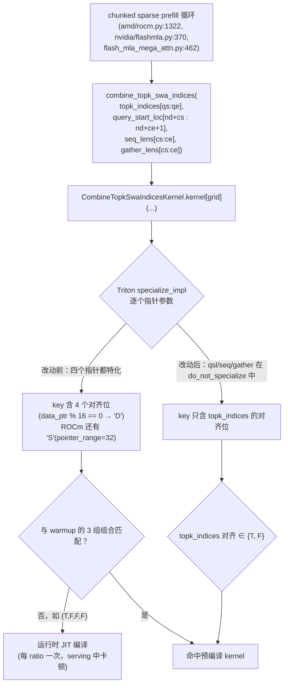
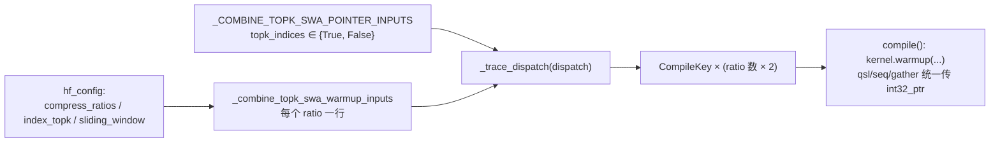

# PR #64001: [ROCm][DSv4.1] Avoid runtime JIT for offset combine_topk_swa_indices inputs

> **Author**: @BaoYunkai | **State**: OPEN | **Date**: 2026-10-27
> **Branch**: `feature/yunkai/dsv41-rocm-jit-warmup` → `main` | **Labels**: rocm, deepseek, verified, DSv4.1
> **Changes**: +114 -28 lines across 2 files | **ROCm 相关性**: 部分相关。改动的 `vllm/models/deepseek_v41/common/ops/cache_utils.py` 是 DSv4.1 的公共算子，ROCm（`ROCM_FLASHMLA_SPARSE_DSV41`）和 NVIDIA（`FLASHMLA_SPARSE_DSV41`、`FLASHMLA_MEGA_ATTN_DSV41`）的 chunked sparse prefill 都会调用它
> 本报告分两部分：§1–6 为 PR 详细总结，§7–8 为 ROCm review 意见。

---

## 1. 总结 (Summary)

DeepSeek-V4.1 的 chunked sparse prefill 调用 `CombineTopkSwaIndicesKernel` 时，`query_start_loc`、`seq_lens`、`gather_lens` 三个 int32 指针都是按 `num_decodes` / `chunk_start` 切出来的 view，起始地址可以落在任意 4 字节偏移上。Triton 默认按「指针是否 16 字节对齐」做特化，而 warmup 只预编译了 3 种对齐组合，很多运行时组合没有覆盖，结果每个服务进程在 serving 期间还要额外 JIT 编译 6 次（2 种对齐 × 3 种 compress ratio）。本 PR 把这三个指针加进 `do_not_specialize`，让编译 key 不再依赖它们的对齐；warmup 只需枚举 `topk_indices` 的对齐，每个 compress ratio 的变体从 3 个降到 2 个。同时新增一个回归测试：用 Triton 的 post-compile hook 断言 warmup 之后、用带偏移的 view 调用时不再触发编译。

## 2. 背景与动机 (Background & Motivation)

- vLLM 的 JIT warmup 框架（`vllm/model_executor/warmup/jit_warmup*.py`）在启动阶段按 `CompileKey` 预编译 Triton kernel，目标是 serving 过程中不出现 JIT 编译。`--jit-monitor-verbose` 会报告运行时仍然发生的编译。
- 作者在 MI355X、DeepSeek-V4.1-Flash、TP4 的 AgentX trace replay 中发现，main 上 `CombineTopkSwaIndicesKernel` 在 4 个 rank 上共被 JIT monitor 报告 12 次（每 rank 3 次，即每个 ratio 1 次）。
- 根因：原 warmup 的三组对齐为 `(topk, qsl, seq, gather) = (T,T,T,T) / (T,F,F,T) / (F,F,F,F)`，而运行时组合由 `num_decodes` 和 `chunk_start` 决定。例如 `num_decodes=0, chunk_start=1` 时是 `(T,F,F,F)`，不在这三组之内。
- 方案参照 #57667 对 `end_ptr` 的处理：kernel 对这三个张量每个 program 只读一两个标量，对齐信息对向量化没有帮助，所以直接不再特化。
- 作者说明这个问题是 AI agent 发现的，测量和复核由人工完成。

## 3. 代码修改分析 (Code Change Analysis)

### 3.1 修改的模块

| 文件 | 改动 |
|------|------|
| `vllm/models/deepseek_v41/common/ops/cache_utils.py` (+12 -28) | `_COMBINE_TOPK_SWA_POINTER_INPUTS` 从 3 组四指针对齐组合缩减为 `topk_indices` 的 True/False 两组；`kernel` 的 `do_not_specialize` 增加 `query_start_loc_ptr` / `seq_lens_ptr` / `gather_lens_ptr` 并加了注释；`dispatch()` 删除对应三个 bool kwarg；`compile()` 中这三个位置统一传 `int32_ptr` |
| `tests/kernels/attention/test_deepseek_v41_combine_topk_swa_warmup.py`（新增 102 行） | 先 warmup，然后用 `num_decodes = chunk_start = 1` 构造的偏移 view（`query_start_loc`、`seq_lens` 偏移 2 个元素，`gather_lens` 偏移 1 个元素）对 ratio 0/1/2 各调用一次，并通过 `triton.knobs.runtime.jit_post_compile_hook` 断言没有新的编译 |

### 3.2 架构 / 流程图

运行时 Triton 编译 key 的形成（改动前后对比）：



warmup 侧的数据流：



### 3.3 关键实现细节

- **`do_not_specialize` 作用于指针参数**：已在环境中的 Triton 3.8.0 核对过（`runtime/jit.py:412` 的 `specialize_impl(..., specialize=False, ...)`）。对 tensor 参数传 `specialize=False` 后不再调用 `get_tensor_specialization`，因此既没有 CUDA/ROCm 共有的 `"D"`（16 字节可整除），也没有 ROCm 后端额外加的 `"S"`（`tt.pointer_range=32`，`backends/amd/compiler.py:236-239`）。编译 key 中只剩下 `*i32` 类型。
- **语义不变**：kernel 内对这三个张量只做标量 `tl.load`（`query_start_loc` 读 `base`、`batch_idx`、`batch_idx+1` 三处，`seq_lens` / `gather_lens` 各读一处），去掉对齐假设不会改变计算结果，只影响生成代码的寻址方式。
- **warmup 与运行时 key 一致性**：`dispatch()` 不再接收 `query_start_loc/seq_lens/gather_lens` 这三个 kwarg，`TritonPointerInputVariant` 也只记录 `topk_indices`。`compile()` 用位置参数调用 `kernel.warmup`，三个位置传默认对齐的 `int32_ptr`；由于这三个参数已经不参与特化，传什么对齐都不影响 key。
- **其余参数**：`combined_indices` / `combined_lens` 在 ROCm 路径由 `torch.full`/`torch.empty` 新分配，在 NVIDIA 路径来自 `WorkspaceManager.get_simultaneous`（每段按 256 字节对齐，`vllm/v1/worker/workspace.py:194`），因此都是对齐的，warmup 只编译对齐变体是合理的。stride、`M`、`N` 原本就在 `do_not_specialize` 里。
- **与 main 的关系**：PR 的 merge-base 之后，main 的 #64974 重构了同一文件（删除 `_hf_config_int` / `_scheduler_config_int`，`get_warmup_keys` 直接读 `hf_config`）。用 `git merge-tree` 核对过，可以自动合并，没有冲突；合并后测试里的 `SimpleNamespace` 配置仍然提供了所需的 `index_topk`、`sliding_window`、`compress_ratios`。

## 4. 涉及的技术原理 (Technical Principles)

- **Triton JIT 特化与编译 key**：Triton 对非 constexpr 参数按「值类」生成编译 key：整数分为 `==1`、16 的倍数、其他三类；指针按 `data_ptr % 16 == 0` 标记 `tt.divisibility=16`。key 不同就要重新编译，单个 kernel 一次编译通常需要数百毫秒到数秒，在 serving 中会表现为 TTFT 毛刺。`do_not_specialize` 让参数退出这套特化；`do_not_specialize_on_alignment` 只去掉对齐位。
- **ROCm 的 buffer ops 特化**：在 ROCm 上，`AMDGCN_USE_BUFFER_OPS` 默认开启，Triton 会给 storage 不超过 2 GB 的张量额外标记 `"S"`（`tt.pointer_range=32`），从而可以用 32 位偏移的 buffer load/store。每次 launch 都要对每个指针调用 `untyped_storage().size()` 来判断。本 PR 用的是 `do_not_specialize`，这三个指针也同时去掉了 `"S"`，标量读取会退回普通的 global load，对这种一两个标量的读取影响可以忽略。另一方面，launch 时也少了三次 Python 侧的检查，这可以解释作者测到的 launch-bound 场景下约 2 us 的下降（具体数字未能溯源，见 §7）。
- **DSv4.1 chunked sparse prefill**：prefill token 按 chunk 处理。每个 chunk 先把压缩 KV 和 SWA KV gather 到连续 buffer，然后由 `combine_topk_swa_indices` 把 indexer 的 top-k 索引和滑窗索引拼成 FlashMLA sparse prefill 需要的 `indices` / `topk_length`。`query_start_loc` 是包含 decode 请求在内的全局数组，所以要按 `num_decodes + chunk_start` 切片；`seq_lens` 来自 `prefill_seq_lens = seq_lens[num_decodes:]`（`sparse_swa.py:983`），再按 `chunk_start` 切片；`gather_lens` 是新分配的 buffer，只按 `chunk_start` 切片。
- **vLLM JIT warmup 框架**：`VllmJitKernel` 子类实现 `dispatch`（运行时参数到 `CompileKey` 的映射）、`get_warmup_keys`（枚举要预编译的 key）和 `compile`（用 `TritonWarmupTensor` 这种伪张量调用 `kernel.warmup`）。`TritonWarmupTensor.data_ptr()` 返回 0 或 1 来模拟对齐或不对齐；`ptr_range()` 用来模拟 ROCm 的 `"S"` 判定。

## 5. 评论区讨论亮点 (Discussion Highlights)

PR 共有 4 条 inline review 评论，来自 reviewer @frida-andersson 与作者的两轮往来，两个问题都已解决：

- **注释措辞（`cache_utils.py`，旧行 970）**：@frida-andersson 指出 `# Representative pointer alignment variants for Triton pointer specialization.` 已经和改动后只枚举 `topk_indices` 的事实不符，建议改为 `Representative topk_indices alignment variants for Triton specialization`。作者已照此修改（新文件第 996 行）。
- **测试规模与注释（测试文件，旧行 81）**：早期版本的测试用 `itertools.product(range(4), range(4), (True, False))` 遍历 32 种偏移组合，@frida-andersson 建议每个 compress ratio 只保留一个偏移为 1 的用例，并认为注释应改成「`seq_lens` 和 `gather_lens` 按 `chunk_start` 切片，只有 `query_start_loc` 按 `num_decodes + chunk_start` 切片」。
  - 作者把测试缩减为 `num_decodes = chunk_start = 1` 一个用例，并确认它在 main 上仍然失败（每个 ratio 一次运行时编译），在本 PR 上通过。
  - 关于注释，作者没有完全采纳 reviewer 的说法，而是给出了代码依据：`seq_lens` 虽然在 attention 后端只按 `chunk_start` 切片，但被切的张量本身已经是 `seq_lens[num_decodes:]`（`sparse_swa.py` 中 `result["prefill_seq_lens"] = seq_lens[num_decodes:]`），所以它的指针同样带有 `num_decodes + chunk_start` 的偏移；`gather_lens` 是新分配的 buffer，只带 `chunk_start` 偏移。本报告复核了 `sparse_swa.py:983-985`，确认作者的说法正确。注释里仍有一处小的不准确，见 §7。
- `claude[bot]` 只说明了 fork PR 不会触发自动 review，其余 review 没有正文。

## 6. 风险与潜在问题 (Risk Analysis)

| 风险 | 严重程度 | 说明 |
|------|---------|------|
| 数值正确性 | Low | 只改变编译特化，不改变 kernel 逻辑。去掉对齐假设后对任意偏移都正确；原来未覆盖的组合在运行时编译出的也是同一份逻辑 |
| CUDA 侧影响 | Low | 同一个 kernel 也服务 NVIDIA FlashMLA DSv4.1 和 mega attention 路径，这些路径同样受益，但 PR 只在 MI355X 上验证过。新测试会在 CUDA 的 `kernels/attention` 任务中运行，见 §7 📝【兼容性】 |
| 性能 | Low | 三个标量读取失去 `"D"` / `"S"` 特化，作者测得 GPU-bound 场景耗时不变，launch-bound 场景下降 7–10%，E2E 差异在 A/A 噪声范围内 |
| 测试覆盖 | Low | 回归测试依赖进程内 Triton kernel cache 的状态，在分片批量运行时可能失去检测能力，见 §7 📝【测试】 |
| 兄弟实现 | Low | DSv4（非 4.1）的同名 kernel 仍然使用三组四指针对齐 warmup，存在同样的运行时 JIT，见 §7 📝【设计】 |
| 合并 | Low | main 已重构同一文件（#64974），自动合并无冲突；CI 状态未知 |

---

## 7. Review 意见 (Findings)

| 类型 | 🔴 | ⚠️ | 📝 |
|------|----|----|----|
| 注释/文档 | — | — | 1 |
| 兼容性 | — | — | 1 |
| 设计 | — | — | 1 |
| 测试 | — | — | 1 |
| 性能 | — | — | 1 |

本次没有发现 🔴 或 ⚠️ 级别的问题。

---

**📝【注释/文档】kernel 注释与测试注释各有一处不准确** `[已验证]`

- **问题**:
  - `cache_utils.py:1046-1048` 的注释写的是 "Each program reads one value from the per-request tensors"，但 kernel 对 `query_start_loc` 实际读了三处：`tl.load(query_start_loc_ptr)`、`+ batch_idx`、`+ batch_idx + 1`。结论（对齐对标量读取没有帮助）是对的，只是表述不准确。
  - 测试 `test_deepseek_v41_combine_topk_swa_warmup.py:73-75` 写的是 "ROCm's seq_lens is seq_lens[num_decodes:] ..."。实际上 NVIDIA 的 `deepseek_v41/nvidia/flashmla.py:298` 和 ROCm 的 `amd/rocm.py:1241` 都从同一个 `swa_metadata.prefill_seq_lens` 取值，它在公共 builder `sparse_swa.py:983` 中生成，所以这个偏移并不是 ROCm 特有的。
- **影响**: 不影响运行。但后来的读者可能因此误以为 CUDA 路径不存在这个偏移，或者误以为 kernel 对每个张量严格只读一个元素。
- **行动**: 建议作者把 kernel 注释改成 "reads only a few scalars"，把测试注释中的 "ROCm's" 去掉或改成 "The prefill seq_lens (built as seq_lens[num_decodes:] in sparse_swa.py)"。

**📝【兼容性】修复与平台无关，CUDA 路径同样受影响，但 PR 只在 MI355X 上验证** `[已验证]`

- **问题**: `_COMBINE_TOPK_SWA_INDICES_KERNEL.register_warmup()` 在 `deepseek_v41/attention.py:660-669` 中对 `FLASHMLA_SPARSE_DSV41`、`FLASHMLA_MEGA_ATTN_DSV41`、`ROCM_FLASHMLA_SPARSE_DSV41` 三个后端都会注册，这三个后端的切片方式也完全一致（`nvidia/flashmla.py:370-376` 与 `amd/rocm.py:1322-1328`）。因此 main 上 NVIDIA 的 DSv4.1 部署同样会出现这 6 次运行时 JIT，本 PR 也同时修复了它们。标题中的 `[ROCm]` 和描述只讲了 ROCm。
- **影响**: 正向的改动，风险很低：kernel 语义不变，CUDA 上去掉的只是 3 个标量读取的 `tt.divisibility` 提示。但 CUDA 侧没有给出任何验证数据。
- **行动**: 建议作者在描述里注明这个修复同样作用于 NVIDIA FlashMLA / mega attention 的 DSv4.1 路径。新测试使用 `is_cuda_alike()` 守卫，会在 CUDA 的 `kernels/attention` 任务中运行；建议 review 时确认该任务确实通过。

**📝【设计】DSv4 的同名 kernel 有同样的对齐覆盖缺口，建议后续跟进** `[已验证]`（结构核对；运行时 JIT 次数没有实测）

- **问题**: `vllm/models/deepseek_v4/common/ops/cache_utils.py` 中 `CombineTopkSwaIndicesKernel` 的 `do_not_specialize`（main 第 825-830 行）仍然不包含这三个指针，`get_warmup_keys`（main 第 979-997 行）也仍然是同样的三组 `(T,T,T,T) / (T,F,F,T) / (F,F,F,F)`。而 `deepseek_v4/nvidia/flashmla.py:361-367` 和 `xpu/xpu_sparse.py` 用同样的方式按 `num_decodes + chunk_start` / `chunk_start` 切片。像 `num_decodes=0, chunk_start=1` 这样的情况会产生 `(T,F,F,F)`，同样会在运行时 JIT。DSv4 的 ROCm 路径（`deepseek_v4/amd/rocm.py:209`）用的是另一个没有 warmup 的 kernel，不受影响。
- **影响**: DSv4（非 4.1）在 CUDA/XPU 上的 chunked prefill 会出现同样的运行时编译卡顿。这超出了本 PR 的 `[DSv4.1]` 范围。
- **行动**: 建议作者在描述里记录这一点，或者单独提一个后续 PR，对 DSv4 的 kernel 做同样的修改（DSv4 版本还有 `left_visible_ptr` / `right_visible_ptr`，需要同时评估）。

**📝【测试】回归测试的检测能力依赖进程内 Triton cache 的状态** `[推测]`

- **问题**: 测试只能证明「warmup 加上之前已经编译过的 key」覆盖了运行时的 key，而 `kernel.device_caches` 在整个 pytest 进程里是共享的。AMD 的 `(MI300) Attention Kernels Shard` 和 CUDA 的 `kernels/attention` 任务都会在同一个进程里批量运行整个目录，`test_rocm_triton_attn_dsv4.py::test_v41_combine_topk_swa_indices_matches_torch`（WINDOW=128、多种 ratio）会先 launch 同一个 kernel。如果那些用例恰好已经编译了偏移组合对应的 key，这个测试在回退的代码上也会通过，于是失去回归保护。作者在隔离运行时验证过 main 会失败，但没有验证分片运行的情况。
- **影响**: 不会造成误报（失败）。在最坏情况下，以后再出现 warmup 覆盖缺口时，这个测试在 CI 里不会报警。
- **行动**: 建议作者在 warmup 之前清空该 kernel 的进程内缓存（例如 `CombineTopkSwaIndicesKernel.kernel.device_caches.clear()`，或者直接 monkeypatch 成一个新的 cache），确保测试结果只取决于 warmup 本身。

**📝【性能】kernel 耗时下降 7–10% 的数字缺少可复现的脚本** `[unverified]`

- **问题**: 描述给出了 "CUDA events, 200 launches, 4 runs per tree, median of runs 2-4"、16384-token 34.8 us，以及 512–4096 token 下降约 2 us 等数字，但没有附上 benchmark 脚本或原始输出。E2E 部分有 A/A 对照（总吞吐差 0.0%，TTFT/TPOT 差 0.5–1.0%），+0.2% 吞吐和约 1% 的 TTFT/TPOT 变化都落在噪声范围内，作者也没有把它当成收益来宣称，这种做法值得肯定。
- **影响**: 不影响合入判断（这个 PR 的收益是消除运行时 JIT，不依赖这个数字）。只是 launch 开销降低这个附带结论无法复核。机制上是合理的：ROCm 上每个指针参数在 launch 时都要做 `data_ptr()` 和 `untyped_storage().size()` 检查。
- **行动**: 建议作者把 kernel 计时脚本贴到描述或 gist 里；如果不准备贴，可以把这句改成定性描述。

> AI 代码诊断：作者声明问题由 AI agent 发现，人工复核和测量。描述解释了机制（WHY）：说明了为什么会漏覆盖、为什么对齐没有收益，并引用了先例 #57667。数字不是整齐的整数，有 A/A 噪声基线；GSM8K 也给出了 base-repeat 噪声。幻觉符号扫描：`do_not_specialize` 接受指针参数名（Triton 3.8.0 `runtime/jit.py:803`），`triton.knobs.runtime.jit_post_compile_hook` 存在（`knobs.py:489`），hook 在每次进程内编译后都会触发（`jit.py:896/904`，包括命中磁盘缓存的情况），`TritonPointerInputVariant.from_alignment` 接受任意数量的 kwarg。没有发现不存在的符号。孪生核对：DSv4 的同名 kernel 没有同步修改（见上文 📝【设计】），但两者属于不同的模型目录，不构成本 PR 内部的不一致。

## 8. 结论 (Verdict)

**✅ LGTM**

改动小而准：把对 kernel 没有收益的三个指针特化去掉，从根上消除了 warmup 与运行时 key 不一致的问题，而不是继续往 warmup 里增加对齐组合。kernel 语义不变，ROCm 和 CUDA 路径都受益，描述给出了 JIT monitor 前后对比、带 A/A 基线的 E2E 和 GSM8K 结果，reviewer 的两条意见也已处理。剩下的都是 📝 级建议：两处注释措辞、补充 CUDA 适用范围的说明、测试的缓存隔离，以及后续处理 DSv4 的同名 kernel。CI 状态未知，合入前建议确认 CUDA `kernels/attention` 任务通过。

## 9. 英文 Review 评论 (Copy-Paste English Comments)

**C1** `vllm/models/deepseek_v41/common/ops/cache_utils.py:1046-1048` — 📝 suggestion

```text
Nit: the kernel actually reads three values from `query_start_loc` (`base`, `batch_idx`, and `batch_idx + 1`), and one each from `seq_lens` and `gather_lens`, so "reads one value" is not quite right. The conclusion still holds, because these are scalar loads and alignment cannot enable vectorization. Consider wording it as "Each program reads only a few scalars from the per-request tensors, so their alignment buys nothing ...".
```

**C2** `tests/kernels/attention/test_deepseek_v41_combine_topk_swa_warmup.py:73-75` — 📝 suggestion

```text
The `num_decodes` offset on `seq_lens` is not ROCm-specific. Both `deepseek_v41/nvidia/flashmla.py` and `deepseek_v41/amd/rocm.py` read `swa_metadata.prefill_seq_lens`, which the shared `sparse_swa.py` builder creates as `seq_lens[num_decodes:]`. So the FlashMLA sparse and mega-attention DSv4.1 paths on CUDA hit the same runtime JIT on main, and this PR fixes them too. Could you drop "ROCm's" from the comment and mention in the PR description that the fix also covers the NVIDIA DSv4.1 backends?
```

**C3** `vllm/models/deepseek_v41/common/ops/cache_utils.py:996-999` — 📝 suggestion

```text
For a follow-up (not blocking): the DSv4 copy of this kernel in `vllm/models/deepseek_v4/common/ops/cache_utils.py` (unchanged by this PR) still specializes `query_start_loc_ptr`/`seq_lens_ptr`/`gather_lens_ptr` and warms the same three alignment combos. `deepseek_v4/nvidia/flashmla.py` slices these tensors at `num_decodes + chunk_start` / `chunk_start` in the same way, so for example `num_decodes=0, chunk_start=1` gives (aligned topk, misaligned qsl/seq/gather), which is not warmed. Would you be open to applying the same `do_not_specialize` change there, either in this PR or in a follow-up?
```
