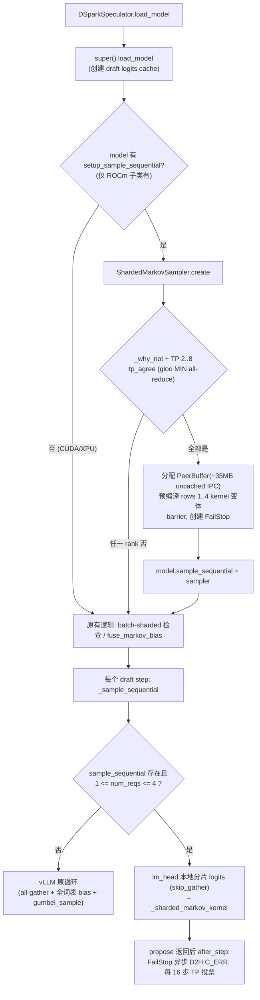

# PR #64031: [ROCm][Perf][Kimi-K3] DSpark Markov sampling sharded over the vocabulary, one launch

> **Author**: @hyukjlee | **State**: OPEN（创建于 2026-10-27） | **Labels**: rocm, speculative-decoding, ready, ci/build, mrv2, dflash, kimi, k3
> **Branch**: `kimi-k3-dspark-sharded-markov` → `main` | **Changes**: +929 -7 lines across 9 files
> **ROCm 相关性**: 完全相关（新增 ROCm 专属 Triton 跨 GPU 采样 kernel；另改动一个 CUDA/ROCm 共享文件 `dspark/speculator.py`，已核对对 CUDA 为 no-op）
> 本报告分两部分：§1–6 为 PR 详细总结，§7–8 为 ROCm review 意见。
> 审查基线：merge-base `000a53c2`，PR head 是 main 的 merge commit；按 merge-base..head 计算的 diff 恰为 9 文件 +929/-7，与 PR 元数据一致（确认是 PR 的净改动）。与当前 `upstream/main`（`821851ea`）三方 `git merge-tree` 无冲突。CI 检查结果未获取，**CI 状态未知**。

---

## 1. 总结 (Summary)

Kimi-K3 + DSpark 投机解码在 ROCm、TP>1 下，vLLM 原生的 Markov 顺序采样每个 draft 位置要先 all-gather 全词表 base logits、再在每个 rank 上重复做一次全词表 `markov_w2` bias GEMV、再跑 Gumbel 采样，7 个位置共约 60 次 launch。本 PR 新增一个 ROCm 专属 Triton kernel（`amd/ops/dspark_markov.py`）：每个 TP rank 只处理自己 lm_head 词表分片对应的 `markov_w2` 行与 base logits，在 kernel 内部通过 aiter 的 uncached IPC peer memory 交换"每个位置一个带 epoch tag 的 int64 记录（value | tag | token id）"完成跨 rank argmax，全部 draft 位置一次 persistent launch 完成，同时把各 rank 的 logits 分片经 peer staging 回写成每个 rank 上的全词表 draft logits cache。作者在 MI355X TP8 c1 上报告 Markov 采样从 263 µs 降到 79 µs/decode step（未能溯源，见 §7）。

## 2. 背景与动机 (Background & Motivation)

- DSpark 是"并行 backbone + 顺序 Markov 头"的半自回归 drafter：backbone 一次前向给出 N 个位置的 base logits，Markov 头再按 `prev token → markov_w1[prev] (r 维) → markov_w2 (V×r) → bias` 逐位置修正 logits 并采样。Kimi-K3 的词表 V=163840，`markov_w2` 是 **全副本**（`DSparkMarkovHead` 用 `disable_tp=True`），所以 TP8 下每个 rank 每个位置都要读完整的 84 MB（163840×256×bf16）权重，7 个位置约 0.6 GB/step，且每个位置先 all-gather base logits。
- 在低并发（c1）延迟敏感场景，这段顺序循环是 draft 步的主要开销。同类优化已在仓内存在：DSV4.1 ROCm `deepseek_v41/amd/ops/fused_markov.py`（`--monokernel` opt-in、单 rank 融合）和 NVIDIA 侧 K3 specialized decode 的 `drafter/markov.py`。本 PR 走得更远：沿词表维度跨 TP 切分 + kernel 内跨 GPU 归约。
- 主干早已为此预留 hook：`DSparkSpeculator._sample_sequential` 先询问 `model.sample_sequential(...)`，返回 True 则跳过原循环（main 已有）。本 PR 只新增"安装 hook 的时机"（`setup_sample_sequential`）和"每步健康检查"（`after_step`）两个接入点。
- 评审过程中 PR 经历了几轮重构：C_ERR 超时上报（接 `FailStop`）、等待从"轮询次数上限"改为"10 s 时间上限"、在 init 中预编译所有 ROWS 变体、把 ROCm hook 从 `nvidia/dspark_mla.py` 挪到新文件 `amd/dspark_mla.py`。

## 3. 代码修改分析 (Code Change Analysis)

### 3.1 修改的模块

| 模块 | 改动 |
|------|------|
| `vllm/models/kimi_k3/amd/ops/dspark_markov.py`（新增 627 行） | 核心：`_sharded_markov_kernel`（Triton，内联 `s_memrealtime`/`s_waitcnt` asm）、`ShardedMarkov`（peer buffer + launcher + 发射几何）、`_why_not` / `_lm_head_shard` 门控、`ShardedMarkovSampler`（作为 `sample_sequential` 安装，带 `after_step`） |
| `vllm/models/kimi_k3/amd/dspark_mla.py`（新增 20 行） | ROCm 版 `K3DSparkForCausalLM`：继承 NVIDIA 共享实现，只加 `setup_sample_sequential(speculator)` |
| `vllm/models/kimi_k3/__init__.py` (+5) | 按平台导出 `K3DSparkForCausalLM`（ROCm → amd 子类；CUDA/XPU → nvidia 原类；TPU 不导出） |
| `vllm/model_executor/models/registry.py` (+1/-1) | `K3DSparkModel` 从 `vllm.models.kimi_k3.nvidia.dspark_mla` 改为平台分发包 `vllm.models.kimi_k3`（与 `KimiK3ForConditionalGeneration` / `KimiK3MTP` 同一模式） |
| `vllm/v1/worker/gpu/spec_decode/dspark/speculator.py` (+18，**共享文件**) | `load_model` 开头调用可选 `model.setup_sample_sequential(self)`；新增 `propose` 覆写，在 super 之后调用可选 `model.sample_sequential.after_step()` |
| `vllm/models/kimi_k3/amd/specialized_decode/runtime/guards.py` (+15/-5) | `FailStop` 参数化 `what` / `remedy`，pinned host 缓冲 dtype 跟随被监视字（int32 → 现可为 int64） |
| `tests/models/kimi_k3/amd_specialized_decode/test_dspark_sharded_markov.py`（新增 236 行） | 8×MI355X 测试：与 `_sample_sequential` 循环逐 token / cache 比对，persistent 与 round 两种模式，rows 1/4，温度 1.0/0.6/0.0，CUDA graph 回放 |
| `tests/models/test_dspark_mla.py` (+3/-1) | registry 断言改为 `issubclass`（ROCm 下返回的是子类） |
| `.buildkite/test_areas/models_basic.yaml` (+4) | `:amd: (MI355) Kimi-K3 Specialized Decode`（mi355_8）步骤的 `source_file_dependencies` 增加 `nvidia/dspark_mla.py`、`spec_decode/dspark/`、`sample/gumbel.py` |

### 3.2 架构 / 流程图

接入点与回退决策（加载期 + 每步）：



单个 call 内 kernel 的跨 rank 协议（persistent 模式，每个位置一轮）：

```mermaid
sequenceDiagram
    participant P as rank k 的各 program (≤ #CU)
    participant P0 as rank k program 0
    participant MB as 各 rank 的 mailbox (peer memory)
    participant ST as 各 peer 的 staging (peer memory)
    Note over P: 读 ctrl.epoch → tag = (epoch+1) & 0x3FFF
    loop step = 0..N-1
        P->>P: e = w1[prev]; bias = Σ w2[v,:]·e (fp32→bf16)<br/>logits = bf16(base+bias); cache[v] = logits
        P->>ST: 把本分片 logits 写入每个 peer 的 staging(parity)
        P->>P: lf = logits/T + Gumbel(seed^step<<32, pos+SALT, v)<br/>tile argmax → record(value|tag|IDX-v)
        P->>P0: 写本 program 的 slot
        P0->>P0: poll 所有 slot（tag 一致）→ max
        P0->>MB: 把本 rank 记录写入每个 rank 的 mailbox
        P->>MB: poll 本 rank mailbox 中 WORLD 条记录 → max → 下一个 prev
    end
    P->>P: 最后一步 winners → draft_tokens
    P->>P: 从本地 staging 拷 peers 的分片到 draft logits cache
```

### 3.3 关键实现细节

- **记录编码**：`_record` 把 fp32 值映射为单调有序的 int32（负数 `bits ^ 0x7FFFFFFF`），放在 int64 高 32 位；低 32 位为 14 bit epoch tag + 18 bit `IDX_MASK - token_id`。于是 int64 `max` 同时完成"取最大值、同值取最小 token id"——与 `_gumbel_combine_kernel` 的"first maximum"tie-break 一致。我用 CPU 脚本核对了 ±inf、±0、负数的有序性与 tie-break（tie → 较小 id）。
- **epoch / tag**：`ctrl[C_EPOCH]` 在设备内存中由 S0==0 launch 的 program 0 自增，因此 CUDA/HIP graph 回放安全（无 host 参与）。program 0 发布 mailbox 时对 8 行全部写入（未屏蔽），每个 call 都刷新所有 slot/mailbox 的 tag，所以 14 bit tag 回绕不会出现 ABA（上一 call 的 tag 必然是 e-1）。staging 用 `epoch & 1` 双缓冲，peer 最多领先一个 call，经推演不会覆盖未读数据。
- **等待与失败**：`_poll` 用 `atomic_add(…,0, scope="sys")` 自旋，`s_memrealtime` 计时，10 s 未齐则置 `C_ERR` 并带着旧记录继续；`FailStop.after_step`（`propose` 后、图外）每步异步 D2H 拷 C_ERR，每 16 步在 TP CPU group 上投票，任一 rank 失败则所有 rank 同时 raise。
- **发射几何**：grid = min(#CU, 256)；每个 program 持有 TA+TB 行 `markov_w2` 寄存器 tile（TP8 时 64+16 行×256），persistent 模式下整个 call 只读一次本分片权重。persistent 要求 nprog ≤ #CU（全部 program 同驻）；`mode()`：TP≥8 或 1 行用 persistent，否则 round（每位置一次 launch）。
- **门控 `_why_not`**（配置级，各 rank 一致 + `tp_agree`）：需要 Markov 头、非 greedy、cache 非 batch-sharded、无 top-k/watermark/reduced vocab/acceptance estimator/output transform、非 fp64 Gumbel、bf16 未量化 Markov 权重、logits processor 无 scale/soft-cap、bf16 cache、V < 2^18、N ≤ 8、lm_head 均匀无 padding 的词表并行；TP 2..8。运行期：`1 <= num_reqs <= 4`，否则走原循环。
- **共享文件改动**：`speculator.py` 两处都是 `getattr(..., None)` 可选 hook；CUDA 上 `K3DSparkForCausalLM`（nvidia）无 `setup_sample_sequential`，DSV4.1 的 `FusedMarkovSampler` / ROCm 方法版 `sample_sequential` 都无 `after_step` 属性——已核对 CUDA 与其他模型行为不变。

## 4. 涉及的技术原理 (Technical Principles)

- **Gumbel-max 与投机采样的无偏性**：token = argmax(logit/T + G)，G 为 i.i.d. Gumbel，等价于从 softmax(logit/T) 采样。rejection sampler 用 draft logits cache 中的 q 做 p/q 比率检验，因此**无偏性的关键是"采样所用的 logits 与写入 cache 的 logits 逐位一致"**，而不是噪声与原实现逐位一致。本 kernel 采样与 cache 用的是同一个 bf16 `logits` 张量（peer 分片经 staging 原样拷贝），两者完全一致；噪声沿用 `murmur3_uniform32(seed ^ step<<32, pos + DRAFT_SALT, token_id)` 与 `_log1p_neg_stable`，与 `gumbel_noised_argmax` 同一公式，因此 per-request seed、per-step seed 混合、draft/target 噪声隔离都保持一致；temperature=0 的请求退化为纯 argmax，tie-break 同为最小 id。唯一差异是 bias 的 fp32 求和顺序（末位 bf16），它改变的是 q 本身（cache 与采样同时改变），不破坏无偏性。DSpark 草稿阶段本身不做 top-k/top-p（原循环也只做 temperature），故无 top-k/top-p 语义差异；`dspark_draft_topk` 配置被门控挡掉。
- **词表并行切分**：`ParallelLMHead` 在 TP 下按连续区间切词表；`skip_gather=True` 返回本 rank 的 `[voff, voff+vlocal)` 列。`_lm_head_shard` 要求每个 rank `num_org_elements == num_elements_padded` 且无 added vocab，任一 rank（通常是最后一个）有 padding 时 `tp_agree` 让全部 rank 回退——"词表不能被 TP 整除 / 有 padding / -inf 掩码列"的情况因此不会进入新路径（Kimi-K3 V=163840=8×20480 可整除）。
- **kernel 内跨 GPU 集合通信**：不用 RCCL，而是每个 rank 一块 uncached、IPC 映射到所有 peer 的显存（aiter `UncachedIpcHeap`），用带 tag 的记录 + 自旋轮询实现 all-reduce(max)。这要求：所有 rank 以相同顺序发起相同次数的 call（由"padded batch 在 TP 组内一致"保证）、所有 program 同驻（persistent），以及任何一个 rank 卡住都会让其他 rank 在 kernel 里自旋直到超时。
- **CUDA/HIP graph 兼容性**：所有状态（epoch、C_ERR、peer 地址）都在设备内存，指针在加载期固定；kernel 变体在 init 中 `warmup(..., grid=(1,))` 预编译，避免运行期某个 rank 单独 JIT 让其他 rank 空等。`FailStop.after_step` 检测 `is_current_stream_capturing()` 并跳过。

## 5. 评论区讨论亮点 (Discussion Highlights)

- **@ChuanLi1101**：指出超时后的 poll 设置了 `C_ERR` 但仍返回 token，而 serve 路径从不读取 `C_ERR`。作者随后接入 `FailStop`（非阻塞 D2H + 每 16 步 TP 投票，全部 rank 一起 raise），并把等待改为 10 s 时间上限（之前约 1 s 轮询上限且会拷贝陈旧 staging）。ChuanLi1101 随后 approve。
- **@okorzh-amd**（两条实质意见）：① 新测试需要 8 GPU，但当时的 MI355 K3 步骤只有 1/4 GPU，B200 步骤又因非 gfx950 跳过 → 测试在任何 CI job 都不会跑；作者把测试移到 `amd_specialized_decode/`（mi355_8 步骤）并补了 `source_file_dependencies`。② `ROWS` 是 constexpr，warmup 只覆盖部分 batch 尺寸，PIECEWISE / eager 下第一次 3、4 行的 step 会在服务中途 JIT，peer rank 在 kernel 里空等直至放弃；作者在 init 中预编译 rows 1..4 的全部变体，并在测试里断言首次真实 launch 不新增编译缓存条目。
- **@shen-shanshan**：ROCm 逻辑不应放在 `nvidia/` 目录；作者新增 `amd/dspark_mla.py` 子类承载 hook，`nvidia/dspark_mla.py` 不再被改动。随后 approve。
- 作者称剩余 pre-commit 失败来自 main（`muse_spark/amd/model.py` 重复定义），与本 PR 无关——未独立验证。
- CI：作者多次 `/ci run`，最新 head（`1ccc642f`）对应 Buildkite #100975，随后 `/ci retry` 了 1 个失败 job，结果未知；评论中 **未见 `/amd-ci run`**（ChuanLi1101 曾要求两者都跑），8-GPU MI355 job 是否实际执行、结果如何，无法从评论确认。

## 6. 风险与潜在问题 (Risk Analysis)

| 风险 | 严重程度 | 说明 |
|------|---------|------|
| 新路径默认开启、无 opt-out、无 arch 门控 | Medium | 见 §7「默认开启且无开关」 |
| 门控漏掉可静态判定的前提，失败是启动期崩溃而非回退 | Medium | 见 §7「`_why_not` 漏检」 |
| 测试绕过真实接线，仅 TP8/gfx950；AMD CI 执行情况未知 | Medium | 见 §7「测试覆盖」 |
| 性能数字不可溯源、无端到端指标 | Medium | 见 §7「性能证据」 |
| C_ERR 超时后 TP rank 间 draft token 可能不一致 | Low–Medium | 见 §7（推测）；触发需某 rank 在 kernel 窗口内落后 >10 s |
| 共享 `speculator.py` 跨后端回归 | Low | 两个可选 hook 均为 `getattr(..., None)`；已核对 CUDA/DSV4.1 为 no-op |
| registry 指向平台分发包 | Low | 与同包其他 K3 类一致；TPU 分支不导出该类（与既有行为一致：TPU 插件自行注册） |
| 与 main 合并冲突 | Low | `git merge-tree` 无冲突 |

---

## 7. Review 意见 (Findings)

| 类型 | 🔴 | ⚠️ | 📝 |
|------|----|----|----|
| 设计 / 兼容性 | — | 2 | — |
| 测试 | — | 1 | — |
| 性能 | — | 1 | — |
| 正确性 | — | 1 | — |
| 可维护性 | — | — | 1 |
| 注释/文档 / 资源 | — | — | 2 |

未发现可给出具体触发输入的阻塞性正确性问题：分布等价性（噪声、seed/step/pos 偏移、temperature、temp=0、tie-break、cache 与采样一致性）、跨 rank 记录编码、epoch/tag 无 ABA、graph 安全、词表 padding 回退均已逐项核对。

---

**⚠️【设计】新路径对所有 ROCm Kimi-K3 DSpark TP>1 部署默认开启，无 opt-out 开关、无 arch 门控，与仓内同类实现的 opt-in 惯例不一致** `[已验证]`

- **问题**: `ShardedMarkovSampler.create`（`vllm/models/kimi_k3/amd/ops/dspark_markov.py:549-566`）只看 `_why_not` 与 TP 范围就安装新采样器；没有任何 env var / `additional_config` 开关，也没有 `on_gfx950()` / CDNA 版本检查。对比：同目录的 K3 specialized decode（同一套 peer memory + FailStop）是 opt-in，且 `platform_reasons()` 要求 gfx950 + 完整 CU 数（`specialized_decode/runtime/__init__.py:293-307`）；DSV4.1 ROCm fused Markov 需要 `--monokernel` 且 `monokernel_cdna3_or_4()`；DSV4.1 NVIDIA 版需要 `additional_config={"dspark_fused_markov": true}`。此外 `FailStop(..., remedy="")`（`:539-542`）在触发时只说"stopping the engine"，用户没有任何可用的关闭办法。新路径还在 `ShardedMarkov.__init__` 中无条件 import `aiter.ops.flydsl...UncachedIpcHeap`（`_why_not` 不检查 aiter/flydsl 是否可用、`VLLM_ROCM_USE_AITER` 是否开启），若不可用会在 `tp_agree` 之后抛错导致启动失败而非回退（该环境是否现实存在为 `[推测]`）。
- **影响**: gfx942（MI300X/MI325X）上的 K3 DSpark TP>1 部署会在未经验证的情况下自动切到一个依赖 kernel 内跨 GPU 自旋等待的新路径（测试仅在 gfx950 运行）；一旦出现超时/挂起，用户只能回滚版本或改 `num_speculative_tokens` 之类的无关配置来绕开。
- **行动**: 建议作者加一个临时 kill-switch（例如 `additional_config` 键或注册在 `vllm/envs.py` 的 env var，验证充分后移除），并在 `_why_not` 中加入已验证的 arch 门控（至少 gfx950，或明确声明 gfx942 也已验证）以及 peer memory 前提检查；`FailStop` 的 `remedy` 应写明如何关闭该路径。

**⚠️【兼容性】`_why_not` 漏掉若干可静态判定的前提，命中时是启动/捕获期硬错误而不是回退原循环** `[已验证]`

- **问题**: ① kernel 用 `k = tl.arange(0, RANK)`（`dspark_markov.py:195`），`RANK` 即 `markov_rank`；Triton 要求 arange 区间为 2 的幂（本地 Triton 3.8 `language/semantic.py:594` `"arange's range must be a power of 2"`）。`_why_not`（`:481-485`）只检查 `w1.shape[1] == w2.shape[1]` 与连续性，不检查 2 的幂。`ShardedMarkovSampler.__init__` 的 warmup 编译（`:536-537`）发生在 `tp_agree` 之后，所以失败会在所有 rank 上抛异常。② `__call__` 在服务/捕获期才检查 base logits 是 bf16，否则 `raise RuntimeError`（`:579-580`），而不是在 `_why_not` 中回退。③ `ShardedMarkov` 不校验 lm_head 分片 `[voff, voff+vlocal)` 落在 `markov_w2` 行数 `vocab` 内、且 `world * vlocal == vocab`（Kimi-K3 的 config 已强制 `draft_vocab_size == vocab_size`，所以当前不会触发）。
- **影响**: 以 `markov_rank`（或 `dspark_markov_rank` hf override）= 192 / 384 等非 2 的幂的 DSpark checkpoint，在 ROCm TP>1、probabilistic drafting 下启动：main 上走原循环能正常服务，本 PR 后引擎在加载期因 Triton 编译错误无法启动。已知 K3 测试/配置使用 256，所以当前公开 checkpoint 是否命中未知。
- **行动**: 建议作者把"`markov_rank` 是 2 的幂（且不超过某个寄存器预算上限）"、"base logits dtype 为 bf16"、"lm_head 分片与 `markov_w2` 行数一致"都移进 `_why_not`，让不满足时所有 rank 一致回退到原循环。

**⚠️【测试】新测试绕过了真实的接线与门控，只覆盖 TP8 / gfx950，AMD CI 是否执行未知** `[已验证]`

- **问题**: `test_dspark_sharded_markov.py:163-171` 用 `object.__new__(dm.ShardedMarkovSampler)` 手工拼装 sampler，`ShardedMarkov(..., vocab_shard=None)` 自行均分词表，因此 `ShardedMarkovSampler.create` / `__init__`、`_why_not`、`_lm_head_shard`（真实 `ParallelLMHead.shard_indices`）、`FailStop.after_step`、`setup_sample_sequential` 与 `DSparkSpeculator.load_model/propose` 的接线都没有被执行；`use_confidence_head=False`，`WRITE_EMB` 分支未测；只测 rows 1 和 4（2/3 只在 init 中编译）；测试 `skipif(not _on_gfx950())` 且固定 8 GPU，因此 TP2/TP4 的几何与 gfx942 都无覆盖。另外评论中只见 `/ci run`，未见 `/amd-ci run`，mi355_8 步骤（`.buildkite/test_areas/models_basic.yaml` 的 `:amd: (MI355) Kimi-K3 Specialized Decode`）在 head `1ccc642f` 上是否运行并通过无法确认。
- **影响**: 门控或接线的回归（例如 `_lm_head_shard` 对真实 lm_head 返回 None 导致路径永远不开、或 confidence head 下 emb 布局错误）不会被这个测试发现；所谓"Passed (1 test, 8 × MI355X)"只能证明 kernel 本身在 TP8 上的等价性。
- **行动**: 建议作者补一个经由 `ShardedMarkovSampler.create(spec)` 的用例（真实 `ParallelLMHead` 分片 + `use_confidence_head=True`），至少加一组 TP4（round 模式、rows 2/3）；并在 PR 中贴出 head 上 mi355_8 job 的 Buildkite 链接与结果。

**⚠️【性能】"263 µs → 79 µs"无法溯源，且缺少端到端指标** `[已验证]`

- **问题**: PR 描述中唯一的性能数字是"Markov sampling per decode step (µs) 263 → 79"（MI355X TP8，7 drafts，c1），未给出测量方法（profiler trace / 计时脚本 / 命令行）、ROCm/aiter 版本以外的服务配置，也没有 TPOT / 吞吐等端到端指标。新路径只在 `num_reqs <= 4` 时生效（`MAX_ROWS_PERSISTENT = 4`），c>4 时完全回退原循环，描述中未说明收益区间。机制本身是合理的：原循环每个 rank 每个位置读完整 84 MB `markov_w2`（7 位置约 0.6 GB）+ all-gather + ~60 次 launch，新路径每 rank 只读 1/8 分片一次、单次 launch——但具体数字本报告标注为 `[unverified]`。
- **影响**: 无法判断该数字对应的端到端收益，也无法复现；FailStop 每 16 步一次 gloo all-reduce 的开销也未计入。
- **行动**: 建议作者补充测量命令/脚本与 trace 来源，给出 c1/c4（以及 c8 回退对照）的 TPOT 或 output tok/s，并注明 acceptance length 数据的采集方法。

**⚠️【正确性】C_ERR 超时后"rejection sampler 保证输出正确"的说法在 TP 下不完全成立** `[推测]`

- **问题**: 模块 docstring（`dspark_markov.py:15-17`）与 `after_step` 注释（`:622-626`）称超时后的 draft token 只是"不可靠"，"the rejection sampler keeps the output correct"。但超时时各 rank 是用陈旧记录各自继续，得到的 winners 可能 **在 rank 间不同**，且 peer 分片的 cache 可能是旧 staging 数据。各 rank 随后把各自的 draft token 喂进目标模型的 TP 前向：`VocabParallelEmbedding` 中各 rank 查自己分片后 all-reduce，若同一位置不同 rank 的 token 不同，嵌入就是两种 token 分片的混合；此外采样到的 token 与 cache 中的 q 不一致也会让该步的接受概率有偏。`FailStop` 最多要 16 步（再加 D2H 延迟）才会让所有 rank raise。
- **影响**: 在触发超时之后、FailStop raise 之前的若干步内，输出 token 可能是错的（而不仅仅是接受率下降），且 rank 间状态可能分叉。触发前提是某个 rank 在 kernel 窗口内落后 >10 s，由于前面的 TP 集合通信会让各 rank 保持同步，实际概率较低。
- **行动**: 建议 review 时追问作者：rank 间 draft token 不一致时目标前向是否还能保证正确；至少应修正注释中的正确性说法，或考虑在 C_ERR 时让 kernel 输出一个各 rank 确定一致的值（例如强制所有位置写同一个哨兵 token，让 rejection 必然拒绝）。

**📝【可维护性】Gumbel 噪声逻辑在 kernel 中重新实现，并依赖 `gumbel.py` 的私有符号** `[已验证]`

- **问题**: `dspark_markov.py:26-31, 73-76, 166-170` 导入 `_DRAFT_NOISE_SALT`、`_log1p_neg_stable` 并手写"`/temp` + 噪声"逻辑；仓内的孪生实现 DSV4.1 ROCm `fused_markov.py` 直接调用 `gumbel_noised_argmax`。若 `gumbel_noised_argmax` 以后改变 temperature 除法（其注释提到可能改用 `tl.div_rn`）或噪声变换，K3 路径会悄悄偏离。作者已把 `sample/gumbel.py` 加入 CI `source_file_dependencies`，可部分缓解。
- **行动**: 建议作者在 `_shard_tile` 中直接调用 `gumbel_noised_argmax(logits, v, vm, seed, pos, temp, IS_DRAFTING=True, USE_FP64=False)`，或至少在 `gumbel.py` 中注释"`kimi_k3/amd/ops/dspark_markov.py` 复制了此逻辑"。

**📝【资源】peer staging 按 `MAX_ROWS = 8` 分配，但实际最多只用 4 行** `[已验证]`

- **问题**: `nbytes = STAGING_OFF + 2 * MAX_ROWS * n_spec * vocab * 2`（`:387`）。按 K3（V=163840，n_spec=7）计算约 35.1 MB/rank uncached IPC 显存，而 `MAX_ROWS_PERSISTENT = 4` 时只需约 17.6 MB；该缓冲也没有释放路径（与 specialized decode 现状一致）。
- **行动**: 建议作者按 `MAX_ROWS_PERSISTENT` 来确定 staging 大小，或注释说明保留 8 行的原因。

**📝【注释/文档】PR 描述中的测试路径已过时** `[已验证]`

- **问题**: 描述写的是 `tests/models/kimi_k3/test_amd_dspark_sharded_markov.py`，实际文件是 `tests/models/kimi_k3/amd_specialized_decode/test_dspark_sharded_markov.py`（为了进入 mi355_8 CI 步骤而移动过）；描述中也没有提到已新增 `amd/dspark_mla.py` 子类与 FailStop 接线。
- **行动**: 建议作者更新 PR 描述，方便 reviewer 和后续 bisect。

## 8. 结论 (Verdict)

**⚠️ NEEDS WORK**

kernel 设计扎实：与原循环的分布等价性（噪声、seed/step/pos、temperature、tie-break、采样与 cache 的一致性）、记录编码、epoch 无 ABA、graph 安全、词表 padding 回退都经得起逐项核对，对 CUDA 与其他模型的共享文件改动也确认是 no-op。主要缺口在"上线方式"：这样一个依赖 kernel 内跨 GPU 自旋等待的新路径默认对所有 ROCm K3 DSpark TP>1 部署开启，没有开关和 arch 门控；门控漏掉了 2 的幂 `markov_rank` 等前提（命中时是启动失败而不是回退）；测试绕开了真实接线，AMD CI 结果和性能数字也都无法确认。建议补上 kill-switch / arch 门控、把静态前提移进 `_why_not`、补一个走 `create()` 的测试并贴出 mi355_8 CI 结果后再合入。

## 9. 英文 Review 评论 (Copy-Paste English Comments)

**C1** `vllm/models/kimi_k3/amd/ops/dspark_markov.py:549-566` — ⚠️ comment

```text
This path is enabled by default for every ROCm Kimi-K3 DSpark deployment with TP 2..8, with no opt-out and no arch gate. The sibling paths that use the same in-kernel cross-GPU spin-wait machinery are opt-in: the K3 specialized decode requires gfx950 and a full CU count (`platform_reasons()`), and the DSV4.1 fused Markov needs `--monokernel` / `additional_config`. The new test only runs on gfx950, so gfx942 (MI300X/MI325X) would switch to an unvalidated path automatically. Could you add a temporary kill-switch (an `additional_config` key or an env var registered in `vllm/envs.py`) and an arch check in `_why_not`, and set `FailStop`'s `remedy` (currently `""`) to tell users how to turn this path off?
```

**C2** `vllm/models/kimi_k3/amd/ops/dspark_markov.py:481-485` — ⚠️ comment

```text
`_why_not` does not check that `markov_rank` is a power of two, but the kernel does `k = tl.arange(0, RANK)` (line 195), and Triton rejects non-power-of-two arange ranges. Because the warm-up compile in `ShardedMarkovSampler.__init__` runs after `tp_agree`, a DSpark checkpoint with e.g. `markov_rank=192` would make every rank fail at load time, where main simply runs the loop. The same applies to the bf16 base-logits check that currently raises in `__call__` (line 579-580). Could you move these static preconditions (power-of-two rank, bf16 base logits, lm_head shard within `markov_w2`'s rows) into `_why_not` so all ranks fall back consistently?
```

**C3** `tests/models/kimi_k3/amd_specialized_decode/test_dspark_sharded_markov.py:163-171` — ⚠️ comment

```text
The test builds the sampler with `object.__new__(dm.ShardedMarkovSampler)` and `vocab_shard=None`, so `ShardedMarkovSampler.create`/`__init__`, `_why_not`, `_lm_head_shard` on a real `ParallelLMHead`, the `FailStop`/`after_step` wiring and `DSparkSpeculator.load_model`'s `setup_sample_sequential` hook are never exercised. The confidence-head (`WRITE_EMB`) branch, rows 2/3 and any TP other than 8 (round mode) are also untested. Could you add a case that goes through `create(spec)` with a real vocab-parallel lm_head and `use_confidence_head=True`, plus one TP4 configuration? It would also help to link the mi355_8 Buildkite job result for the current head, since I only see `/ci run` (not `/amd-ci run`) in the thread.
```

**C4** `vllm/models/kimi_k3/amd/ops/dspark_markov.py:385-388` — ⚠️ comment

```text
Could you add how the "263 us -> 79 us Markov sampling per decode step" number in the description was measured (profiler trace or timing script, exact serve command), and add end-to-end TPOT / output tok/s at c1 and c4, plus a c8 run where this path falls back (num_reqs > MAX_ROWS_PERSISTENT)? The mechanism makes sense (each rank reads 1/TP of markov_w2 once instead of the full 84 MB per position, with no base-logits all-gather), but there is nothing to reproduce the number from right now. Minor, on these lines: the staging is sized for MAX_ROWS = 8 (~35 MB of uncached memory per rank for K3), but at most MAX_ROWS_PERSISTENT = 4 rows are ever used.
```
