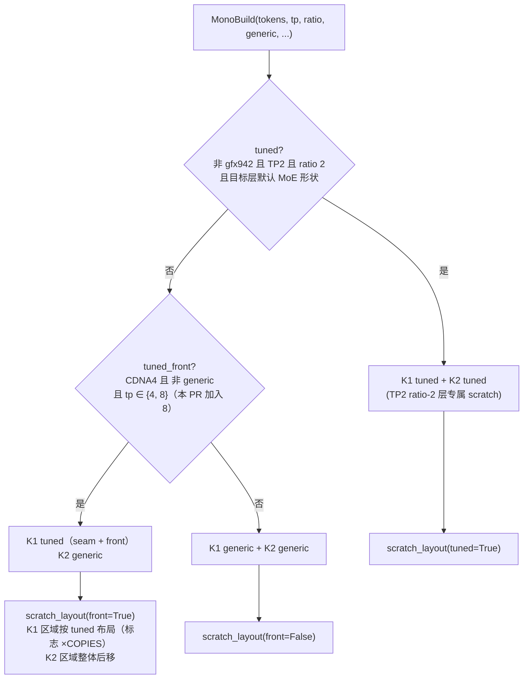
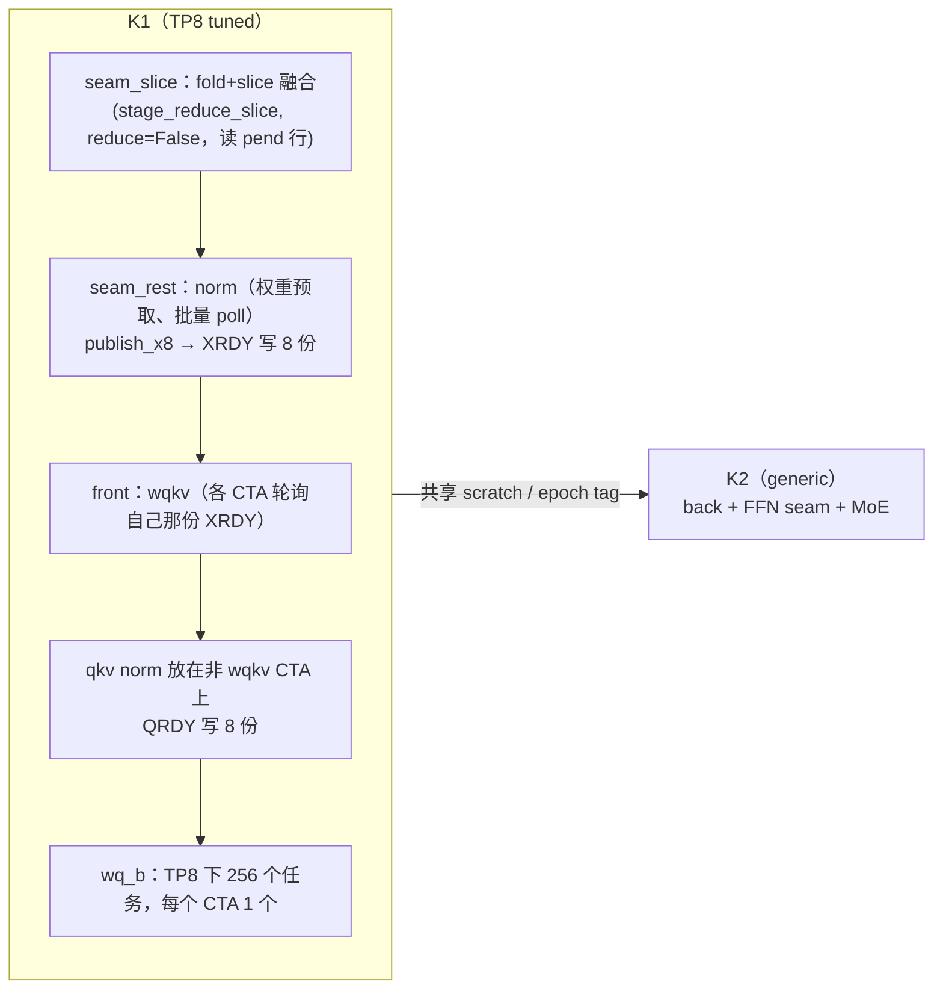

# PR #64152: [ROCm][Perf][DSv4.1] Mono: tuned K1 at TP8

> **Author**: @okorzh-amd | **State**: MERGED（2026-11-11T02:00:16Z，main `bcd6bd810f`）| **Date**: 2026-10-27
> **Branch**: `okorzh/dsv41-mono-tp8-tuned-k1` → `main` | **Labels**: rocm, deepseek, DSv4.1
> **Changes**: +4 -4 lines across 2 files | **ROCm 相关性**: 完全相关（DSv4.1 AMD mono decode kernel，仅 gfx950）
> **CI**: 最终 head `ca66f0a778` 是 CI bot 把 main 合入 `e8171b615a`（与上一版 `d33485dc22` 的 `git range-diff` 完全相同）得到的 merge commit，已包含 #64153；Buildkite #101587 在该 head 上触发，check 详情未能获取（API 限流）。请求的 reviewer：@tjtanaa、@hongxiayang、@dllehr-amd
> **更新说明**：本报告初版针对 `d33485dc22`（2026-11-10）。此后代码 diff 没有变化，只是 head 合入了更新的 main，PR 已合入。下列意见均为合入后的跟进项。
> 本报告分两部分：§1–6 为 PR 详细总结，§7–8 为 ROCm review 意见。

---

## 1. 总结 (Summary)

DSv4.1 的 AMD mono decode 内核每层由两次 launch 组成：

- **K1**：attention seam + attention front。
- **K2**：attention back + FFN seam + MoE。

#63027 先给 TP2 下 compress-ratio-2 的层做了 tuned 路径，#63893 又让 TP4 下所有层的 K1 都走 tuned 路径。这两个 PR 都已合入 main。tuned 路径与 generic 代码逐 bit 一致。

本 PR 只改了一行：把 `MonoBuild.tuned_front` 的 TP 条件从 `tp == 4` 放宽为 `tp in (4, 8)`，让 TP8 的 K1（含 DSpark draft 的 K1）也走 tuned 路径。K2 保持 generic，gfx942 不受影响。

作者在 8×MI355X 上测得 TP8 decode step 缩短 185–262 µs（2.4–4.9%），GSM8K 无变化。

## 2. 背景与动机 (Background & Motivation)

- **TP8 支持**：#64101（main `f97a8d6647`）让 mono 内核支持 TP8，`Dims.__post_init__` 断言 `tp in (2, 4, 8)`。但当时 `tuned_front` 只覆盖 TP4，TP8 的 K1 仍是 generic 代码。
- **为什么能直接复用**：tuned K1 的优化都与 TP 无关：
  - XRDY / QRDY 标志按 `COPIES = 8` 份分散，避免 256 个 CTA 轮询同一缓存行。
  - q/kv norm 移到没有 wqkv 任务的 CTA 上。
  - partials 改为 16 B 批量 poll。
  - seam 的 fold + slice 融合。
  - norm 权重提前预取。

  作者因此判断，同一份代码在 TP8 下"no TP-specific change"即可编译运行。
- **描述中的栈式结构已过时**：PR 描述仍写着"review only the last commit"，以及 #63027 / #63893 必须先合入。现在这两个 PR 都已在 main 上（`c6ae8d68f2`、`d8e1cbb09a`），head 只剩一个 commit。见 §7。

## 3. 代码修改分析 (Code Change Analysis)

### 3.1 修改的模块

| 文件 | 改动 |
|------|------|
| `vllm/models/deepseek_v41/amd/mono/layer.py` | `MonoBuild.tuned_front`（:120-126）：`self.tp == 4` → `self.tp in (4, 8)`，其余条件 `get_cdna_version() == 4 and not self.generic` 不变 |
| `vllm/models/deepseek_v41/amd/mono/README.md` | "Tuned builds" 一段把 "At TP4" 改为 "At TP4 and TP8"（:33-35） |

### 3.2 架构 / 流程图





### 3.3 关键实现细节

- **gate 的作用范围**：`tuned_front` 被以下几处读取：
  - `_front_key` → `FrontBuild.tuned`：决定 front 的 tuned 分支。
  - `build_mono_k1` 中 seam 上下文的 `"tuned"`：决定 fold+slice 融合、norm 批量 poll、`publish_x8` 是否写 8 份。
  - GATE0 的放置位置。
  - `scratch_layout(..., front=...)` 和 `runner.scratch(M, tuned, tuned_front)`：决定 K1 / K2 共用的 scratch 布局。
  - K2 的 `build` 也用同一组参数调用 `scratch_layout`（layer.py:781），因此 K1 和 K2 对布局的认知一致。
- **TP8 的形状核对**（静态阅读 `plan.Dims`、`front.run_front`）：
  - `heads = 64/8 = 8`，`head_tiles = 1`，`heads_pad = 16`。
  - `wqb_tasks = 8×512/16 = 256 = BLOCKS`，`wqb_per_cta = 1`，满足 `assert wqb_tasks % BLOCKS == 0`。
  - 前端 tuned 分支（`stage_qkv` 批量 poll、`publish` 多份、`xq_per × COPIES` 写标志）都不依赖 head 数或 TP。
  - `GATE0 = n_wqkv + s`（224 + s）仅在 `224 + 2s ≤ 256`（s ≤ 16）时启用，并有 `assert GATE0 + s <= BLOCKS` 兜底。
  - seam 在 K1 中只走 `reduce=False`，不轮询 TP partials，所以 TP8 下 seam 的 TP poll 宽度与 K1 无关。
- **K2 的 tuned 分支在 TP8 下不会被构建**：`BackBuild.tuned` 等于 `MonoBuild.tuned`，只在 TP2 ratio-2 时为真。所以描述中讨论的 `stage_split` `hh < d.heads` guard 在 TP8 下是死代码。作者用"重新加回 guard 后 binary 不变"验证了这一点。
- **测试会自动覆盖 TP8**：`tests/models/test_dsv41_mono_numerics.py`：
  - `test_mono_decode_layer_matches_vllm` 已经以 `tp` ∈ [2, 4, 8] 参数化。
  - `_check_layers` 只在 `runner.build(M, ratio).tuned_front` 为真时，额外构造 `generic=True` 的 runner 做逐 bit 比较（:400-403、:518-540）。
  - 因此本 PR 让 TP8 用例自动从"只对 vLLM 参考做容差比较"升级为"tuned 与 generic 逐 bit 比较 + 对 vLLM 参考做容差比较"。

## 4. 涉及的技术原理 (Technical Principles)

- **Mono decode / 持久化 mega kernel**：
  - 一个 decoder layer 只用两次 launch（K1/K2）。
  - 256 个 CTA 之间通过 scratch 中的 mailbox（值 + tag 对）做 stage 间同步。tag = epoch×2 + 1 或 + 2，用来区分 K1 和 K2。
  - 跨 rank 的 TP 归约通过 peer memory 推送后轮询完成，不调用 RCCL。
- **标志多副本**：大量 CTA 自旋轮询同一 128 B 缓存行时，访问会被串行化。tuned 构建把每个被轮询的标志写 `COPIES = 8` 份，每份独占缓存行，CTA b 轮询第 `b % 8` 份。代价是 scratch 变大：作者报告 TP8 下 M=7 时增加 4,608 B，M=48 时增加 8,960 B。这也解释了为什么 TP8 K2 的 binary 只有立即数（region 基址偏移）发生变化。
- **bit-exact 的 tuned 与 generic 双构建**：
  - tuned 路径只改变调度、访存方式和 CTA 分工，不改变每个 token 的浮点运算顺序。
  - 因此 `MonoBuild(generic=True)` 可以作为逐 bit 参考：测试分别用两个 runner 跑同一步，再用 `torch.equal` 比较输出、normed 行和 mHC 中间态。
- **VGPR / LDS 预算**：MI355X 每个 SIMD 有 512 个 VGPR，`THREADS = 512` 时每个 CTA 8 个 wave。作者的 CPU 编译数据显示，TP8 tuned K1 在 M=48 时：
  - VGPR 从 generic 的 239 降到 154。
  - LDS 从 78,400 B 增至 86,016 B，低于 TP4 tuned 的 86,592 B。
  - 没有 spill。

## 5. 评论区讨论亮点 (Discussion Highlights)

- 没有人工 review 评论。评论区只有 mergify 在 10-29 至 11-10 间提示了 5 次冲突，以及 claude[bot] 的"fork 不自动 review"提示。
- @shen-shanshan 于 11-10 07:44 approve 并触发 `/ci run`（Buildkite #101409）。作者 21:29 再次 `/ci run`，CI bot 先合入 main 得到 `ca66f0a778`，再触发 Buildkite #101587。PR 于 11-11 02:00 合入。
- 描述中自述的要点：
  - 原先的"TP8 tuned seam 单批 poll"修复没有包含进来，因为 K1 的 seam 走 `reduce=False`；K2 是 generic，8 个 pair 也在 `POLL_MAX = 12` 以内。
  - 设置了 mutation 对照：只让 TP8 tuned K1 偏一个 ulp，测试会在 `ratio 1, 1 x 6` 处失败。这说明逐 bit 比较确实有效，没有空过。
  - greedy identity probe 无法证明 bit-exact，因为两次 base 运行之间本身也只有 70–81/256 的答案完全一致。作者没有拿它当正确性证据。

## 6. 风险与潜在问题 (Risk Analysis)

| 风险 | 严重程度 | 说明 |
|------|---------|------|
| 正确性：TP8 K1 走新路径 | 低 | tuned 分支不依赖 TP/head 数（§3.3）；数值测试 `[8]` 做逐 bit 比较，且有 mutation 对照证明比较有效 |
| 正确性：K1/K2 共享 scratch 布局变化 | 低 | 两边用同一组 `(tuned, tuned_front)` 调用 `scratch_layout`；TP4 自 #63893 起就是同样的组合 |
| 测试：GPU 验证基于 rebase 前的栈 | 低 | 见 §7「GPU 验证早于 #64153」 |
| 测试：未逐 bit 覆盖的变体 | 低 | DSpark draft 的 K1、fold=0、index-source，以及 M=14/28，作者已列为 "Not bit-compared on GPU" |
| 性能数据来源 | 低 | 步长 A/B（ABBA 4 轮、A/A 噪声 ≤34 µs）和 profiler 拆分都来自作者本地运行，基线也是旧栈（不含 #64153）；CI 无法复现，只能视为作者自报 |
| 兼容性 | 无 | 只影响 gfx950 且 tp=8；gfx942（CDNA3）的 `get_cdna_version() == 4` 为假；CUDA 等其他平台不导入此模块 |
| 可维护性：描述过时 | 低 | 见 §7「PR 描述仍是 rebase 前的栈式结构」 |

---

## 7. Review 意见 (Findings)

| 意见类型 | 数量 |
|---------|------|
| 🔴 必须修复 | 0 |
| ⚠️ 建议修复 | 0 |
| 📝 建议/备注 | 3 |

**📝【注释/文档】PR 描述仍是 rebase 前的栈式结构** `[已验证]`
- **问题**：描述与当前 head 有四处不一致：
  - "Stacking (review only the last commit)" 一节列出 `96fa04ad7a`…`0cc5f92bd5` 五个 commit，并要求 #63027 / #63893 先合入，还写着 head 为 `0cc5f92bd5`、基于 main `4b47db922b`。现在这两个 PR 都已在 main 上，PR 只剩一个代码 commit（`e8171b615a`）加一个合入 main 的 merge commit。
  - Purpose 中引用的 gate 写成 `not GFX942 and ... self.tp == 4`，实际代码（layer.py:120-126，继承自 #63893 合入版）是 `get_cdna_version() == 4 and ...`。
  - 测试说明写的是 `runner.build_key(M, ratio).tuned_front`，实际是 `runner.build(...)`。
  - commit message 写 "TP2 and TP4 builds ... compile byte-identical"，描述里写的是 24/24 + 24/24。两者一致，只是缺少 rebase 后重新编译的说明。
- **影响**：不影响运行。但 reviewer 会按描述去找不存在的栈、对照错误的 gate 写法，增加 review 成本。
- **行动**：PR 已合入，描述直到合入都没有更新。建议作者在 PR 描述里补一行说明 Stacking 一节已过时、gate 以代码为准，方便以后追溯。

**📝【测试】GPU 验证早于 #64153，需要在 rebase 后的 head 上确认** `[已验证]`
- **问题**：
  - Test Result 中的 GPU 数据（10-30）基于 "nightly + main `4b47db922b` 的 mono 文件 + #63027 + #63893"。
  - 此后 main 合入了 #64153（`bdc7e1052a`）。它让 TP8 的 FFN/MoE 也加载 `push_bases`（layer.py:715），并在 TP8 下走 X8 行的批量加载（`moe.load_x8_rows` 的 `batched` 条件）。
  - #64153 改动的是 MoE 内部的访存方式，静态阅读看不出与 K1 tuned 布局有交互：区域偏移由同一个 `scratch_layout` 统一计算，`x8`/`x8s` 本来就是 K1 与 MoE 的共享区域。但 "TP8 tuned K1 + TP8 批量 X8 的 K2" 这一组合还没有在 GPU 上一起跑过，性能基线（generic K1）也不包含 #64153。
- **影响**：正确性风险低。性能数字（-254 µs 等）相对于当前 main 可能略有出入。
- **现状**：最终 head `ca66f0a778` 已包含 #64153，Buildkite #101587 就是在这个组合上跑的。但 check 详情未能获取，不知道 `mi355_8` 步骤是否通过。
- **行动**：建议作者在 PR 中贴出 Buildkite #101587 `mi355_8` 步骤的结果，或者在合入后的 main 上重跑 `test_mono_decode_layer_matches_vllm[8]` 和 `test_mono_decode_matches_the_model[8-8]`/`[8-28]`。

**📝【注释/文档】数值测试模块 docstring 仍写 "at TP2"** `[已验证]`
- **问题**：`tests/models/test_dsv41_mono_numerics.py` 有两处仍只提 TP2：
  - 模块 docstring 开头是 "Numerics of the DeepSeek-V4.1 mono decode kernels at TP2 on CDNA4"。
  - `_check_layers` 中注释（:397-399）写的是 "at TP2 the ratio-2 steps take the tuned paths"。
  
  实际上 TP4（#63893）和 TP8（本 PR）也会走 tuned 路径并做逐 bit 比较。作者说明从 #63893 rebase 时刻意去掉了 docstring 和测试注释的修改。这是遗留问题，不是本 PR 引入的。
- **影响**：只影响可读性。读者会误以为 TP8 用例不做 tuned 与 generic 的比较。
- **行动**：建议作者顺手把这两处改成 "TP2 (ratio 2), TP4 and TP8 K1"，或者留到后续清理 PR 里改。文件不在 diff 中，无法挂 inline 评论。

## 8. 结论 (Verdict)

✅ **LGTM**（PR 已合入）。改动只有一行 gate。静态核对确认，tuned K1 的各分支在 TP8 形状下的前提条件都成立：`wqb_tasks == BLOCKS`、GATE0 有断言兜底、seam 不做 TP poll。现有数值测试会自动在 TP8 下对 tuned 与 generic 做逐 bit 比较，作者还用 mutation 对照证明了比较有效。剩下的都是合入后的非阻塞跟进：确认 TP8 测试在包含 #64153 的代码上通过，以及说明描述已过时。

## 9. 英文 Review 评论 (Copy-Paste English Comments)

**C1** `vllm/models/deepseek_v41/amd/mono/layer.py:125` — 📝 comment

```text
The widened gate looks right to me: the tuned front branches don't depend on the TP size or the head count (at TP8, wqb_tasks == BLOCKS gives one wq_b task per CTA, and GATE0 is guarded by its assert), and K1's seam runs with reduce=False, so it never polls the TP partials. One request: the GPU results in the description were measured on the pre-rebase stack (main 4b47db922b + #63027 + #63893), before #64153 batched TP8 K2's X8 copies. The final head ca66f0a778 includes #64153, so could you link the mi355_8 step of Buildkite #101587, or confirm that test_mono_decode_layer_matches_vllm[8] and the [8-8]/[8-28] layer cases pass on main after the merge?
```

**C2** `vllm/models/deepseek_v41/amd/mono/README.md:33-35` — 📝 comment

```text
Nit on the PR description rather than this file: the "Stacking (review only the last commit)" section and the head/base SHAs still describe the pre-rebase stack, but #63027 and #63893 are both on main now and this PR is a single commit. The quoted gate also reads `not GFX942 and ... self.tp == 4`, while the code has `get_cdna_version() == 4`, and the test note says `runner.build_key(...)` where the code calls `runner.build(...)`. Since the PR has merged, a one-line note in the description saying that the stacking section is outdated would help anyone tracing this change later.
```

## 10. 英文总结评论 (Overall Review Summary)

```text
Thanks for this. Widening MonoBuild.tuned_front to TP8 is a clean one-line change: the tuned K1 paths do not depend on the TP size, K2 stays generic, and the existing numerics test now compares TP8 tuned K1 bit for bit against a generic=True build, with your mutation control showing that the comparison is live. Two post-merge follow-ups: please link the mi355_8 result for the final head, since the GPU results in the description predate #64153, and note that the description's stacking section and gate snippet are outdated. Approved.
```
