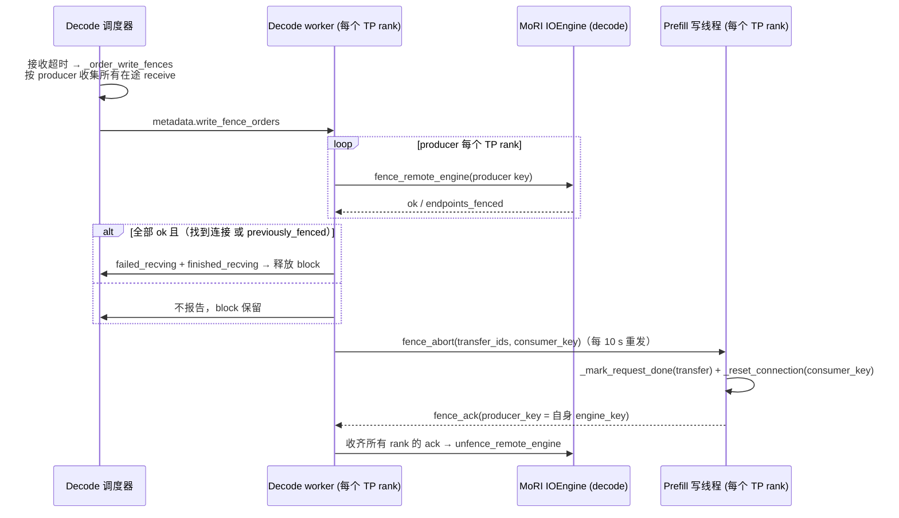

# PR #64154: [ROCm][KVConnector][MoRIIO] Fence a stuck WRITE producer so decode can free its blocks

> **Author**: @amirakb89 | **State**: OPEN（Draft）| **Date**: 2026-10-27（最后更新 2026-11-14）
> **Branch**: `feat/moriio-write-fence` → `main` | **Labels**: documentation, rocm, needs-rebase, kv-connector
> **Changes**: +2368 -95 lines across 13 files（含叠加的 #58962 旧版本；本 PR 自身只有最后两个 commit：connector +322 -58 / engine +222 -37 / common +49 / 新测试 800 行）| **ROCm 相关性**: 完全相关（MoRIIO KV connector + 依赖未合入的 ROCm/mori#848）
> 本报告分两部分：§1–6 为 PR 详细总结，§7–8 为 ROCm review 意见。

---

## 1. 总结 (Summary)

#58962 让 WRITE 模式下 decode 等不到 `write_done` 的请求超时失败，但 block 仍然保留，因为单边 RDMA 写可能还在途。本 PR 用 MoRI-IO 的接收端 fence（`IOEngine.fence_remote_engine` / `unfence_remote_engine`，来自未合入的 ROCm/mori#848）回收这些 block：打开可选开关 `write_recv_fence` 后，decode 在接收超时时 fence 掉对应 prefill DP rank 的全部 TP rank，并把该 prefill 所有在途接收都判为失败，只有每个 rank 都 fence 成功才释放 block。随后 decode 向 prefill 发 `fence_abort`（每 10 s 重发），prefill 丢弃这些 transfer、重置连接并回 `fence_ack`，decode 收齐 ack 后 unfence。PR 还顺带改了默认路径：prefill 写失败不再从模型 step 中抛出，而是在"没有在途写"时以 `write_failed` 通知 decode。

## 2. 背景与动机 (Background & Motivation)

- 超时本身不能证明 prefill NIC 已经停止写入；"问 prefill 是否安全"（Z.AI 的做法）对已死或不可达的 prefill 也无效。接收端 fence 在 decode 侧撤销对端访问权限，fence 成功后无论 prefill 是慢还是死，都不会再有迟到写落地。
- PR 是 **Draft**，叠在 #58962 的**旧版本**（`d29185d`）之上，并依赖**未合入**的 ROCm/mori#848。作者自己说明 "This branch is based on the previous revision of #58962 and will be rebased onto its current head"。
- 已知限制（PR 自述）：已死的 prefill 永远不会 ack，因此会一直被 fence 到 decode 重启；abort 往返期间发给该 prefill 的请求会失败；MoRI 构建中没有 `fence_remote_engine` 时打开开关会在启动时报错。

## 3. 代码修改分析 (Code Change Analysis)

### 3.1 修改的模块

下表只列本 PR 自身的两个 commit（`d29185dc..4dd306ff`）。

| 文件 | 改动 |
|------|------|
| `moriio/moriio_common.py` (+49) | `_extra_config_flag`；`moriio_engine_key(role, host, port, tp, dp)`；`WriteProducer`（`engine_key(tp)`、`notify_endpoint(tp)`）；`WriteFenceOrder`；`FENCE_ABORT_RESEND_INTERVAL=10.0`；metadata 字段 `write_fence_orders` |
| `moriio/moriio_connector.py` (+322 -58) | 调度器：`_resolve_write_producer` 把 allocation notify 的寻址逻辑重构进 `WriteProducer`（**默认路径也受影响**）；超时时 `_order_write_fences` 按 producer 聚合**所有**在途接收，生成 fence order。worker：IOEngine key 改为由 `moriio_engine_key` 生成；`_apply_fence_order`（在 `start_load_kv` 中逐个 TP rank 调用 `fence_remote_engine`）；`_send_fence_aborts`、`_service_fences`（处理 ack、unfence、重发）；`get_transfer_results` 新增 `_reported_recv_req_ids` 去重，并丢弃已 fence transfer 的迟到通知 |
| `moriio/moriio_engine.py` (+222 -37) | 写线程每轮先处理 `_process_fence_aborts`（`_mark_request_done` + `_reset_connection` + 回 ack）；新增 `_fail_transfer`（写失败时，在所有 status 为 `Succeeded()` 或 `Failed()` 的前提下发 `write_failed` 和 `num_writers`）；`_finalize_if_complete` 捕获 `TransferError` 不再上抛；`_mark_request_done` 改为返回 `was_live`；session 不存活时重建；decode 侧 `_count_writer_outcome` 让 `write_failed` 也按 `num_writers` 凑票 |
| `tests/v1/kv_connector/unit/test_moriio_write_fence.py` (+800) | 32 个用例，mock MoRI engine。**路径仍是 #66480 之前的 `unit/` 目录** |

### 3.2 架构 / 流程图



### 3.3 关键实现细节

- **fence 的粒度是"整个 producer DP rank 组"**：一个请求超时，同一 producer 的其他在途接收全部失败（日志里称为 collateral）。
- **安全判定**：`safe` 要求每个 key 的 `fence_remote_engine` 没有抛异常且 `result.ok`；如果所有 key 的 `endpoints_fenced` 之和为 0 且**此前没有 fence 过**，则判为不安全，保留 block。
- **unfence 的条件**：`_service_fences` 按 `key != producer_key` 剔除已 ack 的 rank，而 `producer_key` 是 prefill 发回的自身 `engine_key`。
- **默认路径改动（与开关无关）**：allocation notify 的寻址改走 `WriteProducer.notify_endpoint`；写失败改走 `_fail_transfer`；decode 侧 `write_failed` 带上 `num_writers` 后需要凑票；finalize 中的 `TransferError` 不再上抛。
- **新的 MoRI API**：`fence_remote_engine`、`unfence_remote_engine`、`IOEngineSession.alive`、`result.ok`/`.endpoints_fenced`/`.message`。本地 mori checkout（`09aa23be`，2026-10-28）中没有这些符号，符合 "mori#848 未合入" 的说法。启用开关时 worker 用 `hasattr` 在启动阶段检查，`_session_alive` 对旧版 MoRI 用 `getattr` 回退。

## 4. 涉及的技术原理 (Technical Principles)

- **接收端 fence**：RDMA 写由发起方 NIC 执行，接收方 CPU 不参与。要在不依赖发起方配合的情况下阻止迟到写，接收方必须撤销访问权（断开、复位 QP 或废止 rkey）。fence 成功之后，对端所有在途和后续写都会失败，不会落进内存，这时释放 block 才是安全的。
- **"失败"不等于"没有在途写"**：MoRI 的 `ibv_post_send` 中途失败时，已经 post 的 WR 仍留在 SQ 中（`src/io/rdma/common.cpp:1084` 有 "partially posted {} / {} WRs" 日志，并把这些 WR 记为 orphaned、EP 标记为 degraded），但整个 batch 的 status 已是失败。`qp_per_transfer>1` 时，第一个错误 CQE 就会让共享的 batch status 失败，而其他 QP 仍在写。
- **engine key 的一致性**：fence 用 key 指定对端 engine，所以 decode 推导出的 producer key 必须与 producer 自身注册的 key 完全一致。main 在 PP>1 时会给 key 加上 `:pp{rank}` 后缀（main `moriio_connector.py:1980-1988`）。
- **KVOutputAggregator 一票一报**：fence 让请求失败时，每个 decode worker 都要恰好上报一次，所以本 PR 也加了自己的"已上报"集合。

## 5. 评论区讨论亮点 (Discussion Highlights)

- **okorzh-amd（11-11）的两条 inline 意见至今未处理**：
  1. 如果推导出的 key 匹配不到任何 engine，MoRI 返回 ok 且 0 个 endpoint，第一次 fence 会保留 block；但 key 留在 `_fenced_producer_keys` 中，producer 用真实 key 回 ack，永远清不掉。此后同一 producer 的每次超时都会因为 `previously_fenced` 为 True 而"在什么都没切断的情况下释放 block"。#64693 之后，PP>1 的 prefill 必然触发这个问题。她在 CPU 上复现了这两种情况。
  2. MoRI 的 `Failed` 不代表没有在途写（部分 post、多 QP）；`_fail_transfer` 把 `Failed` 当成"已结束"并发送 `write_failed`，decode 随后释放 block，而且这条路径在**开关关闭时**也会走。她建议只在全部 `Succeeded()` 时才通知 decode，并指出 `test_failed_transfer_with_nothing_in_flight_tells_decode` 断言的正好是相反的行为。
- **okorzh-amd 的冲突清单**：#58962 STACKED（旧版本）；#64693 ALREADY-MERGED（PP key）；#60852 CONFLICT（`_mark_request_done` 契约，"merging both without adapting the call stops every write_done"）；#66480 已经移动了测试目录。
- **ChuanLi1101（11-14）明确暂缓 review**：列出 Draft、冲突、叠在旧 #58962 上、依赖未合入的 mori#848、okorzh 两条意见未答、与 #60852 冲突等 5 个阻塞项，并给出顺序："等 #58962（以及需要的 #59058/#60852）合入 → rebase → 回复 fence 意见 → mori#848 可用后再转为正式 PR"。
- 作者在这些评论之后没有新的回复或 commit。

## 6. 风险与潜在问题 (Risk Analysis)

| 风险 | 严重程度 | 说明 |
|------|---------|------|
| 默认路径下部分 post 后发送 `write_failed`，decode 在写仍在途时释放 block | High | 见 §7 🔴【正确性】`_fail_transfer` 把 `Failed()` 当作没有在途写 |
| key 不匹配后，第二次超时在什么都没 fence 的情况下释放 block | High | 见 §7 🔴【正确性】`previously_fenced` |
| 叠在 #58962 已废弃的设计上，依赖未合入的 mori#848，与 main/#60852 大量冲突 | High | 见 §7 ⚠️【兼容性】 |
| 号称 opt-in，实际改了默认的 notify、失败和 finalize 路径 | Medium | 见 §7 ⚠️【设计】 |
| 无 CI，硬件验证依赖 PR 之外的本地故障注入补丁 | Medium | 见 §7 ⚠️【测试】 |
| fence 在模型线程同步执行，并连带失败同一 producer 的健康请求 | Low | 见 §7 📝【性能】 |

---

## 7. Review 意见 (Findings)

| 类型 | 🔴 | ⚠️ | 📝 |
|------|----|----|----|
| 正确性 | 2 | — | — |
| 兼容性 | — | 1 | — |
| 设计 | — | 1 | — |
| 测试 | — | 1 | — |
| 性能 | — | — | 1 |

整体看：接收端 fence 是唯一能在 prefill 已死时安全回收 decode block 的机制，方向正确，也是 #58962 遗留问题的必要后续。但当前实现有两条会导致 decode block 在仍可能被写入时被释放的路径，其中一条在开关关闭的默认配置下就会触发。PR 本身还是 Draft，建在一个已被废弃的基础上。

---

**🔴【正确性】`_fail_transfer` 把 MoRI 的 `Failed()` 当作"没有在途写"并通知 decode，默认配置下就可能导致迟到写覆盖已复用的 block** `[已验证]`

- **问题**: `moriio_engine.py:345` 的判定是 `if not all(status.Succeeded() or status.Failed() for status in statuses): return`，否则向 decode 发 `write_failed`（带 `num_writers`）。decode 侧 `_count_writer_outcome` 凑齐票后，把 transfer 放进 `failed_write_cache_req_ids` → `failed_recving` + `done_recving`，在 `fail` 策略下调度器结束请求并释放 block（PR 的 docstring 也写着 "Decode frees the destination blocks on write_failed"）。但我在本地 MoRI 源码中核对到：`ibv_post_send` 中途失败时，已 post 的 WR 仍在队列中（`src/io/rdma/common.cpp:1084`，"partially posted {} / {} WRs ... marking EP as degraded"），而 batch status 已是失败。`_fail_transfer` 由写线程的 `except` 分支和 `_finalize_if_complete` 的 `TransferError` 分支调用，**与 `write_recv_fence` 无关**。
- **影响**: 触发条件是 RDMA backend、默认 `write_recv_fence=false`，某次 `batch_write` 中 `ibv_post_send` 部分成功后失败（例如长上下文 WRITE 时 SQ 满，#67863 报过 `SQ full`），或 `qp_per_transfer>1` 时某个 QP 先报错误 CQE。此时 decode 释放的 block 会被分配给下一个请求，残余的 WR 落地后静默改写该请求的 KV，导致输出错误且没有任何报错。在 main 上同样的失败只会释放 prefill block，让 decode 一直等待（hang，但不会损坏数据）；本 PR 把 hang 换成了数据损坏。
- **行动**: 作者应当只在所有已记录的 status 都 `Succeeded()` 时才通知 decode（okorzh-amd 的建议），其余情况交给 #58962 的超时和 fence 处理；同时修改 `test_failed_transfer_with_nothing_in_flight_tells_decode` 的断言，并补一个"部分 post 后失败、不得通知 decode"的用例。这也与 #60852 "可能已提交即不通知 decode" 的契约一致。

**🔴【正确性】一个 key 第一次 fence 找到 0 个连接后，后续超时会在没有切断任何连接的情况下释放 block** `[已验证]`

- **问题**: `_apply_fence_order`（`moriio_connector.py:3204-3261`）先 `previously_fenced |= key in self._fenced_producer_keys`，然后**无条件** `setdefault(key, set()).add(fence_id)`，之后才调用 fence。`endpoints_fenced == 0 and not previously_fenced` 只在第一次时判为不安全（`:3231`）。`_service_fences` 用 prefill 回来的 `producer_key`（即 prefill 自身的 `engine_key`）按字符串相等剔除 pending key。如果 decode 推导出的 key 与 prefill 实际的 key 不一致，这个 key 永远不会被 ack 清掉，会一直留在 `_fenced_producer_keys` 中。
- **影响**: 触发条件是 rebase 到当前 main 后，用 PP≥2 的 prefill（main 的 engine key 带 `:pp{rank}` 后缀，main `moriio_connector.py:1980-1988`；本 PR 的 `moriio_engine_key` 不带）并开启 `write_recv_fence=true`。第一次超时时 fence 命中 0 个连接，block 保留；**同一 producer 的第二次超时**时 `previously_fenced=True`，而 MoRI 对没有连接的 key 返回 ok（据 okorzh-amd 引用的 mori#848 `peer_failure.hpp`），于是判定 `safe=True` 并释放 block，但 prefill 的连接根本没被切断，仍可能写入。即使在当前 head（无 PP），只要请求中的 `remote_host` 与 prefill 的 `moriio_config.local_ip` 字符串不一致（例如主机名与 IP、或多网卡），也会出现同样的情况（这一点 `[推测]`）。
- **行动**: 作者应当只在某个 key 的 fence **确实找到过连接**之后才把它记为"已 fence"（okorzh-amd 的建议），并让 `WriteProducer` 覆盖 prefill 的每个 PP stage key（`:ppN`）。建议补"两次超时、0 endpoint"和"PP=2 key"两个单测。

**⚠️【兼容性】Draft 叠在 #58962 已废弃的版本上，依赖未合入的 mori#848；rebase 时 `notify_endpoint` 会因 #64574 抛 TypeError** `[已验证]`

- **问题**:
  1. 本 PR 的调度器代码仍基于 #58962 早期的 `write_load_failed_block_ids`/invalid_block_ids 设计（`moriio_connector.py:735, 1528-1530, 1609`；worker `:3706-3707`），而 #58962 当前 head 已改为 `failed_recving` 加"扣下 `finished_recving`"的设计。trial merge 显示两者在 `moriio_connector.py` 上有 9 处冲突，与 main 有 5 处冲突，`moriio_engine.py` 上 3 处。
  2. `WriteProducer.notify_endpoint`（`moriio_common.py:94-95`）调用 `get_port_offset(self.dp_rank, tp_rank)`。main 合入 #64574 后 `tp_size` 为必填参数，而这个函数是新代码，git 不会报冲突。由于本 PR 把**所有** WRITE 请求的 allocation notify 都改成走 `producer.notify_endpoint`（`moriio_connector.py:1327`），rebase 后即使不开 fence，decode 也会在第一个 WRITE 请求时抛 TypeError。另外，这次重构替换的代码块在 main 上已被 #65822 加入了 `num_skip_blocks=`，rebase 时必须保留。
  3. 新测试仍在 `tests/v1/kv_connector/unit/`，而 #66480 已把 MoRIIO 测试移到 `unit/moriio/`。
  4. `fence_remote_engine` 等 API 只存在于未合入的 ROCm/mori#848 中，本地 MoRI main（`09aa23be`）里没有。
- **影响**: 当前分支无法合入。直接 rebase 会引入默认路径上的崩溃，并丢失 #65822 的前缀 block 跳过逻辑。
- **行动**: 作者应当按 ChuanLi1101 给出的顺序推进：等 #58962（以及 #60852）合入后，在其最终设计上重写 fence 的接入点（用 `failed_recving` 上报 fence 失败的请求）；`notify_endpoint` 传入 prefill TP size 并复用 main 的 helper；保留 `num_skip_blocks`；移动测试目录；等 mori#848 发布并 pin 版本后再转为正式 PR。

**⚠️【设计】号称 opt-in，实际改了多条默认路径，并与 #60852 的 `_mark_request_done` 契约直接冲突** `[已验证]`

- **问题**: PR 只声明 `write_recv_fence` 为 opt-in，但以下改动在开关关闭时也生效：(a) allocation notify 的寻址重构为 `_resolve_write_producer`/`WriteProducer`；(b) 写失败从 `_mark_request_done` 改为 `_fail_transfer`，会向 decode 发 `write_failed`；(c) decode 侧 `write_failed` 带 `num_writers` 时需要凑票（`_count_writer_outcome`），不带时立即失败；(d) `_finalize_if_complete` 吞掉 `TransferError`；(e) IOEngine key 改由 `moriio_engine_key` 生成（丢掉了 main 的 `:pp` 后缀）。其中 (b) 与 #60852 的契约正好相反：#60852 规定可能已提交后不通知 decode，并让 `_mark_request_done` 返回 None；本 PR 让 `_finalize_if_complete` 依据 `_mark_request_done` 的 bool 返回值决定是否发 `write_done`。两者在 `moriio_engine.py` 上有 6 处冲突。#64785 也重写了同样的两个 `except Exception:` 分支。
- **影响**: 不开 fence 的用户也会承受上面那条 🔴 的数据损坏风险。按 okorzh-amd 的分析，与 #60852 同时合入而不做适配会让 `write_done` 全部停发。
- **行动**: 建议作者把默认路径的改动（不再从模型 step 抛出、失败时通知 decode）拆成单独的 PR，以 #60852 的"可能已提交即不通知 decode"为基线；本 PR 只保留开关之下的 fence 逻辑，并在描述中列出所有默认行为变化。

**⚠️【测试】CI 未运行，硬件验证依赖 PR 之外的故障注入补丁** `[已验证]`

- **问题**: PR 处于 Draft 状态，checks 中只有 DCO、Meta 检查、CodeRabbit（skipped）和 Mergify，没有 pre-run-check 和 pre-commit，Buildkite 没有触发，即 CI 未运行。PR 描述中的结果（1193 passed vs 1131；1P1D TP8 gpt-oss-120b 在 MI355X 上"KV 使用率回到 0、10 req/s 继续服务"）没有日志，并且依赖 "a local fault-injection patch (not part of this PR)" 和私有构建的 mori#848，属于 `[unverified]`。32 个单测全部 mock MoRI engine，fence 的真实语义（0 endpoint 返回 ok、部分 post）都由 mock 决定。
- **行动**: 建议作者在 rebase 并依赖已发布的 MoRI 版本后跑 AMD MoRIIO 单测，并提供可复现的故障注入方式（例如 mori 自带的 `fault_injector`），附上 fence、ack、unfence 的完整日志，以及 PP=2 和 `qp_per_transfer>1` 两种配置的验证结果。

**📝【性能】fence 在模型线程同步执行，并会连带失败同一 producer 的健康请求** `[已验证]`

- **问题**: `_apply_fence_order` 在 worker 的 `start_load_kv` 中（模型 runner 线程、forward 之前）对 producer 的每个 TP rank 同步调用 `fence_remote_engine` 和 `send_notify`。`_order_write_fences` 会把同一 producer 的**所有**在途接收（包括未超时的）一并判为失败。`fence_abort` 从模型线程发送，而 `write_done`/`fence_ack` 在 prefill 侧分别从写线程和模型线程发送。main 上 `send_notify` 的 DEALER socket 按 path 跨线程共享，#60852 的按线程分 socket 修复正好也覆盖这里。
- **影响**: fence 的耗时会计入一个 decode step 的延迟；一次超时会让同一 prefill 上的健康请求一起失败（PR 已注明），突发场景下失败面可能较大。
- **行动**: 建议作者测量 `fence_remote_engine` 在 TP8 下的耗时，必要时移到后台线程执行；评估是否只对已超时的请求释放 block、其余请求等待 fence 后重试；并在 rebase 时采用 #60852 的按线程 socket 方案。

## 8. 结论 (Verdict)

**🔴 BLOCK**

有两条会让 decode block 在仍可能被 RDMA 写入时被释放的路径，触发条件都很具体：(1) 默认配置（fence 关闭）下，`ibv_post_send` 部分 post 后失败或多 QP 中一个先报错，`_fail_transfer` 仍会发 `write_failed`；(2) 开启 fence 时，PP≥2 prefill 的 key 不匹配，第二次超时在什么都没切断的情况下释放 block。此外 PR 是 Draft，叠在 #58962 已废弃的版本上，依赖未合入的 mori#848，rebase 后默认的 allocation notify 路径会抛 TypeError。fence 的方向是对的，建议按 reviewer 给出的顺序在 #58962/#60852 的最终设计上重写。

## 9. 英文 Review 评论 (Copy-Paste English Comments)

**C1** `vllm/distributed/kv_transfer/kv_connector/v1/moriio/moriio_engine.py:345` — 🔴 blocking

```text
A Failed MoRI status does not mean no write is still in flight. When `ibv_post_send` fails partway, the WRs that were already posted stay queued (mori `src/io/rdma/common.cpp` logs "partially posted N / M WRs" and marks the EP degraded), and with `qp_per_transfer > 1` one QP's error CQE fails the batch while the other QPs keep writing. Treating Failed as finished here sends `write_failed`, and decode then frees blocks that can still be written. This also happens with `write_recv_fence` off, so the default path changes from a hang to possible silent KV corruption. Could you notify decode only when every recorded status Succeeded(), and invert `test_failed_transfer_with_nothing_in_flight_tells_decode`?
```

**C2** `vllm/distributed/kv_transfer/kv_connector/v1/moriio/moriio_connector.py:3215-3231` — 🔴 blocking

```text
The key is added to `_fenced_producer_keys` before the fence runs, and `previously_fenced` only protects the first fence. If the derived key matches no engine, MoRI returns ok with zero endpoints, and the producer acks with its own key, so `_service_fences` never clears the derived one. The next timeout from that producer then counts as previously fenced and frees blocks even though no connection was cut. On current main, PP>1 engine keys end in `:pp<rank>`, which `moriio_engine_key` doesn't produce, so every PP prefill with `write_recv_fence=true` would hit this. Could you mark a key as fenced only after a fence of it found a connection, and include every PP stage in `WriteProducer`?
```

**C3** `vllm/distributed/kv_transfer/kv_connector/v1/moriio/moriio_common.py:94-95` — ⚠️ comment

```text
After #64574, `get_port_offset` on main takes `tp_size` as a required argument. This helper is new code, so a rebase will not flag it, and since every WRITE allocation notify now goes through `producer.notify_endpoint`, decode would raise TypeError on its first WRITE request even with the fence disabled. The notify loop this replaces also gained `num_skip_blocks=` from #65822 on main. Could you pass the prefill TP size here and keep `num_skip_blocks` when rebasing?
```

**C4** `vllm/distributed/kv_transfer/kv_connector/v1/moriio/moriio_connector.py:1528-1530` — ⚠️ comment

```text
This still builds on the invalid-block-ids version of #58962, which that PR has since replaced with failed_recving and a held finished_recving. Several changes here also apply with the fence disabled: the notify refactor, `_fail_transfer`, write_failed counting and the engine key format. They conflict with #60852's `_mark_request_done` contract, under which decode is never notified once a submit may have started. Could you rebase onto the final #58962/#60852 design, split the default-path changes into their own PR, and move the tests to `tests/v1/kv_connector/unit/moriio/`?
```

## 10. 英文总结评论 (Overall Review Summary)

```text
A receiver-side fence is the right way to reclaim decode blocks from a dead WRITE producer. Two paths can still free decode blocks that may be written. First, `_fail_transfer` treats a Failed MoRI status as nothing in flight and sends write_failed, even with the fence disabled, so partial posts can corrupt reused blocks. Second, once a derived key fences zero connections, which happens for every PP prefill on current main, later timeouts free blocks with nothing cut. This also needs a rebase onto the final #58962/#60852 design and a released mori#848. Changes needed before merge.
```
