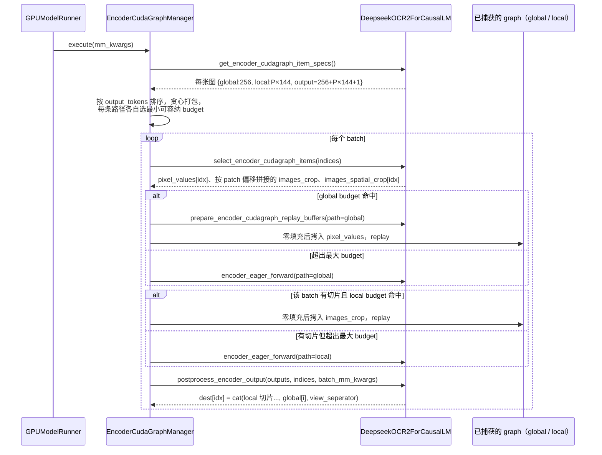
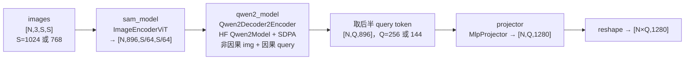

# PR #64311: [MM][CG] support ViT encoder cudagraph for DeepSeek-OCR2

> **Author**: @noone-zhhh | **State**: OPEN | **Date**: 2026-10-28
> **Branch**: `feats/deepseek_ocr2_cg` → `main` | **Labels**: documentation, multi-modality, deepseek, nvidia, verified
> **Changes**: +207 -2 lines across 4 files | **ROCm 相关性**: 部分相关。没有 ROCm 专属代码，但 `deepseek_ocr2.py` 是 CUDA/ROCm 共用的模型文件。用户开启 `cudagraph_mm_encoder` 后，新路径在 ROCm 上以 HIP graph 运行。新增的 `core_model` 测试项也会进入 AMD MI355 的 Multimodal Models CI job（`.buildkite/test-amd.yaml:5180`）
> 本报告分两部分：§1–6 为 PR 详细总结，§7–8 为 ROCm review 意见。

---

## 1. 总结 (Summary)

本 PR 让 DeepSeek-OCR-2（`DeepseekOCR2ForCausalLM`）实现 `SupportsEncoderCudaGraph` 协议，从而接入 vLLM 已有的 encoder CUDA graph 框架（`EncoderCudaGraphManager`）。实现方式照搬 DeepSeek-OCR（v1）的双路径（multi-path）方案：全局视图（1024×1024 → 256 token）和局部切片（768×768 → 每块 144 token）各自按 token budget 捕获一组 graph，replay 后由 `postprocess_encoder_output` 按 `[local..., global, view_seperator]` 的顺序拼回每张图的 embedding。另外同步更新了文档表格、离线示例里支持 ViT CUDA graph 的模型列表，以及 `test_vit_cudagraph.py` 中的冒烟测试配置。

## 2. 背景与动机 (Background & Motivation)

- 这是 #38175（多模态 encoder CUDA graph 跟踪 issue）下的一个子任务，作者说明代码风格遵循 #43586（DeepSeek-OCR v1 的 encoder CUDA graph 支持）。
- DeepSeek-OCR-2 的视觉塔为 SAM ViT-B（`ImageEncoderViT`）+ 把 Qwen2 decoder 当 encoder 用的 `Qwen2Decoder2Encoder` + `MlpProjector`。eager 路径逐张图串行编码（每张图一次 global forward，再对它的切片做一次 local forward），kernel launch 多，小图的 CPU 开销占比较高。
- 作者在 RTX 5070 Ti 16GB 上用 `vllm bench mm-processor` 测得：不切片的小图（224/448）encoder 平均延迟下降约 9%，P99 下降 20%~24%；切片的大图（896/1024）平均延迟只下降 2%~3%。这些数字只出现在 PR 描述中，没有附原始 JSON 输出，本报告按 `[unverified]` 处理。
- PR checklist 声明使用了 AI 辅助，提交者自行复核了每一行改动。

## 3. 代码修改分析 (Code Change Analysis)

### 3.1 修改的模块

| 模块 | 改动 |
|------|------|
| `vllm/model_executor/models/deepseek_ocr2.py` (+193 -2) | 类继承加上 `SupportsEncoderCudaGraph`；保存 `self.model_config`；新增 `global_image_output_tokens`(256) / `single_patch_output_tokens`(144) 两个属性，以及协议要求的 9 个方法：config、budget range、item specs、select items、capture inputs、replay buffers、cudagraph forward、eager forward、postprocess |
| `tests/models/multimodal/generation/test_vit_cudagraph.py` (+12) | `MODEL_CONFIGS` 新增 `deepseek_ocr2`：`core_model` 标记、`load_format=dummy`、`encoder_cudagraph_token_budgets=[288]` |
| `examples/generate/multimodal/vision_language_offline.py` (+1) | `MODELS_SUPPORT_VIT_CUDA_GRAPH` 加入 `deepseek_ocr2`，使 `--enable-vit-cuda-graph` 对它生效 |
| `docs/design/cuda_graphs_multimodal.md` (+1) | 支持矩阵新增一行：Image ✅、Video ❌、Multi-Path ✅ |

### 3.2 架构 / 流程图

运行期执行流程（`EncoderCudaGraphManager._execute_local` 与 OCR2 各回调方法的交互）：



单路径 forward 内部（global 与 local 共用 `_batched_encoder_forward`）：



### 3.3 关键实现细节

- **token 计算**：`global_image_output_tokens = (1024//16//4)^2 = 256`，`single_patch_output_tokens = (768//16//4)^2 = 144`。与 `get_num_image_tokens`（v2 策略不插换行）一致。`EncoderItemSpec.output_tokens = 256 + P×144 + 1`，其中 +1 对应 `view_seperator`，与 eager 路径 `_pixel_values_to_embedding` 产出的 embedding 长度完全一致（已核对）。
- **budget**：`get_encoder_cudagraph_budget_range` 返回 `(256, min(max_num_batched_tokens, max_model_len))`。路径配置为 global `min_token_budget=256`、local `min_token_budget=144` + `allow_zero_tokens=True`，即全部图都不切片时跳过 local 路径。
- **capture**：global 路径的 batch 数为 `min(max_batch_size, budget//256)`，local 路径为 `budget//144` 个切片，输入都用 `torch.zeros`。由于捕获的都是整图或整块，graph 输出行数天然是 256 / 144 的整数倍。
- **select**：先用 `images_spatial_crop`（`keep_on_cpu=True`）算出每张图的切片前缀和，再按 `indices` 顺序拼接 `images_crop`；`postprocess` 也按同一顺序消费 local 输出，两者保持一致（已核对）。
- **postprocess**：直接对整个（含 padding 的）graph 输出 buffer 做 `reshape(-1, 256/144, hidden)`，再按 batch 内位置 `i` 和 `patch_offset` 取值；padding 行被隐式忽略。`torch.cat` 会产生新 tensor，因此结果不会别名到 graph 的输出 buffer。
- **eager**：`path="default"` 复用原有 `_process_image_input`；`global` / `local` 的 eager fallback 直接调 `encoder_cudagraph_forward`，即同一个 batched forward 不经 graph 执行。

## 4. 涉及的技术原理 (Technical Principles)

- **Encoder CUDA graph（budget 模式）**：ViT 输入大小随图片变化，无法像 decode 那样按 batch size 捕获。vLLM 的做法是按「输出 token 数 budget」捕获若干张 graph（默认从最小 budget 开始按 2 的幂递增，直到 max budget），运行期选能装下当前 batch 的最小 budget，把输入零填充到 capture 时的形状后 replay，再由模型的 `postprocess_encoder_output` 丢弃 padding、切回每个 item。
- **多路径（multi-path）graph**：DeepSeek-OCR 系列的每张图都有一个固定大小的全局视图和数量可变的局部切片，两者形状不同，因此为 `global` 和 `local` 各捕获一组 graph、各自选 budget。某条路径超出最大 budget 时只有这条路径回退 eager，另一条照常 replay。
- **Graph 安全性**：被捕获的 forward 不能有 host 同步（`.item()`、`.tolist()`、依赖数据的分支），所有中间 buffer 的地址必须在 replay 时保持有效。OCR2 的 SAM 部分已在 OCR v1 的 graph 中验证过（全局注意力层在 `is_cuda_alike()` 时使用 Triton 融合 rel-pos kernel，形状全静态）。新引入的是 HF `Qwen2Model` 子图：mask 由 `compute_mask_base`（`lru_cache`）生成，对 batch 不变；`token_type_ids` 是 CPU tensor 且未被使用；attention 走 `F.scaled_dot_product_attention` + 浮点 mask，不经过 vLLM 的 attention backend，因此也不存在 `cu_seqlens` 需要补齐的问题。
- **ROCm 上的执行**：`torch.cuda.CUDAGraph` 在 ROCm 上对应 HIP graph。这条路径在 ROCm 上用到的 kernel 包括：SAM 的 Triton rel-pos attention、PyTorch ROCm SDPA（带 mask 时通常选 AOTriton 内存高效 kernel 或 math 回退）、hipBLASLt GEMM 和 Conv。没有 AITER/ROCm 专属 attention backend 参与。

## 5. 评论区讨论亮点 (Discussion Highlights)

目前没有实质性的人工 review：只有 mergify 的文档预览链接，以及 claude[bot] 说明 fork PR 默认不跑自动 review。没有设计层面的讨论。

## 6. 风险与潜在问题 (Risk Analysis)

| 风险 | 严重程度 | 说明 |
|------|---------|------|
| local 路径 graph replay 与多图 batch 未被测试覆盖 | Medium | 见 §7 ⚠️【测试】：CI 用例的两张图都会走 local eager fallback，并且每个 batch 只有一张图 |
| 只在 NVIDIA 上验证，但测试会在 AMD CI 运行 | Medium | 见 §7 ⚠️【兼容性】 |
| graph 与 eager 数值一致性没有断言 | Medium | dummy 权重下只检查输出非空；PR 描述的功能测试也没有给出 eager 对照输出 |
| 自动 budget 下 capture 显存 / 时间 | Low | 默认 budget 会捕获约 13 张 graph，最大一张 global graph 的 batch 为 `max_budget//256` 张 1024² 图；PR 只测了 `[576]` + 1 item 的配置，见 §7 📝【性能】 |
| postprocess 依赖「capture 大小是整数倍」的隐式不变式 | Low | 见 §7 📝【可维护性】 |
| CUDA 主线 CI 显存 | Low | 兄弟用例 `deepseek_ocr` 因 CI OOM 被 `skip=True`，OCR2 用例没有 skip，也没有用 `dummy_hf_overrides` 缩小 LM（`[推测]`） |
| 兼容性 | Low | 默认关闭（`cudagraph_mm_encoder=False`），不开启时 eager 路径行为不变 |

---

## 7. Review 意见 (Findings)

| 类型 | 🔴 | ⚠️ | 📝 |
|------|----|----|----|
| 测试 | — | 1 | 1 |
| 兼容性 | — | 1 | — |
| 性能 | — | — | 1 |
| 可维护性 | — | — | 2 |

---

**⚠️【测试】新增用例覆盖不到 local 路径的 graph replay，也覆盖不到多图 batch，且不校验数值** `[已验证]`

- **问题**: `test_vit_cudagraph.py:363-374` 只配置了 `encoder_cudagraph_token_budgets=[288]`，因此 local 路径的 budget 只有 `[0, 144, 288]`。`test_vit_cudagraph_image` 使用 `stop_sign`（1300×876）和 `cherry_blossom`（1770×1180）两张图。按 `count_tiles(..., image_size=768)` 计算，两张图都切成 3×2=6 块，local 需要 864 token，超过 288，所以 `_path_fitting_budget` 返回 `None`，local 路径总是走 `encoder_eager_forward`。global 每张图 256 token，两张合计 512 也超过 288，所以每个 batch 只有一张图。测试本身只断言 `len(output_text) > 0`，并且使用 dummy 权重。
- **影响**: 本 PR 中最容易出错的逻辑，即 `select_encoder_cudagraph_items` 的切片前缀和拼接、local graph 的零填充 replay、`postprocess_encoder_output` 中跨多张图的 `patch_offset` 推进、切片图与非切片图混合的 batch，在 CI 中完全没有执行。即便这部分逻辑出错（例如切片顺序错位），dummy 权重下的输出非空断言也照样能通过。
- **行动**: 建议作者把 budget 至少提高到能容纳 6 块切片（例如 `[288, 864]`，或直接用 `[1152]`），并设置 `encoder_cudagraph_max_vision_items_per_batch=2`，让 local graph replay 和双图 batch 都能实际执行。更理想的是参照 `_check_eonly_encoder_outputs` 加一个数值对照：对 `manager.execute(kwargs)` 和 `model.embed_multimodal(**kwargs)` 做 `assert_close`，输入覆盖「1 张不切片 + 1 张切片」的混合 batch。

**⚠️【兼容性】新路径只在 NVIDIA 上验证过，但新增的 `core_model` 用例会在 AMD MI355 CI 上运行** `[已验证]`（ROCm 上的运行结果 `[推测]`）

- **问题**: 测试只用 `is_cuda_alike()` 跳过，`.buildkite/test-amd.yaml:5180` 的 `:amd: (MI355 DPX) Multimodal Models` job 会执行 `test_vit_cudagraph.py -m core_model`，所以新用例在 ROCm 上会被捕获为 HIP graph。作者只在 RTX 5070 Ti 上测试过（PR label 也只有 `nvidia`）。这条路径在 ROCm 上与 CUDA 的不同之处有两点：SAM 全局注意力层走 Triton `deepencoder_rel_pos_attention`（ROCm 也是 `is_cuda_alike()`）；新捕获的 HF Qwen2 子图走 PyTorch ROCm SDPA，并带一个 stride 为 0 的 expand 浮点 mask。后者此前从未在任何 graph 中被捕获过。本次无法获取 CI 状态。
- **影响**: 如果 ROCm SDPA 在带 mask 时选中的 kernel 在 HIP graph capture 下有问题（例如 workspace 在 capture 期间分配，或者回退到 math kernel 时显存过大），影响范围限于开启 `cudagraph_mm_encoder` 的 OCR2 用户，以及 AMD multimodal CI job 中新增的这个用例（该 job 是 optional）。CUDA 用户和默认配置不受影响。
- **行动**: 建议作者或 AMD reviewer 在 MI300/MI355 上跑一次 `pytest tests/models/multimodal/generation/test_vit_cudagraph.py -k deepseek_ocr2 -m core_model`，最好再用真实权重做一次 graph 与 eager 的输出对照，并在 PR 中附上结果。如果暂时无法验证，可以先给该用例加 `skipif(current_platform.is_rocm())` 并注明原因，避免 AMD job 出现新的红叉。

**📝【测试】兄弟用例 `deepseek_ocr` 因 CI OOM 被跳过，OCR2 用例没有采取任何对应措施** `[推测]`

- **问题**: 同文件中 `deepseek_ocr` 的配置带有 `skip=True  # TODO: Re-enable this once OOM issues are resolved on CI`，同时使用了 `dummy_hf_overrides` 来缩小 LM。OCR2 的 LM 规模与 v1 相近（3B MoE），新用例却既没有 skip，也没有用 `hf_overrides` 缩小模型。
- **影响**: 可能在 CUDA 主线 CI 上重现 v1 的 OOM，让 `core_model` multimodal job 变得不稳定。
- **行动**: 建议作者说明 OCR2 在 CI 规格 GPU 上的峰值显存，或者参照 v1 加上 `hf_overrides=partial(dummy_hf_overrides, model_arch="DeepseekOCR2ForCausalLM")`。

**📝【性能】只测了单一手工 budget，自动 budget 下的 capture 显存和时间没有说明；数字无法追溯** `[已验证]`（数字 `[unverified]`）

- **问题**: benchmark 固定使用 `encoder_cudagraph_token_budgets=[576]` 和 `max_vision_items_per_batch=1`。示例脚本和普通用户实际使用的是自动 budget：以 `max_num_batched_tokens=8192` 为例，global 路径会捕获 256 到 8192 共 6 档，local 路径会捕获 144 到 8192 共 7 档。最大一张 global graph 的 batch 为 `min(8192//256, …)=32` 张 1024² 图，capture 时 SAM 和 Qwen2 的激活显存远高于 eager 逐张图处理的峰值。延迟数字只出现在 PR 描述的表格里，没有附 `--output-json` 的原始结果。另外切片大图的收益只有 2%~3%。
- **影响**: 用户按示例 `--enable-vit-cuda-graph` 开启后，可能在小显存卡上遇到启动变慢或 capture 阶段 OOM，PR 中没有任何数据可供参考。
- **行动**: 建议作者补充默认 budget 下的 graph 数量、capture 耗时和 graph pool 显存占用，并附上 benchmark 的原始 JSON 或日志。

**📝【可维护性】`postprocess_encoder_output` 对含 padding 的整个 buffer 做 reshape，没有像 v1 那样先截断，也没有使用 `per_item_out_tokens`** `[已验证]`

- **问题**: `deepseek_ocr2.py:617-625` 直接执行 `outputs["global"].reshape(-1, 256, hidden)`；local 输出同理，按 144 reshape。v1 的同名方法（`deepseek_ocr.py` 的 `postprocess_encoder_output`）会先截断为 `output[: bsz * global_image_output_token]` 和 `local_output[: total_patches * single_patch_output_token]`。当前写法之所以正确，是因为 `prepare_encoder_cudagraph_capture_inputs` 只捕获整图或整块，buffer 行数恰好是 256 / 144 的整数倍。
- **影响**: 今天不会出错。但如果以后 capture 改用非整数倍的 padding，或者 manager 改为返回按 budget 补齐的 buffer，这里的 reshape 会直接报错，甚至错位。此外 `per_item_out_tokens` 参数没有被用来做长度校验。
- **行动**: 建议作者与 v1 保持一致，先按 `len(indices) * 256` 和 `sum(patch_counts) * 144` 截断再 reshape，并可加一个断言：`dest[index].shape[0] == per_item_out_tokens[index]`。

**📝【可维护性】graph 中捕获的 Qwen2 mask 依赖 `lru_cache` 一直持有该 tensor** `[已验证]`

- **问题**: `deepencoder2.py` 的 `compute_mask_base` 用 `@lru_cache(maxsize=8)` 缓存 `[1,1,S,S]` mask，graph 捕获的是这个缓存 tensor 的地址。capture 前的 warmup 会先在 graph pool 之外创建这个 tensor，所以当前是安全的：OCR2 只有 S=288 和 S=512 两个 key，远小于 8。
- **影响**: 如果以后增加分辨率档位或 dtype，导致缓存 key 超过 8 个，旧 mask 会被淘汰并释放，已捕获 graph 的 replay 就会读到已释放的内存，结果静默出错。
- **行动**: 建议作者在 `compute_mask_base` 旁加注释，说明 encoder CUDA graph 依赖该缓存不被淘汰；或者在模块初始化时把两个固定长度的 mask 注册为 non-persistent buffer。

> AI 代码诊断：PR 描述只讲了做了什么（照搬 #43586 的风格），没有解释 OCR2 与 v1 的差异，例如 v2 不插换行、Qwen2 子图的 graph 安全性。幻觉符号扫描没有发现问题：`EncoderCudaGraphPathConfig`、`allow_zero_tokens`、`EncoderItemSpec.path_output_tokens`、`axis_keys` 参数都存在于 `upstream/main` 的 `encoder_cudagraph_defs.py` / `interfaces.py` 中，且方法签名与协议一致。孪生对比（与 v1 相比）的差异都有合理解释：OCR2 不插换行，所以 local 切片直接 `flatten`，不调用 `_assemble_patch_grid`；`output_tokens` 多出的 +1 也与 eager 产出的长度一致。主要的残余风险集中在测试本身（只做冒烟检查、覆盖不到关键分支），以及 ROCm 上尚未验证。

## 8. 结论 (Verdict)

**⚠️ NEEDS WORK**

实现严格遵循已有的 encoder CUDA graph 协议和 DeepSeek-OCR v1 的双路径模式。逐项核对后，token 计数、切片偏移、输出顺序和长度都与 eager 路径一致，没有发现能给出具体触发输入的阻塞性缺陷。但新增测试实际上只覆盖了单图的 global graph，local replay、多图 batch 和数值一致性都没有验证；另外新用例会在 AMD MI355 CI 上运行，而作者只在 NVIDIA 上验证过。建议补强测试并提供 ROCm 上的运行结果后再合入。

## 9. 英文 Review 评论 (Copy-Paste English Comments)

**C1** `tests/models/multimodal/generation/test_vit_cudagraph.py:368-370` — ⚠️ comment

```text
With `encoder_cudagraph_token_budgets=[288]`, the local path only gets budgets [0, 144, 288]. Both test images (stop_sign 1300x876, cherry_blossom 1770x1180) are tiled 3x2 = 6 patches = 864 local tokens, so the local path always falls back to eager. Also, two global views (512 tokens) never fit in 288, so every batch has one image. As a result, local graph replay, the patch-offset logic in `select_encoder_cudagraph_items` and `postprocess_encoder_output`, and mixed tiled/untiled batches are never exercised. The test only checks that the output is non-empty with dummy weights. Could you raise the budgets (e.g. [288, 864]) with `encoder_cudagraph_max_vision_items_per_batch=2`, and ideally add an `assert_close` between `manager.execute(...)` and `embed_multimodal(...)` for a mixed batch, similar to `_check_eonly_encoder_outputs`?
```

**C2** `tests/models/multimodal/generation/test_vit_cudagraph.py:363-367` — ⚠️ comment

```text
This new `core_model` entry will also run in the AMD MI355 "Multimodal Models" job (test-amd.yaml runs `test_vit_cudagraph.py -m core_model`, and the test only skips on `not is_cuda_alike()`), but the PR was validated only on an RTX 5070 Ti. On ROCm, the captured graph includes the Triton rel-pos attention in SAM and, for the first time, the HF Qwen2 encoder with a float-masked SDPA (expanded, stride-0 mask) under HIP graph capture. Could you (or an AMD reviewer) run this test on MI300/MI355 and post the result, ideally with a graph-vs-eager output comparison on real weights? If that is not possible yet, consider skipping this entry on ROCm with a short reason so it does not add a new red X to the AMD job.
```

**C3** `vllm/model_executor/models/deepseek_ocr2.py:617-625` — 📝 nit

```text
This reshapes the full graph output buffer (including padding rows) instead of slicing it first, as the DeepSeek-OCR v1 implementation does (`output[: bsz * global_image_output_token]`, `local_output[: total_patches * single_patch_output_token]`). It works today only because the capture inputs are whole images/patches, so the buffer length happens to be a multiple of 256/144. Could you slice to `len(indices) * 256` and `sum(patch_counts) * 144` before reshaping, and maybe assert `dest[index].shape[0] == per_item_out_tokens[index]`? That would keep this robust if the capture padding policy ever changes.
```
