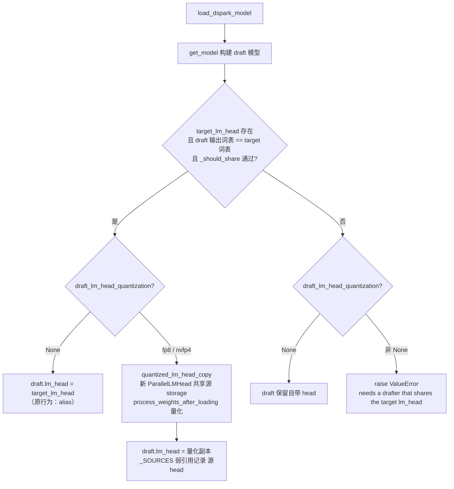
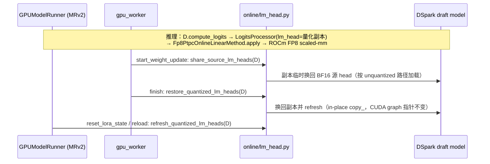

# PR #64368: [Spec Decode][ROCm] draft_lm_head_quantization for DSpark drafters

> **Author**: @AMD-yanfeiwang | **State**: OPEN | **Date**: 2026-10-28
> **Branch**: `rocm-dspark-fp8-draft-lm-head` → `main` | **Labels**: rocm, speculative-decoding, qwen, quantization, mrv2, dflash
> **Changes**: +20 -4 lines across 3 files | **ROCm 相关性**: 部分相关（改的是平台无关的 DSpark 加载与 SpeculativeConfig 校验；动机和全部实测都在 MI355X 上，ROCm 走 FP8 per-token scaled-mm）
> 本报告分两部分：§1–6 为 PR 详细总结，§7–8 为 ROCm review 意见。

---

## 1. 总结 (Summary)

本 PR 把 `SpeculativeConfig.draft_lm_head_quantization`（#59973 引入，此前只支持 EAGLE/EAGLE3/MTP）扩展到 `method="dspark"`。当 DSpark drafter 与 target 共享 `lm_head` 时，`load_dspark_model` 不再直接 alias target head，而是通过 `quantized_lm_head_copy()` 生成一份私有的 FP8（或 NVFP4）副本给 drafter 算 base logits；target 仍用自己的 BF16 head 做 verify，所以只可能影响接受长度，不影响输出正确性。若请求量化但 drafter 自带 head（不共享），则显式报错。整体是对 `eagle/utils.py` 既有逻辑的 ~10 行镜像。

## 2. 背景与动机 (Background & Motivation)

- DSpark（DeepSeek-V4.1-Flash 的投机解码 drafter，k=5，带 Markov head 与概率采样）每个 decode step 都要对 5 行（c1）hidden 做一次 `[M, 5120] × [5120, vocab/TP]` 的 lm_head GEMM。作者在 MI355X 的 trace 中观察到：BF16 head 在 M=5 时被 `rocm_unquantized_gemm` 派发到 `wvSplitK`，耗时约 348 µs，而 M=10 只需 ~97 µs——M=5 是一个性能悬崖。
- 现有的 `vllm/models/deepseek_v41/amd/ops/draft_lm_head.py` 通过「补一行 0 → 走 torch GEMM」绕开这个悬崖，但只在 gfx942 + `--monokernel` 启用；gfx950（MI355X）上没有绕开。
- 换成 FP8 per-row/per-token 的 head 副本后，GEMM 落到 hipBLASLt FP8 kernel（trace 中 `Cijk_..._F8BS` ≈ 55 µs + 5 µs per-token quant），同时把权重读带宽减半。作者报告 TP2 c1 ITL P50 -4.0%、TP4 c1 -2.4%，c8 以上中性。
- 作者明确与 #47584 区分：后者新增 env var `VLLM_DSPARK_FP8_DRAFT_HEAD` 与专用 rowwise FP8 模块且只针对 NVIDIA DSV4 路径；本 PR 复用已有配置项与 kernel 选择机制。对应 sglang 侧 sgl-project/sglang#39622。

## 3. 代码修改分析 (Code Change Analysis)

### 3.1 修改的模块

| 模块 | 改动 |
|------|------|
| `vllm/v1/worker/gpu/spec_decode/dspark/utils.py` (+13/-1) | `load_dspark_model`：共享 target head 时可选地换成 `quantized_lm_head_copy(target_lm_head, quant)`；请求量化但不共享时 `raise ValueError` |
| `vllm/config/speculative.py` (+6/-3) | `_verify_args` 的方法白名单加入 `"dspark"`；字段 docstring 改为 "EAGLE, MTP and DSpark" |
| `tests/model_executor/test_qwen3_omni.py` (+1) | 现有 DSpark 共享 embedding 测试的 `SimpleNamespace` stub 补 `draft_lm_head_quantization=None`，否则新代码访问该属性会 AttributeError |

### 3.2 架构 / 流程图

DSpark 加载阶段 lm_head 共享决策（PR 后）：



运行时与权重更新（复用既有机制，PR 未改动）：



### 3.3 关键实现细节

- **新符号核验**：`quantized_lm_head_copy` 在 `vllm/model_executor/layers/quantization/online/lm_head.py:131` 存在，签名 `(lm_head: ParallelLMHead, quantization: Literal["fp8","nvfp4"])`，与调用一致；import 放在函数内的局部 import 块里，与周围风格一致。
- **镜像 EAGLE**：新代码与 `vllm/v1/worker/gpu/spec_decode/eagle/utils.py:117-140` 的 `draft_head` / `elif ... raise` 结构逐字对应；DSpark 侧没有 MTP 的 `layer.shared_head.head` per-layer 修补，这对 DSpark 是正确的（DSpark drafter 只通过顶层 `self.lm_head` 出 logits）。
- **刷新路径**：`DSparkSpeculator` 继承 `DFlashSpeculator`，属于 `DraftModelSpeculator`，因此 `GPUModelRunner.get_draft_model()` 能拿到 draft 模型，`refresh_quantized_lm_heads` / `share_source_lm_heads` / `restore_quantized_lm_heads` 自动覆盖——PR 描述中的这一说法已核实。
- **配置护栏**：`_verify_args` 同时保留了 `head_dtype != dtype` 拒绝，以及 `vllm/config/vllm.py:3136` 中「V1 runner 不支持 draft lm_head quantization」的护栏（DSpark 本身也只在 MRv2 上可用）。
- **副本输出 dtype**：`_quantize_copy` 在 `set_default_torch_dtype(lm_head.weight.dtype)` 下构造，输出 logits 仍为 BF16，因此 gfx942 的 `fused_markov.sample_sequential`（要求 base_logits 为 bf16 且 stride=1）不会因此退回慢路径。

## 4. 涉及的技术原理 (Technical Principles)

- **DSpark 投机解码**：drafter 先算 base logits `U_k = lm_head(norm(head_hidden))`，再叠加 Markov head 的 bias 做顺序采样，生成 k 个 draft token，target 一次 verify。base logits 只影响 draft 质量（接受长度），不影响最终 token 的分布正确性——这是「drafter 用量化 head、target 用原 head」在语义上安全的根本原因。
- **在线 PTPC FP8（per-token activation × per-channel weight）**：`Fp8PtpcOnlineLinearMethod` 在加载后对 head 权重逐行求 amax 得到 per-row scale 并量化为平台 FP8 dtype（gfx942 为 `e4m3fnuz`、gfx950 为 OCP `e4m3fn`，经 `current_platform.fp8_dtype()` 与 `get_fp8_min_max()` 处理）；推理时对 activation 做动态 per-token 量化，再调 scaled-mm。lm_head 按 vocab 维切分（行），所以 per-row scale 无需跨 TP rank 归约。
- **ROCm FP8 线性 kernel 选择**：`_POSSIBLE_FP8_KERNELS[ROCM]` 的优先级为 `AiterHipbMMPerToken → AiterPreshuffledPerToken → AiterPerToken → ROCmFP8ScaledMM(skinny, 仅 per-tensor) → PerTensorTorch → RowWiseTorch → ChannelWiseTorch`。aiter 三者都要求 `VLLM_ROCM_USE_AITER=1`，且 Preshuffled/PerToken 需要该 (N, K) 有 tuned config，HipbMM 还需 `VLLM_ROCM_USE_AITER_LINEAR_HIPBMM=1`（默认 False）；都不满足时落到 `RowWiseTorchFP8ScaledMMLinearKernel`（`torch._scaled_mm` → hipBLASLt）。
- **skinny GEMM 性能悬崖**：ROCm 的 `rocm_unquantized_gemm` 对 M ≤ 某阈值（这里是 5）走 `wvSplitK`，在 64640×5120 这类大 N 下反而比 hipBLASLt 慢 3.5×；FP8 head 绕开了这条 BF16 dispatch，同时把 HBM 读量减半，所以 c1（M=5）收益最大，大 batch 时 GEMM 变成 compute-bound 且被其它开销稀释。

## 5. 评论区讨论亮点 (Discussion Highlights)

- 截至 head `d6b5026f`，PR 无人工 review 与讨论评论；唯一的 review 是 claude[bot] 的提示——fork PR 自动 review 被禁用，需要 maintainer 评论 `@claude review` 触发。
- 抓取到的 `checks` 数据为空（只有 `total_count/check_runs` 两个键名，没有 run 记录），CI 状态未知。

## 6. 风险与潜在问题 (Risk Analysis)

| 风险 | 严重程度 | 说明 |
|------|---------|------|
| 正确性：Muse Spark DSpark 的 activation cast 以 `lm_head.weight.dtype` 为准 | Medium | 见 §7 ⚠️【正确性】；共享 head 时副本权重为 FP8 |
| 测试覆盖：DSpark 新分支无单测、无 CI e2e | Medium | 见 §7 ⚠️【测试】 |
| 兼容性：ROCm 上实际选中的 FP8 kernel 依赖 AITER env 与 tuned 表 | Low | 见 §7 📝【注释/文档】；各候选 kernel 都能正确算，只是性能结论可能随之改变 |
| 性能：gfx942 补零行 workaround 与 FP8 head 叠加 | Low | 见 §7 📝【性能】 |
| 内存：多一份 FP8 head 分片（TP2 ≈ 0.33 GB） | Low | 在 load 阶段创建，KV 预算会把它算进去；默认关闭 |
| 可维护性：DSpark 与 EAGLE 两份相同的共享+量化逻辑 | Low | 未来改一处需要同步另一处；体量小，可接受 |

---

## 7. Review 意见 (Findings)

| 类型 | 🔴 | ⚠️ | 📝 |
|------|----|----|----|
| 正确性 | — | 1 | — |
| 测试 | — | 1 | — |
| 注释/文档 | — | — | 1 |
| 性能 | — | — | 2 |
| 设计 | — | — | 1 |

---

**⚠️【正确性】Muse Spark DSpark drafter 共享 head 并启用量化时，hidden states 会被 cast 成 FP8** `[已验证]`（触发所需的 checkpoint 条件 `[推测]`）

- **问题**: 本 PR 让 `"dspark"` 的所有 drafter 都通过配置校验（`vllm/config/speculative.py:1937-1940`），共享 head 时就换上量化副本（`dspark/utils.py:150-157`）。但 `vllm/models/muse_spark/common/dspark.py:337-341` 的 `MuseSparkDSparkForCausalLM.compute_draft_logits` 是 `self.logits_processor(self.lm_head, hidden_states.to(self.lm_head.weight.dtype))`。FP8 副本经过 `Fp8PtpcOnlineLinearMethod.process_weights_after_loading` 后，`weight` 被替换成 FP8 的 `qweight.t()`（`online/fp8.py:441`）。Muse 的 `has_own_lm_head = True`，但当 draft 的 head 与 target 的 head `torch.equal`、词表也相同时，`_should_share` 仍会选择共享（该文件注释 "Identical full-vocabulary heads may be shared…" 说明这是预期场景）。
- **影响**: 如果 target head 是 BF16，hidden states 会先被 cast 成 float8，再交给要求高精度输入的 per-token 量化路径。结果要么是 kernel 报 dtype 错误，要么是 draft logits 被静默破坏，接受长度塌陷。如果 target head 是 FP32（注释提到的情况），`_quantize_copy` 会在加载后才报 "needs an unquantized fp16/bf16 lm_head"。不管哪种情况，配置校验都放行了一个实际不可用的组合。PR 描述写的是 "covers every DSpark drafter that shares the head"，但这个范围只在 DSV4/V4.1 drafter 上验证过（它们的 base logits 直接走 `logits_processor(self.lm_head, norm(h))`，不受影响）。
- **行动**: 建议作者把 Muse 的 cast 改成与 head 权重 dtype 无关的写法，例如 cast 到模型 dtype。或者在 `load_dspark_model` 中对这类 drafter 显式拒绝量化。也可以在 PR 描述里把支持范围收窄到已验证的 drafter。建议 review 时追问作者是否跑过 Muse Spark / Qwen3 DSpark 的组合。

**⚠️【测试】DSpark 的两条新分支（换上量化副本 / 不共享时报错）没有任何单测** `[已验证]`

- **问题**: `tests/model_executor/test_qwen3_omni.py:390` 只是给 stub 补了 `draft_lm_head_quantization=None`，用来保住已有测试，没有新增断言。`tests/v1/worker/test_gpu_draft_lm_head.py` 覆盖的是 `quantized_lm_head_copy` / refresh 本身，不覆盖 DSpark 的接线。CI 中也没有 DSpark 的 e2e（PR 描述已承认）。
- **影响**: `load_dspark_model` 以后被重构时（例如调整共享条件、引入 draft TP≠target TP 的分支），量化副本可能被悄悄绕过，变回 alias BF16 head（只损失性能，但没有测试能发现）。`elif` 报错分支也可能被误删，回到「静默忽略用户选项」的行为。
- **行动**: 建议作者在 `test_dspark_shares_target_embedding_with_smaller_draft_vocabulary` 所在的 stub 框架里补两个用例：① 共享 head + `draft_lm_head_quantization="fp8"` 时，patch `quantized_lm_head_copy` 并断言 `draft_model.lm_head` 是返回的副本、不是 target head；② `has_own_lm_head=True` 且不共享时断言抛出 `ValueError`。现有的 mock/patch 基础设施已经齐全，成本很低。

**📝【注释/文档】「ROCm 上 fp8 解析为 `RowWiseTorchFP8ScaledMMLinearKernel`」只在特定 env 与 tuned 表下成立** `[已验证]`（实测环境中实际选中哪个 kernel `[推测]`）

- **问题**: PR 描述的 Details 段称 `"fp8"` 在 ROCm 上解析为 RowWiseTorch（hipBLASLt `_scaled_mm`）。但 `vllm/model_executor/kernels/linear/__init__.py:468-476` 中，ROCm 的候选顺序把三个 aiter per-token kernel 放在前面。作者使用的 InferenceX recipe（`dsv41flash/vllm/mi355x-fp4-mtp/agentic.yaml`）设置了 `VLLM_ROCM_USE_AITER=1`，而 `VLLM_ROCM_USE_AITER_LINEAR` 默认为 True，所以 aiter kernel 会参与选择。它们这次没被选中，只是因为 (64640/32320, 5120) 没有 tuned 配置（`is_*_w8a8_gemm_tuned`）、hipb_mm 的 env 默认关闭。trace 中的 `Cijk_..._F8BS` 与 RowWiseTorch 一致。
- **影响**: 数值上每个候选 kernel 都正确，refresh 也会经过 `process_weights_after_loading`，所以 aiter 的 preshuffle 同样会被重新执行。但只要有人往 aiter 的 tuned CSV 里加入这个 shape，或者打开 `VLLM_ROCM_USE_AITER_LINEAR_HIPBMM`，kernel 就会切换，描述中的 µs 数据也就不再适用。
- **行动**: 建议作者在描述里注明选中 kernel 的条件（AITER linear 是否开启、该 shape 没有 tuned 条目），并附上 `init_fp8_linear_kernel` 打印的 "Selected … kernel" 日志行。

**📝【性能】gfx942 + `--monokernel` 的「5 行补成 6 行」workaround 与 FP8 head 叠加后已经没有必要** `[已验证]`

- **问题**: `vllm/models/deepseek_v41/amd/ops/draft_lm_head.py` 的 `compute_logits` 只看 `normed.shape[0] == 5` 和 `enabled()`，不看 head 是否被量化。用 FP8 副本时它仍然会 pad 出一行 0，多做一次 pad 和一行 per-token quant。它的 docstring 前提（"BF16 dispatch sends 5 rows to wvSplitK"）对 FP8 head 不成立。
- **影响**: 只有一次很小的额外开销（gfx950 上 `enabled()` 为假，不受影响），以及注释与实际行为不一致。
- **行动**: 建议作者在 follow-up 中让该 workaround 只对 unquantized head 生效（例如检查 `type(lm_head.quant_method) is UnquantizedEmbeddingMethod`，与 NVIDIA 的 `low_batch_lm_head_applies` 一致），或者在 docstring 里注明 FP8 head 的情况。

**📝【性能】性能数据的溯源与覆盖范围** `[已验证]`

- **问题**: kernel 级数据（BF16 `wvSplitK_hf_sml` 347.8 µs → FP8 `Cijk_..._F8BS` 54.6 µs + 5.0 µs quant）来自 torch profiler（TP2 rank0，60 steps），并附有独立的 microbenchmark 表，可信度较高。端到端 ITL 每个点只跑了一次，作者自己也承认 c2/c4 的收益大部分是噪声，所以只有 c1 的 -4.0% / -2.4% 有 trace 佐证；其余数据视为 `[unverified]`。实测只覆盖 MI355X（gfx950）+ DeepSeek-V4.1-Flash；gfx942 和 NVFP4 都没有测（CUDA 上也没有给出数据）。
- **影响**: 不影响合入（默认关闭），但读者不应把 c2/c4 的数据当作收益。
- **行动**: 建议作者在 Claims 中只保留 c1 的结论（目前基本已是这样），并补一句 gfx942 未验证。

**📝【设计】配置校验对所有 `"dspark"` 一律放行，不可用的组合要等 target 加载完才报错** `[已验证]`

- **问题**: Qwen3 DSpark 的缩减词表 drafter、自带 head 的 drafter，都要等到 `load_dspark_model` 才进入 `elif ... raise`。对 DeepSeek-V4 这种大模型来说，这意味着 target 权重加载完（数分钟）之后才失败。EAGLE 的行为与此相同，所以不算回归。
- **行动**: 建议作者在 docstring 或文档（如 `docs/features/speculative_decoding/` 里提到该选项的地方）注明「仅限与 target 共享 lm_head 的 DSpark drafter（如 DeepSeek-V4/V4.1）」，不需要改代码。

> 未发现 aiter/mori 新符号、新 env var、arch 字符串硬编码、cudagraph 捕获区新分支或 fp8 常量硬编码；新增 import 已核实存在。CI 状态未知（抓取的 checks 为空），作者报告在 MI355X 上本地跑通了 `test_qwen3_omni.py` + `test_gpu_draft_lm_head.py`（14 passed / 4 skipped NVFP4）。

## 8. 结论 (Verdict)

**⚠️ NEEDS WORK**

改动小、复用既有机制、默认关闭。DeepSeek-V4/V4.1 DSpark 在 ROCm 上的数值路径（fnuz/OCP FP8 dtype、per-row scale、refresh/weight transfer）已经过跨文件核实，没有问题。主要的缺口有两个：一是配置把所有 DSpark drafter 都放行，而 Muse Spark 的 `hidden_states.to(self.lm_head.weight.dtype)` 和 FP8 副本不兼容；二是 DSpark 的新分支没有单测。补上 Muse 的护栏或收窄声明范围，再加两条 stub 单测，就可以 LGTM。

## 9. 英文 Review 评论 (Copy-Paste English Comments)

**C1** `vllm/config/speculative.py:1937-1940` — ⚠️ comment

```text
This now admits every DSpark drafter, but `MuseSparkDSparkForCausalLM.compute_draft_logits` (vllm/models/muse_spark/common/dspark.py) does `hidden_states.to(self.lm_head.weight.dtype)`. When its head is shared (identical full-vocab heads pass `_should_share`), `lm_head` becomes the quantized copy whose `weight` is the FP8 `qweight`, so the activations would be cast to float8 before the per-token quant path. Either that errors or it silently corrupts the draft logits, and with an FP32 target head `_quantize_copy` instead fails only after the target has loaded. Could you either make that cast independent of the head weight dtype, reject quantization for such drafters, or narrow the claim to the DeepSeek-V4/V4.1 drafters you validated?
```

**C2** `vllm/v1/worker/gpu/spec_decode/dspark/utils.py:150-161` — ⚠️ comment

```text
Neither new branch is covered by a test: tests/model_executor/test_qwen3_omni.py only adds `draft_lm_head_quantization=None` to keep the existing stub working. The stub/patch setup in `test_dspark_shares_target_embedding_with_smaller_draft_vocabulary` makes this cheap. Could you add one case that patches `quantized_lm_head_copy` and asserts `draft_model.lm_head` is the returned copy (not the target head) when the head is shared, and one that asserts the `ValueError` when the drafter keeps its own head? That would stop a future refactor from silently going back to the BF16 alias or dropping the explicit error.
```

**C3** `vllm/v1/worker/gpu/spec_decode/dspark/utils.py:151-154` — 📝 nit

```text
Small description nit: "fp8" resolves to RowWiseTorchFP8ScaledMMLinearKernel only because the aiter per-token kernels, which come first in the ROCm FP8 kernel list and are active with VLLM_ROCM_USE_AITER=1 as in the recipe, have no tuned entry for (64640/32320, 5120), and hipb_mm is off by default. If someone adds a tuned shape or enables VLLM_ROCM_USE_AITER_LINEAR_HIPBMM, the kernel and the quoted microsecond numbers change. Results stay correct, since refresh re-runs process_weights_after_loading. Could you note the selection conditions in the PR description and paste the "Selected ... kernel" log line from your run?
```
