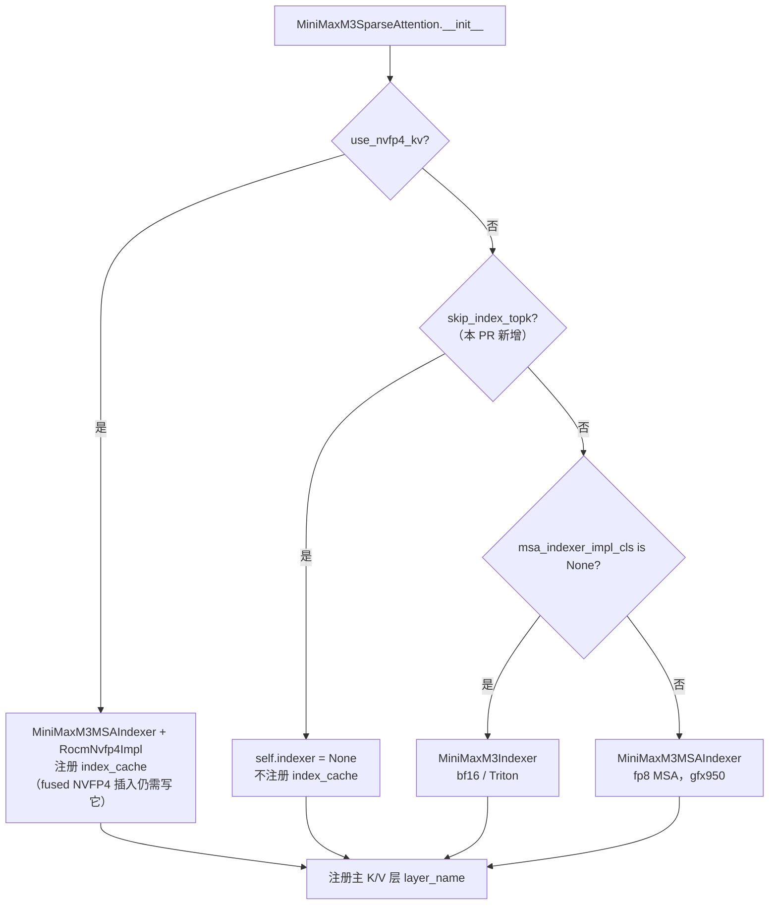
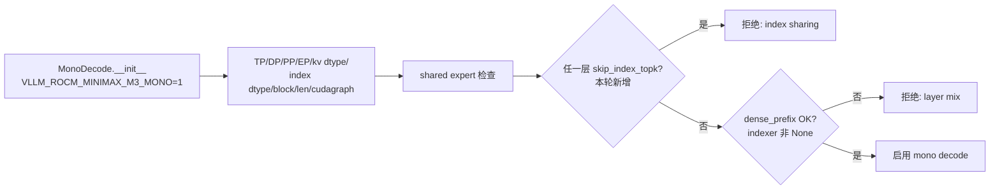

# PR #64403: [Bugfix][ROCm] Avoid unused index caches in MiniMax-M3 sharing layers

> **Author**: @lunarwhite | **State**: OPEN | **Date**: 2026-10-29
> **Branch**: `lunarwhite/minimax-shared-index-cache` → `main` | **Labels**: bug, documentation, rocm, ready, minimax
> **Changes**: +228 -4 lines across 5 files | **ROCm 相关性**: 完全相关（源码改动只在 `vllm/models/minimax_m3/amd/` 这个 AMD 专属模型目录，另有 ROCm-only 测试和文档）
> 本报告分两部分：§1–6 为 PR 详细总结，§7–8 为 ROCm review 意见。
> **复审**：上一版报告针对 head `2459f5e9`（结论 needs-work），本次针对 head `eab3ee8b05`。本地仓库里已没有 `2459f5e9` 这个对象，因此与旧 head 的对比依据是旧报告对 diff 的描述，详见 §5 末尾的"相对上一版 head 的变化"。PR 分支基于 `51c6dfd8c8`，diff 能干净地 apply 到当前 `upstream/main`（`ffdf26702a`）。

---

## 1. 总结 (Summary)

MiniMax-M3 的 ROCm 实现支持 IndexCache 跨层 top-k 共享（`use_index_cache` + `index_topk_freq`，由 #47269 引入）。开启后，"复用层"（`skip_index_topk=True`）在 forward 里不跑 indexer，但构造期照样创建 indexer，它的 `MiniMaxM3IndexerCache` 也会注册进 `static_forward_context`。KV cache manager 于是给这些层分配了一块从来不会被读写的 index-K 侧缓存。

本 PR 让构造条件和 forward 使用同一个 `skip_index_topk` 判断：复用层设 `self.indexer = None`，不再注册 side cache。NVFP4 K/V 路径是例外，因为它的 fused 插入 kernel 仍然要写 index cache。

本轮新增的改动是在 mono decode 的 `_config_refusal` 里加了一条显式的 "index sharing" 拒绝。其余部分和上一版一致：mono `dense_prefix` 的检查从 `hasattr` 改为"非 None"，补了构造/注册/state-dict 测试和一个 5 层 dummy 模型的 `LLM.generate` 端到端测试，文档也加了 MiniMax M3 的用法段落。

## 2. 背景与动机 (Background & Motivation)

- #47269 给 MiniMax-M3（ROCm）加了 ATOM 风格的 `index_topk_freq`：每 `freq` 个稀疏注意力层只有 1 层重算 lightning-indexer 的 top-k，其余层复用共享 `topk_indices_buffer` 里前一个计算层写下的选择结果。forward 侧已经按 `skip_index_topk` 跳过 indexer 调用和 index-K 写入，但构造侧没有同步跳过。结果是共享模式下每个复用层都多挂一块 index-K cache，白占 KV 预算。
- 作者在 MI355X 上用新增测试在 base 上复现了问题：base 上 14 个构造类用例中 10 个通过，4 个因注册了多余的 `*.index_cache` 失败；head 上 14 个全部通过。两个 engine 用例在 base 上 sharing 那一个失败，head 上都通过。PR 定位为容量/资源注册修复，明确不主张吞吐收益。
- 先例：DeepSeek-V3.2 的 IndexCache 实现（`vllm/model_executor/models/deepseek_v2.py`）在 skip 层同样设 `self.indexer = None`。本 PR 让 MiniMax-M3 ROCm 路径与它对齐。`[已验证]`

## 3. 代码修改分析 (Code Change Analysis)

### 3.1 修改的模块

| 模块 | 改动 |
|------|------|
| `vllm/models/minimax_m3/amd/model.py` (+9) | `MiniMaxM3SparseAttention.__init__` 新增 `elif self.skip_index_topk: self.indexer = None` 分支，位置在 NVFP4 分支之后，所以 NVFP4 仍会构造 indexer。`indexer` 注解改为 Optional，6 处使用点前加了 `assert self.indexer is not None` 来收窄类型 |
| `vllm/models/minimax_m3/amd/mono/dispatch.py` (+7，**本轮新增**) | `_config_refusal` 在 "layer mix" 之前加一条检查：任一层 `self_attn.skip_index_topk` 为真时，拒绝原因为 `"index sharing"` |
| `vllm/models/minimax_m3/amd/mono/runner.py` (+2 -1) | `dense_prefix` 对 MoE 层的检查从 `hasattr(self_attn, "indexer")` 改为 `getattr(..., None) is not None` |
| `tests/models/minimax_m3/test_index_cache_overrides.py` (+199 -3) | 新增 `test_index_cache_registration`（5 组配置 × bf16/fp8，外加 1 个 nvfp4 sharing 用例，共 11 个参数化）和 `test_index_cache_engine`（5 层 dummy 模型，sharing 关、开各跑一次 `LLM.generate`） |
| `docs/features/index_cache.md` (+11) | 新增 "MiniMax M3 on ROCm" 小节 |

### 3.2 架构 / 流程图

构造期 indexer 选择（PR 后）：



mono decode 的部署级拒绝顺序（本轮变化）：



### 3.3 关键实现细节

- **分支顺序是关键**：`use_nvfp4_kv` 先于 `skip_index_topk` 判断，所以 NVFP4 复用层仍会构造 indexer。NVFP4 forward 无条件读取 `fwd_slot_mapping[self.indexer.index_cache.prefix]`，`_norm_rope_nvfp4_insert` 也会把 index-K 写进 `self.indexer.index_cache.kv_cache`，因此这个例外是必需的。`[已验证]`
- **非 NVFP4 复用层的 forward 不会碰 indexer**：`_native_gfx942_qknorm_rope_cache` 在 skip 时提前 `return q, None`；`forward` 的 skip 分支走 `skip_index_branch=True`；`_insert_aiter_sparse_pa_kv` 在 `index_k is None` 时先于 assert 返回；`_run_attention` 只在 `not skip_index_topk` 时调用 indexer。6 个新 assert 都在"非 skip 或 NVFP4"的可达路径上。`[已验证]`
- **indexer 不含可训练参数**：唯一的 buffer `topk_completion_counter` 是 `persistent=False`，因此去掉 indexer 不影响 checkpoint 加载和 `load_state_dict(strict=True)`。`[已验证]`
- **KV cache 分组不受影响**：主 K/V 是 `FullAttentionSpec`，index cache 是 `MLAAttentionSpec(cache_role=INDEXER)`，二者落在同一个 `UniformTypeKVCacheSpecs` 组。少注册几层 index cache 只是减少组内的 per-layer spec，不会把块表拆开。`[已验证]`
- **本轮新增的 mono "index sharing" 检查**：`getattr(layer.self_attn, "skip_index_topk", False)`。dense 层的 `MiniMaxM3Attention` 没有这个属性，取默认 False；复用层（包括 NVFP4 复用层）为 True，会被拒绝。这条检查排在 "layer mix" 之前，所以 sharing 开启时日志会给出正确原因。`checks` 是一个立即求值的 tuple，PP>1 时 `PPMissingLayer` 没有 `self_attn`，在这里会抛 AttributeError。但已有的 `_dense_prefix_ok` / `_separate_shared_ok` 本来就会访问 `is_moe_layer`，存在同样的问题，而且这条路径只在 `VLLM_ROCM_MINIMAX_M3_MONO=1` 时运行，所以不算本 PR 引入的回归。`[已验证]`

## 4. 涉及的技术原理 (Technical Principles)

- **IndexCache（跨层 top-k 复用）**：稀疏注意力层先由轻量 indexer 给 KV block 打分并选出 top-k，相邻层的选择高度相关。每 `freq` 层计算一次、其余层复用，indexer 成本约降到 1/freq。MiniMax-M3 用 `_should_skip_index_topk` 判断哪些层复用：`max(ordinal - offset, 0) % freq != 0` 的层复用。
- **vLLM KV cache 注册模型**：构造期写入 `static_forward_context` 的 `AttentionLayerBase` 模块都会被 KV cache manager 按 `get_kv_cache_spec()` 计入预算，不管 forward 是否用到。这就是本 bug 的根因：模块被构造出来，cache 就被分配。
- **index-K 侧缓存**：每 token 每层存一个 128 维 key（bf16 为 256 B，fp8 为 128 B）。真实 M3 有 57 个稀疏层，`freq=4` 时其中约 42 层是复用层，这些层的 index cache 都可以省掉。
- **NVFP4 fused 插入**：`minimax_m3_norm_rope_nvfp4_insert` 在一个 kernel 里同时完成 norm、RoPE、主 K/V 插入和 index-K 插入，所以复用层也必须保留 index cache。

## 5. 评论区讨论亮点 (Discussion Highlights)

- **@ChuanLi1101**：确认 NVFP4 路径保留 indexer 是对的；PR 没有吞吐声明，内存下降是真实的，但在两层 fixture 里幅度很小。
- **@okorzh-amd（model.py，10-30）**：指出 Optional 化后 mypy 报 3 个 `union-attr`。作者已在 `_norm_rope_nvfp4_insert` 和 forward 的 NVFP4 分支加了 assert，PR 页面显示 mypy hook 已通过。
- **@okorzh-amd（runner.py，10-30）**：建议用 `getattr(..., None)` 替换 `hasattr`，并给 index sharing 单独一条拒绝日志。作者在本轮加了 `dispatch.py` 的 "index sharing" 检查。
- **@okorzh-amd（test 文件，11-03）**：指出 `nvfp4-sharing` 用例没有出现在原验证描述里，要求把描述更新为 14 个构造用例 + 2 个 engine 用例。作者已更新描述。
- 目前没有 approval，CI 状态在页面上不可见，PR 在等 maintainer 触发 CI。

**相对上一版 head（`2459f5e9`）的变化**（旧 commit 本地不可得，依据旧报告的描述比对）：

| 项目 | 旧 head `2459f5e9` | 新 head `eab3ee8b05` |
|------|--------------------|----------------------|
| 文件数 / 行数 | 4 files, +221 -4 | 5 files, +228 -4 |
| `mono/dispatch.py` | 未改 | 新增 "index sharing" 拒绝（+7） |
| `model.py` / `runner.py` / 测试 / 文档 | — | 与旧报告描述一致（+9、+2-1、+199-3、+11），未见变化 |
| PR 描述 | 验证 head 为 `ace98c48`，"13 cases，base 9/4" | 验证 head 为 `eab3ee8b05a2`，"14 cases（含 NVFP4 sharing），base 10 pass / 4 fail，head 14 pass"，两个 engine 用例均通过 |

上一版发现的处理情况：

| 上一版发现 | 状态 |
|-----------|------|
| ⚠️ nvfp4 sharing 用例未限定 gfx950 | **未解决**：`test_index_cache_overrides.py:95` 不变，仍只有文件级 `is_rocm()` skip |
| ⚠️ 验证证据不是当前 head，测试数量对不上 | **已解决**：描述已改为在当前 head `eab3ee8b05a2` 上验证，14 + 2 个用例，base 10/4 与我的推算一致，NVFP4 用例在 MI355 上有通过记录。上游 CI 结果仍不可见 |
| 📝 mono 拒绝信息误导，两处孪生检查不一致 | **部分解决**：① 误导日志已修复（新增 "index sharing"）；② `mono/weights.py:260` 仍是 `hasattr(attn, "indexer")`（现在被两道检查挡在前面，不可达）；③ `test_mono_host.py` 没有为新的拒绝条件加用例 |
| 📝 文档没有说明 MiniMax M3 的参数集与 DeepSeek 不同 | **未解决** |

## 6. 风险与潜在问题 (Risk Analysis)

| 风险 | 严重程度 | 说明 |
|------|---------|------|
| 正确性：复用层访问 `None` indexer | Low | 所有访问点都已追溯到 skip 分支或 NVFP4 分支，见 §3.3 |
| 测试：nvfp4 用例在 gfx942 上必挂 | Medium | 见 §7 ⚠️【测试】 |
| CI：AMD MI355 job 是 optional，当前 head 的 CI 结果不可见 | Medium | 需要 `/amd-ci run` 并贴出结果 |
| 测试覆盖：新的 mono "index sharing" 拒绝没有单测 | Low | 见 §7 📝【可维护性】 |
| 兼容性：KV cache 布局随 `use_index_cache` 变化 | Low | P/D 分离两端需要用相同的 sharing 配置。PR 前复用层的 index cache 本来就没有被写入，所以不是新回归 |
| 文档：配置表只描述 DeepSeek 的参数 | Low | 见 §7 📝 |

---

## 7. Review 意见 (Findings)

| 类型 | 🔴 | ⚠️ | 📝 |
|------|----|----|----|
| 测试 | — | 1 | — |
| 可维护性 | — | — | 1 |
| 注释/文档 | — | — | 1 |

核心改动已按路径逐一核对（§3.3），本轮新增的 dispatch 检查也是正确的，没有能写出具体触发输入的阻塞问题。剩下的意见集中在测试的可移植性和几处收尾工作上。

---

**⚠️【测试】nvfp4 sharing 用例仍未限定 gfx950，在 MI300/MI325（gfx942）上会因构造失败报错** `[已验证]`（上一版遗留）

- **问题**: `tests/models/minimax_m3/test_index_cache_overrides.py:95` 的 `pytest.param(True, 4, 0, 4, True, "nvfp4", id="nvfp4-sharing")` 只受文件级 `current_platform.is_rocm()` skip 保护。该用例设置 `cache_dtype="nvfp4"`，构造路径会走 `MiniMaxM3IndexerRocmNvfp4Impl`，其中 `rocm_nvfp4_indexer_unsupported_reason()` 在 `not on_gfx950()` 时返回 `"needs gfx950"`，随后抛出 `ValueError("MiniMax M3 NVFP4 indexer on ROCm needs gfx950")`（`indexer_nvfp4.py:49-52,114`）。
- **影响**: 在 gfx942 上运行这个文件必然有 1 个失败。原因是硬件不支持，不是回归，但很容易被误读成回归。目前三个 CI 入口都不会暴露它：`test-amd.yaml` 的 MI355 job、`models_basic.yaml` 的 mi355_4 job，以及 B200 job（被 `is_rocm` skip）。同目录的 `amd_specialized_decode/test_model.py`、`test_ops.py` 已经用 `on_gfx950()` 做了 gate，本文件和它们不一致。
- **行动**: 建议作者给这个 param 加 `marks=pytest.mark.skipif(not on_gfx950(), reason="NVFP4 indexer needs gfx950")`，或者直接用 `rocm_nvfp4_indexer_unsupported_reason(...)` 作为 skip 条件，这样测试和生产 gate 不会各自漂移。

**📝【可维护性】新的 "index sharing" 拒绝没有单测，`weights.py` 的孪生检查仍是 `hasattr`** `[已验证]`

- **问题**: ① `mono/dispatch.py:79-85` 新增的拒绝条件没有在 `tests/models/minimax_m3/test_mono_host.py` 的 `test_config_refusal_names_the_unmet_condition` 中加参数化用例（现有用例只覆盖 TP、kv cache、block size、max_model_len、shared expert）。描述里说 "Host-only checks covered the mono eligibility and rejection predicates"，但这部分没有提交成测试。② `mono/weights.py:260` 的 `build_sparse_layer` 仍是 `hasattr(attn, "indexer") and layer.is_moe_layer`。PR 之后复用层上 `indexer` 为 `None`，`hasattr` 恒为真，后面 `attn.indexer.impl` 会抛 AttributeError。目前它被 `_config_refusal` 和 `dense_prefix` 两道检查挡住、不可达，但两处判断语义已经不一致。
- **行动**: 建议作者在 `test_mono_host.py` 加一个带 `skip_index_topk=True` 层的 `_model()` 用例，断言原因为 "index sharing"；同时把 `weights.py:260` 改为 `getattr(attn, "indexer", None) is not None`，让孪生检查一致。

**📝【注释/文档】MiniMax M3 文档小节没有说明参数集与 DeepSeek 不同** `[已验证]`（上一版遗留）

- **问题**: 新增的 "MiniMax M3 on ROCm" 小节（`docs/features/index_cache.md:20-30`）后面紧跟的 "Configuration Reference" 表列的是 DeepSeek 的 `index_topk_pattern`。MiniMax-M3 只读取 `use_index_cache`、`index_topk_freq`、`index_skip_topk_offset`，不支持 `index_topk_pattern`；而它支持的 `index_skip_topk_offset` 又不在表里。
- **行动**: 建议作者在该小节补一句："MiniMax M3 supports `index_topk_freq` and `index_skip_topk_offset`; `index_topk_pattern` is not supported."

## 8. 结论 (Verdict)

**⚠️ NEEDS WORK**（接近 LGTM）

核心修复正确，和 DeepSeek-V3.2 的现有做法一致。上一轮的两条主要意见里，验证证据过时这一条已解决：描述改为在当前 head 上验证，用例数量也对得上。mono 日志误导的问题也已经通过显式的 "index sharing" 拒绝修好。剩下的 ⚠️ 只有 nvfp4 用例的 gfx950 gate，一行就能改；另外两条 📝 可以顺手处理。改完、再贴一次当前 head 的 `/amd-ci run` 结果，就可以 LGTM。

**数字溯源**：描述中"64 blocks 时两层 cache 从 12 降到 10 MiB（BF16 index）、从 10 降到 9 MiB（FP8 index）"可以用测试 fixture 的形状独立算出来：8192 tokens 下，主 K/V 每层 4 MiB，index-K 每层 BF16 2 MiB、FP8 1 MiB。算术与描述一致。不过这只是两层 fixture 的组件数字，原始输出不在仓库中，本报告不外推到整模型。

## 9. 英文 Review 评论 (Copy-Paste English Comments)

**C1** `tests/models/minimax_m3/test_index_cache_overrides.py:95` — ⚠️ comment

```text
This is still open from the previous round: the `nvfp4-sharing` case is only gated by the file-level `is_rocm()` skip, but constructing it goes through `MiniMaxM3IndexerRocmNvfp4Impl`, whose `rocm_nvfp4_indexer_unsupported_reason()` returns "needs gfx950", so the constructor raises `ValueError` on gfx942. All current CI entries for this file run on mi355_4, so CI won't catch it, but anyone running the file on MI300/MI325 gets a hardware-unsupported failure that looks like a regression. Could you add `marks=pytest.mark.skipif(not on_gfx950(), reason=...)` to this param (as `amd_specialized_decode/test_model.py` does), or reuse `rocm_nvfp4_indexer_unsupported_reason(...)` as the skip condition so the test and the production gate cannot drift?
```

**C2** `vllm/models/minimax_m3/amd/mono/dispatch.py:79-85` — ⚠️ comment

```text
Thanks for adding the explicit "index sharing" refusal; the log reason is now accurate. Two small follow-ups: (1) `test_config_refusal_names_the_unmet_condition` in `tests/models/minimax_m3/test_mono_host.py` doesn't cover this new condition yet, so a `_model()` variant with a `skip_index_topk=True` layer asserting "index sharing" would lock it in (the description mentions this was checked host-side, but it isn't committed). (2) The twin check in `mono/weights.py:260` (`build_sparse_layer`) is still `hasattr(attn, "indexer")`, which is always true now that reuse layers set `indexer = None`; it is unreachable behind this refusal and `dense_prefix`, but switching it to `getattr(attn, "indexer", None) is not None` keeps the predicates consistent.
```

**C3** `docs/features/index_cache.md:29` — ⚠️ comment

```text
Nit: the "Configuration Reference" table right below this section lists DeepSeek's `index_topk_pattern`, which MiniMax M3 does not read, and omits `index_skip_topk_offset`, which it does. Consider adding one sentence here, e.g. "MiniMax M3 supports `index_topk_freq` and `index_skip_topk_offset`; `index_topk_pattern` is not supported."
```
