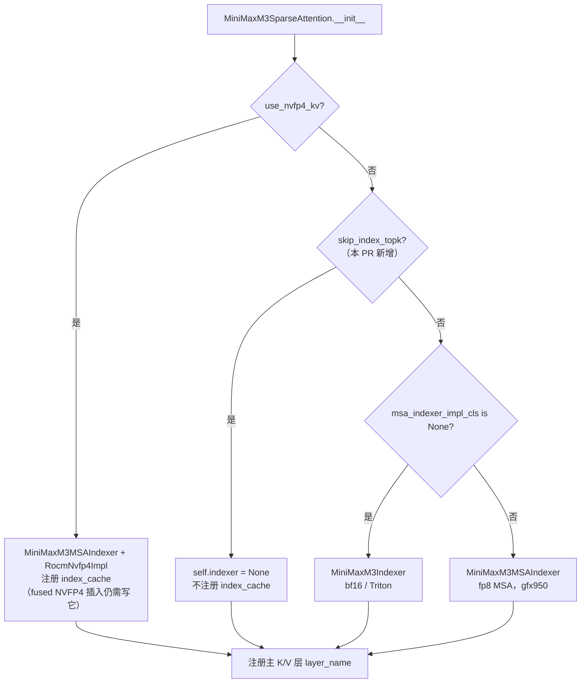

# PR #64403: [Bugfix][ROCm] Avoid unused index caches in MiniMax-M3 sharing layers

> **Author**: @lunarwhite | **State**: OPEN | **Date**: 2026-10-29
> **Branch**: `lunarwhite/minimax-shared-index-cache` → `main` | **Labels**: bug, documentation, rocm, ready, minimax
> **Changes**: +221 -4 lines across 4 files | **ROCm 相关性**: 完全相关（只改 `vllm/models/minimax_m3/amd/`，属于 AMD 专属模型目录，外加 ROCm-only 测试和文档）
> 本报告分两部分：§1–6 为 PR 详细总结，§7–8 为 ROCm review 意见。
> 审阅基线：vLLM main `335dd77b09`（2026-10-30）。本 PR 改动的两个源文件在 main 上与 PR base 一致，hunk 头可直接对上。

---

## 1. 总结 (Summary)

MiniMax-M3 的 ROCm 实现支持 IndexCache 跨层 top-k 共享（`use_index_cache` + `index_topk_freq`，由 #47269 引入）。开启后，"复用层"（`skip_index_topk=True`）在 forward 里不跑 indexer，但构造期仍然创建 indexer，它的 `MiniMaxM3IndexerCache` 也照常注册进 `static_forward_context`。KV cache manager 因此为这些层分配了一块永远不会被读写的 index-K 侧缓存。本 PR 让 indexer 的构造条件和 forward 用的同一个 `skip_index_topk` 判断保持一致：复用层设 `self.indexer = None`，不再注册 side cache。NVFP4 K/V 路径例外，因为它的 fused 插入 kernel 仍要写 index cache。另外，mono decode 的层检查从 `hasattr` 改为"非 None"，同时补了构造/注册/state-dict 测试和一个 5 层 dummy 模型的 `LLM.generate` 端到端测试，文档里也加了 MiniMax M3 的用法段落。

## 2. 背景与动机 (Background & Motivation)

- #47269 给 MiniMax-M3（ROCm）加了 ATOM 风格的 `index_topk_freq`：每 `freq` 个稀疏注意力层只有 1 层重算 lightning-indexer 的 top-k，其余层复用共享 `topk_indices_buffer` 里前一个计算层写下的选择结果。forward 侧已经按 `skip_index_topk` 跳过 indexer 调用和 index-K 写入，构造侧却没有同步跳过。结果是共享模式下每个复用层多挂一块 index-K cache，白占 KV 预算，也让 `static_forward_context` 中的层集合与实际使用不一致。
- 作者用新增测试在 base 上复现了问题：sharing 开启时，复用层（layer 4/5）多注册了 `*.index_cache`，BF16/FP8 两种 index dtype 共 4 个失败。PR 定位为"容量/资源注册修复"，明确不主张吞吐收益。
- 先例：DeepSeek-V3.2 的 IndexCache 实现（`vllm/model_executor/models/deepseek_v2.py:1168-1192`）在 skip 层同样设 `self.indexer = None`（MTP 层除外），本 PR 让 MiniMax-M3 ROCm 路径与之对齐。`[已验证]`

## 3. 代码修改分析 (Code Change Analysis)

### 3.1 修改的模块

| 模块 | 改动 |
|------|------|
| `vllm/models/minimax_m3/amd/model.py` (+9) | `MiniMaxM3SparseAttention.__init__` 新增 `elif self.skip_index_topk: self.indexer = None` 分支（位于 NVFP4 分支之后，因此 NVFP4 仍构造 indexer）。`indexer` 注解改为 Optional，6 处使用点前加 `assert self.indexer is not None` 收窄类型 |
| `vllm/models/minimax_m3/amd/mono/runner.py` (+2 -1) | `dense_prefix` 的 MoE 层检查从 `hasattr(self_attn, "indexer")` 改为 `getattr(..., None) is not None`，使 mono decode 对含复用层的模型返回 `MonoUnsupported` |
| `tests/models/minimax_m3/test_index_cache_overrides.py` (+199 -3) | 新增 `test_index_cache_registration`（5 组配置 × bf16/fp8，加 1 个 nvfp4 sharing 用例，共 11 个参数化）和 `test_index_cache_engine`（5 层 dummy 模型，sharing 关/开各一次 `LLM.generate`） |
| `docs/features/index_cache.md` (+11) | 新增 "MiniMax M3 on ROCm" 小节：说明需通过 `text_config` 传参、默认关闭，并说明复用层不分配 index-K cache（NVFP4 例外） |

### 3.2 架构 / 流程图

构造期 indexer 选择（PR 后）：



forward 与 KV cache 分配的对应关系：

```mermaid
graph LR
    subgraph 计算层 ordinal%freq==0
      L3[layer 3 attn] -->|写| IC3[(layer3.index_cache)]
      L3 -->|indexer 写 top-k| TB[(共享 topk_indices_buffer<br/>/ sparse_bt_buffer)]
    end
    subgraph 复用层 skip_index_topk
      L4[layer 4 attn<br/>indexer=None] -->|读| TB
      L4 -. PR 前: 分配但从不读写 .-> IC4[(layer4.index_cache)]
    end
    KVM[KV cache manager<br/>UniformTypeKVCacheSpecs 单组] --> IC3
    KVM -. PR 后不再分配 .-> IC4
```

### 3.3 关键实现细节

- **分支顺序是关键**：`use_nvfp4_kv` 先于 `skip_index_topk` 判断，所以 NVFP4 复用层依然构造 indexer。NVFP4 forward（`model.py` 新文件 1183-1191）无条件读取 `fwd_slot_mapping[self.indexer.index_cache.prefix]`，`_norm_rope_nvfp4_insert` 也会把 index-K 写入 `self.indexer.index_cache.kv_cache`，因此这个例外是必需的。`[已验证]`
- **非 NVFP4 复用层的 forward 已经不碰 indexer**：`_native_gfx942_qknorm_rope_cache` 在 `skip_index_topk` 时提前 `return q, None`；`forward` 的 skip 分支用 `skip_index_branch=True` 调 fused kernel，或在调 `_insert_aiter_sparse_pa_kv` 时传 `index_k=None`，该函数在 `index_k is None` 时于 assert 之前就返回；`_run_attention` 只在 `not skip_index_topk` 时调用 indexer。新加的 6 个 assert 都位于"非 skip 或 NVFP4"的可达路径上，不会在复用层误触发。`[已验证]`
- **indexer 不含可训练参数**：`MiniMaxM3Indexer`、`MiniMaxM3MSAIndexer` 及各 impl 没有 `nn.Parameter`，唯一的 buffer `topk_completion_counter` 是 `persistent=False`。index 分支的 `index_q_norm`/`index_k_norm`/`qkv_proj` 都挂在 attention 层本身。所以去掉 indexer 不影响 checkpoint 加载和 state_dict，与测试中 `load_state_dict(strict=True)` 的断言一致。`[已验证]`
- **KV cache 分组不受扰动**：主 K/V 是 `FullAttentionSpec`，index cache 是 `MLAAttentionSpec(cache_role=INDEXER)`，二者都以 FullAttention 为 uniform 基类，落在同一个 `UniformTypeKVCacheSpecs` 组里（`kv_cache_interface.py:1348`）。少注册几层 index cache 只会减少组内的 per-layer spec，不会把主 K/V 拆进不同的 block table，复用层读到的 top-k 和计算层共享同一套物理块。MiniMax-M3 没有 sliding-window 层，因此不存在 hybrid 分组。`[已验证]`
- **下游消费者**：`mono/dispatch.py` 的 `_config_refusal` 通过 `_dense_prefix_ok` 调用 `dense_prefix`，mono 在初始化阶段就以 "layer mix" 拒绝。`MonoDecodeRunner.__init__` 也会先调 `dense_prefix`。`specialized_decode/runtime/spec.py:73-76` 本来就拒绝 `use_index_cache` 和 `index_topk_freq != 1`，`caches.py` 中的 `cache_binding` 还会捕获 `AttributeError`。NVIDIA 侧 `nvidia/model.py` 没有 `skip_index_topk`，不受影响。`[已验证]`

## 4. 涉及的技术原理 (Technical Principles)

- **IndexCache / 跨层 top-k 复用**：稀疏注意力层先由轻量 indexer 对每个 KV block 打分并选 top-k block，再只在这些 block 上做 attention。相邻层选出的 block 高度相关，因此每 `freq` 层算一次、其余层复用，可以把 indexer 成本降到约 1/freq，代价是选择结果是近似的。MiniMax-M3 用 `_should_skip_index_topk`，按稀疏层序号 `max(ordinal - offset, 0) % freq != 0` 决定哪些层复用。
- **vLLM 的 KV cache 注册模型**：任何实现 `AttentionLayerBase` 并在构造期写入 `compilation_config.static_forward_context` 的模块，都会被 KV cache manager 视为一个需要分配 cache 的"层"，按 `get_kv_cache_spec()` 计入 KV 预算。所以只要模块被构造出来，cache 就会被分配，不管 forward 是否用到。这也是本 bug 的根因。
- **index-K 侧缓存**：MiniMax-M3 的 indexer 为每个 token 存一个 `sparse_index_dim=128` 维的 key（bf16 为 256 B/token/层，fp8 为 128 B，nvfp4 为 packed 72 B），以 key-only 的 `MLAAttentionSpec` 预算。真实 M3 有 57 个稀疏层，`freq=4` 时其中 42 层是复用层，这些层的 index cache 全部可以省掉。
- **NVFP4 fused 插入**：NVFP4 K/V 路径用一个 kernel（`minimax_m3_norm_rope_nvfp4_insert`）同时完成 norm、RoPE、主 K/V 插入和 index-K 插入，签名要求传入 index cache 和对应的 slot mapping，因此复用层也必须保留 index cache。

## 5. 评论区讨论亮点 (Discussion Highlights)

- **@ChuanLi1101**：确认 NVFP4 路径保留 indexer 是正确的；没有吞吐声明，内存下降真实存在，但在两层 fixture 里幅度很小。
- **@okorzh-amd（inline，model.py:852）**：称 pre-commit mypy 报了 3 个 `union-attr`（model.py:1093/1106/1162，NVFP4 路径），要求在 `_norm_rope_nvfp4_insert` 开头和 forward 的 NVFP4 分支加 assert。**核对结果**：当前 head `2459f5e9` 的 diff 已在这两处加了 assert（新文件 1115、1185）。把 diff 应用到 main 副本后，所有 `self.indexer.` 访问点之前都有收窄（1025/1080/1115/1185/1291/1413）。评论中的行号与当前 head 文件对不上（例如 1093 在 head 中已位于 1080 的 assert 之后），疑似针对 force-push 之前的版本，或 CI merge 了更新 main 之后的行号。这需要作者在当前 head 重跑 pre-commit 来确认，见 §7。
- **@okorzh-amd（inline，runner.py:86）**：Nit，开启 sharing 后 mono 拒绝时日志写的是 "layer mix"，而 main 上同一配置原本以 "sparse selection config"（`weights.py:274-276`）拒绝，建议给 sharing 单独一条信息。这一点与 §7 的 📝 一致。
- mergify 在 10-29 17:34 报过 pre-commit 失败，当时对应的 head 未知。PR 目前 `mergeable_state=unstable`。

## 6. 风险与潜在问题 (Risk Analysis)

| 风险 | 严重程度 | 说明 |
|------|---------|------|
| 正确性：复用层访问 `None` indexer | Low | 所有访问点都已追溯到 skip 分支或 NVFP4 分支，见 §3.3 |
| 测试：nvfp4 用例在 gfx942 上必挂 | Medium | 见 §7 ⚠️【测试】nvfp4 用例未限定 gfx950 |
| 测试/证据：验证结果对应的不是当前 head | Medium | 见 §7 ⚠️【测试】验证证据与当前 head 不一致 |
| CI：AMD MI355 job 为 optional，且本次 fetch 未拿到 check 数据 | Medium | 需要 `/amd-ci run` 并贴出结果 |
| 兼容性：KV cache 布局随 `use_index_cache` 变化 | Low | P/D 分离或 KV offload 两端需用相同 sharing 配置。PR 前若配置不一致，复用层的 index cache 本来就未被写入，所以这不是新回归 |
| 可维护性：mono 拒绝信息误导、`weights.py` 的孪生检查仍用 `hasattr` | Low | 见 §7 📝 |
| 文档：配置表只描述 DeepSeek 的参数 | Low | 见 §7 📝 |

---

## 7. Review 意见 (Findings)

| 类型 | 🔴 | ⚠️ | 📝 |
|------|----|----|----|
| 测试 | — | 2 | — |
| 可维护性 | — | — | 1 |
| 注释/文档 | — | — | 1 |

核心改动的正确性已经逐路径核对（§3.3），没有发现能写出具体触发输入的阻塞问题。下面的发现集中在测试的可移植性和证据时效性上。

---

**⚠️【测试】nvfp4 sharing 用例没有限定 gfx950，在 MI300/MI325（gfx942）上会因构造失败报错** `[已验证]`

- **问题**: `tests/models/minimax_m3/test_index_cache_overrides.py:95` 新增了 `pytest.param(True, 4, 0, 4, True, "nvfp4", id="nvfp4-sharing")`，而整个文件只用 `current_platform.is_rocm()` 做 skip（第 25-27 行）。该用例设置 `cache_dtype="nvfp4"`，因此 `use_nvfp4_kv=True`，构造路径是 `MiniMaxM3MSAIndexer(impl_cls=MiniMaxM3IndexerRocmNvfp4Impl)`，接着调用 `rocm_nvfp4_indexer_unsupported_reason()`，在 `not on_gfx950()` 时返回 `"needs gfx950"`，最后抛出 `ValueError("MiniMax M3 NVFP4 indexer on ROCm needs gfx950")`（`indexer_nvfp4.py:47-51,107-115`）。
- **影响**: 在 gfx942 机器上（开发者本地，或以后把该文件加入 MI300/MI325 队列时）运行该文件必然出现 1 个失败。这是硬件不支持导致的，与回归无关，但会被误读成回归。当前两条 CI 入口（`test-amd.yaml` 的 MI355 job 和 `test_areas/models_basic.yaml`）都跑在 `mi355_4` 上，暂时不会暴露。
- **行动**: 建议作者给该 param 加 `marks=pytest.mark.skipif(not on_gfx950(), reason="NVFP4 indexer needs gfx950")`，或者直接复用 `rocm_nvfp4_indexer_unsupported_reason(...)` 作为 skip 条件，这样 skip 条件和生产路径的判断不会各自漂移。

**⚠️【测试】PR 描述中的验证证据对应的不是当前 head，测试数量也对不上** `[已验证]`（CI 结果 `[无法验证]`）

- **问题**: Validation 一节写的是在 head `ace98c48dfe2` 上验证，而本次审阅的 head 是 `2459f5e9`（PR 只有 1 个 commit，说明经过 force-push）。描述称"13 个构造类测试：base 9 pass / 4 fail，head 13 pass"。但当前测试文件的非 engine 用例数是 2（top-level 拒绝）+ 1（text_config 生效）+ 11（registration，含 nvfp4）= **14**。nvfp4 用例在 base 上也应该通过（base 本来就保留 indexer），所以 base 应为 10 pass / 4 fail。由此推断 `nvfp4-sharing` 用例是在验证之后才加入的，它在任何硬件上都没有记录过通过结果。描述也明确写了"combined 15-test invocation has not been rerun"（按当前文件实际是 16 个）。
- **影响**: 无法确认当前 head 的完整测试文件在 MI355 上全部通过，nvfp4 用例尤其如此：它依赖 `num_attention_heads=16` 等专门调整过的参数，构造的是 NVFP4 主 attention impl 和 FlyDSL indexer impl，此前没有被验证过。加上 reviewer 报告的 mypy 失败没有在当前 head 上被确认或排除，CI 实际状态不明。
- **行动**: 建议作者在当前 head 上触发 `/amd-ci run`，并贴出 MI355 job 中 `pytest -v -s models/minimax_m3/test_index_cache_overrides.py` 的完整结果（16 个用例），同时重跑 pre-commit（mypy），回复 @okorzh-amd 的 union-attr 评论。按 diff 静态核对，当前 head 的 `self.indexer` 访问点都已收窄。最后更新描述中的 head SHA 和测试数量。

**📝【可维护性】mono 的拒绝信息误导，两处"是否有 indexer"的孪生检查语义不一致** `[已验证]`

- **问题**: ① sharing 开启后，`mono/runner.py:86-88` 的 `dense_prefix` 会因复用层 `indexer is None` 抛出 `MonoUnsupported("layer mix: dense layers must precede the MoE layers")`，`dispatch.py` 中 `_config_refusal` 打出的日志是 "mono decode off: layer mix"，与真实原因（启用了 index sharing）无关。② `mono/weights.py:260` 的 `build_sparse_layer` 仍用 `hasattr(attn, "indexer")`，而 PR 后该属性在复用层为 `None`，`hasattr` 恒为真，后面 272 行的 `attn.indexer.impl` 会抛 `AttributeError`。目前它被 `dense_prefix` 提前拦截所以不可达，但两个孪生检查已经出现分歧。③ `tests/models/minimax_m3/test_mono_host.py` 的 `test_dense_prefix_refuses_other_layer_mixes` 没有覆盖 `indexer=None` 的情况，描述中说的 "mono rejection predicate was checked separately on the host" 没有提交为测试。
- **行动**: 建议作者在 `_config_refusal` 里加一条显式的 `(not getattr(text_config, "use_index_cache", False) or freq <= 1, "index sharing")` 检查（与 `specialized_decode/runtime/spec.py:73-76` 的写法对齐），把 `weights.py:260` 同步改为 `getattr(attn, "indexer", None) is not None`，并在 `test_mono_host.py` 加一个 `indexer=None` 的参数化用例。

**📝【注释/文档】MiniMax M3 文档小节没有说明参数集与 DeepSeek 不同** `[已验证]`

- **问题**: 新增的 "MiniMax M3 on ROCm" 小节位于 "Configuration Reference" 表格之前，而表格列出的是 DeepSeek 的 `index_topk_pattern`。MiniMax-M3 只读取 `use_index_cache`/`index_topk_freq`/`index_skip_topk_offset`（`model_executor/models/config.py:864` 的 `INDEX_CACHE_KEYS`，以及 `_should_skip_index_topk`），不支持 `index_topk_pattern`，而它支持的 `index_skip_topk_offset` 又不在表里。
- **行动**: 建议作者在该小节补一句："MiniMax M3 supports `index_topk_freq` and `index_skip_topk_offset`; `index_topk_pattern` is not supported."

## 8. 结论 (Verdict)

**⚠️ NEEDS WORK**

核心修复是正确的，也与 DeepSeek-V3.2 的既有做法一致。构造条件与 forward 分支一一对应，NVFP4 例外有充分理由，KV 分组、权重加载、mono/specialized decode 的下游消费者都已逐一核对，没有回归。需要补的是测试和证据：nvfp4 用例要限定 gfx950；当前 head 需要一次真实的 MI355 CI 结果（含此前未验证的 nvfp4 用例）以及一次 mypy 重跑。这两项都是小改动，补齐后可以 LGTM。

**数字溯源**：描述中"64 blocks 时两层 cache 从 12 降到 10 MiB（BF16 index）、从 10 降到 9 MiB（FP8 index）"，用测试 fixture 的形状可以独立算出来。block_size=128 × 64 blocks = 8192 tokens；主 K/V 每层为 8192 × 2 × 1 head × 128 × 2 B = 4 MiB；index-K 每层 BF16 为 2 MiB、FP8 为 1 MiB。两层合计 BF16 为 8+2+2 = 12 MiB，降为 10 MiB；FP8 为 8+1+1 = 10 MiB，降为 9 MiB。算术与描述一致，但实测输出是在 head `ace98c48` 上得到的，没有出现在仓库里，且只是两层 fixture 的组件数字。作者本人也说明这不代表整模型的节省，报告不作外推。

## 9. 英文 Review 评论 (Copy-Paste English Comments)

**C1** `tests/models/minimax_m3/test_index_cache_overrides.py:95` — ⚠️ comment

```text
The `nvfp4-sharing` case is only gated by the file-level `is_rocm()` skip, but constructing it goes through `MiniMaxM3IndexerRocmNvfp4Impl`, whose `rocm_nvfp4_indexer_unsupported_reason()` returns "needs gfx950" and raises `ValueError` on gfx942. Both current CI entries run on mi355_4, so CI won't notice, but anyone running this file on MI300/MI325 (or a future gfx942 queue) gets a hardware-unsupported failure that looks like a regression. Could you add `marks=pytest.mark.skipif(not on_gfx950(), ...)` to this param, or reuse `rocm_nvfp4_indexer_unsupported_reason(...)` as the skip condition so the test and the production gate cannot drift?
```

**C2** `tests/models/minimax_m3/test_index_cache_overrides.py:176-177` — ⚠️ comment

```text
The validation in the description was done on `ace98c48dfe2`, not the current head `2459f5e9`, and the counts no longer match: the non-engine subset is now 14 tests (2 + 1 + 11 incl. `nvfp4-sharing`), and base should then be 10 pass / 4 fail rather than 9/4, so the NVFP4 case seems to have been added after the recorded run and has never been reported passing. Could you run `/amd-ci run` on the current head and post the MI355 result for the full file (16 tests, including both engine cases), and rerun pre-commit so we can close out the mypy union-attr report? From reading the diff, every `self.indexer` access on this head is already narrowed by an assert, so that report may be from an earlier push. Please also refresh the head SHA and test counts in the description.
```

**C3** `vllm/models/minimax_m3/amd/mono/runner.py:86-88` — ⚠️ comment

```text
Nit: with index sharing enabled, mono decode is now refused here and the log reads "mono decode off: layer mix", which is misleading. Consider adding an explicit "index sharing" check to `_config_refusal` (matching `specialized_decode/runtime/spec.py`), and updating the twin check in `mono/weights.py:260` from `hasattr(attn, "indexer")` to `getattr(attn, "indexer", None) is not None` so the two predicates don't diverge. A `indexer=None` case in `test_dense_prefix_refuses_other_layer_mixes` would also lock in the host-side rejection you mentioned checking manually.
```
