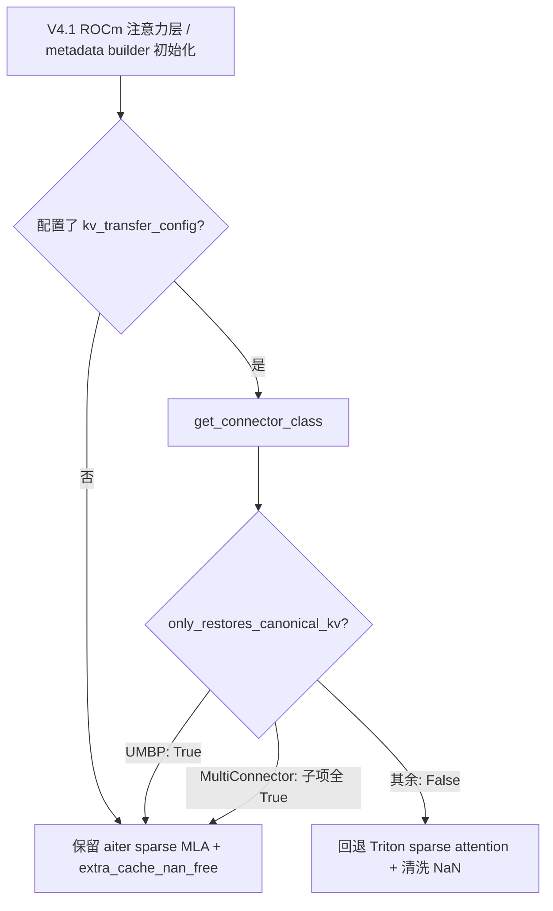
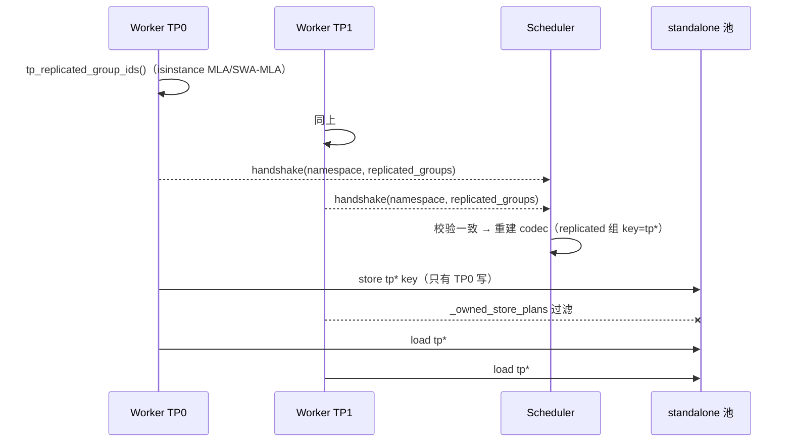

# PR #64715: [ROCm][UMBP] Support UMBP standalone mode for DeepSeek-V4.1-Flash

> **Author**: @shen-shanshan | **State**: OPEN（Draft） | **Date**: 2026-10-30（最近 force-push 2026-11-05）
> **Branch**: `shen-shanshan:rocm-dsv41-flash-umbp` → `main` | **Labels**: `deepseek`, `documentation`, `DSv4.1`, `kv-connector`, `needs-rebase`, `rocm`
> **Changes**: +186 -22 lines across 9 files | **ROCm 相关性**: 部分相关
> - ROCm 专属文件：`vllm/models/deepseek_v41/amd/rocm.py`。
> - 跨后端共享的文件：`kv_connector/v1/base.py`、`multi_connector.py`，以及 UMBP connector 的 6 个文件。
>
> 本报告分两部分：§1–6 为 PR 详细总结，§7–8 为 ROCm review 意见，§9 为可以直接粘贴到 GitHub 的英文评论。
> 数据来源：GitHub API 被限流，diff 用 `git fetch upstream pull/64715/head` 获取，并已核对与作者本地 commit `f30eb996b0` 逐字节一致；PR 描述和 CI 状态取自 PR 网页。

---

## 1. 总结 (Summary)

本 PR 让 DeepSeek-V4.1-Flash 在 ROCm（MI355X）上通过 `UMBPStoreConnector` 的 standalone 模式（节点本地 MORI UMBP server）做 KV offloading，包含两项改动：

1. **保留快路径：** 新增 connector 能力声明 `only_restores_canonical_kv`，UMBP 声明为 True。这样 V4.1 ROCm 路径接上 UMBP 后，aiter sparse MLA 和 `extra_cache_nan_free` 两条快路径仍然开启。原来的逻辑是只要配了 connector 就关闭它们。
2. **TP 去重：** standalone 池在整机所有 rank 之间共享。对 TP 复制的 MLA 类 KV 组，改用 TP 无关的 key（`tp*`），只由 TP0 写入，各 rank 共同读取。

PR 自报的效果：
- GSM8K 精度无损。
- 当工作集超出 GPU KV 容量时（AgentX TP2 c192），吞吐 +46%。
- 当工作集装得下时（c128），基本没有开销。
- DP2 c256 下吞吐 +3.8%。

## 2. 背景与动机 (Background & Motivation)

- **UMBP 合入进度：** UMBP connector 以 `[UMBP][1/10]`～`[10/10]` 系列 PR 合入 main，目前已合入到 7/10（#61795，standalone 运行时）。本 PR 只基于 main 上已有的部分，不包含 9/10（#61797，lazy offload）。
- **快路径被一刀切关闭：** `deepseek_v41/amd/rocm.py` 中有 4 处判断 `kv_transfer_config is not None`，只要配了 connector 就关闭两条快路径：
  - aiter Triton sparse MLA；
  - `extra_cache_nan_free`，即不再清洗 K 中的 NaN。

  这样做的原因是：这两条路径都假设 KV cache 里只有本引擎 canonical writer 写出的字节。NIXL、Mooncake 一类 connector 可能写入外来字节，所以要关闭；但 UMBP 只存取完整 block，namespace 还对每层 spec 做了指纹，不会混入外来字节，对它也关闭只是白白损失性能。InferenceX recipe 默认开启 `VLLM_ROCM_USE_AITER_TRITON_SPARSE_MLA`。
- **TP 冗余存储：** standalone 模式下整机共用一个池。MLA latent、SWA 和 indexer K 在各 TP rank 上完全相同，不去重就会占用 `tp_size` 倍的 DRAM 和写入带宽。
- **与 #63002 的关系：** 通用部分（hook 和去重）与 DSv4-Pro 的同类 PR #63002 相同。V4-Pro 那边的 SWA replay 和 compressor state 改动在 V4.1 上不需要，原因如下：
  - ROCm 上本来就关闭了 SWA replay；
  - compressor state 是 `CircularBufferSpec`，不参与 prefix cache。

## 3. 代码修改分析 (Code Change Analysis)

### 3.1 修改的模块

| 文件 | 说明 |
|------|------|
| `kv_connector/v1/base.py` | 新增 classmethod `only_restores_canonical_kv()`，默认返回 False |
| `kv_connector/v1/multi_connector.py` | 只有当子 connector 不为空且全部返回 True 时，才返回 True |
| `umbp/connector.py` | UMBP 的 hook 返回 True。<br>去重开关：由 `shares_pool_across_ranks` 和 option `dedup_tp_replicated_kv` 共同决定。<br>handshake 上报 `replicated_groups`，scheduler 收到后重建 codec。 |
| `umbp/data.py` | 新增 `tp_replicated_group_ids()`。<br>`UMBPHandshakeMetadata.replicated_groups`。<br>codec 新增 `stores_group` / `keys_per_object`，以及 `tp*` key。 |
| `umbp/runtime/base.py`, `standalone.py` | `shares_pool_across_ranks`：默认 False，standalone 为 True |
| `umbp/scheduler.py` | 3 处 residency 校验改为按组计算 key 宽度，不再统一用 `rank_count` |
| `umbp/worker.py` | `_owned_store_plans()`：TP 非 0 的 rank 过滤掉 replicated 组的 store |
| `models/deepseek_v41/amd/rocm.py` | 新增 `_has_foreign_kv_writer()`，替换 4 处守卫 |

### 3.2 架构 / 流程图





### 3.3 关键实现细节

- **hook 实现方式：** hook 是 classmethod，模型层只需要 `kv_transfer_config` 就能判断，不需要 connector 实例。`rocm.py` 对 factory 延迟 import，避免循环依赖。
- **去重的条件：** `tp_size>1` 且 `pcp=dcp=1`；组开启了 transfer、至少有一层，并且所有层都是 `MLAAttentionSpec` 或 `SlidingWindowMLASpec`。
- **key 数计算：**
  - `keys_per_object = rank_count // tp_size`；
  - `keys_for_topology` 只保留 tp==0 的 namespace；
  - `_rank_keys` 的 lru_cache 以 codec 为键，而 codec 是 frozen 且带有 `replicated_groups`，重建后缓存不会串用。
- **scheduler 采纳 worker 的结果：** scheduler 收到 handshake 时，即使 namespace 已在配置里给定，也会重建 codec；各 rank 上报的组不一致时抛 `ValueError`。
- **非 0 rank 的 store 完成上报：** TP 非 0 的 rank 被过滤到没有任何 store 时，`wait_for_save` 仍会为该 event 上报 `completed_workers=1`，store event 不会卡住（已核对 `worker.py:193-221`）。

## 4. 涉及的技术原理 (Technical Principles)

- **MLA 在 TP 下是复制的。** latent 被所有 head 共享，TP 只切 q/o 的 head，所以每个 rank 的 MLA KV cache 完全相同。
  - main 对此已有正式表达：`AttentionSpec.max_tp_shards`，含义是"cache 在 TP 上最多分成几份，超出这个数的 rank 持有副本；None 表示未知，视为不复制"。
  - `kv_cache_groups_tp_replicas()` 根据它算出 `KVCacheConfig.kv_tp_replicas`（#57652），offloading connector 用这个值判断是否可以按复制布局存储。
- **NaN 清洗与 canonical 来源。** gfx950 的 `fp8_ds_mla` sparse 解码 kernel 在 `TRUST_EXTRA_CACHE_NAN_FREE=False` 时，会把载入的 K 中的 NaN 替换为 0（`rocm_aiter_mla_sparse.py:3176`）。原因是被 mask 掉的列在 P·V 中也会带来 `0×NaN=NaN`。只有 cache 中的每个字节都来自本引擎 writer 时，才可以跳过清洗。
- **UMBP namespace。** 默认 namespace 由 model、revision、model config、block size、cache layout、每层 spec 以及 TP/PP/PCP/DCP 拓扑哈希得到（`data.py:242-288`）。设置了 `key_namespace` 时，直接使用用户给的值，不做任何指纹。

## 5. 评论区讨论亮点 (Discussion Highlights)

- **暂无 reviewer 评论。** PR 仍是 Draft，等待 code owner review：tjtanaa、dllehr-amd、hongxiayang、NickLucche、ApostaC、orozery、xuechendi、ivanium、wzhao18。
- **Mergify 两次标记冲突：** 11-03 和 11-05 各一次。11-05 force-push 后，本地 cherry-pick 到最新 `upstream/main`（`25c148c602`）没有冲突，`needs-rebase` 标签已经过时。
- **CI 尚未运行：** Draft 状态下 Buildkite（包括 AMD 队列）都没跑；pre-commit 和 DCO 处于 pending 状态，在等待 CI 授权。

## 6. 风险与潜在问题 (Risk Analysis)

| 风险 | 严重程度 | 说明 |
|------|---------|------|
| 去重判定与 main 的 `max_tp_shards` 约定不一致 | Medium | 见 §7「TP 复制判定没有复用 `max_tp_shards`」 |
| 去重对所有 MLA 模型生效，但只在 V4.1 上验证过 | Medium | 见 §7「去重范围超出验证范围」 |
| 显式 `key_namespace` 下的 canonical 声明不成立 | Medium | 见 §7「显式 `key_namespace` 绕过指纹」 |
| 新增 option 没有写进文档 | Low | 见 §7 |
| 没有新增单测 | Medium | 见 §7 |
| 和 #61797 lazy offload 的接口 | Low | 后合入的一方需要把 lazy 扫描改为 `keys_per_object`，PR 的 Limitations 中已经写明 |
| ROCm CI 还没跑 | Medium | 转为 Ready 后需要 AMD 队列覆盖 `deepseek_v41/amd/rocm.py` |

---

## 7. Review 意见 (Findings)

| 意见类型 | 数量 |
|---|---|
| 🔴 必须修复 | 0 |
| ⚠️ 建议修复 | 5 |
| 📝 建议/备注 | 3 |

**⚠️【设计】TP 复制判定没有复用 main 已有的 `max_tp_shards` / `kv_tp_replicas` 约定** `[已验证]`
- **问题：**
  - `umbp/data.py:87-106` 的 `tp_replicated_group_ids()` 用 `isinstance(spec, (MLAAttentionSpec, SlidingWindowMLASpec))` 判断某个组是否在 TP 上复制。
  - 而 main 已经有正式字段 `AttentionSpec.max_tp_shards`（`kv_cache_interface.py:543`），docstring 写明 "None: unknown, treated as not replicated"。它由 `kv_cache_planning.py:1248-1265` 汇总为 `kv_tp_replicas`，offloading connector 已在使用（#57652）。
  - 两者对 V4.1 的结论不同：V4.1 的压缩 KV 和 indexer 两个 `MLAAttentionSpec`（`deepseek_v41/attention.py:1310`、`:1380`）都没有设置 `max_tp_shards`，按 main 的约定是"不复制"，按本 PR 的约定是"复制"。V4（`deepseek_v4/attention.py:866/912`）和通用 MLA（`mla_attention.py:1381`）都设置了 `max_tp_shards=1`。
- **影响：**
  - 同一个"是否复制"的概念有两套判定，以后有新模型或新 spec 时容易出现分歧。
  - `isinstance` 会把任何 MLA 类 spec 都视为复制，包括 MiniMax M3 和 Qwen4-exp 的 indexer。这些 spec 没有声明 `max_tp_shards`，属于 main 认为"未知"的情况。
  - reviewer（特别是 offloading 方向的 owner）很可能要求统一。
- **行动：** 建议作者：
  - 把判定改为"组内每层都满足 `max_tp_shards == 1`"（DCP 情况沿用现有排除逻辑）；
  - 在 `deepseek_v41/attention.py` 的两个 `MLAAttentionSpec` 上补 `max_tp_shards=1`，与 V4 保持一致；
  - 在 PR 中说明副作用：V4.1 的 `kv_tp_replicas` 会从 1 变成 `tp_size`，offloading connector 对 V4.1 也会启用 replicated layout，行为与 V4 相同。

**⚠️【正确性】显式 `key_namespace` 会绕过 namespace 指纹，但 `only_restores_canonical_kv` 仍然无条件返回 True** `[已验证]`
- **问题：**
  - `umbp/connector.py:104-107` 的注释写的是 "the namespace fingerprints every per-layer spec, so foreign bytes cannot match"。
  - 但 `UMBPNamespace.configured()`（`data.py:221-229`）在用户设置 `key_namespace` 时直接返回这个值，不包含模型、dtype、layout 或 spec 指纹。
  - 文档（`umbp_store_connector_usage.md:131`）对这个选项的描述是 "Overrides the namespace derived from ..."。
- **影响：** 触发条件是两组部署共用同一个 standalone server 和同一个 `key_namespace`，但 `--kv-cache-dtype` 不同（例如一组用 `fp8_ds_mla`，另一组用 `auto`/bf16），或者 V4.1 MXFP8 record 开关不同。
  - 此时会恢复出不同编码的字节，其中可能有 E8M0 的 `0xFF`（NaN）。
  - 而本 PR 让 gfx950 跳过了 NaN 清洗，`0×NaN` 会污染注意力输出。
  - 修改前，即使配置错误，也有 NaN 清洗兜底。
  - 这需要用户配置错误才会触发，所以不定为 🔴。
- **行动：** 建议作者让 UMBP 的 hook 只在 `key_namespace` 为 `"auto"` 时返回 True，hook 可以直接读 `kv_transfer_config.kv_connector_extra_config`；并同步修正注释。另一种做法是在文档中明确说明：显式 namespace 必须对应相同的 KV 布局。

**⚠️【兼容性】TP 去重的生效范围超出了验证范围** `[已验证]`
- **问题：**
  - 去重写在通用的 UMBP connector 里，只要满足 standalone + TP>1 + 组内全是 MLA 类 spec 就会生效。
  - 因此 DeepSeek V2/V3/R1、V3.2、V4-Pro、Kimi K3、MiniMax M3 等模型在 standalone TP>1 下，key 格式和存取行为都会改变。
  - 但 PR 标题和验证只覆盖了 DeepSeek-V4.1-Flash。
- **影响：**
  - 其他模型的 store/load 路径没有经过端到端验证。
  - 升级后这些模型原来写入池中的 MLA 对象（`tp<N>` key）全部失效。这不会导致读错，但会造成一次冷启动。
- **行动：** 建议作者：
  - 在 PR 描述中明确写出：这是 connector 层的通用行为变化，影响 UMBP standalone 下的所有 MLA 模型；
  - 在 MI355X 上用一个小的 MLA 模型（例如 DeepSeek-V2-Lite，TP2）补一次 standalone 冒烟。
  - 如果要先收窄范围，可以把 `dedup_tp_replicated_kv` 的默认值改为 false，由 V4.1 recipe 显式开启。

**⚠️【测试】新增逻辑没有单测** `[已验证]`
- **问题：** 以下逻辑都没有测试：
  - `keys_per_object` / `keys_for_topology` 对 replicated 组的 key 数和顺序；
  - `_owned_store_plans` 对列式 `BlockStoreBatch` 的列对齐过滤；
  - handshake 中 `replicated_groups` 不一致时报错，以及配置了 namespace 时重建 codec；
  - `MultiConnector.only_restores_canonical_kv` 的聚合逻辑。

  现有的 242 个 UMBP 单测全部通过，但没有覆盖 TP>1 加 standalone 的去重路径。
- **影响：**
  - hits 数组按组切片的偏移一旦写错，会静默地把命中错位到别的 block 上，恢复出错误的 KV。
  - 这类错误只能靠端到端精度测试发现。
  - AGENTS.md 和 `/pr-checklist` 也都要求行为改动带测试。
- **行动：** 建议作者在现有的 `tests/v1/kv_connector/unit/test_umbp_core.py` 中补 3–4 个纯 CPU 小测试，覆盖上面列出的几项；如果确实不加，就在 PR 描述中说明原因。

**⚠️【注释/文档】新的用户可见选项和 key 语义变化没有写进渲染文档** `[已验证]`
- **问题：** `docs/features/umbp_store_connector_usage.md` 没有改动：
  - Shared options 表中没有 `dedup_tp_replicated_kv`；
  - 第 100-104 行仍写着 "Objects are keyed by ... TP/PCP/DCP topology"，而 standalone 模式下 replicated 组的 key 已经与 TP rank 无关。
- **影响：**
  - 用户不知道有这个开关，也不知道升级后旧对象会失效。
  - AGENTS.md 规定，用户可见的配置项必须在同一个 PR 中更新文档。
- **行动：** 作者应当：
  - 在 options 表中加一行 `dedup_tp_replicated_kv`（默认 `true`，仅 standalone 生效）；
  - 在 keying 段落中加一句：TP 复制的 MLA 组在 standalone 模式下只存一份。

**📝【可维护性】参数名与语义不一致**
- **问题：**
  - `rocm.py:73-81` 的 `_trust_dsv4_extra_cache_nan_free(has_kv_transfer)` 和 `:104-111` 的 `_aiter_sparse_mla_enabled(has_kv_transfer)`，现在传入的都是 `_has_foreign_kv_writer(...)` 的结果，参数名却仍是 `has_kv_transfer`。
  - `connector.py:140` 的注释写的是 "e.g. DeepSeek-V4 on ROCm"，但去重与平台无关。
- **行动：** 建议作者把参数名改为 `has_foreign_kv_writer`，并把注释改成与平台无关的写法。

**📝【设计】与 #63002 的重复**
- **问题：** `only_restores_canonical_kv`、MultiConnector 聚合和 UMBP TP 去重，与 DSv4-Pro 的 PR #63002 是同一份通用改动，分别出现在两个 PR 里。
- **影响：** 两个 PR 都能合入时，后合入的一方一定会冲突。reviewer 也可能要求"通用改动单独提一个 PR"。
- **行动：** 建议作者考虑把通用部分（base hook、MultiConnector、UMBP 去重和文档）拆成一个独立 PR，让 V4.1 和 V4-Pro 两个 PR 只保留各自模型侧的改动；或者至少在两个 PR 的描述中互相说明合入顺序。

**📝【HK】PR 描述和流程项**
- **问题：**
  - GitHub 上的 PR 描述是旧版，Limitations 还写着 lazy_offload，也缺少 DP2 的结果。
  - Checklist 中 "I used `/pr-checklist`" 和 "AI assistance was used" 都没有勾选，而 AGENTS.md 规定 AI 协作的 PR 必须明确声明。
  - Validation 中没有列出单测命令和结果（`pytest tests/v1/kv_connector/unit/test_umbp_*.py`，242 passed）。
  - commit 标题是 "support umbp for dsv41-flash"，信息量太少。
- **行动：** 建议作者：
  - 用本地 `docs/mori/pr-umbp-dsv41-flash-standalone.md` 更新 PR 描述；
  - 勾选上述两项，并补上单测命令；
  - 转为 Ready 后确认 AMD CI 队列已经运行。

## 8. 结论 (Verdict)

⚠️ **NEEDS WORK**

- 核心逻辑是正确的。以下几点已对照代码核实无误：
  - hits 切片宽度、`tp*` key 的本地化、key 的生成顺序；
  - 非 0 rank 的 store event 完成上报；
  - `_rank_keys` 缓存会随 codec 区分。
- 合入前建议先做两件事：
  1. 把 TP 复制判定统一到 main 已有的 `max_tp_shards` 约定上；
  2. 收紧显式 `key_namespace` 下的 canonical 声明。
- 另外需要补上文档、少量单测，并在 PR 中说明去重对其他 MLA 模型的影响。

## 9. 英文 Review 评论 (Copy-Paste English Comments)

**C1** `vllm/distributed/kv_transfer/kv_connector/v1/umbp/data.py:87-106` — ⚠️ comment

```text
main already models TP replication through `AttentionSpec.max_tp_shards`
("None: unknown, treated as not replicated"), aggregated into
`KVCacheConfig.kv_tp_replicas` and used by the offloading connector (#57652).
This helper uses `isinstance(MLAAttentionSpec | SlidingWindowMLASpec)` instead,
so the two disagree on V4.1: its compressed-KV and indexer specs
(deepseek_v41/attention.py) do not set `max_tp_shards`. Could we derive the
replicated groups from `max_tp_shards == 1` and set `max_tp_shards=1` on the two
V4.1 MLAAttentionSpecs, matching V4? That would also make V4.1's
`kv_tp_replicas` consistent for the offloading connector.
```

**C2** `vllm/distributed/kv_transfer/kv_connector/v1/umbp/connector.py:104-107` — ⚠️ comment

```text
The comment relies on the namespace fingerprint, but an explicit
`key_namespace` bypasses it entirely (UMBPNamespace.configured). Two
deployments sharing a server and a key_namespace with different
--kv-cache-dtype could then restore non-canonical bytes, and with this PR the
gfx950 fp8_ds_mla path no longer scrubs NaNs. I think the hook should return
True only when `key_namespace` is "auto" (it can read
kv_transfer_config.kv_connector_extra_config), or the docs should state that
an explicit namespace must map to an identical KV layout.
```

**C3** `vllm/distributed/kv_transfer/kv_connector/v1/umbp/connector.py:140-144` — ⚠️ comment

```text
This changes the key format and store ownership for every MLA model on UMBP
standalone with TP > 1 (DeepSeek V2/V3/V3.2/V4, Kimi, MiniMax M3, ...), not
only V4.1, while validation covers V4.1 only. Could you call this out in the
description, add `dedup_tp_replicated_kv` and the TP-agnostic keying to
docs/features/umbp_store_connector_usage.md, and ideally run a small MLA
model (e.g. DeepSeek-V2-Lite, TP2) through standalone once? Also, the
"DeepSeek-V4 on ROCm" example in the comment is platform-specific while the
dedup is not.
```

**C4** `vllm/distributed/kv_transfer/kv_connector/v1/umbp/data.py:357-361` — ⚠️ comment

```text
`keys_per_object` now drives how the scheduler slices lookup and residency
hits per group; an offset bug here would silently attribute hits to the wrong
blocks and restore wrong KV. Could you add a few CPU-only unit tests in
tests/v1/kv_connector/unit/test_umbp_core.py covering keys_for_topology /
keys_per_object for replicated groups, `_owned_store_plans` on a
BlockStoreBatch, and the handshake mismatch error?
```
