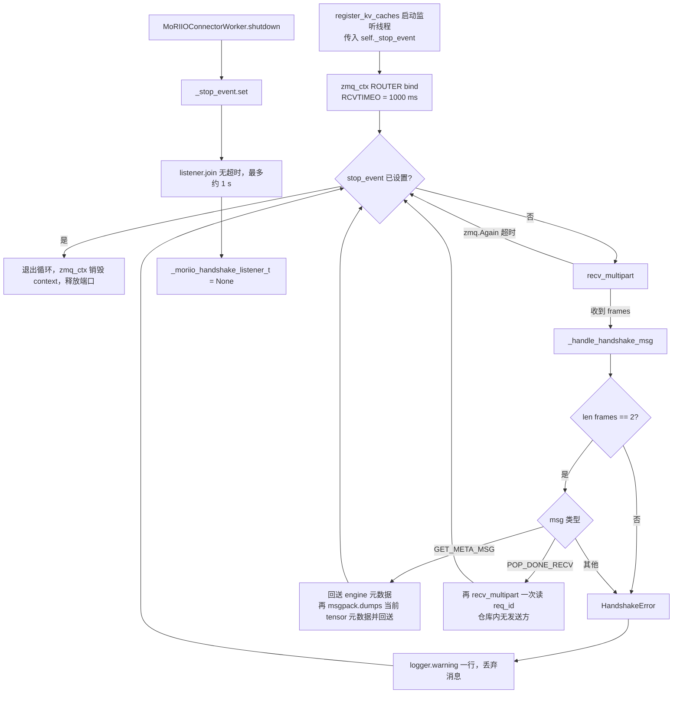

# PR #64756: [KVConnector][MoRIIO] Keep the handshake listener alive on bad messages

> **Author**: @charlifu | **State**: OPEN | **Date**: 2026-10-30
> **Branch**: `charlifu:moriio-handshake-listener-ras` → `main` | **Labels**: ci/build, kv-connector, performance
> **Changes**: +132 -28 lines across 4 files | **ROCm 相关性**: 完全相关（MoRIIO KV connector，ROCm 专属）
> 本报告分两部分：§1–6 为 PR 详细总结，§7–8 为 ROCm review 意见。

---

## 1. 总结 (Summary)

MoRIIO 每个 worker 在 `register_kv_caches` 里启动一个 ZMQ ROUTER 握手监听线程 `_moriio_handshake_listener`，负责向对端回送 MoRI-IO engine 元数据和逐层 KV 区域元数据。main 上这个线程收到帧数不对或类型未知的消息时会抛异常退出，此后该 worker 再也无法和新的对端握手，只能重启；`shutdown()` 也停不掉它（`join(timeout=0)` 立即返回，线程仍阻塞在没有超时的 `recv_multipart()`）。本 PR 给 socket 加 1 s 接收超时，循环改为检查 `stop_event`，把消息处理拆到 `_handle_handshake_msg` 并对每条消息单独捕获异常（记一行 warning 后丢弃），`shutdown()` 设置 stop event、join 线程并清空引用。合法 `GET_META_MSG` 的回包字节不变。

## 2. 背景与动机 (Background & Motivation)

- 对应 MoRIIO RAS RFC（ROCm/mori#759）的 gap 5：一条异常消息即可让某个 worker 永久失去握手能力。由于发起方 `_moriio_handshake` 没有接收超时（gap 3，由 #63856 处理），新对端会一直阻塞在 recv 上。
- 修复方式参照 NIXL 监听线程的做法（#26404：`RCVTIMEO=1000` + `stop_event`）。main 上 `nixl/base_scheduler.py` 的 `_nixl_handshake_listener` 与 `shutdown()` 正是这个结构。
- 作者在描述中给出了 main 上的复现脚本（先发未知消息，再发 `GET_META_MSG`，得到 `NO REPLY: listener alive = False`），并说明与 #62832（WRITE 模式 sleep mode）在同一函数上有冲突，需要后合入者 rebase。

## 3. 代码修改分析 (Code Change Analysis)

### 3.1 修改的模块

| 文件 | 改动 |
|------|------|
| `vllm/distributed/kv_transfer/kv_connector/v1/moriio/moriio_connector.py` (+62/-27) | `__init__` 新增 `self._stop_event`；`shutdown()` 改为 set + `join()` + 清空引用；监听线程新增 `stop_event` 参数、`RCVTIMEO=1000`、逐消息 try/except；新增静态方法 `_handle_handshake_msg`（先检查帧数，未知类型抛 `HandshakeError`）；`register_kv_caches` 启动线程时传入 `self._stop_event` |
| `tests/v1/kv_connector/unit/moriio/test_moriio_connector.py` (+68) | 新增 `test_moriio_handshake_listener_survives_bad_messages_and_stops`：真实 ZMQ socket 上依次发 3 帧消息、未知消息、`GET_META_MSG`，断言回包正确；原地修改 tensor 元数据后再握手，断言拿到新值；通过 `worker.shutdown()`（在辅助线程上、10 s 超时）停止监听并断言线程退出、引用清空 |
| `tests/v1/kv_connector/unit/moriio/test_moriio_hma_scheduler.py` (+1) | `_make_register_worker` 的 `SimpleNamespace` 假 worker 补上 `_stop_event`，因为 `register_kv_caches` 现在会读取它 |
| `.buildkite/performance-benchmarks/scripts/compare-json-results.py` (+1/-1) | `_sanitize_sheet_name` 的 docstring 改为 raw string（`"""` → `r"""`），与本 PR 主题无关；这是 PR 被打上 `ci/build`、`performance` 标签并自动请求 @khluu、@Harry-Chen 等 code owner review 的原因 |

### 3.2 架构 / 流程图



### 3.3 关键实现细节

- **逐消息隔离**：`except Exception` 包住单条消息的处理，循环本身只在 `stop_event` 被设置时退出。warning 只打印 path、tp/dp rank 和异常字符串，不带 traceback（作者解释是防止端口扫描刷屏）。
- **元数据按请求编码**：review 中 @okorzh-amd 指出早期版本把 `msgpack.dumps(layer_name_to_local_kv_cache_metadata)` 提到循环外会与 #62832 的原地重注册冲突，作者在 6bf1dc2 改回每次 `GET_META_MSG` 时编码，测试也覆盖了“原地修改后下一次握手拿到新值”。
- **shutdown 幂等**：`getattr(self, "_moriio_handshake_listener_t", None)` 判空，join 后清空引用，所以 `__del__` 再次调用 `shutdown()` 是 no-op；`__init__` 中 `_stop_event` 紧随 `_moriio_handshake_listener_t = None` 之后赋值，`__init__` 中途失败时也不会 AttributeError。
- **POP_DONE_RECV 分支保留**：行为不变（只把 debug 日志的格式串补上 `%s`），但仓库内没有任何代码发送该消息（`git grep` 只在 `moriio_common.py` 定义处和本分支出现）。

## 4. 涉及的技术原理 (Technical Principles)

- **MoRIIO 握手**：PD 分离时，需要对端 MoRI-IO engine 描述和 KV 区域描述的一方（READ 模式下 D 连 P，WRITE 模式下 P 连 D）用 DEALER socket 发 `GET_META_MSG`，监听方回两条消息：msgspec 编码的 `MoRIIOAgentMetadata` 和 msgpack 编码的逐层 KV 元数据。之后发起方 `register_remote_engine` 并建 session，才能发起 RDMA/XGMI 读写。
- **ZMQ ROUTER/DEALER**：ROUTER 收到的每条消息前面带对端 identity 帧；DEALER 直接 `send(msg)` 时 ROUTER 端看到 `[identity, msg]` 两帧，REQ 或多帧发送会变成 3 帧以上。ROUTER 默认对不可达 identity 静默丢包，`send_multipart` 不会阻塞。
- **RCVTIMEO 轮询停止**：Python 线程无法被外部中断，阻塞在无超时 `recv` 上的线程只能靠销毁 socket 所属 context 唤醒。监听线程用的是 `zmq_ctx` 自己创建的 context，`self.zmq_context.destroy()` 碰不到它，所以只能靠接收超时 + stop event 轮询退出。代价是 shutdown 最多多等一个超时周期。

## 5. 评论区讨论亮点 (Discussion Highlights)

- @vcave 建议测试通过 `MoRIIOConnectorWorker.shutdown()` 停止监听，而不是直接 set event，并加超时和 finally 清理，避免回归时挂住整个测试套件。作者在 c7cdc8a 采纳。
- @okorzh-amd 指出把 tensor 元数据编码提到循环外会在 #62832（sleep mode 唤醒后原地重注册 KV 区域并递增 epoch）合入后发送已注销的旧区域；作者在 6bf1dc2 改回逐请求编码，并修正描述中关于冲突 PR 的说法（冲突的是 #62832，不是 #60743）。
- @okorzh-amd 指出描述中的 CI 段落和测试路径过时（测试已在 #66480 移到 `tests/v1/kv_connector/unit/moriio/`），作者更新为 MI355 MoRIIO 单测 step，并给出 MI300X 上 917 passed（该数字来自作者自述，本 review 未复现）。
- @okorzh-amd 汇总关联 PR：#62832 冲突、#63856 互补（发起方接收超时与重试）、#54757 是 NIXL 侧的同类加固。
- CI：`pre-run-check` 成功，pre-commit 成功，DCO 通过；Buildkite 结果未核实。
- 同批 PR 交叉核对（本 review 在本地 ref 上用 `git merge-tree` 和函数级 diff 检查）：
  - **#63856**（kudomcho，gap 3）只改发起方 `_moriio_handshake`（加 `RCVTIMEO` 与重试退避），与本 PR 改的监听方没有文本重叠，语义互补：本 PR 丢弃的异常消息不会回包，#63856 让发起方在超时后重试而不是永久阻塞。
  - **#63854**（kudomcho，gap 12）在 `MoRIIOAgentMetadata` 加 `handshake_version`/`mode` 字段，在发起方校验；监听方只是把元数据原样编码发送，与本 PR 无冲突。
  - **#63855**（kudomcho，gap 6）改的是 `save_kv_layer` / `start_load_kv` 的等待逻辑，与监听线程无关。
  - **#65690** 处理发起方握手失败后的 READ 请求失败，与本 PR（监听方存活）互补；两者无文本冲突。
  - 与当前 `upstream/main` 合并无文本冲突。

## 6. 风险与潜在问题 (Risk Analysis)

| 风险 | 严重程度 | 说明 |
|------|---------|------|
| 无关文件改动带来额外标签和 code owner | Medium | 见 §7 ⚠️【可维护性】 |
| `POP_DONE_RECV` 分支仍会吞掉下一条来自任意对端的消息 | Medium | 见 §7 ⚠️【正确性】 |
| `shutdown()` 从 `__del__` 调用时无超时 `join()` | Low | 见 §7 📝，`[推测]` |
| 与 #62832 在 `_moriio_handshake_listener` 上冲突 | Low | 作者已知；后合入者 rebase，注意保留逐请求编码 |
| shutdown 最多慢约 1 s | Low | 与 NIXL 同样的取舍，已在描述中说明 |
| CUDA/其他平台回归 | Low | 仅改 MoRIIO 目录；无新 env var、无新依赖 |

---

## 7. Review 意见 (Findings)

| 类型 | 🔴 | ⚠️ | 📝 |
|------|----|----|----|
| 可维护性 | — | 1 | 1 |
| 正确性 | — | 1 | 1 |
| 测试 | — | — | 1 |

总体评价：核心修复正确，结构与 NIXL 监听线程一致；`shutdown()` 的幂等性、`__init__` 半失败时的属性访问、逐请求编码元数据都核对无误；新测试用真实 ZMQ socket 覆盖了坏帧、未知类型、元数据原地更新和 shutdown 退出。没有可写出具体触发输入的阻塞级问题。

**⚠️【可维护性】`compare-json-results.py` 的 docstring 改动与本 PR 无关，并把 PR 拉进 `ci/build`、`performance` 两个领域** `[已验证]`

- **问题**: `.buildkite/performance-benchmarks/scripts/compare-json-results.py:365` 把 `_sanitize_sheet_name` 的 docstring 改成 raw string。这来自 1c634b2（"Fix docstring code spans and raw docstring escape in MoRIIO listener and benchmark script"），与 MoRIIO 监听线程无关；`upstream/main` 上该行仍是普通字符串，main 的 pre-commit 也不要求这个改动。时间线显示正是这次提交后 mergify 给 PR 加上了 `ci/build`、`performance` 标签，并自动请求了 @Harry-Chen、@khluu 和一个 team 的 review。
- **影响**: 一个 connector bugfix 需要额外领域的 code owner 审批才能合入，延长合入路径；squash 后这个无关改动也混入 MoRIIO 修复的提交历史。
- **行动**: 建议作者把这一行回退，另开一个小 PR 修复 `\ ` 转义（它确实会在 Python 3.12 上产生 `SyntaxWarning`），本 PR 只保留 MoRIIO 相关文件。

**⚠️【正确性】保留的 `POP_DONE_RECV` 分支会消费下一条来自任意对端的消息，异常客户端仍可让一个合法握手永久挂住** `[已验证]`

- **问题**: `moriio_connector.py:2348-2353` 收到 `b"pop_done_recv"` 后会再调用一次 `sock.recv_multipart()` 读取 `req_id`。ROUTER socket 的下一条消息可能来自任何对端，所以如果另一个对端恰好在 1 s 内发来 `GET_META_MSG`，这条消息会被当作 `req_id` 读掉，只打一条 debug 日志，对端得不到回包。仓库内没有任何代码发送 `POP_DONE_RECV`（作者在描述中也承认）。
- **影响**: 触发输入：任一客户端向握手端口发送单帧 `b"pop_done_recv"`，同时另一个 decode/prefill worker 在 1 s 内发起握手。在 #63856 合入前，发起方没有接收超时，会永久阻塞在握手上；#63856 合入后也要等完整一轮超时重试。这正是本 PR 要防的“异常消息破坏握手”场景，只是换了一种消息内容。
- **行动**: 建议作者在本 PR 中直接删除 `POP_DONE_RECV` 分支（让它走“未知类型”路径），既然本 PR 已经在重写这个函数，改动只有几行；如果担心兼容性，至少不要在分支内再次 `recv`。

**📝【正确性】`shutdown()` 的 `listener.join()` 没有超时，且 `shutdown()` 也从 `__del__` 调用** `[推测]`

- **问题**: `moriio_connector.py:2263-2267` 在 set event 后无超时 `join()`。正常运行时最多等待一个 `RCVTIMEO` 周期（1 s），没有问题；但 `__del__` 可能在解释器退出的 finalization 阶段被调用，此时 daemon 线程可能已无法再获得 GIL，`join()` 有理论上的挂起可能。NIXL 的 `shutdown()` 同样无超时 join，但它不在 `__del__` 中调用。
- **行动**: 建议作者给 `join()` 加一个略大于 `RCVTIMEO` 的超时（如 5 s），超时后记 warning 并放弃，对正常路径无影响。

**📝【可维护性】warning 不带对端 identity，也没有限速** `[已验证]`

- **问题**: `moriio_connector.py:2320-2329` 的 warning 只记录本地 path 和 rank。排查“谁在发坏消息”时缺少对端信息；持续的异常流量会每条打一行。
- **行动**: 建议作者在异常里带上 identity 的十六进制前缀，或对同类 warning 做简单限速（例如每 N 秒最多一条并附计数）。属于可选改进。

**📝【测试】新测试是纯 Python + ZMQ，但被模块级 `pytestmark` 限定在 ROCm 且安装了 mori 的环境** `[已验证]`

- **问题**: `test_moriio_connector.py:95` 的模块级 skip 要求 `current_platform.is_rocm() and mori_available`，所以新测试只在 MI355 MoRIIO 单测 step 中运行。测试本身不依赖 mori 或 GPU。
- **行动**: 可选：建议作者把这个测试放到不受该 skip 约束的位置，让它也在通用 CPU CI 上跑，降低回归只在 AMD 队列暴露的风险。

## 8. 结论 (Verdict)

**⚠️ NEEDS WORK**

修复本身正确且有效：监听线程不再因单条坏消息退出，`shutdown()` 能真正停止线程并释放端口，测试覆盖到位。合入前建议移除与本 PR 无关的 `compare-json-results.py` 改动（它带来了额外的标签和 code owner 审批），并顺手删除仍可被异常消息利用的 `POP_DONE_RECV` 分支。

## 9. 英文 Review 评论 (Copy-Paste English Comments)

**C1** `.buildkite/performance-benchmarks/scripts/compare-json-results.py:365` — ⚠️ comment

```text
This docstring change is unrelated to the MoRIIO listener fix. It came in with 1c634b2, and it is the reason mergify added the ci/build and performance labels and requested reviews from extra code owners. That adds approvals this connector bugfix should not need. Could you drop this line from the PR and send the raw-string fix as a separate small PR? The fix itself is fine, since the "\ " escape warns on Python 3.12.
```

**C2** `vllm/distributed/kv_transfer/kv_connector/v1/moriio/moriio_connector.py:2348-2353` — ⚠️ comment

```text
This branch can still break a handshake. On receiving b"pop_done_recv" it calls recv_multipart() again, and the next message on a ROUTER socket can come from any peer. If another worker sends GET_META_MSG within the 1 s timeout, that request is consumed as the req_id and never answered, and until #63856 lands the dialer waits forever. Nothing in the repo sends POP_DONE_RECV. Since this PR already rewrites the handler, could you remove the branch so the message takes the unknown-type path?
```

## 10. 英文总结评论 (Overall Review Summary)

```text
Thanks for fixing the MoRIIO handshake listener. The per-message error handling, RCVTIMEO plus stop event, and idempotent shutdown() match the NIXL listener, and the new test covers bad frames, unknown types, in-place metadata updates and a clean shutdown. Two requests before merge: drop the unrelated compare-json-results.py docstring change, which pulled in the ci/build and performance labels and extra code owners, and remove the unused POP_DONE_RECV branch, which can still swallow another peer's GET_META_MSG. Approve after these changes.
```
