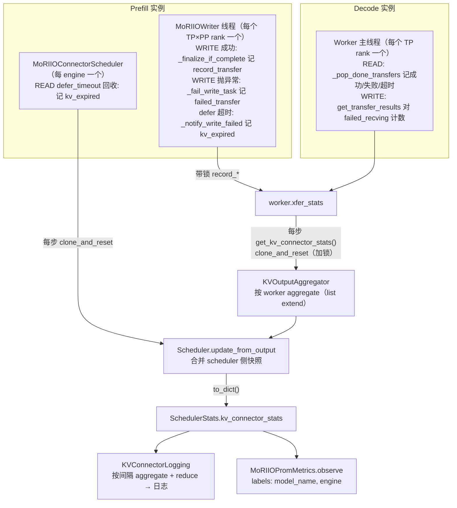
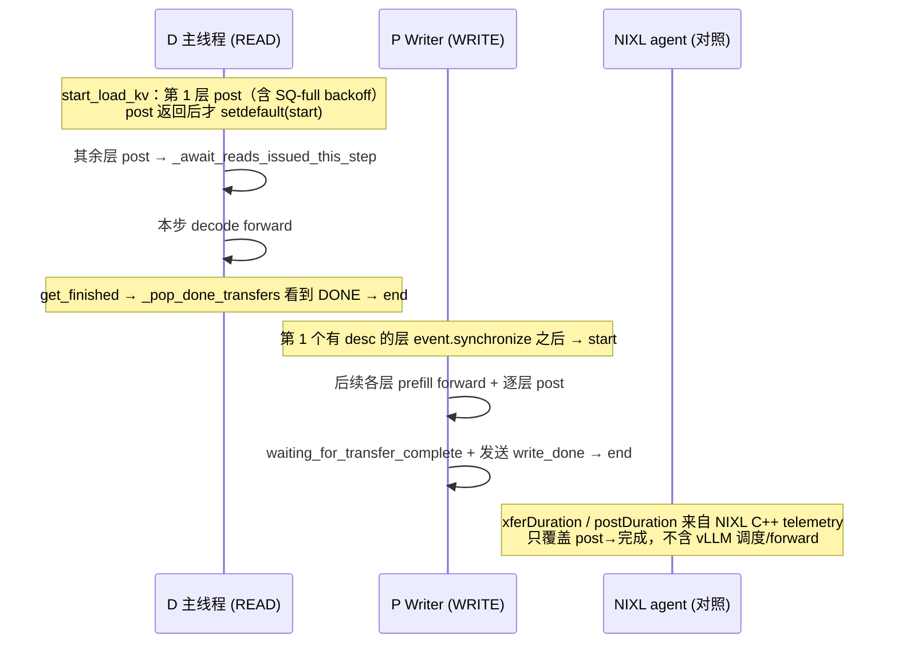

# PR #64785: [ROCm][KV Connector] Add MoRIIO transfer stats and Prometheus metrics

> **Author**: @charlifu | **State**: OPEN（11-12 起为 draft，当前带 `needs-rebase`） | **Date**: 2026-10-30
> **Branch**: `moriio-connector-stats` → `main` | **Labels**: documentation, kv-connector, needs-rebase, rocm
> **Changes**: +809 -25 lines across 11 files | **ROCm 相关性**: 完全相关（MoRIIO KV connector，AMD ROCm 专属）
> 本报告分两部分：§1–6 为 PR 详细总结，§7–8 为 ROCm review 意见。本次 review 的重点是把本 PR 的 stats/metrics 设计和 upstream/main 上 NIXL connector（以及本 PR 所模仿的 Mooncake connector）的实现逐项对比：命名、label 基数、跨 worker 聚合、reset 语义、热路径开销。

---

## 1. 总结 (Summary)

MoRIIO connector 目前不上报任何 KV connector stats，传输延迟、大小和失败在周期性 `KV Transfer metrics` 日志和 Prometheus 中都看不到。本 PR 新增 `moriio/stats.py`（`MoRIIOKVConnectorStats` + `MoRIIOPromMetrics`），导出 3 个 histogram（`vllm:moriio_xfer_time_seconds` / `bytes_transferred` / `num_descriptors`）和 3 个 counter（`num_failed_transfers` / `num_failed_notifications` / `num_kv_expired_reqs`），并在 READ 路径（D 侧主线程）、WRITE 路径（P 侧 `MoRIIOWriter` 线程）以及 READ 模式 scheduler 侧回收处埋点。整体结构基本照搬 Mooncake 的 `stats.py`（带锁、`__getstate__` 去锁），对外接口与 NIXL 一致。由于 MoRI-IO 不提供传输 telemetry，延迟由 connector 自己用 `time.monotonic()` 测量，这是它和 NIXL 最本质的区别。

## 2. 背景与动机 (Background & Motivation)

- 对应 MoRIIO RAS RFC（ROCm/mori#759）的 gap 11（可观测性）。此前的 #43218（MoRI connector telemetry）因 stale 被作者关闭；本 PR 从当前 main 重写，并声称处理了 #43218 的 review 意见：缺 key 时的 KeyError、日志中的 notify 端口、线程安全。
- vLLM 的 KV connector 指标框架（`kv_connector/v1/metrics.py`）是：worker 每步调用 `get_kv_connector_stats()` 拿增量快照 → `KVOutputAggregator` 按 `aggregate()` 合并所有 worker → scheduler 再合并 scheduler 侧快照 → `SchedulerStats.kv_connector_stats`（dict）→ 日志侧用 `build_kv_connector_stats` 重建、累积并按间隔 `reduce()`；Prometheus 侧 `KVConnectorProm` 调 `build_prom_metrics()` 注册 connector 专属 metric，并对每个增量调用 `observe(data, engine_idx)`。NIXL、Mooncake 都已接入。
- 作者在 PR 描述中也把它当作诊断工具：metric 暴露出 xgmi 后端上多 block 传输总是卡满 `transfer_timeout`（30 s）的问题。但 @okorzh-amd 指出 #64330（已在本分支 base 中）已经以 10 ms 切片等待绕过了这个问题，描述中的 e2e 数字（11-02）早于 #64330，在当前 head 上无法溯源。

## 3. 代码修改分析 (Code Change Analysis)

### 3.1 修改的模块

| 文件 | 改动 |
|------|------|
| `vllm/distributed/kv_transfer/kv_connector/v1/moriio/stats.py`（新增 270 行） | `MoRIIOKVConnectorStats`（6 个 list 列、`threading.Lock`、`clone_and_reset`、`reduce`）与 `MoRIIOPromMetrics`（3 histogram + 3 counter，bucket 与 NIXL/Mooncake 相同） |
| `moriio/moriio_connector.py` (+102 -6) | `MoRIIOConnector.get_kv_connector_stats / build_kv_connector_stats / build_prom_metrics`；scheduler 新增 `xfer_stats`，READ 回收时记 `kv_expired`，并排除同一步已 ACK 的请求；worker 新增 `xfer_stats` 与 `_recving_transfers_size`；`_pop_done_transfers` 记成功/失败/超时及 release 发送失败；`get_transfer_results` 对 D 侧 WRITE `failed_recving` 计数；`_post_read_with_backoff` 累加 bytes/descs；失败日志补充 transfer id 和 peer |
| `moriio/moriio_engine.py` (+47 -13) | Writer：抽出 `_fail_write_task`（记 failed_transfer）；`_notify_write_failed` 记 `kv_expired`，write_failed 发送失败时记 failed_notification；`_execute_write_task` 累加每层 posted bytes/descs/首次 post 时间；`_finalize_if_complete` 在 write_done 发出后记 `record_transfer` |
| `moriio/moriio_common.py` (+4) | `RemoteAllocInfo` 新增 `transfer_start/bytes/descs` |
| `docs/features/moriio_connector_usage.md` (+20) | 新增 "Prometheus metrics" 小节 |
| `tests/v1/kv_connector/unit/test_moriio_stats.py`（新增 241 行） | reduce、序列化、并发对齐、Prom 导出、READ scheduler 回收 |
| `tests/.../unit/moriio/test_moriio_{read_tp,hetero_tp_write,tp_ack,write_done_routing}.py` | 在现有 mock e2e 测试上追加 stats 断言 |
| `tests/.../moriio_integration/test_write_dummy_e2e_rocm.py` (+53) | `test_transfer_metrics_are_exported`：真实 1P1D（xgmi），WRITE/READ 各一组，diff `/metrics` |

### 3.2 架构 / 流程图

stats 从埋点到导出的数据流（与 NIXL 的差异标在节点里）：



单个请求的 `xfer_time` 实际覆盖的区间（与 NIXL 的 agent telemetry 对比）：



### 3.3 关键实现细节

- **数据结构**：`data` 为 6 个 list；成功传输是 3 列对齐的行（duration/bytes/descs），失败类每次 append 1（或 `extend([1]*n)`）。`reduce()` 输出 Num successful transfers、Avg/P90 xfer time、Avg MB、Throughput、Avg descs，以及 3 个失败计数。与 NIXL 相比少了 `post_duration`、`num_failed_handshakes`、`num_notifications_after_expiry`、`num_declined_expired_reads`；与 NIXL 不同，failed notifications 没有并入 failed transfers。
- **线程安全**：每次 record 和 `clone_and_reset` 都加 `threading.Lock`（照搬 Mooncake），`__getstate__/__setstate__` 去掉锁以便跨进程序列化。NIXL 的记录都在 worker 主线程，所以它的 `clone_and_reset` 是不加锁的 `copy.copy` + `reset`。
- **scheduler 侧 stats**：`MoRIIOConnector.get_kv_connector_stats()` 返回 `connector_worker or connector_scheduler` 的快照；upstream `scheduler.py` 在 `update_connector_output` 之后把 scheduler 侧快照合并进 worker 聚合结果。NIXL 只有 worker 侧 stats。
- **READ 回收语义修正**：`expired` 新增 `req_id not in safe`，同一步已收到 ACK 的请求不再算过期。这只影响计数和日志，`safe.update` 本身是幂等的，没有行为回归。
- **Prometheus**：metric 名前缀 `vllm:moriio_`，labelnames 由 `PrometheusStatLogger` 传入（`model_name`、`engine`），通过 `create_metric_per_engine` 为每个 engine 预建子 metric。没有 per-peer、per-request 或 per-layer label。

## 4. 涉及的技术原理 (Technical Principles)

- **vLLM KV connector 指标管线**：worker 每步产出增量快照，跨 TP/PP worker 的 list 直接 extend，所以 histogram 的一个样本是"某个 worker 观察到的一次传输"，counter 增量也按 worker 相加。日志侧按间隔累积后 `reduce()`；Prometheus 侧 counter 单调累加，histogram 每个样本 observe 一次。所谓 reset 只是"取走增量"，不影响 Prometheus 的累计值。
- **READ（PULL） vs WRITE（PUSH）**：READ 模式下 D 在 `start_load_kv` 中对每层发 RDMA READ，P 在收到 release 后释放 block；WRITE 模式下 P 在每层 forward 后由 writer 线程逐层 RDMA WRITE，最后发 `write_done`。WRITE 的"传输区间"天然和 prefill 计算重叠，所以按请求测量的端到端时长主要反映 prefill 后半段的 forward 时间，而不是网络时间。
- **NIXL telemetry**：NIXL ≥ 0.7.1 打开 `capture_telemetry=True` 后，每个 xfer handle 完成时可以取到 `xferDuration`、`postDuration`、`totalBytes`、`descCount`。这些都在 C++ agent 内测量，Python 侧只是读一个结构体。MoRI-IO 的 `TransferStatus` 只有 code、message 和终态，所以 MoRIIO 只能在 connector 层用 wall-clock 测量。
- **Prometheus 基数与 bucket**：label 基数 = 模型数 × engine 数（DP），与 NIXL 相同，不会爆炸。histogram 的 bucket 上限决定 P90/P99 能否通过 `histogram_quantile` 求出，超过最大 bucket 的样本全部落在 `+Inf`。

## 5. 评论区讨论亮点 (Discussion Highlights)

- **@simondanielsson**：要求补 e2e 验证。作者随后加了 `test_transfer_metrics_are_exported`（1P1D、xgmi、WRITE/READ 各一组）。
- **@vcave（Request changes）**：实测 metric 能流到 Prometheus，但指出它测的是"实例间 KV 传输在 vLLM 生命周期内的延迟（包含通信、WRITE 模式下最后几层的计算）"，而不是细粒度的通信操作，**强烈建议不要沿用 nixl/mooncake 的命名**，等 mori 有 telemetry 后再做同名 metric。作者点了 👍，但 head 上还没有改。三条 inline：① READ 成功路径先 record，`_send_read_release` 若抛异常会导致请求不被清理，可能重复记录；② WRITE 数据已完成、但 write_done 通知抛异常时，成功不会被记录，应区分通知失败与传输失败；③ READ 的计时起点在首次 post（含 backoff）之后。
- **@okorzh-amd**：① PR 描述在当前 head 上已过时（ROCm MoRIIO unit/e2e step 自 #60544 起已启用；887-passed 的 glob 在 #66480 后只匹配本文件；30 s 卡顿已由 #64330 绕过，e2e 数字需重跑），并建议把测试文件移到 `unit/moriio/`；② READ 的结束时间在 forward 之后的 `get_finished` 中取，所以每个样本都包含本步 decode forward；③ #58962、#63880 新增的 WRITE 失败路径会绕过当前计数点，建议把计数挪到 return 之前；④ 文档中 "A WRITE failure is counted on P and again on the D" 不成立；⑤ 汇总了相关 PR：#58962/#63880/#62552/#64574 CONFLICT，#66008 EXTENDS。
- 作者 11-12 将 PR 转为 draft，尚未回应 vcave 和 okorzh 的意见。

## 6. 风险与潜在问题 (Risk Analysis)

| 风险 | 严重程度 | 说明 |
|------|---------|------|
| metric 与 NIXL 同名同形但语义不同，跨 connector 看板会误读 | Medium | 见 §7 ⚠️【设计】命名 |
| WRITE 时长包含 prefill forward，5 s 上限 bucket 让长上下文样本全落 `+Inf` | Medium | 见 §7 ⚠️【设计】bucket |
| `num_kv_expired_reqs` 在 READ/WRITE 两种模式下计数单位不同 | Medium | 见 §7 ⚠️【正确性】 |
| 与同批 MoRIIO PR（#60852/#66008/#58962）在相同计数点上冲突 | Medium | 见 §7 ⚠️【设计】跨 PR |
| 文档/描述与代码不一致 | Low | 见 §7 ⚠️【注释/文档】 |
| 热路径开销 | Low | 每次 post 多一次 `sum(sizes)`，每请求一次加锁；与 RDMA post 的 Python 循环相比可忽略，见 §7 📝【性能】 |
| 测试覆盖 | Low | 单测与 mock e2e 覆盖较全；真机 e2e 只有 TP=1 1P1D，多 rank 聚合单位未覆盖 |

---

## 7. Review 意见 (Findings)

| 类型 | 🔴 | ⚠️ | 📝 |
|------|----|----|----|
| 设计 | — | 3 | — |
| 正确性 | — | 1 | 2 |
| 注释/文档 | — | 1 | — |
| 性能 | — | — | 1 |

先给出与 NIXL 的逐项对比结论（均已对照 upstream/main 代码 `[已验证]`）：

| 维度 | NIXL（upstream/main） | 本 PR（MoRIIO） | 评价 |
|------|----------------------|-----------------|------|
| 命名 | `vllm:nixl_xfer_time_seconds`、`post_time_seconds`、`bytes_transferred`、`num_descriptors`、5 个 counter | `vllm:moriio_` + 同名后缀，6 个 series，无 post_time | 形状一致，但 `xfer_time` 语义不同 → ⚠️ |
| 时延来源 | NIXL agent C++ telemetry（每 handle 的 `xferDuration`/`postDuration`） | connector wall-clock，按请求，含调度/forward | 本质不同 |
| label 基数 | `model_name`、`engine` | 相同 | ✅ 无问题 |
| 失败归类 | failed_transfers = transfer + handshake + notification；notification 单独保留"兼容"计数 | 三者分离，handshake 暂不统计（留给 gap 4） | 有意设计，已在 description 说明；文档应写清和 NIXL 不可直接对比 |
| 跨 worker 聚合 | 全部在 worker 记录，per-rank 计数（含 kv_expired，`_reap_expired_send_leases` 每个 rank 都会记） | worker + scheduler 混合；READ 过期 per-engine，WRITE 过期 per-rank | 单位不一致 → ⚠️ |
| reset 语义 | `copy.copy` + `reset`，无锁（单线程记录） | 加锁复制 list + reset（writer 线程并发记录），与 Mooncake 相同 | ✅ 正确；每步增量、Prom 累计 |
| 热路径 | Python 侧每 handle 读一次 telemetry | 每次 post 多 `sum(sizes)`、每请求加锁 1–2 次 | ✅ 可忽略 |
| bucket | xfer 5 ms–5 s；bytes 2 KiB–8 GiB；descs 10–50k | 完全相同 | NIXL 的 5 s 上限对纯网络时延合理，对 MoRIIO 的含 forward 时延不够 → ⚠️ |

---

**⚠️【设计】`vllm:moriio_xfer_time_seconds` 与 NIXL 同名同形，但测的是"请求级端到端 KV 交付延迟"，不是传输时间** `[已验证]`

- **问题**: `stats.py:198` 注册 `vllm:moriio_xfer_time_seconds`，命名、bucket、日志字段（"Avg xfer time"、"Throughput (MB/s)"）都和 NIXL 一样。但 NIXL 的值来自 agent telemetry `xferDuration`（`nixl/base_worker.py` 中 `get_xfer_telemetry(handle)`，只覆盖 post→完成），而 MoRIIO 的值是 connector wall-clock：READ 从第 1 层 post 返回后开始计时（`moriio_connector.py:4309` `setdefault`），到 forward 之后 `get_finished → _pop_done_transfers`（`moriio_connector.py:3117-3121`）结束，包含本步 decode forward；WRITE 从第一个有 desc 的层开始（`moriio_engine.py:402`），到 `write_done` 发出后结束（`moriio_engine.py:678-681`），包含后续所有层的 prefill forward。因此 "Throughput (MB/s)" 是 bytes / (forward + 传输)，作者自己的日志里出现过 0.158 MB/s。
- **影响**: 运维在同一个看板上对比 NIXL 与 MoRIIO 的 `*_xfer_time_seconds` 或 Throughput 时，会得出 MoRIIO 传输慢 1–3 个数量级的错误结论；以后 mori 提供真正的 telemetry 时，同名 metric 的语义还会再变一次，相当于破坏性变更。@vcave 已就此 request changes。
- **行动**: 建议作者把时延 histogram 改成能体现语义的名字（例如 `vllm:moriio_request_kv_transfer_latency_seconds`），并把日志字段从 "xfer time" / "Throughput" 改成 "KV delivery latency"、"Effective MB/s" 之类；`xfer_time_seconds` 这个名字留给将来基于 mori telemetry 的真实传输时间。文档中也应明确写出它和 NIXL 同名 metric 不可直接比较。

**⚠️【设计】时延 bucket 照搬 NIXL 的 5 s 上限，但 WRITE 样本包含 prefill forward，长上下文请求会全部落进 `+Inf`** `[已验证]`

- **问题**: `_XFER_TIME_BUCKETS`（`stats.py:20-33`）的最大边界是 5.0 s，与 NIXL/Mooncake 相同。NIXL 测的是纯网络时间，5 s 已经算异常值；而 MoRIIO 的 WRITE 样本等于"第 1 层 post 之后的 prefill forward + 最后一批 RDMA + write_done"，READ 样本也包含一个 decode step。
- **影响**: 具体触发场景：WRITE 模式下，单请求 prefill 的 forward 超过 5 s（例如 DeepSeek/Kimi 级模型的 64K–128K prompt，在 AgentX 这类长上下文负载中很常见），所有样本都会落进 `+Inf`，`histogram_quantile(0.9, …)` 只能返回 5 s，Prometheus 上看不到尾延迟。PR 描述里 xgmi 卡满 30 s 的现象（#64330 之前）也全部在 `+Inf` 里，只能从日志里的 numpy P90 看出来。
- **行动**: 如果保留当前语义，建议作者把 bucket 扩展到 10 / 30 / 60 / 120 s（低端保留 5 ms），并在注释中说明为什么与 NIXL 不同；或者把 WRITE 的计时起点改到最后一层 post（只测尾部传输 + 通知），使其更接近 NIXL 的语义。

**⚠️【正确性】`num_kv_expired_reqs` 的计数单位随模式变化：READ 每个请求算 1 次，WRITE 每个请求算 TP×PP 次** `[已验证]`

- **问题**: READ 模式的过期计数在 `MoRIIOConnectorScheduler.update_connector_output`（`moriio_connector.py:1831`）中，每个 engine 只有一个 scheduler，所以每个请求记 1 次。WRITE 模式的过期计数在 `MoRIIOWriter._notify_write_failed`（`moriio_engine.py:272`）中。每个 P worker（每个 TP rank、每个 PP stage）都有自己的 writer 和 `moriio_wrapper`，`fail_unallocated_write(transfer_id)` 是按 wrapper 去重的，所以每个 rank 都会返回 True 一次，经 `KVOutputAggregator` 的 list extend 后变成 TP×PP 次。NIXL 的 `_reap_expired_send_leases` 也在 worker 中按 rank 计数，单位至少是一致的。
- **影响**: 例如 P 为 TP=8 时，同样 1 个请求过期，WRITE 部署下 counter +8，READ 部署下 +1。用这个 counter 做自动扩缩容或告警（NIXL 文档明确说它是 "actionable autoscaler signal"）时，阈值无法在两种模式间复用。D 侧 `num_failed_transfers` 和成功 histogram 也是 per-rank 计数（与 NIXL 一致），但文档只写了 "per request transfer"。另外，#66008 会把 READ 过期改到 worker 的 lease 回收中（见下一条），届时 READ 也会变成 per-rank 计数，与当前单测的期望（`== 1`）不一致。
- **行动**: 建议作者统一单位：要么全部 per-rank（与 NIXL 一致，并在文档中写明 "counted once per worker"），要么在 WRITE 路径只让一个 rank（如 `tp_rank == 0 and pp_rank == 0`）记过期。同时在文档表格里注明 histogram 样本是"每个 worker 每个请求一次"。

**⚠️【设计】与同批 MoRIIO PR 在相同计数点上冲突，合并顺序会决定计数是否丢失** `[已验证]`

- **问题**: 我用 `git diff` 核对了同批 PR：① #60852（WRITE 取消）重写了 `get_transfer_results` 中的 `failed_recving` 循环（新增 `_reported_write_transfers`、"failure wins over success"），并把超时分支改成 `_fail_deferred_task` → `_notify_write_failed`，与本 PR 在 `moriio_connector.py:3083-3084` 和 `moriio_engine.py:238-249` 的改动在文本上直接冲突；② #66008（READ 租约续期）把 READ 的过期回收从 scheduler 的 defer_timeout 改为 worker 的 lease 过期，scheduler 只保留一个上限回收，并改写了本 PR 修改的同一段 "Reaped …" 日志，所以本 PR 的 scheduler 侧计数会漏掉 lease 过期；③ #58962 在本 PR 的计数行之后才往 `failed_recving` 里加超时接收（@okorzh-amd 已指出）。
- **影响**: 无论哪个后合并，如果冲突解决时只做文本合并，`num_failed_transfers` 或 `num_kv_expired_reqs` 都会静默少计。指标显示 0，但实际有失败，这比没有指标更危险。
- **行动**: 建议作者把 D 侧 WRITE 失败计数挪到 `get_transfer_results` 的 return 之前（按最终的 `failed_recving` 计数），并在 PR 描述中写明与 #60852、#66008、#58962 的合并顺序和各自的计数责任；建议 review 时追问 #66008 的作者，lease 过期是否要在 worker 侧调用 `record_kv_expired_req`。

**⚠️【注释/文档】文档中的 "WRITE failure is counted on P and again on D" 与代码不符，PR 描述也已过时** `[已验证]`

- **问题**: `docs/features/moriio_connector_usage.md:287-288` 说 WRITE 失败会在 P 上计一次、在被通知的 D 上再计一次。实际上，唯一的 `write_failed` 发送方是 `_notify_write_failed`（`moriio_engine.py:293`），它在 P 上记的是 `num_kv_expired_reqs`，不是 `num_failed_transfers`；而 P 上记 `num_failed_transfers` 的 `_fail_write_task`（`moriio_engine.py:257`）不会通知 D。所以同一个 WRITE 事件在两侧分别出现在两个不同的 counter 里，`num_failed_transfers` 不会重复计数。此外，PR 描述中的 CI 段落、887-passed 命令和 30 s 卡顿数据都已过时（@okorzh-amd 已列出），30 s 的 e2e 数字在当前 head 上是 `[unverified]`。
- **影响**: 运维按文档对两侧的 `num_failed_transfers` 去重，会把真实失败数少算一半。
- **行动**: 作者应当改写这段说明，按"同一事件在 P 侧计为 kv_expired、在 D 侧计为 failed_transfer"如实描述；并在当前 head（包含 #64330）上重跑 e2e，更新描述中的数字。

**📝【正确性】WRITE 数据已完成但 `write_done` 发送失败时，被计为传输失败而不是通知失败** `[已验证]`

- **问题**: `_finalize_if_complete` 先 `waiting_for_transfer_complete`，然后 `send_notify(... "write_done")`。`MoRIIOWrapper.send_notify` 在异常时会 log 后重新 raise（`moriio_engine.py:1282-1285`），异常一路传到 `_execute_write_task` 的调用方，最终进入 `_fail_write_task` 并记为 `record_failed_transfer`，而位于 `moriio_engine.py:678-681` 的 `record_transfer` 不会执行。这与 PR 中"notification 失败单独计数"的设计说法相矛盾（@vcave 也提过）。READ 成功路径的 `_send_read_release`（`moriio_connector.py:3122`）同样不在 try 里，但异常会直接冒出 `get_finished`，属于已有行为。
- **影响**: ZMQ DEALER 的 send 很少抛异常，实际触发概率低；一旦触发，P 侧会把一次数据成功、通知失败的传输记成传输失败。
- **行动**: 建议作者在 `_finalize_if_complete` 中先 `record_transfer`，再对 `send_notify` 包一层 try/except，失败时记 `record_failed_notification` 后再 raise（或按现有的失败处理流程走）。

**📝【正确性】READ 计时起点晚于首次 post（含 SQ-full backoff），终点晚于本步 forward** `[已验证]`

- **问题**: `_recving_transfers_start.setdefault(...)`（`moriio_connector.py:4309`）在第 1 层 `_post_read_with_backoff` 返回之后才执行，所以首次 post 及其 backoff 不计入（@vcave）。终点在 forward 之后的 `get_finished` 中（@okorzh-amd），而 `start_load_kv` 已经在 forward 之前通过 `_await_reads_issued_this_step` 阻塞到所有 READ 完成。
- **影响**: READ 样本既漏掉了 SQ 拥塞（恰恰是最想观察的部分），又多算了一个 decode step，噪声与信号方向相反。
- **行动**: 建议作者在发起第 1 个 post 之前记录起点（可单独维护一个 stats 用的 dict，不改 `_recving_transfers_start` 的超时语义），并在 `_await_reads_issued_this_step` 返回时记录终点。

**📝【性能】热路径开销可忽略，锁设计正确** `[已验证]`

- **问题**: 我检查了所有新增的埋点：READ 每次 post 多一次 `sum(sizes)` 加一次 defaultdict 访问（`moriio_connector.py:4134-4136`），而同一函数里的 offset 列表构建与 `read_remote_data` 本身就是 O(#desc) 的，相对开销很小；WRITE 每层每个 plan 多一次 `sum(plan.transfer_sizes)`，但 `_do_layer_write` 本来就对每个 desc 调用一次 `write_remote_data_single`；每个请求只有 1–2 次加锁记录，加上每步一次 `clone_and_reset`（复制本步新增的 list）。stats 锁是叶子锁，持有 `_write_state_lock` 或 `moriio_wrapper.lock` 时只会去拿 stats 锁，不会反过来，不存在死锁风险。`_recving_transfers_size` 在所有删除 `_recving_transfers` 的地方都同步 pop 了，没有泄漏。
- **影响**: 无。
- **行动**: 无需修改。建议作者在描述中加一句开销说明，方便 maintainer 判断。

## 8. 结论 (Verdict)

**⚠️ NEEDS WORK**

框架接入方式（`get/build_kv_connector_stats`、`build_prom_metrics`、scheduler 侧合并、加锁快照与去锁序列化）正确，label 基数与 NIXL 一致，热路径开销可忽略，测试也比较扎实。需要改的地方在指标语义上：时延 metric 沿用了 NIXL 的名字和 5 s bucket，但测的是包含 forward 的请求级交付延迟（vcave 已 request changes）；`kv_expired` 在两种模式下计数单位不同；文档对 WRITE 失败的描述与代码不符；与 #60852、#66008、#58962 在同一组计数点上冲突。这些都需要在 rebase 时一并解决。

## 9. 英文 Review 评论 (Copy-Paste English Comments)

**C1** `vllm/distributed/kv_transfer/kv_connector/v1/moriio/stats.py:198-200` — ⚠️ comment

```text
This series has the same name and buckets as `vllm:nixl_xfer_time_seconds`, but it measures something different. NIXL reports the agent's own post-to-completion telemetry. Here READ samples run from after the first layer's post to `get_finished` after the forward, and WRITE samples include the prefill forward of every later layer, up to sending `write_done`. Dashboards that compare connectors, and the "Throughput (MB/s)" log field, will make MoRIIO look orders of magnitude slower than it is. Could you rename it (e.g. `vllm:moriio_request_kv_transfer_latency_seconds`) and keep `xfer_time` for when mori exposes real transfer telemetry, as vcave suggested?
```

**C2** `vllm/distributed/kv_transfer/kv_connector/v1/moriio/stats.py:20-33` — ⚠️ comment

```text
These buckets are copied from NIXL and stop at 5 s. That suits pure network time, but WRITE samples here include the prefill forward after the first layer. With long prompts (64K-128K on DeepSeek/Kimi-class models) every sample lands in +Inf, so `histogram_quantile` can't show tail latency. The 30 s xgmi stall in the description would also have been invisible in Prometheus. If the semantics stay as they are, could you extend the buckets (e.g. 10/30/60/120 s) and note why they differ from NIXL?
```

**C3** `vllm/distributed/kv_transfer/kv_connector/v1/moriio/moriio_engine.py:272` — ⚠️ comment

```text
In WRITE mode this runs on every prefill worker. Each TP rank and PP stage has its own writer and wrapper, and `fail_unallocated_write` returns True once per wrapper, so one expired request adds TP*PP to `num_kv_expired_reqs`. The READ-mode reap in the scheduler adds 1 per request. Since the counter is meant as an autoscaling/alerting signal, the unit should not depend on the mode. Could you either count WRITE expiry on a single rank or count per worker everywhere (as NIXL does), and document the unit?
```

**C4** `docs/features/moriio_connector_usage.md:284-288` — ⚠️ comment

```text
"A WRITE failure is counted on P and again on the D that is told about it" doesn't match the code. The only sender of `write_failed` is `_notify_write_failed`, which counts `num_kv_expired_reqs` on P, not `num_failed_transfers`. `_fail_write_task` counts a failed transfer on P but never notifies D. So one event shows up as kv_expired on P and failed_transfer on D, and `num_failed_transfers` is never double counted. Could you reword this so operators don't halve the real failure count?
```

**C5** `vllm/distributed/kv_transfer/kv_connector/v1/moriio/moriio_connector.py:3083-3084` — ⚠️ comment

```text
Several open MoRIIO PRs change these same counting points. #60852 rewrites this `failed_recving` loop and the deferred-timeout path that calls `_notify_write_failed`. #58962 adds timed-out receives to `failed_recving` after this line. #66008 moves READ expiry from the scheduler reap to worker lease expiry. Whichever lands second, a plain textual merge would silently drop counts. Could you count the final `failed_recving` just before the return, and agree on the merge order and on who records lease expiry with the #60852 and #66008 authors?
```

## 10. 英文总结评论 (Overall Review Summary)

```text
Thanks for this. The plumbing is sound: worker and scheduler snapshots, locked clone_and_reset with a lock-free pickled form, the same model_name/engine labels as NIXL, and negligible hot-path cost. The main concerns are about what the metrics mean. The latency histogram reuses NIXL's name and 5 s buckets but measures request-level delivery including forward time. WRITE-mode expiry is counted per worker while READ counts per request. The docs claim WRITE failures are double counted, which the code doesn't do. The counting points also conflict with #60852, #66008 and #58962. Changes needed before merge.
```
