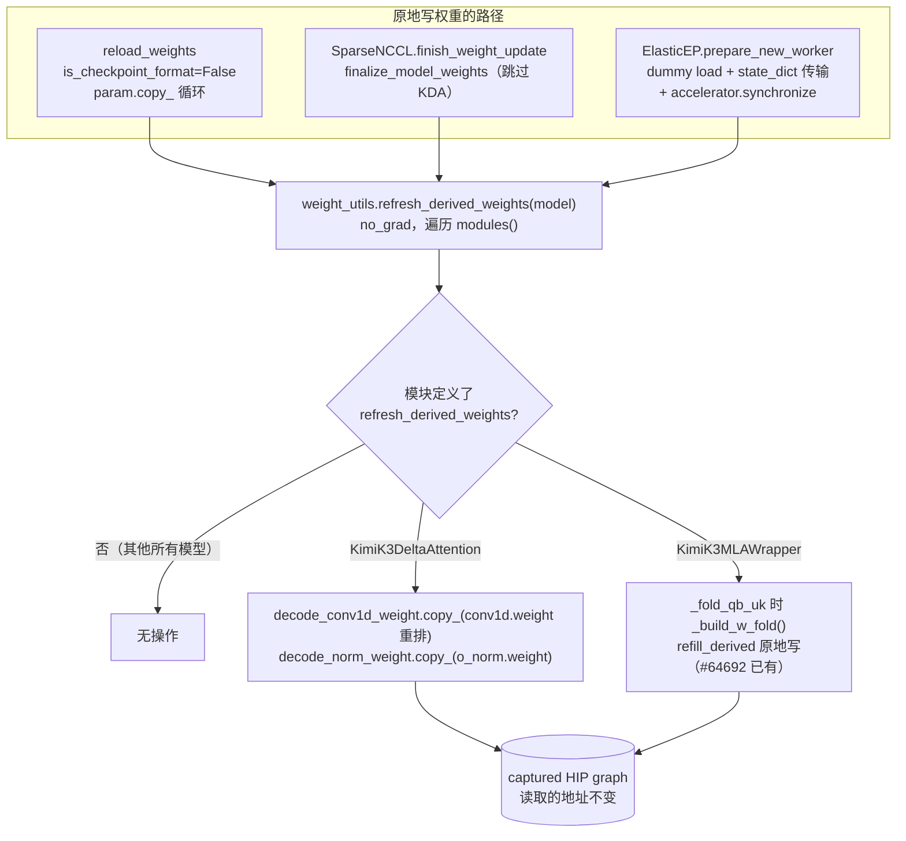
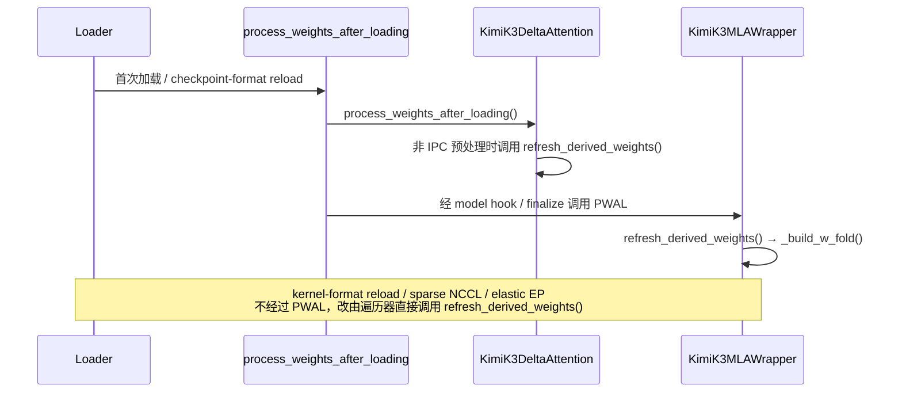

# PR #64886: [Bugfix][ROCm][Kimi-K3] Refresh derived weight copies after in-place weight writes

> **Author**: @okorzh-amd | **State**: OPEN | **Date**: 2026-10-31
> **Branch**: `okorzh/k3-refresh-derived-weights` → `main` | **Labels**: bug, rocm, kimi, k3
> **Changes**: +62 -16 lines across 7 files | **ROCm 相关性**: 部分相关。受影响的模块是 Kimi-K3 的 ROCm 专属层 `vllm/models/kimi_k3/amd/{kda,mla}.py`，但入口改在三个所有后端共用的核心路径上：kernel-format `reload_weights`、sparse NCCL 权重更新、elastic-EP 扩容。
> 本报告分两部分：§1–6 为 PR 详细总结，§7–8 为 ROCm review 意见。
> 审阅基线：PR 分支基于 `57371c4e28`，diff 能干净地 apply 到当前 `upstream/main`（`ffdf26702a`，`weight_utils.py` hunk 偏移 1 行）。mergify 在 11-02 20:20 UTC 报的冲突早于 head commit 的推送时间（约 20:23 UTC），应该已经解决。

---

## 1. 总结 (Summary)

Kimi-K3 的 ROCm 实现会从权重派生出三个不在 `state_dict()` 里的张量：KDA 层的 `decode_conv1d_weight` 和 `decode_norm_weight`（非持久 buffer，fused decode kernel 读取），以及 MLA wrapper 的 `_w_fold`（普通属性，fused decode-query GEMM 读取）。它们只在 post-load hook 里生成。三条原地覆写权重的路径不会跑对应的 hook，所以写完之后这些派生张量就过期了：kernel-format reload、sparse NCCL 更新（对 KDA）、elastic-EP 新 rank。

本 PR 新增一个可选的模块钩子 `refresh_derived_weights()`，在 `weight_utils.py` 里加了一个遍历器，并在上面三条路径的末尾调用它。KDA 层和 MLA wrapper 把原来 post-load hook 里的派生逻辑搬进这个钩子。没有定义该钩子的模型不受影响。

## 2. 背景与动机 (Background & Motivation)

- #61207 把 KDA 的 decode 副本移到 `process_weights_after_loading` 里生成（dummy load 不会走 weight loader）；#60110 引入了 `_w_fold`；#64158 / #64357 让 model-level hook 在每次加载、checkpoint-format reload 和 sparse NCCL 更新后都会运行，但 kernel-format reload 不在其中。
- 根因（作者的分析，我已对照代码核实）：
  - kernel-format reload：`reload_weights(..., is_checkpoint_format=False)` 只是逐个 `param.copy_()`，per-layer hook 和 model hook 都不跑。`[已验证]`
  - sparse NCCL：`finish_weight_update` 只调用 `finalize_model_weights`，而 `finalize_model_weights` 会跳过 `is_deferred_attention_layer`（`AttentionLayerBase` 并且有 PWAL）。KDA 层属于这类，所以它的副本不会更新；MLA wrapper 不属于，所以会更新。`[已验证]`
  - elastic EP：新 rank 先 dummy load，再通过 `batch_transfer_weights` 只接收对端的 `state_dict()`，之后不跑任何 post-load 流程。`[已验证]`
- 这个问题是作者在 review #63612 时读代码发现的，没有在 serving 或 RL 中实际复现。作者也承认 Kimi-K3 目前不设 `num_moe_layers`，elastic-EP 扩容在它上面根本走不通，所以 elastic-EP 这处调用只是防御性的。

## 3. 代码修改分析 (Code Change Analysis)

### 3.1 修改的模块

| 模块 | 改动 |
|------|------|
| `vllm/model_executor/model_loader/weight_utils.py` (+13) | 新增 `@torch.no_grad() refresh_derived_weights(model)`：遍历 `model.modules()`，对定义了同名可调用钩子的模块逐个调用。docstring 写明了钩子契约：幂等、原地写、不做 collective、只读非 expert 权重 |
| `vllm/model_executor/model_loader/reload/inplace.py` (+2) | kernel-format 分支在 copy 循环之后调用遍历器 |
| `vllm/distributed/weight_transfer/sparse_nccl_engine.py` (+2) | `finish_weight_update` 在 `finalize_model_weights` 之后调用遍历器 |
| `vllm/distributed/elastic_ep/elastic_execute.py` (+5) | `prepare_new_worker` 在 `batch_transfer_weights` 和 `torch.accelerator.synchronize()` 之后，在 `set_current_vllm_config` 下调用遍历器 |
| `vllm/models/kimi_k3/amd/kda.py` (+5 -3) | 原有的 copy 逻辑移入 `refresh_derived_weights()`（带 `@torch.no_grad`）；`process_weights_after_loading` 保留 IPC weight-cache 的 `is_weights_pre_processed()` 守卫后再调用它 |
| `vllm/models/kimi_k3/amd/mla.py` (+3) | `process_weights_after_loading` 改为调用 `refresh_derived_weights()`，后者在 `_fold_qb_uk` 时执行 `_build_w_fold()` |
| `tests/models/kimi_k3/test_amd_kda_decode.py` (+32 -13) | `test_decode_weights_staged_after_loading` 抽出 `check_staged()`，在其后做一次 kernel-format reload（所有参数换成 `randn_like`），再次校验副本数值，并断言所有 buffer 地址不变 |

### 3.2 架构 / 流程图

三条原地写路径与派生张量刷新：



正常加载路径与新钩子的关系：



### 3.3 关键实现细节

- **遍历器**：用 `model.modules()` 遍历，共享模块只访问一次。用 `getattr` 按名字找钩子，没有基类或 Protocol 约束；契约只写在 docstring 里。整个遍历包在 `torch.no_grad()` 下。
- **KDA**：`decode_conv1d_weight`、`decode_norm_weight` 是 `persistent=False` 的 buffer，只有 fp32 recurrent state 加上 HIP 或 AITER decode 时才会分配；bf16 state 下为 `None`，钩子直接跳过。两次 copy 都是原地 `copy_`，地址不变。`[已验证]`
- **MLA `_w_fold`**：`_build_w_fold` 已经通过 `refill_derived(self, "_w_fold", ...)` 原地写入，这是 #64692（`26d198bd56`，11-02 合入 main，在本 PR 的 base 里）带来的，不是本 PR 的改动。本 PR 在 `mla.py` 里只加了一个转发钩子。`[已验证]`
- **流同步**：elastic-EP 路径在 `torch.accelerator.synchronize()` 之后才调用遍历器，NCCL 传输流写入的 state_dict 对后续的 copy 可见。kernel-format reload 和 sparse NCCL 中，copy 与遍历在同一条流上按顺序执行。没有发现跨流竞争。`[已验证]`
- **配置上下文**：`_build_w_fold` → `split_kv_b_proj` → `get_and_maybe_dequant_weights` 可能会读当前的 vllm config。worker 的 `reload_weights` 和 `finish_weight_update` 都已经包在 `set_current_vllm_config` 里，elastic-EP 路径由 PR 显式包了一层。`[已验证]`
- **sparse NCCL 上重复构建**：`finalize_model_weights` 已经会调用 MLA wrapper 的 PWAL（也就是 `_build_w_fold`），遍历器会再算一次。每个 MLA 层多一次 `kv_b_proj` dequant + einsum + concat，作者在描述里已说明。

## 4. 涉及的技术原理 (Technical Principles)

- **派生权重与 CUDA/HIP graph**：很多 ROCm fast path 会在加载后把权重转成 kernel 友好的布局（转置、升精度、预乘），并存在 `state_dict()` 之外。captured graph 记录的是张量地址，所以刷新必须原地 `copy_`；如果重新赋值一个新张量，graph 仍会读旧的（甚至已经释放的）地址。
- **三种权重更新语义**：checkpoint-format reload 走 `load_weights` + layerwise PWAL；kernel-format reload 假设传入的权重已经是 kernel 格式，直接 copy，不跑 PWAL；sparse NCCL 用 checkpoint 坐标打补丁，最后只跑 `finalize_model_weights`。对 PWAL 不幂等的模块来说，后两种路径都不能简单地重跑 PWAL（例如 DeepSeek-V4 AMD 会在 hook 里做 preshuffle），所以需要一个独立的、必须幂等的钩子。
- **Elastic EP 扩容**：新 rank 先 dummy load，再从对端 rank 接收 `state_dict()`（不含非持久 buffer 和普通属性），之后由 EPLB 搬运 routed experts。钩子契约要求"只读非 expert 权重"，就是因为调用时 expert 还没到位。
- **KDA fused decode**：ROCm 上 Kimi-K3 的 KDA decode 把 conv1d、KDA 递推和 gated RMSNorm 融合进一个 HIP kernel 或 AITER Gluon kernel，要求 conv 权重是 `[3, W, D]` 布局，norm 权重是 fp32，因此需要单独存一份副本。

## 5. 评论区讨论亮点 (Discussion Highlights)

- 目前没有实质性的人工 review 评论，也没有 approval。PR 页面上只有一个需要 maintainer 触发的 claude[bot] 自动 review。
- mergify 在 11-02 两次提示 merge conflict，head commit 推送时间晚于这两次提示，本地验证 diff 可以干净 apply 到当前 main。
- CI 状态没有抓取到，视为未知。PR 描述说 `:amd: (MI355) Kimi K3` 会跑 `models/kimi_k3`；本地核对，`test-amd.yaml` 的 Kimi K3 步骤依赖 `vllm/models/kimi_k3/amd/` 和 `tests/models/kimi_k3/test_amd_kda_decode.py`，会被触发。

## 6. 风险与潜在问题 (Risk Analysis)

| 风险 | 严重程度 | 说明 |
|------|---------|------|
| 正确性：KDA / `_w_fold` 刷新逻辑本身 | Low | 原地 copy，同步正确，见 §3.3 |
| 兼容性：核心路径上对其他模型的影响 | Low | 遍历器对未定义钩子的模块不做任何事，开销只是一次 `modules()` 遍历 |
| PR 描述与当前 base 不符（`_w_fold` 原地写已由 #64692 提供） | Medium | 见 §7 ⚠️【注释/文档】 |
| 测试覆盖：sparse NCCL、elastic-EP 调用点和 MLA 钩子都没有测试 | Medium | 见 §7 ⚠️【测试】 |
| 可维护性：钩子契约只靠 docstring | Low | 见 §7 📝【设计】 |
| 性能：sparse NCCL 每次更新多构建一次 `_w_fold` | Low | 见 §7 📝【性能】 |
| 共享核心文件改动需要 owner 确认 | Low | 见 §7 📝【设计】 |

---

## 7. Review 意见 (Findings)

| 类型 | 🔴 | ⚠️ | 📝 |
|------|----|----|----|
| 注释/文档 | — | 1 | — |
| 测试 | — | 1 | — |
| 设计 | — | — | 1 |
| 性能 | — | — | 1 |

核心逻辑核对下来是正确的：遍历器只读权重、原地写，各调用点的同步和配置上下文都没问题，没有能写出具体触发输入的阻塞问题。下面的意见集中在描述的时效性和共享调用点的测试覆盖上。

---

**⚠️【注释/文档】PR 描述中关于 `_w_fold` 原地重建的 Claims/Validation 已经和当前 base 不符** `[已验证]`

- **问题**: 描述写道 "The PR also makes the Kimi-K3 ROCm `_w_fold` rebuild write in place"、"On main, layerwise reload and sparse NCCL assign a new `_w_fold`"，并把 "The in-place `_w_fold` rebuild" 列为未验证项，理由是"没有现成的 Kimi-K3 测试"。但 #64692（`26d198bd56`，11-02 合入）已经让 `_build_w_fold` 通过 `refill_derived` 原地写入，并在 `tests/models/kimi_k3/test_amd_qb_uk_fold.py::test_rebuild_refills_fold_in_place` 中做了测试。本 PR 的 base `57371c4e28` 已经包含这次改动，`mla.py` 的 diff 也只剩 +3 行的钩子转发。
- **影响**: reviewer 会以为本 PR 修改了 `_w_fold` 的分配语义，从而高估它的改动面；Claims 里"On main, ... assign a new `_w_fold`"这句话对当前 main 也已经不成立。按当前代码，本 PR 对 `_w_fold` 的实际贡献只是让 kernel-format reload 和 elastic EP 这两条路径也会触发重建。
- **行动**: 建议作者 rebase 后更新 Overview、Claims、Not validated 三处：注明 `_w_fold` 的原地写由 #64692 提供，本 PR 只是把它接入新钩子；把"in-place `_w_fold` rebuild"从未验证项中移除，或者改成"MLA hook 在 kernel-format reload 上的调用未测试"。

**⚠️【测试】三个共享调用点里只有 kernel-format reload + KDA 有测试，遍历器本身也没有后端无关的测试** `[已验证]`

- **问题**: 新测试只覆盖 `reload_weights(is_checkpoint_format=False)` → KDA，而且依赖 `@requires_hip_kernel_arch`，只会在 AMD 队列上运行。`sparse_nccl_engine.py:155`、`elastic_execute.py:717` 这两个调用点，以及 MLA wrapper 的 `refresh_derived_weights`，都没有任何测试；`inplace.py:111` 在 CUDA CI 上也只会以无操作的形式被执行到。
- **影响**: 这三个文件属于所有后端共用的权重更新路径。之后有人重构 `finish_weight_update` / `prepare_new_worker`（比如把 `finalize_model_weights` 移走，或调整 elastic-EP 的同步顺序），把调用删掉或挪到同步之前，不会有任何测试失败。到那时 Kimi-K3 ROCm 在 RL 更新后会静默使用过期的 decode 权重，decode 和 prefill 的输出不一致，而且不会报错。
- **行动**: 建议作者补两个轻量测试：① 在 `tests/model_executor/model_loader/` 下用一个只有 CPU/任意设备的玩具模块（定义 `refresh_derived_weights`，并带一个派生 buffer）跑一次 kernel-format `reload_weights` 和 `SparseNCCLWeightTransferEngine.finish_weight_update`（可以 mock 掉 NCCL），这样 CUDA CI 也能覆盖调用点；② 仿照 `test_rebuild_refills_fold_in_place` 的 SimpleNamespace 写法，直接调用 `KimiK3MultiHeadLatentAttentionWrapper.refresh_derived_weights`，断言 `_w_fold` 被原地刷新。

**📝【设计】钩子契约只写在 docstring 里，elastic-EP 调用点目前没有模型能用到** `[已验证]`

- **问题**: `weight_utils.py:1550-1559` 的契约（幂等、原地写、无 collective、只读非 expert 权重）没有任何约束手段；遍历器按方法名 duck-typing 查找钩子，任何模块以后只要恰好定义了同名方法就会被调用。elastic-EP 这处调用，作者自己也说明目前没有模型能走到（Kimi-K3 扩容在 `model.expert_weights` 处就会失败）。这三个文件的 de-facto owner 分别是：elastic EP 为 Itay Alroy / Ilya Markov，sparse NCCL 和 reload 为 Aaron Hao。
- **行动**: 建议作者在 KDA 和 MLA 的钩子上各加一行注释，引用 `weight_utils.refresh_derived_weights` 的契约；也可以考虑定义一个轻量 Protocol 或 mixin，方便 grep 和类型检查。另外建议 review 时请上述 owner 确认：在共享路径里加这个"目前没有消费者"的 elastic-EP 调用是否可以接受。

**📝【性能】sparse NCCL 每次更新会重复构建 `_w_fold`** `[已验证]`

- **问题**: `finish_weight_update` 先调用 `finalize_model_weights`（它会运行 MLA wrapper 的 PWAL，即 `_build_w_fold`），然后遍历器又调用一次 `refresh_derived_weights`，同一层的 `_w_fold` 算了两遍。
- **行动**: 作者已在描述中说明，影响很小（每层一次 dequant + einsum）。如果 RL 场景对更新延迟敏感，建议作者考虑让 MLA wrapper 只在遍历器里重建，或者让 `finish_weight_update` 跳过已经在 PWAL 中处理过的模块。目前保持现状也可以接受。

## 8. 结论 (Verdict)

**⚠️ NEEDS WORK**

设计是合理的：用一个必须幂等、原地写的独立钩子，替代"重跑并不幂等的 PWAL"，并且只对自愿实现钩子的模块生效，对其他模型没有影响。KDA 和 MLA 的刷新逻辑、流同步、配置上下文都核对过，没有问题。合入前需要做两件事：一是 rebase 后修正 PR 描述中已经被 #64692 取代的 `_w_fold` 相关说法；二是给共享路径上的调用点补一个后端无关的轻量测试，避免今后重构时静默丢掉调用。

**数字溯源**：描述中 "45 passed"、"82 passed / 2 failed（与 base 相同）"、"114 passed / 3 failed（与 base 相同）" 都是作者在单张 MI355X 上的本地结果，日志不在仓库中，标为 `[unverified]`。base 上新测试 2 failed / 2 passed 与测试的参数化结构一致：fp32 state 的两个用例会分配副本，所以失败；bf16 的两个用例提前 return。

## 9. 英文 Review 评论 (Copy-Paste English Comments)

**C1** `vllm/models/kimi_k3/amd/mla.py:187-192` — ⚠️ comment

```text
Since #64692 landed (and is in this PR's base), `_build_w_fold` already refills `_w_fold` in place via `refill_derived`, and `test_amd_qb_uk_fold.py::test_rebuild_refills_fold_in_place` covers that. The description still says this PR "makes the Kimi-K3 ROCm `_w_fold` rebuild write in place" and that "on main, layerwise reload and sparse NCCL assign a new `_w_fold`", and lists the in-place rebuild as unvalidated. Could you update the Overview/Claims/Not-validated sections so they reflect that this PR only wires the existing in-place rebuild into the new hook (i.e. the new coverage is kernel-format reload and elastic EP)? That will make the actual scope of the change much clearer to reviewers.
```

**C2** `vllm/model_executor/model_loader/weight_utils.py:1549-1559` — ⚠️ comment

```text
The walker is now called from three shared weight-update paths (`reload/inplace.py:111`, `sparse_nccl_engine.py:155`, `elastic_execute.py:717`), but the only test is the HIP-gated KDA kernel-format reload, so on CUDA CI these call sites are exercised only as no-ops and the sparse-NCCL/elastic-EP ones not at all. A future refactor that drops or reorders one of these calls would silently bring back stale decode copies for Kimi-K3 on ROCm. Could you add a small backend-agnostic test with a toy module that defines `refresh_derived_weights` and owns a derived buffer, checking that kernel-format `reload_weights` and `SparseNCCLWeightTransferEngine.finish_weight_update` (with NCCL mocked) refresh it in place? A SimpleNamespace-style check of `KimiK3MultiHeadLatentAttentionWrapper.refresh_derived_weights`, like `test_rebuild_refills_fold_in_place`, would cover the MLA hook too.
```

**C3** `vllm/distributed/elastic_ep/elastic_execute.py:714-717` — ⚠️ comment

```text
Ordering here looks right (after `batch_transfer_weights` and `torch.accelerator.synchronize()`, under the worker's vLLM config). As the description notes, though, no model currently implementing the hook can complete an elastic-EP scale-up, so this is a defensive call in a shared path. It would be good to get a quick ack from the elastic-EP owners that this is fine. Separately, since the hook contract (idempotent, in-place, no collectives, non-expert weights only) lives only in the `refresh_derived_weights` docstring, consider referencing it from the KDA/MLA implementations so future implementers see the "no collectives / experts not yet in place" constraint that this call site relies on.
```
