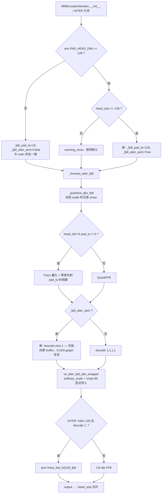
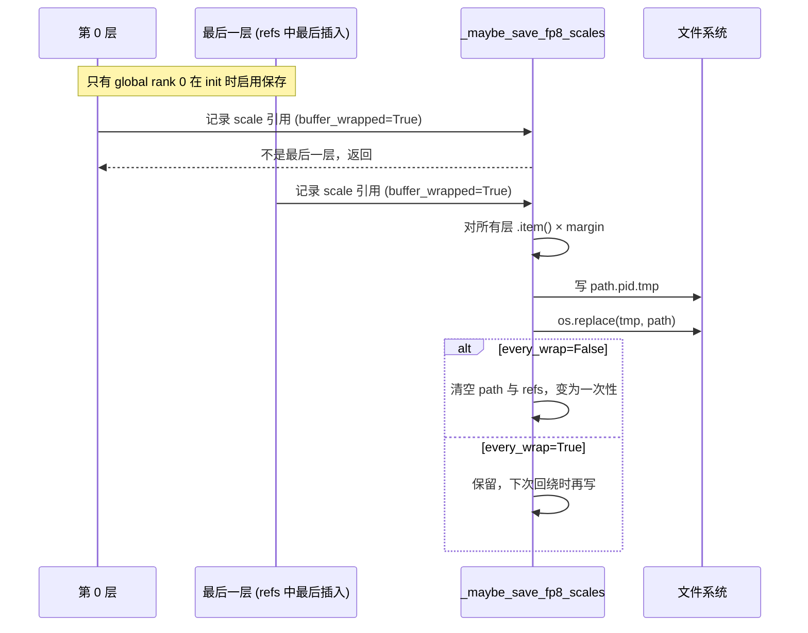

# PR #64928: [ROCm][Multimodal][MiniMax-M3, M3.1-Flash] FP8 ViT attention: opt-in AITER asm path for head_dim 80 (padded to 128); single-writer scale file

> **Author**: @vorapolsiloai | **State**: OPEN | **Date**: 2026-10-31（最后一次推送 2026-11-24）
> **Branch**: `vorapolsiloai:mm3-vit-fp8-hd128` → `main` | **Labels**: rocm, minimax, nvidia, documentation, ready, verified
> **Changes**: +467 -32 lines across 10 files | **ROCm 相关性**: 完全相关（AITER FP8 ViT attention 路径；共享文件 `mm_encoder_attention.py` / `qkv_padded_fp8_quant.py` 的 CUDA/FlashInfer 分支在默认配置下行为不变）
> **CI 状态**: Buildkite #105355（在 merge commit `54207e5` 上由 @shen-shanshan `/ci run` 触发）结果为 failed：498 个 job 中只启动了 22 个，失败的是 pre-commit（已由 head `cf076f1` 修复）和 “Check every test ran”；head 上没有新的 CI 运行，AMD CI 未触发。GitHub checks 页面显示 head 上的 pre-commit 通过。
> 本报告分两部分：§1–6 为 PR 详细总结，§7–8 为 ROCm review 意见。
>
> **复审说明**：上一版报告（2026-11-05，head `3960cf7`）的主要意见已全部处理：`(1,)` descale 改为只在 opt-in 时生效、`_aiter_ops.py` 恢复原样；env 取值改为白名单校验；EVERY_WRAP 改为 `MultiModalConfig` 字段，并且每次回绕只在最后一层写一次；scale 文件只由 global rank 0 写；测试同时断言 head_dim 和 descale shape；`envs.py` 的插入位置也已调整。本报告按当前 head 重写。

---

## 1. 总结 (Summary)

MiniMax-M3 和 MiniMax-M3.1-Flash 的视觉塔是 16 heads、head_dim 80。在 ROCm 上用 FP8 ViT attention（`--mm-encoder-attn-dtype fp8` + `ROCM_AITER_FA`）时，AITER 只能走 CK-tile FP8 kernel，因为它的 asm FP8 kernel 要求 head_dim 128 且 per-tensor descale shape 为 `(1,)`。本 PR 新增 opt-in 环境变量 `VLLM_ROCM_VIT_FP8_PAD_HEAD_DIM=128`：把 Q/K/V 零填充到 128，并把 descale 以 `(1,)` 的 view 传入，使 AITER 选中 asm kernel，输出再切回 80 列。数学结果不变，代价是 37.5% 的 attention FLOPs 浪费，以及每层额外的填充/量化 launch，所以只对大图有收益（作者给出的盈亏点约 5k patches）。另外，FP8 scale 校准文件改为只由 global rank 0 写入，用临时文件加原子 rename 落盘，并新增 `--mm-encoder-fp8-scale-save-every-wrap`，可在每次 amax 回绕时重写文件。

## 2. 背景与动机 (Background & Motivation)

- 已合入的 FP8 ViT attention 在 ROCm 上调用 `aiter.flash_attn_varlen_fp8_pertensor_func`。vLLM 的量化 helper 只把 head_dim 填充到 16 的倍数（为 cuDNN 准备），80 本来就是 16 的倍数，所以 AITER 拿到的是 hd80，只能走 CK-tile kernel。vLLM 的 scale buffer 为了 FlashInfer 注册为 `(1,1,1,1)`，即使 head_dim 是 128，也不满足 asm 路径对 descale shape 的判断。
- 作者在 MI355X 上测得：16,416 patches 的单次 attention 从 2.43 ms（CK-tile）降到 1.42 ms（asm）；32 层 ViT 前向在 2048x1600 下快 1.72x，但在 768x1024 下只有 0.86x（反而更慢）。因此最终设计为 opt-in，并写明 AITER 提供原生 hd80 asm FP8 kernel 后应删除。
- scale 文件：在 `--mm-encoder-tp-mode data`（数据并行视觉编码器）下，以前每个 rank 都会写同一个路径。原子 rename 只能防止文件写坏，各 rank 的 amax 窗口仍然不同，文件内容取决于最后写入的 rank；另外以前在**第一个**回绕的层就触发保存，后续层的窗口还不完整。
- 演进：11-04 标记为 ready for review；11-19 一次性 force-push 了 16 个 commit，逐条回应了上一轮 review（descale 门控、env 校验、改为 config、单写者、只在最后一层保存、测试断言）；11-24 @shen-shanshan 加了 `ready`/`verified` label 并触发 `/ci run`；之后作者修复了 pre-commit。
- 后续 / 关联：#68398（Draft）计划融合 Q/K/V amax 与填充量化 launch，以消除小图上的损失；#65311（Draft）是 MiniMax-M3 序列并行 ViT；#60809（使用 abs().amax() 的 scale）与本 PR 相互独立，作者提示合入后需要重新校准静态 scale。

## 3. 代码修改分析 (Code Change Analysis)

### 3.1 修改的模块

| 文件 | 改动 |
|------|------|
| `vllm/model_executor/layers/attention/mm_encoder_attention.py` (+79 -15) | AITER 分支读取 env，`head_size <= 128` 时设置 `_fp8_pad_to=128` 与 `_fp8_aiter_asm=True`，否则 `warning_once`；`_forward_aiter_fp8` 在 asm 模式下把三个 descale `view(1)`；`_maybe_save_fp8_scales` 改为只在最后一层回绕时保存、临时文件 + `os.replace`、支持 every-wrap；保存只在 `is_global_first_rank()` 上启用 |
| `vllm/kernels/triton/qkv_padded_fp8_quant.py` (+16 -10) | `quantize_fp8_pad_head_dim_triton` / `quantize_fp8_maybe_pad_head_dim` 新增 `pad_to` 参数（默认 16），更新 docstring |
| `vllm/envs.py` (+18) | 注册 `VLLM_ROCM_VIT_FP8_PAD_HEAD_DIM`：`env_with_choices` 只接受 `""/0/16/128`，空值和 0 视为 16 |
| `vllm/config/multimodal.py` (+13) | 新字段 `mm_encoder_fp8_scale_save_every_wrap`；没有 save path 时报 `ValueError` |
| `vllm/config/model.py` (+5)、`vllm/engine/arg_utils.py` (+10) | 透传新字段与 CLI `--mm-encoder-fp8-scale-save-every-wrap` |
| `docs/features/quantization/fp8_vit_attn.md` (+38) | 说明 opt-in 开关、盈亏点表格、单写者语义 |
| `tests/kernels/attention/test_mha_attn.py` (+120) | `test_mha_attn_aiter_fp8_pad_head_dim`：pad 16/128 × eager/graph 布局，断言启动的 head_dim 与 descale shape，并与 SDPA 参考及 pad16 输出比较 |
| `tests/kernels/core/test_vit_fp8_scaling.py` (+155 -5) | 去掉模块级 FlashInfer skip（各用例已自行 skip）；新增原子写、every-wrap、每次回绕只写一次、只在 first rank 启用等 CPU 测试 |
| `tests/test_envs.py` (+15) | env 取值白名单测试 |

当前 head 与 `upstream/main`（`5cc69fe699`）逐文件三方合并无文本冲突。

### 3.2 架构 / 流程图

AITER FP8 ViT attention 前向（「新」为本 PR 改动）：



scale 自动保存（动态 scale + `mm_encoder_fp8_scale_save_path`）：



### 3.3 关键实现细节

- **默认路径不变**：env 未设置（或设为 16/0/空）时，`_fp8_pad_to=16`、`_fp8_aiter_asm=False`，量化与 descale 都和 main 一致；`_aiter_ops.py` 未改动。FlashInfer/cuDNN 分支从不读取这个 env。
- **数学等价**：Q/K 填充列为 0，QK^T 不变；V 的填充列只影响输出的填充列，最后会被切掉。`scale=self.scale`（按原 head_size 计算）显式传给 `_rocm_aiter_fp8_attn_impl` 的 `softmax_scale`（已核对 `vllm/_aiter_ops.py`），不会退化成按 128 计算。
- **Triton 填充 kernel**：`padded_head_dim = round_up(D, pad_to)`，`block_n = max(16, min(next_pow2(padded), 128))`；读取用 `mask_in`（列 < D）并以 0 填充，写出用 `mask_out`（列 < padded）。D=80、pad 128 时只有一个 128 宽的列块，填充列写入 FP8 的 0。
- **descale view**：`d.view(1)` 是 `(1,1,1,1)` buffer 的 view，动态 scale 用 `fill_` 原地更新，所以 encoder CUDA graph replay 时读到的是当前 scale。
- **env 解析**：`env_with_choices(..., ["", "0", "16", "128"])` 拒绝其他值；外层 `int(... or 16) or 16` 把空串和 `"0"` 都映射成 16。`head_size == 128` 的模型设置后不填充，只切换到 `(1,)` descale（即 asm kernel）。
- **单写者**：`is_global_first_rank()` 基于 `_WORLD`，而 `_WORLD` 按 `world_size_across_dp` 初始化，所以在多 DP engine 下也只有一个进程写（已核对 `parallel_state.py`）。不增加集合通信，因为在 data 模式下没有图像的 rank 会跳过 encoder，集合通信会 hang。
- **只在最后一层保存**：`layer_name != next(reversed(_fp8_saved_scale_refs))` 时直接返回。dict 的插入顺序就是第一次 forward 时各层的调用顺序，所以“最后一层”指的是首次被调用顺序中的最后一层（注释写作“last-registered”）。每次回绕 rank 0 上的 `.item()` 次数从 3·L² 量级降到 3·L。

## 4. 涉及的技术原理 (Technical Principles)

- **FP8 per-tensor attention**：Q/K/V 各自按 per-tensor scale 量化为 FP8（gfx950 为 OCP e4m3，gfx942 为 e4m3fnuz），kernel 内用 descale 还原 QK^T 与 PV。动态模式下 scale 取最近 16 次 amax 的最大值（环形缓冲）；静态模式从校准 JSON 读取，并乘以 margin（默认 1.5）。
- **AITER fmha 分派**：`flash_attn_varlen_fp8_pertensor_func` 在满足 hdim 128（gfx950 也支持 256）、FP8 dtype、descale shape 为 `(1,)` 或 `(batch, nhead_k)` 时走手写 asm kernel，否则回退到 CK-tile。没有提供该 asm 符号的 AITER 版本会**静默回退**，所以文档建议在 profile 中查找 `fmha_fwd_hd128_fp8`。
- **零填充的成本模型**：attention FLOPs 按 128/80 = 1.6 倍增长，另有每层固定开销：Q/K/V 各一次填充量化 launch、输出切片 `.contiguous()`。只有当 asm kernel 相对 CK-tile 的提速（大 S 时约 1.7x）超过这些开销时才划算，这就是存在约 5k patches 盈亏点的原因。
- **视觉编码器的并行模式**：`mm_encoder_tp_mode="weights"` 按 head 切分（每个 rank 看到所有图像的部分 head），`"data"` 按图像切分（每个 rank 看到完整 head、部分图像）。两种模式下 rank 0 计算 amax 的样本不同，scale 文件只反映 rank 0 那一份，由 margin 兜底。

## 5. 评论区讨论亮点 (Discussion Highlights)

- 没有人工 reviewer 的行内讨论（页面上有 20 个折叠项无法展开，可见部分只有 bot 提示）。`claude[bot]` 提示 fork PR 无法自动 review；mergify 两次提示冲突，作者两次 rebase。
- 作者的 commit message 很详细，逐条解释了上一轮 review 的处理，例如：017a910 把 `(1,)` descale 绑定到 opt-in（“the untested pad-128-on-CK-tile combination no longer exists”）；e77cb51 发现 `0` 会在 profile run 中触发 `ZeroDivisionError`，`100` 会静默填充到 AITER 没有调优的 head_dim；ac4dcda 说明 every-wrap 以前每次回绕会写 32 次、触发 3,072 次 `.item()`；0b465b7 把 pad128 与 pad16 的余弦阈值从 0.999 放宽到 0.998（MI355X 实测 0.999288，两个 kernel 的舍入差异约为各自误差的 2/3）。
- 性能与精度数字均来自 PR 描述，本 review 未复现 `[unverified]`：MiniMax-M3 在 MI355X、TP2、2048x1600 c16 下 +7.8% output tok/s（3 组 A/B，基线为 FP8 CK-tile）；MiniMax-M3.1-Flash 在 MI350X 上 TTFT -5.5% / -22.4%（基线为 **BF16 ViT**）；MMMU val 0.6144 vs 0.6222（M3）、0.581 vs 0.558（M3.1-Flash），标准误约 0.016；单测 143 passed / 13 skipped。
- CI：@shen-shanshan 于 11-24 加 `ready`/`verified` 并 `/ci run`，Buildkite #105355 只启动了 22/498 个 job，pre-commit 失败（作者随后在 `cf076f1` 中修复）。head 上没有新的 Buildkite 构建，AMD CI（`/amd-ci run`）未触发。

## 6. 风险与潜在问题 (Risk Analysis)

| 风险 | 严重程度 | 说明 |
|------|---------|------|
| head 上没有任何测试信号，ROCm 新测试只在作者机器上跑过 | Medium | 见 §7 ⚠️【测试】 |
| opt-in 开关的生效范围大于验证范围（gfx942、hd64/72、hd128 均可启用且没有提示） | Medium | 见 §7 ⚠️【兼容性】 |
| AITER 缺少 asm 符号时静默回退，用户开了开关也可能没有收益 | Low | 文档已说明，见 §7 📝 |
| M3.1-Flash 的收益相对于 BF16 基线，混合了“启用 FP8”和“填充到 128”两个因素 | Low | 见 §7 📝 |
| 只在最后一层保存的假设在多 encoder 模型上不成立 | Low | 见 §7 📝 |
| TP head 切分下 scale 文件只反映 rank 0 的 head | Low | 已在文档说明，margin 兜底 |
| CUDA 路径回归 | Low | 默认 `pad_to=16`，FlashInfer 分支不读 env；原子写与单写者对 CUDA 同样适用且无害 |

---

## 7. Review 意见 (Findings)

| 类型 | 🔴 | ⚠️ | 📝 |
|------|----|----|----|
| 测试 | — | 1 | 1 |
| 兼容性 | — | 1 | — |
| 正确性 | — | — | 1 |
| 可维护性 | — | — | 1 |

总体评价：相对上一版，改动收敛得很好。默认路径与 main 逐字节一致，填充/切片/softmax scale/descale view 在数学和 CUDA graph 语义上都正确（已逐行核对），单写者与“最后一层保存”修复了上一轮指出的问题，测试也锁定了 kernel 选择。剩下的意见主要是 CI 信号和开关的适用范围。

**⚠️【测试】head 上没有任何 CI 信号，新的 ROCm 测试只在作者的 MI355X 上跑过** `[已验证]`

- **问题**: 唯一一次 Buildkite 构建 #105355（基于 merge commit `54207e5`）是 failed：498 个 job 只启动了 22 个，失败项是 pre-commit 和 “Check every test ran”，其余 260 个 step 处于 waiting/blocked。pre-commit 已在 `cf076f1` 修复，但之后没有再跑 CI。AMD CI 没有触发，而 `.buildkite/test-amd.yaml` 中正好有覆盖 `tests/kernels/attention` 和 `tests/kernels/core` 的 step，可以在 MI355 上运行 `test_mha_attn_aiter_fp8_pad_head_dim` 和 `test_vit_fp8_scaling.py`。新测试依赖安装的 AITER 是否提供 `flash_attn_varlen_fp8_pertensor_func`，否则会 skip。
- **影响**: 本 PR 的核心断言（pad128 时 `launched == [(128, (1,))]`、与 pad16 输出的余弦 ≥ 0.998）只在作者环境中验证过。CI 镜像中的 AITER 版本如果没有 asm 符号，测试会 skip 或断言失败，这恰恰是文档提到的“静默回退”场景，需要在 CI 上确认。另外，去掉 `test_vit_fp8_scaling.py` 的模块级 skip 后，该文件会第一次在 ROCm CI 上运行。
- **行动**: 建议 review 时请作者或 maintainer 在 head 上触发 `/amd-ci run`（或 `/ci run`），确认 MI355 的 kernels attention/core step 中两个测试文件确实运行（不是 skip）并通过，再合入。

**⚠️【兼容性】opt-in 开关的生效范围大于已验证范围，且启用时没有任何提示** `[已验证]`

- **问题**: `mm_encoder_attention.py:489-499` 只检查 `head_size <= 128`，不检查架构。因此：① gfx942（MI300X，FP8 为 e4m3fnuz）设置后同样会把 descale 改为 `(1,)` 并走 asm kernel；② hd64/72 的视觉塔会被填充到 128（作者自己写明“nearly doubles the work”）；③ hd128 的模型不填充，但会从 CK-tile 切换到 asm kernel。这三种情况 PR 都声明“未验证”（Not claimed: gfx942, head_dims 64/72），但代码会照样生效，只有 head_dim > 128 时才打 warning。生效时也没有 info 日志说明“pad 128 + asm 已启用”。
- **影响**: 用户在共享部署脚本里打开这个 env（例如同一个 launcher 同时用于 MI300X 和 MI355X，或者同时用于 MiniMax 和其他 VLM），就会在未验证的组合上切换 FP8 kernel，数值差异和性能回退（hd64 时约 2x 的计算量）都没有提示。触发输入：MI300X + `VLLM_ROCM_VIT_FP8_PAD_HEAD_DIM=128` + `--mm-encoder-attn-dtype fp8`，或 hd64 的视觉塔 + 同样配置。
- **行动**: 建议作者在已验证组合之外（非 gfx950，或 head_size 不是 80）打一条 `warning_once`，说明该组合未验证，并在生效时打一条 `info_once`（包括 head_dim、pad 目标、arch）。更保守的做法是只在 gfx950 上生效。

**📝【测试】M3.1-Flash 的收益相对于 BF16 基线，没有把“填充到 128”单独拆出来** `[已验证]`

- **问题**: Claims 中 MiniMax-M3 的 +7.8% 是相对于 FP8 CK-tile（只改变了本 PR 的开关），而 MiniMax-M3.1-Flash 的 TTFT -5.5% / -22.4% 和 tok/s +12.1% / -0.8% 是相对于 BF16 ViT，同时包含了“启用 FP8 ViT”和“填充到 128 走 asm”两个因素；第二组 A/B 中还有一次 3.9 s 的引擎停顿。Overview 把两组数字并列，容易被读成同一口径。
- **行动**: 建议作者在 Overview 中明确标注两组的基线，或者补一组 M3.1-Flash 的“FP8 CK-tile vs FP8 pad-128”A/B，让本 PR 的贡献可以单独衡量。

**📝【正确性】“只在最后一层保存”假设所有层在同一次 forward 中回绕，多 encoder 模型不满足** `[已验证]`（影响 `[推测]`）

- **问题**: `mm_encoder_attention.py:142` 用 `next(reversed(_fp8_saved_scale_refs))` 判断“最后一层”，这个顺序来自首次 forward 中各层的调用顺序。像 Qwen3-Omni 这样视觉塔和音频塔都使用 `MMEncoderAttention` 的模型（`qwen3_omni_moe_thinker.py:270`），两个塔的 forward 次数不同。如果 refs 中最后插入的是 A 塔的层，B 塔的回绕永远不会触发保存；在一次性模式下，如果之后的流量只用到 B 塔，文件就永远不会被写出（main 上的“第一个回绕的层触发”在这种情况下仍会写）。注释中的 “last-registered” 与实际语义（首次调用顺序）也不完全一致。
- **行动**: 建议作者把这个假设写进 docstring 或文档（“适用于单视觉塔”），或者按 refs 中第一层所在的模块前缀分组判断；至少把注释改为 “last layer first called”。

**📝【可维护性】静默回退与 env 解析的小问题** `[已验证]`

- **问题**: ① 文档写明 AITER 没有 asm 符号时会静默回退，但代码没有提供任何运行时提示，用户只能靠 profile 发现；② `envs.py:1569-1577` 中 `int(env_with_choices(...)() or 16) or 16` 的两层 `or 16` 有一层是多余的（`"0"` 由外层处理、`""` 由内层处理，用一个映射表会更清楚）。
- **行动**: 建议作者考虑在初始化时用 AITER 的分派判断函数（如果对外暴露）检查一次，并在会回退时 `warning_once`；env 解析可以简化为 `{"": 16, "0": 16, "16": 16, "128": 128}[value]`。均为可选。

## 8. 结论 (Verdict)

**⚠️ NEEDS WORK**

代码本身已经可以合入：默认路径不变，opt-in 路径的填充、切片、softmax scale 和 descale view 都正确，单写者与最后一层保存修复了上一轮的问题。合入前需要在 head 上跑一次 AMD CI，确认新的 ROCm 测试在 CI 的 AITER 版本上确实运行并通过；同时建议在未验证的组合（非 gfx950、head_dim 不是 80）上给出 warning，避免共享启动脚本在 MI300X 或其他 VLM 上静默切换 kernel。

## 9. 英文 Review 评论 (Copy-Paste English Comments)

**C1** `tests/kernels/attention/test_mha_attn.py:435-452` — ⚠️ comment

```text
The only Buildkite build (#105355, on merge commit 54207e5) ran 22 of 498 jobs and failed on pre-commit, which cf076f1 fixes. Nothing has run on the current head, and AMD CI was not triggered. This test and test_vit_fp8_scaling.py (now without the module-level skip) are the only automated check that the pad-128 path picks the asm kernel. They skip if the CI image's AITER lacks flash_attn_varlen_fp8_pertensor_func. Could you run /amd-ci run on the head and confirm that the MI355 kernels attention and core steps actually run both files (not skip them) and that they pass?
```

**C2** `vllm/model_executor/layers/attention/mm_encoder_attention.py:489-499` — ⚠️ comment

```text
The gate checks only head_size <= 128. With the variable set, gfx942 (fnuz FP8), head_dim 64/72 towers (padded to 128, close to 2x the work), and native head_dim 128 towers (switched to the asm kernel) all take the new path silently, though the description lists them as not validated. A shared launcher that sets this for MI355X would change kernels on MI300X or on other VLMs without any log line. Could you add a warning_once outside the validated combination (gfx950, head_dim 80) and an info_once when the path is active, with head_dim, pad target and arch? Restricting it to gfx950 would also be reasonable.
```

**C3** `vllm/model_executor/layers/attention/mm_encoder_attention.py:139-142` — 📝 comment

```text
"Last layer" here is the last key of _fp8_saved_scale_refs, which is the first-call order, not the registration order. That works for a single vision tower. For models with two MMEncoderAttention towers that run at different rates (Qwen3-Omni has vision and audio), the save fires only when the last-inserted tower wraps. With the one-shot default, the file may never be written if later traffic uses only the other tower. Could you document that this assumes a single encoder, or fix the comment to say "last layer first called"?
```

## 10. 英文总结评论 (Overall Review Summary)

```text
Thanks, this version addresses the earlier feedback well. The default path is unchanged, and the opt-in pad-to-128 path is mathematically equivalent: zero columns, the original softmax scale, and a (1,) descale view that stays graph-safe. The single-writer, once-per-wrap scale save is also correct. Before merging, please run AMD CI on the head and confirm that the new ROCm tests actually run and pass with the CI AITER. Please also warn when the variable is used outside the validated combination of gfx950 and head_dim 80. Approve after that.
```
