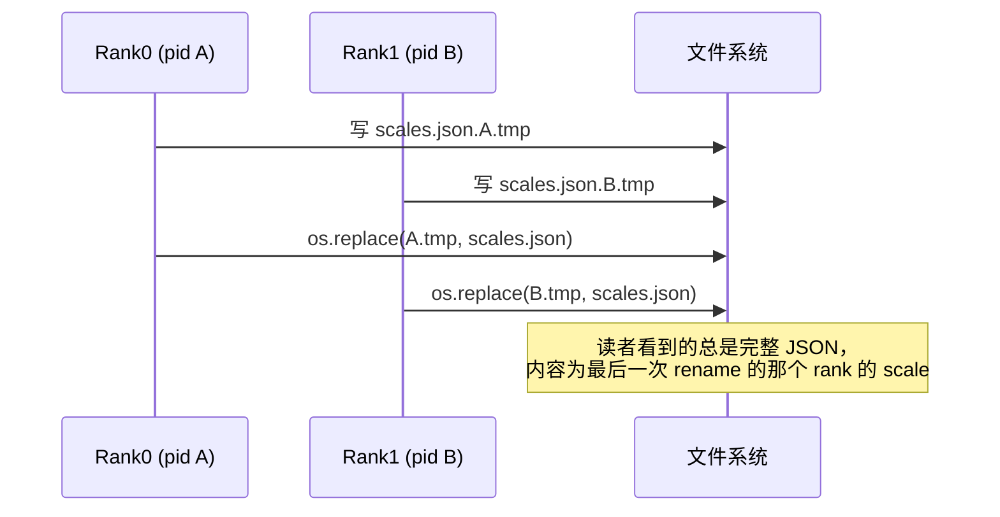

# PR #64928: [ROCm][Multimodal] FP8 ViT attention on AITER asm kernel: pad head_dim to 128, (1,) descales, atomic scale file

> **Author**: @vorapolsiloai | **State**: OPEN | **Date**: 2026-10-31
> **Branch**: `mm3-vit-fp8-hd128` → `main` | **Labels**: rocm, nvidia, minimax
> **Changes**: +222 -14 lines across 6 files | **ROCm 相关性**: 完全相关（AITER FP8 ViT attention 路径；共享文件 `mm_encoder_attention.py` 的 CUDA/FlashInfer 分支在默认配置下行为不变）
> **CI 状态**: 未知（fetch 脚本的 `checks` 字段只返回了键名 `total_count`/`check_runs`，无具体 check 结果）；mergify 提示存在 merge conflict，需要 rebase。
> 本报告分两部分：§1–6 为 PR 详细总结，§7–8 为 ROCm review 意见。

---

## 1. 总结 (Summary)

本 PR 把 ROCm 上 FP8 ViT attention（`--mm-encoder-attn-dtype fp8` + `ROCM_AITER_FA`）从 AITER 的 CK-tile FP8 kernel 切到更快的手写 asm FP8 kernel（`fmha_v3_varlen_fwd`），目标模型是 head_dim=80 的视觉塔（MiniMax-M3）。做法有三点：(1) 新增 opt-in 环境变量 `VLLM_ROCM_VIT_FP8_PAD_HEAD_DIM`（默认 16，设为 128 时把 head_dim 80 零填充到 128）；(2) 把 1 元素的 per-tensor descale 从 `(1,1,1,1)` 改成 `(1,)` 再传给 AITER，满足 asm 路径的 shape 判断（**该项默认开启**）；(3) 原子写入 FP8 scale 校准文件（tmp + `os.replace`），并新增 `VLLM_MM_ENCODER_FP8_SCALE_SAVE_EVERY_WRAP`，可在每次 amax 环形缓冲回绕时重写一次文件。PR 声称 2048x1600 图像下单层 attention 从 2.41 ms 降到 1.32 ms，TP2 serving 吞吐 +5.7%。

## 2. 背景与动机 (Background & Motivation)

- 已合入的 FP8 ViT attention 在 ROCm 上调用 `aiter.flash_attn_varlen_fp8_pertensor_func`。head_dim 不是 16 的倍数时，vLLM 的 Triton 量化 kernel 只填充到 16 的倍数（80 本来就是 16 的倍数，所以不填充），AITER 拿到 hd80 就只能走 CK-tile kernel。
- AITER 的 asm FP8 kernel 要同时满足两个条件：`hdim_q == hdim_v == 128`（gfx950 上也支持 256），且 descale shape 为 `(1,)` 或 `(batch, nhead_k)`。vLLM 的 scale buffer 为了兼容 cuDNN 注册成了 `(1,1,1,1)`，所以即使 head_dim 是 128 也会走 CK-tile。
- 用 `--mm-encoder-tp-mode data`（数据并行视觉编码器）做静态 scale 校准时，各 rank 同时写同一个 `mm_encoder_fp8_scale_save_path`，读者可能读到写了一半的 JSON。
- PR 描述中说明：序列并行 MiniMax ViT 已拆到 #65311；TP2 + `--mm-encoder-tp-mode data` 的启动 hang 要靠 #65352 修复（作者的 A/B 测试都打了这个补丁）。

## 3. 代码修改分析 (Code Change Analysis)

### 3.1 修改的模块

| 模块 | 改动 |
|------|------|
| `vllm/_aiter_ops.py` (+5) | `_rocm_aiter_fp8_attn_impl`：1 元素 descale `view(1)` 后再传给 AITER |
| `vllm/envs.py` (+14) | 注册 `VLLM_ROCM_VIT_FP8_PAD_HEAD_DIM`（int，默认 16）和 `VLLM_MM_ENCODER_FP8_SCALE_SAVE_EVERY_WRAP`（bool，默认 False） |
| `vllm/kernels/triton/qkv_padded_fp8_quant.py` (+11 -6) | `quantize_fp8_pad_head_dim_triton` / `quantize_fp8_maybe_pad_head_dim` 新增 `pad_to` 参数（默认 16） |
| `vllm/model_executor/layers/attention/mm_encoder_attention.py` (+23 -3) | `_fp8_pad_to` 只在 AITER 分支读取 env var；scale 文件原子写入 + 可选的每次回绕都重写 |
| `tests/kernels/attention/test_mha_attn.py` (+99) | 新测试 `test_mha_attn_aiter_fp8_pad_head_dim`：pad 16/128 × eager/graph 布局 |
| `tests/kernels/core/test_vit_fp8_scaling.py` (+70 -5) | 去掉模块级 FlashInfer skip（改由各用例自行 skip），新增两个原子写 CPU 测试 |

### 3.2 架构 / 流程图

AITER FP8 ViT attention 前向（改动点用「新」标注）：

```mermaid
flowchart TD
    A[MMEncoderAttention._forward_aiter_fp8] --> B[_quantize_qkv_fp8]
    B --> C{动态 scale?}
    C -- 是 --> D[_record_amax_and_update_scales<br/>写 amax 环形缓冲 len=16]
    D --> E[_maybe_save_fp8_scales<br/>新: 原子写 / 可选每次回绕重写]
    C -- 否 --> F
    E --> F{head_dim % pad_to != 0 ?}
    F -- 是 --> G[Triton 量化+零填充到 pad_to 的倍数<br/>新: pad_to=VLLM_ROCM_VIT_FP8_PAD_HEAD_DIM]
    F -- 否 --> H[QuantFP8 静态量化]
    G --> I[rocm_aiter_ops.fp8_attn_wrapper]
    H --> I
    I --> J[_rocm_aiter_fp8_attn_impl<br/>新: descale (1,1,1,1) → (1,)]
    J --> K{AITER: hdim==128 且 descale.shape==(1,)?}
    K -- 是 --> L[fmha_v3 asm FP8 kernel]
    K -- 否 --> M[CK-tile FP8 kernel]
    L --> N[输出切片 ..., :head_size]
    M --> N
```

scale 文件写入（数据并行编码器，多 rank 共享路径）：



### 3.3 关键实现细节

- `_fp8_pad_to` 在 `_init_fp8_state` 中默认为 16，只有在 `ROCM_AITER_FA` 分支才赋值为 `envs.VLLM_ROCM_VIT_FP8_PAD_HEAD_DIM`，FlashInfer/cuDNN 分支不受影响。
- 填充语义是「填充到 `pad_to` 的**倍数**」（`round_up(D, pad_to)`），不是「至少填充到 `pad_to`」。只有 `head_dim % pad_to != 0` 时才走 Triton 填充 kernel，否则走 `QuantFP8`。
- Triton kernel 的 `block_n = max(16, min(next_pow2(padded), 128))`，grid 第二维按 `cdiv(padded, block_n)` 划分，填充到 128/256 均能正确覆盖；填充列由 `mask_in` 置 0。
- attention 结束后 `_forward_aiter_fp8` 用 `output[..., :self.head_size]` 切回原 head_dim；softmax scale 显式传入 `self.scale = 1/sqrt(原 head_size)`，没有用 AITER 默认的 `q.shape[-1] ** -0.5`（那样会按填充后的 128 计算），因此 scale 正确。
- fake 实现 `_rocm_aiter_fp8_attn_fake` 返回 `(*q.shape[:-1], v.shape[-1])`，与填充后的真实输出 shape 一致。
- 原子写：`tmp = f"{path}.{os.getpid()}.tmp"` 与目标文件在同一目录，`os.replace` 在 POSIX 上是原子操作。EVERY_WRAP 模式下不清空 `_fp8_scale_save_path` / `_fp8_saved_scale_refs`。
- 两个新 env var 都已注册到 `envs.py`，并默认进入 `compile_factors()` 哈希（不在 ignored 集合中）。PAD_HEAD_DIM 会改变图中 tensor shape，进哈希是正确的。

## 4. 涉及的技术原理 (Technical Principles)

- **FP8 per-tensor attention**：Q/K/V 先按各自的 per-tensor scale 量化到 FP8（gfx950 为 OCP e4m3，gfx942 为 e4m3fnuz），kernel 内部用 descale 还原 QK^T 和 PV。动态模式下 scale 取最近 16 次 amax 的最大值；静态模式从校准文件读取。
- **零填充 head_dim 的数学等价性**：Q、K 在多出来的维度上都为 0，所以 QK^T 不变；V 的填充列只影响输出的填充列，之后会被切掉。只要 softmax scale 按原 head_dim 计算，结果在精确算术下完全相同，差异只来自 kernel 的舍入。代价是 QK^T 和 PV 的 FLOPs 按 128/80 = 1.6 倍增长。
- **AITER fmha 分派**：`flash_attn_varlen_fp8_pertensor_func` → `_flash_attn_varlen_forward`。其中 `is_fmha_v3_fp8()` 要求 gfx942/gfx950、hdim 128（gfx950 也支持 256）、FP8 dtype，且 descale shape 为 `(1,)` 或 `(batch, nhead_k)`。满足时走手写 asm kernel（`fmha_v3_varlen_fwd`），否则回退到 CK-tile `mha_varlen_fwd`。（已核对本机安装的 AITER `aiter/ops/mha.py`。）
- **amax 环形缓冲与校准文件**：每个 `MMEncoderAttention` 实例都有自己的 `_fp8_amax_pos`，同一次 encoder forward 中所有层同步递增，所以同一次 forward 内所有层都会命中 `buffer_wrapped`。原逻辑由第一个回绕的层触发一次性保存，之后清空路径。
- **encoder CUDA graph 布局**：graph replay 时 `cu_seqlens` 尾部存在零长度 slot，`max_seqlen` 固化为 buffer 行数，最后一个序列之后还有多余行。新测试的 graph 布局覆盖了这种情况。

## 5. 评论区讨论亮点 (Discussion Highlights)

- 目前没有人工 reviewer 的实质评论。`claude[bot]` 提示 fork PR 无法自动 review；`mergify[bot]` 提示存在 merge conflict，需要 rebase。
- PR 描述本身信息很详细：有逐 commit 的 leave-one-out 消融（pad 128 约 +4.3%，`(1,)` descale 约 +3.4%）、8 行 serving A/B 及 pass-to-pass 波动、MMMU 精度（0.6567 vs 0.6600，±0.0148），并解释了 2048x1600 行 median TPOT 反向变化的原因（closed-loop 下 prefill stall 的分布不同）。作者也说明了 AI 辅助编写，以及与 #60809/#65084/#65227 的关系。

## 6. 风险与潜在问题 (Risk Analysis)

| 风险 | 严重程度 | 说明 |
|------|---------|------|
| `(1,)` descale 是默认开启的分派变更 | Medium | 见 §7「默认开启的 descale 变更会改变 hd128 ViT 的 kernel 选择」 |
| env var 取值无校验 / 「倍数」语义 | Medium | 见 §7「`VLLM_ROCM_VIT_FP8_PAD_HEAD_DIM` 缺少取值校验」 |
| EVERY_WRAP 模式在每次回绕时重复写 N 次 | Medium | 见 §7【性能】 |
| gfx942（MI300X）未验证 | Medium | asm FP8 路径在 gfx942 上同样会被选中，但所有数据都来自 MI355X |
| DP 编码器的 scale 文件为 last-writer-wins | Low | 见 §7 📝 |
| 性能数字缺少可复现命令 | Low | 见 §7【测试】 |
| CUDA 路径回归 | Low | 默认 `pad_to=16` 时 FlashInfer 分支行为不变；原子写对 CUDA 无害 |
| merge conflict / 依赖 #65352 | Low | 需要 rebase；TP2 + DP 编码器启动依赖其他 PR |

---

## 7. Review 意见 (Findings)

| 类型 | 🔴 | ⚠️ | 📝 |
|------|----|----|----|
| 兼容性 | — | 1 | — |
| 正确性 | — | 1 | 1 |
| 性能 | — | 1 | — |
| 测试 | — | 1 | 1 |
| 设计 | — | — | 1 |
| 可维护性 | — | — | 1 |

---

**⚠️【兼容性】默认开启的 descale `(1,)` 变更会改变所有 hd128 ViT 的 AITER kernel 选择，且只在 MI355X + hd80(→128) 上验证过** `[已验证]`（数值影响 `[推测]`）

- **问题**: PR 描述说「the padding is opt-in」，但 `vllm/_aiter_ops.py:1984-1988` 的 `d.view(1)` 是无条件生效的。对照本机 AITER `aiter/ops/mha.py` 的 `is_fmha_v3_fp8()`：gfx942/gfx950 上只要 `hdim == 128`（gfx950 上也包括 256），且 descale shape 为 `(1,)`，就会选 asm `fmha_v3_varlen_fwd`。这意味着即使不设任何 env var，原生 head_dim 为 128 的视觉塔（如 InternViT-6B：3200/25=128；GLM-4.xV ViT：1536/12=128）在 `--mm-encoder-attn-dtype fp8` 下也会从 CK-tile 切到 asm kernel，并且 MI300X（gfx942）也受影响。
- **影响**: 这些模型的默认路径发生了 kernel 切换，但 PR 的所有精度和性能数据都来自 MI355X + MiniMax-M3（hd80 填充到 128）。gfx942 上 asm FP8 kernel 配合 e4m3fnuz 的数值表现、以及 graph 布局下零长度 slot 的行为都没有验证。如果有问题，会表现为静默的精度退化。
- **行动**: 建议作者在 PR 描述中明确说明这一项是默认行为变更，并至少补充一次 MI300X（gfx942）上的 `test_mha_attn_aiter_fp8_pad_head_dim`（pad 128）结果和一个原生 hd128 ViT 的精度对比；或者把 `view(1)` 也放到 opt-in 开关之后，验证完成后再默认开启。

**⚠️【正确性】`VLLM_ROCM_VIT_FP8_PAD_HEAD_DIM` 缺少取值校验，「倍数」语义对 head_dim>128 或 ≤64 的模型不合适** `[已验证]`

- **问题**: `vllm/envs.py:1492-1494` 直接用 `int(os.getenv(...))`，没有任何校验；`qkv_padded_fp8_quant.py` 中用 `head_dim % pad_to` 和 `round_up(D, pad_to)`。具体问题：① `VLLM_ROCM_VIT_FP8_PAD_HEAD_DIM=0` 会在第一次 ViT forward 时抛 `ZeroDivisionError`，而不是启动时报错；② 这是「填充到倍数」的语义，比如 head_dim=144 设为 128 会填充到 256（gfx942 上不在 asm FP8 支持范围内，计算量还变为 1.8 倍）；head_dim=64 会填充到 128，计算量翻倍，且无证据表明会更快；③ 这个 env var 对进程内所有 ViT 层全局生效。
- **影响**: 配置错误时只在运行时崩溃；对不同于 MiniMax-M3 的视觉塔，打开开关可能反而变慢。
- **行动**: 建议作者用 `env_with_choices` 把取值限制为 `{16, 128}`（或在 `_init_fp8_state` 中断言为 16 的正倍数），并考虑把语义改为「head_dim < 128 时填充到 128，否则保持原样」，同时在 env var 注释中说明适用的 head_dim 范围。

**⚠️【性能】`VLLM_MM_ENCODER_FP8_SCALE_SAVE_EVERY_WRAP=1` 时每次回绕会写 N 次文件，并触发约 3N² 次 `.item()` 同步** `[已验证]`

- **问题**: `mm_encoder_attention.py:145-147` 在 EVERY_WRAP 模式下不清空 `_fp8_scale_save_path`。由于每层各有一个 `_fp8_amax_pos`，并在同一次 encoder forward 中同步回绕，`_record_amax_and_update_scales` 会让**每一层**都命中 `buffer_wrapped=True`，每次都对 `_fp8_saved_scale_refs` 中的所有层执行 `.item()` 并写一次文件。以 32 层视觉塔为例，每 16 次 encoder forward 会产生 32 次 JSON 写 + rename 和约 3×32×32 = 3072 次 GPU→CPU 同步。
- **影响**: 校准运行期间 encoder 延迟出现周期性尖峰。文件的最终内容是正确的（最后一层写入时所有层都已更新），但前 N-1 次写入多余，且其中部分层的 scale 还是上一窗口的值。新测试 `test_scale_file_rewritten_every_wrap` 只用了单层，覆盖不到这个问题。
- **行动**: 建议作者在 EVERY_WRAP 模式下只由一个固定层（例如第一个注册的层，或 refs 中最后一层）触发写入，或按 forward 计数去重；并补充一个双层 / 同步回绕的测试。

**⚠️【测试】性能数字缺少可复现的命令，gfx942 无数据，CI 状态未知** `[已验证]`

- **问题**: 关键数字（单层 2.41→1.32 ms、TP2 吞吐 +5.7%、asm 在 768x1024 replay 上快 0.44 ms 等）没有附带 microbenchmark 脚本或 `vllm bench serve` 命令行、原始日志；镜像 nightly-40941f2c 还叠加了 #65352 的补丁。fetch 结果中的 `checks` 只有键名，无法确认 AMD CI 队列是否运行；PR 当前有 merge conflict。
- **影响**: reviewer 无法独立复现 kernel 级别的收益，这些数字目前只能视为未经第三方核实的结果。如果合入时 AMD CI 没有跑过，新测试（ROCm 专属）在 CI 上就没有覆盖。
- **行动**: 建议作者附上 kernel 级 benchmark 脚本和 serving 命令行（含 env、TP、`--mm-encoder-tp-mode`、budget 配置），rebase 后确认 AMD CI 队列运行并通过；建议 review 时追问 MI300X 上的结果。

**📝【正确性】数据并行编码器下，原子写解决了文件写坏的问题，但文件内容是最后写入的那个 rank 的 scale** `[推测]`

- **问题**: `mm_encoder_attention.py:148-153` 用 pid 区分 tmp 文件，再用 `os.replace` 发布，读者不会再读到写了一半的 JSON。但各 rank 只基于自己分到的图像子集做 amax 校准，最终文件等于最后一个完成 rename 的 rank 的结果，具有随机性。
- **影响**: 如果各 rank 看到的数据分布差异较大，静态 scale 可能偏小，导致 FP8 饱和截断。PR 中的 MMMU 0.6422（静态）vs 0.6456（BF16）可以作为参考，但没有覆盖这种差异。
- **行动**: 建议作者考虑只由 DP rank 0 写入，或在写入前对各 rank 的 scale 做 max 归约；至少在注释中说明这是 last-writer-wins 语义。

**📝【测试】没有测试断言 asm kernel 真的被选中** `[已验证]`

- **问题**: 新测试的 spy 只检查 `q.shape[-1]`（launch 时的 head_dim），没有检查传给 AITER 的 descale shape。如果 commit 3 的 `view(1)` 以后被改坏，测试仍然会通过（因为 CK-tile 也能算对），性能则会悄悄回退。
- **行动**: 建议作者在测试中 monkeypatch `aiter.flash_attn_varlen_fp8_pertensor_func`，断言 `q_descale.shape == (1,)`。

**📝【设计】新增两个 env var，而现有的同类配置在 `MultiModalConfig` 中** `[已验证]`

- **问题**: `mm_encoder_fp8_scale_save_path` / `_margin` 都是 `MultiModalConfig` 字段，而本 PR 用 env var `VLLM_MM_ENCODER_FP8_SCALE_SAVE_EVERY_WRAP` 控制同一功能的行为；`VLLM_ROCM_VIT_FP8_PAD_HEAD_DIM` 也是模型级调优项。vLLM maintainer 一般不鼓励继续增加 env var。
- **行动**: 建议作者考虑把 EVERY_WRAP 合并成一个 `MultiModalConfig` 字段（例如 `mm_encoder_fp8_scale_save_mode`）；如果保留 env var，需在 PR 中说明理由，并在相应文档中补充说明。

**📝【可维护性】`envs.py` TYPE_CHECKING 块的插入位置把 `VLLM_ROCM_QUICK_REDUCE_*` 一组变量拆开了** `[已验证]`

- **问题**: 两个新声明插在 `VLLM_ROCM_QUICK_REDUCE_MAX_SIZE_BYTES_MB` 和 `..._MIN_SIZE_BYTES_MB` 之间（`envs.py:275-276`）。
- **行动**: 建议作者移到 QUICK_REDUCE 组之后，和 `environment_variables` 字典中的位置保持一致。rebase 解决冲突时可以一并处理。

## 8. 结论 (Verdict)

**⚠️ NEEDS WORK**

改动本身结构清晰：零填充 + 切片在数学上等价，softmax scale 和 fake shape 都正确，CUDA/FlashInfer 路径在默认配置下不受影响，测试也覆盖了 encoder graph 布局。但有两点需要先处理：descale `(1,)` 是默认开启的 kernel 分派变更，会影响所有 hd128 ViT 和 gfx942，却只在 MI355X 上验证过；新 env var 缺少取值校验，EVERY_WRAP 模式也有重复写入问题。另外 CI 状态未知，PR 需要 rebase。补上 gfx942 验证（或把 descale 改动也放到开关之后）并加上 env 校验后，即可接近合入。

## 9. 英文 Review 评论 (Copy-Paste English Comments)

以下评论可直接复制到 GitHub PR review 的对应文件和行（行号为新文件行号，根据 diff hunk 头推算）：

**C1** `vllm/_aiter_ops.py:1984-1988` — ⚠️ comment

```text
This reshape is unconditional, so unlike the head_dim padding it is not opt-in: with the AITER build I checked, `is_fmha_v3_fp8()` picks the asm `fmha_v3_varlen_fwd` kernel whenever hdim is 128 (or 256 on gfx950) and the descales are `(1,)`. That means any ViT whose native head_dim is already 128 (e.g. InternViT-6B, GLM-4.xV) switches from CK-tile to the asm kernel by default, on both gfx942 and gfx950, while all the numbers in the description are from MI355X with MiniMax-M3 (hd80 padded to 128). Could you call this out as a default behavior change in the description and add at least a gfx942 (MI300X) run of `test_mha_attn_aiter_fp8_pad_head_dim` plus an accuracy check on a native-hd128 ViT? Alternatively, gate it together with the padding until it has been validated more broadly.
```

**C2** `vllm/envs.py:1489-1494` — ⚠️ comment

```text
`VLLM_ROCM_VIT_FP8_PAD_HEAD_DIM` is parsed with a bare `int()` and never validated. `0` raises a `ZeroDivisionError` at the first ViT forward (`head_dim % pad_to`) instead of failing at startup. Because the semantics are "round up to a multiple of", a head_dim of 144 becomes 256 and a head_dim of 64 becomes 128, which doubles the attention FLOPs with no evidence of a speedup, and the setting applies to every ViT layer in the process. Could you restrict it with `env_with_choices` (e.g. 16 / 128), or change the semantics to "pad up to 128 only when head_dim < 128", and document which head_dims it is meant for?
```

**C3** `vllm/model_executor/layers/attention/mm_encoder_attention.py:145-147` — ⚠️ comment

```text
With `VLLM_MM_ENCODER_FP8_SCALE_SAVE_EVERY_WRAP=1` the save path is never cleared, and since every layer has its own `_fp8_amax_pos` and they all wrap in the same encoder forward, every layer hits `buffer_wrapped=True`. For a 32-layer tower that means 32 JSON writes + renames and about 3 * 32 * 32 `.item()` syncs every 16 forwards. The final file content is right, but the first N-1 writes are redundant (and partly contain the previous window's scales). Could you trigger the rewrite from a single layer (e.g. the first or the last registered one) and extend `test_scale_file_rewritten_every_wrap` to cover two layers wrapping in the same forward?
```
