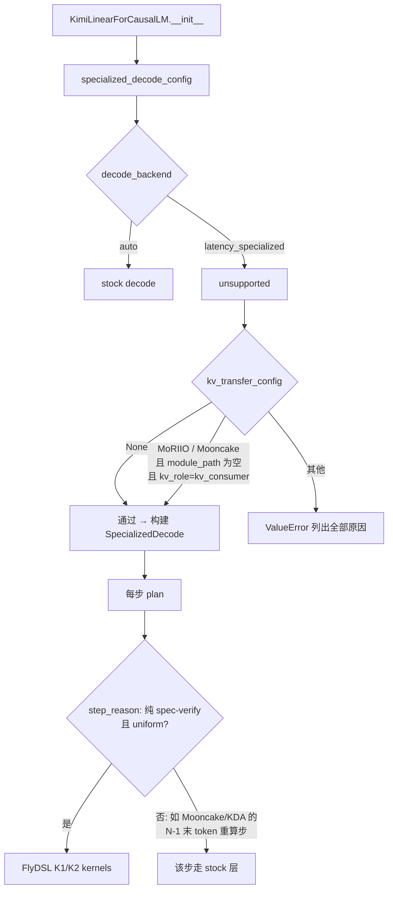
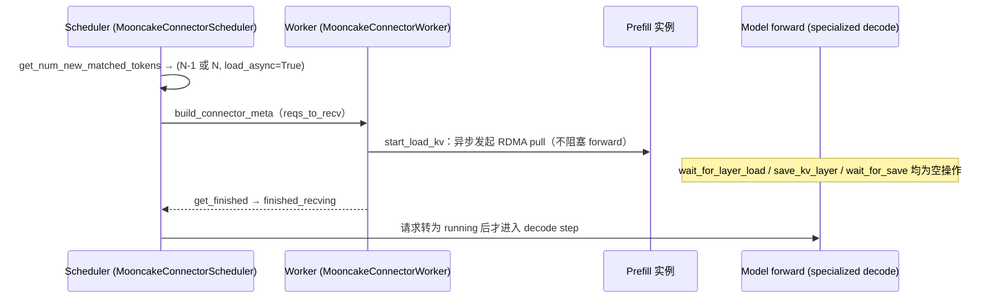

# PR #64958: [ROCm][Kimi-K3] Support Mooncake consumers with specialized decode

> **Author**: @whx-sjtu | **State**: OPEN | **Date**: 2026-11-01
> **Branch**: `whx-sjtu:whx/k3-specialized-decode-mooncake-consumer` → `main`（base `e0d00e4b8e`）| **Labels**: rocm, needs-rebase, kimi, k3, mooncake
> **Changes**: +17 -4 lines across 3 files | **ROCm 相关性**: 完全相关（MI355X 专属的 Kimi-K3 specialized decode 配置门控）
> 本报告分两部分：§1–6 为 PR 详细总结，§7–8 为 ROCm review 意见。

---

## 1. 总结 (Summary)

Kimi-K3 在 MI355X 上的 specialized decode（`additional_config={"decode_backend": "latency_specialized"}`）原本只接受内置 MoRIIO consumer 作为 KV connector；用 Mooncake 做 PD 分离时，decode 实例在启动阶段就会被拒绝，只能走 stock decode。本 PR 把内置 `MooncakeConnector` 且 `kv_role=kv_consumer` 加入白名单，理由是 Mooncake consumer 与 MoRIIO consumer 一样：KV 在请求被调度前就已加载完成（通过 `get_finished` 上报），并且逐层 hook 都是空操作。Mooncake producer / `kv_both`、自定义 connector 模块与其他 connector 仍然被拒绝。

## 2. 背景与动机 (Background & Motivation)

- #63031 引入 specialized decode 的 KV transfer 门控时只放行了 MoRIIO（READ/WRITE）consumer。Mooncake 是 vLLM 中另一个主流的 PD KV 传输后端，在 ROCm 上也可通过 RDMA 使用。
- 作者在 2 节点 8×MI355X（1P1D、TP8、FP8 KV cache、DSpark 7 draft tokens、Mooncake RDMA）上实测：decode 单步从 19.4/21.8 ms 降到 15.7/17.7 ms（32K/384K 上下文），端到端 concurrency=1 时 tok/s/GPU 由 859.7 提升到 985.8（+14.7%），GSM8K 0.958（对照组为本地测得的 0.972）。
- 基准环境为 nightly `3966924d`（2026-10-29）+ 启动时打补丁，并同时叠加了 #63730 的 in_proj padding。

## 3. 代码修改分析 (Code Change Analysis)

### 3.1 修改的模块

| 模块 | 改动 |
|------|------|
| `vllm/models/kimi_k3/amd/specialized_decode/runtime/__init__.py` (+5/-4) | `unsupported()` 中 KV transfer 检查：`kv_connector not in ("MoRIIOConnector", "MooncakeConnector")`；拒绝理由文案同步更新 |
| `vllm/models/kimi_k3/amd/specialized_decode/README.md` (+2/-1) | 支持范围补充“built-in Mooncake consumer” |
| `tests/models/kimi_k3/amd_specialized_decode/test_runtime.py` (+11) | 新增 `test_mooncake_consumer_is_supported`；拒绝用例增加 Mooncake `kv_producer` / `kv_both` |

### 3.2 架构 / 流程图

decode 实例启动期门控与运行期分流：



Mooncake consumer 的 KV 加载时序（说明为什么无需逐层 hook）：



### 3.3 关键实现细节

- 门控仍是“默认拒绝”：connector 名需精确匹配字符串，`kv_connector_module_path` 必须为空（排除同名自定义模块），`kv_role` 必须为 `kv_consumer`。`MooncakeStoreConnector`、`MultiConnector` 等仍被拒绝。
- 已核对 `MooncakeConnector`（`v1/mooncake/mooncake_connector.py`）：`wait_for_layer_load`、`save_kv_layer`、`wait_for_save` 均为 `pass`；`start_load_kv` 只负责发起异步 pull；scheduler 侧 `get_num_new_matched_tokens` 返回 `load_async=True`；完成状态通过 `get_finished` / `get_transfer_results` 上报。PR 的论据成立。
- Kimi-K3 含 KDA（MambaSpec）层，Mooncake consumer 会只拉取 N-1 个 token 的状态，由 decode 端重算最后一个 prompt token。该步不是 spec-verify 步，`step_reason` 返回 “not spec-verify”，走 stock 层，不会进入 specialized kernel。
- Kimi-K3 是 MLA 模型，`MooncakeConnector.get_required_kvcache_layout` 对 MLA 返回 `None`，不会改变 KV cache 布局。
- 新单测只验证配置门控（`specialized_decode_config` 的返回值），不涉及真实 Mooncake 传输。

## 4. 涉及的技术原理 (Technical Principles)

- **PD 分离与 KV connector 生命周期**：vLLM v1 KV connector 在 scheduler 侧决定需要外部加载的 token 数（可异步），在 worker 侧有 `start_load_kv`（forward 前）、`wait_for_layer_load` / `save_kv_layer`（逐层，位于 forward 内部）、`wait_for_save`（forward 后）等 hook。逐层 hook 会插入到模型层循环中，与“整层替换成单个 FlyDSL kernel”的 specialized decode 不兼容；只有逐层 hook 为空操作、且加载在调度前完成的 connector 才是安全的。
- **异步加载（load_async）**：请求在 KV 拉取完成前处于 WAITING_FOR_REMOTE_KVS 状态，不参与 forward；拉取完成后才被调度。因此 decode forward 看到的 KV/state 已经完整。
- **Kimi-K3 specialized decode**：仅在“纯 spec-verify、uniform 请求”的步骤上用 FlyDSL kernel 替换层；其他步骤（prefill、混合批、N-1 重算）都退回 vLLM stock 层。各 TP rank 的判定必须一致。
- **Mamba/KDA 状态的 PD 传输**：线性注意力的递归状态只对应“某一位置之后”的单一状态，因此 Mooncake 让 prefill 端计算 h(N-1)，decode 端重算最后一个 token 得到 h(N)。

## 5. 评论区讨论亮点 (Discussion Highlights)

- 截至抓取时无人工 review 评论、无 approval；6 位 code owner 待 review。fork PR，Claude bot 未自动 review。
- mergify 于 2026-11-03 标记冲突（`needs-rebase`）。冲突来源：main 在 base 之后合入了 #61435（specialized decode 加入 MLA M1a/M1b、DCP1/DCP8、`max_num_seqs` 进入 `DecodeConfig`），改动了 `runtime/__init__.py` 与 `test_runtime.py`（例如 `MAX_TOKENS` 改名为 `MAX_ROWS`，`DecodeConfig` 新增带默认值的 `m1` / `interleave` / `max_num_seqs` 字段；新测试中的 `DecodeConfig(q=8)` 断言在 main 的 fixture 下仍成立，与 main 上的 MoRIIO 用例写法一致）。
- 当前 head 的 CI / AMD CI 状态未知。

## 6. 风险与潜在问题 (Risk Analysis)

| 风险 | 严重程度 | 说明 |
|------|---------|------|
| 基准早于 #61435，rebase 后 specialized decode 新增 MLA kernel，Mooncake 路径未重新验证 | Medium | 见 §7 ⚠️【测试】 |
| DCP8 + Mooncake consumer 组合未见验证 | Low | 见 §7 📝 |
| 字符串白名单随 connector 增多而膨胀 | Low | 见 §7 📝 |
| stock 路径在 BF16 o_proj + prefix caching 下长上下文输出乱码（作者自述，PR 范围外） | Medium（范围外） | 见 §7 📝 |
| 代码改动面极小，仅放宽 ROCm/gfx950 专属门控 | Low | 不影响 CUDA/其他 connector |

---

## 7. Review 意见 (Findings)

| 类型 | 🔴 | ⚠️ | 📝 |
|------|----|----|----|
| 测试 | — | 1 | 1 |
| 可维护性 | — | — | 1 |
| 注释/文档 | — | — | 2 |

---

**⚠️【测试】基准数据早于 specialized decode 的 MLA M1 kernel，rebase 后 Mooncake 路径需要重新验证** `[已验证]`

- **问题**: 作者的端到端数据基于 nightly `3966924d`（2026-10-29）。#61435（`254a2a3390`，2026-11-03 合入 main）不是该 nightly 的祖先，它让 specialized decode 新增了 MLA M1a/M1b kernel：直接读取 fp8 MLA KV cache（`cache_reasons` 要求 cache 行连续），并改为在 DCP1 下按 `max_num_seqs` 规划宽度。本 PR 带 `needs-rebase`，rebase 后 Mooncake consumer 搬运过来的 MLA KV 会第一次被这些新 kernel 原地读取。
- **影响**: 配置门控本身是正确的。但 PR 中的 “+14.7% / GSM8K 0.958” 对应的是不含 MLA kernel 的旧 specialized decode，不能直接证明 rebase 后的组合在数值上正确。
- **行动**: 建议作者 rebase 到包含 #61435 的 main 后，用 Mooncake 1P1D 至少重跑一次 GSM8K（DCP1 与 DCP8 各一次更好），并在当前 head 上触发 `/amd-ci run`。

**📝【测试】DCP8 + Mooncake consumer 未见验证** `[推测]`

- **问题**: specialized decode 支持 DCP 1 或 TP（=8），PR 基准只写了 “TP8 per role”。Mooncake 对 `dcp_sharded` 的 block size 有单独处理（`block_size * dcp_size`），与 MoRIIO 的实现不同。
- **行动**: 建议 review 时追问 Mooncake consumer 是否在 DCP8 下验证过；如未验证，可在 README 中注明。

**📝【可维护性】connector 白名单基于字符串元组，可考虑改为能力声明** `[已验证]`

- **问题**: `runtime/__init__.py:107-116` 用 `("MoRIIOConnector", "MooncakeConnector")` 硬编码白名单，判断依据（加载在调度前完成、无逐层 hook）是从各 connector 的实现中人工推断的。若将来 Mooncake 引入逐层 pull（类似 layerwise load），这里不会自动失效。
- **行动**: 建议作者把元组提取为带注释的模块级常量，并在注释中指向 `MooncakeConnector.wait_for_layer_load` / `save_kv_layer` 的空实现；长远可考虑由 connector 类声明一个“无逐层 hook”的能力标志。

**📝【注释/文档】与 #63730 的依赖关系需要澄清** `[已验证]`

- **问题**: PR 描述称基准“also needs the KDA in_proj padding fix in #63730”。实际上本 PR 的代码不依赖 #63730：只有在同时叠加了 #63730 的 128 行 padding 时，才需要 #63730 中的 guard 适配。而 #63730 的 padding 在 AITER v0.1.27 下可能被撤回。
- **行动**: 建议作者在 PR 描述中说明这只是基准构建上的叠加，不是合入顺序上的依赖。

**📝【注释/文档】PR 描述中提到的 stock 路径乱码问题建议单独开 issue** `[已验证]`（问题本身 `[推测]`）

- **问题**: 作者在基准说明中提到，BF16 `o_proj` + prefix caching 开启时，stock 路径上部分 “128K + 2-token” 续写会输出乱码，并称“outside this change”。
- **行动**: 建议作者为该问题单独开 issue 并附复现方式，避免它只留在本 PR 的折叠区中。

## 8. 结论 (Verdict)

**⚠️ NEEDS WORK**（改动小且正确，需 rebase 并重新验证）

本 PR 的门控放宽有据可依：已核对 `MooncakeConnector` 的逐层 hook 均为空操作，加载为异步且在调度前完成；KDA 的 N-1 重算步会自动退回 stock 层；producer / `kv_both` / 自定义模块仍被拒绝，并有测试覆盖。阻碍合入的只有流程性问题：分支需 rebase 到包含 #61435（MLA M1 kernel）的 main，且 Mooncake + 新 MLA kernel 的组合应至少重跑一次精度验证。

## 9. 英文 Review 评论 (Copy-Paste English Comments)

**C1** `vllm/models/kimi_k3/amd/specialized_decode/runtime/__init__.py:107-116` — ⚠️ comment

```text
The gate change itself looks right to me: MooncakeConnector's wait_for_layer_load / save_kv_layer / wait_for_save are no-ops, start_load_kv only kicks off async pulls, and the N-1 KDA recompute step falls back to the stock layers via step_reason. However, the benchmark nightly (3966924d) predates #61435, which now runs the MLA M1a/M1b kernels in the specialized decode and reads the fp8 MLA cache in place. After rebasing (needs-rebase is set), could you re-run at least GSM8K for Mooncake 1P1D on the rebased branch (ideally DCP1 and DCP8) and trigger /amd-ci run on the new head?
```

**C2** `vllm/models/kimi_k3/amd/specialized_decode/runtime/__init__.py:112` — 📝 nit

```text
Minor: consider hoisting ("MoRIIOConnector", "MooncakeConnector") into a named module-level constant, with a comment that points at why each connector qualifies (loads finish before scheduling, no per-layer hooks). That way, if either connector later gains layerwise loading, the reviewer has an obvious place to re-check.
```
