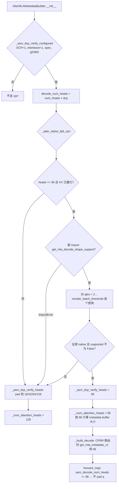

# PR #64969: [ROCm][Perf] Run fp8 DCP cprr MLA verify at 96 native heads when AITER supports it

> **Author**: @whx-sjtu | **State**: OPEN（Draft） | **Date**: 2026-11-01
> **Branch**: `whx-sjtu:whx/rocm-mla-native-96-cprr` → `main` | **Labels**: rocm
> **Changes**: +114 -8 lines across 3 files | **ROCm 相关性**: 完全相关（仅改 `mla/rocm_aiter_mla.py` 的 gfx950 DCP cprr 路由，Tier-1 文件）
> 本报告分两部分：§1–6 为 PR 详细总结，§7–8 为 ROCm review 意见。

---

## 1. 总结 (Summary)

Kimi-K3 在 TP8 + DCP8 下 DCP all-gather 后每个 rank 有 96 个 query head。ROCm AITER MLA 后端的 DCP 多 token verify（cprr，round-robin causal ASM decode）此前只在 `_NATIVE_CPRR_HEADS = (16, 32, 64, 128)` 上运行，所以 96 会被 pad 到 128，多算 1/4 的 head，还要做一次 96→128 的 query pad 拷贝。本 PR 新增 `_aiter_native_fp8_cprr()`：在 metadata builder 初始化时调用 AITER v0.1.27 的形状规划查询 `get_mla_decode_shape_support`，只要它对 cprr 可能走到的每个 qlen 都报告 fp8/96 head 为 native，就直接以 96 head 运行，跳过 padding。其它情况都保留原来的 pad 行为，包括旧版 AITER、bf16 KV、qlen>6 和其它 head 数。

## 2. 背景与动机 (Background & Motivation)

- cprr 路由（gfx950 + DCP interleave=1 + 投机解码 + qlen ≥ 3）此前假定 ASM kernel 只有 16/32/64/128 head 的版本，非 native 的 head 数统一向上 pad。
- AITER v0.1.27（`docker/Dockerfile.rocm_base` 已 pin `AITER_BRANCH="v0.1.27"`）的 fp8 cprr kernel `mla_a8w8_qh32_qseqlen4_gqaratio32_lse_cprr_ps` 在 qlen ≤ 6 时可以直接跑 96 head，并提供 `get_mla_decode_shape_support` 规划查询接口。
- 作者给出的数字：`forward_mqa` 每层耗时在 128K 上下文下 -9.0%（ASM）/ -12.1%（OPUS），32K 下 -25% / -31%；E2E（1P1D，2×8 MI355X）+4.2% / +7.2%。E2E 数字同时混入了 `AITER_MLA_USE_OPUS=1`，作者自己也说明 native-96 的贡献**没有单独剥离**，而且是在 v0.1.26 nightly 上用 runtime patch 跑出来的。这些数字都**无法追溯到可复现脚本，视为 [unverified]**。
- 相关 PR：#59966 加速了本 PR 跳过的 96→128 query pad；#54899 在普通 decode 路由上使用了同一个 AITER 查询。

## 3. 代码修改分析 (Code Change Analysis)

### 3.1 修改的模块

| 文件 | 改动 |
|------|------|
| `vllm/v1/attention/backends/mla/rocm_aiter_mla.py` (+44/-3) | 新增 `_aiter_native_fp8_cprr()`；`AiterMLAMetadataBuilder.__init__` 中 `_asm_dcp_verify_heads` 先查这个函数，命中时用原始 head 数；更新路由注释 |
| `tests/v1/attention/test_rocm_aiter_mla_dcp_cprr.py` (+67/-4) | 新增 `_fake_shape_support` 假规划器和 5 组测试（native 选择、遍历全部 qlen、4 种保持 padding 的反例、无规划器回退） |
| `tests/v1/attention/test_rocm_aiter_mla_dcp_cprr_numerics.py` (+2/-2) | 参数 id `padded-96-to-128` 改名为 `k3-96`，按 AITER 版本走 native 或 padded |

### 3.2 架构 / 流程图



### 3.3 关键实现细节

- `_aiter_native_fp8_cprr(decode_num_heads, kv_cache_dtype, max_qlen, cp_world_size)`：
  - 只在 `decode_num_heads == 96 and is_quantized_kv_cache(kv_cache_dtype)` 时进入；
  - `from aiter.ops.attention import get_mla_decode_shape_support` 失败时返回 False，旧 AITER 保持 padding；
  - 对 `range(_MIN_CPRR_QLEN, max_qlen + 1)` 中的每个 qlen 调用规划查询，参数为 `dtypes.fp8, dtypes.fp8, return_lse=True, cp_world_size, cp_round_robin=True`，其余参数用默认值（`causal=True, persistent=True, fast_mode=True, intra_batch_mode=False, page_size=1, v_head_dim=512`）；
  - 判定条件是 `support.native and support.supported is not False`，`supported is None` 也会被接受（注释说明这是为 OPUS 准备的）。
- Builder 用 `self.reorder_batch_threshold or 1` 作为最大 qlen，和 `_mtp_decode_qlen` 是同一个来源。
- 运行时不加新的 host sync：查询只在 builder 初始化时执行一次，AITER 内部用 `lru_cache` 缓存结果。
- forward 侧代码不用改：`asm_dcp_heads == self._decode_num_heads` 时走 `get_mla_padded_q(96, q)`，此时 `get_actual_mla_num_heads(96)=96`，q 原样透传，输出也不用 unpad。

## 4. 涉及的技术原理 (Technical Principles)

- **DCP（decode context parallel）+ round-robin KV 分片**：token t 的 KV 存放在 rank `t % W` 上，各 rank 用 all-gather 后的全部 query head 对本地 KV 分片做 attention，再按 LSE 合并。多 token verify 时，causal 窗口必须按**全局位置**计算，cprr kernel 用 `g_kv_indptr / cp_rank / cp_world_size` 在 kernel 内重建全局位置。
- **head padding 等价性**：MLA 各 query head 共享同一个 latent KV、彼此独立，pad 出来的 head 不影响真实 head 的结果，所以 native 96 和 pad 到 128 在数学上等价（作者实测 bit-identical）。收益来自少算 1/4 的 head，以及省掉 query pad 拷贝。
- **AITER 形状规划 (`get_mla_decode_shape_support`)**：它复用 metadata planner、reducer 和 ASM dispatch 的同一套 C++ 规则，报告 `native`（未被 fold 成 16-head 伪 batch）、`backend`（ASM/OPUS/...）、`supported`（True=查表命中，False=确定不支持，None=该 backend 没有可用性表，或 ASM 查询状态 UNKNOWN）。本地 v0.1.27 实测（`arch='gfx950'`）：fp8/96/cprr 在 qlen 1–6 时 `native=True, supported=True`，qlen ≥ 7 时 fold 为 16 head × 6。
- **persistent metadata**：`get_mla_metadata_info_v1` 按 `_num_attention_heads` 为 qlen 1..mtp 计算 work/reduce buffer 大小。改成 96 后，buffer 大小和 CPRR 及 PLAIN 路由实际使用的 metadata head 数（PLAIN 本来就用 `get_actual_mla_num_heads(96)=96`）一致。

## 5. 评论区讨论亮点 (Discussion Highlights)

- 截至 review 时 PR 为 Draft，issue 评论区为空。等待 code owner @tjtanaa、@AndreasKaratzas review，暂无 approval。CI 状态在页面上不可见（**未知**）。
- 作者在 PR 描述中主动说明了局限：没有在 bf16 KV、qlen>6、gfx942 和 main 上跑过 e2e；E2E 收益和 OPUS 混在一起；nightly 镜像的 AITER v0.1.26 没有这个查询接口，所以 PR 在那个镜像上实际仍走 padding。

## 6. 风险与潜在问题 (Risk Analysis)

| 风险 | 严重程度 | 说明 |
|------|---------|------|
| CPU 单测依赖 pytest 进程里的导入顺序 | Medium | 见 §7 ⚠️【测试】`_build` 未屏蔽 `aiter.ops.attention` |
| 规划器返回 `supported=None` 时一律放行 | Medium | 见 §7 ⚠️【正确性】ASM 状态 UNKNOWN 也会被当作可以走 native |
| vLLM + AITER v0.1.27 的完整链路没有实测 | Medium | 见 §7 ⚠️【测试】 |
| 性能数字不可复现，E2E 混入 OPUS | Low | 见 §2；按 [unverified] 处理 |
| 注释过时 / 空循环真值 | Low | 见 §7 📝 |
| 对其它模型、arch 的影响 | Low | 只在 gathered head 数 = 96 + fp8 KV + gfx950 cprr 时生效，范围很窄 |

---

## 7. Review 意见 (Findings)

| 类型 | 🔴 | ⚠️ | 📝 |
|------|----|----|----|
| 测试 | — | 2 | — |
| 正确性 | — | 1 | 1 |
| 可维护性 | — | — | 2 |

---

**⚠️【测试】`_build()` 只替换了 `sys.modules["aiter"]`，没有屏蔽 `aiter.ops.attention`，`test_selects_cprr_for_k3_gathered_heads` 的结果取决于测试执行顺序** `[已验证]`（CI 中实际触发 `[推测]`）

- **问题**: `tests/v1/attention/test_rocm_aiter_mla_dcp_cprr.py` 的 `_build()`（未改动的 L119-188）只用 `SimpleNamespace(dtypes=SimpleNamespace(fp8="fp8", ...))` 替换了 `sys.modules["aiter"]`。如果同一个 pytest 进程里之前有测试真正 import 过 aiter，`sys.modules["aiter.ops.attention"]` 里已经是真实模块，那么 `from aiter.ops.attention import get_mla_decode_shape_support` 会直接拿到**真实函数**，导入机制先查完整模块名，不会经过假的父包；而 `from aiter import dtypes` 拿到的是假的 `"fp8"` 字符串。我在容器中按这个顺序复现过（先 `import aiter`，再替换 `sys.modules["aiter"]`），真实函数抛出 `TypeError: MLA decode dtype must be a torch.dtype, got 'fp8'`。生产代码只捕获 `ImportError`，所以 builder 初始化会直接报错。
- **影响**: AMD CI 的 `:amd: (MI355 DPX) V1 Attention` 会在同一个 session 里跑整个 `v1/attention` 目录。按字母序，`test_gdn_aiter_flydsl.py` 等测试排在前面，它们会 `from aiter.ops.triton... import`，进而加载整个 aiter 包，同一个 shard 内本用例就会 error。即使碰巧没有报 TypeError，真实规划器在 gfx950 上也会返回 native，导致 `assert ... == 128` 失败。作者描述里的"CPU 下 38 passed"是单独运行这一个文件的结果，覆盖不到这种情况。
- **行动**: 作者应当在 `_build()` 中默认加上 `monkeypatch.setitem(sys.modules, "aiter.ops.attention", None)`（`_fake_shape_support` 会覆盖它）。这样"没有规划器"的用例不再依赖导入顺序。

**⚠️【正确性】`support.supported is None` 被无条件接受，ASM backend 查询状态为 UNKNOWN 时也会走 native 96** `[已验证]`（触发条件 `[推测]`）

- **问题**: `rocm_aiter_mla.py:465` 的判断是 `if not support.native or support.supported is False: return False`，注释说 None 对应 OPUS。但读 AITER v0.1.27 的 `_get_mla_decode_shape_support_cached` 可知，ASM 路由下如果 `mla_decode_asm_query` 抛异常，或者返回无法识别的状态码，`asm_status=UNKNOWN`，`supported` 同样是 `None`，只在 `reasons` 里加一条 `"asm query failed: ..."`。
- **影响**: 这时 vLLM 会在 kernel 是否存在都没有确认的情况下按 96 head 准备 metadata 并启动 ASM decode。原来的行为（pad 到 128）在这种情况下更安全。正常的 v0.1.27 + gfx950 环境不会触发（实测 `supported=True`），但这是为将来 AITER 版本漂移准备的回退逻辑，应该只在确有依据时放行。
- **行动**: 建议作者把条件收紧为 `support.supported is True or (support.supported is None and support.backend is MlaBackend.OPUS)`，或者至少对 `asm_status is UNKNOWN` 显式返回 False，并在回退时 `logger.debug` 输出 `support.reasons`。

**⚠️【测试】"vLLM builder + 真实 AITER v0.1.27 规划器 + 96 head kernel" 这条完整链路没有被实际运行过** `[已验证]`（依据 PR 描述）

- **问题**: 按 PR 描述，各项验证是分段完成的：①在 v0.1.26 上**强制** native 跑 `forward_mqa`，结果和 pad 版 bit-identical；②在 v0.1.27 上直接调用 AITER decode；③在 v0.1.27 上单独调用规划查询。经 vLLM builder 由真实规划器自动选到 96、再启动 kernel 的完整路径没有跑过。CI 镜像是否已经是 v0.1.27 也没有确认（作者说 nightly `3966924d` 仍是 v0.1.26，在那里 `k3-96` 会继续走 padded，新路径不会被覆盖）。
- **影响**: 如果合入时 CI 镜像还是 v0.1.26，新分支在 AMD CI 上完全不会执行，数值回归只能等 v0.1.27 镜像上线后由用户发现。
- **行动**: 建议作者确认 `:amd: (MI355 DPX) V1 Attention` 当前镜像里的 AITER 版本，并贴出在 v0.1.27 环境下 `test_rocm_aiter_mla_dcp_cprr_numerics.py -k k3-96` 的输出（最好带一行日志证明走的是 native 96）。

**📝【正确性】`max_qlen < _MIN_CPRR_QLEN` 时循环一次都不执行，函数直接返回 True** `[已验证]`

- **问题**: `num_speculative_tokens=1` 时 `reorder_batch_threshold=2`，`range(3, 3)` 为空，`_aiter_native_fp8_cprr` 不做任何查询就返回 True，`_asm_dcp_verify_heads` 被设成 96。
- **影响**: 这种配置下 CPRR 路由永远不会被选中（qlen<3），所以目前没有实际危害，只是 buffer 从 128 head 改成按 96 head 计算，和 PLAIN 路由实际使用的 metadata head 数一致。但语义上相当于"没查就默认支持"，以后别人改路由条件时容易出错。
- **行动**: 建议作者在函数开头加 `if max_qlen < _MIN_CPRR_QLEN: return False`，表达"cprr 不可达时保持原行为"。

**📝【可维护性】规划查询只捕获 `ImportError`，接口签名漂移会让 builder 初始化直接崩溃** `[已验证]`

- **问题**: `get_mla_decode_shape_support` 对参数非法、dtype 不支持等情况会抛 `TypeError` / `ValueError`（见其 docstring）。如果后续 AITER 版本改了关键字参数名（例如 `cp_round_robin`），这里的调用会抛 `TypeError`，不会回退到 padding。
- **行动**: 建议作者把调用包在 `try/except (TypeError, ValueError)` 里，回退到 padding 并 `logger.warning_once`。这是纯性能优化，不应该因为探测失败影响服务启动。

**📝【可维护性】两处注释和新行为不一致** `[已验证]`

- **问题**: `rocm_aiter_mla.py:1059-1062` 仍写着 "the cprr kernel exists only at the native head counts … 96 … pad has to be applied here explicitly"，`:3277` 仍写着 "cprr has kernels only at native head counts, so pad q up (e.g. 96 -> 128)"。builder 中 ValueError 的报错信息也只列了 `_NATIVE_CPRR_HEADS`。
- **行动**: 建议作者同步更新这两处注释，说明 fp8 96 head 可能由 `_aiter_native_fp8_cprr` 选为 native。

## 8. 结论 (Verdict)

**⚠️ NEEDS WORK**

改动范围很窄（只影响 96 head + fp8 KV + gfx950 cprr），回退逻辑整体保守，数学等价性也站得住，本地也确认了 AITER v0.1.27 规划器对 qlen 1–6 返回 native/True。需要先处理两点：CPU 测试在 AMD CI 的同一个 pytest session 中依赖导入顺序；`supported is None` 的放行范围过宽。另外建议在 v0.1.27 镜像上补跑完整链路的数值测试，并说明 CI 镜像版本，否则新路径合入后在 CI 上不会被执行。

## 9. 英文 Review 评论 (Copy-Paste English Comments)

**C1** `tests/v1/attention/test_rocm_aiter_mla_dcp_cprr.py:191-192` — ⚠️ comment（`_build()` 本身未改动，锚定在相邻改动的 docstring 行）

```text
`_build()` replaces `sys.modules["aiter"]` but not `sys.modules["aiter.ops.attention"]`. When an earlier test in the same pytest session has imported the real aiter (e.g. test_gdn_aiter_flydsl.py runs before this file in the MI355 "V1 Attention" step), `from aiter.ops.attention import get_mla_decode_shape_support` resolves to the real function while `dtypes.fp8` is the fake string "fp8", so the real planner raises `TypeError: MLA decode dtype must be a torch.dtype` and the builder fails. I reproduced this by importing aiter first and then applying the same stubs. Could you add `monkeypatch.setitem(sys.modules, "aiter.ops.attention", None)` to `_build()` by default, so the "no planner" tests are independent of import order?
```

**C2** `vllm/v1/attention/backends/mla/rocm_aiter_mla.py:464-466` — ⚠️ comment

```text
`supported is None` is accepted for every backend, but in AITER v0.1.27 the planner also returns `supported=None` on the ASM route when `asm_status` is UNKNOWN (the asm table query raised or returned an unrecognised code). In that case we would run cprr at 96 heads without any confirmation that the kernel exists, whereas the old padded path is the safe choice. Could you narrow this to `support.supported is True or (support.supported is None and support.backend is MlaBackend.OPUS)`, and maybe log `support.reasons` at debug level when falling back?
```

**C3** `vllm/v1/attention/backends/mla/rocm_aiter_mla.py:447-454` — ⚠️ comment

```text
Two small robustness points for this probe. (1) When `max_qlen < _MIN_CPRR_QLEN` (e.g. num_speculative_tokens=1), the loop is empty and the function returns True without asking AITER; this is harmless today because CPRR is never selected, but an explicit `return False` would match the intent. (2) Only `ImportError` is caught, while the planner raises `TypeError`/`ValueError` for bad arguments, so a future kwarg rename would crash builder init instead of falling back to padding. Since this is a pure perf optimization, catching those too and falling back with a `warning_once` seems safer.
```

**C4** `vllm/v1/attention/backends/mla/rocm_aiter_mla.py:911-921` — ⚠️ comment

```text
As far as I can tell from the description, the full path (vLLM builder -> real v0.1.27 planner -> native 96 metadata -> kernel launch) has not been run end to end: native 96 was forced on v0.1.26, and the v0.1.27 planner and decode were checked separately. Could you confirm which AITER version the MI355 "V1 Attention" CI image currently ships, and paste a `test_rocm_aiter_mla_dcp_cprr_numerics.py -k k3-96` run on v0.1.27 showing that it actually took the native-96 branch? Otherwise the new branch may never run in CI until the base image is bumped.
```
