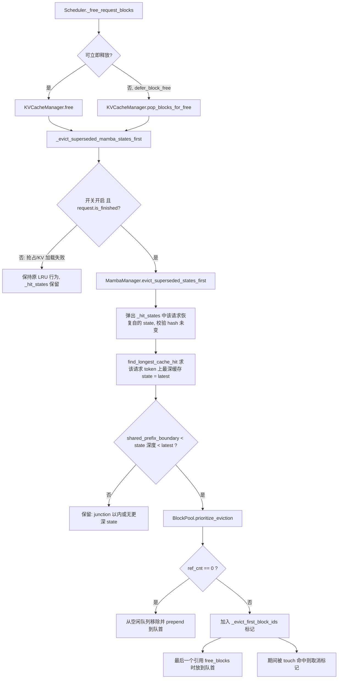
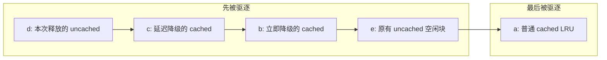

# PR #64975: [Core][Perf] Evict superseded Mamba align states first

> **Author**: @whx-sjtu | **State**: OPEN（Draft） | **Date**: 2026-11-01
> **Branch**: `whx-sjtu:whx/mamba-evict-superseded-states` → `main` | **Labels**: scheduler, kv-cache-manager
> **Changes**: +347 -1 lines across 7 files | **ROCm 相关性**: 不相关（平台无关的 v1 调度器 / prefix cache 逻辑；仅 E2E 数据在 MI355X 上采集）
> 本报告分两部分：§1–6 为 PR 详细总结，§7–8 为 review 意见（非 ROCm 路径，仅卫生检查 + 通用正确性/设计意见）。

---

## 1. 总结 (Summary)

在 Mamba `align` 前缀缓存模式下，多轮对话每一轮都会从上一轮缓存的 Mamba state 恢复，再缓存一个更深的 state，旧 state 对该会话已经"作废"，但 `BlockPool.free_blocks` 仍把它挂在空闲队列的 MRU 端，池紧张时反而比活跃会话的前缀活得更久。本 PR 新增 opt-in 开关 `--evict-superseded-mamba-states`：请求**正常结束**时，把它"恢复自"且已被同 token 序列上更深缓存 state 取代的 Mamba state 移到空闲队列**队首**（保留 hash，在被复用前仍可命中）；若该 block 此时仍被别处引用，则打标记，待最后一个引用释放时再放到队首。

## 2. 背景与动机 (Background & Motivation)

- 场景：混合模型（Mamba/KDA + attention，如 Kimi-K3、Nemotron 3.5）在 agentic 多轮负载下开启 prefix caching。Mamba 只需要"最后一个 token"的 state，因此每个会话在池中只有最深的 state 有价值，较浅的 state 只对分支/重试/共享 system prompt 有用。
- 问题：当前 LRU 语义下，请求释放的 cached block 统一 `append` 到队尾（最后被驱逐），导致作废的 state 挤占活跃会话前缀的空间，在 P 实例池接近满载时引起不必要的重算 / Mooncake Store 回填。
- 作者给出的 E2E 数据（Kimi-K3 1P1D，2×8 MI355X，88 并发会话）：tok/s/GPU +2.1%，平均 TTFT 8.90 s → 7.64 s；72 会话持平。**但 PR 自述这些数字来自"它移植的运行时原型"，不是本分支，且原型范围更宽（还会移走请求自己缓存的较浅 state，且关闭了 shared-prefix checkpoint）**——属于无法溯源到本分支的数字。
- 关键背景：评论区 @shaharmor98 指出 #63808（2026-10-26）已经实现了同一规则，以 `--prefix-cache-eviction-policy mamba_aware_lru` 暴露（与 #63578 CPU offload 层的策略名一致），并建议把本 PR 的"延迟降级（deferred demotion）"并入 #63808；作者已同意并表示转去 review #63808。

## 3. 代码修改分析 (Code Change Analysis)

### 3.1 修改的模块

| 模块 | 改动 |
|------|------|
| `vllm/config/cache.py` (+8) | 新增 `CacheConfig.evict_superseded_mamba_states: bool = False`，并加入 `compute_hash` 排除列表（调度侧细节，不影响编译图） |
| `vllm/engine/arg_utils.py` (+5) | `EngineArgs` 字段 + CLI `--evict-superseded-mamba-states` + 传入 `CacheConfig` |
| `vllm/v1/core/sched/scheduler.py` (+3) | 构造 `KVCacheManager` 时透传该开关 |
| `vllm/v1/core/kv_cache_manager.py` (+14) | 新增构造参数；在 `free()` / `pop_blocks_for_free()` 前调用 `_evict_superseded_mamba_states_first`（仅 `request.is_finished()`） |
| `vllm/v1/core/single_type_kv_cache_manager.py` (+55) | `MambaManager`：`add_local_computed_blocks` 记录命中的 state（`_hit_states`）；新增 `evict_superseded_states_first` 在结束时筛选并调用 `prioritize_eviction` |
| `vllm/v1/core/block_pool.py` (+33 -1) | 新增 `_evict_first_block_ids` 标记集合、`prioritize_eviction()`；`free_blocks` 对已标记的 cached block 走"队首"分支；`touch` / `_remove_cached_block_hashes` 清除标记 |
| `tests/v1/core/test_mamba_superseded_states.py`（新增 229 行） | CPU 单测：TP8 风格的 3 个 Mamba align 组 + 1 个 attention 组，覆盖主路径、无更深 state、抢占、shared-prefix junction、被他处持有、`prioritize_eviction` 队列顺序 |

### 3.2 架构 / 流程图

请求结束时的降级流程：



空闲队列顺序（以 PR 自带单测 `test_prioritize_eviction` 为例）：



### 3.3 关键实现细节

- **命中记录**：`MambaManager.add_local_computed_blocks` 在开关开启时记录 `new_computed_blocks[-1]`（Mamba align 的命中列表是 `[null, ..., state]`，最后一个即恢复点），按 `{block_id: block_hash}` 存储，跨抢占保留。
- **结束判定**：`KVCacheManager._evict_superseded_mamba_states_first` 只在 `request.is_finished()` 时触发——抢占（`_preempt_request` 调用 free 时 status 仍为 RUNNING）与 KV 加载失败重试都不会降级，已核对调用点。
- **"被取代"的判定**：结束时用 Mamba manager 自己的 `find_longest_cache_hit(request.block_hashes, request.num_tokens, ...)` 求最深缓存 state；只有 `shared_prefix_boundary < 深度 < latest` 的恢复点被降级，因此"别的请求在同 token 上缓存的更深 state"也算，"结束前已被驱逐的更深 state"不算。
- **延迟降级**：仍被引用的 block 打标记；`free_blocks` 在 ref_cnt 归零时把它放进新的 `cached_blocks_to_evict_first`，先 prepend 它们，再 prepend uncached，最终 uncached 在前、降级 cached 在后，但两者都在原有空闲块之前。`touch`（前缀命中）和 hash 移除都会清除标记。
- **配置**：新开关不进入 `compute_hash`（正确，属于调度侧行为）；无新增环境变量。

## 4. 涉及的技术原理 (Technical Principles)

- **v1 BlockPool 与空闲队列**：`FreeKVCacheBlockQueue` 是双向链表，`get_new_blocks` 从队首取块；取到仍带 hash 的 cached block 时会把它从前缀缓存中驱逐。`free_blocks` 默认把 uncached 块 prepend（LIFO，GPU 局部性），cached 块 append（FIFO 即 LRU），因此"队首 = 最先被复用/驱逐"。
- **Mamba `align` 前缀缓存**：Mamba/线性注意力层每个请求只保留最后一个 token 的递归 state；为支持前缀缓存，在与 attention block 对齐的位置把 state 写入独立 block 并 hash。命中时只需要最深一个对齐点的 state（`find_longest_cache_hit` 右向左搜索、首个命中即停）。
- **混合模型的 hit 对齐**：Mamba 的命中长度要与 attention 组对齐（`cache_hit_alignment_tokens`、`prefix_match_unit`），同时存在 prefill checkpoint 与 shared-prefix checkpoint（`shared_prefix_boundary` 记录跨请求的公共前缀 junction）。
- **延迟释放（defer_block_free）**：异步 KV connector 场景下，block 的真正归还要等到 GPU step 完成，`pop_blocks_for_free` 先摘下 block，之后再 `free_blocks`；本 PR 的"标记 + 归零时降级"正是为了覆盖这一路径以及 connector 持有的情况。

## 5. 评论区讨论亮点 (Discussion Highlights)

- **@shaharmor98**：指出 #63808 已在 GPU 前缀缓存上实现同一规则（`--prefix-cache-eviction-policy mamba_aware_lru`，与 #63578 的 CPU offload 策略同名），对比差异：
  - 被他处持有的 state：本 PR 打标记、最后引用释放时降级，优于 #63808（保持 LRU）；
  - 范围：本 PR 只降级"恢复自"的 state；#63808 维护每个已结束请求的最深 state 集合（tips），降级请求命中点到结束点之间的所有更早 tip；
  - 证据：#63808 有自身分支上的 1 小时 AgentX A/B（Nemotron 3.5 Super，GB200，+5.4% req/h，−15% 重算 prompt token）。
  - 建议把本 PR 的 deferred demotion 并入 #63808，作者作为 co-author。
- **@whx-sjtu（作者）**：同意合并方案，将在 #63808 上复测，并转向 review #63808。
- 当前没有其他 reviewer 意见；PR 为 Draft，CI 状态未知。

## 6. 风险与潜在问题 (Risk Analysis)

| 风险 | 严重程度 | 说明 |
|------|---------|------|
| 与 #63808 功能重复，双开关/双实现 | High | 见 §7 ⚠️【设计】与 #63808 重复 |
| 降级块排在 never-used 空闲块之前，低负载下也会立即丢失分支命中 | Medium | 见 §7 ⚠️【设计】队首位置 |
| E2E 收益数字来自原型而非本分支 | Medium | 见 §7 ⚠️【测试】数字溯源 |
| 正确性：hash 保留、抢占排除、junction 排除逻辑 | Low | 已逐一核对调用点，未发现错误；单测覆盖 8 个场景 |
| 性能：结束时额外一次 `find_longest_cache_hit` | Low | 右向左首个命中即停，每个 Mamba 组一次，开销可忽略 |
| 可维护性：`_hit_states` / `_evict_first_block_ids` 新状态 | Low | 见 §7 📝【可维护性】reset 未清理 |
| 兼容性：默认关闭 | Low | 关闭时 `add_local_computed_blocks` 不记录，`free_blocks` 只多一次 set 查找 |

---

## 7. Review 意见 (Findings)

非 ROCm 相关，已跳过 ROCm 专项规则（aiter / mori / ROCm 平台 / kernel 数值类检查）。以下为卫生检查与通用设计/正确性意见。

| 类型 | 🔴 | ⚠️ | 📝 |
|------|----|----|----|
| 设计 | — | 2 | — |
| 测试 | — | 1 | 1 |
| 可维护性 | — | — | 2 |

---

**⚠️【设计】与 #63808 实现的是同一规则，作者已同意并入，本 PR 不应再独立合入** `[已验证]`

- **问题**: #63808 已以 `--prefix-cache-eviction-policy mamba_aware_lru` 实现"请求结束时把被取代的 Mamba align state 移到空闲队列队首、保留 hash、排除抢占与 shared-prefix junction"；本 PR 则新增独立布尔开关 `--evict-superseded-mamba-states`（`vllm/config/cache.py:318-324`、`vllm/engine/arg_utils.py:1453-1456`）。评论区作者已同意把 deferred demotion 合入 #63808。
- **影响**: 若两者都合入，同一行为会有两个互相独立的开关与两套 `BlockPool` 状态（`_evict_first_block_ids` 与 #63808 的 tip 集合），组合开启时的交互无人测试；用户也会困惑该用哪个。
- **行动**: 建议作者把 `prioritize_eviction` 的"引用归零时降级 + touch 取消"逻辑以 commit 形式交给 #63808，并在本 PR 注明已被取代后关闭（或保持 Draft 仅作参考）；合并后的实现应使用 #63808/#63578 的策略枚举名，而不是新增布尔开关。

**⚠️【设计】降级块被 prepend 到所有 never-used 空闲块之前，池不紧张时也会在下一次分配被驱逐** `[已验证]`（实际负载影响 `[推测]`）

- **问题**: `BlockPool.prioritize_eviction`（`vllm/v1/core/block_pool.py:873-880`）对 ref_cnt==0 的块直接 `prepend_n` 到队首，排在所有 uncached 空闲块之前；延迟路径（`free_blocks:853-856`）把降级块放在本批 uncached 之后，但仍位于此前所有空闲块之前。PR 自带单测 `test_prioritize_eviction` 断言了 `[b, e, a]`（降级的 b 在未缓存的 e 之前）。PR 描述也承认"the front of the queue is ahead of never-used blocks"，并以此作为默认关闭的理由。
- **影响**: 即使池中还有大量从未使用的块，被取代的 state 也会在下一次 `get_new_blocks` 时被丢弃，分支 / 重试 / 共享 system prompt 从这些 state 恢复的机会在低负载下也被提前消耗——这也解释了 72 会话"持平"、以及为什么只能 opt-in。该语义与动机（"under pool pressure"）不完全一致。
- **行动**: 建议作者（或在 #63808 合并实现时）考虑把降级块放在 uncached 段之后、普通 cached 段之前（例如维护一个独立的"evict-first cached"子队列，`get_new_blocks` 在 uncached 用尽后优先取它），这样只有真正需要驱逐 cached 块时才牺牲它们，开关的风险也更低，甚至可以讨论默认开启。

**⚠️【测试】E2E 收益数字无法溯源到本分支** `[已验证]`

- **问题**: PR body 中 +2.1% tok/s/GPU、TTFT 8.90 → 7.64 s、Mooncake Store 加载 −26%、prefill-only 回放 goodput 1,457 → 4,883 tok/s 等数字，作者明确说明来自"the runtime prototype this ports, not from this branch"；原型还降级了请求自身缓存的较浅 state，且关闭了 shared-prefix checkpoint；两组 88 会话 A/B 跑在不同节点对上；"9,705 个被取代 state 中有多少是恢复点"未统计。
- **影响**: 本分支的实际收益未知（`[unverified]`），且由于本分支范围更窄，收益可能小于原型。
- **行动**: 建议作者在并入 #63808 后，用合并后的分支在同一节点对上复测 88/72 会话 A/B，并给出原始 benchmark 输出（或脚本 + 日志链接）。

**📝【测试】单测依赖由分块推导出的魔法常量，且未覆盖调度器侧的延迟释放路径** `[已验证]`

- **问题**: `COLD_STATE, WARM_STATE = 19_968, 22_400` 与 `[11_648, 8_352]`、`[2_532]` 等分块大小是由当前 checkpoint 对齐规则推导出的；`pop_blocks_for_free` 路径（`defer_block_free` 时由 `Scheduler._free_request_blocks` 调用）只经由"touch 持有"间接覆盖，没有用调度器的 deferred_frees 端到端验证。
- **行动**: 建议作者为常量加一行推导说明（例如"20,000 向下对齐到 128 的最后一个 prefill checkpoint"），并补一个经由 `Scheduler` + `defer_block_free` 的用例，确认降级发生在 deferred free 真正归还时。

**📝【可维护性】新增状态在 `reset_prefix_cache` 时未清理** `[已验证]`

- **问题**: `BlockPool.reset_prefix_cache` 直接 `block.reset_hash()`，不经过 `_remove_cached_block_hashes`，因此不会清理 `_evict_first_block_ids`；`MambaManager._hit_states` 也不随 reset 清理。
- **影响**: 当前无害——reset 只在所有块都空闲时成功，此时不存在被引用的标记块；`_hit_states` 在使用前会校验 `block_hash == h`。但这是隐式不变量，后续改动 reset 条件时容易破坏。
- **行动**: 建议作者在 `reset_prefix_cache` 中顺手 `self._evict_first_block_ids.clear()`，或加注释说明为什么不需要。

**📝【可维护性】开关以属性注入方式下发到 `MambaManager`** `[已验证]`

- **问题**: `KVCacheManager.__init__` 通过遍历 `single_type_managers` 设置 `manager.evict_superseded_states`（`kv_cache_manager.py:199-202`），与上方 `shared_prefix_checkpoint` 的写法一致，但每加一个开关就多一段循环。
- **行动**: 建议在并入 #63808 时把 Mamba 相关的缓存策略打包成一个 policy 对象一次性下发。

## 8. 结论 (Verdict)

**⚠️ NEEDS WORK**

实现本身逻辑自洽：抢占、KV 加载失败、shared-prefix junction、被他处持有等边界都经调用点核对，未发现正确性问题；deferred demotion 也确实比 #63808 更完整。但同一规则已由 #63808 实现、作者已同意合并过去，本 PR 不宜独立合入；同时"降级块排在 never-used 块之前"的位置选择值得在合并实现中重新考虑，E2E 数字也需要在合并后的分支上复测。非 ROCm 相关，无 ROCm 专项阻塞项。

## 9. 英文 Review 评论 (Copy-Paste English Comments)

**C1** `vllm/v1/core/block_pool.py:873-880` — ⚠️ comment

```text
`prioritize_eviction` prepends demoted states to the very front of the free queue, ahead of never-used (uncached) free blocks, and the deferred path in `free_blocks` also lands them ahead of all previously free blocks (your `test_prioritize_eviction` asserts `[b, e, a]`). So even when the pool has plenty of empty blocks, a superseded state is dropped on the next `get_new_blocks`, and branches/retries lose the hit under low load as well. That seems to be the main reason the flag has to stay opt-in. Could you consider placing them after the uncached segment and before regular cached blocks (e.g. a separate evict-first cached sub-queue that is consumed only once uncached blocks run out)? That would keep the benefit under pressure and make the policy much safer to enable.
```

**C2** `vllm/config/cache.py:318-324` — ⚠️ comment

```text
As discussed with @shaharmor98, #63808 implements the same rule behind `--prefix-cache-eviction-policy mamba_aware_lru` (the same policy name #63578 uses for the CPU offload tier). If both land we would have two independent knobs and two sets of BlockPool state for one behavior, with untested interactions when both are on. Since you agreed to fold the deferred demotion into #63808, could you mark this PR as superseded (or close it) and make sure the merged version uses the policy enum rather than a new boolean flag?
```

**C3** `vllm/v1/core/kv_cache_manager.py:680-685` — ⚠️ comment

```text
The end-to-end numbers in the description (+2.1% tok/s/GPU, TTFT 8.90 -> 7.64 s, -26% Store loads) come from the runtime prototype, which also demoted states the request cached itself and ran with shared-prefix checkpoints off, and the two 88-session runs used different node pairs. This branch is narrower, so its gain is currently unknown. Once the deferred demotion is folded into #63808, could you re-run the 88/72-session A/B on the same node pair with the merged branch and attach the raw benchmark output?
```
