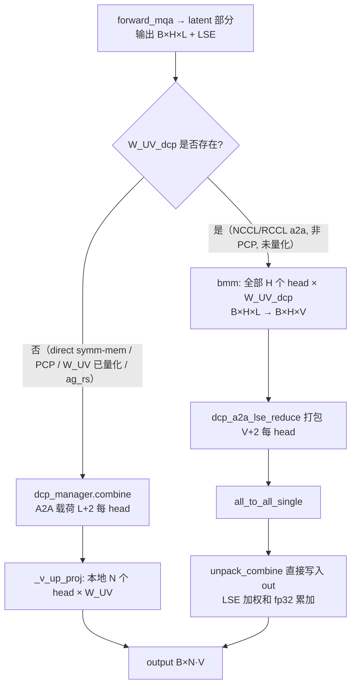
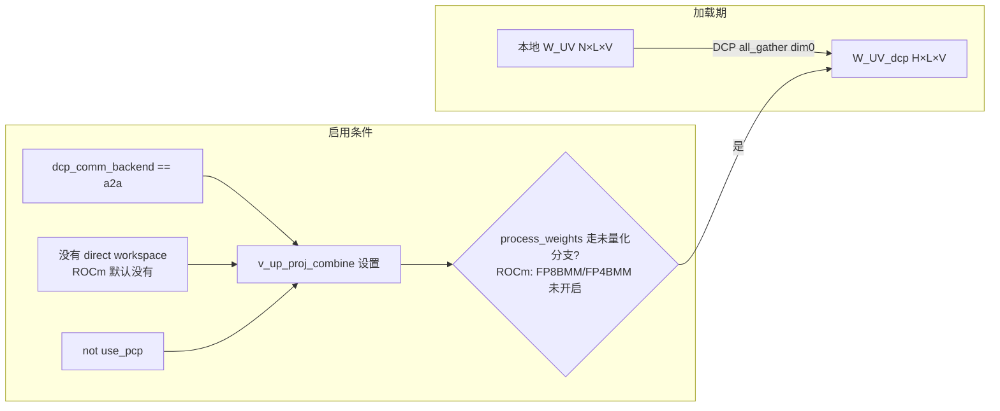

# PR #64994: [Perf][DCP] Up-project the MLA decode output before the A2A merge

> **Author**: @whx-sjtu | **State**: OPEN | **Date**: 2026-11-01
> **Branch**: `whx-sjtu:whx/dcp-mla-project-before-merge` → `main` | **Labels**: ci/build, kimi, k3
> **Changes**: +216 -22 lines across 7 files | **ROCm 相关性**: 部分相关（CUDA/ROCm 共享的 MLA DCP 路径；ROCm 上 a2a 合并默认走 NCCL/RCCL，所以本 PR 在 ROCm 上默认生效，作者的全部数据也来自 MI355X）
> 本报告分两部分：§1–6 为 PR 详细总结，§7–8 为 ROCm review 意见。

---

## 1. 总结 (Summary)

`--dcp-comm-backend a2a` 时，MLA decode 原本的顺序是：各 rank 的 latent 部分输出 `[B, H, L=512]` 先做 all-to-all 和 LSE 合并，再用 `W_UV` 上投影到 `[B, H/N, V=128]`。本 PR 新增 `dcp_a2a_v_up_proj_lse_reduce`，把顺序改成"先对全部 DCP-gathered head 做 `W_UV` 上投影，再 all-to-all + LSE 合并"。这样每个 head 的 A2A 载荷从 514 降到 130 个 bf16（Kimi-K3 L/V=512/128，+2 为打包进去的 fp32 LSE），约减少 4 倍。代价是每层多存一份 all-gather 后的 `W_UV_dcp`，并且 BMM 要对 N 倍的 head 计算。只在 NCCL a2a（非 symmetric-memory direct）、非 PCP、`W_UV` 未量化时启用，默认开启。

## 2. 背景与动机 (Background & Motivation)

- 在 DCP a2a 路径上，decode 的跨 rank 通信量和 latent 维度 L 成正比。MLA 的 L（512）远大于 V（128），而 LSE 合并对每个 head 来说是逐元素的加权和，属于线性运算，所以可以先投影再合并来压缩通信量。
- 作者的数据（Kimi-K3 1P1D，MI355X，TP8/DCP8）：C16/C32 吞吐 +0.6%/+1.1%，P90 interactivity +1.4%/+2.8%，decode step -1.1%/-1.7%。按作者说明，这些 E2E 数字**不是用本分支跑的**，而是在 nightly `3966924d` 上用 runtime patch 得到的，control 组也用了不同的节点对，属于 **[unverified]**；其中 +0.6% 很可能落在噪声范围内。
- 相关：#48196（draft、有冲突）在更大的 sparse-MLA 改动里对所有 DCP backend 做了同样的投影前移；本 PR 只覆盖 `MLADCPManager` 的 NCCL a2a 分支。

## 3. 代码修改分析 (Code Change Analysis)

### 3.1 修改的模块

| 文件 | 改动 |
|------|------|
| `vllm/v1/attention/ops/dcp.py` (+60/-6) | 新增 `dcp_a2a_v_up_proj_lse_reduce`；`dcp_a2a_lse_reduce` / `_dcp_a2a_unpack_combine` 新增可选参数 `out=`；`MLADCPManager` 新增属性 `v_up_proj_combine`，只在 `use_a2a and not use_pcp` 且没有 direct workspace 时设置 |
| `vllm/model_executor/layers/attention/mla_attention.py` (+32/-10) | `MLAAttention` 新增 `W_UV_dcp`；`process_weights_after_loading` 的未量化分支对 `W_UV` 做 DCP all-gather；`forward_impl` 在 `W_UV_dcp is not None` 时调用新的合并函数 |
| `vllm/models/kimi_k3/nvidia/mla.py` (+27/-4) | K3 的 `MultiHeadLatentAttention`（DSpark draft 在 ROCm 上也走这个文件，registry 固定为 `kimi_k3.nvidia.dspark_mla`）做同样改动 |
| `tests/distributed/test_dcp_a2a.py` (+78) | 新增 2-rank 测试，和"先合并再投影"的参考实现对比（bf16/fp32），包含 rank0 空分片 + NaN 的情况 |
| `tests/distributed/test_dcp_direct_a2a_lse_reduce.py` (+7) | `MLADCPManager` 三种选择场景下断言 `v_up_proj_combine` 的取值 |
| `.buildkite/test-amd.yaml`、`.buildkite/test_areas/distributed.yaml` (+8) | AMD 和 CUDA 的 Distributed 步骤都加上 `test_dcp_a2a.py -k v_up_proj`，并补充 source deps |

### 3.2 架构 / 流程图





### 3.3 关键实现细节

- `dcp_a2a_v_up_proj_lse_reduce(cp_attn_out[B,H,L], cp_attn_lse[B,H], w_uv[H,L,V], out[B,H/N·V], ...)`：先 `torch.bmm(cp_attn_out.transpose(0,1), w_uv, out=v.transpose(0,1))` 得到 `v[B,H,V]`，再调用 `dcp_a2a_lse_reduce(v, ..., out=out.view(B,-1,V))`，unpack kernel 按 `out` 的 stride 直接写回层输出，不再额外拷贝。
- 选择逻辑写在 `MLADCPManager._init_combine`：direct workspace 存在时提前 return（不设置），否则在 `use_a2a and not use_pcp` 时设置 `functools.partial(dcp_a2a_v_up_proj_lse_reduce, cp_group, is_lse_base_on_e)`。
- `direct_cp_enabled()` 在 `VLLM_USE_DIRECT_DCP_A2A` 未设置时要求 `current_platform.is_cuda()`，所以 **ROCm 上只要用了 a2a 就默认走新路径**；CUDA 上只有跨节点 symm-mem 不可用，或显式设置 `VLLM_USE_DIRECT_DCP_A2A=0` 时才走。
- `W_UV_dcp` 只在 `process_weights_after_loading` 的"未量化"分支生成。ROCm 上 `VLLM_ROCM_USE_AITER_FP8BMM` 和 `VLLM_ROCM_USE_AITER_FP4BMM` 默认都是 False，所以默认会走这个分支；开启其中任一项则自动回退到旧路径。K3 nvidia 文件在 `is_weights_pre_processed()`（weight cache daemon）时会跳过整个吸收块，同样回退。
- `sparse_mla_attention.py`（DeepSeek-V3.2）虽然也会构造 `MLADCPManager`（因此也会设置 `v_up_proj_combine`），但它没有被修改，也不读这个属性，继续保持原行为。

## 4. 涉及的技术原理 (Technical Principles)

- **LSE 合并的线性性**：对每个 token、每个 head，`o = Σ_r w_r · o_r`，其中 `w_r = exp(lse_r − lse_global)`；`W_UV` 对每个 head 是固定的线性映射，所以 `(Σ_r w_r o_r) W_h = Σ_r w_r (o_r W_h)`，两种顺序在数学上严格等价。权重 `w_r` 只依赖 LSE，不依赖 o_r 的维度，所以投影前后可以复用同一组权重。
- **空分片 / NaN 处理**：pack kernel 根据 `seq_lens/query_start_loc` 把空分片的 LSE 置为 −inf；unpack kernel 用 `partial = tl.where(weight == 0.0, 0.0, partial)` 屏蔽掉。所以先投影产生的 NaN（NaN latent × W_UV）同样会被清零。我已核对 `_dcp_a2a_unpack_combine_kernel` 中的这一行，新测试也覆盖了 rank0 首请求为 NaN 的情况。
- **舍入**：旧顺序是"fp32 累加合并 → bf16 → BMM（fp32 累加）→ bf16"，新顺序是"BMM → bf16 → fp32 累加合并 → bf16"，都是两次舍入。作者的 8-rank 模拟中，两种顺序的 Frobenius 相对误差相同（2.3e-3），单元素最大差 3.1e-2，是 bf16 1 ulp 的量级。
- **通信与计算的权衡**：A2A 每个 head 的载荷从 L+2 降到 V+2（K3：514→130）；代价是每个 rank 的上投影 BMM 从 N 个 head 扩大到 H=N·W 个 head，并且每步要读完整的 `W_UV_dcp`（K3 每层 12 MiB）。decode 小 batch 时这个 BMM 受权重带宽限制，额外的权重读取是固定开销，和 batch 大小无关。
- **head 顺序一致性**：query 按 DCP rank 顺序 all-gather，A2A 把第 `[r·h, (r+1)·h)` 段 head 发回 rank r，`W_UV_dcp` 也按同一 DCP group 沿 dim0 all-gather，三者顺序一致。新测试会检查打乱 head 顺序后失败。

## 5. 评论区讨论亮点 (Discussion Highlights)

- 截至 review 时没有实质性的人工评论。Claude Bot 提示"PR 来自 fork，automated review 已禁用"。等待 code owner @Harry-Chen、@khluu、@LucasWilkinson、@MatthewBonanni review，暂无 approval。CI 状态在页面上不可见（**未知**）。
- 作者在描述中主动说明的局限：没有在 CUDA 上运行；E2E 不是用本分支跑的；`test_dcp_a2a.py` 原本不在 CI 中，所以只加了 `-k v_up_proj`；两个测试文件各有 7 个在未修改镜像上同样失败的既有用例（fp32 LSE 对 bf16 参考、CUDA-only direct op）。

## 6. 风险与潜在问题 (Risk Analysis)

| 风险 | 严重程度 | 说明 |
|------|---------|------|
| 默认开启且没有开关，每层常驻额外 HBM | Medium | 见 §7 ⚠️【性能】`W_UV_dcp` 的显存代价 |
| 低并发 decode 下可能是净负收益 | Medium | 见 §7 ⚠️【性能】只在 C16 以上测过 |
| 模型层集成没有单测，E2E 不是本分支，CUDA 未验证 | Medium | 见 §7 ⚠️【测试】 |
| 数值正确性 | Low | 线性等价成立，NaN 屏蔽路径已核对，op 级测试覆盖了 head 顺序 |
| 两个模型文件中的门控逻辑重复 | Low | 见 §7 📝 |
| 对 sparse MLA / direct symm-mem / PCP 的影响 | Low | 已核对：这三条路径都不会进入新分支 |

---

## 7. Review 意见 (Findings)

| 类型 | 🔴 | ⚠️ | 📝 |
|------|----|----|----|
| 性能 | — | 2 | — |
| 测试 | — | 1 | — |
| 可维护性 | — | — | 2 |
| 注释/文档 | — | — | 1 |

---

**⚠️【性能】`W_UV_dcp` 每层常驻一份完整的 gathered `W_UV`，原来的本地 `W_UV` 仍然保留；默认开启且没有开关** `[已验证]`（数字为计算值）

- **问题**: `mla_attention.py:1369-1377` 和 `kimi_k3/nvidia/mla.py:463-471` 在 `v_up_proj_combine` 可用时都会 all-gather 出 `[H, L, V]` 的 `W_UV_dcp`，同时本地的 `W_UV`（`[N, L, V]`）依然保留。新路径启用后，decode 中 `_v_up_proj` 已不再使用本地 `W_UV`，但它仍然常驻显存。实际新增的显存是整个 `H·L·V·2B`，比 PR 描述里"+10.5 MiB"的口径（扣掉了本地部分）略大。按 K3 每层 12 MiB 算；DeepSeek-V3/R1 在 TP8/DCP8 下 H=128，每层 16 MiB，61 层约 **976 MiB/GPU**（计算值）；Kimi-K2（64 head）约 488 MiB/GPU。
- **影响**: 只要用了 `--dcp-comm-backend a2a`，ROCm 上默认（以及 CUDA 跨节点时）就会少约 1 GiB 的 KV cache 容量。DCP 本来就是为长上下文、KV 容量受限的场景设计的，这个代价和它的目标相冲突，而 PR 的 Claims 只给出了单层数字。
- **行动**: 建议作者 ①让 `W_UV` 改为 `W_UV_dcp` 中本 rank 那一段的 view，避免存两份；②在 PR 描述中给出整模型的显存增量（至少 K3 和 DeepSeek-V3）；③加一个临时开关（例如 env var 或 `MLADCPManager` 的参数），方便在 KV 容量敏感的部署中关闭。

**⚠️【性能】额外的权重读取是和 batch 无关的固定开销，低并发 decode 下可能是净回退，但只测了 C16 及以上** `[推测]`

- **问题**: `dcp.py:1048` 的 BMM 每步都要读完整的 `W_UV_dcp`（K3 每层 12 MiB，原来只读 1.5 MiB），计算量也是原来的 W=8 倍。A2A 节省的字节数和 token 数成正比（作者给出 160 token 时 15.8→4.0 MB）。B 很小时（1–8 个 token，受时延约束的交互式场景），A2A 处于延迟主导区，体积缩小带来的收益很有限，而多读的 10.5 MiB 权重在 MI355X 上大约是 2 µs/层的固定成本。
- **影响**: 作者的数据点是 C16/C32/C72，以及 24/32 个 running request 的 decode-only A/B，没有覆盖低并发。默认开启后，低并发 + DCP 的部署可能出现小幅 TPOT 回退。
- **行动**: 建议作者补充 C1/C4（或 decode-only 下 1–8 个请求）的 A/B 数据；如果确有回退，就按 token 数设阈值，小 batch 时走旧路径。

**⚠️【测试】新测试只覆盖 op 级，模型层集成（gather 顺序、`out` 布局、两个模型文件的分支）没有单测；E2E 不是本分支跑的；共享的 CUDA 路径没有验证** `[已验证]`

- **问题**: `test_dcp_a2a.py` 新增的测试直接调用 `dcp_a2a_v_up_proj_lse_reduce`，`w_uv` 是测试里构造的。`process_weights_after_loading` 的 all-gather 顺序、`forward_impl` 和 `_attention` 新分支的 `out` 切片，以及强制 MQA（`not use_mha`，seq_lens 包含 prefill token）场景，都没有被任何测试执行。E2E 数据来自 runtime patch，不是本分支；描述里也明确写了"not run on CUDA"，但 CUDA 在跨节点或 `VLLM_USE_DIRECT_DCP_A2A=0` 时同样会走这条路径。
- **影响**: 将来如果有人改动 `W_UV` 布局或 DCP group 的 rank 顺序（例如调整 TP/DCP 映射），op 级测试仍然会通过，但模型输出会出现静默的 head 错位。
- **行动**: 建议作者 ①用本分支至少跑一次 K3 或 DeepSeek 的 DCP a2a GSM8K，并贴出结果；②在 CUDA（或 CI 的 2-GPU 步骤）上用 `VLLM_USE_DIRECT_DCP_A2A=0` 做一次冒烟测试；③可以考虑加一个小的 `MLAAttention` 层级测试，对比 `v_up_proj_combine` 开启和关闭时的输出。

**📝【可维护性】启用条件分散在两个地方，并且没有日志** `[已验证]`

- **问题**: 启用需要两步：`MLADCPManager._init_combine` 设置 `v_up_proj_combine`，然后 `process_weights_after_loading` 的未量化分支生成 `W_UV_dcp`。ROCm 上设置 `VLLM_ROCM_USE_AITER_FP8BMM=1` / `FP4BMM=1`，或者 K3 走 weight cache daemon，都会静默回退到旧路径，用户无法判断当前实际走了哪条。
- **行动**: 建议作者在 `W_UV_dcp` 生成成功时 `logger.info_once("Using up-project-before-A2A DCP combine for MLA")`，和 direct A2A 已有的 `info_once` 保持一致。

**📝【可维护性】`MLAAttention` 和 `kimi_k3/nvidia/mla.py` 中两段几乎相同的分支代码** `[已验证]`

- **问题**: 两个文件各自复制了"gather `W_UV_dcp`"和"forward 中 `if self.W_UV_dcp is not None` 走合并"这两段逻辑。K3 文件用的是 `self.dcp_manager.group.all_gather`，`MLAAttention` 用的是 `get_dcp_group().all_gather`，目前两者是同一个 group，但写法已经开始分叉。
- **行动**: 建议作者把"gather + 合并"封装成 `MLADCPManager` 上的方法（例如 `prepare_w_uv(W_UV)` / `combine_v_up_proj(...)`），两个调用方共用。

**📝【注释/文档】`dcp_a2a_lse_reduce` 中 `world_size == 1 and out is None` 的语义变化** `[已验证]`

- **问题**: `world_size == 1` 且传入 `out` 时，函数会继续执行单 rank 的 A2A 和 unpack 来填充 `out`，而不是直接 return。逻辑是对的，但调用方很难看出 `out` 一定会被写入这一约定。
- **行动**: 建议作者在 docstring 的 `out:` 说明里注明"`out` 传入时总会被写入，`world_size==1` 也一样"。

## 8. 结论 (Verdict)

**⚠️ NEEDS WORK**

思路正确，数值等价性已从数学和 kernel 实现两方面核对（LSE 合并对每个 head 线性，空分片 / NaN 屏蔽对投影后的数据同样有效，head 顺序一致）。direct symm-mem、PCP、sparse MLA 这几条路径也都正确地排除在外。主要问题有三点：默认开启且不可关闭，每层常驻一份 gathered `W_UV`（DeepSeek-V3 TP8/DCP8 约 1 GiB/GPU，本地 `W_UV` 还冗余保留）；低并发场景没有测过；模型层集成没有用本分支验证，CUDA 也没有验证。建议补充显存和低并发数据，加上开关或阈值，并去掉冗余的本地 `W_UV`。

## 9. 英文 Review 评论 (Copy-Paste English Comments)

**C1** `vllm/model_executor/layers/attention/mla_attention.py:1369-1377` — ⚠️ comment

```text
`W_UV_dcp` keeps a full gathered `[H, L, V]` copy per MLA layer, and the local `W_UV` is still kept even though `_v_up_proj` is no longer called on the decode path once this is active. So the real cost is the whole H*L*V*2B, e.g. 16 MiB/layer, about 976 MiB/GPU for DeepSeek-V3 at TP8/DCP8 (computed), which comes straight out of KV-cache capacity. That is exactly what DCP users are short on, and the feature is on by default with a2a (always on ROCm). Could you (1) make the local `W_UV` a view into this rank's slice of `W_UV_dcp`, (2) state the whole-model memory delta in the description, and (3) add an opt-out knob?
```

**C2** `vllm/v1/attention/ops/dcp.py:1044-1048` — ⚠️ comment

```text
This BMM now runs over all H = N * dcp_world_size heads and reads the full gathered `W_UV_dcp` every step (12 MiB/layer for K3 vs 1.5 MiB before). That is a fixed, batch-independent cost, while the A2A savings scale with tokens. The A/B data covers C16 and above (24/32 running requests); at low concurrency (1-8 decode tokens) the A2A is latency-bound and this could be a net regression. Could you share a C1/C4 decode-only A/B, and if needed fall back to merge-then-project below a token threshold?
```

**C3** `vllm/model_executor/layers/attention/mla_attention.py:1156-1165` — ⚠️ comment

```text
The new test exercises `dcp_a2a_v_up_proj_lse_reduce` with a test-built `w_uv`, but nothing covers the model-level wiring: the `W_UV_dcp` all-gather order in `process_weights_after_loading`, the `out` slice here and in `kimi_k3/nvidia/mla.py`, or the forced-MQA case where seq_lens include prefill tokens. The e2e numbers also come from a runtime patch rather than this branch, and CUDA (multi-node, or `VLLM_USE_DIRECT_DCP_A2A=0`) takes this path too but was not run. Could you post a GSM8K run from this branch with DCP a2a, and a CUDA smoke test with direct A2A disabled?
```

**C4** `vllm/v1/attention/ops/dcp.py:1575-1581` — ⚠️ comment

```text
Whether this path is actually used depends on two separate decisions (here, and the unquantized branch of `process_weights_after_loading`). On ROCm, `VLLM_ROCM_USE_AITER_FP8BMM=1`/`FP4BMM=1`, or the K3 weight-cache-daemon path, silently fall back to merge-then-project. Could you add an `info_once` when `W_UV_dcp` is actually materialized, like the existing "Using direct symmetric-memory DCP A2A" log, so users can tell which combine is active?
```
