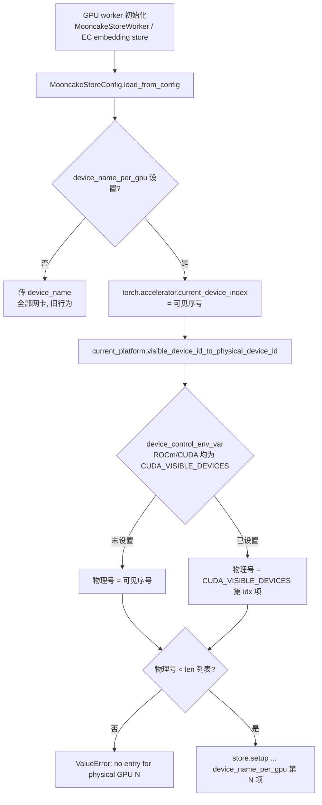

# PR #65076: [KVConnector][Mooncake] Add per-GPU device names for MooncakeStoreConnector

> **Author**: @whx-sjtu | **State**: OPEN | **Date**: 2026-11-02
> **Branch**: `whx-sjtu:whx/mooncake-store-per-gpu-nic` → `main` | **Labels**: documentation, kv-connector, mooncake
> **Changes**: +87 -4 lines across 4 files | **ROCm 相关性**: 部分相关（代码平台无关，但动机与唯一的端到端验证都来自 MI355X；GPU 物理编号映射走 ROCm 平台的 `CUDA_VISIBLE_DEVICES` 逻辑）
> 本报告分两部分：§1–6 为 PR 详细总结，§7–8 为 ROCm review 意见。

---

## 1. 总结 (Summary)

本 PR 给 Mooncake Store 配置（`MOONCAKE_CONFIG_PATH` 指向的 JSON）新增可选键 `device_name_per_gpu`：一个按**物理 GPU 编号**索引的 RDMA 设备名列表。设置后，每个 rank 的 store client 在 `setup_mooncake_store` 中只拿到自己 GPU 对应的那一项（一项内可用逗号列多块网卡），而不再把所有 HCA 交给每个 rank。`device_name` 保持 #43799 之后的"所有网卡"语义不变，两个键互斥。

## 2. 背景与动机 (Background & Motivation)

- #42689 曾经按 GPU index 从 `device_name` 的 CSV 里挑一项；#43799 为了 B300（8 GPU / 16 HCA）把它去掉，改为每个 rank 都用全部网卡。
- 作者在 2 节点 8×MI355X 上跑 Kimi-K3 1P1D 时发现：每个 rank 拿到全部 8 块网卡时，网卡跨 NUMA，Mooncake 用 4KB 页做 NUMA 分段的 global segment 映射，`ibv_reg_mr` 在 rdma5 上大量 EINVAL（PR 中贴了 92 条失败日志），Store 初始化失败。限制为"每 rank 只用 `rdma<物理 GPU>`"后 prefill Store 每 rank 注册 209 GiB、benchmark 通过。
- Mooncake 侧配套修复是 kvcache-ai/Mooncake#5151（修分配方式），但"8 个 rank 共享所有网卡"在修复后是否可行未测；本 PR 提供一个显式、opt-in 的 per-GPU 选择方式，默认行为不变。

## 3. 代码修改分析 (Code Change Analysis)

### 3.1 修改的模块

| 文件 | 改动 |
|------|------|
| `vllm/distributed/mooncake_store.py` (+31/-1) | `MooncakeStoreConfig` 新增 `device_name_per_gpu: list[str] \| None`，`__post_init__` 校验（与 `device_name` 互斥、非空 list、每项非空白 str）；`from_file` 读取该键；新增 `_device_name_for_current_gpu()`，`setup_mooncake_store` 改为传它的返回值 |
| `vllm/distributed/kv_transfer/kv_connector/v1/mooncake/store/connector.py` (+3/-3) | `supports_sleep_mode` 接受 `device_name` 或 `device_name_per_gpu` 任一 |
| `tests/v1/kv_connector/unit/test_mooncake_store_worker.py` (+48) | 选择逻辑参数化测试（旧键直通 / 按物理 GPU 取项 / 越界报错）+ 非法配置测试 |
| `docs/features/mooncake_store_connector_usage.md` (+4) | 新键说明 |

### 3.2 架构 / 流程图



### 3.3 关键实现细节

- 选择发生在 `setup_mooncake_store`，因此 KV 的 `MooncakeStoreWorker`（`store/worker.py:1562`）与 EC 的 `create_mooncake_embedding_store_client`（`store_client.py:111`）两个调用点都自动生效；二者都在 GPU worker 进程内、设备已设置之后调用。
- 物理编号用 `visible_device_id_to_physical_device_id`，该函数刻意不受 `set_assigned_physical_gpu_ids` 的逻辑映射影响，只做 env-var 反向翻译——语义正确。
- `torch`/`current_platform` 在函数内延迟 import，未设置新键时不触发。
- 校验在配置加载时完成；越界在 setup 时报错（每个 rank 各自报）。

## 4. 涉及的技术原理 (Technical Principles)

- **GPU 与 NIC 亲和性**：RDMA 网卡与 GPU 挂在不同 PCIe switch / NUMA 节点上。GPUDirect RDMA 和内存注册（`ibv_reg_mr`）的性能与成功率依赖于"本 GPU 用本地网卡"。MI355X 节点典型配置为 8 GPU 对 8 块 400G NIC，一一对应。
- **三种 GPU 编号空间**（`vllm/platforms/interface.py` 中的注释）：vLLM logical local ID、进程内 torch visible ordinal、物理 ID（amd-smi/NVML 视角）。本 PR 用 visible → physical 的转换。
- **ROCm 上的可见性环境变量**：vLLM 在 ROCm 平台 `device_control_env_var = "CUDA_VISIBLE_DEVICES"`，并在 import `vllm.platforms.rocm` 时把 `HIP_VISIBLE_DEVICES` 同步到 `CUDA_VISIBLE_DEVICES`（不一致则报错）。`ROCR_VISIBLE_DEVICES`（ROCr 运行时层过滤，Slurm/k8s AMD device plugin 常用）**不在**这套映射中。
- **Mooncake Store**：每个 rank 内嵌一个 `MooncakeDistributedStore` client（embedded 模式贡献 `global_segment_size` 内存），`setup()` 的第 6 个参数即该 client 的 TransferEngine 使用的 RDMA 设备列表。

## 5. 评论区讨论亮点 (Discussion Highlights)

- 目前只有 claude[bot] 的自动 review（fork PR，受限），尚无 code owner（ApostaC / ivanium / orozery / NickLucche / wzhao18 / xuechendi）review，无 approval。
- issue comments 仅 docs 预览链接。CI 状态未知（未抓取，页面未显示）。

## 6. 风险与潜在问题 (Risk Analysis)

| 风险 | 严重程度 | 说明 |
|------|---------|------|
| ROCm 上 `ROCR_VISIBLE_DEVICES` 场景下静默选错网卡 | Medium | 见 §7 ⚠️【兼容性】 |
| 唯一的 ROCm 端到端证据不是本分支代码 | Medium | 见 §7 ⚠️【测试】 |
| "物理 GPU 编号"与容器内编号 / NIC 命名的对应关系由用户手配 | Low | 见 §7 📝【注释/文档】 |
| 默认行为变化 | Low | 未设新键时完全走旧路径，`_device_name_for_current_gpu` 直接返回 `device_name` |
| 测试覆盖 | Low | 选择逻辑与校验均有单测；未覆盖真实 `CUDA_VISIBLE_DEVICES` 重映射（mock 了 platform） |

---

## 7. Review 意见 (Findings)

| 类型 | 🔴 | ⚠️ | 📝 |
|------|----|----|----|
| 兼容性 | — | 1 | — |
| 测试 | — | 1 | — |
| 注释/文档 | — | — | 1 |
| 可维护性 | — | — | 1 |

本 PR 不涉及 aiter / attention / MoE / 量化内核，相关 ROCm 内核规则不适用；ROCm 关注点集中在 GPU 编号映射与 MI355X 验证。

---

**⚠️【兼容性】ROCm 上 `ROCR_VISIBLE_DEVICES` 不参与物理编号换算，网卡会被静默选错** `[已验证]`

- **问题**: `mooncake_store.py:149-151` 用 `current_platform.visible_device_id_to_physical_device_id(torch.accelerator.current_device_index())` 求物理 GPU 号。ROCm 平台的 `device_control_env_var` 是 `CUDA_VISIBLE_DEVICES`（`platforms/rocm.py:661`），`HIP_VISIBLE_DEVICES` 会在 import 时同步过去（`rocm.py:138-157`），这两种都能正确处理。但 `ROCR_VISIBLE_DEVICES` 完全不被考虑：例如 `ROCR_VISIBLE_DEVICES=4,5,6,7` 且未设 `CUDA/HIP_VISIBLE_DEVICES` 时，第一个 rank 的 torch ordinal 为 0，`visible_device_id_to_physical_device_id` 直接返回 0，于是选中 `device_name_per_gpu[0]`（如 `rdma0`），而真实 GPU 是物理 4，本地网卡是 `rdma4`。
- **影响**: 不报错、不告警，rank 用上跨 NUMA 的网卡——正好是本 PR 想消除的场景（性能下降，最坏情况下复现 PR 描述里的 `ibv_reg_mr` EINVAL 初始化失败）。Slurm `--gres=gpu` 和部分 k8s AMD device plugin 在 AMD 节点上设置的正是 `ROCR_VISIBLE_DEVICES`。这是 vLLM 平台层原有的假设，但本 PR 是第一个依赖它的"物理号必须准确"的用户可见功能。
- **行动**: 建议作者在 `_device_name_for_current_gpu` 中，当 `current_platform.is_rocm()` 且设置了 `ROCR_VISIBLE_DEVICES` 时给出 warning（或直接报错要求改用 `HIP/CUDA_VISIBLE_DEVICES`），并在文档里写明"物理 GPU 编号 = 不设任何可见性变量时进程看到的序号"。

**⚠️【测试】MI355X 的端到端证据来自"等效运行时补丁"，不是本分支** `[已验证]`

- **问题**: PR 描述的 Validation 第二条明确写着 "Not from this branch: Kimi-K3 1P1D on 2 nodes of 8x MI355X with an equivalent runtime patch"。分支本身只跑了 `test_mooncake_store_worker.py`（mock 掉 `current_platform` 和 `torch.accelerator`，见测试 `monkeypatch.setattr(vllm.platforms, "current_platform", platform)`）。209 GiB/rank、AnonHugePages 等数字无日志或命令可追溯，应视为未验证。
- **影响**: 本分支在 ROCm 上真实的 `visible → physical` 路径（包括 `CUDA_VISIBLE_DEVICES` 被 Ray/外部设置的情况）以及 `setup()` 收到单个网卡名后的行为没有在本分支上跑过；B300"每 GPU 两块 HCA"的写法（`"rdma1,rdma2"`）也只有单测覆盖。
- **行动**: 建议作者用本分支 head 在 MI355X 上重跑一次 1P1D（或至少单节点 embedded 模式 Store 初始化），在 PR 里贴出每个 rank 的 `device_name` 选择日志和 Store 注册成功日志；同时建议在 `_device_name_for_current_gpu` 里加一行 `logger.info`（rank、visible idx、物理 idx、选中的设备），方便部署时核对。

**📝【注释/文档】文档应说明"物理 GPU 编号"在容器中的含义，以及 GPU 与 NIC 对应关系需要自己核对** `[已验证]`

- **问题**: `docs/features/mooncake_store_connector_usage.md:59-62` 只写了 "indexed by physical GPU ID, such as `["rdma0", "rdma1", ...]`"。如果 Docker 只透传部分 `/dev/dri/renderD*`，容器内的 GPU 编号会从 0 重新开始，而 RDMA 设备名（`rdma0..7`，或 AINIC 上的 `ionic_*`）是主机级的；另外 MI355X 上 `rdmaN` 不一定就对应 GPU N。
- **行动**: 建议作者补一句：编号以进程（容器）在不设可见性变量时看到的 GPU 序号为准；GPU↔NIC 对应请用 `amd-smi topology` / `rocm-smi --showtopo`（或 `nvidia-smi topo -m`）对照 NIC 的 PCIe/NUMA 位置确认，不要默认 `rdmaN` 对应 GPU N。

**📝【可维护性】越界报错信息可以更具体** `[已验证]`

- **问题**: `mooncake_store.py:152-153` 只报 "device_name_per_gpu has no entry for physical GPU {gpu}"，不说明列表长度、visible ordinal 和所用的可见性变量。
- **行动**: 建议作者在报错中带上 `len(device_name_per_gpu)`、visible ordinal 和 `current_platform.device_control_env_var` 的值，方便判断是配置少写了还是映射问题（也包括上面 `ROCR_VISIBLE_DEVICES` 的情况）。

**验证过、没有问题的点**：

- 未设新键时，`_device_name_for_current_gpu` 直接返回 `config.device_name`，不 import torch，行为与 main 一致。
- `visible_device_id_to_physical_device_id` 不受 `_assigned_physical_gpu_ids` 影响，用 torch ordinal 作为输入是对的（与 `interface.py` 的三命名空间约定一致）。
- 两个调用点（KV worker 与 EC embedding store）都在 GPU worker 进程内、设备设置之后调用，`current_device_index()` 有意义。
- sleep mode 的检查同步更新，报错文案已包含新键。

## 8. 结论 (Verdict)

**⚠️ NEEDS WORK**（问题不大）

改动小，opt-in，默认路径不变，校验和测试都到位。ROCm 侧的主要缺口是：`ROCR_VISIBLE_DEVICES` 场景下会静默选错网卡，而这个功能的价值就在于物理号准确；另外 MI355X 的证据不是本分支跑出来的。建议补 warning 或文档，再用本分支在 MI355X 上做一次初始化验证后合入。

## 9. 英文 Review 评论 (Copy-Paste English Comments)

**C1** `vllm/distributed/mooncake_store.py:149-153` — ⚠️ comment

```text
On ROCm, `visible_device_id_to_physical_device_id()` only translates through `CUDA_VISIBLE_DEVICES` (HIP_VISIBLE_DEVICES is synced into it at import), but `ROCR_VISIBLE_DEVICES` is not considered at all. With e.g. `ROCR_VISIBLE_DEVICES=4,5,6,7` (common under Slurm gres / k8s AMD device plugin) and no CUDA/HIP var, the first rank resolves to physical GPU 0 and silently picks `device_name_per_gpu[0]` instead of the entry for GPU 4 — which is exactly the cross-NUMA NIC situation this PR is trying to avoid. Could you either warn/raise when `current_platform.is_rocm()` and `ROCR_VISIBLE_DEVICES` is set, or document that this key requires HIP/CUDA_VISIBLE_DEVICES-based isolation? A one-line info log of (visible idx, physical idx, selected device) would also make misconfigurations easy to spot.
```

**C2** `docs/features/mooncake_store_connector_usage.md:59-62` — ⚠️ comment

```text
It would help to clarify what "physical GPU ID" means in practice: it is the GPU index the process sees without any visibility env var, which inside a container that only mounts a subset of GPUs is not the host index, while RDMA device names are host-level. Also, `rdmaN` is not guaranteed to be attached to GPU N (e.g. on MI355X / AINIC nodes); consider pointing users to `amd-smi topology` / `nvidia-smi topo -m` to build the list from actual PCIe/NUMA affinity.
```

**C3** `vllm/distributed/mooncake_store.py:142-154` — ⚠️ comment

```text
The MI355X end-to-end result in the description was produced with "an equivalent runtime patch", not this branch, and the unit tests mock both `current_platform` and `torch.accelerator`. Could you re-run at least the Store initialization (ideally the 1P1D Kimi-K3 setup) from this branch head on MI355X and paste the per-rank selected device / registration logs? That would cover the real ROCm visible-to-physical path end to end.
```
