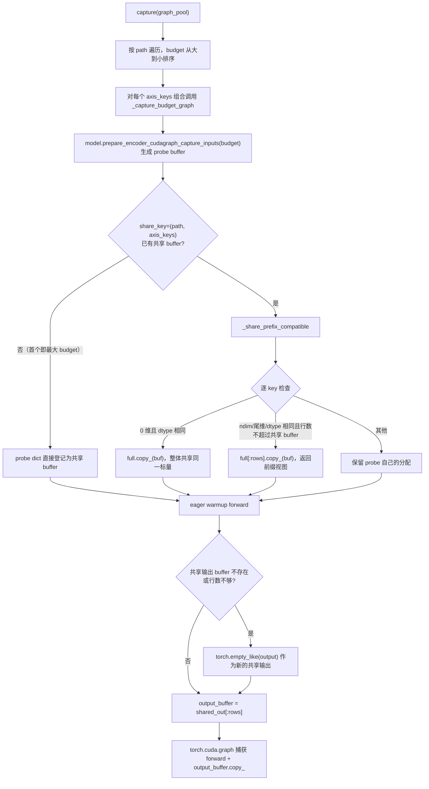
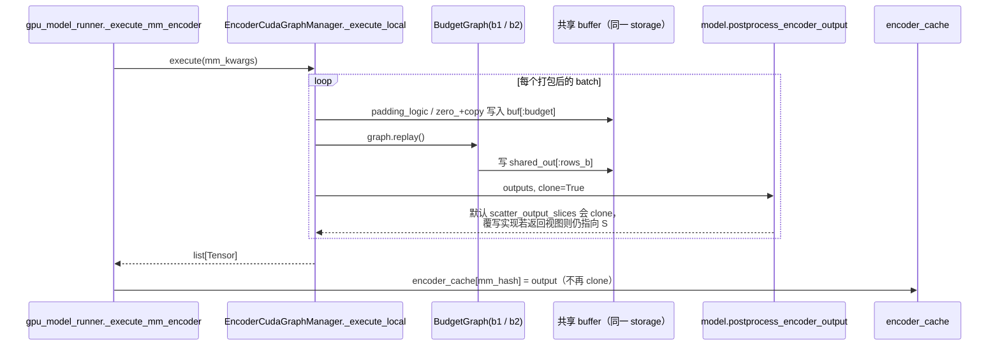

# PR #65084: [Multimodal] Refactor encoder cuda graph to support share graph buffer reuse

> **Author**: @Isotr0py | **State**: OPEN（mergify 提示存在 merge conflict，需要 rebase） | **Date**: 2026-11-02
> **Branch**: `encoder-cg-shared-buffers` → `main` | **Labels**: documentation, rocm, nvidia
> **Changes**: +354 -35 lines across 3 files | **ROCm 相关性**: 部分相关（改动集中在 CUDA/ROCm 共用的 `vllm/v1/worker/encoder_cudagraph.py`。ROCm 上的 encoder 图同样由 `torch.cuda.CUDAGraph`（HIP graph）捕获，MiniMax-M3 / Qwen-VL 系列等模型会在 `ROCM_AITER_FA` / Triton ViT attention 下使用这条路径）
> 本报告分两部分：§1–6 为 PR 详细总结，§7–8 为 ROCm review 意见。

---

## 1. 总结 (Summary)

这个 PR 改造了多模态 encoder 的 CUDA graph 管理器 `EncoderCudaGraphManager`，做了两件事。第一，让同一 (path, capture-axis) 组内的所有 token budget 共用一套按最大 budget 分配的输入/输出 buffer：较小 budget 的图捕获在共享 buffer 的前缀视图（`buf[:rows]`）上，做法与 decoder 的 `input_ids[:num_tokens]` 一致；形状不兼容的 key 退回各自独立分配，0 维标量整体共享。第二，既然多一张图几乎不再增加 buffer 显存，默认 budget 表就从 2 的幂阶梯改成更细的网格：1024 以下每个倍频程 4 档，以上每个倍频程 2 档，例如 64→16384 共 25 档。目标是把平均 padding 浪费从约 33% 降到约 10%。模型侧代码没有改动。

## 2. 背景与动机 (Background & Motivation)

- 修改前，每个 budget 的图在捕获时都会通过 `prepare_encoder_cudagraph_capture_inputs()` 分配一整套按该 budget 计算尺寸的输入 buffer，外加一个 `torch.empty_like(output)` 输出 buffer，所以 buffer 显存约为 Σbudgets ≈ 2×max。默认表只能用比较粗的 2 的幂阶梯，请求会被向上取整到下一个 2 的幂，padding 浪费较大。
- 作者的思路是：encoder 的 buffer 都是行连续（packed-contiguous）的，replay 只写 `buf[:real_rows]`，因此可以像 decoder 那样让多张图共用一块最大 buffer。PR 描述称这是「零模型改动、零协议改动、零配置开关」的通用方案。
- 作者数据（GB200 ×4，TP=4，DeepSeek-V4.1-Flash dummy 权重）：图从 9 张增加到 25 张，capture 显存从 4.19 GiB 降到 3.80 GiB，capture 时间从 14 s 增加到 21 s；padding 较重的 probe 延迟降低约 2–3%，其余 probe 持平。
- 关联背景：作者在描述中称本 PR 与 #41714（profiling 中的 pool 显存）互补，并沿用 #42796 的 padding 语义。评论区有人指出 #65351 实现了类似的功能。
- PR 描述声明使用了 AI 辅助（Kimi Code），提交者自行复核了所有改动。PR checklist 中的各项都没有勾选。

## 3. 代码修改分析 (Code Change Analysis)

### 3.1 修改的模块

| 模块 | 改动 |
|------|------|
| `vllm/v1/worker/encoder_cudagraph.py` (+101 -18) | 新增 `_shared_input_buffers` / `_shared_output_buffers`（以 `(path, axis_keys)` 为 key）；新增静态方法 `_share_prefix_compatible()`；`_capture_budget_graph()` 改为首个（最大）budget 提供共享 buffer，后续 budget 使用前缀视图；`_generate_budgets()` 改为细分网格；`clear()` 同时清空共享 buffer；更新 capture 图数量告警文案 |
| `tests/v1/cudagraph/test_encoder_cudagraph.py` (+250) | `TestDefaultBudgetTable`（默认表、仅设置 `max_vision_items`、用户显式 budgets）；`TestSharedCaptureBuffers`（共享 storage、前缀视图、输出切片、大→小→大 replay 与 eager 对比、`clear()`）；`TestSharedBufferFallback`（尾维不兼容时回退、标量按身份共享） |
| `docs/design/cuda_graphs_multimodal.md` (+6 -4) | 描述新的默认网格与 buffer 共享机制；更新 DeepSeek-OCR global/local 两条 path 的 budget 示例 |

### 3.2 架构 / 流程图

捕获阶段：同一 (path, axis) 组内按 budget 从大到小捕获，后续 budget 复用前缀视图。



Replay 阶段：多张图在同一条 stream 上依次执行，共享 buffer 在两次 replay 之间被覆盖。输出是否安全取决于调用方在下一次 replay 前有没有把结果拷贝出来。



### 3.3 关键实现细节

- **共享粒度**：key 为 `(path, axis_keys)`。双 path 模型（DeepSeek-OCR、Step3-VL 的 global/local）和带 capture axes 的模型（Gemma4 的 row width）各组之间不共享，所以同一 batch 中两个 path 的输出不会互相别名。
- **前缀兼容判定**（`encoder_cudagraph.py:334-366`）：`full.ndim == buf.ndim`、`full.shape[1:] == buf.shape[1:]`、dtype 相同、`buf.shape[0] <= full.shape[0]`。不检查 device 和连续性。0 维标量只要 dtype 相同就 `full.copy_(buf)`，然后共用同一个 tensor 对象。
- **probe 拷贝**：前缀视图会先拷入 probe 的内容，让捕获时的 eager forward 读到该 budget 自己的元数据（例如 cu_seqlens）。
- **输出共享**（`encoder_cudagraph.py:410-414`）：只按行数判断，行数更大时重新分配并替换共享输出（之前捕获的图继续持有旧 buffer）。这里没有像输入那样检查尾维和 dtype。
- **默认 budget 表**（`encoder_cudagraph.py:239-261`）：网格点固定落在「2 的幂 + k·(2 的幂/步数)」上，即以 1 为锚点，再加上 min/max 两个端点。例如 (64, 16384) 为 25 档，(64, 32768) 为 27 档，(64, 131072) 为 31 档。用户显式设置的 `encoder_cudagraph_token_budgets` 仍然生效，但设置了 `min_token_budget` 的 path 仍会走 `_generate_budgets`（这是已有行为）。
- **Replay 未改动**：`_run_budget_graph` 只写 `replay.values` 中出现的 key（缺失的 key 直接 `continue`），默认 padding 为 `dst.zero_(); dst[:n].copy_(src)`，模型也可以通过 `padding_logics` 自定义。

## 4. 涉及的技术原理 (Technical Principles)

- **CUDA/HIP graph 与静态地址**：图捕获时会把 kernel 参数中的指针固化下来，replay 只能通过原地改写这些地址处的内容来换输入。多张图共用一块 buffer 是安全的，前提是这些图在同一条 stream 上串行 replay，并且每次 replay 前把该图会读到的区域全部重写。ROCm 上 `torch.cuda.CUDAGraph` 映射到 hipGraph，`graph_pool_handle()` 的私有池语义与 CUDA 一致。本 PR 的共享 buffer 都在图外用普通分配器创建，不进入 graph pool。
- **graph pool 与 I/O buffer 是两类显存**：图内的中间激活放在 graph pool 中，按从大到小的顺序捕获就能复用，这部分 vLLM 早已在做。本 PR 节省的只是图外的 I/O buffer。因此 MI355X 上 MiniMax-M3 的图显存基本持平（见 §5），节省多少取决于 I/O buffer 在总显存中的占比。
- **ViT attention 的 max_seqlen**：FlashAttention / `ROCM_AITER_FA` / Triton / aiter FP8 ViT attention 的 wrapper 都会在捕获时对 CPU 标量执行 `max_seqlen.item()`，把结果固化为 kernel launch 参数（`vit_attn_wrappers.py`、`_aiter_ops.py:1974`）。所以即使这个 CPU 标量在捕获后被其他 budget 覆写，也不会影响已经捕获的图。
- **Budget 网格与 padding**：一个 batch 会被向上取整到最小的可容纳 budget。对按「行（图像/帧）」组织 buffer 的模型（DeepSeek-OCR global path：`rows = budget // 272`；Gemma4：`rows = budget // row_width`），实际计算量由 `floor(budget / 每项 token 数)` 决定，网格是否落在「每项 token 数 × 2^k」上直接影响浪费的行数。

## 5. 评论区讨论亮点 (Discussion Highlights)

- **@vorapolsiloai（AMD 侧实测，MI355X gfx950，MiniMax-M3 MXFP4，TP2，`--mm-encoder-tp-mode data`，FP8 ViT attention）**：在较早的 head `d9d886a5d` 上，默认 budget 下吞吐为 +0.7%，落在 1.2% 的噪声范围内；2048x1600 图像为 −0.8%（4163 token 的图像从 pad 到 8192 改为 pad 到 6144）。图显存为 16.85 vs 16.86 GiB/rank，即 27 张图与 main 的 10 张图持平。MMMU 为 0.6489。与手调 budget 列表相比，整体 −0.8%，2048x1600 为 −6.1%。叠加 #65227（启动时 probe 剪枝）后，默认配置能反超手调。这是目前唯一的 ROCm 端到端证据，但测的不是当前 head `78aa5ca88`，所用 base 也叠加了 #64928 / #65352 两个未合入的 PR。
- **@shen-shanshan**：指出 #65351 前一天实现了类似功能，需要 maintainer 决定合并哪一个或如何整合。
- **mergify**：PR 当前有 merge conflict。`claude[bot]` 因 PR 来自 fork 未执行自动 review。暂无 maintainer 的实质 review。

## 6. 风险与潜在问题 (Risk Analysis)

| 风险 | 严重程度 | 说明 |
|------|---------|------|
| 新默认网格对固定粒度 path 反而更差 | Medium | 见 §7 ⚠️【性能】：DeepSeek-OCR global path、Gemma4 在 2^k 个 item 时，padding 的行数比修改前更多，还会多出若干与已有图等价的「死图」 |
| 共享 buffer 隐式收紧了模型协议 | Medium | 见 §7 ⚠️【正确性】：只在捕获时写入、replay 不刷新的 GPU buffer/标量会被其他 budget 覆写。树内模型目前安全，但没有任何约束或文档 |
| 已有的输出视图别名范围扩大 | Medium | 见 §7 ⚠️【正确性】Step3-VL：无 patch 图像的输出是共享输出 buffer 的视图，修改前只会被相同 budget 覆写，现在任意 budget 都会覆写 |
| 图数量与启动时间 | Low | 每个 path 的图约增加到 2.5–3 倍；Gemma4 叠加 5 个 row width 后超过 64 张图的告警阈值；ROCm 上的 capture 时间未测 |
| ROCm 覆盖 | Low | 单测会在 AMD MI250 `CUDAGraph` 任务（optional）中运行；端到端只有社区在旧 head 上做的 MI355X MiniMax-M3 数据 |
| 描述与实现不符 | Low | 描述称「21 个模型中没有不兼容 buffer」，但 MiniMax-M3 的 `rotary_cos/sin` 就是回退分配的 |

---

## 7. Review 意见 (Findings)

| 类型 | 🔴 | ⚠️ | 📝 |
|------|----|----|----|
| 性能 | — | 1 | — |
| 正确性 | — | 2 | — |
| 可维护性 | — | — | 1 |
| 注释/文档 | — | — | 1 |
| 测试 | — | — | 1 |

---

**⚠️【性能】新网格以 1 为锚点而不是以 min_budget 为锚点，固定粒度的 path 在 2^k 个 item 时 padding 更多，还会产生等价的冗余图** `[已验证]`

- **问题**: `encoder_cudagraph.py:250-261` 的网格点固定为 `2^n + k·2^n/steps`，只额外加入 min/max 两个端点。原来的 2 的幂阶梯从 `min_budget` 开始翻倍，因此对「每项 token 数固定」的 path 恰好落在 `per_item × 2^k` 上。以 DeepSeek-OCR global path 为例（每张图 272 token，`deepseek_ocr.py:789` 的 `rows = token_budget // 272`），PR 自己的文档列出新表为 `[272, 320, 384, 448, 512, 640, 768, 896, 1024, 1536, ...]`：
  - 4 张全局图（1088 token）原来正好落在 1088；现在落在 1536，捕获了 5 行，多算 25%。8 张图（2176）落在 3072，捕获 11 行，多算 37%。
  - 320/384/448/512 这几档都是 `rows = 1`，和 272 那张图完全等价，2 张图需要 544，超出了它们的容量。它们是只增加 capture 时间和 graph pool 显存、永远不会被选中的冗余图（1024 同理）。
  - Gemma4 的 row width 为 280 时也一样：4 帧/图原来用 1120 预算（4 行），现在用 1536（5 行）。另外 Gemma4 有 5 个 row width 的 capture axis，默认图数量从约 45 张增加到约 115–125 张，默认配置就会触发 >64 张图的告警。
- **影响**: 对这类模型，「padding 从约 33% 降到约 10%」的说法不成立：奇数个 item 时变好，2^k 个 item 时变差，同时启动时间和图数量明显增加。ROCm 上 HIP graph 的捕获与实例化通常比 CUDA 慢，PR 没有给出 ROCm 上的 capture 时间（社区的 MI355X 数据也只报告了吞吐和显存）。
- **行动**: 建议作者把网格锚定在 `min_budget` 上（例如 `min_budget · 2^(k/4)` 取整），或者让模型（或 path）声明 budget 粒度并对网格点按粒度取整、去掉 `budget // per_item` 相同的重复档。同时建议在 PR 中补充一个固定粒度模型（DeepSeek-OCR 或 Gemma4）的 padding/延迟对比，以及 ROCm 上的 capture 时间。

**⚠️【正确性】共享 buffer 隐式收紧了模型协议：只在捕获时写入的 buffer 和 0 维标量会被其他 budget 覆写，而这一点既没有约束也没有文档** `[已验证]`（树内模型安全；针对未来/外部模型的触发 `[推测]`）

- **问题**: 修改前，每张图独占一份输入，「捕获时写入、replay 时不刷新」的内容会一直保留。修改后：
  1. `_share_prefix_compatible` 对 0 维标量执行 `full.copy_(buf)` 并共享同一对象（`encoder_cudagraph.py:352-356`）。捕获完成后，这个标量保存的是**最小** budget 的值。
  2. `_run_budget_graph` 对 `replay.values` 中缺失的 key 会直接 `continue`（`encoder_cudagraph.py:531-534`）。所以只要某个 GPU buffer 在捕获时依赖 budget、在 replay 时又不刷新，大 budget 的图就会读到最后一个小 budget 捕获时写入的内容。
  3. 如果自定义 `padding_logics` 只写 `dst` 的一部分、依赖尾部保留捕获时的值，尾部也会被其他 budget 的 replay 改写。
  我逐个检查了树内模型：只有 MiniMax-M3（`minimax_m3/common/encoder_cudagraph.py:244`）和 Pixtral 的 `max_seqlen` 是「仅捕获时写入」的 key，而它们都是 CPU 标量。FA、`ROCM_AITER_FA`、Triton 和 aiter FP8 ViT wrapper 都会在捕获时 `.item()`（`vit_attn_wrappers.py`，`_aiter_ops.py:1974`），因此目前不受影响。树内所有 `padding_logics` 也都会写满 `dst`。但新测试里的 `VarShapeMockViTModel.scalar`（GPU 0 维标量，值等于 budget）恰好就是这种危险模式，而 mock 的 forward 不读取它，测试只断言了「共享成功」。
- **影响**: PR 描述称「No protocol changes」，但实际上新增了两条隐式约束：replay 必须刷新所有依赖 budget 的 GPU buffer；padding_logic 必须写满目标 buffer。以后新增的模型（或 out-of-tree 模型）如果在 GPU 上放一个按 budget 计算的标量（例如有效 token 数或 scale），并且只在捕获时设置，大 budget 的图就会静默算错，且没有任何报错。共享标量本身也没有任何显存收益。
- **行动**: 建议作者 (a) 不再共享 0 维 buffer，让每个 budget 保留自己的标量；(b) 在 `interfaces.py` 的 `prepare_encoder_cudagraph_replay_buffers` / `EncoderCudaGraphConfig.padding_logics` docstring 和设计文档中明确写出上述两条约束；(c) 可以考虑在前缀兼容判定中加上 `full.device == buf.device` 和 `full.is_contiguous()` 检查；(d) 把测试改成让 mock forward 真正使用一个依赖 budget 的 buffer，以覆盖这个风险。

**⚠️【正确性】Step3-VL 无 patch 图像返回的是输出 buffer 的视图；输出共享后，覆写范围从「同 budget」扩大到「同 path 的任意 budget」** `[已验证]`（问题已存在于 main，本 PR 扩大了影响面）

- **问题**: `step3_vl.py` 的 `postprocess_encoder_output` 在 `np == 0` 时执行 `merged[idx] = parts[0]`，其中 `parts[0] = global_part[i].reshape(-1, hidden)`，是 `graph_meta.output_buffer` 的视图，并且忽略了 `clone` 参数。这个视图会经过 `_execute_local` 和 `execute` 返回给 `gpu_model_runner._execute_mm_encoder`，最后被 `_cache_encoder_output` 原样存进 `encoder_cache`（`gpu_model_runner.py:2742`，没有 clone）。修改前，每个 budget 有独立的输出 buffer，只有之后同一个 global budget 的 replay 才会覆写它。本 PR 之后，global path 所有 budget 都共用一块 storage（`encoder_cudagraph.py:410-414`），之后任何一次 global path 的 replay 都会覆写它。
- **影响**: 触发条件示例：Step3-VL，请求 A 只有一张不切 patch 的小图，它的 encoder 输出缓存后还没被完全消费（例如 chunked prefill 跨多个 step）；这时请求 B 的图像以不同 global budget 走 graph。A 的缓存 embedding 会被 B 的输出覆盖，结果静默出错。同一次 `_execute_local` 中的多个打包 batch 之间同样会互相覆盖。其他覆写了 `postprocess_encoder_output` 的模型（DeepSeek-OCR、DeepSeek-V4.1、ERNIE）都会 `torch.cat` 或 clone，因此不受影响。
- **行动**: 建议作者在本 PR 中顺手修复：Step3-VL 在 `len(parts) == 1` 且 `clone=True` 时返回 `parts[0].clone()`。也可以在设计文档中说明：共享输出之后，`postprocess_encoder_output` 必须遵守 `clone` 语义。

**📝【注释/文档】「21 个 encoder-CG 模型中没有不兼容 buffer」的说法不准确：MiniMax-M3 的 rope planes 会回退为按 budget 分配** `[已验证]`

- **问题**: MiniMax-M3 的 `rotary_cos/rotary_sin` 形状为 `(3, N, half_rot_dim)`，行轴是第 1 维（`minimax_m3/common/encoder_cudagraph.py:82-86`）。不同 budget 之间 `shape[1:]` 不同，按 `encoder_cudagraph.py:357-361` 的判定会回退为每个 budget 单独分配。这两块 fp32 buffer 的总量仍随 Σbudgets 增长，而 budget 数从 10 档增加到 27 档。
- **行动**: 建议作者修正 PR 描述，并在 debug 日志中输出每个 share_key 下回退分配的 key 列表，方便模型作者发现这种情况。如果需要，也可以为「行轴不在第 0 维」的 buffer 提供一个可选的行轴声明。这个模型正是 AMD 侧在 `ROCM_AITER_FA` 上实际部署的模型。

**📝【可维护性】输出共享没有像输入那样做兼容性检查** `[已验证]`

- **问题**: `encoder_cudagraph.py:410-414` 只比较 `output.shape[0]`，就把 `shared_out[: output.shape[0]]` 作为输出 buffer，然后在图内执行 `output_buffer.copy_(output)`。如果不同 budget 的输出尾维或 dtype 不同（目前树内没有这种情况），`copy_` 会静默做类型转换或广播，而不会报错。
- **行动**: 建议作者对输出也检查 `shape[1:]` 和 dtype，不一致时回退到 `torch.empty_like(output)`，与输入的判定逻辑保持一致。

**📝【测试】ROCm 侧验证情况需要在 PR 中说明** `[已验证]`

- **问题**: `.buildkite/test-amd.yaml` 中的 `:amd: (MI250) CUDAGraph` 任务（optional）依赖 `vllm/v1/worker/encoder_cudagraph.py`，并会运行 `test_encoder_cudagraph.py`。新增的 GPU 测试用 `HAS_DEVICE_GRAPH` 作 gate，在 ROCm 上也会执行。但这个任务是 optional，`checks` 中的 CI 状态未知。端到端 ROCm 数据只有社区在旧 head `d9d886a5d` 上跑的 MI355X MiniMax-M3，且叠加了 #64928/#65352。作者自己的数字全部来自 GB200 + dummy 权重，延迟 probe 也没有给出脚本。
- **行动**: 建议作者 rebase 后确认 AMD MI250 CUDAGraph 任务通过，并在 PR 描述中引用 MI355X 的结果，注明对应的 head。同时补充延迟 probe 的命令或脚本，便于复现。

> AI 代码诊断：描述对机制的解释（为什么前缀视图安全）较充分，作者声明了 AI 辅助，PR checklist 未勾选。没有发现幻觉符号：`untyped_storage`、`graph_pool_handle`、`round_up_to` 等均存在。主要信号有两个：一是「为通过而校准的测试」，`scalar` 共享测试只断言 storage 相同，没有验证语义；二是描述中的「零协议改动」与实际收紧的契约不一致。ROCm 专项方面，ViT attention 的 `max_seqlen` 在 AITER FA / Triton / aiter FP8 路径上都是在捕获时固化的 CPU 值，HIP graph 的 pool 语义也与 CUDA 一致，没有发现 ROCm 专属的别名问题。

## 8. 结论 (Verdict)

**⚠️ NEEDS WORK**

共享 I/O buffer 的核心机制是成立的：同一 stream 串行 replay；replay 前写满前缀视图；`_execute_local` 默认 clone 输出；不同 path/axis 之间不共享。没有找到在树内模型上有具体触发输入的阻塞性缺陷，ROCm 的 ViT attention 路径也不受影响。需要改进的地方有四点：新默认网格对固定粒度 path（DeepSeek-OCR、Gemma4）在 2^k 个 item 时反而更差，还会产生冗余图；标量共享和「仅捕获时写入」的 buffer 隐式收紧了模型协议；Step3-VL 已有的输出视图别名问题被扩大；PR 描述中的部分说法与实现不一致。

## 9. 英文 Review 评论 (Copy-Paste English Comments)

**C1** `vllm/v1/worker/encoder_cudagraph.py:250-261` — ⚠️ comment

```text
The new grid is anchored at powers of two (2^n + k * 2^n / steps), not at min_budget. The old ladder doubled from min_budget, so it landed exactly on per_item * 2^k for fixed-granularity paths. For example, the DeepSeek-OCR global path (272 tokens per image, rows = budget // 272) now gets [272, 320, 384, 448, 512, 640, ..., 1024, 1536, ...] (see the updated doc). Four global images (1088 tokens) used to fit 1088 exactly and now go to 1536, which captures 5 rows. Eight images go to 3072, which captures 11 rows. The 320/384/448/512 budgets all give rows == 1 like 272, so they are redundant graphs that never get picked. Gemma4 with row width 280 has the same issue (1120 -> 1536), and its 5 capture-axis widths take the default graph count to roughly 115-125, so it trips the >64 warning out of the box. Could you anchor the grid at min_budget (e.g. min_budget * 2^(k/4), rounded), or let a path declare a token granularity and dedupe budgets that map to the same row count? Capture-time numbers on ROCm would also help, since HIP graph capture is usually slower.
```

**C2** `vllm/v1/worker/encoder_cudagraph.py:352-356` — ⚠️ comment

```text
Sharing 0-dim buffers by identity saves no memory, but it changes semantics. After capture, the shared scalar holds the smallest budget's value. `_run_budget_graph` skips keys that are missing from `replay.values`, so any budget-dependent GPU scalar or buffer that is only written at capture time will be read with another budget's value by the larger graphs. In-tree models are fine today: the only capture-only key is the CPU `max_seqlen` (MiniMax-M3, Pixtral), and FA, ROCM_AITER_FA, Triton and aiter FP8 all `.item()` it at capture. But this is a new implicit contract, plus "padding_logic must overwrite the whole dst", and it contradicts "no protocol changes". The new `VarShapeMockViTModel.scalar` test is exactly this pattern, but the mock forward never reads it. Could you keep 0-dim buffers per-budget, document both requirements on `prepare_encoder_cudagraph_replay_buffers` / `padding_logics`, and maybe add device/contiguity checks to the prefix-compatibility test?
```

**C3** `vllm/v1/worker/encoder_cudagraph.py:410-414` — ⚠️ comment

```text
With one output storage per (path, axis), any `postprocess_encoder_output` override that returns a view of the graph output now gets clobbered by the next replay of *any* budget on that path, not only the same budget as before. Step3-VL does this: for images with no local patches it stores `global_part[i].reshape(-1, hidden)`, a view of `output_buffer`, ignoring `clone`. `gpu_model_runner._cache_encoder_output` keeps that view as is, so a later global-path replay (another batch in the same `_execute_local`, or another request while chunked prefill is still consuming the first one) overwrites the cached embedding. Could you clone in that branch of Step3-VL (it's a one-liner), and note in the design doc that overrides must honor `clone` now that outputs are shared? Separately, this block only compares `shape[0]`; checking `shape[1:]` and dtype like the input path does would avoid a silent cast or broadcast in `output_buffer.copy_(output)`.
```

**C4** `vllm/v1/worker/encoder_cudagraph.py:357-365` — ⚠️ comment

```text
Small accuracy note on the PR description ("none among the 21 current encoder-CG models" are prefix-incompatible). MiniMax-M3's `rotary_cos`/`rotary_sin` are (3, N, half_rot_dim) with the row axis on dim 1, so this check sends them to the per-budget fallback. Across 27 budgets they still scale with the sum of budgets. That fits the MI355X numbers posted in the thread (graph memory 16.85 vs 16.86 GiB, i.e. no saving). Could you correct the description and log the fallback keys per share_key at debug level, so model authors can tell when sharing does not apply? Also, could you confirm that the optional AMD MI250 CUDAGraph job, which runs test_encoder_cudagraph.py, passes after the rebase?
```
