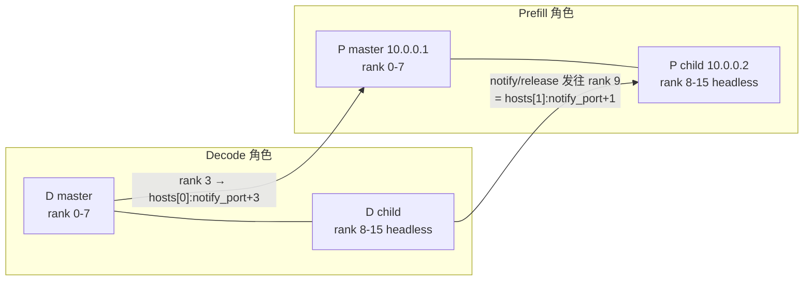

# PR #65098: [ROCm][Disagg][CI] Give Wide-EP headless nodes the KV config

> **Author**: @avininjamay8 | **State**: OPEN | **Date**: 2026-11-02
> **Branch**: `ci/amd-disagg-wideep-headless-kv` → `main` | **Labels**: rocm, ci/build, kv-connector
> **Changes**: +138 -7 lines across 7 files | **ROCm 相关性**: 完全相关（MoRIIO 连接器 + AMD disagg CI 启动脚本）
> 本报告分两部分：§1–6 为 PR 详细总结，§7–8 为 ROCm review 意见。

---

## 1. 总结 (Summary)

在 Wide-EP 多节点（2P2D、EP16/DP16）部署中，headless 子节点启动时没有带 `--kv-transfer-config`，所以子节点上不会创建 KV connector：MoRIIO 下 DP rank 8–15 不监听 handshake/notify 端口，NIXL 下 2P2D 会一直卡到 1800 s 的 gloo 超时。

这个 PR 做了两件事：
- **CI 启动脚本**：`vllm_disagg.sh` 给 master 和 headless 子节点都传 KV 配置。MoRIIO 配置新增 `remote_hosts`（对端角色的节点 IP，master 在前）和 `remote_dp_size_local`（= `GPUS_PER_NODE`）。
- **MoRIIO 连接器**：新增 `fill_remote_pod_from_config`。router 没有提供 `remote_hosts` 时，用 serve 配置里的值补到请求上，并在明确的情况下把 decode 请求标为 leader。WRITE 模式下的 block release 也改为按对端节点和节点内本地 rank 计算目标地址。

## 2. 背景与动机 (Background & Motivation)

- [vllm-project/router#386](https://github.com/vllm-project/router/pull/386) 之后，vllm-router 会把请求调度到每个角色的全部 16 个 DP rank 上，而不只是 master 节点的 0–7。但 vllm-router 只认识向它注册的 DP master，不知道子节点 IP，所以无法在 `kv_transfer_params` 里给出 `remote_hosts`（见作者对 @simondanielsson 的回复）。
- 连接器里其实已经有多节点寻址逻辑（`pod_index` / `fold_local_rank` / `multi_pod_hosts`），用于 handshake、notify 和 WRITE 任务。但这些逻辑都依赖请求里带 `remote_hosts` / `remote_dp_size_local`，以往只有 llm-d 这类 sidecar 会提供。
- 作者的做法是：把这两个值作为 serve 侧配置的兜底，只在请求本身没有 `remote_hosts` 时生效。llm-d 这类会发 `remote_hosts` 的 router 行为不变。
- @simondanielsson 问能否改在 router 侧修。作者回复说 vllm-router 目前拿不到子节点 IP，所以在 serve 配置侧兜底。

## 3. 代码修改分析 (Code Change Analysis)

### 3.1 修改的模块

| 模块 | 文件 | 改动 |
|------|------|------|
| AMD disagg CI | `.buildkite/amd-disagg/vllm_disagg.sh` | `build_ep_cmd` 中 kv_cfg 的生成从 master 分支里提出来，master 和 child 共用。新增 `remote_hosts` / `remote_dp_size_local`。child 也追加 `--kv-transfer-config`，选 NIXL 时用 `nixl_kv_cfg` |
| MoRIIO 公共函数 | `moriio/moriio_common.py` | 新增 `fill_remote_pod_from_config(params, extra_config, is_producer)` |
| MoRIIO scheduler | `moriio/moriio_connector.py` | `update_state_after_alloc` 和 `request_finished`（WRITE 模式、请求在调度前被 abort）调用 fill。`_release_write_prefill_blocks` 按 `pod_index` 选 host，按 `fold_local_rank` 计算端口偏移 |
| 单测 | `tests/v1/kv_connector/unit/moriio/test_moriio_remote_pod.py`（新） | 覆盖 fill 的 leader 判定、router 值优先、release 发到第二个节点（两条调用路径 × 两个 rank） |
| 单测夹具 | `test_moriio_connector.py` / `test_moriio_hma_scheduler.py` / `test_moriio_pipeline_parallel.py` | `__new__` 构造的 scheduler 补上 `kv_transfer_config`（和 `is_producer`），否则新调用会触发 AttributeError |

### 3.2 架构 / 流程图

```mermaid
flowchart TD
    A[请求到达 decode/prefill scheduler] --> B{请求里已有 remote_hosts?}
    B -- 是, 如 llm-d sidecar --> Z[保持原样]
    B -- 否 --> C{serve 配置有 remote_hosts<br/>且 remote_dp_size_local>0?}
    C -- 否 --> Z
    C -- 是 --> D[params.remote_hosts = 配置值<br/>params.remote_dp_size_local = 配置值]
    D --> E{decode 侧 且<br/>有 remote_dp_rank 或 对端只有 1 个 rank?}
    E -- 是 --> F[setdefault is_request_leader=True]
    E -- 否 --> G[不设置, 沿用 override / _is_kv_master 判定]
    F --> H[使用这些参数的下游路径]
    G --> H
    H --> H1[notify: host=hosts[r//dp_local], port=notify+(r%dp_local)*1+tp]
    H --> H2[WRITE release: 同上 本 PR 新改]
    H --> H3[handshake / WRITE 任务: 按 multi_pod_hosts 遍历对端全部 DP rank]
```



### 3.3 关键实现细节

- **fill 只在请求未带 `remote_hosts` 时生效**。配置缺 `remote_hosts` 或 `remote_dp_size_local` 中任意一个时直接 return，不报错。
- **decode 侧 leader 默认值收紧了**：只在 `remote_dp_rank` 存在时，或 `min(remote_dp_size, dp_local) <= 1` 时才 `setdefault(is_request_leader, True)`。这是采纳了 @okorzh-amd 的意见：router 没指定 rank 时，原有的 "router did not pin remote_dp_rank" 告警仍会触发。
- **`_release_write_prefill_blocks` 的变化**：
  - 原来用全局 rank 计算 `get_port_offset(remote_dp_rank, tp)`，目标 host 固定为 master IP。
  - 现在改为 `hosts[pod_index(r, dp_local)]`，端口偏移用 `fold_local_rank(r, dp_local)`。
  - 和 `update_state_after_alloc` 里已有的 notify 路径（:1347-1360）算法一致。
- **`request_finished` 的 WRITE abort 分支**会先 fill 再 release。请求在调度前就被 abort 时，release 也能发到子节点。这修了 review 中指出的问题：子节点的 KV block 会被占住直到 `defer_timeout`（默认 60 s）。
- **两处调用点都依赖 `self.kv_transfer_config`**，所以三个单测夹具都补了这个属性。
- **producer 侧也会被 fill**：prefill 请求在 `update_state_after_alloc` 中拿到 decode 的 hosts，进入 `_req_kv_params` 快照，再进入 `ReqMeta.multi_pod_hosts`。WRITE 任务和 handshake 据此按节点寻址。

## 4. 涉及的技术原理 (Technical Principles)

**Wide-EP 多节点 DP**：`--data-parallel-size 16 --data-parallel-size-local 8`。master 节点起 API server 和 rank 0–7，子节点用 `--headless --data-parallel-start-rank 8` 起 rank 8–15，不对外提供 HTTP。每个 DP rank 是独立的 EngineCore，各自有一个 KV connector scheduler 实例。

**MoRIIO 端口约定**：每个节点只为本节点的本地 rank 绑定 `notify_port + local_dp * 1 + tp_rank`（`get_port_offset` 的 `tp_size` 默认为 1）。handshake 端口同理。所以对端寻址必须是 "host = 第 `r // dp_local` 个节点，port 偏移 = `r % dp_local`"。如果用全局 rank 去算 master IP 上的端口，8–15 号 rank 对应的端口没有进程监听，消息会静默丢失。

**WRITE 模式握手**：decode 分配好 block 后，由一个 leader rank 向 prefill rank 发 "blocks ready" notify，prefill 再通过 RDMA 写入 decode 的 block。请求在调度前被 abort，或者前缀缓存全部命中时，decode 改发 release，让 prefill 释放 block。leader 的判定优先级是 `is_request_leader` > `remote_dp_rank_override`（全局 rank 匹配）> `_is_kv_master`（`pod_index == 0`）。在子节点上 `_is_kv_master` 为 False，所以如果没有 leader 标记，子节点上的 decode rank 永远不会发 notify。

**一个请求只落在一个 decode engine 上**：每个 decode 请求只会被分发到一个 DP engine，所以把 `is_request_leader` 默认设为 True 不会导致重复 notify。

## 5. 评论区讨论亮点 (Discussion Highlights)

- **@okorzh-amd，release 路径**：fill 修好了 notify、handshake、write，但 `_release_write_prefill_blocks` 仍然发到 master IP 和全局 rank 端口。请求在调度前被 abort 时，子节点的 block 会被占用 60 s。前缀全部命中时的 release（:1256 附近）也有同样问题。早期提交 2d2386a6c8 修过，后来在 893fbf1ca8 精简时被删掉了。作者在 344b049961 恢复了这个修复。
- **@okorzh-amd，leader 默认值**：最初的写法会对所有 decode 请求默认设 leader，导致 "router 没指定 rank" 的告警不再触发，请求静默超时。作者改为只在有 `remote_dp_rank` 或对端只有单个 rank 时才设默认值。
- **@okorzh-amd，测试缺失**：作者一度删掉了单测（dfbd5eeb56），理由是 MoRIIO 单测 job 在当时的 base 上是关闭的。reviewer 指出 #66480 已经把 `:amd: (MI355 DPX) MoRIIO Connector Unit Tests` 打开了，作者随后在 0770f77b11 新增了 `test_moriio_remote_pod.py`。
- **@okorzh-amd，夹具**：merge main 之后，#64693 新增的 `_decode_scheduler` 夹具没有设置 `kv_transfer_config`，已修。
- **@okorzh-amd，文档 nit**：新增了两个面向用户的 extra_config key，标题却是 CI，`docs/features/moriio_connector_usage.md` 没有记录，toy proxy 头注释也没更新。作者回复说目前只有 CI 用到，所以暂不写文档（见 §7 第 1 条）。
- **@simondanielsson**：问能否改在 router 侧。作者解释了 vllm-router 拿不到子节点 IP，并说明 fill 不影响已经发送 `remote_hosts` 的 router。
- @okorzh-amd 已在 2026-11-12 APPROVED。

## 6. 风险与潜在问题 (Risk Analysis)

| 风险 | 严重程度 | 说明 |
|------|---------|------|
| 新增配置 key 未写入文档，toy proxy 注释与实际不符 | 低 | 见 §7「新 extra_config key 未写入文档」 |
| `remote_hosts` 配置不完整时静默降级 | 低 | 见 §7「配置不完整时静默降级」 |
| 使用 toy proxy 时子节点也会发心跳 | 低 | 只在 `ROUTER_TYPE` 不是 vllm-router 时出现，见 §7 |
| leader 默认值优先于 `remote_dp_rank_override` | 低 | 配了 `remote_hosts` 后，带 rank 的 decode 请求总是由持有请求的 engine 发 notify。由于每个请求只落在一个 engine 上，这是正确的；行为变化只在 opt-in 时出现 |
| 测试覆盖 | 低 | 单测覆盖 decode 侧的 fill、leader 判定和 release。producer 侧的 multi-pod handshake/write 和 READ 模式只靠 PR 描述中的 E2E gsm8k 验证 |
| 兼容性 | 低 | 只有配置里显式写了 `remote_hosts` 和 `remote_dp_size_local` 才生效。llm-d 等发送 `remote_hosts` 的 router 不受影响。1P1D EP8 下 `pod_index` 都为 0，行为和原来一致 |
| 性能 | 无 | 每个请求只多了几次 dict 操作 |

---

## 7. Review 意见 (Findings)

| 意见类型 | 数量 |
|---------|------|
| 📝【注释/文档】 | 1 |
| 📝【可维护性】 | 1 |
| 📝【兼容性】 | 1 |
| 📝【测试】 | 1 |

没有 🔴 或 ⚠️ 级问题。

**📝【注释/文档】新 extra_config key 未写入文档，toy proxy 头注释过时** `[已验证]`
- **问题**：`moriio_common.py:275-289` 让 `kv_connector_extra_config.remote_hosts` 和 `remote_dp_size_local` 成为会改变任何 MoRIIO 部署路由行为的配置项，但 `docs/features/moriio_connector_usage.md` 里没有这两个 key。此外，`examples/disaggregated/disaggregated_serving/moriio_toy_proxy_server.py:10-16` 的注释仍然写着 Wide-EP 的节点信息由 "vLLM's own vllm-router" 等 sidecar 提供，而作者在评论区明确说 vllm-router 目前给不出这些信息，这正是本 PR 的出发点。
- **影响**：不影响运行。但其他 Wide-EP 用户（比如没跑 CI 脚本、直接用 vllm-router 部署 2P2D 的人）不会知道需要配置这两个 key，会遇到和本 PR 修复前一样的 rank 8–15 卡住。
- **行动**：建议作者在 usage 文档里补一小段，说明这两个 key 的语义、优先级（router 的值优先）和 leader 默认规则，同时把 toy proxy 头注释里 "vllm-router 会提供" 改为 "可以通过 serve 配置的 `remote_hosts` 兜底"。也可以放到 follow-up PR。

**📝【可维护性】`remote_hosts` 配置不完整时静默降级** `[已验证]`
- **问题**：
  - 只配了 `remote_hosts`、没配 `remote_dp_size_local`（或反过来）时，`fill_remote_pod_from_config` 直接 return，没有任何日志。
  - `_release_write_prefill_blocks`（`moriio_connector.py:1039-1044`）在 `pod_idx >= len(hosts)` 时回退到 master 的 `remote_host`，但端口仍用 fold 后的本地 rank。notify 路径（:1356-1360）和 handshake 路径（:2449-2450）也是同样的回退方式。
- **影响**：触发条件是配置错误，例如 yD=3 但 `remote_hosts` 只写了两个 IP。此时 rank 16–23 的 notify 或 release 会发到 master 上 rank 0–7 的端口。对方不认识这个 transfer_id，请求要等到超时才失败，日志里看不出原因。
- **行动**：建议作者在 scheduler 初始化时做一次校验：两个 key 必须同时出现，`remote_dp_size_local` 必须为正整数，否则 warning 或 raise。在 `pod_idx` 越界时记一条 warning，不要静默回退。

**📝【兼容性】headless 子节点在使用 toy proxy 时也会注册心跳** `[推测]`
- **问题**：子节点现在也带了包含 `proxy_ip` / `proxy_ping_port` / `http_port` 的 MoRIIO 配置。worker 在 `_rank == 0 && proxy_ip` 时启动 `MoRIIOHeartbeat`（`moriio_connector.py:1961`），上报 `http_address = <child_ip>:<http_port>`。推测在非外部 DP 启动方式下，每个 DP engine 的 world rank 0 都会满足这个条件，但没有在运行时验证。
- **影响**：只影响 `ROUTER_TYPE != vllm-router`、使用 `moriio_toy_proxy_server.py` 的 2P2D 运行。toy proxy 会把子节点当成一个新的 P/D 实例，把请求转发到子节点上没有 API server 的端口。默认的 vllm-router 路径不受影响。另外，在本 PR 之前，toy proxy + 2P2D 本来也不可用。
- **行动**：建议 review 时追问：toy proxy 路径是否明确不支持 Wide-EP？如果是，可以在脚本里对 `xP>1 || yD>1` 且非 vllm-router 的组合直接 `die`；或者不给子节点的配置传 `proxy_ip`。

**📝【测试】producer 侧 multi-pod 寻址和 READ 模式只有 E2E 验证** `[已验证]`
- **问题**：
  - 新单测只覆盖 decode 侧：fill、leader 判定、两条 release 路径。
  - prefill 侧没有单测覆盖。fill 后 `remote_hosts` 会进入 `_req_kv_params` 快照、`ReqMeta.multi_pod_hosts`，再进入 `_background_moriio_handshake` 和 `schedule_write_blocks` 的按节点寻址。
  - READ 模式（`MORIIO_READ_MODE=1`）下 decode 侧按 `multi_pod_hosts` 做 handshake，也没有单测。
  - PR 描述里的 gsm8k 结果（DeepSeek-V3 0.9484/0.9469，Kimi-K2.5-MXFP4 0.9295，NIXL push/pull 0.9484/0.9454）有命令，但没有附日志，记为 `[unverified]`。
- **影响**：这段代码是已有逻辑，本 PR 只改变了它的输入来源，所以风险不高。但以后重构时，这条 Wide-EP 路径没有 CPU 单测兜底。
- **行动**：建议作者补一个 producer 侧用例：对 `do_remote_decode` 请求调用 `update_state_after_alloc` 后，断言 `_req_kv_params[req]["remote_hosts"]` 和 `remote_dp_size_local` 正确。可以放到 follow-up。

**CI 状态**：本次抓取没有拿到 check-runs 明细，只知道 `mergeable_state=unstable`。base 上已经启用了 `:amd: (MI355 DPX) MoRIIO Connector Unit Tests`（`.buildkite/test_areas/misc.yaml:179`），它会跑 `v1/kv_connector/unit/moriio`。合并前请在 PR 页面确认这个 job 是绿色的；如有失败，先和 main 对比，排除 infra 波动。

## 8. 结论 (Verdict)

✅ **LGTM**：改动是 opt-in 的（只有 serve 配置显式写了 `remote_hosts` 才生效）。新的 release 寻址和已有的 notify/handshake 多节点算法一致。评论区提出的 release 漏发、leader 默认值过宽、测试缺失、夹具缺属性都已修复，并有单测覆盖。剩下的都是文档和配置校验类的 📝 建议，不阻塞合并。

## 9. 英文 Review 评论 (Copy-Paste English Comments)

**C1** `vllm/distributed/kv_transfer/kv_connector/v1/moriio/moriio_common.py:275-289` — 📝 comment

```text
Non-blocking: remote_hosts and remote_dp_size_local are now user-facing kv_connector_extra_config keys that change notify, release and handshake routing for any MoRIIO deployment that sets them. Anyone running 2P2D with vllm-router outside this CI script will hit the same rank 8-15 hang unless they know about them. Could you add a short section to docs/features/moriio_connector_usage.md (semantics, router values take precedence, the leader default)? The header of examples/disaggregated/disaggregated_serving/moriio_toy_proxy_server.py also still says vllm-router supplies remote_hosts, which contradicts the motivation of this PR. A follow-up is fine.
```

**C2** `vllm/distributed/kv_transfer/kv_connector/v1/moriio/moriio_connector.py:1039-1044` — 📝 comment

```text
Non-blocking: a partial config fails silently. If only one of remote_hosts / remote_dp_size_local is set, the fill returns without a log. If remote_hosts is shorter than the number of peer pods, pod_idx falls past the list and we fall back to remote_host but still use the folded local rank. The release then goes to a master port that belongs to an unrelated rank, and the request only fails at the timeout. The notify and handshake paths fall back the same way. Consider validating both keys together at scheduler init and logging a warning when pod_idx is out of range instead of falling back silently.
```

## 10. 英文总结评论 (Overall Review Summary)

```text
Thanks for this. Giving the Wide-EP headless nodes the KV config, plus the serve-config fallback for remote_hosts, looks correct and only applies when it is opted into. The WRITE release now uses the same per-pod host and local-rank port math as the existing notify path, and the new remote-pod tests cover the fill, the leader default and both release paths. Two optional follow-ups: document the two new extra_config keys (and fix the toy proxy header), and warn on a partial or too-short remote_hosts instead of falling back silently. Approve, once the MoRIIO unit job is green.
```
