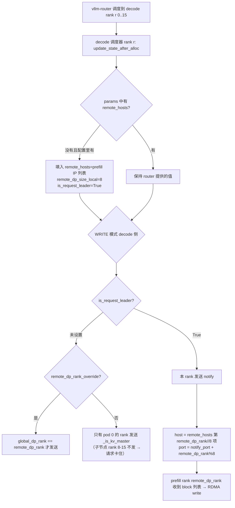

# PR #65098: [ROCm][Disagg][CI] Give Wide-EP headless nodes the MoRIIO KV config

> **Author**: @avininjamay8 | **State**: OPEN | **Date**: 2026-11-02
> **Branch**: `avininjamay8:ci/amd-disagg-wideep-headless-kv` → `main` | **Labels**: rocm, ci/build, kv-connector
> **Changes**: +56 -6 lines across 5 files | **ROCm 相关性**: 完全相关（MoRIIO KV connector + AMD disagg CI 脚本）
> 本报告分两部分：§1–6 为 PR 详细总结，§7–8 为 ROCm review 意见。

---

## 1. 总结 (Summary)

Wide-EP（DP16/EP16，跨 2 节点）的 PD 分离 CI 中，headless 子节点（DP rank 8–15）启动时没有 `--kv-transfer-config`，这些 rank 不建立 MoRIIO 连接器，也不打开 handshake/notify 端口。vllm-router#386 之后 router 会把请求调度到每个角色的全部 16 个 DP rank 上，落在 8–15 上的请求 KV 无法传输。本 PR 给子节点也传 MoRIIO KV 配置，并在 serve 配置里加 `remote_hosts`（对端角色的节点 IP，master 在前）和 `remote_dp_size_local`。连接器侧新增 `fill_remote_pod_from_config`：router 没有提供 `remote_hosts` 时，用 serve 配置里的值补到请求上；decode 侧还会额外设置 `is_request_leader=True`。

## 2. 背景与动机 (Background & Motivation)

- MoRIIO 的多 pod（Wide-EP）路由已经实现：按 `pod_idx = global_dp_rank // dp_size_local` 从 `remote_hosts` 中选对端 IP，端口偏移用 `global_dp_rank % dp_size_local`。但这些信息原本只能由 router/sidecar 通过 `kv_transfer_params` 下发；toy proxy 明确声明不提供这些信息。
- 在 CI 拓扑（`.buildkite/amd-disagg/vllm_disagg.sh`）中，只有 master 节点带 KV 配置，因此子节点上的 rank 实际上没有参与 KV 传输；而在 router#386 之前，router 只调度到 master 的 8 个 rank，问题被掩盖了。
- PR 给出的结果：DeepSeek-V3 2P2D EP16/DP16 MoRIIO WRITE，gsm8k 0.9484 / 0.9469（未附日志，下文视为未验证数字）。

## 3. 代码修改分析 (Code Change Analysis)

### 3.1 修改的模块

| 文件 | 改动 |
|------|------|
| `.buildkite/amd-disagg/vllm_disagg.sh` (+16/-6) | `build_ep_cmd`：KV 配置从只在 master 生成改为总是生成；新增 `remote_hosts`（prefill 用 decode 节点 IP，decode 用 prefill 节点 IP）和 `remote_dp_size_local=${GPUS_PER_NODE}`；headless 子节点在非 NIXL 时也加 `--kv-transfer-config`（NIXL 仍只给 master） |
| `moriio/moriio_common.py` (+14) | 新增 `fill_remote_pod_from_config(params, extra_config, is_producer)` |
| `moriio/moriio_connector.py` (+4) | `MoRIIOConnectorScheduler.update_state_after_alloc` 在设置 `transfer_id` 之后调用 fill |
| `tests/.../test_moriio_remote_pod.py`（新增 22 行） | fill 的两个用例：配置值补入 / router 已给的值保留 |
| `tests/.../test_moriio_hma_scheduler.py` (+2) | `_FakeScheduler` 补上 `is_producer`、`kv_transfer_config`，让已有测试在新调用下不崩 |

### 3.2 架构 / 流程图



### 3.3 关键实现细节

- `fill_remote_pod_from_config` 只在三个条件同时满足时生效：配置里有 `remote_hosts`、`remote_dp_size_local` 非 0、请求里还没有 `remote_hosts`。生效后会**覆盖**请求里已有的 `remote_dp_size_local`。
- consumer（decode）侧 `setdefault("is_request_leader", True)`：改变了 WRITE 模式下 notify 由谁发送的判断——优先级为 `is_request_leader` > `remote_dp_rank_override` > `_is_kv_master`。由于一个请求只落在一个 decode DP rank 的调度器上，"持有请求的 rank 发送 notify"仍是恰好一次。
- producer（prefill）侧也会被填入 `remote_hosts`（decode IP），随 `_req_kv_params` 快照进入 `ReqMeta.multi_pod_hosts`，WRITE 时 `moriio_engine.py:664-674` 据此选择 decode pod IP。
- `request_finished` 返回给 router 的 dict 是新构造的，不会把 producer 侧填入的 decode IP 原样回传（已核对 `moriio_connector.py:1686-1702`）。
- 心跳只在 `get_world_group().rank == 0` 时启动；DP>1 时 world group 跨所有 DP rank（`parallel_state.py:1876-1878`），所以 headless 子节点不会向 proxy 注册一个不存在的 HTTP 端点。

## 4. 涉及的技术原理 (Technical Principles)

- **Wide-EP + headless 多节点 DP**：一个 vLLM 实例跨 N 个节点，master 运行 API server 和前 8 个 DP rank，子节点用 `--headless --data-parallel-start-rank 8` 只运行 engine core。KV connector 是 engine 级配置，每个 DP engine 都需要它才能建立自己的 MoRIIO 传输端点。
- **MoRIIO 控制面寻址**：每个 DP rank 绑定 `handshake_port + local_dp_rank` / `notify_port + local_dp_rank`（同一节点内按本地 rank 偏移），跨节点靠 `remote_hosts[pod_idx]` 区分 IP。WRITE 模式下 decode 分配好 block 后给对应的 prefill rank 发 notify，由 prefill 侧 RDMA 写入。
- **路由权威性**：连接器的约定是 `remote_dp_rank` 由 router 决定（与 `X-data-parallel-rank` 一致），连接器不自行推导；未指定时会告警并回落到 rank 0。

## 5. 评论区讨论亮点 (Discussion Highlights)

- 目前只有 claude[bot] 自动 review，没有 code owner review（Harry-Chen / khluu / ApostaC / orozery / ivanium / wzhao18 / NickLucche / xuechendi），没有 approval。
- 提交历史显示作者多次缩小改动范围（"Minimize MoRIIO headless KV transfer change"、"Drop commentary..."），最终版本只有一个 helper 和一处调用。
- CI 状态未知（未抓取；AMD disagg pipeline 是否在 PR 上运行无法确认）。

## 6. 风险与潜在问题 (Risk Analysis)

| 风险 | 严重程度 | 说明 |
|------|---------|------|
| router 没有指定 `remote_dp_rank` 时，原有告警被关掉，notify 静默发往 prefill rank 0 | Medium | 见 §7 ⚠️【正确性】 |
| 新的 `kv_connector_extra_config` 键没有文档，toy proxy 头注释过时 | Medium | 见 §7 ⚠️【注释/文档】 |
| 调度器集成路径（fill → leader 判断 → 子节点 host/port）没有单测 | Medium | 见 §7 ⚠️【测试】 |
| 覆盖 router/prefill 回传的 `remote_dp_size_local` | Low | 见 §7 📝 |
| 1P1D EP 现在也用 `IPADDRS` 中的 IP 覆盖 request_id 中的 IP | Low | 见 §7 📝 |
| gsm8k 数字无出处 | Low | 未附日志，视为未验证 |

---

## 7. Review 意见 (Findings)

| 类型 | 🔴 | ⚠️ | 📝 |
|------|----|----|----|
| 正确性 | — | 1 | 2 |
| 注释/文档 | — | 1 | — |
| 测试 | — | 1 | — |
| 可维护性 | — | — | 1 |

mori 检查清单逐项结论：注册（无新 connector，不涉及）；配置面（新键无文档，见下）；端口（子节点按本地 rank 偏移，与 `fold_local_rank` 一致，已核对）；tensor 注册 / 平台守卫 / 回退（本 PR 未改动）；资源（无新线程或 buffer）。

---

**⚠️【正确性】注入 `is_request_leader=True` 会关掉"router 未指定 remote_dp_rank"的告警，notify 静默发往 prefill rank 0** `[已验证]`（实际触发取决于 router 行为 `[推测]`）

- **问题**: `fill_remote_pod_from_config`（`moriio_common.py:269-270`）在 decode 侧 `setdefault("is_request_leader", True)`。`update_state_after_alloc` 的告警条件是 `_dp_size > 1 and "remote_dp_rank" not in params and "is_request_leader" not in params`（`moriio_connector.py:1232-1246`）。fill 发生在告警之前（`moriio_connector.py:1059-1061`），所以只要 serve 配置里有 `remote_hosts`、router 又没给 `remote_hosts`，这条告警就不会再触发；接着 `remote_dp_rank` 默认取 0，notify 发往 `remote_hosts[0]:notify_port+0`。
- **影响**: 如果 router（或其他 NIXL 风格的 sidecar）既没下发 `remote_hosts` 也没下发 `remote_dp_rank`，在 2P2D 下 prefill 实际运行在 rank 12 的请求会把 notify 发给 rank 0，请求一直挂到 deferred timeout，而日志里本来用来定位这个问题的告警没有了。在 PR 的测试配置下 router 会指定 rank，所以测试过了。
- **行动**: 建议作者只在 `remote_dp_rank` 已存在时才注入 `is_request_leader`（或者把告警条件改为不看 `is_request_leader`），保证"未指定 rank"时仍然告警。

**⚠️【注释/文档】新的 `kv_connector_extra_config` 键 `remote_hosts` / `remote_dp_size_local` 没有文档，toy proxy 的说明也过时了** `[已验证]`

- **问题**: 这两个键现在是 MoRIIO serve 配置的一部分，但 `docs/features/moriio_connector_usage.md` 中搜不到；`examples/.../moriio_toy_proxy_server.py:10-16` 仍写着 Wide-EP 的 peer 信息只能由生产 router 提供。
- **影响**: 手工部署多节点 Wide-EP（不经过本 CI 脚本）的用户不知道子节点需要这两个键，会再次遇到"rank 8–15 KV 不传输"；也不清楚列表顺序必须是 master 在前、按 `data_parallel_start_rank` 递增，以及 `remote_dp_size_local` 应该等于**对端**的 `--data-parallel-size-local`。
- **行动**: 建议作者在 `moriio_connector_usage.md` 的 Wide-EP / 多节点部分补充这两个键（含顺序与取值约束），并更新 toy proxy 头注释，说明这些信息也可以来自 serve 配置。

**⚠️【测试】只测了 helper，调度器集成路径没有测试** `[已验证]`

- **问题**: `test_moriio_remote_pod.py` 只直接测试 `fill_remote_pod_from_config` 的两个分支；`test_moriio_hma_scheduler.py` 的改动只是让 `_FakeScheduler` 在新调用下不崩。没有测试覆盖本 PR 真正修复的行为：decode 子节点 rank（如 global rank 12）在 router 未给 `remote_hosts` 时会发送 notify，目标 host 是 `remote_hosts[1]`、端口是 `notify_port + 4`。2P2D 的 gsm8k 结果没有附日志，CI 状态也未知。
- **影响**: 以后对 leader 优先级或 `pod_index`/`fold_local_rank` 的改动可能让子节点的 notify 又静默失效，单测发现不了；而 AMD 多节点 disagg CI 很可能不在每个 PR 上运行。
- **行动**: 建议作者为 `update_state_after_alloc` 补一个 WRITE 模式 decode 侧的单测：`_global_dp_rank=12`、配置里 `remote_hosts=[A,B]`、`remote_dp_size_local=8`、`remote_dp_rank=12`，mock `send_notify_block` 并断言被调用一次且 host=B、port=notify_port+4；同时建议在 PR 中附上 2P2D 运行的日志或 CI 链接。

**📝【正确性】fill 会覆盖请求里已有的 `remote_dp_size_local`** `[已验证]`

- **问题**: `moriio_common.py:265-268` 只检查 `params.get("remote_hosts")`，router 只给了 `remote_dp_size_local` 或 READ 模式下 prefill 的 `request_finished` 回传了 `remote_dp_size_local`（`moriio_connector.py:1697-1699`）而没给 `remote_hosts` 时，会被配置值覆盖。在 CI 拓扑中两边都是 `GPUS_PER_NODE`，结果相同。
- **行动**: 建议作者改为 `params.setdefault("remote_dp_size_local", dp_local)`，或在两者不一致时告警。

**📝【正确性】单节点 EP（1P1D）也会改用 `IPADDRS` 中的 IP，覆盖 request_id 中实际通告的 IP** `[推测]`

- **问题**: 现在即使 xP=yD=1，EP 模式下也会写入 `remote_hosts=[对端 IP]`。WRITE decode 的 notify（`moriio_connector.py:1314-1318`）和握手（`2359-2386`）会优先用这个列表，而不是 request_id 里由 `resolve_host_ip()`（`host_ip` 或 `get_ip()`）通告的地址。`IPADDRS` 来自 `hostname -I` 的第一个地址（`run_xPyD_disagg.slurm:192`），在多网卡节点上不一定与 `get_ip()` 相同。
- **行动**: 建议 review 时追问这个行为变化在 1P1D EP CI 中是否验证过；更稳妥的做法是只在 `xP>1` / `yD>1` 时写 `remote_hosts`，或者让脚本同时设置 `host_ip`，保证两者一致。

**📝【可维护性】对端节点切片为空时生成 `"remote_hosts": [""]`** `[已验证]`

- **问题**: `vllm_disagg.sh:361-363` 中，`printf '"%s",'` 在没有参数时仍会输出一次 `"",`（已在 bash 中确认），所以当 `IPADDRS` 条目数少于 `xP+yD` 时（例如用 1P1D 的 `PREFILL_IP/DECODE_IP` 回退却设置了 `xP=2`），会得到 `[""]`。fill 会把它当作有效列表，notify 发往空 host。
- **行动**: 建议作者在 `resolve_topology` 中断言 `${#IP_ARRAY[@]} -ge xP+yD`，或者在切片为空时不写这个键。

## 8. 结论 (Verdict)

**⚠️ NEEDS WORK**

修复方向正确，改动很小：子节点必须有 KV 配置，用 serve 配置补齐 pod 信息也和现有多 pod 路由逻辑一致（端口折叠、pod 索引、心跳只在全局 rank 0 发送都已核对）。需要处理的是：`is_request_leader` 注入关掉了"未指定 rank"的告警；新配置键缺文档；真正修复的子节点 notify 路径没有单测，gsm8k 结果也无日志可查。

## 9. 英文 Review 评论 (Copy-Paste English Comments)

**C1** `vllm/distributed/kv_transfer/kv_connector/v1/moriio/moriio_common.py:269-270` — ⚠️ comment

```text
Setting `is_request_leader=True` here also suppresses the "router did not pin remote_dp_rank" warning in `update_state_after_alloc`, because that check requires `"is_request_leader" not in params` and the fill runs before it. If a router omits both `remote_hosts` and `remote_dp_rank`, the decode side now silently notifies prefill rank 0 (`remote_hosts[0]`, offset 0) and the request hangs until the deferred timeout, with no log hint. Could you only inject `is_request_leader` when `remote_dp_rank` is present, or decouple the warning from `is_request_leader`?
```

**C2** `vllm/distributed/kv_transfer/kv_connector/v1/moriio/moriio_common.py:259-270` — ⚠️ comment

```text
`remote_hosts` and `remote_dp_size_local` are now user-facing `kv_connector_extra_config` keys, but they are not documented in `docs/features/moriio_connector_usage.md`, and the header of `moriio_toy_proxy_server.py` still says this peer info only comes from a production router. Could you document them (peer role's node IPs, master first in `data_parallel_start_rank` order; `remote_dp_size_local` = the peer's `--data-parallel-size-local`) so manual multi-node Wide-EP deployments don't hit the same ranks 8-15 issue? Separately, consider `setdefault` for `remote_dp_size_local` so a value already provided by the router / prefill is not overwritten.
```

**C3** `vllm/distributed/kv_transfer/kv_connector/v1/moriio/moriio_connector.py:1059-1061` — ⚠️ comment

```text
The new test only covers the helper; the behaviour this PR actually fixes (a child-node decode rank notifying the right prefill pod) is untested. Could you add a WRITE-mode decode test for `update_state_after_alloc` with `_global_dp_rank=12`, config `remote_hosts=[A, B]`, `remote_dp_size_local=8`, `remote_dp_rank=12`, asserting `send_notify_block` is called once with host B and port `notify_port + 4`? A log or CI link for the 2P2D gsm8k run would also help, since the AMD multi-node disagg pipeline may not run on every PR.
```

**C4** `.buildkite/amd-disagg/vllm_disagg.sh:358-379` — ⚠️ comment

```text
Two small script concerns: (1) `printf '"%s",'` with an empty slice still emits `"",`, so if `IPADDRS` has fewer than xP+yD entries the config becomes `"remote_hosts": [""]` and the connector will notify an empty host; an explicit length check in `resolve_topology` would catch this early. (2) `remote_hosts` is now also written for 1P1D EP, so the notify/handshake host comes from `hostname -I`'s first address rather than the IP the peer advertises via `resolve_host_ip()`; was 1P1D EP re-validated, or should this only be emitted when xP>1 or yD>1?
```
