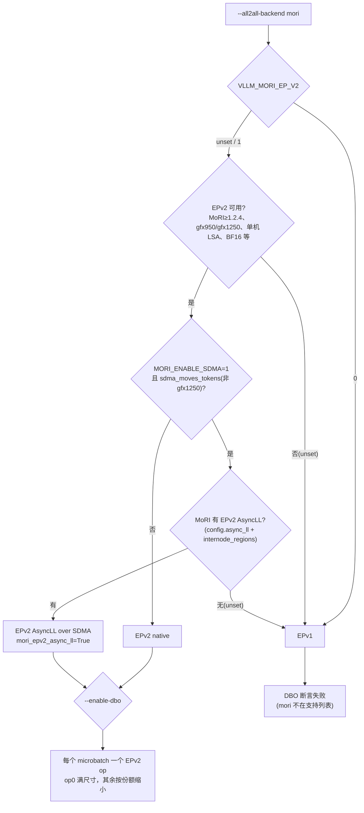
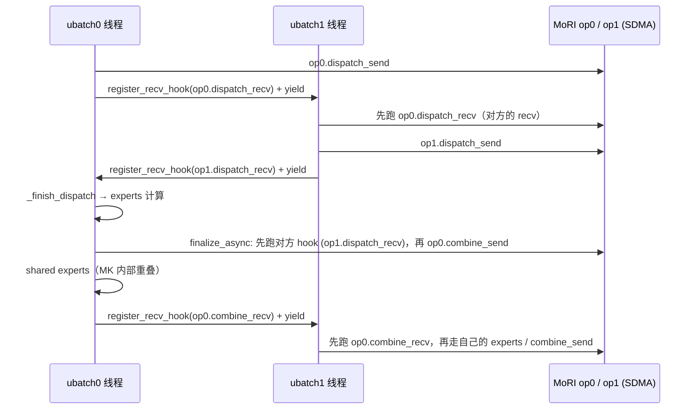

# PR #65128: [MORI][DBO] Dual batch overlap with MoRI EPv2 (native and AsyncLL), and DBO fixes on ROCm

> **Author**: @ChengYM5685 | **State**: OPEN | **Date**: 2026-11-02
> **Branch**: `feat/mori-epv2-dbo` → `main` | **Labels**: documentation, rocm, deepseek, nvidia, mrv2, DSv4
> **Changes**: +908 -137 lines across 24 files | **ROCm 相关性**: 完全相关（MoRI EPv2 all2all + DeepSeek-V4 ROCm 模型路径 + ROCm DBO），另有部分 CUDA/ROCm 共享的 DBO 基础设施改动
> 本报告分两部分：§1–6 为 PR 详细总结，§7–8 为 ROCm review 意见。

---

## 1. 总结 (Summary)

本 PR 让 `--all2all-backend mori` 在运行 MoRI EPv2 时支持 `--enable-dbo`（Dual Batch Overlap），覆盖两种 EPv2 内核：native（dispatch/combine 在 comm stream 上执行，与另一个 microbatch 的计算重叠）与新接入的 AsyncLL（基于 SDMA，dispatch/combine 拆成 send/recv 两半，仿照 deepep_ll 的 recv hook 交错）。同时修复了在 DeepSeek-V4 + MI355X DP8/EP8 上发现的若干 DBO 问题：纯 DP padding 的 microbatch 触发 FULL graph 回放和两个 DSv4 ROCm 算子越界、非 0 号 microbatch 的 workspace 未在 lock 前定尺寸、模型侧流上 hipBLASLt handle 未在 capture 前创建（`HIP error 900`）。V2 与 V1 两个 model runner 都做了对应修复。

## 2. 背景与动机 (Background & Motivation)

- 此前 ROCm 上可配合 DBO 的 all2all 只有 deepep_*、nixl_ep 和 `allgather_reducescatter`，mori 不在 `supported_backends` 中，DSv4 在 MI355X 上用 MoRI EPv2 部署时无法使用 DBO 做通信/计算重叠。
- MoRI 上游新增了 EPv2 AsyncLL 内核（ROCm/mori#768，2026-10-27 合并）以及「每个 AsyncLL op 独立 SDMA 队列」（ROCm/mori#892，2026-11-05 合并）。此前 vLLM 的 `MORI_ENABLE_SDMA=1` 会强制退回 EPv1，本 PR 改为在 MoRI 带 AsyncLL 时选 EPv2 AsyncLL。
- 作者在 DSv4-Pro、8×MI355X、DP8+EP8 上验证：prefill 吞吐 native +11.7%~14.0%、AsyncLL +21.7%~21.9%；但 decode 一旦被拆分会**下降 25%~27%**，因此作者建议只在 prefill 上开 DBO（调大 `--dbo-decode-token-threshold` 或在 PD 分离时只给 prefill 实例开），且明确说明不改各后端共享的阈值默认值。
- PR 描述声明使用了 AI 辅助（Claude）编写代码与描述，提交者自行复核并完成了验证。

## 3. 代码修改分析 (Code Change Analysis)

### 3.1 修改的模块

| 模块 | 改动 |
|------|------|
| `vllm/model_executor/layers/fused_moe/prepare_finalize/mori_epv2.py` (+149 -26) | `MoriEPv2PrepareAndFinalize` 改为持有一组 op（每个 microbatch 一个）；native 路径用 `dbo_comm_region()` 包住 dispatch/combine；新增 `prepare_async`/`finalize_async`（AsyncLL），`supports_async()` 返回 `async_ll`，`supports_dbo()` 返回 `len(ops) > 1`；routing 按 ubatch 分槽保存 |
| `vllm/model_executor/layers/fused_moe/all2all_utils.py` (+53 -2) | `_make_mori_epv2_ops`：按 `get_num_ubatches` 建多个 op，非 0 号 op 的 `max_num_inp_token_per_rank` 用 `_mori_ubatch_max_tokens` 缩小；AsyncLL 时补 `async_ll=True, async_ll_transport="sdma", kernel_backend="hip"`，MoRI 支持时加 `async_ll_own_sdma_queue=True` |
| `vllm/distributed/device_communicators/all2all.py` (+15 -2) | AsyncLL arena 大小改用 MoRI `asyncll_regions(cfg)`；`_make_handle` 接受只作为 cache key 的 `ubatch_id`；探测 LSA team 后 `comm.barrier()` 再 `close()`（SDMA 下交换队列句柄） |
| `vllm/config/parallel.py` (+38 -13) / `vllm/platforms/rocm.py` (+1 -1) | 新字段 `mori_epv2_async_ll`；参数 `sdma_picks_epv1` → `sdma_moves_tokens`；SDMA 只有在 MoRI 缺 AsyncLL 时才退回 EPv1 |
| `vllm/config/vllm.py` (+2) | ROCm 上 `mori_ep_v2=True` 时把 `mori` 加入 DBO 支持的后端列表 |
| `vllm/utils/import_utils.py` (+29) | `mori_epv2_has_async_ll()`、`mori_epv2_has_own_sdma_queue()`：按 `EpDispatchCombineConfig` dataclass 字段和 `internode_regions` 模块做特性探测 |
| `vllm/v1/worker/ubatching.py` (+20) / `naive_dp_ep.py` (+4 -32) | `_comm_region` 从 naive DP/EP 上提为公共 `dbo_comm_region()`，mori_epv2 复用 |
| `vllm/v1/worker/ubatch_utils.py` (+36 -2) | 新增 `find_model_streams(model)`（扫描模块属性中的 `torch.cuda.Stream`）与 `create_blas_handles(streams, dtype)`（ROCm 上用 1×1 GEMM 预建 hipBLASLt handle） |
| `vllm/v1/worker/gpu/{dp_utils,model_runner,ubatch_utils}.py` (V2 runner) | DP 同步改用 `is_last_ubatch_empty`（覆盖「恰好填满前面 microbatch」的边界）；profile_run 后 `size_workspace_ubatches_alike()`；capture 时为模型侧流也建 BLAS handle |
| `vllm/v1/worker/gpu_model_runner.py` / `gpu_ubatch_wrapper.py` (V1 runner) | profile_run 先跑不拆分的 dummy run，再跑一次拆分的 dummy run 并对齐 workspace；CUDA graph 内存 profile 对所有 microbatched FULL graph 逐个采样；清理 UBatchWrapper 自己的 graph；抽出 `_capture_microbatched` |
| `vllm/v1/worker/workspace.py` (+29) | `WorkspaceManager.size_ubatches_alike()`：把每个 lane 下各 microbatch 槽位扩到该 lane 最大槽位 |
| `vllm/models/deepseek_v4/amd/rocm.py` (+9 -3) | sparse MLA decode 在 `num_decode_tokens == 0` 时跳过；MXFP4 indexer compressor 的 launch 行数取 state 与 K cache slot mapping 的较小者 |
| 测试 (`test_mori_epv2_prepare_finalize.py` +291、`test_gpu_dp_utils.py` +75、`test_workspace.py` +31 等) | mock op 验证 DBO 交错顺序、AsyncLL recv hook 时序、later-op 容量上界、空 microbatch 走 eager、workspace 对齐 |
| 文档 (`dbo.md`、`expert_parallel_deployment.md`) | 说明 mori EPv2 支持 DBO、SDMA→AsyncLL 行为，以及 decode 不建议拆分 |

### 3.2 架构 / 流程图

后端选择（启动期，`resolve_mori_all2all`）：



AsyncLL + DBO 下两个 microbatch 的交错（与 deepep_ll 相同的 recv hook 机制，单 compute stream）：



### 3.3 关键实现细节

- **每 microbatch 一个 op**：MoRI op 的 receive/staging buffer 只在下次调用前有效，因此 microbatch 共用一个 op 会互相覆盖。`ubatch_id` 只进 `handle_cache` 的 key，不传给 `EpDispatchCombineConfig`。op0 保持 `max_num_inp_token_per_rank = moe.max_num_tokens`（即 `max_num_batched_tokens`），因为不拆分的 step 也走 op0。
- **later op 容量上界**：`_mori_ubatch_max_tokens(N, n) = min(N, cdiv(N, n) + (n-1)*q)`，`q = 1 + num_speculative_tokens`，推导依赖 `maybe_create_ubatch_slices` 在 `N//n` 处切分、或 V2 `create_ubatch_slices` 在 `q*(N//(q*n))` 处切分。
- **native DBO**：`dbo_comm_region()` 在 DBO 且非 capture 时 `yield_and_switch_from_compute_to_comm` → collective → `switch_to_compute_sync`；graph capture 中仍在 capture stream 上执行（因此 decode FULL graph 无重叠）。
- **AsyncLL**：`supports_async()=True` 会同时打开 modular kernel 内部的 shared-experts 重叠；`finalize_async` 开头主动调用 `dbo_maybe_run_recv_hook()`，因为 MK 只在 `prepare_async` 前调用它（与 deepep_ll / nixl_ep 写法一致）。
- **空 microbatch**：`is_last_ubatch_empty(min, N, n)` 判断 `(N//n)*(n-1) >= min`，原条件 `2*min < N` 漏掉了「恰好填满」的情况（如 N=128、min=64）；命中时该 step 走 eager。DSv4 的 MXFP4 compressor 改为按 `min(state_slot_mapping, k_cache_slot_mapping)` 行数 launch（`compress_pool` 的 grid 取 `pooled_k.shape[0]`，与之一致）。
- **workspace**：V2 的 profile run 不拆分，只给 ubatch0 定尺寸；V1 改为先跑不拆分的，再跑一次拆分的（让其他 ubatch 创建 persistent resource），然后 `size_ubatches_alike()`。
- **hipBLASLt handle**：handle 按线程和 stream 区分，只有 GEMM 才会创建；capture 中创建会失败。现在 capture 前对 compute/comm stream 以及 `find_model_streams` 找到的模型侧流（如 DSv4 的 `shared_experts_stream`、indexer `aux_stream_list`）都跑一次 1×1 `torch.mm`。

## 4. 涉及的技术原理 (Technical Principles)

- **DBO（Dual Batch Overlap）**：把一个 step 的 token 切成 2 个（或 n 个）microbatch，每个由一个 CPU 线程驱动，在 MoE 的 all2all 处 yield，让一个 microbatch 的通信与另一个的计算重叠。各 DP rank 必须以相同的方式切分并 padding，否则 all2all 的集合语义被破坏。因此某个 rank 的最后一个 microbatch 可能完全是 padding。
- **MoRI EPv2 / CCO-LSA**：AMD 的 MoE dispatch/combine 库。EPv2 基于 cco 对称内存窗口（每 rank 按 4 GiB 预留 VMM），要求所有 EP rank 在同一个 LSA team（单机）。op 的 arena 从窗口中切出，所以每多一个 op 就多占一块 arena。
- **AsyncLL over SDMA**：用 GPU 的 SDMA 引擎（拷贝引擎）搬 token，不占 CU。dispatch/combine 拆成 send 与 recv 两半，recv 侧自旋等待。在 eager prefill 中可以和计算重叠；但在 FULL graph decode 中会被串行化，作者实测拆分 decode 反而更慢。
- **CUDA/HIP graph 与 handle/workspace 预分配**：graph capture 期间不能分配新的 hipBLASLt handle，也不能扩 workspace（锁定后扩容会释放 graph 引用的静态 buffer），所以所有 microbatch、所有 stream 的资源必须在 capture/lock 前建好。
- **Modular kernel 的 async 契约**：`supports_async()` 让 MK 调用 `prepare_async/finalize_async`（返回 hook + receiver），DBO 下 hook 登记到下一个 ubatch 的 context，由对方在自己 send 之前执行。

## 5. 评论区讨论亮点 (Discussion Highlights)

- 目前没有实质性人工 review。评论只有 mergify 的文档预览链接，以及 `claude[bot]` 的一条说明（PR 来自 fork，自动 review 被禁用，需要 maintainer 评论 `@claude review` 触发）。
- 作者在 PR 描述中主动说明了一处已知限制：V1 runner + DBO 的 CUDA graph 内存 profile「不计入 microbatched graph（上游行为）」，因此要多留几 GiB 余量，并提到有一次 V1 AsyncLL decode 在 `--gpu-memory-utilization 0.92` 下 OOM。但本 PR 的 diff 恰好新增了对 microbatched graph 的逐个 profile（见 §7 📝），描述与代码需要对齐。

## 6. 风险与潜在问题 (Risk Analysis)

| 风险 | 严重程度 | 说明 |
|------|---------|------|
| 新 MoRI 路径无 AMD CI 覆盖 | High | 见 §7 ⚠️【测试】：基础镜像 MoRI v1.2.3.post1 < 1.2.4，EPv2/AsyncLL 在 CI 中走不到；新增测试全部基于 mock op |
| later op 容量依赖切分算法的解析上界 | Medium | 见 §7 ⚠️【正确性】：切分逻辑一旦改变就可能超出容量，且运行时没有守卫 |
| 默认阈值下开 DBO 会让 mori decode 变慢 | Medium | 见 §7 ⚠️【性能】：decode 下降 25%~27%，目前只在文档里提示 |
| `MORI_ENABLE_SDMA=1` 语义变更 | Medium | 见 §7 ⚠️【兼容性】：升级 MoRI 后，gfx950 上的 SDMA 部署会从 EPv1 切到 EPv2 AsyncLL，并同时改变 shared experts 的执行顺序 |
| 共享 DBO 路径行为变化（CUDA 也受影响） | Low | `is_last_ubatch_empty`、`create_blas_handles`、V1 profile_run 改动对 CUDA DBO 用户同样生效。逻辑上是修复，但只在 ROCm 上验证过 |
| 启动时间 / 内存 | Low | V1 多跑一次 max_num_tokens dummy run，并逐个 profile 所有 microbatched graph；DBO 下每个 microbatch 多一个 EPv2 arena（按 GiB 取整） |
| 性能数字可复现性 | Low | 见 §7 ⚠️【性能证据】 |

---

## 7. Review 意见 (Findings)

| 类型 | 🔴 | ⚠️ | 📝 |
|------|----|----|----|
| 正确性 | — | 1 | — |
| 测试 | — | 1 | — |
| 性能 | — | 2 | 1 |
| 兼容性 | — | 1 | — |
| 可维护性 | — | — | 1 |
| 注释/文档 | — | — | 1 |

---

**⚠️【测试】MoRI EPv2 DBO / AsyncLL 新路径在 AMD CI 镜像中走不到，新增测试全部基于 mock** `[已验证]`

- **问题**: `docker/Dockerfile.rocm_base:15` 固定 `MORI_BRANCH="v1.2.3.post1"`，而 `vllm/utils/import_utils.py` 的 `MORI_EPV2_MIN_VERSION = "1.2.4"`。因此在官方 ROCm 镜像里 `mori_epv2_unavailable_reason()` 不为空，`mori` 一律解析到 EPv1，`mori_epv2_async_ll` 永远为 False，`vllm/config/vllm.py:2236` 也不会把 mori 加入 DBO 列表。AsyncLL 依赖的 ROCm/mori#768 / #892 目前都没有正式 release（#892 今天才合并）。`tests/kernels/moe/test_mori_epv2_prepare_finalize.py` 新增的 DBO/AsyncLL 用例全部用 `FakeOp` / `_AsyncLLOp` 模拟，只验证调用顺序，不跑真实内核。本次 CI 状态无法获取（fetch 结果只有 `checks` 的 key 名）。
- **影响**: 合入后，`mori_epv2.py` 的多 op / AsyncLL 分支、`_mori_epv2_arena_bytes` 的 AsyncLL 分支、`comm.barrier()` 时序等在 main 上没有任何硬件回归保护；MoRI 后续 API 漂移（比如 `asyncll_regions` 改名）只会在用户部署时暴露。
- **行动**: 建议作者在 PR 描述里写明验证所用的 MoRI commit（需要同时包含 #768 和 #892），并说明 AMD CI 覆盖计划（升级 base 镜像 MoRI pin，或在 AMD 队列加一个 EPv2 + DBO 的 DSv4/小 MoE 冒烟用例）。review 时建议追问：上述 MoRI 依赖何时进入 release。

**⚠️【正确性】later microbatch 的 EPv2 op 容量取自对切分算法的解析上界，运行时没有守卫** `[已验证]`（越界后果 `[推测]`）

- **问题**: `all2all_utils.py:193-207` 的 `_mori_ubatch_max_tokens` 把非 0 号 op 的 `max_num_inp_token_per_rank` 缩为 `cdiv(N, n) + (n-1)*q`。这个上界只在两种切分方式下成立：`maybe_create_ubatch_slices` 默认的 `N//n`，以及 V2 `create_ubatch_slices` 的 `q*(N//(q*n))`。但 `maybe_create_ubatch_slices` 本身已经支持显式的 `split_point: list[int]`（任意切分点），`mori_epv2.py:208-216` / `232-235` 取 `self.mori_ops[ubatch_id]` 后直接 dispatch，没有检查 `a1.shape[0]` 是否超过该 op 的容量。容量的推导与切分代码分布在三个文件中，只有一个单测（`test_later_microbatch_ops_hold_their_share`）把它们绑在一起。
- **影响**: 只要以后有人改切分策略（例如按请求边界切 prefill、或启用显式 `split_point` 列表），后续 microbatch 就可能超过 op 容量。MoRI 侧是报错还是静默写越界取决于其实现，最坏情况是 dispatch 的 receive 区被写坏、结果静默出错。
- **行动**: 建议作者在 `prepare`/`prepare_async` 中对 `a1.shape[0]` 与该 op 的 `max_num_inp_token_per_rank` 加一个 CPU 侧断言（shape 是静态的，不影响 graph capture），并在 `maybe_create_ubatch_slices` 的切分处注释说明这一约束。

**⚠️【性能】默认 DBO 阈值下，mori 的 decode 会被拆分并明显变慢，只有文档提示** `[已验证]`（数字本身 `[unverified]`）

- **问题**: PR 自己的数据显示，默认阈值（`dbo_decode_token_threshold=32`）下开启 DBO，native decode 为 −27.0%、AsyncLL 为 −24.8%。代码对此只在 `expert_parallel_deployment.md:108` 加了一句建议，`vllm/config/vllm.py:2236` 放行 mori 时没有任何日志提示。
- **影响**: 按文档常规用法 `--enable-dbo --all2all-backend mori` 部署 DSv4 的用户，会在混合负载中默默损失约四分之一的 decode 吞吐。
- **行动**: 建议作者在 mori + DBO + decode 阈值仍为默认值时输出一条 `warning_once`，提示调大 `--dbo-decode-token-threshold`；如果不改共享默认值，也可以考虑只对 mori 后端在 `_raise_dbo_thresholds_for_spec_decode` 一类的位置做后端特定的调整。

**⚠️【兼容性】`MORI_ENABLE_SDMA=1` 的语义从「强制 EPv1」变为「EPv2 AsyncLL」，并连带打开 MK 内部 shared-experts 重叠** `[已验证]`

- **问题**: `config/parallel.py:1330-1335` 在 gfx950 上、MoRI 带 AsyncLL 时设置 `mori_epv2_async_ll=True`；`mori_epv2.py` 的 `supports_async()` 随之返回 True。这不仅换了 all2all 内核，还让 modular kernel 改走 `prepare_async/finalize_async`，shared experts 也改为 `MK_INTERNAL_OVERLAPPED` 顺序（不开 DBO 时同样如此）。验证范围只有 DSv4-Pro、DP8+EP8、单机 MI355X。
- **影响**: 现有 SDMA 部署在升级 MoRI 后，会在不改任何 vLLM 参数的情况下切换到完全不同的执行路径。激活范围（所有 gfx950 上的 mori MoE 模型）比验证范围（单一模型、单一并行配置）宽。
- **行动**: 建议作者在 PR / release note 中把它列为 breaking 行为变更（已有 `logger.info_once` 输出 "AsyncLL over SDMA"，建议改为 warning 级别并提示 `VLLM_MORI_EP_V2=0` 可恢复旧行为），并在不开 DBO 的情况下，至少对另一个 MoE 模型（如 DeepSeek-V3 / Kimi）补一组 AsyncLL 的精度结果。

**⚠️【性能】性能数字缺少可复现信息** `[unverified]`

- **问题**: 验证表给出了 prefill/decode tok/s 和百分比，但没有 benchmark 命令/脚本、MoRI commit、ROCm/aiter 版本，也没有说明是单次运行还是多次取均值；描述中「final run matched these within 3%」同样没有原始输出。
- **影响**: 无法复核 +21.7% 与 −27% 等结论，也无法判断 3% 的波动是否会掩盖 native 与 AsyncLL 之间的差异。
- **行动**: 建议作者补充完整的 `vllm serve` 与 `vllm bench serve` 命令、MoRI/aiter/ROCm 版本，并附上原始 benchmark 输出（或 gist）。

**📝【性能】DBO + AsyncLL 在 MoRI 只有 #768、没有 #892 时会默默共用 SDMA 队列** `[已验证]`

- **问题**: `all2all_utils.py:402-403` 只在 `mori_epv2_has_own_sdma_queue()` 为真时设置 `async_ll_own_sdma_queue=True`，否则不做任何提示。按 ROCm/mori#892 的描述，同一 stream 上多个 AsyncLL op 共用 SDMA 队列时，recv 会被无关传输阻塞，这是性能问题而不是正确性问题。
- **行动**: 建议作者在 DBO + AsyncLL 且缺少 own-queue 支持时输出一条 `info_once`/`warning_once`，避免用户把较差的重叠效果误判为 DBO 本身的问题。

**📝【注释/文档】PR 描述中「V1 内存 profile 不计入 microbatched graph」与 diff 不一致；V1 启动成本上升** `[已验证]`

- **问题**: `gpu_model_runner.py:6322-6345` 新增了 `profile_groups`，对所有 microbatched FULL graph 逐个 capture 采样（`profile_descs = descs if microbatched else descs[:2]`），并把结果计入 `per_graph_estimate[mode, True]`。这与描述 Notes 中「does not count the microbatched graphs (upstream behavior)」的说法矛盾。另外 `gpu_model_runner.py:6123-6135` 让 profile_run 多跑一次 `max_num_tokens` 的拆分 dummy run。
- **行动**: 建议作者更新描述，说明本 PR 后 V1 还缺哪部分内存没有计入（与那次 0.92 OOM 的关系），并给出开启 DBO 时启动/profile 耗时的增量。

**📝【可维护性】mori 解析为 EPv1 时，`--enable-dbo` 的报错没有说明原因** `[已验证]`

- **问题**: `vllm/config/vllm.py:2235-2236` 只在 `mori_ep_v2` 为真时放行 mori。如果因为 MoRI < 1.2.4、gfx942、或 SDMA 但没有 AsyncLL 而退回 EPv1，用户会看到 "mori is not supported" 的断言，提示列表里也没有 mori，无从得知是 EPv1 回退导致的。
- **行动**: 建议作者在 ROCm 且 backend 为 mori 但 `mori_ep_v2=False` 时给出专门的报错，说明 DBO 需要 EPv2，并附上 EPv2 不可用的原因（`_mori_epv2_unsupported_reason` 已经能算出来）。

> AI 代码诊断：描述对机制（WHY）解释充分，数字也不是整数，作者声明了 AI 辅助并自行做了硬件验证。主要信号是测试以 mock 为主、靠 CPU 侧时序断言保证正确性。幻觉符号扫描方面：`asyncll_regions`、`dispatch_send/dispatch_recv/combine_send/combine_recv`、`async_ll`、`async_ll_transport` 与 ROCm/mori#768 的描述一致，`async_ll_own_sdma_queue` 与 #892 一致，且 vLLM 侧都有特性探测兜底。没有发现缺失符号。DSv4 的两处空 microbatch 修复（`rocm.py` decode 跳过、compressor `min` 行数）经交叉核对 `compress_pool` 的 grid 后确认是安全的。

## 8. 结论 (Verdict)

**⚠️ NEEDS WORK**

设计与现有 DBO 机制（deepep_ll 的 recv hook、naive DP/EP 的 comm region）一致，DSv4/workspace/hipBLASLt 等 DBO 修复也有针对性的单测。本次没有找到能给出具体触发输入的阻塞性缺陷。但新的 MoRI EPv2 DBO/AsyncLL 路径在 AMD CI 镜像中完全走不到，later op 容量缺少运行时守卫，`MORI_ENABLE_SDMA=1` 的行为变更和默认阈值下 decode 变慢也需要更显式的提示，性能数字需要补充可复现信息。

## 9. 英文 Review 评论 (Copy-Paste English Comments)

**C1** `vllm/model_executor/layers/fused_moe/all2all_utils.py:193-207` — ⚠️ comment

```text
The later microbatch ops are sized from an analytic bound that mirrors the split logic in `maybe_create_ubatch_slices` (N // n) and V2 `create_ubatch_slices` (q * (N // (q * n))), but nothing checks it at runtime: `MoriEPv2PrepareAndFinalize.prepare`/`prepare_async` index `self.mori_ops[ubatch_id]` and dispatch `a1` directly. `maybe_create_ubatch_slices` already accepts an explicit `split_point` list, so a future change to the split policy could silently exceed a later op's `max_num_inp_token_per_rank`. Could you add a cheap CPU-side assert in prepare/prepare_async that `a1.shape[0]` fits the current op's capacity (the shape is static, so it is graph-safe), and note the constraint next to the split code?
```

**C2** `vllm/config/vllm.py:2236` — ⚠️ comment

```text
This enables DBO for `mori` only when it resolves to EPv2, but the default ROCm base image pins MoRI v1.2.3.post1 (< MORI_EPV2_MIN_VERSION 1.2.4), and AsyncLL needs ROCm/mori#768 and #892, which are not in a release yet. So none of the new EPv2 DBO / AsyncLL paths can run in AMD CI, and the new tests use mocked ops only. Could you state the exact MoRI commit used for validation and the plan for CI coverage (bump the MoRI pin or add an EPv2 + DBO smoke test on the AMD queue)? Separately, when mori falls back to EPv1, the assertion below lists the supported backends without mentioning why mori was excluded; a dedicated error that says DBO needs EPv2, with the EPv1 fallback reason, would save users some debugging.
```

**C3** `vllm/config/parallel.py:1330-1335` — ⚠️ comment

```text
With a MoRI that has AsyncLL, `MORI_ENABLE_SDMA=1` on gfx950 now switches from EPv1 to EPv2 AsyncLL. Because `supports_async()` then returns True, the modular kernel also takes the prepare_async/finalize_async path and overlaps shared experts internally, even without DBO. That is a sizeable behavior change for existing SDMA deployments, and it was validated only on DeepSeek-V4-Pro DP8+EP8. Consider logging this at warning level with a hint that `VLLM_MORI_EP_V2=0` restores the old behavior, calling it out in the release notes, and adding a non-DBO AsyncLL accuracy check on at least one other MoE model.
```

**C4** `vllm/model_executor/layers/fused_moe/all2all_utils.py:395-403` — ⚠️ comment

```text
Your own numbers show that, with the default `dbo_decode_token_threshold` (32), enabling DBO on mori makes decode 25-27% slower, and the only mitigation is a sentence in the docs. Users who follow the usual `--enable-dbo --all2all-backend mori` recipe will lose decode throughput without any signal. Could you emit a `warning_once` when mori EPv2 runs with DBO and the decode threshold is still the default? It would also help to log when DBO + AsyncLL runs on a MoRI without `async_ll_own_sdma_queue` (pre-#892), since the shared SDMA queue reduces the overlap.
```
