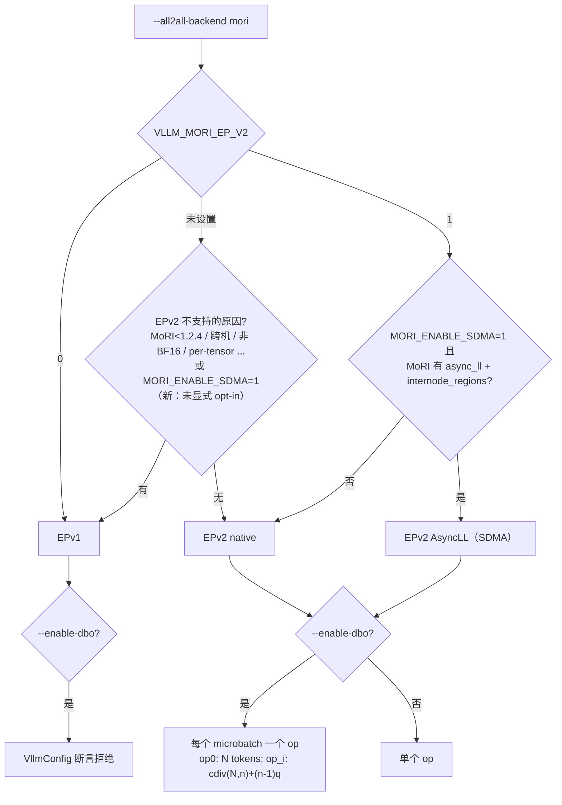
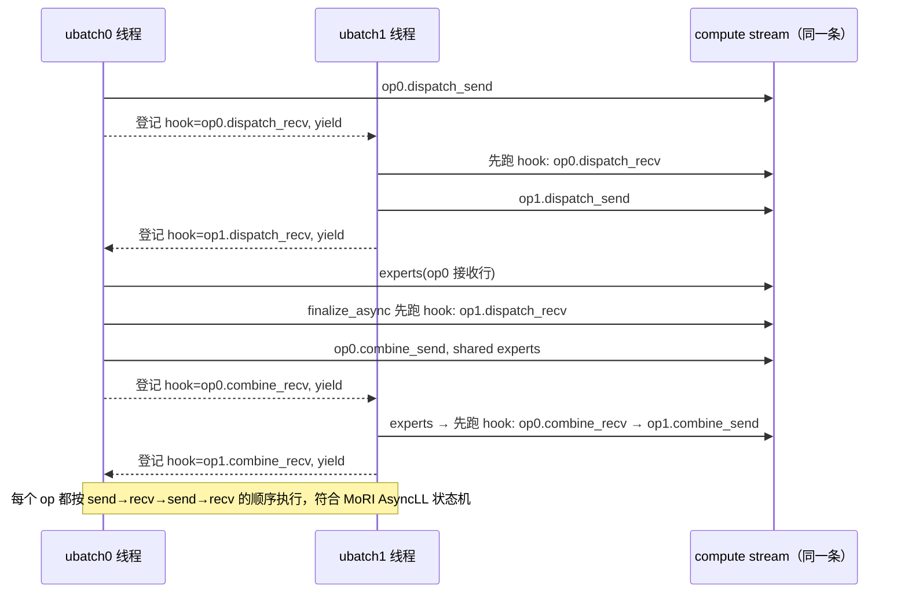
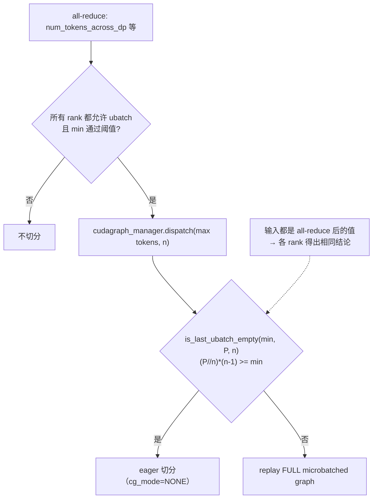

# PR #65128: [MORI][DBO] Dual batch overlap with MoRI EPv2 (native and AsyncLL), and DBO fixes

> **Author**: @ChengYM5685 | **State**: OPEN | **Date**: 2026-11-02
> **Branch**: `ChengYM5685:feat/mori-epv2-dbo` → `main` | **Labels**: documentation, rocm, ready, deepseek, nvidia, mrv2, DSv4
> **Changes**: +851 -110 lines across 22 files | **ROCm 相关性**: 部分相关（MoRI EPv2 prepare/finalize、`platforms/rocm.py`、DeepSeek-V4 ROCm 模型代码是 ROCm 专属；`vllm/v1/worker/` 下的 DBO 修复是 CUDA 和 ROCm 共用的）
> 本报告分两部分：§1–6 为 PR 详细总结，§7–8 为 ROCm review 意见。
>
> 说明：
> - 代码取自本地 ref `pr/65128`（head `73ff6d1659`，merge-base `0d9d953d68`，与 PR 的 base sha 一致）。当前 `upstream/main` 比它新 24 个 commit，其中改到同一批文件的是 `all2all.py`、`parallel.py`、`vllm.py`、`model_runner.py` 和文档，改动区域与本 PR 不重叠。
> - 抓取到的 JSON 里 `checks` 字段只有键名、没有内容，所以 **CI 状态未知**。评论区能看到作者多次 `/ci run`，并说 Main CI #100468 通过、CPU 镜像构建失败是网络问题，但没有看到 `/amd-ci run`。
> - 这是静态 review，没有运行 PR 代码。MoRI 符号对照了本机安装的 `amd_mori 1.2.3.post1`（没有 EPv2 AsyncLL），以及 ROCm/mori main 上的 `dispatch_combine_v2/dispatch_combine_op.py` 和 `internode_regions.py`。

---

## 1. 总结 (Summary)

本 PR 让 `--all2all-backend mori` 在跑 MoRI EPv2 时支持 `--enable-dbo`（dual batch overlap），并支持两种模式：
- **native EPv2**：dispatch/combine 放到 comm stream 上，和另一个 microbatch 的计算重叠；
- **AsyncLL**：在 gfx950 上同时设置 `MORI_ENABLE_SDMA=1` 和 `VLLM_MORI_EP_V2=1` 时启用，用 SDMA 搬运 token，dispatch/combine 拆成 send 和 recv 两半，复用 deepep_ll 的 recv-hook 交错机制。

为此，每个 microbatch 使用自己的 EPv2 op（op 0 保持原大小，同时服务不切分的 step；后面的 op 按一个 microbatch 最多能拿到的 token 数分配）。同时修了 DeepSeek-V4 在 ROCm DP8+EP8 下暴露的几个通用 DBO 问题：
- 某个 rank 的最后一个 microbatch 全是 DP padding 时，不再 replay FULL graph，改为 eager；
- profile run 之后，把所有 microbatch 的 workspace 都按 microbatch 0 的大小分配好；
- capture 之前，在模型持有的所有 side stream 上先建好 hipBLASLt handle；
- DSv4 的 sparse decode 和 MXFP4 indexer compressor 只处理真实 token。

作者给出的数据：DSv4-Pro prefill 提升 12–14%（native）和 22%（AsyncLL）；decode 拆分后变慢，所以建议只对 prefill 开 DBO。

## 2. 背景与动机 (Background & Motivation)

- main 上的 DBO 在 ROCm 只支持 deepep_ll/ht、nixl_ep 和 `allgather_reducescatter`。MoRI EPv2 是 ROCm 上默认的 EP all2all，此前不能和 DBO 一起用（`VllmConfig` 的断言会直接拒绝）。
- EPv2 的 op 内部持有接收/暂存 buffer，下一次调用会覆盖上一次的结果。两个 microbatch 交错执行时，不能共用一个 op。
- MoRI 新增了 EPv2 AsyncLL（ROCm/mori#768，2026-10-27 合入）和 per-op SDMA 队列（ROCm/mori#892，2026-11-05 合入），两者都包含在 v1.2.5 中。AsyncLL 把 dispatch/combine 拆成 send/recv，中间可以插入计算。
- 在 DSv4 上开 DBO 暴露了几个与 MoRI 无关的 DBO bug：
  1. V2 runner 的 pure-padding 判断（`2 * min < graph_tokens`）漏掉了「最小 rank 的 token 恰好填满前面 microbatch」这个边界，而且只适用于 2 个 microbatch；
  2. profile run 不切分 microbatch，所以只给 microbatch 0 分配了 workspace。microbatch 1 的 slot 在 forward 中途扩容，会在线程里触发 device sync，workspace 锁定后则直接失败；
  3. 在 capture 过程中创建 hipBLASLt handle 会报 HIP error 900。
- 关联 PR（由 @okorzh-amd 整理）：
  - #57020（`<` 改成 `<=`）被本 PR 覆盖；
  - #63823 是另一种方案（保留 FULL graph，把 padding microbatch 当作图内 padding replay）；
  - #64787 加了完全相同的 `dbo_comm_region`，后合入的一方要删掉自己那份；
  - #66733 / #66734 是 Quark MXFP4 走 EPv2 的前置依赖。

## 3. 代码修改分析 (Code Change Analysis)

### 3.1 修改的模块

| 模块 | 文件 | 改动 |
|------|------|------|
| MoRI EPv2 prepare/finalize | `fused_moe/prepare_finalize/mori_epv2.py` (+149/-26) | `mori_op` 改为 `mori_ops` 列表，按 `dbo_current_ubatch_id()` 选择 op。native 模式在 `dbo_comm_region()` 中执行 dispatch/combine；AsyncLL 模式实现 `prepare_async`/`finalize_async`（hook = `dispatch_recv`/`combine_recv`）。`supports_async()` 在 AsyncLL 时返回 True，`supports_dbo()` 在 op 数大于 1 时返回 True。routing 改为每个 microbatch 各存一份 |
| op 构造 | `fused_moe/all2all_utils.py` (+53/-2) | `_mori_ubatch_max_tokens()` 计算后续 op 的容量 `min(N, cdiv(N,n)+(n-1)q)`；`_make_mori_epv2_ops()` 按 `ubatch_id` 区分 handle cache key。AsyncLL 时传入 `async_ll=True, async_ll_transport="sdma", kernel_backend="hip"`，MoRI 支持时再加 `async_ll_own_sdma_queue=True` |
| MoRI 通信管理 | `distributed/device_communicators/all2all.py` (+15/-2) | AsyncLL 的 arena 大小改用 MoRI 的 `asyncll_regions()`；`_make_handle(ubatch_id=0, ...)`；在 `create_dev_comm` 之后、`close` 之前加 `comm.barrier()`（SDMA 队列句柄交换） |
| 配置 | `config/parallel.py` (+43/-13)、`config/vllm.py` (+2)、`platforms/rocm.py` (+1/-1) | 新增 `ParallelConfig.mori_epv2_async_ll` 字段；`sdma_picks_epv1` 改名为 `sdma_moves_tokens`。`MORI_ENABLE_SDMA=1` 单独设置时仍走 EPv1，加上 `VLLM_MORI_EP_V2=1` 且 MoRI 支持时走 AsyncLL。ROCm 上 `mori` 在 EPv2 下加入 DBO 允许列表 |
| 特性探测 | `utils/import_utils.py` (+29) | `mori_epv2_has_async_ll()` 和 `mori_epv2_has_own_sdma_queue()`，通过 dataclass 字段和模块是否存在来探测 |
| DBO 公共层（CUDA 共用） | `v1/worker/ubatching.py` (+20)、`prepare_finalize/naive_dp_ep.py` (+4/-32) | `_comm_region` 从 naive DP/EP 移到 `ubatching.dbo_comm_region`，两处共用，逻辑逐行一致 |
| DBO 公共层（CUDA 共用） | `v1/worker/gpu/dp_utils.py` (+12/-5) | pure-padding 判断改用 `is_last_ubatch_empty(min, graph_tokens, n)`，覆盖恰好填满的边界和 n>2 的情况 |
| DBO 公共层（CUDA 共用） | `v1/worker/workspace.py` (+29)、`v1/worker/gpu/model_runner.py` (+9/-1) | `WorkspaceManager.size_ubatches_alike()`：按 lane 把所有 microbatch 的 slot 扩到最大的那个；`profile_run` 在 `use_ubatching` 时调用 |
| DBO 公共层（CUDA 共用） | `v1/worker/ubatch_utils.py` (+36/-2)、`v1/worker/gpu/ubatch_utils.py` (+9/-9) | `find_model_streams()` 扫描各 module 属性里的 `torch.cuda.Stream`；`create_blas_handles()` 在每个 stream 上建 BLAS handle，ROCm 上额外跑一次 1x1 GEMM。capture 时覆盖 compute、comm 和模型的 side stream |
| DSv4 ROCm | `models/deepseek_v4/amd/rocm.py` (+9/-3) | decode 在 `num_decode_tokens == 0` 时跳过；MXFP4 compressor 的 launch 行数取 `min(state slot_mapping, k_cache slot_mapping)` |
| 文档 | `docs/design/dbo.md`、`docs/serving/expert_parallel_deployment.md` | DBO 支持的后端列表；SDMA/AsyncLL 的选择规则；建议只对 prefill 开 DBO |
| 测试 | `tests/kernels/moe/test_mori_epv2_prepare_finalize.py` (+311)、`tests/v1/worker/test_gpu_dp_utils.py` (+75)、`test_workspace.py` (+31) 等 | 用 FakeOp 测 op 尺寸（n=2/3，spec=0/1/3）、两个 microbatch 各用各的 op 交错执行、AsyncLL 在对方的间隙中 recv、SDMA 选择矩阵、eager 回退的三种情况、workspace slot 尺寸 |

### 3.2 架构 / 流程图

**MoRI 后端选择（gfx950）**



**AsyncLL 在 DBO 下的交错（2 个 microbatch，同一层 MoE）**



**DP 同步阶段的 pure-padding 回退（V2 runner）**



### 3.3 关键实现细节

- **op 尺寸上界**：`create_ubatch_slices` 的切分点是 `P // n`，uniform decode 且 q>1 时是 `q * (P // (q n))`。前 n-1 个 microbatch 各拿到一个切分点长度的 token，最后一个拿到剩余部分，少于 `P/n + (n-1)q`。
  - op 0 的容量就是 `max_num_batched_tokens`，所以只要 P ≤ `max_num_batched_tokens`，后续 op 不会溢出；万一溢出，MoRI 的 `dispatch` 会抛 `ValueError`。
  - q 取 `1 + num_speculative_tokens`。V2 runner 的 `uniform_token_count` 只在 decode-eligible 的 batch 上非空，不会超过 q。dummy batch 在 uniform 时请求数是偶数（R=256）或 q=1。我核对过，这个上界成立。
- **native 的流同步**：`dbo_comm_region` 先 `_signal_compute_done` 再 yield，切到 comm stream 后 `wait(compute_done)`；退出时 compute stream `wait(comm_done)`。这与 naive DP/EP 原有的 `_comm_region` 逐行一致，跨流的内存复用也由这次 wait 保证顺序。
- **AsyncLL**：`prepare_async` 返回 `(op.dispatch_recv, receiver)`。`finalize_async` 先调用 `dbo_maybe_run_recv_hook()`，这是因为 MK 只在 `prepare_async` 之前跑 hook，做法与 `deepep_ll.py:409` 相同。`supports_async()` 为 True 后，MK 会走 `MK_INTERNAL_OVERLAPPED` 的 shared experts 路径，即使不开 DBO 也一样。
- **AsyncLL 配置**：`kernel_backend="hip"`（只有 hip backend 有 AsyncLL）。arena 大小按 MoRI 的 `asyncll_regions(cfg)` 加上每个 region 256 B 的对齐。
- **配置**：新字段 `mori_epv2_async_ll` 没有加进 `compile_factors` 的忽略列表，会参与 hash。它由 env 和已安装的 MoRI 决定，在同一台机器上各 rank 一致（EPv2 本身要求单机）。
- **workspace**：`size_ubatches_alike()` 只扩大 scratch slot，不碰 persistent resources。persistent resources 仍然在第一次 microbatched capture 时创建，那时 workspace 还没锁。
- **MoRI 符号核对**：`dispatch_send/dispatch_recv/combine_send/combine_recv`、`async_ll`、`async_ll_transport`、`async_ll_own_sdma_queue`、`kernel_backend`、`internode_regions.asyncll_regions` 在 mori main 上都存在，签名与调用一致；`combine_in_view` 在已安装的 1.2.3.post1 中就有。没有发现不存在的符号。

## 4. 涉及的技术原理 (Technical Principles)

- **DBO（dual batch overlap）**：把一个 step 的 batch 切成 n 个 microbatch，每个 microbatch 由一个线程执行。各线程在 MoE 的 dispatch/combine 处通过 CPU event 交接控制权，让 A 的 all2all 和 B 的计算同时在 GPU 上运行。EP 场景下，所有 DP rank 必须用相同的 token 数和相同的切分点，否则 all2all 的集合通信对不上。
- **MoRI EPv2**：基于 CCO 对称内存窗口的 intranode dispatch/combine。每个 op 在 window 里分配一块 arena（接收、暂存、路由表），容量 = `world_size × max_num_inp_token_per_rank` 行，超出时在 host 端抛错。native kernel 一次 launch 内完成 send 和 recv。
- **AsyncLL**：MoRI 的另一类 kernel。send 和 recv 分开 launch，SDMA（copy engine）在两者之间搬数据，不占 CU，所以 send/recv 之间可以插入计算。每个 op 内部有 host 状态机，强制 `dispatch_send → dispatch_recv → combine_send → combine_recv` 的顺序，乱序会抛 RuntimeError。多个 op 共用一条 SDMA 队列时，后面 op 的 recv 会被前面 op 的 send 堵住（head-of-line blocking），#892 的 per-op 队列解决了这个问题。
- **CUDA/HIP graph 与 microbatch**：FULL graph 在 capture 时把各 microbatch 的形状固定下来。如果某个 rank 的最后一个 microbatch 全是 padding，与 capture 时的形状和元数据假设不符，所以只能 eager 运行。hipBLASLt 的 handle 和 workspace 按 (线程, stream) 惰性创建，在 capture 中首次创建会失败，必须提前预热。
- **Workspace 管理**：按 (ubatch, lane) 分 slot 的 scratch buffer。锁定之后不允许扩容，否则会释放 graph 引用的静态 buffer。

## 5. 评论区讨论亮点 (Discussion Highlights)

- **@okorzh-amd（inline，`parallel.py`）**：main 上 `MORI_ENABLE_SDMA=1` 总是选 EPv1，Quark MXFP4 MoE 模型就是在这个设置下运行的。按 PR 原来的改法，装了带 AsyncLL 的 MoRI（v1.2.5）后，同一条命令会走 EPv2 AsyncLL，然后在 `post_init_setup` 中因为 per-tensor 量化被拒，启动失败。作者接受了这个意见：改为只有 `MORI_ENABLE_SDMA=1` 时仍走 EPv1，必须显式设置 `VLLM_MORI_EP_V2=1` 才 opt-in AsyncLL。作者还在 8×MI355X 上用 MiniMax-M3.1-Flash-Quark-MXFP4 验证了改动前会失败、改动后走 EPv1。
- **@okorzh-amd（关联 PR 清单）**：
  - 与 #64787 是 add/add 冲突（同一个 `dbo_comm_region`）；
  - 与 #66733 在 `mori_epv2.py` 的 `prepare → _finish_dispatch` 拆分上冲突；
  - 与 #64668（MRV2 DBO 切分重构）以及 #63556/#63567/#64278 在 `sync_cudagraph_and_dp_padding` 上冲突。
  合入顺序需要协调。
- **作者关于 CI 的说明**：Main CI #100468 通过；CPU 镜像构建失败是因为从 GitHub Releases 下载 triton-cpu wheel 时出现 504，与本 PR 无关；docs 严格模式的告警在 main 上同样存在。
- 没有其他 maintainer 的实质 review。claude[bot] 因为是 fork PR 没有运行。

## 6. 风险与潜在问题 (Risk Analysis)

| 风险 | 严重程度 | 说明 |
|------|---------|------|
| 共享 DBO 代码（dp_utils / workspace / BLAS 预热）对 CUDA 的行为改变没有在 CUDA 上验证 | Medium | 见 §7 ⚠️【兼容性】 |
| 主路径（MoRI + DBO）CI 无法覆盖，端到端数据是在 merge 掉 V1 之前测的 | Medium | 见 §7 ⚠️【测试】 |
| 多个开放 PR 与本 PR 冲突（#64787、#66733、#64668 等） | Medium | 合入顺序决定谁来 rebase；两份 `dbo_comm_region` 都要保持语义一致 |
| AsyncLL + DBO 在缺少 #892 的 MoRI 上悄悄共用一条 SDMA 队列 | Low | 见 §7 📝【性能/文档】 |
| 每多一个 microbatch op，每卡多占约 1 GiB arena | Low | 见 §7 📝【性能】 |
| op 尺寸上界依赖 `create_ubatch_slices` 的切分规则 | Low | 两处代码没有互相引用，见 §7 📝【可维护性】 |
| 跨 rank 不一致导致 hang | Low | eager 回退由 all-reduce 后的值决定，op 创建顺序和调用顺序在各 rank 相同。没发现分歧点 |

---

## 7. Review 意见 (Findings)

| 类型 | 🔴 | ⚠️ | 📝 |
|------|----|----|----|
| 兼容性 | — | 1 | — |
| 测试 | — | 1 | — |
| 性能/文档 | — | — | 2 |
| 可维护性 | — | — | 1 |
| 正确性 | — | — | 1 |
| 注释/文档 | — | — | 1 |

先说结论：重点检查的几个方面都没有发现阻塞问题。

- **microbatch 尺寸**：后续 op 的容量上界与两种切分规则一致，溢出时 MoRI 会大声报错，不会静默越界。
- **跨 rank 一致性**：pure-padding 回退只依赖 all-reduce 后的值，各 rank 结论相同。
- **AsyncLL**：每个 op 的调用顺序符合 MoRI 状态机。
- **native 模式**：流同步与已有的 naive DP/EP 完全一致。
- **配置与平台**：`rocm.py` 的改动只是 kwarg 改名，`parallel.py` 的选择逻辑对 Quark 模型保持了 main 上的行为。

下面的意见集中在共享代码的 CUDA 验证、测试证据和若干可维护性问题。

---

**⚠️【兼容性】共享 DBO 代码的三处行为改变没有 ROCm 门控，CUDA 上的 DBO 也会受影响，但只在 MI355X 上验证过** `[已验证]`（改动不受平台门控已确认；CUDA 上的实际影响为 `[推测]`）
- **问题**：
  - `vllm/v1/worker/gpu/dp_utils.py:162-167`：pure-padding 判断从 `2*min < P` 改为 `is_last_ubatch_empty`。n=2 时多覆盖了 `min == P/2`（P 为偶数）这一种情况，这类 step 会从 FULL replay 改成 eager。
  - `vllm/v1/worker/gpu/model_runner.py:1100-1103`：只要 `use_ubatching`，profile run 后就会把所有 microbatch 的 slot 扩到与 microbatch 0 一样大。在 CUDA DeepEP DBO 上，这部分 workspace 改为在 KV cache 分配之前占用。
  - `vllm/v1/worker/gpu/ubatch_utils.py:518-544`：capture 时还会在模型持有的所有 side stream 上调用 `current_blas_handle()`，ROCm 上额外跑 1x1 GEMM。
- **影响**：三处都是修复方向，回退风险看起来很低。但 CUDA 用户会看到行为变化：在恰好填满边界的 decode step 上从 graph 变成 eager，KV cache 容量变小一个 workspace 的大小，capture 时多建几个 cuBLAS handle/workspace。作者的验证只覆盖了 MI355X 和 naive DP/EP。
- **行动**：建议作者补一次 CUDA 上 DeepEP LL/HT + DBO 的冒烟测试（例如 DeepSeek-V2-Lite DP2，在 profile 日志中对比 KV cache 容量），并请 MRV2 runner 的维护者（`dp_utils.py`/`ubatch_utils.py` 的主要作者 @njhill、@WoosukKwon，`workspace.py` 的 @LucasWilkinson）确认。

**⚠️【测试】主路径没有 CI 覆盖，端到端数据早于当前 head，CI 状态未知** `[已验证]`
- **问题**：
  - 作者承认 CI 跑不了 MoRI + DBO（需要 8×MI355X）。单测用 FakeOp 验证了 op 尺寸、交错顺序和选择矩阵，但真实 MoRI 的 arena、SDMA 和 graph capture 没有覆盖。
  - 描述中的性能表「是在 merge 之前在 V2 runner 上测的」，之后 merge 掉了 V1 的改动。所谓「在提交的代码上做的最终一次运行」是在哪个 commit 上做的不清楚，head 之后又 merge 了 main 10 次左右。
  - 本次抓取拿不到 checks 数据，评论区也只看到 `/ci run`，没有看到 `/amd-ci run` 的结果。
  - 表中数字（例如 AsyncLL prefill +21.7%）有复现命令，但没有日志可以追溯，暂记为 `[unverified]`。
- **影响**：DBO 的线程交接一旦出错（例如某个 microbatch 抛异常），兄弟线程会永久停在交接点，表现为 hang（`begin_capturable_run` 的注释承认了这一点）。这类问题只能靠真实硬件上的端到端运行发现。
- **行动**：建议作者在当前 head 上重跑一次 native 和 AsyncLL 的 DBO prefill/decode 以及 GSM8K，贴出日志摘要和 commit；同时触发 `/amd-ci run` 并贴出结果。

**📝【性能/文档】AsyncLL + DBO 在缺少 per-op SDMA 队列的 MoRI 上会静默共用队列；文档没有写出最低 MoRI 版本** `[已验证]`
- **问题**：
  - `all2all_utils.py:403-404` 只有在 `mori_epv2_has_own_sdma_queue()` 为真时才传 `async_ll_own_sdma_queue=True`，否则不打任何日志，继续运行。按 ROCm/mori#892 的描述，DBO 的两个 op 共用队列会造成 head-of-line blocking，DSv4-Pro EP8 prefill 每次 forward 大约多 100 ms。
  - 能触发的只是在 #768（10-27）和 #892（11-05）之间从源码构建的 MoRI，v1.2.5 两者都有。
  - 此外，`docker/Dockerfile.rocm_base` 仍然固定 `MORI_BRANCH="v1.2.3.post1"`，低于 EPv2 要求的 1.2.4。在官方镜像里照着新文档使用 `--enable-dbo --all2all-backend mori`，会被 `VllmConfig` 的断言以「mori is not supported」拒绝。这个 pin 不是本 PR 引入的。
- **行动**：建议作者在 DBO + AsyncLL 且没有 own queue 时打一条 `warning_once`，并在 `expert_parallel_deployment.md` 写明：DBO 需要 MoRI ≥ 1.2.4（native），AsyncLL 需要 ≥ 1.2.5。

**📝【性能】每个后续 microbatch 都有自己的 EPv2 op，带来约 1 GiB/卡的 arena；不开 UBatchRunner 时也会创建** `[已验证]`（大小是按 `_mori_epv2_arena_bytes` 公式估算的）
- **问题**：
  - 以 DSv4-Pro 为例（hidden 7168，BF16，EP8，`max_num_batched_tokens=8192`），后续 op 的容量是 8×4097 行，每行约 28.7 KB，arena 约 0.94 GB，向上取整到 1 GiB。
  - `_make_mori_epv2_ops` 用 `get_num_ubatches()` 决定创建几个 op。而 `maybe_build_ubatch_runner` 在 DP=1 且 schedule 为 `dispatch-combine-overlap` 时返回 None，这时多出来的 op 永远用不到。
- **行动**：建议作者在文档中写明 DBO 会多占这部分显存，并考虑在 runner 不会被构建时只创建一个 op。

**📝【可维护性】op 尺寸上界与切分规则分处两处，q 的来源也是自己重新推导的** `[已验证]`
- **问题**：`all2all_utils.py:194-208` 的 `_mori_ubatch_max_tokens` 用 `1 + num_speculative_tokens` 作为 q，正确性依赖 `gpu/ubatch_utils.create_ubatch_slices` 的切分规则（`P//n`，或 `q*(P//(qn))`）。
  - 配置层已经有 `VllmConfig.uniform_decode_query_len`，它的 docstring 专门说明了 DFlash 等情况下 query 长度与 draft 预留 slot 的区别，DBO 的阈值提升（`_raise_dbo_thresholds_for_spec_decode`）也用的是它。
  - 将来切分规则改动（例如 #64668 的 MRV2 DBO 切分重构）时，这里不会跟着改，只会在运行时由 MoRI 抛 ValueError。
- **行动**：建议作者改用 `uniform_decode_query_len`，并在 `create_ubatch_slices` 的 docstring 中引用这个上界（或者加一个断言：最后一个 slice 的 token 数 ≤ 后续 op 的容量）。

**📝【正确性】`find_model_streams` 只扫描 module 的直接属性和一层容器，可能漏掉 side stream** `[推测]`
- **问题**：`vllm/v1/worker/ubatch_utils.py:150-165` 只看 `vars(module)` 及其中的 dict/list/tuple。
  - 普通对象里持有的 stream 找不到，例如 `deepseek_v41/amd/mhc.py:38` 中 `MHCOverlapStream` 的 `.stream`。
  - 在 forward 中临时取的全局 stream 也找不到，例如 `inkling/amd/ops/qkvr_prep.py:870` 的 `kv_stream = aux_stream()`。
  - 由于 `aux_stream()` 是全局单例，只要有一个 module 把它存为属性（例如 `SharedExperts._stream`），就能间接覆盖到。但这是巧合，不是保证。
- **影响**：如果某个模型的 side stream 没被扫描到，它在 DBO capture 中仍会遇到 HIP error 900。
- **行动**：建议作者在 `find_model_streams` 中额外加入已初始化的全局 `aux_stream()`，或在 docstring 中说明覆盖范围。

**📝【注释/文档】PR 描述与最终 diff 不一致** `[已验证]`
- **问题**：
  - 描述中「9 个 commit，每个都可以单独 review」包括「Count microbatched CUDA graphs in the V1 memory profile」，但 V1 runner 已经被删除，这部分在最终 diff 中不存在。
  - 最终 diff 对 CUDA graph 的显存 profiling 没有任何改动。描述中提到 V2 对 microbatched graph 显存高估（20.7 GiB 对比实际 9.2 GiB），本 PR 也没有处理。
- **行动**：建议作者更新描述，去掉 V1 的部分，并为 V2 的显存高估开一个跟进 issue。

## 8. 结论 (Verdict)

⚠️ **NEEDS WORK**。

我检查过的 ROCm 路径都没有发现阻塞问题：
- microbatch op 的容量上界、跨 rank 一致的 eager 回退、AsyncLL 每个 op 的调用顺序、native 模式的流同步，都经过逐段追踪；
- `MORI_ENABLE_SDMA` 的默认行为保持与 main 一致。

合入前建议：
1. 在 CUDA 上用 DBO 冒烟测试一次本 PR 对共享 worker 代码的改动；
2. 在当前 head 上重跑端到端数据并给出 AMD CI 的结果。

📝 项可以在跟进 PR 中处理。

## 9. 英文 Review 评论 (Copy-Paste English Comments)

**C1** `vllm/v1/worker/gpu/dp_utils.py:162-167` — ⚠️ comment

```text
These shared DBO fixes are not ROCm-gated, so they also change CUDA DBO (DeepEP LL/HT, nixl_ep): with two microbatches, a step where the smallest rank exactly fills microbatch 0 (min == P/2) now runs eager instead of replaying the FULL graph, `profile_run` now reserves every microbatch's workspace before the KV cache is sized (model_runner.py:1100-1103), and capture now creates BLAS handles on every model side stream. All three look like the right fixes, but the validation in the description is MI355X-only. Could you add a CUDA DeepEP + DBO smoke run (e.g. DeepSeek-V2-Lite DP2, comparing KV cache size and decode throughput) and get a sign-off from the MRV2 runner owners?
```

**C2** `vllm/model_executor/layers/fused_moe/all2all_utils.py:194-208` — ⚠️ comment

```text
The later-op bound is correct for today's split rule (P // n, or q * (P // (q * n)) for uniform q-token decode), but it lives here while the rule lives in `gpu/ubatch_utils.create_ubatch_slices`, and q is re-derived from `num_speculative_tokens` instead of `VllmConfig.uniform_decode_query_len`, which DBO's own threshold check already uses and which documents the DFlash distinction. If the split changes (e.g. #64668), this only surfaces as a MoRI ValueError at runtime. Could you use `uniform_decode_query_len` here and cross-reference or assert the bound next to the split?
```

**C3** `vllm/model_executor/layers/fused_moe/all2all_utils.py:403-404` — ⚠️ comment

```text
When the installed MoRI has EPv2 AsyncLL (#768) but not `async_ll_own_sdma_queue` (#892), DBO silently runs both microbatch ops on one SDMA queue. Per ROCm/mori#892 that head-of-line blocking costs about 100 ms per forward on DeepSeek-V4-Pro EP8 prefill. Could you log a `warning_once` in that case, and state the minimum MoRI versions in expert_parallel_deployment.md (>= 1.2.4 for DBO on native EPv2, >= 1.2.5 for AsyncLL)? Note that `Dockerfile.rocm_base` still pins MoRI v1.2.3.post1, so `--enable-dbo --all2all-backend mori` is rejected in the official image.
```

**C4** `vllm/v1/worker/gpu/model_runner.py:1100-1103` — ⚠️ comment

```text
The PR's end-to-end numbers were measured before the merge that dropped the V1 changes, and the head has been re-merged with main several times since. Since CI cannot run MoRI + DBO, could you re-run native and AsyncLL DBO (prefill, decode and GSM8K) on the current head, post the commit and log summaries, and trigger `/amd-ci run`? The description also still lists the V1 "Count microbatched CUDA graphs" commit, which is no longer part of the diff.
```

## 10. 英文总结评论 (Overall Review Summary)

```text
Thanks for the careful root-cause work. Later EPv2 ops are sized with a bound that matches both split rules, MoRI fails loudly on overflow, the pure-padding eager fallback uses DP-synced values so ranks cannot diverge, and each AsyncLL op follows MoRI's send/recv order. Before merge, please smoke-test the shared worker changes (eager fallback, workspace sizing, side-stream BLAS warm-up) with CUDA DeepEP DBO, and re-run the end-to-end numbers on the current head with AMD CI results. Deriving q from uniform_decode_query_len and warning without per-op SDMA queues would help. Approve after those.
```
