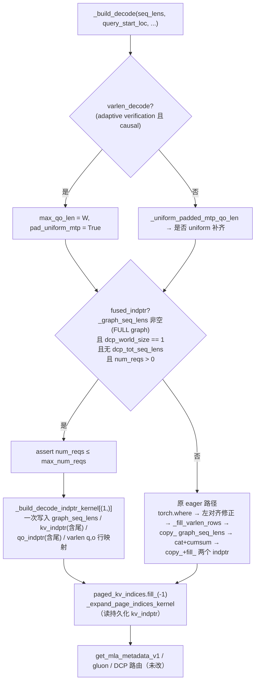

# PR #65132: [ROCm][Perf] Build AITER MLA full-graph decode metadata in one kernel

> **Author**: @zengleixin-amd | **State**: OPEN | **Date**: 2026-11-02
> **Branch**: `feature/leixin/aiter-mla-fused-decode-indptr` → `main` | **Labels**: rocm, ready
> **Changes**: +457 -11 lines across 3 files | **ROCm 相关性**: 完全相关（Tier-1：`mla/rocm_aiter_mla.py`）
> 本报告分两部分：§1–6 为 PR 详细总结，§7–8 为 ROCm review 意见。

---

## 1. 总结 (Summary)

在 FULL CUDA graph 模式下，`AiterMLAMetadataBuilder._build_decode` 每次 build 都要用 10–25 个零碎的 eager torch op 填充持久化 decode 元数据缓冲区，包括 `graph_seq_lens`、`paged_kv_indptr`、`qo_indptr`，以及 adaptive verification（varlen）下的 q/o 行映射。本 PR 新增一个单 program 的 Triton kernel `_build_decode_indptr_kernel`，在非 DCP 的 full-graph decode 路径上一次 launch 写完上述所有缓冲区（含尾部填充）。DCP 路径保持原 eager 实现不变。按作者在 MI355X + Kimi-K3 recipe 上的测量，每次 build 的 GPU 时间从 60→41 µs（uniform MTP）、135→48 µs（varlen），端到端 decode step 在低并发下快 0.2–0.56%。

## 2. 背景与动机 (Background & Motivation)

- Kimi-K3 官方 recipe：TP8、DSpark MTP 7 token、fp8 KV、`FULL_AND_PIECEWISE`，`--max-num-seqs 8`。在这种低并发、长 MTP 的场景下，每个 decode step 本身只有十几到二十几毫秒，metadata build 的 host 时间（211–342 µs p50）和十几个小 kernel 已经成为可见开销。
- adaptive verification 打开时，varlen 行映射（`_fill_varlen_rows`：index_select、where、zero_、scatter_）让 eager op 数翻倍，这是收益最大的一侧（GPU 时间 -64%，host 时间 -52%）。
- 作者说明与同 backend 上的 #65022（拆分 metadata 生命周期）和 #64560（decode q absorb/quant 融合）没有重叠。#64560 已于 2026-11-12 合入 main。
- PR 描述末尾声明使用了 Claude Code 辅助实现与验证。

## 3. 代码修改分析 (Code Change Analysis)

### 3.1 修改的模块

| 文件 | 改动 | 说明 |
|------|------|------|
| `vllm/v1/attention/backends/mla/rocm_aiter_mla.py` | +143 -11 | 新增 `_build_decode_indptr_kernel`；`__init__` 预计算 `_decode_indptr_block`；`_build_decode` 新增 `fused_indptr` 分支，绕过原 torch.where / cumsum / cat / copy_ / fill_ / `_fill_varlen_rows` |
| `tests/v1/attention/test_rocm_aiter_mla_mtp_split.py` | +185 | ROCm-only builder 级测试：对同一输入分别走 fused 和 eager，逐字段比较 metadata 与持久化缓冲区（含尾部）；覆盖 DCP 不走 fused、超大 batch 被 assert 拒绝 |
| `tests/v1/attention/test_aiter_mla_decode_indptr_kernel.py` | +129（新文件） | 平台无关的 kernel 级测试：kernel 直接对比一份 eager 参考实现，NVIDIA 必跑的 V1 Attention step 也会收集到 |

### 3.2 架构 / 流程图



```mermaid
graph LR
    subgraph 单 program（BLOCK = next_pow2(max_num_reqs+1)）
        S["seq_lens[offs]"] --> P{"PAD?"}
        P -->|"PAD & !VARLEN"| P1["q_len==0 → seq = pad（dummy 行）"]
        P -->|"VARLEN"| P2["seq += pad - q_len（左对齐）"]
        P1 --> CS["tl.cumsum → kv_indptr[1:buf_len]"]
        P2 --> CS
        S --> CS
        Q["query_start_loc"] --> QO["qo_indptr：PAD 时 min(offs,n)*pad，否则 q_start/q_last"]
        Q --> VR["VARLEN：q_rows[slot]=packed / o_rows[packed]=slot<br/>[total, len-1) 清零，dump 位不写"]
    end
```

### 3.3 关键实现细节

- **门控**（`rocm_aiter_mla.py:1617`）：`_graph_seq_lens is not None`（即 `has_full_cudagraphs()`），`dcp_world_size == 1`，`g_tot_seq_lens is None`，`num_kernel_reqs > 0`。fused 分支内用 assert 拒绝 `num_reqs > max_num_reqs`，这是回应 reviewer 的修改，原 eager 路径的 `copy_` 在这种情况下同样会报错。
- **单 program 设计**：`BLOCK = next_power_of_2(max_num_reqs + 1)`，所以 kernel 开销随 `max_num_seqs` 而不是随实际 batch 增长。作者给了 8→1024 的扫描：uniform 2.0–2.8 µs，varlen 2.0–8.5 µs，都比 eager 低 8–30 倍。
- **`do_not_specialize=["num_reqs"]`**：避免 serving 时不同 batch size 触发 Triton JIT 重编译。
- **kv_indptr 尾部**：lane ≥ num_reqs 的 `seq` 为 0，所以 cumsum 在尾部自然等于最后一个有效值，与原 `fill_(paged_kv_indptr[-1])` 等价。
- **qo_indptr**：PAD 时为 `min(offs, n) * pad`，等价于 `qo_indptr_for_uniform_qlen` 加尾部填充；非 PAD 时为 `query_start_loc[:n+1]`，尾部填 `query_start_loc[n]`。
- **varlen 行映射**：`q_rows[req*W+pos] = q_start+pos`（padding 位为 0）；`o_rows[packed] = slot`；`[total, len-1)` 用 tile 循环清零。原实现是先整体 `zero_()` 再 `scatter_`，padding slot 散射到 dump 位（最后一个元素）。fused 版不写 dump 位，这是两者唯一的差异。
- **varlen 左对齐**：fused 分支 assert `varlen_left_align`，无 DCP 时 `_varlen_right_align` 恒为 `dcp_world_size > 1 = False`，因此成立。
- **`_expand_page_indices_kernel`**：现在读持久化 `self.paged_kv_indptr` 的切片，而不是临时 tensor，数值相同；两者在同一 stream 上先写后读。

## 4. 涉及的技术原理 (Technical Principles)

**FULL CUDA graph 与持久化 metadata**：FULL 模式把 attention 也捕获进 graph，replay 时 kernel 读取的是捕获时的固定地址，所以 builder 必须把每步的 seq_lens / indptr 写进地址稳定的持久化 buffer。replay 的 batch 可能小于捕获的 batch，因此 indptr 尾部必须"展平"成最后一个有效值，让 padding 请求的 KV 长度为 0。

**AITER MLA decode 的 flat page 视图**：aiter MLA kernel 内部总是 page_size=1，KV cache 被 `.view(-1,1,1,H)` 展平，`paged_kv_indptr` 就是每请求 KV token 数的前缀和，`paged_kv_indices` 由 `_expand_page_indices_kernel` 把 block table 展开为逐 token 索引。

**uniform MTP 补齐与 dummy 行**：spec decode 下每请求有 1+k 个 query token。full graph 要求 query 结构统一，`_uniform_padded_mtp_qo_len` 判定后把 query 长度为 0 的请求当作 dummy 行，KV 长度设为 `max_qo_len`，避免 causal mask 退化。

**adaptive verification（varlen）**：每请求的验证 token 数可以不同。q 按 `[req, pos]` 布局 gather 到固定宽度 W，输出再用 `o_rows` 映射回 packed 顺序。左对齐时把 KV 长度加上 `W - q_len`，让 causal 窗口对齐，`_expand_page_indices_kernel` 的 `CLAMP_TAIL` 再把多出来的 page 指回首页。

**单 program Triton kernel**：metadata 规模（≤ 数千元素）远小于一个 CU 的处理能力，单 program + `tl.cumsum` 避免了多 kernel 之间的 HBM 往返与 launch 开销。代价是开销按 buffer 大小而不是 live batch 计算。

## 5. 评论区讨论亮点 (Discussion Highlights)

- **@frida-andersson**：kernel 按 `max_num_seqs` 定规模，batch 1 也付全量开销，要求给 512/1024 的数据。作者补了 8→1024 的扫描，最坏 8.5 µs，仍比 eager 便宜 8–30 倍，保留单 program 设计。此外：
  - 质疑测试里保留一份 eager 拷贝的必要性。作者删掉那份测试，改为扩展 builder 测试。
  - 建议用 assert 替代"超大 batch 回退到 eager 再让 copy_ 报错"。已改。
  - 要求高并发 A/B。作者补了 c16/32/64，结果在噪声内。
- **@simondanielsson**：建议覆盖 MTP 宽度 1/3/7，并做 NIAH、GPQA 精度对比。作者补齐了宽度 1/3/4/7。NIAH 32k/64k/128k 两侧均为 100%。GPQA 两轮结果为 91.9/86.9 和 90.4/90.9。
- **@apex-mochen**：GPQA run1 差 5 个点（McNemar p=0.013），认为不能宣称 "no regression"。作者做了三件事：
  - 改写描述，给出 pooled -2.3 点及 bootstrap 区间 [-5.1, +0.3]。
  - 证明 main 自身不可复现：两轮 0/198 响应一致；固定 seed、温度 0、关闭 prefix cache 后仍为 0/10。
  - 以 shadow check（每次 fused build 后重算 eager 参考并逐字段比较，共 1,394,688 + 331,776 + 49,152 次，0 mismatch）作为等价性的主证据。

  reviewer 接受，撤回第三轮 GPQA 的要求。
- **@okorzh-amd**：指出 builder 测试模块在非 ROCm 上整体 skip，NVIDIA 必跑 step 全部跳过，AMD step 又是可选的。作者新增平台无关的 kernel 测试 `test_aiter_mla_decode_indptr_kernel.py`。之后 approve。

## 6. 风险与潜在问题 (Risk Analysis)

| 风险 | 严重程度 | 说明 |
|------|---------|------|
| 正确性：fused 与 eager 输出不一致 | 低 | 逐分支静态对照均等价（见 §7 的分析）；builder 测试和 kernel 测试都覆盖 tails 与 stale 缓冲；serving shadow check 0 mismatch |
| 正确性：varlen dump 位不再写入 | 低 | 消费方只读 `varlen_o_rows[:num_tokens]`（`rocm_aiter_mla.py` forward 的 index_select），dump 位从不被读 |
| 兼容性：rebase 后与 main 新代码的交互 | 低 | 见"验证基线早于 main 对同文件的大量改动" |
| 性能：大 `max_num_seqs` 下单 program 开销 | 低 | 见"单 program 开销随 `max_num_seqs` 线性增长，>1024 未测" |
| 测试覆盖：builder 测试把 page-index 展开 mock 掉了 | 低 | 见"builder 测试未覆盖 `_expand_page_indices_kernel` 改读持久化 indptr" |
| 可维护性：kernel 隐含 `VARLEN ⇒ PAD` 前提 | 低 | 见对应 📝 |
| CI | 未知 | API 限流，check-runs 未取到；`mergeable_state=unstable` |

---

## 7. Review 意见 (Findings)

| 意见类型 | 🔴 | ⚠️ | 📝 |
|---------|----|----|----|
| 兼容性 | 0 | 0 | 1 |
| 性能 | 0 | 0 | 1 |
| 测试 | 0 | 0 | 1 |
| 可维护性 | 0 | 0 | 1 |

**静态等价性核对（结论：全部等价）** `[已验证]`

逐项把 PR head 的 `_build_decode` 与 kernel 和合入前的 eager 路径对照：

| 输出 | eager 路径 | fused kernel | 结论 |
|------|-----------|--------------|------|
| `graph_seq_lens[:n]`（PAD、非 VARLEN） | `where(qo_len>0, seq, max_qo_len)` | `where(q_len>0, seq, pad_qo_len)` | 一致 |
| `graph_seq_lens[:n]`（VARLEN） | 先 where，再被左对齐整体覆盖为 `seq + (W - q_len)` | `seq + (pad - q_len)`，q_len=0 时为 `seq + W` | 一致 |
| `graph_seq_lens[n:]` | 不写（保留旧值） | `mask=req_mask` 不写 | 一致 |
| `paged_kv_indptr` | `cat([0], cumsum)` → copy_ → 尾部 `fill_(last)` | lane ≥ n 的 seq 为 0，cumsum 自然得到尾部值，写满 `[0, buf_len)` | 一致 |
| `qo_indptr`（PAD） | `arange(n+1)*qlen` + 尾部 `n*qlen` | `min(offs, n) * pad` | 一致 |
| `qo_indptr`（非 PAD） | `query_start_loc[:n+1]` + 尾部 `q[n]` | `where(offs ≤ n, q_start, q_last)` | 一致 |
| `varlen_q_rows[:n*W]` | `where(is_real, start+pos, 0)` | 同式，左对齐 | 一致 |
| `varlen_o_rows[:-1]` | `zero_()` 后 scatter | `[0,total)` 写 slot，`[total,len-1)` 清零 | 一致 |
| `varlen_o_rows[-1]`（dump 位） | 被 padding slot 以不确定顺序写入 | 不写 | 不同，但从不被读 |

边界情况核对：

- **num_reqs = 0**：门控排除，仍走 eager。
- **num_reqs > max_num_reqs**：assert，与原 `copy_` 形状不匹配时的报错行为一致。
- **BLOCK 覆盖**：`BLOCK ≥ max_num_reqs + 1 = buf_len`，所以 `kv_indptr[offs+1]` 能写到 `buf_len - 1`。
- **越界读**：`query_start_loc` 的读取最大下标为 `num_reqs`，不越界。
- **int32**：kv 前缀和溢出条件与原 `cumsum(dtype=int32)` 相同，没有引入新风险。行映射的 slot 和 packed 下标都提升到 int64。
- **同 program 内写冲突**：`o_rows` 的 packed 写入区间为 `[0, total)`，清零区间为 `[total, …)`，不重叠；`kv_indptr[0]` 与 `kv_indptr[1:]` 的写入也不重叠。
- **新增 host 同步**：没有。`num_reqs`、`max_qo_len` 都来自 CPU 侧的 `query_start_loc_cpu`。
- **CUDA graph 捕获**：builder 在 graph 外运行，新增的 launch 不进入捕获区域。

---

**📝【兼容性】验证基线早于 main 对同一 Tier-1 文件的大量改动** `[已验证]`
- **问题**：PR 描述写道"`rocm_aiter_mla.py` 和 `test_rocm_aiter_mla_mtp_split.py` 在 main 上自验证以来未变"，这句话已经过时。PR 的 merge-base 是 `4ab4404e24`，此后 main 对 `rocm_aiter_mla.py` 改了约 670 行。其中进入 `_build_decode` 的改动有：
  - #54899：decode head 数补齐到 native tile，2026-11-12 合入。
  - #64560：decode q absorb/quant 融合。
  - gfx942 的折叠 Triton verify（`use_triton_verify`）：会跳过 `paged_kv_indices` 的展开，但仍消费 `seq_lens`、`qo_indptr` 和 `kv_indptr`。

  我用 `git merge-tree` 做了合并检查，两个文件都能无冲突合并。这些新逻辑都只读本 PR 生成的 metadata，而本 PR 保证数值逐 bit 相同，所以静态上看不出交互问题。
- **影响**：作者的 989 passed、shadow check 和 E2E 数据都是在旧基线、MI355X（gfx950）上得到的。gfx942 的 Triton verify 路径从未和 fused build 一起跑过。
- **行动**：建议作者 rebase 到当前 main，在 MI355X 上重跑 `test_rocm_aiter_mla_mtp_split.py` 和 `test_aiter_mla_decode_indptr_kernel.py`，有条件的话在 MI300X（gfx942）上至少跑一次 builder 测试，并更新描述里"unchanged on main"这句话。

**📝【测试】builder 测试未覆盖 `_expand_page_indices_kernel` 改读持久化 indptr** `[已验证]`
- **问题**：`full_graph_decode_mocks` 在 `test_rocm_aiter_mla_mtp_split.py:1337` 把 `_expand_page_indices_kernel` 替换为 no-op。因此"展开 kernel 现在读 `self.paged_kv_indptr` 而不是临时 tensor"这一改动在单测中没有被执行，fused 和 eager 两侧的 `paged_kv_indices` 都没有被比较。
- **影响**：目前数值相同，同一 stream 上也是先写后读，不构成 bug。但以后如果有人调整写入顺序（例如把 fused launch 挪到 expand 之后），单测不会报警。serving shadow check 覆盖了 page-index 尾部为 -1，但它不在仓库测试里。
- **行动**：建议作者在 builder 测试里至少保留一个不 mock 展开 kernel 的用例（它本身就是纯 Triton），并比较两侧的 `paged_kv_indices`。

**📝【性能】单 program 开销随 `max_num_seqs` 线性增长，>1024 未测** `[已验证]`
- **问题**：`BLOCK = next_power_of_2(max_num_reqs + 1)`（`rocm_aiter_mla.py:1154`）。VARLEN 分支建立 `BLOCK × ROW_P2` 的 int64 二维 tile，在 `max_num_seqs=1024`、W=8 时是 2048×8。作者只测到 1024，此时最坏 8.5 µs，vs eager 78 µs。
- **影响**：`max_num_seqs` 为 2048 或 4096 的部署，单 program 的寄存器压力和串行 cumsum 会继续增长。按趋势外推大概率仍优于 eager，但这是 `[推测]`，没有数据。
- **行动**：建议作者在描述或代码注释里写明已测范围（≤1024），或者补一个 2048 的数据点。

**📝【可维护性】kernel 隐含 `VARLEN ⇒ PAD` 前提** `[已验证]`
- **问题**：`q_len` 只在 `if PAD:` 分支里定义（`rocm_aiter_mla.py:2201`），而 `if VARLEN:`（2221 行）直接使用它。目前调用方在 varlen 时总是设置 `pad_uniform_mtp=True`，所以成立。
- **影响**：如果以后单独以 `VARLEN=True, PAD=False` 调用，会得到 Triton 编译期错误，而不是静默错误，危害有限。
- **行动**：建议作者在 kernel 开头加 `tl.static_assert(PAD or not VARLEN)`，或者在 docstring 里写明这一前提。

> CI 说明：GitHub API 限流，check-runs 未取到，只知道 `mergeable_state=unstable`，无法判断红叉归属。builder 级测试只在 ROCm（可选 AMD step）上运行，NVIDIA 必跑 step 只覆盖 kernel 级测试。建议合入前确认 AMD V1 Attention step 在当前 head 上通过。

## 8. 结论 (Verdict)

✅ **LGTM**

逐分支静态核对确认 fused kernel 的输出与 eager 路径逐 bit 等价，唯一差异是从不被读取的 varlen dump 位。DCP 和超大 batch 都有明确的边界处理，测试和 serving shadow check 的证据充分。剩余 4 条都是非阻塞备注，最值得做的是 rebase 到当前 main 后在 ROCm 上重跑相关测试。

## 9. 英文 Review 评论 (Copy-Paste English Comments)

**C1** `vllm/v1/attention/backends/mla/rocm_aiter_mla.py:1617-1623` — 📝 comment

```text
I walked the fused branch against the eager path case by case (dummy rows, left-aligned varlen, both indptr tails, stale graph_seq_lens tail, o_rows zero range) and they match bit for bit; the only difference is the never-read dump slot. One thing to refresh: the description says rocm_aiter_mla.py is unchanged on main since validation, but main has since landed ~670 lines in this file (#54899, #64560, and the gfx942 Triton verify that also consumes seq_lens/qo_indptr/kv_indptr). It merges cleanly and I see no interaction, but could you rebase and re-run test_rocm_aiter_mla_mtp_split.py and the new kernel test on ROCm (ideally once on MI300X too), and update that sentence?
```

**C2** `tests/v1/attention/test_rocm_aiter_mla_mtp_split.py:1336-1338` — 📝 comment

```text
The fixture replaces _expand_page_indices_kernel with a no-op, so the change that makes it read the persistent paged_kv_indptr (instead of the temporary) is never executed by the new builder test, and paged_kv_indices is not compared between the fused and eager builds. Since the expand kernel is plain Triton, consider keeping at least one case that runs it for real and asserts the two paged_kv_indices buffers are equal, so a future reordering of the fused launch relative to the expand is caught.
```

**C3** `vllm/v1/attention/backends/mla/rocm_aiter_mla.py:2221` — 📝 comment

```text
Nit: the VARLEN block uses q_len, which is only defined under `if PAD:`. The caller always sets PAD when VARLEN, so this is fine today, but a `tl.static_assert(PAD or not VARLEN)` (or a docstring line) would make the precondition explicit for future callers.
```

## 10. 英文总结评论 (Overall Review Summary)

```text
Nice, well-evidenced change. I checked the fused kernel against the eager build branch by branch: kernel lengths for dummy and left-aligned varlen rows, both indptr tails, the untouched graph_seq_lens tail and the varlen row maps all match bit for bit; the only difference is the dump slot that nothing reads, and DCP stays on the eager path. Minor asks: rebase onto current main, since rocm_aiter_mla.py changed substantially, and re-run the ROCm builder tests; consider letting one builder case run the real page-index expansion. Approve.
```
