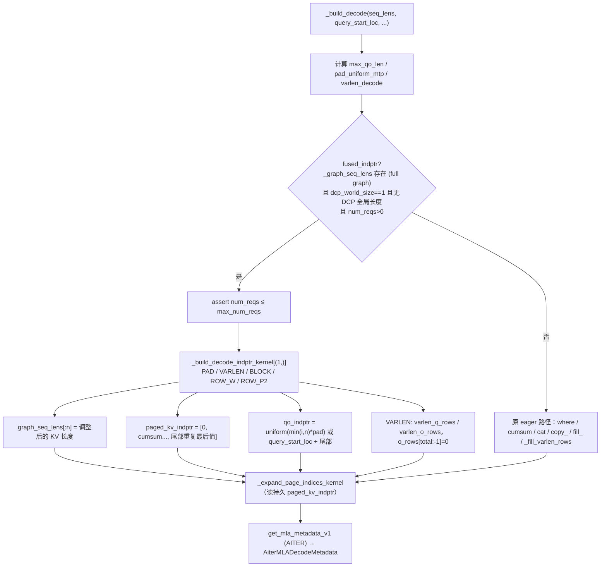
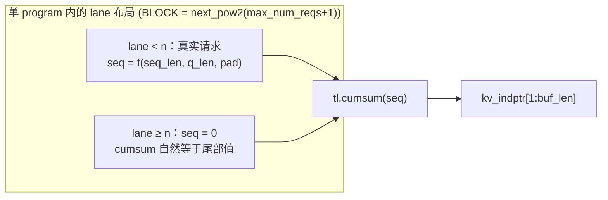

# PR #65132: [ROCm][Perf] Build AITER MLA full-graph decode metadata in one kernel

> **Author**: @zengleixin-amd | **State**: OPEN | **Date**: 2026-11-02
> **Branch**: `feature/leixin/aiter-mla-fused-decode-indptr` → `main` | **Labels**: rocm
> **Changes**: +320 -11 lines across 2 files | **ROCm 相关性**: 完全相关（Tier-1：`vllm/v1/attention/backends/mla/rocm_aiter_mla.py`）
> 本报告分两部分：§1–6 为 PR 详细总结，§7–8 为 ROCm review 意见。

---

## 1. 总结 (Summary)

在 full CUDA graph 模式下，`AiterMLAMetadataBuilder._build_decode` 每次 decode 都要用 10-25 个小的 eager torch op 去填持久化元数据缓冲：`_graph_seq_lens`、`paged_kv_indptr`、`qo_indptr`；开启 adaptive verification（varlen）时还要填 q/o 行映射 `varlen_q_rows` / `varlen_o_rows`。本 PR 新增单 program 的 Triton kernel `_build_decode_indptr_kernel`，在**非 DCP** 的 full-graph decode 路径上一次 launch 写完上述全部缓冲（含尾部填充）；DCP 路径保持原 eager 实现不变。PR 报告：Kimi-K3（TP8、DSpark 7 token）每次构建的 kernel 数从 11 降到 4（varlen 从 24.5 降到 4.7），GPU 时间降 33% / 64%，低并发 decode step 快 0.2-0.56%。

## 2. 背景与动机 (Background & Motivation)

- full CUDA graph 回放读的是固定地址的持久缓冲，所以每一步 decode 的元数据构建都必须把本步的值写进这些缓冲，并把超出 live batch 的尾部填成"最后一个有效值"，否则回放时 padding 行会读到上一步残留的数据。
- 原实现由一串 eager op 组成：`torch.where` 处理 dummy 行、`cumsum` + `cat` 得到 indptr、`copy_` + `fill_` 写尾部、`index_select` / `scatter_` 生成 varlen 行映射。这些 op 在 host 侧约 211-342 µs、GPU 侧 60-135 µs。在低并发、尤其是 MTP / adaptive verification 场景下，这部分开销占 decode step 的比例不可忽略。
- 作者说明没有其他 open PR 覆盖这部分：#65022 改的是元数据生命周期，#64560 做的是 decode q absorb/quant 融合，#61504 / #58352 针对 sparse MLA。
- 剩余最大的单项开销是 AITER 自己的 `get_mla_metadata_v1`（约 28 µs），本 PR 不涉及。

## 3. 代码修改分析 (Code Change Analysis)

### 3.1 修改的模块

| 模块 | 改动 |
|------|------|
| `vllm/v1/attention/backends/mla/rocm_aiter_mla.py` (+~140 -11) | `__init__` 预计算 `_decode_indptr_block = next_pow2(max_num_reqs+1)`；`_build_decode` 新增 `fused_indptr` 分支，并对 eager 段落加 `not fused_indptr` 守卫；新增 `@triton.jit(do_not_specialize=["num_reqs"]) _build_decode_indptr_kernel` |
| `tests/v1/attention/test_rocm_aiter_mla_mtp_split.py` (+176) | 用真实 `_build_decode` 对比 fused 与 eager 两个 builder 的元数据和持久缓冲（含尾部）：uniform / mixed / varlen，buffer 为 8/64/1024 个请求，batch 取 1、一半、满；断言 DCP 不 launch fused kernel、超大 batch 被 assert 拒绝 |

### 3.2 架构 / 流程图





### 3.3 关键实现细节

- **门控**：只依赖 `_graph_seq_lens is not None`（仅在 `has_full_cudagraphs()` 时分配）、`dcp_world_size == 1`、`g_tot_seq_lens is None`、`num_kernel_reqs > 0`。其余情况（DCP、非 full graph、空 batch）原样走 eager 路径。
- **KV 长度语义**（与 eager 一致）：非 PAD 时 `seq = seq_lens`；PAD 时 dummy 行（`q_len == 0`）的长度取 `pad_qo_len`；VARLEN 时 `seq = seq_lens + (pad_qo_len - q_len)`，对应左对齐。超出 live batch 的 lane 置 0，因此 cumsum 在尾部自然等于 total，`kv_indptr` 尾部"重复最后值"不需要额外 fill。
- **qo_indptr**：PAD 时为 `min(i, n) * pad_qo_len`，等价于 `qo_indptr_for_uniform_qlen` 加尾部填充；非 PAD 时为 `query_start_loc[:n+1]`，尾部填 `query_start_loc[n]`。
- **varlen 行映射**：用 `[BLOCK, ROW_P2]` 2-D tile 写 `varlen_q_rows[slot]`（padding slot 为 0）；把 `slot` scatter 到 `varlen_o_rows[packed]`；用循环把 `[total, len-1)` 清零。最后一个 dump slot 不写，原实现会往里 scatter 任意值，消费方 `forward_mqa` 只读 `varlen_o_rows[:num_tokens]`，不会读到它。
- 用 `assert varlen_left_align` 固化"fused 只在左对齐时运行"：`_varlen_right_align ≡ dcp_world_size > 1`，而 fused 分支已排除 DCP，这个 assert 恒成立。
- `num_reqs` 用 `do_not_specialize`，避免 batch 大小变化触发 Triton 重新特化。
- `_expand_page_indices_kernel` 改为读持久缓冲 `paged_kv_indptr`，其值与原临时 tensor 相同，并且在同一 stream 上排在 fused kernel 之后。
- 超大 batch 的 assert：原实现中 `_graph_seq_lens[:n].copy_()` 在 n 超界时同样会报 size mismatch，行为一致。

## 4. 涉及的技术原理 (Technical Principles)

- **Full CUDA graph 与持久元数据**：graph 回放时 kernel 参数（指针）是固定的，只能通过改写固定地址缓冲的内容来传递每步变化的元数据。回放规模取 capture size，大于真实 batch，所以 padding 行（尾部）必须是"无害"的值：indptr 尾部重复最后值，使 padding 行长度为 0。
- **AITER MLA 的扁平 page 视图**：AITER MLA decode kernel 以 page_size=1 处理 KV（每个 token 一个 page），`paged_kv_indptr` 就是每个请求 KV 长度的前缀和，`paged_kv_indices` 由 block table 展开得到。
- **Uniform MTP padding 与 adaptive verification（varlen）**：spec decode 时每个请求的 query 长度为 1+k。uniform 模式下把 batch 补齐为统一 qlen，dummy 行给一个 `pad_qo_len` 长度的假 KV。adaptive verification 允许每个请求的验证长度不同：q 行按 `req * W + pos` 的固定 slot 排布交给 kernel，结果再通过 `varlen_o_rows` 映射回紧凑的 token 顺序。左对齐时 KV 长度要补上 `W - q_len`，使 causal 窗口落在正确位置。
- **单 program Triton kernel**：整批元数据都放在一个 program 的寄存器 tile 里完成（`tl.cumsum` 做前缀和）。launch 开销是常数，计算量随 `max_num_seqs` 增长而非随 live batch 增长；对小 batch 而言，用一次 launch 换掉十几次 launch 收益明显。

## 5. 评论区讨论亮点 (Discussion Highlights)

- **@frida-andersson**（`rocm_aiter_mla.py`）：kernel 按 `max_num_seqs` 的满容量运行，小 batch 也要付全量代价，要求给出 512 / 1024 的数据。作者在描述中补了 `max_num_seqs` 8-1024 × batch 1 / 半 / 满的 microbenchmark：uniform 2.0-2.8 µs，varlen 2.0-8.5 µs，均为 eager 的 1/8 到 1/30。
- **@frida-andersson**：建议把超大 batch 的回退逻辑改为显式 assert。当前 head 已改为 assert（"exceed the N-request graph buffers"），并有对应测试。
- **@frida-andersson**（测试文件）：新测试与 `test_rocm_aiter_mla_mtp_split.py` 已有的 eager 路径测试重复，建议合并并扩大 batch 覆盖。当前 head 已把用例并入该文件，并加入 64 / 1024 请求的 large-batch cases。
- 代码 owner（tjtanaa、AndreasKaratzas）尚未 review；CI 状态未抓取，视为未知。PR 描述声明使用了 AI 辅助（Claude Code）。

## 6. 风险与潜在问题 (Risk Analysis)

| 风险 | 严重程度 | 说明 |
|------|---------|------|
| 元数据与 eager 不一致导致静默错误注意力 | Low | 本次 review 逐分支核对语义，并用 CPU 等价仿真（735 例，含非 2 幂 qlen）验证无差异；见 §7 📝【测试】 |
| 运行中首次遇到新 constexpr 变体时 JIT 编译 | Low | 见 §7 📝【性能】 |
| 单 program 在超大 `max_num_seqs` 下的伸缩性 | Low | 实测只到 1024；见 §7 📝【性能】 |
| 两份实现（fused / DCP eager）语义需同步维护 | Low | 见 §7 📝【可维护性】 |
| 端到端收益小、部分不显著 | Low | 见 §7 📝【性能】数字溯源 |
| AMD CI 覆盖 | Low | MI300 attention step 为 optional；见 §7 📝【测试】 |

---

## 7. Review 意见 (Findings)

| 类型 | 🔴 | ⚠️ | 📝 |
|------|----|----|----|
| 测试 | — | — | 2 |
| 性能 | — | — | 3 |
| 可维护性 | — | — | 1 |

本次 review 的核对过程：逐分支比对 `_build_decode` 新旧路径（PAD / VARLEN / 普通，以及尾部、dummy 行、dump slot），确认持久缓冲尺寸 `paged_kv_indptr` / `qo_indptr` = `max_num_reqs+1` ≤ `BLOCK`，因此尾部全部被覆盖，`varlen_o_rows` = `max_num_seqs*W+1`。此外在 CPU 上用 torch 按 kernel 语义逐行仿真 fused 与 eager 两条路径：`max_reqs ∈ {1,2,3,8,64,100,1024}`，`W ∈ {1,2,3,4,5,7,8}`，覆盖 plain / pad / varlen，缓冲预填脏值，共 735 例，0 处不一致（varlen 的 dump slot 除外）。该仿真是语义模型，不是真实 Triton 执行。

---

**📝【测试】varlen 等价性测试只覆盖 qlen ∈ {1, 4}，`ROW_P2 != ROW_W` 的掩码分支没有 GPU 用例** `[已验证]`

- **问题**: `test_rocm_aiter_mla_mtp_split.py:1343-1356` 的 large-batch cases 以及小 case 的 varlen 用例，`mtp_qlen` 都是 4，此时 `ROW_W == ROW_P2`。非 2 的幂的 qlen（如 `num_speculative_tokens=2` 对应 qlen 3，k=6 对应 qlen 7）会走 `pos < ROW_W` 的掩码路径，PR 里的 GPU 测试没有覆盖。adaptive verification 不限制 k，这些配置在实际中可以出现。
- **影响**: 本次 CPU 语义仿真显示 W=3/5/7 结果与 eager 一致，当前代码没有问题；缺的是回归保护，以后改动 kernel 时这个分支可能被悄悄改坏。
- **行动**: 建议作者在参数表中加一个 `mtp_qlen=3`（或 7）的 varlen 用例和一个 PAD 用例，成本只有几行。

**📝【测试】Tier-1 文件改动，AMD CI 覆盖情况未知** `[推测]`

- **问题**: 新测试位于 `tests/v1/attention/`，由 test-amd.yaml 中 MI300 的 attention step 覆盖（`pytest v1/attention`），但该 step 是 `optional: true`。PR 描述中的单测结果（989 passed）全部在作者的 MI355X 上本地运行。
- **行动**: 建议合并前由 maintainer 触发 `/amd-ci run`，确认 MI300（gfx942）上该 step 实际执行并通过。gfx942 的 Triton 编译和 `tl.cumsum` 行为没有在 PR 中验证过。

**📝【性能】首次遇到新的 constexpr 变体时，仍可能在 serving 中触发 Triton JIT** `[推测]`

- **问题**: `do_not_specialize=["num_reqs"]` 只解决了 batch 大小变化带来的重新特化。`PAD` / `VARLEN` 是 constexpr，`pad_qo_len` 为 0 和为其他值时整数特化键也不同。MTP + full graph 配置下 capture 阶段跑的是 uniform（PAD=True）batch；如果运行中出现 qlen 不一致的 decode batch，`_uniform_padded_mtp_qo_len` 会返回 0，于是 PAD=False，这个变体可能在 serving 的热路径上首次编译。在没有 Triton 磁盘缓存的新容器里，这次编译会造成一次可感知的停顿。
- **行动**: 建议作者确认 capture / warmup 阶段是否已经覆盖 PAD=False 变体。如果没有，可以在 builder 初始化或 warmup 时用 dummy 参数把 2-3 个变体都预编译一遍；同时 PR 描述里 "new batch sizes do not trigger a JIT compile" 这句话的适用范围也应说明清楚。

**📝【性能】单 program 的开销随 `max_num_seqs` 增长，1024 以上没有数据** `[推测]`

- **问题**: `BLOCK = next_pow2(max_num_seqs+1)`。varlen 时 2-D tile 大小为 `BLOCK × ROW_P2`：`max_num_seqs=1024`、qlen 8 时是 16K 元素，实测 8.5 µs；`max_num_seqs=4096` 时是 64K 元素，可能出现寄存器溢出，单 program 的耗时可能逼近甚至超过原 eager 实现。
- **行动**: 建议作者补测 `max_num_seqs=2048/4096` 的 varlen 用例。如果出现退化，可以在 `__init__` 中为 `_decode_indptr_block` 设一个上限，超出时回落到 eager。

**📝【性能】端到端数字收益很小，部分没有统计显著性；全部为作者本地结果** `[已验证]`

- **问题**: 描述称 "decode steps are 0.2-0.56% faster at concurrency 1-8"，但其中 c1 只有 4 对数据、t=-1.4（3 个自由度，p≈0.25），不显著；c16-c64 在噪声范围内。GSM8K 的 94.92%→95.83% 也不能算收益，因为元数据逐位一致，这个差异只是 batch 组成不确定带来的噪声。kernel / host 时间来自 profiler trace，原始数据没有附上。
- **行动**: 这些数字在本报告中按 `[unverified]` 处理。建议作者把 claims 收敛为两点：每次构建的 kernel 数 / GPU 时间明确下降，以及 c4/c8 有小幅端到端收益（t≈-2.5），不要把 c1 写成确立的收益。

**📝【可维护性】同一套元数据语义现在有两份实现（Triton fused 与 DCP 用的 eager），容易分叉** `[已验证]`

- **问题**: dummy 行的 KV 长度、左对齐的长度补偿、尾部填充、`varlen_o_rows` 清零这几条语义，现在同时存在于 `_build_decode_indptr_kernel`（第 2161 行起）和 eager 分支 / `_fill_varlen_rows` 中。以后改 eager 语义（例如 DCP 相关修复），很容易漏掉 kernel 一侧。好在 PR 的测试以 eager 路径为参考做逐缓冲比对，能抓住大部分分叉。
- **行动**: 建议作者在 eager 分支和 `_fill_varlen_rows` 旁加一行交叉引用注释（"keep in sync with `_build_decode_indptr_kernel`"），提醒后续修改者两边同时改。

## 8. 结论 (Verdict)

**✅ LGTM**

改动范围清晰：只在非 DCP 的 full-graph decode 路径上替换元数据构建，DCP 与非 full-graph 路径保持不变。逐分支核对和 735 例 CPU 语义仿真都确认，fused kernel 在 uniform / mixed / varlen、dummy 行和尾部填充上与原 eager 实现逐位一致，持久缓冲尺寸也保证尾部被完整覆盖。剩下的都是建议级问题：补一个非 2 幂 qlen 的用例、确认 PAD=False 变体有预编译、触发 AMD CI。

## 9. 英文 Review 评论 (Copy-Paste English Comments)

**C1** `tests/v1/attention/test_rocm_aiter_mla_mtp_split.py:1343-1356` — 📝 suggestion

```text
The varlen equivalence cases all use mtp_qlen=4, where ROW_W == ROW_P2, so the `pos < ROW_W` masking in the 2-D varlen tile is never exercised on GPU. Adaptive verification allows any k, so qlen 3 (k=2) or 7 (k=6) are realistic. I checked these semantics with a CPU emulation of the kernel against the eager path for W in {3, 5, 7} and found no mismatches, but a real-kernel regression case would protect this branch. Could you add one varlen and one padded case with mtp_qlen=3 (or 7) to the parametrization?
```

**C2** `vllm/v1/attention/backends/mla/rocm_aiter_mla.py:1635-1651` — 📝 suggestion

```text
do_not_specialize=["num_reqs"] avoids recompiles on batch size, but PAD/VARLEN are constexprs and pad_qo_len=0 vs >0 also changes the specialization key. With MTP + full graphs, capture runs uniform (PAD=True) batches, so the first mixed-qlen decode batch at runtime (where _uniform_padded_mtp_qo_len returns 0) may compile the PAD=False variant on the hot path. Could you confirm that warmup or capture already covers that variant? If it doesn't, consider pre-compiling the 2-3 variants when the builder is initialized.
```

**C3** `vllm/v1/attention/backends/mla/rocm_aiter_mla.py:1617-1622` — 📝 suggestion

```text
The dummy-row length, the left-align KV extension, the tail fill and the varlen_o_rows zeroing now live in two places: this fused kernel and the eager branch that DCP still uses, including _fill_varlen_rows. A short "keep in sync with _build_decode_indptr_kernel" comment on the eager side would reduce the risk of a future DCP-side fix silently diverging. The equivalence test is a good guard, but it only runs where the fused path is taken.
```
