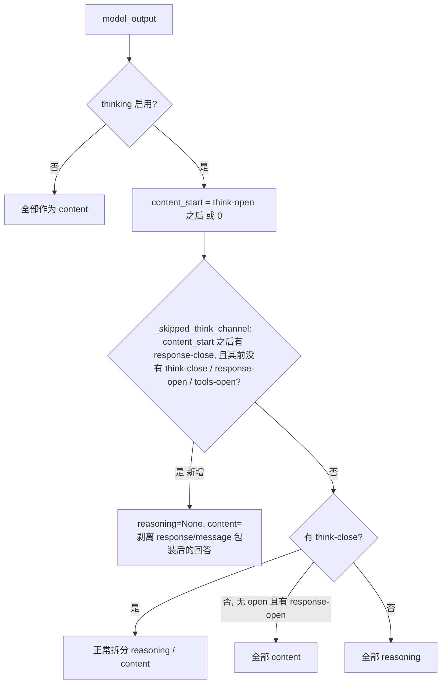
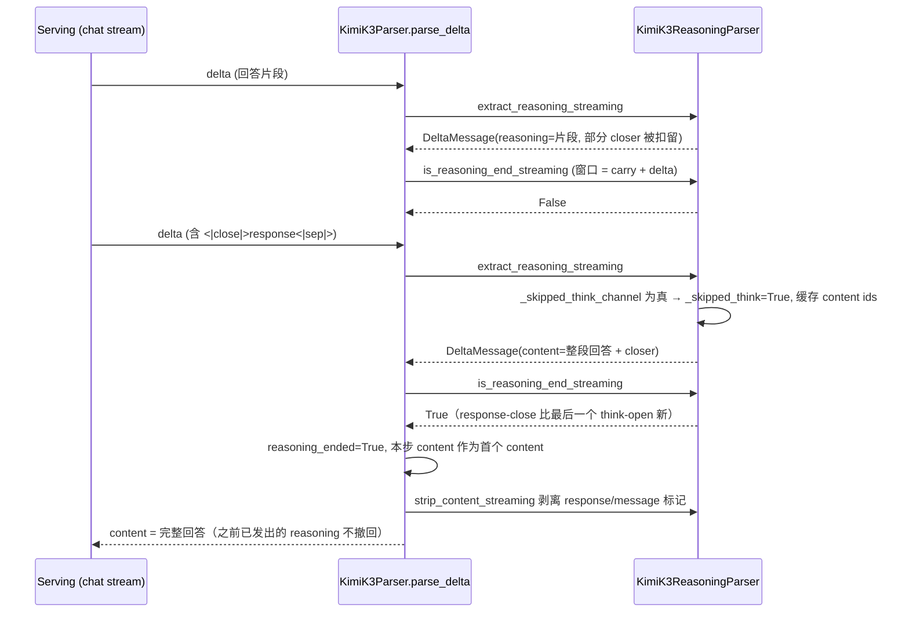

# PR #65169: [Bugfix][Reasoning] kimi_k3: return the reply as content when the think channel is skipped

> **Author**: @Jasen2201 | **State**: OPEN | **Date**: 2026-11-02
> **Branch**: `Jasen2201:fix/kimi-k3-skipped-think-content` → `main` | **Labels**: bug, tool-calling, kimi, k3
> **Changes**: +228 -8 lines across 2 files | **ROCm 相关性**: 不相关（平台无关的 reasoning parser；仅端到端验证在 8×MI355X 上完成）
> 本报告分两部分：§1–6 为 PR 详细总结，§7–8 为 review 意见（非 ROCm 路径，仅卫生检查 + 通用正确性意见）。

---

## 1. 总结 (Summary)

Kimi K3 在约 1M token 的长 prompt 上有时会"跳过"已由 prompt 预填的 think channel：直接写回答，并以 `<|close|>response<|sep|><|close|>message<|sep|>` 结尾，既不输出 `<|close|>think<|sep|>`，也不输出 `<|open|>response<|sep|>`。现有 `KimiK3ReasoningParser` 只认 think-close 作为推理结束，于是整段回答被当作 `reasoning` 返回，`content` 为空。本 PR 把"think channel 内、任何 think 退出标记之前出现的 `<|close|>response<|sep|>`"解释为"前面的文本就是回答"，在非流式路径返回为 content，在流式路径于看到 closer 的那一步把整段回答作为 content 重放（已流出的 reasoning 无法撤回），同时扩展 token 级的 `is_reasoning_end(_streaming)`。

## 2. 背景与动机 (Background & Motivation)

- 触发场景：Kimi Vendor Verifier（KVV）的 BEAM (1M) 基准只给 `content` 打分；作者统计 700 题中 144 题因该问题 `content` 为空。
- 参考实现：SGLang sgl-project/sglang#37743 采用相同解读（包括"已流出的 reasoning 保留在 reasoning"的取舍）。
- 相关 PR：#53249 同样把 response closer 当作隐式 think close，但把 closer 前的文本保留为 reasoning（目标是 closer 之后的 tool call），无法恢复这些回答；#60565 / #60655 处理"有 response opener 但没有 think close"的情况。
- 作者给出的结果：单测 91 passed；对 700 条原始 BEAM 输出的离线回放中 141 条被恢复为 content，3 条（1 条 `max_tokens` 截断、2 条无 closer 的 EOS）仍为空，556 条不变；端到端 BEAM 0.263 → 0.307、空 content 144 → 6（Kimi-K3 自评判、`thinking_effort=max`）。这些数字未附原始日志/脚本，本报告视为 `[unverified]`，但回放统计（141 + 3 + 556 = 700）内部自洽。

## 3. 代码修改分析 (Code Change Analysis)

### 3.1 修改的模块

| 模块 | 改动 |
|------|------|
| `vllm/reasoning/kimi_k3_reasoning_parser.py` (+98 -8) | 新增 `_tools_open_re`、`_response_close_ids`、`_skipped_think` 状态；新增文本级判定 `_skipped_think_channel()` 与 token 级判定 `_reasoning_end_newest()`；改写 `is_reasoning_end` / `is_reasoning_end_streaming` / `_extract_content_ids` / `extract_reasoning` / `_reasoning_text_ready_to_emit` / `extract_reasoning_streaming` |
| `tests/reasoning/test_kimi_k3_reasoning_parser.py` (+138) | 非流式（有无 open marker、有无 message closer、经 `KimiK3Parser.parse`）、已关闭 think channel 不变、`is_reasoning_end`（含上一轮 closer 在 prompt 中）、流式（closer 整块、跨步拆分、单 chunk）、已关闭 channel 的流式不变 |

### 3.2 架构 / 流程图

非流式 `extract_reasoning` 决策：



流式路径（`KimiK3Parser.parse_delta` → `DelegatingParser.parse_delta`）：



### 3.3 关键实现细节

- **文本级判定** `_skipped_think_channel(text, pos)`：`pos` 之后第一个 response-close 之前，不得出现 think-close、response-open、tools-open；用于 `extract_reasoning` 与 `extract_reasoning_streaming`。
- **token 级判定** `_reasoning_end_newest(window)`：`think-close` **或** `response-close` 任一比最后一个 `think-open` 新即视为推理结束；`is_reasoning_end` 与 `is_reasoning_end_streaming` 共用，后者 carry 扩展为三个 marker 的最大长度减一。注意：它**没有**文本级判定中的 response-open / tools-open 排除条件（见 §7）。
- **content ids**：`_extract_content_ids` 在没有 think-close 时，若 response-close 比 think-open 新，则返回最后一个 think-open 之后（或从 0 开始）的全部 token。
- **流式**：一旦识别，`_skipped_think=True`，此后所有 delta 直接作为 content；本步返回 `current_text[r_start:]`（整段回答，含 closer），由 `KimiK3Parser.strip_content_streaming` 或 K3 tool parser（tools 启用时）剥离包装。
- **部分 marker**：`_reasoning_text_ready_to_emit` 把 response-close 加入扣留集合，避免 `<|close|>resp…` 片段漏入 reasoning。
- 未改动 `count_reasoning_tokens`（PR 中已声明为后续工作）。

## 4. 涉及的技术原理 (Technical Principles)

- **Kimi K3 XTML 通道格式**：输出由 `<|open|>X<|sep|> … <|close|>X<|sep|>` 包裹的 think / response / tools 通道组成，每个 marker 为 3 个特殊 token；thinking 模式下 serving 层可能把 `<|open|>think<|sep|>` 作为生成前缀放进 prompt，因此模型输出可以"从 think channel 内部开始"。
- **reasoning parser 的双重角色**：文本级接口（`extract_reasoning*`）决定 API 返回的 reasoning/content 切分；token 级接口（`is_reasoning_end*`）同时被 `DelegatingParser.parse_delta`（流式状态机切换）、`ChatCompletionRequest.resolve_reasoning_ended`（prompt 级判定）与 `vllm/v1/structured_output`（决定 grammar 从何时开始约束）使用——后者是**引擎侧**行为，影响实际采样。
- **流式不可撤回**：SSE 已发送的 reasoning delta 无法收回，因此识别"其实是回答"后只能把全文作为 content 重放，客户端会看到同一段文字出现在 reasoning 与 content 两处。
- **结构化输出与推理**：开启 `response_format`/guided decoding 时，grammar 在 `is_reasoning_end` 为真之后才开始约束；推理结束判定越宽，grammar 越早介入。

## 5. 评论区讨论亮点 (Discussion Highlights)

- 目前没有人工 review 评论；PR 页面显示等待 code owner（aarnphm、chaunceyjiang、sfeng33、bbrowning）审批，自动 Claude review 因 fork 配置未运行。CI 状态未知。
- PR 描述中与 #53249 / #60565 / #60655 的关系梳理清楚，是本 PR 最有价值的上下文：三者都在修改"think channel 未正常关闭时"的语义，合入顺序需要协调。

## 6. 风险与潜在问题 (Risk Analysis)

| 风险 | 严重程度 | 说明 |
|------|---------|------|
| token 级结束判定比文本级宽，prompt 判定与 #60565 形态下行为改变 | Medium | 见 §7 ⚠️【正确性】token 级判定 |
| 结构化输出下 grammar 在 closer 后开始约束 | Medium | 见 §7 ⚠️【正确性】结构化输出（推测） |
| 流式下回答文本重复出现在 reasoning 与 content | Low | 有意的取舍，见 §7 📝 |
| `count_reasoning_tokens` 与返回结果不一致 | Low | 已声明为后续工作 |
| 测试：随机性质测试未覆盖新 marker；流式未覆盖 tool parser 场景 | Low | 见 §7 📝【测试】 |
| 与 #53249 / #60565 / #60655 的合入冲突 | Low | 同一函数族的语义修改，需协调顺序 |
| 端到端数字（BEAM 0.263 → 0.307）无原始日志 | Low | `[unverified]`，但离线回放统计自洽 |

---

## 7. Review 意见 (Findings)

非 ROCm 相关，已跳过 ROCm 专项规则（aiter / mori / ROCm 平台 / kernel 数值类检查）。以下为卫生检查与通用正确性意见。

| 类型 | 🔴 | ⚠️ | 📝 |
|------|----|----|----|
| 正确性 | — | 2 | 1 |
| 设计 | — | — | 1 |
| 测试 | — | — | 1 |

---

**⚠️【正确性】token 级 `_reasoning_end_newest` 比文本级 `_skipped_think_channel` 宽，导致 prompt 级判定和"有 response opener 无 think close"形态的行为改变** `[已验证]`（prompt 形态是否真实出现 `[推测]`）

- **问题**: `_reasoning_end_newest`（`vllm/reasoning/kimi_k3_reasoning_parser.py:203-216`）只要 `<|close|>response<|sep|>` 比最后一个 `<|open|>think<|sep|>` 新就返回 True，没有文本级判定里"closer 之前不得出现 response-open / tools-open / think-close"的排除条件。我用 PR 版与 main 版 parser（3-token marker 的模拟 tokenizer）对比验证：
  1. prompt `…<|open|>response<|sep|>ans<|close|>response<|sep|><|close|>message<|sep|>u2`（历史轮的 think 被模板去掉、且末尾**没有** think-open 生成前缀）：main 返回 False，PR 返回 **True**；
  2. 输出 `<|open|>think<|sep|><|open|>response<|sep|>ans<|close|>response<|sep|>`（#60565 / #60655 处理的形态）：main `is_reasoning_end` 为 False，PR 为 **True**，但同一文本的 `extract_reasoning` 仍把全部内容（含 marker）作为 reasoning 返回。
- **影响**: (1) 中 `is_reasoning_end(prompt)` 为真会让 `DelegatingParser.parse_delta` 在 prompt 阶段就置 `reasoning_ended=True`（整个 think channel 被当作 content 流出），并让 `resolve_reasoning_ended` / `structured_output` 从第一个 token 起就施加 grammar。模块 docstring 写的是 serving 层"may" 把 think-open 作为生成前缀——若存在 thinking 模式下 prompt 不以 think-open 结尾的路径（例如模型自己输出 think-open、或 assistant 续写），这就是回归。(2) 中引擎侧（grammar 介入、流式状态切换）与非流式切分结果不一致。
- **行动**: 建议作者让 token 级判定与文本级判定保持同一语义：例如只在 response-close 与最后一个 think-open 之间没有 response-open / tools-open / think-close 时才算结束，或者 response-close 规则只在窗口中/生成部分中确实存在 think-open（或 prompt 以 think-open 结尾）时生效；并为上述两个输入补单测。同时建议 review 时追问：K3 chat template 在 thinking 模式下是否**总是**以 `<|open|>think<|sep|>` 结束生成前缀。

**⚠️【正确性】结构化输出下，grammar 会在被跳过 channel 的 closer 之后开始约束** `[推测]`

- **问题**: `vllm/v1/structured_output/__init__.py` 用 `is_reasoning_end_streaming` 决定 grammar 的起点。改动前，跳过 think channel 的请求永远不会"结束推理"，grammar 从不介入（回答为不受约束的自由文本，返回为 reasoning）；改动后，看到 `<|close|>response<|sep|>` 即视为推理结束，grammar 从下一个 token 开始约束，而模型此时本来要输出 `<|close|>message<|sep|>` / EOS。
- **影响**: 在 `response_format=json_schema` 等场景下，grammar 可能禁止 message closer / EOS，迫使模型在已结束的回答之后再生成一段符合 schema 的文本，最终 content 变为"自由文本回答 + 被强制生成的 JSON"。PR 描述与测试均未涉及结构化输出。
- **行动**: 建议作者用 `response_format`（json_schema）+ 长 prompt 复现一次跳过 channel 的情况（或在 structured_output 单测中模拟），确认行为可接受；如果不可接受，可以考虑对 grammar 侧仍只用 think-close 作为结束信号，仅在 parser 文本层做 content 恢复。

**📝【正确性】`count_reasoning_tokens` 与返回结果不一致** `[已验证]`

- **问题**: 跳过 channel 时非流式返回 `reasoning=None`，但 `count_reasoning_tokens` 仍把整段回答计为 reasoning token（作者已在 PR 中说明为后续工作）。
- **影响**: `usage.completion_tokens_details.reasoning_tokens` 与返回内容不符，可能影响按 reasoning token 计费/统计的用户。
- **行动**: 建议作者在本 PR 内一并修复（逻辑与 `_extract_content_ids` 一致即可），或开 issue 跟踪并在代码中留 TODO 链接。

**📝【设计】流式下同一段回答会同时出现在 reasoning 与 content 中** `[已验证]`

- **问题**: `extract_reasoning_streaming`（`kimi_k3_reasoning_parser.py:499-513`）在识别时把 `current_text[r_start:]`（整段回答）作为 content 返回，之前已作为 reasoning 发出的同一段文字不撤回；单测 `test_streaming_skipped_think_channel_delivers_the_reply_as_content` 也只断言 `REPLY.startswith(reasoning)`。
- **影响**: 同时展示思考过程的 UI 会把回答显示两遍；把 `reasoning_content` 回传到下一轮历史的 agent 客户端会把回答重复送入上下文。与 SGLang 取舍一致，属于有意设计，但用户可见。
- **行动**: 建议作者在 parser docstring 或 K3 部署文档中显式说明这一行为，便于下游客户端识别（例如 content 以已发 reasoning 为前缀时可去重）。

**📝【测试】随机性质测试未覆盖新 marker，流式未覆盖 tool parser 场景** `[已验证]`

- **问题**: 已有的 `test_reasoning_end_matches_reference_over_marker_dense_sequences` 及 `_reference_is_reasoning_end` 未更新——随机序列只取 token 1–4，而 `DummyTokenizer` 把 `<|close|>response<|sep|>` 逐字符编码（约 24 个 token），新规则在性质测试中从未被触发，测试中的 carry 也与生产环境（3-token marker，carry=2）不同。另外新增的流式用例都用 `ReasoningOnlyParser`（无 tool parser），tools 启用时由 K3 tool parser 接手 closer 之后文本的路径没有用例。
- **行动**: 建议作者让 `DummyTokenizer` 把 response-close 也编码为 3 个 token，把它加入随机序列与 reference 实现；并补一个 tools 启用（`tool_choice="auto"`）的跳过 channel 流式用例。

## 8. 结论 (Verdict)

**⚠️ NEEDS WORK**

修复方向正确、动机充分（BEAM 空 content 问题真实存在，离线回放统计自洽），文本层逻辑与已有路径隔离良好，正常输出不受影响。但 token 级结束判定比文本级判定宽，改变了 prompt 级判定和"有 response opener 无 think close"输出的引擎侧行为，并可能影响结构化输出的 grammar 起点；建议收紧 token 级规则、补充对应单测后合入。非 ROCm 相关，无 ROCm 专项阻塞项。

## 9. 英文 Review 评论 (Copy-Paste English Comments)

**C1** `vllm/reasoning/kimi_k3_reasoning_parser.py:203-216` — ⚠️ comment

```text
`_reasoning_end_newest` treats any `<|close|>response<|sep|>` newer than the last think-open as the end of reasoning, but it lacks the exclusions `_skipped_think_channel` applies (no response-open / tools-open / think-close before the closer), so the token-level and text-level rules disagree. I checked two inputs against main: (1) a prompt whose prior turn ends with `<|close|>response<|sep|><|close|>message<|sep|>` and that does not end with `<|open|>think<|sep|>` now returns True from `is_reasoning_end` (False on main), which makes `parse_delta` start in content mode and structured outputs constrain from the first token; (2) `<|open|>think<|sep|><|open|>response<|sep|>ans<|close|>response<|sep|>` now ends reasoning at the token level while `extract_reasoning` still returns everything as reasoning. Could you apply the same exclusions in the token-level check (or only honor the response closer when a think-open is present), and add tests for both inputs? Also, is the K3 thinking-mode generation prompt guaranteed to end with `<|open|>think<|sep|>`?
```

**C2** `tests/reasoning/test_kimi_k3_reasoning_parser.py:468-479` — ⚠️ comment

```text
The randomized `test_reasoning_end_matches_reference_over_marker_dense_sequences` and `_reference_is_reasoning_end` were not updated for the new marker. `DummyTokenizer` encodes `<|close|>response<|sep|>` character by character (~24 ids), so random sequences over ids 1-4 never contain it, and the streaming carry in tests differs from production (3-token markers, carry 2). Could you encode the response closer as a 3-token marker in `DummyTokenizer`, include it in the random sequences and the reference, and add a skipped-channel streaming case with tools enabled (the K3 tool parser path)?
```

**C3** `vllm/reasoning/kimi_k3_reasoning_parser.py:499-513` — ⚠️ comment

```text
When the closer is detected, the whole reply is returned as content while the same text already streamed as reasoning stays there, so streaming clients see the reply twice (and agents that echo `reasoning_content` back into history will duplicate it). I understand this matches SGLang and cannot be avoided once deltas are sent, but could you document it in the parser docstring (or the K3 deployment docs) so client authors can de-duplicate? Relatedly, `count_reasoning_tokens` still counts these replies as reasoning; it would be good to fix it here or leave a TODO with an issue link.
```
