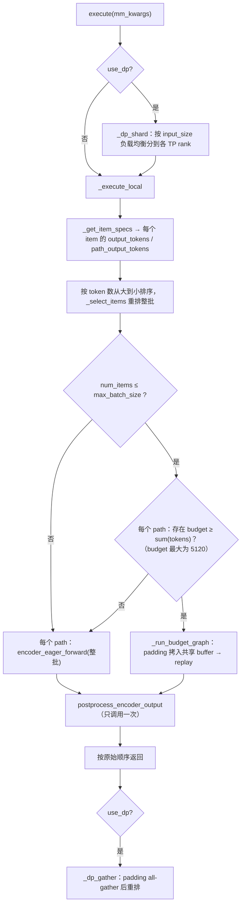
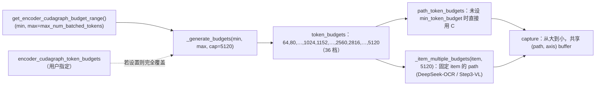
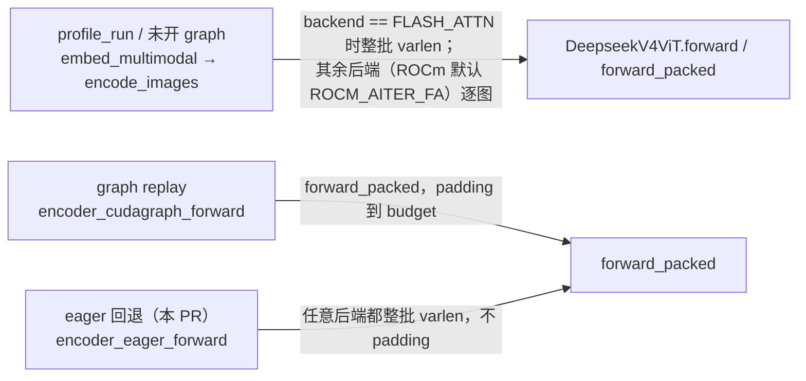

# PR #65227: [Perf][Multimodal] Encoder CUDA graphs: one replay per batch, finer grid up to one max budget

> **Author**: @Pb314314 | **State**: MERGED（2026-11-08T13:01:30Z，main 上的提交为 `325bc507bc`） | **Date**: 2026-11-02
> **Branch**: `cg/vit-encoder-dispatch-pr2` → `main` | **Labels**: documentation, rocm, ready, llama, qwen, deepseek, nvidia, kimi, glm, minimax, cohere, DSv4.1
> **Changes**: +227 -261 lines across 9 files | **ROCm 相关性**: 部分相关。`vllm/v1/worker/encoder_cudagraph.py` 是 CUDA/ROCm 共用的 encoder graph 管理器，在 ROCm 上以 HIP graph 运行。`vllm/models/deepseek_v41/common/vl_cudagraph.py` 被 AMD 专属模型 `vllm/models/deepseek_v41/amd/vl_model.py` 直接使用，所以 DSv4.1 的 eager 路径改动会直接影响 MI355X 部署
> 本报告分两部分：§1–6 为 PR 详细总结，§7–8 为 ROCm review 意见。**本 PR 已合并，这是一次合并后 review**：§7 的发现均作为后续跟进建议，§8 的结论表示是否需要后续工作。
> 数据来源：本地生成的 `/tmp/vllm_rocm_pr_65227.json`（diff 基于 merge-base `cbe948fe0c` 与 PR head 计算）。已核对：该 diff 与 main 上合并提交 `325bc507bc` 的改动逐行一致（忽略 index 行）。**CI 状态未获取，视为未知。**

---

## 1. 总结 (Summary)

本 PR 修改了 ViT encoder CUDA graph 的调度方式。原来的做法是把一批图片贪心切成多组，每组各自 replay 一次。现在改为**每个 batch 最多 replay 一次**：选能装下整个 batch 的最小 budget；如果装不下，或者 item 数超过 `max_batch_size`，整个 batch 走一次 eager forward。同时，默认的 budget 网格变细了（1024 以下每次乘 2^(1/4)，1024–2560 每 128 一档，再往上每次乘 2^(1/8)），并新增全局上限 `encoder_cudagraph_max_token_budget`（默认 5120）。PR 还修复了三处 eager 路径的问题（DeepSeek-V4.1 逐图 eager 很慢、Ernie-4.5-VL 重复跑 resampler 导致崩溃、DeepSeek-VL2 缺少 `encoder_eager_forward`），以及 GLM-4.1V 在新网格下 capture 尺寸向下取整导致的崩溃。

## 2. 背景与动机 (Background & Motivation)

- Encoder graph 节省的只是 host 侧的 kernel launch 时间。eager 延迟约等于 max(launch 时间, GPU 时间)；graph replay 则要付出整个 captured shape 的 GPU 时间，padding 也算在内。所以 encoder 一旦 GPU-bound，graph 就不再有收益。原来 main 一直 capture 到 `max_num_batched_tokens`（默认 16384），大 batch 还会被切成多次带 padding 的 replay，作者测得这比一次 eager 更慢。
- #65084（@Isotr0py，已合并）让所有 budget 共享同一套最大尺寸的输入/输出 buffer，并引入了更细的网格。本 PR 在此基础上改成"一次 replay + 全局上限"，graph 显存因此下降约 3 倍（例如 DeepSeek-V4.1 6.29 → 2.25 GiB，GB200 数据）。
- 作者称，#65084 的细网格（80、96 等）让 GLM-4.1V 的 `budget // max_batch_size` 向下取整后 capture 的行数不够，main 上一张 252x252 图片就会让 engine 崩溃。本 PR 的 `8bf9354b99` 同时修复了这个问题。
- 后续：#66067（基于本 PR）会把 Qwen2/2.5/3-VL、GLM-4.1V、Cohere Compass 中重复的 encoder graph 代码抽成共享 mixin；#60112 负责视频帧数超出 graph 容量时退回 eager；#65453 修复 GLM 系列在开启视频时的 image replay 错误。

## 3. 代码修改分析 (Code Change Analysis)

### 3.1 修改的模块

| 模块 | 改动 |
|------|------|
| `vllm/v1/worker/encoder_cudagraph.py` (+71/-100) | 删除贪心打包和 budget-cliff 延迟逻辑（`should_defer_item`），`_execute_local` 改为"整批一次 replay 或一次 eager"，item 按 token 数从大到小排序。`_generate_budgets` 改为三段网格，并新增 `cap` 参数；新增常量 `_LINEAR_GRID_END = 2560` |
| `vllm/config/compilation.py` (+22/-5) | 新增 `encoder_cudagraph_max_token_budget: int \| None = 5120`，`<= 0` 时在 `__post_init__` 中报错；更新 `encoder_cudagraph_token_budgets` 和 `max_vision_items_per_batch` 的 docstring |
| `vllm/models/deepseek_v41/common/vl_cudagraph.py` (+11/-20) | `encoder_eager_forward` 不再逐图调用 `_encode_image`，改为复用 `prepare_encoder_cudagraph_replay_buffers` 和 `encoder_cudagraph_forward`，所有图片一起跑一次 varlen；删除 `_encode_image` |
| `vllm/model_executor/models/ernie45_vl.py` (+7/-9) | `encoder_eager_forward` 只跑 ViT，resampler 交给 `postprocess_encoder_output`，避免跑两次 |
| `vllm/model_executor/models/deepseek_vl2.py` (+7) | 补上 `encoder_eager_forward`，此前继承的是协议的默认空实现，返回 `None` |
| `vllm/model_executor/models/glm4_1v.py` (+3/-1) | capture 时 `per_mm_item_output` 改为向上取整 |
| `vllm/v1/worker/encoder_cudagraph_defs.py` (+3/-1) | `min_token_budget` 的 docstring 改为"固定大小 item 的 token 数" |
| `docs/design/cuda_graphs_multimodal.md` (+13/-34) | 删除贪心打包和 budget-cliff 章节，新增 "One Replay per Batch" 和第五个配置项 |
| `tests/v1/cudagraph/test_encoder_cudagraph.py` (+90/-91) | 打包测试改为调度测试（整批最小 budget、超出 budget 或 `max_batch_size` 时全 eager、多 path 各 replay 一次）；新增网格、上限、配置校验测试 |

### 3.2 架构 / 流程图

调度流程（合并后的 `_execute_local`，`encoder_cudagraph.py:580-644`）：



Budget 生成与 capture 的关系：



DeepSeek-V4.1 的三条 encoder 路径（本 PR 改的是第三条）：



### 3.3 关键实现细节

- **调度判定**（`encoder_cudagraph.py:598-614`）：`fits = num_items <= self.max_batch_size`，每个 path 用 `_path_fitting_budget(path, sum(tokens))` 找 budget。只看 token 总数和 item 数，**不看视频帧数**（见 §7）。
- **网格**（`encoder_cudagraph.py:245-275`）：`cap` 先被截到 `max(cap, min_budget)`，所以 DeepSeek-OCR、Step3-VL 这类 min budget 等于单个 item 大小的模型不会因为 cap 太小而在初始化时报 "Invalid minimum budget"。我用 Python 在 CPU 上重放了 `_generate_budgets(64, 16384, cap=5120)`，结果正好是描述中的 36 档，相邻两档的最大比例是 1.25（只出现在 1024 以下）。
- **`max_batch_size`** 仍然按模型给出的**未截断** `max_budget // min_budget` 推导，再与 `min(token_budgets)` 取 min（`encoder_cudagraph.py:173-176`）。所以在 5120 的上限下，最大的 graph 未必能装下 `max_batch_size` 张最小图片，但这只决定 capture 时的 dummy 布局，不影响正确性。
- **排序**：item 改为按 token 数从大到小排序（理由是 varlen attention 先调度长序列，tile 更均衡）。每个模型的 `postprocess_encoder_output` 都按 `batch_indices` 和 `batch_mm_kwargs` 散射结果，reviewer @subhashpolisetti 也逐个核对过。
- **eager 回退的使用频率大幅上升**：以前只有单个 item 超过最大 budget 才会走 eager；现在任何总 token 数 > 5120 或 item 数 > `max_batch_size` 的 batch 都走 eager。因此 PR 顺带修了三个模型的 `encoder_eager_forward`。
- **DeepSeek-V4.1 eager**：`encoder_eager_forward` 调用 `prepare_encoder_cudagraph_replay_buffers(max_batch_size=len(vit_grid))` 构造不带 padding 的 varlen metadata，再调用 `encoder_cudagraph_forward`（即 `forward_packed`）。删除的 `_encode_image` 在 main 上已经没有其他调用点（已 grep 确认）。

## 4. 涉及的技术原理 (Technical Principles)

- **Encoder CUDA/HIP graph 的收益边界**：graph 节省的是 CPU 侧逐个 launch kernel 的开销。ViT 每层有十几个小 kernel，小 batch 时 launch 时间远大于 GPU 时间。batch 足够大后 GPU 时间占主导，graph 不再节省时间，padding 反而白白增加计算。所以设置"最大 capture 尺寸"后，超过它就走 eager，这和 decoder 的 `max_cudagraph_capture_size` 是同一个思路。
- **共享 capture buffer（#65084）**：budget 从大到小依次 capture，第一个（最大的）budget 分配 buffer，之后的 budget 用这些 buffer 的前缀视图（`input_ids[:n]` 的模式）。所以 graph 数增加不会增加 buffer 显存，graph 显存主要来自 graph pool 中各 graph 的中间激活，由最大 budget 决定。上限从 16384 降到 5120，graph 显存因此下降约 3 倍。
- **varlen attention 与 cu_seqlens padding**：多张图片打包成一行序列，用 `cu_seqlens` 标出每张图片的边界。replay 时 `cu_seqlens` 的尾部用"重复最后一个 offset"的零长度序列补齐，所以 capture 时 `cu_seqlens` 的长度（≈ item 数 / 帧数 + 1）是硬上限。视频每一帧是一个 attention 序列，帧数超过 capture 时的容量就会在 `_copy_padded_buffer` 中出现尺寸不匹配。
- **ROCm 上的对应关系**：`torch.cuda.CUDAGraph` 在 ROCm 上就是 HIP graph。ViT attention 后端由 `RocmPlatform.get_vit_attn_backend` 选择：开启 AITER MHA 时默认 `ROCM_AITER_FA`，否则 CK `FLASH_ATTN`，或者 `TRITON_ATTN`。这三个后端都支持 `cu_seqlens` 形式的 varlen 计算（`mm_encoder_attention.py:777-798`）。HIP 的 launch 开销与 CUDA 不同，所以 eager 在什么 batch 大小开始 GPU-bound，在 MI300/MI355 上不一定和 GB200 相同。

## 5. 评论区讨论亮点 (Discussion Highlights)

- **@vorapolsiloai（MI355X 端到端数据，针对早期带启动 probe 的版本 `76f9a2057`）**：MiniMax-M3，TP2，`--mm-encoder-tp-mode data`。8 行负载吞吐 +2.9%；2048x1600 图片吞吐 +6.5%；encoder graph 显存从每 rank 16.9 GiB 降到 5.7 GiB，KV-cache token 数 +8%；MMMU 0.6500。他还观察到 probe 在 MI355X 上的切分点不稳定（TP0 保留到 1024，TP1 保留到 1536），说明**在 MI355X 上，这个模型从大约 1–1.5k token 起 eager 就不比 graph 慢**。作者随后用固定网格加 2560、最终 5120 的上限取代了 probe。**最终版本没有 AMD 数据**，作者在描述中也承认 "no AMD hardware was available"。
- **@subhashpolisetti（实质性 review）**：(1) 调度判定不考虑帧数，所以 main 会拆开的视频 batch 现在可能被合并到一次 replay，`cu_seqlens` 越界。他在 CPU 上（用户设置帧数上限时）和 A10 上（默认配置，Qwen2.5-VL-3B，单个 130 帧 112x112 视频需要 66 个 `cu_seqlens` 槽，而 capture 只有 65 个）都复现了崩溃，main 也一样。作者在 GB200 上确认后，把修复交给 #60112。(2) 用户设置了 `max_vision_items_per_batch` 时，超出 item 数的 batch 会整批走 eager，已在文档中补充说明。(3) 文档漏了第五个配置项，已补。
- **PR Pundit（@peymanr）**：(1) 大于 5120 token 的 batch 不再 replay graph，且 5120 缺少逐模型依据。作者随后补了 24 个模型的 "Choosing the maximum" 数据。(2) `max_token_budget <= 0` 没有校验，已补上并加测试。(3) `min_token_budget` 的语义变成了"固定 item 的大小"，但名字没改。**作者没有回应**，合并后名字仍是 `min_token_budget`。
- **@Isotr0py**：直接 Approve（LGTM），没有展开讨论。

## 6. 风险与潜在问题 (Risk Analysis)

| 风险 | 严重程度 | 说明 |
|------|---------|------|
| ROCm 上 DSv4.1 eager 回退的峰值激活没有被 profile 计入 | Medium | 见 §7 ⚠️【兼容性】 |
| 5120 上限只在 GB200 上标定，最终版本没有 AMD 数据 | Medium | 见 §7 ⚠️【性能】 |
| 视频帧数不参与调度判定，长视频会让 engine 崩溃（main 上已存在，依赖 #60112） | Medium | 见 §7 ⚠️【正确性】 |
| 端到端测试全部固定了 budget，新网格、上限和 eager 回退在 CI 中（包括 AMD）都没有覆盖 | Medium | 见 §7 ⚠️【测试】 |
| eager 回退成为常用路径，协议的默认实现会静默返回 None | Low | 见 §7 📝 |
| 每个模型 capture 的 graph 从 25 增加到 36，启动 capture 时间变长（GLM-4.1V 8.8 → 15.8 s，GB200）；ROCm 上 HIP graph 的 capture 时间没有测过 | Low | 只影响启动时间 |
| 性能数字全部来自作者未公开的 harness（GB200） | Low | 无法复现；见 §7 中的说明 |

### 6.1 对相关在审 encoder-graph PR 的影响

| PR | 状态 | 与 #65227 的关系 | 需要的动作 |
|----|------|------------------|-----------|
| #65084（共享 buffer） | 已合并（早于本 PR） | 本 PR 的基础 | 无 |
| #65351（Step3-VL 别名修复 + 共享 buffer 守卫） | 已合并（main 上的 `d2c5f9ad5f` 晚于 `325bc507bc`） | 改的是同一个 `encoder_cudagraph.py`，已经在本 PR 之上落地 | 无。此前 review 中"与 #65084 重复"的问题已经消解 |
| #57379（LLaVA-OneVision） | 开放 | **语义上已经过时**。文本可以自动合并。PR 中的 `_encoder_cudagraph_token_budgets()`（`llava_onevision.py:584-610`）仍然自己生成**按 2 倍递增、没有上限**的 budget 列表，并用 `_encoder_padding_axis()` 算出 padding axis。但 manager 实际 replay 的是细网格中的 budget（#65084 起是细网格，本 PR 又加了 5120 上限）。capture 时 `(b, a)` 这张 graph 的 `pixel_values` 有 `bucket(b) - a` 个 tile；replay 时 `b` 来自 manager，`a` 却是按该 PR 自己的更大 budget 算的。以每 tile 729 token 为例（示意）：5 个 tile 共 3645 token，manager 选 3840（6 个 tile），该 PR 按 5832 算出 a=3，于是 graph 只有 3 个 tile 的 buffer，比真实的 5 个 tile 还少，replay 时拷贝尺寸不匹配。这个推导没有实际运行验证，属于推测；不一致在 #65084 时就已出现，本 PR 合并后差异更大 | 必须 rebase，改为读取 manager 实际的 budget 列表，或者让 axis 只依赖 tile 数 |
| #64311（DeepSeek-OCR2） | 开放 | 文本可自动合并（与 main 只在 docs/示例/e2e 测试上有重叠，没有冲突标记）。两个 path 都设置了 `min_token_budget`，走 item 整数倍的 budget，向下取整没有问题。但超过 5120 或超过 `max_batch_size` 的 batch 现在会整批走它新增的 `encoder_eager_forward` | rebase 后需要补测一个大于 5120 token 的多图 batch，确认 eager 路径输出正确 |
| #63374（Qwen2.5-Omni，大改 `qwen2_5_vl.py`） | 开放 | 本 PR 没有改 `qwen2_5_vl.py`，文本上没有冲突。但 eager 回退变得常用，Omni 的 `encoder_eager_forward` 需要支持整批输入；另外 #66067 会把 Qwen 系列的 encoder graph 代码抽成 mixin，届时会和这个 1152 行的 diff 严重冲突 | 尽早 rebase，并和 #66067 的作者协调先后顺序 |
| #56820（Ling-3.0-flash-VL） | 开放 | 在 `docs/design/cuda_graphs_multimodal.md` 和 `tests/v1/cudagraph/test_encoder_cudagraph.py` 中有 3 处冲突标记，以 `325bc507bc^` 为基准时也是 3 处，说明冲突在本 PR 之前就存在；本 PR 又改动了同一个测试文件。PR 中的 `per_item_output` 已经向上取整，和本 PR 对 GLM 的修复一致 | rebase；在新网格下（例如 96、1152 等非 2 的幂 budget）重新跑 graph 与 eager 的一致性检查 |
| #60112（视频帧数超出容量时退回 eager） | 开放 | 作者明确表示需要在本 PR 之上做一次小 rebase | 建议优先合并，见 §7 ⚠️【正确性】 |

---

## 7. Review 意见 (Findings)

ROCm 相关性为"部分相关"：只对 ROCm 会用到的共享路径（`encoder_cudagraph.py`、DSv4.1 mixin）检查跨后端行为。没有涉及 aiter/mori 符号，也没有新增 env var 或 requirements。

| 类型 | 🔴 | ⚠️ | 📝 |
|------|----|----|----|
| 兼容性 | — | 1 | — |
| 性能 | — | 1 | — |
| 正确性 | — | 1 | — |
| 测试 | — | 1 | — |
| 可维护性 | — | — | 2 |
| 注释/文档 | — | — | 1 |

---

**⚠️【兼容性】DSv4.1 的 eager 回退在 ROCm 上整批 varlen 打包，而 profile 走的是逐图路径，峰值激活没有被计入** `[已验证]`（OOM 是否真的发生属于 `[推测]`）

- **问题**: `vl_cudagraph.py:315-332` 中的新 `encoder_eager_forward` 对 graph 允许的所有后端都把整个 batch 打包成一次 `forward_packed`。但 profile 阶段走的是 `embed_multimodal → encode_images`（`vision.py:419-424`），它只在 `attn_backend == FLASH_ATTN` 时打包，其他后端逐图计算。ROCm 开启 AITER MHA 时 ViT 默认后端是 `ROCM_AITER_FA`（`platforms/rocm.py:964-970`），DSv4.1 的 graph 检查（`vl_cudagraph.py:110-119`）只排除 FLASHINFER 和 TORCH_SDPA，所以 ROCm 上可以开 graph。profile 发生在 encoder graph capture 之前（`encoder_runner.py` 中 `is_captured()` 为 False，走 `embed_multimodal`），因此 ROCm 上 profile 测到的只是"单张最大图片"的峰值激活。合并后，总 token 数在 5120 到 encoder budget（≈`max_num_batched_tokens`）之间的 batch 都会走整批打包的 eager。按 DSv4 vision 的参数估算（`vision_dim=1024`、`inter=2816`、`downsample=3`），16384 个输出 token 约对应 14.7 万个 patch 行，仅 MLP 的 `gate_up` 就有约 1.6 GB 的临时激活，还要加上 RMSNorm 和 RoPE 的 fp32 临时张量。这部分显存没有被 profile 计入。在 main 上，这个区间由 graph 处理（显存在 graph pool 中，已计入），或者走逐图 eager。CUDA 的 `FLASH_ATTN` 在 profile 时也是打包的，所以不存在这个差异。**这个差异只出现在 ROCm 上。**
- **影响**: 在 MI355X 上，DSv4.1-Flash 开启 `cudagraph_mm_encoder`、使用较高的 `gpu_memory_utilization` 和多图大 batch 时，eager 回退的临时激活可能超出 profile 预留的余量，导致 OOM。另外，profile/非 graph 路径（逐图）与 graph 回退路径（打包）的数值舍入也不同，这一点 `encode_images` 的 docstring 自己也承认 "Rows can differ ... by rounding"。
- **行动**: 建议在后续 PR 中二选一：(a) 让 `encode_images` 对 `ROCM_AITER_FA` / `TRITON_ATTN` 也走打包路径，因为 graph 路径已经证明 varlen 在这些后端上可用，这样 profile 就能覆盖打包的峰值；(b) 让 `encoder_eager_forward` 复用 `encode_images` 的后端判断。并建议在 MI355X 上用一个 16k token 的多图 batch 测一下峰值显存。

**⚠️【性能】默认上限 5120 只在 GB200 上标定，最终版本在 MI300/MI355 上没有任何数据** `[已验证]`（在 ROCm 上是否变慢属于 `[推测]`）

- **问题**: `compilation.py:624-629` 将 `encoder_cudagraph_max_token_budget` 的默认值设为 5120，对所有平台一视同仁。描述中所有表格都是 "All runs: GB200"，作者也写了 "no AMD hardware was available"。唯一的 AMD 数据（@vorapolsiloai，MI355X）是针对**早期带启动 probe 的版本**测的。那组数据中 probe 的切分点只有 1024–1536，说明在 MI355X 上 MiniMax-M3 的 eager 在远低于 5120 时就不比 graph 慢了。反过来，HIP launch 开销较大的小 encoder（作者用来定这个上限的 Gemma 4 / Qwen3.5-0.8B 这类），在 MI355X 上可能需要比 5120 更大的上限。数字溯源：GB200 的表格来自作者没有公开的 harness，无法复现，只能作为 `[unverified]` 参考；MI355X 的数据可以追溯到评论中给出的完整环境（ROCm 7.15、PyTorch 2.13、镜像版本），但测的不是合并时的版本。
- **影响**: 在 MI300/MI355 上，5120 可能不是最优值。对大 encoder 来说可能偏大（1.5k–5k token 区间做了多余的 padding replay），对小 encoder 来说可能偏小（5k–16k 区间由 graph 改为 eager）。和 main 相比，后一种情况可能出现性能倒退。好在 graph 显存大幅下降、KV cache 增加，这对 ROCm 是明显的好处。
- **行动**: 建议 AMD 侧在 MI355X 上，用作者的 batch 分布（1–40 张图，45–16k token）对 DSv4.1-Flash、MiniMax-M3、Kimi-K2.5、Qwen2.5-VL 和一个小 encoder（Qwen3.5-0.8B 或 Gemma 4）跑一组 "max = 2560/5120/8192/None" 的对比。如果结论与 GB200 不同，再考虑按平台设置默认值，或者在文档中写明 ROCm 的推荐值。

**⚠️【正确性】调度判定不考虑视频帧数，长视频会让 engine 崩溃（main 上已存在，修复依赖 #60112）** `[已验证]`

- **问题**: `encoder_cudagraph.py:598-614` 只用 `num_items <= max_batch_size` 和 token 总数选 budget，不检查本 batch 的总帧数是否超过 graph capture 时的 `max_frames_per_batch = min(max_batch_size * max_frames_per_video, token_budget)`。默认视频上限为 999 时，`get_max_frames_per_video()` 返回 1，所以帧容量只有 `max_batch_size`（通常是 64）。@subhashpolisetti 在 A10 上、作者在 GB200 上都复现了：Qwen2.5-VL-3B，单个 130 帧 112x112 视频需要 66 个 `cu_seqlens` 槽，capture 只有 65 个，`_copy_padded_buffer` 尺寸不匹配，engine 直接退出。此外，main 会通过 budget-cliff 延迟拆开的少数视频组合，现在会被合并到一次 replay，进一步扩大了触发面（用户设置帧数上限时已在 CPU 上复现）。
- **影响**: 只要开启 encoder graph 并允许视频，Qwen2/2.5/3-VL、GLM-4.1V 系列的长低分辨率视频就会让 engine 崩溃。这段代码在 CUDA 和 ROCm 上完全相同，MI355X 上同样会触发。
- **行动**: 建议优先 rebase 并合并 #60112（在 replay 前发现任何输入超出 capture buffer 就整批走 eager）。在合并之前，建议在文档的 "Trade-offs" 中把这条写成已知的崩溃，而不只是一句 "fixed by #60112"。

**⚠️【测试】端到端测试全部固定了 budget，新网格、5120 上限和 eager 回退在 CI 中（包括 AMD）都没有被覆盖** `[已验证]`

- **问题**: `tests/models/multimodal/generation/test_vit_cudagraph.py` 中每个模型都显式设置了 `encoder_cudagraph_token_budgets`，例如 DSv4.1 设为 `[1024]`，ROCm 上还会选用 `ROCM_FLASHMLA_SPARSE_DSV41`。根据 `vllm/config/compilation.py` 的规则，用户 budget 会**完全绕过** `_generate_budgets` 和 `encoder_cudagraph_max_token_budget`。新的 `tests/v1/cudagraph/test_encoder_cudagraph.py` 用例都是 mock 或 CPU 测试，GPU 上的 replay 用例也用的是自定义的小 budget。作者在描述中说"去掉固定 budget 后跑过"，但这是手工在 GB200 上跑的。端到端的生成 token 对比是在使用"按模型设置上限"的早期版本上做的，作者明确说 "They were not rerun on this revision"。
- **影响**: 默认配置下的真实路径没有任何 CI 守护，包括 36 档网格的 capture、> 5120 时的整批 eager，以及 DSv4.1、Ernie、DeepSeek-VL2 新的 eager 实现。AMD MI355 的多模态 job 也只跑固定 budget 的用例。
- **行动**: 建议补一个不固定 budget 的端到端用例（dummy 权重即可），构造一个总 token 数大于 5120 的多图 batch，比较 graph 和 eager 的输出。至少覆盖 DSv4.1，因为它在 ROCm 上走 `amd/vl_model.py`，并确保这个用例会进入 AMD CI。

**📝【可维护性】`SupportsEncoderCudaGraph.encoder_eager_forward` 的协议默认实现会静默返回 None** `[已验证]`

- **问题**: `interfaces.py:2002-2011` 中该方法的函数体只有 `...`。显式继承这个协议、但没有实现该方法的模型会得到一个返回 `None` 的方法，这正是 DeepSeek-VL2 在本 PR 之前的问题。docstring 仍然写着 "Used as eager fallback when inputs exceed all budgets"，而现在任何超过 5120 或超过 `max_batch_size` 的 batch 都会调用它。
- **行动**: 建议把默认实现改成 `raise NotImplementedError`，或者在 manager 初始化时检查模型是否覆盖了这个方法，并同步更新 docstring。这样以后新增的模型（#64311、#63374、#57379、#56820 等）缺少实现时能尽早报错。

**📝【可维护性】`min_token_budget` 的语义已经变成"固定 item 的大小"，但名字没改** `[已验证]`

- **问题**: `encoder_cudagraph_defs.py:52-55` 的 docstring 和 `encoder_cudagraph.py:225-228` 都把它当作单个 item 的 token 数，用来生成 item 整数倍的 budget。PR Pundit 提出过这一点，作者没有回应。另外，最大 budget 是 `floor(max/item)·item`，不一定等于 5120。
- **行动**: 建议在 #66067 的 mixin 重构中顺便改名为 `item_token_count` 一类的名字，并保留一个兼容别名。

**📝【注释/文档】残留的过时注释和描述** `[已验证]`

- **问题**: (1) `encoder_cudagraph.py:110-114` 的不变式注释仍然写 `per_image_output = budget // max_batch_size`，而 GLM-4.1V（本 PR）、DSv4.1 和 Qwen 系列现在都向上取整。(2) PR 描述中说 GLM-4.1V 的崩溃发生在 "with encoder CUDA graphs on (the default)"，但 `cudagraph_mm_encoder` 的默认值是 `False`（`compilation.py:609`），encoder graph 需要用户主动开启。
- **行动**: 建议在后续 PR 中更新这条注释，并在 release note 中写明崩溃只影响主动开启 `cudagraph_mm_encoder` 的用户。

> AI 代码诊断：描述末尾带有 "Generated with Claude Code"，checklist 也勾选了使用 AI 辅助。描述对机制（WHY）的解释比较充分，根因也有说明（GLM 向下取整、Ernie 重复跑 resampler）。已做幻觉符号扫描：`round_up_to`、`_item_multiple_budgets`、`prepare_encoder_cudagraph_replay_buffers`、`forward_packed`、`build_packed_vit_metadata` 在 PR head 上都存在，签名一致。孪生代码的差异见第一条 ⚠️（`encode_images` 和 `encoder_eager_forward` 的打包条件不一致）。没有发现为了让测试通过而刻意校准的用例。

## 8. 结论 (Verdict)

**⚠️ NEEDS WORK**（合并后 review，需要后续跟进）

这个 PR 的方向正确，实现也比原来简单：一次 replay、全局上限、共享 buffer 让显存降低约 3 倍。MI355X 的早期数据也显示 KV cache 增加约 8%、吞吐提升 3%。eager 路径的三处修复和 GLM 的崩溃修复都确认有效。但仍有几件事需要后续处理：ROCm 上 DSv4.1 的 eager 回退与 profile 路径不一致，可能有没被计入的峰值激活；5120 上限没有任何 AMD 数据；视频帧数导致的崩溃依赖 #60112；新的默认路径没有 CI 覆盖。此外，#57379 自带的 budget 列表与新网格不再一致，需要 rebase 并修改（见 §6.1）。

## 9. 英文 Review 评论 (Copy-Paste English Comments)

本 PR 已合并，以下评论按合并后跟进的口吻撰写。行号是 PR head（`70cb5e16a4`）上的新文件行号，并已与 `files[].patch` 的 hunk 头核对。

**C1** `vllm/models/deepseek_v41/common/vl_cudagraph.py:320-332` — ⚠️ comment

```text
Follow-up suggestion: this eager fallback now always packs the whole batch into one varlen `forward_packed` call, but the profiling path (`embed_multimodal` -> `encode_images`, vision.py:419-424) only packs when the ViT backend is FLASH_ATTN and runs per image otherwise. On ROCm the default ViT backend is ROCM_AITER_FA (and DSv4.1's encoder-graph gate allows it), so profile_run only measures the per-image activation peak, while batches between 5120 tokens and the encoder budget now run this packed eager forward (roughly 1.6 GB of MLP gate_up activations alone at 16k output tokens), which was never accounted for. On CUDA with FLASH_ATTN both paths pack, so this is ROCm-only. Could a follow-up either let `encode_images` pack for ROCM_AITER_FA/TRITON_ATTN too (the graph path already proves varlen works there), or reuse the same backend gate here, and check peak memory on MI355X with a ~16k-token multi-image batch?
```

**C2** `vllm/v1/worker/encoder_cudagraph.py:598-614` — ⚠️ comment

```text
Follow-up: the replay decision only checks item count and total tokens, not the total frame count against the graph's captured `max_frames_per_batch`. With the default video limit, `max_frames_per_video` is 1, so a single 130-frame 112x112 video overflows `cu_seqlens` (66 vs 65) and kills the engine, as reproduced on A10 and GB200 in this thread. Merging batches that the old cliff deferral used to split can also widen this. The code is shared, so ROCm/HIP graphs are affected the same way. Could #60112 be prioritized for rebase and merge, and until then could the docs list this as a known crash rather than only "fixed by #60112"?
```

**C3** `vllm/config/compilation.py:624-629` — ⚠️ comment

```text
Follow-up for AMD: the 5120 default was calibrated only on GB200, and the final revision has no MI300/MI355 data. The only MI355X numbers in this thread are for the earlier startup-probe revision, where the probe cut at 1024-1536 tokens for MiniMax-M3, which suggests the eager/graph crossover on ROCm can differ substantially from GB200. Since HIP launch overhead and the encoder's GPU time both differ, it would be good to rerun the "max = 2560/5120/8192/None" sweep on MI355X for at least DSv4.1-Flash, MiniMax-M3 and one small encoder (Qwen3.5-0.8B or Gemma 4). If the optimum differs, consider a platform-specific default or a documented ROCm recommendation.
```
